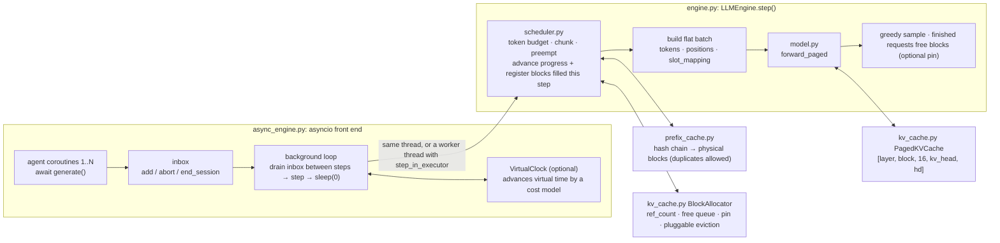

[中文](README.md) · **English**

# Capstone: A Mini Inference Engine That Actually Computes

> 🕐 Suggested time: 2.5 hours ｜ 🎯 After this you can: explain, and verify by hand, what PagedAttention-style block KV, block-hash-chain prefix caching, continuous batching, chunked prefill, recompute preemption, request abort and an async front end look like in code, and how the way an agent harness or an RL rollout builds its requests decides the cache hit rate ｜ 🧪 Demo: [`demo.py`](demo.py) ｜ 📖 Must-read primary sources: [vLLM Automatic Prefix Caching design doc](https://docs.vllm.ai/en/latest/design/prefix_caching.html), [vLLM V1 architecture blog](https://vllm.ai/blog/2025-01-27-v1-alpha-release)

## 0. One sentence

**`codesign_sim` is a cost model that can only tell you "roughly how fast"; `mini_engine` is a real engine in about 1400 lines of numpy where every mechanism actually computes. The tests give strong regression evidence, not a mathematical proof: toggling any optimization leaves the greedy output identical at the token level to a naive "recompute everything each step" implementation (logits differ only at floating-point rounding level), backed by a randomized differential test and mutation testing.**

## 1. Why this capstone exists

Earlier modules use the simulator to discuss prefill, KV cache, prefix hit rates and preemption. The simulator assumes the mechanisms are correct and then estimates time. The questions that interviewers actually dig into are often of a different kind:

- "After a prefix cache hit, what position encoding does the first token to compute get? Where is its KV written?"
- "Two requests share a block and one of them finishes. When can the block be evicted?"
- "Chunked prefill cuts in the middle of a block. How does the next chunk continue?"
- "When a preempted request is recomputed, do its generated tokens count as prompt or as decode?"
- "The caller timed out. What happens to that request inside the engine?"
- "RL just synced new weights. What about the old KV in the prefix cache?"

These can only be answered solidly on an implementation that **runs, can be wrong, and has tests that catch it when it is wrong**. Where `mini_engine` sits:

| | codesign_sim | mini_engine |
|---|---|---|
| What it does | Estimates time from FLOPs / bytes | Actually does the matmuls, writes KV, looks up the cache, schedules |
| Answers | Orders of magnitude for throughput, TTFT, hit rate | Whether mechanisms are correct, edge cases, invariants |
| Scale | Any GPU and model (specs from official sources) | 0.89M-parameter random-weight model, a few ms per step on CPU |
| Limitation | Does not verify correctness | Says nothing about real GPU performance (see Section 9) |

The model is a 4-layer decoder-only Transformer: vocab 512, d_model 128, 8 query heads / 2 KV heads (GQA), head_dim 16, SwiGLU hidden size 384, RMSNorm, RoPE; weights are fixed-seed random numbers, all in float64. Random weights do not "speak", but the output is context-sensitive (a test checks exactly that), so "identical output" is meaningful evidence.

## 2. Architecture overview



One step (`LLMEngine.step`) does four things:

1. **Schedule**: first give tokens to running requests (1 for decode, the next chunk for an unfinished prefill), preempting from the tail of running when blocks run out; only if nothing was preempted this step, admit new requests from waiting in FCFS order — look up the prefix cache first and allocate blocks only for the uncached part. As soon as a request gets tokens, its `num_computed_tokens` is **advanced at schedule time**, and the blocks this step will fill are **registered immediately** in the prefix cache, so a request admitted later in the same step can hit them directly.
2. **Build the batch**: concatenate every request's tokens for this step into one flat sequence, and compute each token's absolute position and KV slot `slot = block_table[pos // 16] * 16 + pos % 16`.
3. **Forward**: the linear layers run over the whole flat sequence at once (that is the batching win); in each layer, **all new K/V of this step are written into blocks before any attention runs** — the safety condition that makes step 1's "register at schedule time" correct, guarded by `test_forward_paged_writes_all_kv_before_attention` (which deliberately puts the reader before the writer).
4. **Finish**: greedily sample one token for requests that reached the end of their sequence; free the blocks of requests that hit `max_tokens` (optionally pinning them).

Three rules of the async front end:
- **Engine state changes only between steps.** `generate()`, cancellation and `end_session()` just post messages to an inbox, which the background loop drains between steps, so running the step in a worker thread has no data races.
- **Cancel means abort.** When the caller times out or is cancelled, `generate()` posts an abort: the request leaves the scheduler queues and its blocks are freed; before delivering a result the loop checks whether the Future is already done.
- **Yield the event loop after every step** (`await asyncio.sleep(0)`), so new requests can join the batch while others are halfway through decoding.

## 3. Mapping to vLLM / SGLang

Only items verified against primary sources are listed (vLLM as of its main-branch source and docs in 2026-09); the "difference" column records the simplifications mini_engine makes.

| mini_engine mechanism | File | Counterpart in production systems (source) | Difference |
|---|---|---|---|
| KV split into fixed-size blocks; block table maps logical → physical | `kv_cache.py` | PagedAttention, inspired by OS paging ([Kwon et al., SOSP 2023, arXiv:2309.06180](https://arxiv.org/abs/2309.06180)) | We gather the whole history in numpy and then compute; real systems read blocks directly in dedicated GPU kernels |
| Block hash = H(parent hash, block tokens); only full blocks cached | `prefix_cache.py` | vLLM APC design doc: the hash consists of the parent hash, block tokens, and extra hashes (LoRA IDs, multimodal hashes, cache salt, etc.); "We only cache full blocks." ([design doc](https://docs.vllm.ai/en/latest/design/prefix_caching.html)) | "same hash ⇔ same prefix" holds only if collisions are ignored; we truncate sha256 to 64 bits (pairwise collision probability among N blocks is about N²/2⁶⁵) |
| One hash may map to several physical blocks; lookup returns the first, and a duplicate takes over when it is evicted | `prefix_cache.py` | vLLM `block_pool.py`: "It caches blocks from hash directly to a block or multiple blocks"; `get_one_block` returns any one of them, and a comment says blocks are currently not de-duplicated | Same idea |
| Blocks with ref_count 0 go to a free queue and can still be hit; LRU eviction from the head; freed in reverse order | `kv_cache.py` | Same design doc: freed blocks are appended to the free queue in reverse order because the last block of a request hashes more tokens and is less likely to be reused | We use an `OrderedDict` instead of a doubly linked list; eviction is a pluggable `pick_victims` hook (exercise (b)) |
| Advance progress and register blocks this step will fill at schedule time | `scheduler.py` `_advance` | vLLM design doc: "If an allocated block is already full of tokens, we immediately add it to the cache block"; `allocate_slots` in `kv_cache_manager.py` calls `cache_blocks` at allocation (`num_tokens_to_cache = min(total_computed_tokens + num_new_tokens, request.num_tokens)`); `_update_after_schedule` in `scheduler.py` advances `num_computed_tokens` right after scheduling | Same |
| Even on a full hit, recompute the last token (match at most `num_tokens - 1`) | `scheduler.py` `_admit` | vLLM source [`kv_cache_manager.py`](https://github.com/vllm-project/vllm/blob/main/vllm/v1/core/kv_cache_manager.py) comment: "When all tokens hit the cache, we must recompute the last token to obtain logits" | Same |
| No prefill / decode distinction; each step yields `{request: tokens this step}` | `scheduler.py` | vLLM V1 scheduler: "Scheduling decisions are represented as a simple dictionary, e.g., `{request_id: num_tokens}`" ([V1 blog](https://vllm.ai/blog/2025-01-27-v1-alpha-release)) | Same idea |
| Chunked prefill; running requests get tokens in order; optional `long_prefill_token_threshold` caps one request's tokens per step | `scheduler.py` | vLLM docs: "In V1, chunked prefill is enabled by default whenever possible", and with it on the policy "prioritizes decode requests" ([Optimization doc](https://docs.vllm.ai/en/latest/configuration/optimization.html)). But the V1 source [`scheduler.py`](https://github.com/vllm-project/vllm/blob/main/vllm/v1/core/sched/scheduler.py) actually allocates in order with `while req_index < len(self.running) and token_budget > 0`, without moving decodes to the front; what keeps one long prefill from eating the budget is `long_prefill_token_threshold` (default 0 = off; current main skips the cap when only one request is left, and has an adaptive option). The systems paper is [Sarathi-Serve, arXiv:2403.02310](https://arxiv.org/abs/2403.02310) | We also allocate in order; our threshold has no "only one request left" exception and no adaptive variant |
| When blocks run out, preempt the tail of running, reset progress, put it at the head of waiting, recompute later | `scheduler.py` `_grow` / `_preempt` | vLLM docs: "In vLLM V1, the default preemption mode is `RECOMPUTE` rather than `SWAP`"; under the FCFS policy the source does `self.running.pop()`, `num_computed_tokens = 0`, `waiting.prepend_request` | Same; we have no priority policy |
| Schedule per iteration; requests join / leave the batch at any step | `engine.py` | The origin of continuous batching: Orca's iteration-level scheduling ([OSDI 2022](https://www.usenix.org/conference/osdi22/presentation/yu)) | — |
| Caller cancels → abort the request, free its blocks | `async_engine.py` `generate` | vLLM [`async_llm.py`](https://github.com/vllm-project/vllm/blob/main/vllm/v1/engine/async_llm.py) `generate()`: on `except (asyncio.CancelledError, GeneratorExit)` it calls `self.abort(...)` | Same idea |
| asyncio front end: background loop steps, coroutines await results; the step can optionally run in a thread | `async_engine.py` | vLLM V1 makes EngineCore an isolated execution loop (V1 blog: "isolated `EngineCore` execution loop"); the source `vllm/v1/engine/core.py` runs it in a background process behind ZMQ; `generate()` is an async generator fed by a background output handler task | We compute in the event-loop thread by default; `step_in_executor=True` is a middle ground: the NumPy docs say "NumPy releases the GIL for many low-level operations" ([thread safety](https://numpy.org/doc/stable/reference/thread_safety.html)), but the Python parts still contend for the GIL, which is why production systems split into processes |
| Changing weights must clear the prefix cache; refuse to clear while blocks are in use | `engine.py` `update_weights` / `reset_prefix_cache` | vLLM `reset_prefix_cache` in `kv_cache_manager.py`: its docstring says it "may be used in RLHF flows to invalidate prefix caching after the weights are updated"; `block_pool.py` logs and returns False if some blocks are not freed yet | We require an idle engine to swap weights; for in-flight updates see the in-flight weight update section of [Module 06](../modules/06_long_tail_async/README.en.md) |
| `cache_salt` mixed into the chain root to isolate tenants | `prefix_cache.py` `root_hash` | vLLM design doc: the cache_salt "is injected into the hash of the first block", preventing timing-based attacks that infer cached content from latency differences | Same idea |
| Longest-prefix match + LRU | `prefix_cache.py` | SGLang RadixAttention stores KV in a radix tree, "evicts the least recently used leaf first", and does cache-aware scheduling in longest-shared-prefix-first order ([Zheng et al., arXiv:2312.07104](https://arxiv.org/abs/2312.07104)). SGLang's docs list `--page-size` default 1 (token-level matching; some attention backends use larger pages) and `--radix-eviction-policy` default lru, with options lru / lfu / slru / priority ([server arguments](https://docs.sglang.io/advanced_features/server_arguments.html)) | We match in 16-token blocks and drop the partial block; scheduling is FCFS, not reordered by hit length |
| Exercise (a) cache-aware routing | `exercise.py` | SGLang v0.4's cache-aware load balancer: the router maintains "an approximate radix tree of the actual radix tree on the workers", "lazily updated"; the blog reports up to 1.9x throughput and 3.8x hit rate improvement ([SGLang v0.4 blog](https://lmsys.org/blog/2024-12-04-sglang-v0-4/)) | We only implement the simplest "affinity + load cap" rule; the router in the test also has only an approximate view |
| Pin blocks while waiting for a tool | `kv_cache.py` `pin` | Corresponds to Continuum's KV TTL ("selectively pins the KV cache in GPU memory with a time-to-live value", [arXiv:2511.02230](https://arxiv.org/abs/2511.02230)) and InferCept's retention policy; see the section on keeping KV during tool calls in [Module 05](../modules/05_cache_prefill/README.en.md) | Only registered full blocks are pinned; total pins are capped and default to 0 (opt in explicitly); an oracle TTL sees the future and is an upper bound |

**Reference implementation**: [nano-vllm](https://github.com/GeeeekExplorer/nano-vllm) is a from-scratch vLLM implementation in about 1,200 lines of Python (per its README), with prefix caching, tensor parallelism, torch compilation and CUDA graph; the README's comparison runs Qwen3-0.6B with 256 requests on an RTX 4070 Laptop (8GB): vLLM 1361.84 tok/s, nano-vllm 1434.13 tok/s. The author's GitHub profile self-reports Xingkai Yu, @deepseek-ai / Nanjing University (self-reported, not independently confirmed). It is a good next stop after this capstone: it has the GPU half that mini_engine deliberately leaves out (CUDA graph, tensor parallelism, torch compilation).

## 4. File-by-file guide (suggested order, about 10 minutes each)

| Order | File | Start with | Ask yourself while reading |
|---|---|---|---|
| 1 | [`mini_engine/model.py`](../mini_engine/model.py) | `_attend`, `forward_dense`, `forward_paged` | Why does `forward_paged` **write all K/V of this step into blocks before running attention**? Does RoPE use in-chunk positions or absolute positions? |
| 2 | [`mini_engine/kv_cache.py`](../mini_engine/kv_cache.py) | `PagedKVCache.write/gather`, `BlockAllocator.allocate/pick_victims/touch/free/pin` | What is the difference between "free" and "evicted"? At what moment does the prefix on a block really become invalid? |
| 3 | [`mini_engine/prefix_cache.py`](../mini_engine/prefix_cache.py) | `hash_block`, `root_hash`, `lookup`, `register`, `_on_evict` | Why is a flat dict enough for longest-prefix matching? What happens when the same hash shows up twice? |
| 4 | [`mini_engine/scheduler.py`](../mini_engine/scheduler.py) | `schedule`, `_advance`, `_grow`, `_admit`, `abort` | Why "no new admissions in a step that preempted"? Why are hit blocks first `exclude`d and then `touch`ed? Why may registration only go up to `num_computed_tokens`? |
| 5 | [`mini_engine/engine.py`](../mini_engine/engine.py) | `validate_request`, `step`, `_run_model`, `update_weights` | How many tokens of KV can one request hold at most? Why check against that when chunked prefill is off? |
| 6 | [`mini_engine/async_engine.py`](../mini_engine/async_engine.py) | `generate`, `_apply_inbox`, `_loop`, `VirtualClock` | What happens if you delete `await asyncio.sleep(0)`? If `generate` called `engine.add_request` directly, what would break with `step_in_executor` on? |
| 7 | [`mini_engine/agent_harness.py`](../mini_engine/agent_harness.py) | `build_prompt`, `update_history`, `_run_agent`, `steps_during_others_tool_wait` | Under each of the three strategies, how long is the common prefix between the turn-t prompt and the tokens whose KV was computed in turn t-1? |

Then read the tests; they are the specification of these mechanisms: [`tests/test_mini_engine.py`](../tests/test_mini_engine.py) (31), [`tests/test_mini_engine_async.py`](../tests/test_mini_engine_async.py) (12), [`tests/test_mini_engine_fuzz.py`](../tests/test_mini_engine_fuzz.py) (1 randomized differential test over 60 configurations).

| Claim proven by the test | Test |
|---|---|
| Paged forward = cache-free full forward; shuffling physical block ids does not change the result; zeroing a block does (attention really reads the blocks) | `test_paged_forward_matches_dense_and_reads_blocks` |
| Within one forward pass, a sequence placed earlier can read blocks that a later sequence writes in the same step | `test_forward_paged_writes_all_kv_before_attention` |
| Engine greedy output = recompute from scratch every step; logits differ only at rounding level | `test_engine_matches_naive_reference`, `test_batch_changes_logits_only_at_rounding_level` |
| Prefix cache on / off, chunked prefill (7 / 16 / 23 tokens per step), mixed batches, preemption and recompute: output never changes | `test_prefix_cache_on_off_identical`, `test_chunked_prefill_matches_one_shot`, `test_batched_equals_individual`, `test_preemption_recompute_keeps_outputs` |
| Exact hit counts: 40 shared tokens hit 32; append-only multi-turn hits blocks filled by the previous turn's generated tokens; a full hit still recomputes the last block; G copies of one prompt in the same step hit (G−1)×48 | `test_shared_prefix_second_request_hits_exact_blocks`, `test_multiturn_hits_blocks_filled_by_generated_tokens`, `test_full_hit_still_recomputes_last_block`, `test_same_step_requests_share_prefix_grpo_style` |
| Identical tokens with a different preceding context never hit; a different tenant salt never hits; changed weights without a reset hit stale KV | `test_hash_chain_prevents_cross_context_false_hits`, `test_cache_salt_isolates_tenants`, `test_weight_update_without_cache_reset_hits_stale_kv` |
| LRU evicts the tail block first; a duplicate takes over after the original is evicted; nothing is evicted before its pin expires, pins are capped and off by default | `test_lru_evicts_tail_first_and_keeps_chain_head`, `test_duplicate_block_is_promoted_when_canonical_is_evicted`, `test_pin_*` |
| Capacity is counted in KV tokens (prompt + max_tokens − 1); requests that fit at the boundary are not rejected | `test_capacity_counts_kv_tokens_not_generated_tokens`, `test_no_chunked_prefill_budget_boundary` |
| Aborting a request halfway through prefill frees its blocks and leaves other requests untouched | `test_abort_mid_prefill_frees_blocks_and_keeps_others_correct`, `test_cancel_mid_prefill_aborts_and_engine_keeps_serving`, `test_wait_for_timeout_does_not_break_other_requests`, `test_closing_with_pending_requests_fails_them_and_frees_blocks` |
| A short request arriving while a long one is decoding finishes before the long one (continuous batching really works) | `test_continuous_batching_admits_new_request_mid_flight` |
| With the step in a worker thread, the event loop keeps running during the step | `test_step_in_executor_keeps_event_loop_responsive` |
| The harness under the virtual clock is identical on every run; some steps run while another agent waits for a tool; virtual elapsed time < half the sum of tool waits; outputs do not depend on interleaving | `test_harness_is_deterministic_and_overlaps_compute_with_tool_waits` |
| Random configurations + random arrivals + random aborts, checking every step: no duplicate physical block in a block table, conserved reference counts, free queue consistent with ref=0, consistent hash table, waiting requests hold no blocks; no leak at the end and identical to naive recompute | `test_random_differential_with_invariants` |

Run (after `make setup` in the repo root, which installs `mini_engine` into `.venv` in editable mode; otherwise running `capstone/demo.py` directly cannot find the package):

```bash
.venv/bin/python -m pytest tests/test_mini_engine.py tests/test_mini_engine_async.py tests/test_mini_engine_fuzz.py   # 48 tests, about 5 seconds
.venv/bin/python capstone/demo.py --with-solution                                                                      # the output in Section 6
```

There is no wall-clock assertion anywhere in the tests: concurrency and overlap are proven with an event timeline (which step ran while whom was waiting for a tool) and a virtual clock, so the results are the same however busy the machine is.

## 5. Hands-on: break it

The other half of "the tests prove it correct" is "the tests fail when it is wrong". Every row below is a mutation we actually applied and ran the tests against (cover the right column and guess first):

| Mutation | Consequence | Test that catches it |
|---|---|---|
| `hash_block` no longer mixes in `parent_hash` | Blocks with a different preceding context hit falsely | `test_hash_chain_prevents_cross_context_false_hits` |
| In `_run_model`, replace `slot` with `pos` (assume KV is physically contiguous) | KV written to the wrong place | `test_engine_matches_naive_reference` |
| Remove the causal mask / use in-chunk positions for RoPE | Attention sees the future, positions are wrong | `test_paged_forward_matches_dense_and_reads_blocks` |
| Change `(req.num_tokens - 1) // bs` to `req.num_tokens // bs` | Nothing left to compute on a full hit | `test_full_hit_still_recomputes_last_block` |
| Make `free` release in forward order | The chain head is evicted first | `test_lru_evicts_tail_first_and_keeps_chain_head` |
| Delete `touch(hit_ids)` in `_admit` | Wrong reference counts on hit blocks | `test_engine_matches_naive_reference` |
| **Drop `exclude=hit_ids` in `_admit`** | A hit block sitting in the free queue is handed to the same request again as a "new" block; the block table has a duplicate physical block and the output is wrong | `test_random_differential_with_invariants`, `test_pin_during_tool_calls_reduces_recompute_under_memory_pressure` |
| **Register up to `min(num_tokens // bs, len(block_ids))` in `_cache_full_blocks` (registering blocks whose KV is not written yet)** | Another request hits a half-empty block; the output is wrong | `test_random_differential_with_invariants`, `test_long_prefill_token_threshold_caps_chunks_without_changing_output` |
| **Delete `await asyncio.sleep(0)` in the background loop** | Continuous batching degrades to "finish a batch, then take the next"; cancellation and timeouts wait for the whole batch | `test_continuous_batching_admits_new_request_mid_flight` and 3 others |
| Make `forward_paged` write only the first sequence's K/V before attention | Requests sharing a prefix within a step read empty blocks | `test_engine_matches_naive_reference` |
| `generate` posts no abort when cancelled | The request keeps using compute and blocks | `test_cancel_mid_prefill_aborts_and_engine_keeps_serving` |
| Revert the capacity check to `prompt + max_tokens` | Requests that fit at the boundary are rejected | `test_capacity_counts_kv_tokens_not_generated_tokens` |
| `update_weights` does not clear the prefix cache | Stale KV from the old weights is hit | `test_weight_update_without_cache_reset_hits_stale_kv` |
| VirtualClock does not wake the idle loop when someone starts sleeping | The loop waits for requests, the coroutines wait for virtual time: deadlock | `test_virtual_clock_wakes_idle_loop_when_someone_starts_sleeping` |

The three bold rows are "dangerous mutations" found during review: at one point they passed every hand-written test, and the first two produce wrong tokens. Hand-written tests only cover the interleavings you thought of; the randomized differential test with per-step invariant checks is what catches them.

## 6. Real run output

Full output of `.venv/bin/python capstone/demo.py --with-solution` on an Apple M1 (8GB), with other jobs running on the machine at the same time. The demo prints Chinese labels; legend: 步数 = steps, prefill实算 = prefill tokens computed, 命中 = cached tokens, 命中率 = hit rate, 抢占 = preemptions, 淘汰 = evictions, 耗时 = elapsed time, 输出一致 = output identical to reference, 心跳延迟 = heartbeat lag, KV 重读 = KV re-reads, 分数矩阵元素 = score-matrix elements.

```text
模型：vocab 512, d_model 128, 4 层, 8 个 query 头 / 2 个 KV 头, head_dim 16, SwiGLU 384；block_size 16

== 1. 正确性：与朴素重算逐 token 对比（6 个请求 × 10 token） ==
配置                        步数   prefill实算    命中    抢占  输出一致
默认（一次全部提交）                10         213    64     0  True
逐个提交                      60         213    64     0  True
关闭前缀缓存                    11         277     0     0  True
每步只给 7 个 token            45         213    64     0  True
只有 10 个块（逼出抢占）            26         236    64     2  True
logits 不逐位相同：单独算 vs 拼 batch 最大差 1.8e-15–2.7e-15；top-1 与 top-2 的间隔 0.009–1.11（10 个随机序列）

== 2. 共享前缀 ==
先后两个请求 #0: prompt 50（前 40 共享），命中  0，实算 50
先后两个请求 #1: prompt 50（前 40 共享），命中 32，实算 18
同一步提交 G=1 份 200 token 的 prompt：prompt 共  200，命中    0，实算  200，步数 4，G 份输出相同 True
同一步提交 G=8 份 200 token 的 prompt：prompt 共 1600，命中 1344，实算  256，步数 4，G 份输出相同 True

（harness：6 个 agent × 4 轮；共享 system prompt 96 token；每轮输出 8、工具结果 24 token；工具耗时 40 ms ±50%；虚拟时钟：每步 1 ms + 0.1 ms/token）

== 3. harness 上下文策略（块充足：256 块；虚拟时钟） ==
                  prompt      命中      命中率 prefill实算    抢占    淘汰    步数    耗时(s)
append              3840    3072    80.0%       768     0     0    96    0.242
compress            3300    2208    66.9%      1092     0     0    73    0.259
timestamp           3864       0     0.0%      3864     0     7    47    0.529

== 4. 显存紧张（36 块）时，等工具期间 pin 与不 pin（append；虚拟时钟） ==
                  prompt      命中      命中率 prefill实算    抢占    淘汰    步数    耗时(s)
不 pin               3840    2496    65.0%      1344     0    51    89    0.294
oracle TTL          3840    2752    71.7%      1088     0    35    90    0.259
固定 TTL              3840    2720    70.8%      1120     0    37    90    0.263

== 5. 会话感知淘汰 vs LRU（练习 (b) 参考答案；会话长短不一：5/4/3/2 轮；32 块；虚拟时钟） ==
                  prompt      命中      命中率 prefill实算    抢占    淘汰    步数    耗时(s)
LRU                 3728    2688    72.1%      1040     0    36    91    0.300
会话感知                3728    2912    78.1%       816     0    20    91    0.296
两者输出一致：True

== 6. 真实墙钟（随机器负载变化） ==
工具等待之和 0.78 s；并发墙钟 0.25 s；串行墙钟 1.09 s；输出一致 True；并发时在别人等工具期间执行的步数 99/115
step 在事件循环线程里    1 个 768 token 长 prompt + 4 个短请求：心跳延迟 p50   0.16 ms、max  255.32 ms；总耗时    265 ms
step 放进线程池       1 个 768 token 长 prompt + 4 个短请求：心跳延迟 p50   0.17 ms、max    1.26 ms；总耗时    296 ms

== 7. chunk 大小：一个 768 token prompt 的 prefill（真实墙钟） ==
    每步预算    步数   prefill 总耗时(ms)    KV 重读(token)     分数矩阵元素(百万,每层每头)
     768     1             264.7               0              0.59
     256     3             179.8             768              0.39
      64    12             174.0            4224              0.32

== 8. CPU 上每 token 耗时（float64 numpy，中位数；prefill 一步含首 token 的 logits 与调度开销） ==
prefill  16 token 一步:   1.46 ms  →    91.0 µs/token
prefill  64 token 一步:   5.30 ms  →    82.9 µs/token
prefill 256 token 一步:  31.98 ms  →   124.9 µs/token
decode batch= 1（上下文 ~70）一步:   1.02 ms  →  1020.8 µs/token
decode batch=16（上下文 ~70）一步:   3.99 ms  →   249.3 µs/token

总耗时 5.6 s
```

How to read it:

- **Section 1**: all five configurations print `True`. "prefill computed = total prompt tokens − cached + recomputed after preemption": the last row is 236 = 277 − 64 + 23. The first row, submitting all requests at once, also hits 64: blocks are registered at schedule time, so a request admitted later in the same step hits blocks that an earlier request computes in that very step. The last line shows that "identical" is at the token level: computing a sequence alone versus inside a batch changes the logits by about 2e-15 (different floating-point reduction order), while the gap between top-1 and top-2 can be as small as 0.009. bf16 has only 8 significant bits (relative error about 2⁻⁸ ≈ 0.4%), so with logits of a few units the error can reach the 0.01 level and such near-ties can flip — the source of "nondeterministic even at temperature 0" on GPUs and of RL train/inference logprob mismatch; see the train–inference mismatch section of [Module 06](../modules/06_long_tail_async/README.en.md).
- **Section 2**: of the 40 shared tokens only 2 full blocks (32 tokens) can be shared; SGLang's radix tree with its default page_size=1 matches at the token level and would hit all 40 here. Submitting G=8 copies of a 200-token prompt in the same step (GRPO-style sampling of one prompt): the first copy computes 200, each of the other 7 hits 12 full blocks (192) and computes only the last 8, for 256 in total instead of 1600.
- **Section 3**: append-only has the highest hit rate and the least prefill compute; compress rewrites the history every turn, so only the system prompt hits; timestamp puts one per-turn token at the very front, invalidating the whole prefix, and computes 5x the prefill of append.
- **Section 4**: with only 36 blocks, an agent's registered full blocks get evicted by other agents' prefills while it waits for a tool. Pinning them brings evictions from 51 down to 35–37 and prefill computed from 1344 down to 1088–1120. The oracle TTL = this call's real tool latency × 1.5 sees the future and is an upper bound; the fixed TTL = the upper end of the tool-latency distribution (60 ms) needs no foresight and is only 32 tokens worse. Deriving a TTL from the historical distribution is covered in the Continuum section of [Module 05](../modules/05_cache_prefill/README.en.md).
- **Section 5**: when sessions have different lengths (some agents finish early), LRU keeps the blocks of sessions that just finished and evicts those of sessions waiting for a tool; session-aware eviction drops finished sessions' blocks first, bringing prefill computed from 1040 to 816 with identical output.
- Sections 1–5 only count tokens or use the virtual clock, so they are identical on every run.
- **Section 6** (real wall clock): concurrent wall time is far below the sum of tool waits, and 99 of 115 steps ran while another agent was waiting for a tool. With the step in the event-loop thread, one 768-token prefill froze the heartbeat coroutine for 255 ms — tool-result callbacks, new requests and health checks all stall for that long; with the step in a thread pool the maximum lag is 1.3 ms, at the cost of a slightly longer total (GIL contention). This is one reason vLLM V1 moves EngineCore into a separate process.
- **Section 7**: on GPUs the extra cost of chunked prefill is **re-reading the KV of the prefix already written**: splitting a length-L prompt into chunks of size C, chunk j's attention reads the KV of the j·C tokens before it, about L²/(2C) in total (0 / 768 / 4224 in the table for 768 / 256 / 64). This is a simplified counting proxy (each chunk touches the existing prefix KV once); the real HBM traffic on a GPU also depends on the attention kernel's tiling, page layout and fusion, so read it as an order of magnitude only; on top of that, each chunk reads all the weights again, so smaller C means lower arithmetic intensity. But mini_engine on CPU shows the opposite trend: one-shot is the slowest. The reason is that our `_attend` materializes the full [n, ctx] float64 score matrix, including the upper triangle that the causal mask throws away — one-shot needs L² ≈ 0.59M elements, chunked about L²/2 + LC/2. FlashAttention-style kernels skip masked tiles and never materialize the scores, so GPUs do not see this effect. **Do not infer GPU chunk-size choices from CPU timings.**
- **Section 8**: decode at batch=1 costs about 1 ms per token, while this model needs only about 2 × 0.89M ≈ 1.8 MFLOP per token — about 2 GFLOP/s, so the time is almost entirely fixed per-step overhead (the Python interpreter and dozens of numpy calls per layer); batch=16 amortizes it down to about 0.25 ms per token. The prefill step time also includes the first token's logits and scheduling overhead. Wall-clock numbers in Sections 6–8 vary with machine load.

## 7. Exercises

Open [`exercise.py`](exercise.py) and implement five functions / methods (the first is a warm-up):

| Function | What to do | Acceptance |
|---|---|---|
| `prefix_match_blocks` | How many blocks hit contiguously from the start | Unit test |
| `pick_instance` | Cache-aware routing: among instances under the load cap, pick the one with the most hits | 3 agents × 3 turns on two real `LLMEngine`s; the router has only its own approximate view; affinity routing computes less prefill than round robin |
| `choose_victims` | Session-aware eviction rule: skip pins → uncached blocks first → fewer active sessions first → LRU → **tail block first** | Unit tests + on a real `PrefixCache`, after evicting 1 block the first 2 blocks of the chain still hit |
| `SessionAwareAllocator.pick_victims` | **Change engine internals**: plug the rule above into `BlockAllocator`; `LLMEngine(..., allocator_cls=SessionAwareAllocator)` then uses it | Differential: under tight memory with preemption, output equals naive recompute and nothing leaks; under the agent harness, output is identical to LRU and prefill computed is lower (sub-section 5 of the Section 6 output) |
| `speculative_greedy` | Greedy speculative decoding with a draft plus one target forward for verification | Output identical to greedy; target forwards = ⌈max_tokens/(k+1)⌉ with a perfect draft and max_tokens with an always-wrong one; when each draft position is right with probability α, the average yield per forward is within 15% of E(α, k) = (1 − α^(k+1)) / (1 − α) |

```bash
.venv/bin/python -m pytest capstone                    # fails until you finish, which is expected
INFRA_SOLUTION=1 .venv/bin/python -m pytest capstone   # run against the reference solution.py
```

A few notes:
- A shared system-prompt block is used by many sessions, so we count "active sessions" instead of a single boolean; for a chain freed at the same moment, evict the tail first — dropping the head makes the whole chain unreachable while the remaining blocks still occupy the free queue.
- A real cache-aware router cannot see inside the engines: SGLang's router keeps an approximate, lazily updated tree and may believe an instance still caches blocks that were already evicted; load should also be counted in in-flight tokens (especially pending prefill tokens), not requests. See the cluster routing section of [Module 05](../modules/05_cache_prefill/README.en.md).
- The derivation of E(α, k) and the "optimal γ" is in the speculative decoding section of [Module 02](../modules/02_inference_engines/README.en.md); the original paper: [Leviathan et al., arXiv:2211.17192](https://arxiv.org/abs/2211.17192).

## 8. Advanced tasks (not counted in the 2.5 hours)

1. **A TTL that does not see the future.** Replace Section 4's oracle TTL with "pick the TTL from each tool's historical latency distribution": give tools types in the harness, record their latencies, and choose τ with Continuum's TTL formula from [Module 05](../modules/05_cache_prefill/README.en.md). Combine it with session-aware eviction and report prefill computed and preemptions under the virtual clock; think about what problem each of pin and session awareness solves.
2. **Concurrent multi-instance routing.** Start N `AsyncLLMEngine`s and write a front end that dispatches harness requests with `pick_instance`, counting load in in-flight tokens and keeping only the router's own approximate view; compare round robin / least loaded / pure affinity / affinity + load cap on total prefill computed and step imbalance across instances (max/mean). Then switch to a workload where every agent shares one very long prefix with a short private part, and watch pure affinity pile traffic onto one machine.
3. **Put speculative decoding into the engine.** In `LLMEngine`, feed one request "last token + k draft tokens" in a single step (a chunk of length k+1), roll back `num_computed_tokens` after verification and free any extra blocks. The hard parts: the KV of rejected tokens has already been written into blocks, and `_advance` registers "blocks this step will fill" at schedule time, so blocks containing draft tokens must **not** be registered early. Verify with `reference_greedy` and the randomized differential test that the output is unchanged.
4. **An RL rollout engine.** Chain Section 2's G-copies sampling with `update_weights`: swap weights after every "training step". Compare three approaches — drain and reset the prefix cache, mix a weight version into the chain root (`cache_salt`) so old blocks are reclaimed by LRU, and in-flight updates (keep generating on the old KV, see [Module 06](../modules/06_long_tail_async/README.en.md)) — on prefill computed and on the fraction of generated tokens that differ from a "pure new weights" reference.
5. **CPU versus GPU.** Sweep prompt length (16–1024) and decode batch (1–64), fit "step time = fixed overhead + a·tokens + b·tokens × context length", and use `cProfile` to find where the fixed overhead comes from. Then answer: why is decode bound by interpreter overhead here, while decode of a real model on a GPU is bound by HBM bandwidth (give orders of magnitude with the roofline functions in `codesign_sim`)? Which part does CUDA graph address? If you rewrite `_attend` as a tiled online softmax (no materialized score matrix), how does the Section 7 trend change?

## 9. Gap to production systems (an honest list)

| Aspect | mini_engine | Production systems (vLLM / SGLang, etc.) |
|---|---|---|
| Compute | numpy float64 on CPU; attention is a per-sequence Python loop that gathers the whole history and materializes the full score matrix | bf16/fp8 on GPU; dedicated paged-attention kernels read KV directly from blocks without materializing scores |
| Fixed per-step overhead | Python interpreter, about 1 ms per step | CUDA graph; overlapping CPU scheduling with GPU execution |
| Parallelism | Single process; the step can at most move to one thread | tensor / pipeline / expert parallelism, many GPUs and machines |
| Front end | Engine and asyncio in one process; the inbox is drained between steps | EngineCore in a separate process + ZMQ, separate API server, streaming output |
| Preemption | Recompute only | vLLM V1 defaults to recompute; the docs also mention a SWAP mode |
| Prefix cache | 16-token blocks; 64-bit truncated hash; cache_salt but no LoRA / multimodal extra keys | Selectable hash algorithm (the vLLM docs say sha256 is the default as of v0.11; the source already made it the default in v0.10.2); extra keys; SGLang can match per token |
| Security / isolation | The chain root is a constant (when salt is 0), so anyone can compute block hashes | vLLM had CVE-2025-25183 ([GHSA-rm76-4mrf-v9r8](https://github.com/vllm-project/vllm/security/advisories/GHSA-rm76-4mrf-v9r8)): since Python 3.12, `hash(None)` is a predictable constant that could be used to craft prefix-cache hash collisions; 0.7.2 fixed it by randomizing the initial hash value at each start. Multi-tenant deployments use cache_salt against the latency side channel |
| Scheduling | FCFS; no priorities, no SLO awareness, no reordering by hit length | Priority scheduling, cache-aware scheduling (SGLang), etc. |
| Sampling | Greedy only; no stop conditions, no detokenization | Full sampling parameters, streaming, structured output |
| Model | 0.89M-parameter random weights | Billions to hundreds of billions of parameters, quantization, MoE, MLA, etc. |

So: **mini_engine demonstrates what the mechanisms are and why they are correct; it cannot be used to infer real-system performance numbers**. For performance orders of magnitude go back to codesign_sim and the primary sources in the earlier modules.

## 10. Self-check questions

1. Why can only full blocks be shared?
2. Two requests share 40 tokens. Why does the second one hit only 32? What about SGLang's default configuration?
3. A 32-token prompt is submitted a second time. Why does it hit 16 tokens rather than 32?
4. Why are a request's blocks freed in **reverse** order when it finishes?
5. What are the cost and the benefit of recompute preemption?
6. When 8 copies of one prompt are submitted in the same step, why does registering at schedule time let the last 7 hit? Which property of the model forward does it rely on?
7. Why does the compress strategy still hit the system prompt while the timestamp strategy cannot even hit that?
8. What does pinning cost? Why does it need a cap, and why is it off by default?
9. The tests say "identical output". Why does that not mean the logprobs from the rollout engine match the training engine?

<details><summary>Answers</summary>

1. A full block's contents never change, so many requests can reference it at once without copy-on-write; a partial block is still being written by its request, and sharing it would require copying or locking. The vLLM design doc says "We only cache full blocks."
2. With block size 16, the first 32 tokens form 2 full blocks whose hashes match; the third block holds 8 shared tokens + 8 different suffix tokens, so its hash differs. SGLang's docs list `--page-size` default 1, so its radix tree matches per token and would hit all 40; the price is more fragmented tree operations and kernel accesses that are no longer whole blocks.
3. Even on a full hit the last token must be recomputed to get logits, so at most 31 tokens can match, which contain only 1 full block. vLLM's `kv_cache_manager.py` uses the same rule.
4. Freed in reverse, tail blocks sit closer to the LRU head and are evicted first; the head of the chain (often the shared system prompt) lives longest. If the prefix chain breaks in the middle, nothing after the break can be found, so dropping the tail first loses the least. The vLLM design doc's reason is that the tail block hashes more tokens and is less likely to be reused.
5. Cost: the preempted request's prompt and generated tokens are prefilled again (23 extra tokens in demo Section 1). Benefit: no CPU memory or PCIe transfers and a simple implementation; also the preempted request's full blocks stay in the prefix cache and, if not evicted, are hit directly on re-admission. The vLLM docs say V1 defaults to RECOMPUTE because it has lower overhead in the V1 architecture. For when to load from a lower storage tier instead of recomputing, see the recompute-vs-load break-even formula in [Module 05](../modules/05_cache_prefill/README.en.md).
6. When the first copy is scheduled, the blocks it will fill this step are already registered; the other 7 are admitted in the same `schedule()` call, look up the table, hit those blocks, and compute only the last 8 partial-block tokens. The safety condition is that `forward_paged` writes the K/V of **all** sequences of the step in each layer before any attention, so a reader placed before the writer in the batch still sees them. vLLM's `allocate_slots` likewise calls `cache_blocks` at allocation time.
7. Compress rewrites what comes **after** the system prompt; the first 96 tokens (6 full blocks) are unchanged and still hit. Timestamp changes the **first** token, and the hash of block i depends on every block before it, so once block 0 changes the whole chain changes.
8. Pinned blocks cannot be given to active requests; it is a bet of some memory that "this agent will be back soon". Bet too much and active requests get preempted or cannot be admitted, hence the cap; blocks reserved for pins also lower the largest request that fits, hence the default of 0 and explicit opt-in.
9. "Identical" is at the token level: batch composition and chunking change the floating-point reduction order, so the logits differ by about 1e-15 in float64 — only the argmax stays the same. On bf16 GPUs the error is much larger, near-tie tokens flip and logprobs differ. In RL, the logprobs returned by the rollout engine differ from those the trainer recomputes, which needs batch-invariant kernels or an importance-sampling correction; see the train–inference mismatch section of [Module 06](../modules/06_long_tail_async/README.en.md).

</details>

## 11. Interview follow-ups

1. **"Why is the prefix cache key a hash chain? Why not just hash the 16 tokens of the block?"**
   Conclusion: it cannot be, because KV depends on the entire preceding context. Order of magnitude: if block i of two requests has identical tokens but different preceding context, the KV is completely different, and a false hit produces wrong output directly (`test_hash_chain_prevents_cross_context_false_hits` constructs exactly this). Trade-off: the hash chain lets a flat hash table do longest-prefix matching, at the price that any early token change invalidates every block after it — which is why harness design must "append only, put dynamic content late".
2. **"What goes wrong with plain LRU under agent workloads? How would you fix it?"**
   Conclusion: LRU treats a session that is waiting for a tool and will be back soon as the coldest data, and keeps the blocks of sessions that just ended. Order of magnitude (virtual clock, deterministic): with 36 blocks, pinning brings prefill computed from 1344 down to 1088 (oracle TTL) / 1120 (fixed TTL); with sessions of different lengths, session-aware eviction brings 1040 down to 816. Trade-off: pinning holds memory and may add preemptions; session awareness needs the harness to tell the engine about session state (cross-layer co-design); a TTL must come from the tool-latency distribution, and the oracle is only an upper bound.
3. **"How do you choose the chunk size for chunked prefill?"**
   Conclusion: larger chunks finish prefill sooner (better TTFT) but slow the decodes in the same step (worse TPOT); smaller chunks give smoother TPOT, but re-read about L²/(2C) tokens of KV, re-read the weights for every chunk, and add steps and fixed overhead. In mini_engine a budget of 7 raises the step count from 10 to 45 (demo Section 1). Do not infer GPU choices from CPU timings (demo Section 7). vLLM additionally uses `long_prefill_token_threshold` to cap how much of a step's budget one long prefill may take.
4. **"How do you prove an inference engine is correct?"**
   Conclusion: take an obviously correct reference (recompute the whole sequence every step), make every optimization switchable, and compare greedy output token by token; add a randomized differential test (random configurations, arrivals and aborts) that checks invariants at every step (no duplicate blocks in a block table, conserved reference counts, no leaks); finally run mutation testing — reviewing this project found 3 dangerous mutations that passed every hand-written test (Section 5). Trade-off: on GPUs, a different batch size can change a kernel's reduction order so floating-point results are no longer bitwise identical — the Thinking Machines blog [Defeating Nondeterminism in LLM Inference](https://thinkingmachines.ai/blog/defeating-nondeterminism-in-llm-inference/) (Horace He et al., 2025-09) attributes this to kernels that are not batch-invariant.
5. **"GRPO samples G=8 completions per prompt. How much can prefix caching save? Why might it save nothing?"**
   Conclusion: ideally (G−1)/G ≈ 87.5% of the prompt prefill. Order of magnitude: demo Section 2, G=8 × 200 tokens, computed 1600 → 256 (84% saved; the gap is the last partial block each copy must recompute). The trap: if blocks are registered only **after** the forward pass, the 8 copies submitted in the same step cannot see each other and nothing is saved; a larger budget (admitting all at once) even saves less. Trade-off: registering at schedule time requires the model to write all K/V of the step before any attention.
6. **"The rollout engine syncs weights after every training step. What about the prefix cache and in-flight requests?"**
   Conclusion: block hashes look only at tokens, not at the weight version; left alone, the stale KV gets hit (`test_weight_update_without_cache_reset_hits_stale_kv`). Three approaches: drain and reset (vLLM's `reset_prefix_cache` docstring says it is for RLHF weight updates, and it fails while blocks are still in use); mix the weight version into the chain root so old blocks are reclaimed by LRU; or update in flight, continuing on the old KV with versions mixed inside a sequence (see [Module 06](../modules/06_long_tail_async/README.en.md)). Trade-off: reset waits for the slowest request; versioned hashes waste memory until eviction; in-flight is fastest but introduces off-policy data.
7. **"What security issues come with sharing a KV cache across projects / tenants?"**
   Conclusion: two. First, hash-collision poisoning — vLLM's CVE-2025-25183 was that `hash(None)` became predictable in Python 3.12, allowing crafted collisions; since 0.7.2 the initial hash is randomized at each start; a longer cryptographic hash (sha256) is sturdier but slower. Second, a latency side channel — whether a request hits shows up in TTFT, so others can probe what you have cached; vLLM mixes cache_salt into the first block's hash to isolate tenants. Trade-off: a router that computes block hashes itself for affinity must share the same salt with the engines (one salt per trust domain). See the multi-tenancy section of [Module 05](../modules/05_cache_prefill/README.en.md).

## 12. Further reading

- [vLLM Automatic Prefix Caching design doc](https://docs.vllm.ai/en/latest/design/prefix_caching.html): the prototype of `prefix_cache.py` and `BlockAllocator`; focus on the hash components, the free queue and cache_salt.
- [vLLM V1 architecture blog](https://vllm.ai/blog/2025-01-27-v1-alpha-release): why the unified scheduler and the isolated EngineCore.
- [vLLM Optimization and Tuning](https://docs.vllm.ai/en/latest/configuration/optimization.html): the official tuning notes on preemption and chunked prefill.
- [vLLM V1 scheduler source](https://github.com/vllm-project/vllm/blob/main/vllm/v1/core/sched/scheduler.py): after `scheduler.py`, compare with its `schedule()` to see which extra cases production code handles.
- [vLLM security advisory GHSA-rm76-4mrf-v9r8 (CVE-2025-25183)](https://github.com/vllm-project/vllm/security/advisories/GHSA-rm76-4mrf-v9r8): prefix-cache hash collisions.
- [PagedAttention paper (arXiv:2309.06180)](https://arxiv.org/abs/2309.06180): where block-based KV comes from.
- [SGLang paper (arXiv:2312.07104)](https://arxiv.org/abs/2312.07104): RadixAttention and cache-aware scheduling; read it against vLLM's hash-table approach.
- [SGLang v0.4 blog](https://lmsys.org/blog/2024-12-04-sglang-v0-4/): the cache-aware load balancer, the production version of exercise (a).
- [Continuum (arXiv:2511.02230)](https://arxiv.org/abs/2511.02230): KV TTL during agent tool calls, the full version of Section 4's pinning.
- [Orca (OSDI 2022)](https://www.usenix.org/conference/osdi22/presentation/yu): iteration-level scheduling, the starting point of continuous batching.
- [Sarathi-Serve (arXiv:2403.02310)](https://arxiv.org/abs/2403.02310): chunked prefill and the throughput-latency trade-off (the title is literally Taming Throughput-Latency Tradeoff).
- [Speculative decoding (arXiv:2211.17192)](https://arxiv.org/abs/2211.17192): the theory behind exercise (c) and advanced task 3.
- [NumPy thread safety](https://numpy.org/doc/stable/reference/thread_safety.html): why `step_in_executor` keeps the event loop responsive, and why it is still not as good as a separate process.
- [nano-vllm](https://github.com/GeeeekExplorer/nano-vllm): a ~1,200-line GPU reference implementation, the next stop after this capstone.
- In this project: [Module 02 (inference engines, incl. the speculative decoding formula)](../modules/02_inference_engines/README.en.md), [Module 05 (Cache × Prefill: why LRU kills agents, TTL, routing)](../modules/05_cache_prefill/README.en.md), [Module 06 (long tail and async: weight sync, train–inference mismatch)](../modules/06_long_tail_async/README.en.md).
- Model components: [RoPE (arXiv:2104.09864)](https://arxiv.org/abs/2104.09864), [GQA (arXiv:2305.13245)](https://arxiv.org/abs/2305.13245), [SwiGLU (arXiv:2002.05202)](https://arxiv.org/abs/2002.05202), [RMSNorm (arXiv:1910.07467)](https://arxiv.org/abs/1910.07467).
