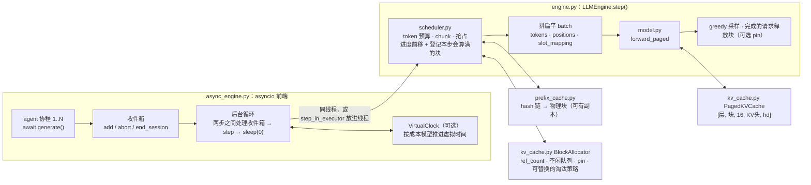

**中文** · [English](README.en.md)

# Capstone：一个真正会算的迷你推理引擎

> 🕐 建议时长：2.5 小时 ｜ 🎯 学完你能：讲清并亲手验证 PagedAttention 式分块 KV、按 block 哈希链的前缀缓存、continuous batching、chunked prefill、recompute 抢占、请求中止与异步前端在代码里分别长什么样，以及 agent harness 与 RL rollout 的写法怎样决定缓存命中率 ｜ 🧪 演示：[`demo.py`](demo.py) ｜ 📖 必读一手资料：[vLLM Automatic Prefix Caching 设计文档](https://docs.vllm.ai/en/latest/design/prefix_caching.html)、[vLLM V1 架构博客](https://vllm.ai/blog/2025-01-27-v1-alpha-release)

## 0. 一句话

**`codesign_sim` 是成本模型，只能告诉你"大概多快"；`mini_engine` 是约 1400 行 numpy 写的真引擎，每个机制都真的在算。测试给出的是很强的回归证据，而不是数学证明：开关任何优化，greedy 输出都与"每步从头重算"的朴素实现 token 级完全一致（logits 只在浮点舍入级别不同），并且有随机差分测试和变异测试兜底。**

## 1. 为什么要有这个 capstone

前面的模块用模拟器讨论 prefill、KV cache、前缀命中率、抢占。模拟器的问题是：它假设机制是对的，然后估时间。面试里真正被追问的往往是另一类问题：

- "前缀缓存命中之后，第一个要算的 token 的位置编码是多少？KV 写到哪里？"
- "两个请求共享一个块，一个结束了，这个块什么时候能被淘汰？"
- "chunked prefill 切在块中间，下一块怎么接上？"
- "被抢占的请求重算时，已经生成的 token 算 prompt 还是算 decode？"
- "调用方超时了，引擎里那个请求怎么办？"
- "RL 同步了新权重，前缀缓存里的旧 KV 怎么办？"

这些问题只有在一份**能跑、能错、能被测试抓住错误**的实现上才能回答扎实。`mini_engine` 的定位：

| | codesign_sim | mini_engine |
|---|---|---|
| 做什么 | 按 FLOPs / 字节估时间 | 真正做矩阵乘、写 KV、查缓存、调度 |
| 能回答 | 吞吐、TTFT、命中率的数量级 | 机制是否正确、边界条件、不变量 |
| 规模 | 任意 GPU 与模型（参数查自官方） | 0.89M 参数的随机权重模型，CPU 上几毫秒一步 |
| 局限 | 不验证正确性 | 不代表真实 GPU 性能（见第 9 节） |

模型是 4 层 decoder-only Transformer：vocab 512、d_model 128、8 个 query 头 / 2 个 KV 头（GQA）、head_dim 16、SwiGLU 中间维 384、RMSNorm、RoPE，权重是固定 seed 的随机数，全部用 float64。随机权重不会"说人话"，但输出对上下文敏感（有测试专门检查这一点），所以"输出一致"是有意义的证据。

## 2. 架构总览



一步（`LLMEngine.step`）做四件事：

1. **调度**：先给 running 的请求分 token（decode 给 1 个，没算完的 prefill 给下一块），块不够就从 running 队尾抢占；本步没有抢占才从 waiting 按 FCFS 接纳新请求——接纳前先查前缀缓存，只为未命中的部分分配块。每分到 token，请求的 `num_computed_tokens` 就**在调度时前移**，本步会算满的块**立刻登记**进前缀缓存，所以同一步里后接纳的请求能直接命中它们。
2. **拼 batch**：所有请求本步要算的 token 拼成一条扁平序列，同时算出每个 token 的绝对位置和 KV 写入槽位 `slot = block_table[pos // 16] * 16 + pos % 16`。
3. **前向**：线性层对整条扁平序列一起算（这就是 batching 的收益）；每层**先把本步所有新 K/V 写进块，再做任何注意力**——这是第 1 步能"调度时登记"的安全前提，由 `test_forward_paged_writes_all_kv_before_attention` 守着（它故意把读者排在写者前面）。
4. **收尾**：算到序列末尾的请求 greedy 采样一个 token；达到 `max_tokens` 的请求释放块（可选 pin）。

异步前端的三条规则：
- **只在两步之间改引擎状态**。`generate()`、取消、`end_session()` 都只是往收件箱里投消息，由后台循环在两步之间统一处理，所以把 step 放进线程也没有数据竞争。
- **取消即中止**。调用方超时或被 cancel 时，`generate()` 投一条 abort：请求从调度队列里摘掉、块被释放；后台循环交付结果前检查 Future 是否已经结束。
- **每步之后让出事件循环**（`await asyncio.sleep(0)`），新请求才能在别人 decode 到一半时加进 batch。

## 3. 与 vLLM / SGLang 的对应关系

只列我们核实过一手来源的部分（vLLM 以 2026-09 的 main 分支源码和文档为准）；"差异"一列是 mini_engine 为了简单做的取舍。

| mini_engine 机制 | 文件 | 生产系统里的对应（来源） | 差异 |
|---|---|---|---|
| KV 分成固定大小的块，block table 做逻辑→物理映射 | `kv_cache.py` | PagedAttention，借鉴操作系统分页（[Kwon et al., SOSP 2023, arXiv:2309.06180](https://arxiv.org/abs/2309.06180)） | 我们在 numpy 里 gather 整段历史再算；真实系统用专门的 GPU kernel 直接按块读 |
| 块 hash = H(父块 hash, 本块 token)；只缓存满块 | `prefix_cache.py` | vLLM APC 设计文档：hash 由 parent hash、block tokens、extra hashes（LoRA ID、多模态 hash、cache salt 等）组成；"We only cache full blocks."（[设计文档](https://docs.vllm.ai/en/latest/design/prefix_caching.html)） | "hash 相同 ⇔ 前缀相同"只在忽略碰撞时成立；我们用 sha256 截断到 64 位（N 个块两两碰撞概率约 N²/2⁶⁵） |
| 同一 hash 可以挂多个物理块，查找返回第一个，它被淘汰时副本顶上 | `prefix_cache.py` | vLLM `block_pool.py`："It caches blocks from hash directly to a block or multiple blocks"，`get_one_block` 返回其中任意一个，注释写明当前不去重 | 相同思路 |
| ref_count 为 0 的块进空闲队列、仍可命中；从队头 LRU 淘汰；释放时逆序入队 | `kv_cache.py` | 同一设计文档：释放的块按 reverse order 追加到 free queue，因为请求的最后一块 hash 了更多 token、更不容易被复用 | 我们用 `OrderedDict` 代替双向链表；淘汰策略做成可替换的 `pick_victims` 钩子（练习 (b)） |
| 调度时就前移进度、登记本步会算满的块 | `scheduler.py` `_advance` | vLLM 设计文档："If an allocated block is already full of tokens, we immediately add it to the cache block"；`kv_cache_manager.py` 的 `allocate_slots` 在分配时调用 `cache_blocks`（`num_tokens_to_cache = min(total_computed_tokens + num_new_tokens, request.num_tokens)`）；`scheduler.py` 的 `_update_after_schedule` 在调度后立刻推进 `num_computed_tokens` | 相同 |
| 全部命中时也要重算最后一个 token（最多匹配 `num_tokens - 1`） | `scheduler.py` `_admit` | vLLM 源码 [`kv_cache_manager.py`](https://github.com/vllm-project/vllm/blob/main/vllm/v1/core/kv_cache_manager.py) 注释："When all tokens hit the cache, we must recompute the last token to obtain logits" | 相同 |
| 不区分 prefill / decode，每步产出 `{请求: 本步 token 数}` | `scheduler.py` | vLLM V1 调度器："Scheduling decisions are represented as a simple dictionary, e.g., `{request_id: num_tokens}`"（[V1 博客](https://vllm.ai/blog/2025-01-27-v1-alpha-release)） | 相同思路 |
| chunked prefill；running 请求按进入顺序分配；可选 `long_prefill_token_threshold` 限制单个请求一步的 token 数 | `scheduler.py` | vLLM 文档："In V1, chunked prefill is enabled by default whenever possible"，并称开启时调度"prioritizes decode requests"（[Optimization 文档](https://docs.vllm.ai/en/latest/configuration/optimization.html)）。但 V1 源码 [`scheduler.py`](https://github.com/vllm-project/vllm/blob/main/vllm/v1/core/sched/scheduler.py) 实际是 `while req_index < len(self.running) and token_budget > 0` 按顺序分配，不把 decode 重排到前面；防止长 prefill 占满预算靠 `long_prefill_token_threshold`（默认 0 = 关闭；当前 main 在只剩一个请求时不截断，另有 adaptive 选项）。系统论文见 [Sarathi-Serve, arXiv:2403.02310](https://arxiv.org/abs/2403.02310) | 我们也按顺序分配；阈值没有"只剩一个请求时不截断"的例外，也没有 adaptive 版本 |
| 块不够时抢占 running 队尾，进度归零、放回 waiting 队首，之后整段重算 | `scheduler.py` `_grow` / `_preempt` | vLLM 文档："In vLLM V1, the default preemption mode is `RECOMPUTE` rather than `SWAP`"；源码 FCFS 策略下 `self.running.pop()`、`num_computed_tokens = 0`、`waiting.prepend_request` | 相同；我们没有 priority 策略 |
| 以"迭代"为单位调度，请求随时加入 / 退出 batch | `engine.py` | continuous batching 的来源：Orca 的 iteration-level scheduling（[OSDI 2022](https://www.usenix.org/conference/osdi22/presentation/yu)） | — |
| 调用方取消 → 中止请求、释放块 | `async_engine.py` `generate` | vLLM [`async_llm.py`](https://github.com/vllm-project/vllm/blob/main/vllm/v1/engine/async_llm.py) 的 `generate()`：`except (asyncio.CancelledError, GeneratorExit)` 时调用 `self.abort(...)` | 相同思路 |
| asyncio 前端：后台循环 step，协程 await 结果；可选把 step 放进线程 | `async_engine.py` | vLLM V1 把 EngineCore 做成独立的执行循环（V1 博客："isolated `EngineCore` execution loop"），源码 `vllm/v1/engine/core.py` 用 ZMQ 在后台进程里跑它；`generate()` 是异步生成器，由后台 output handler 任务分发输出 | 我们默认在事件循环线程里算；`step_in_executor=True` 是折中：NumPy 文档说 "NumPy releases the GIL for many low-level operations"（[thread safety](https://numpy.org/doc/stable/reference/thread_safety.html)），但 Python 部分仍要抢 GIL，所以生产系统干脆拆进程 |
| 换权重必须清前缀缓存；有块在用时拒绝清 | `engine.py` `update_weights` / `reset_prefix_cache` | vLLM `kv_cache_manager.py` 的 `reset_prefix_cache`：docstring 写明"may be used in RLHF flows to invalidate prefix caching after the weights are updated"；`block_pool.py` 在还有块没释放时记日志并返回 False | 我们要求引擎空闲才能换权重；in-flight 更新见[模块 06](../modules/06_long_tail_async/README.md)的 in-flight 权重更新一节 |
| `cache_salt` 混进链根，隔离租户 | `prefix_cache.py` `root_hash` | vLLM 设计文档：cache_salt "is injected into the hash of the first block"，用来防止通过时延差推断别人缓存了什么（timing-based attacks） | 相同思路 |
| 最长前缀匹配 + LRU | `prefix_cache.py` | SGLang RadixAttention 用 radix tree 存 KV，"evicts the least recently used leaf first"，并按 longest-shared-prefix-first 做 cache-aware 调度（[Zheng et al., arXiv:2312.07104](https://arxiv.org/abs/2312.07104)）。SGLang 文档写 `--page-size` 默认 1（按 token 匹配，部分注意力后端会用更大的 page），`--radix-eviction-policy` 默认 lru，可选 lru / lfu / slru / priority（[server arguments](https://docs.sglang.io/advanced_features/server_arguments.html)） | 我们按 16 token 的块匹配，块内的零头丢掉；调度是 FCFS，不按命中长度重排 |
| 练习 (a) cache-aware 路由 | `exercise.py` | SGLang v0.4 的 cache-aware load balancer：路由器维护 "an approximate radix tree of the actual radix tree on the workers"，"lazily updated"；博客称吞吐最高提升 1.9x、命中率提升 3.8x（[SGLang v0.4 博客](https://lmsys.org/blog/2024-12-04-sglang-v0-4/)） | 我们只做"亲和 + 负载上限"的最简规则；测试里的路由器同样只有近似视图 |
| 等工具期间 pin 块 | `kv_cache.py` `pin` | 对应 Continuum 的 KV TTL（"selectively pins the KV cache in GPU memory with a time-to-live value"，[arXiv:2511.02230](https://arxiv.org/abs/2511.02230)）与 InferCept 的保留策略，见[模块 05](../modules/05_cache_prefill/README.md)讲工具调用期间 KV 去留的小节 | 只 pin 已登记的满块；pin 总量有上限，默认 0（要显式打开）；oracle TTL 看得见未来，是上界 |

**参考实现**：[nano-vllm](https://github.com/GeeeekExplorer/nano-vllm) 是一个约 1,200 行 Python 的 vLLM 从零实现（README 自述），带 prefix caching、tensor parallelism、torch compilation、CUDA graph；README 给出的对比是 RTX 4070 Laptop（8GB）上跑 Qwen3-0.6B、256 条请求，vLLM 1361.84 tok/s、nano-vllm 1434.13 tok/s。作者 GitHub 资料自填 Xingkai Yu、@deepseek-ai / Nanjing University（自述信息，未另行证实）。它适合作为读完本 capstone 之后的下一站：mini_engine 刻意省掉的 GPU 那一半（CUDA graph、张量并行、torch compilation），它都有。

## 4. 逐文件导读（建议阅读顺序，每个约 10 分钟）

| 顺序 | 文件 | 先看哪里 | 读的时候问自己 |
|---|---|---|---|
| 1 | [`mini_engine/model.py`](../mini_engine/model.py) | `_attend`、`forward_dense`、`forward_paged` | 为什么 `forward_paged` 要**先把本步所有 K/V 写进块，再做注意力**？RoPE 用的是块内位置还是绝对位置？ |
| 2 | [`mini_engine/kv_cache.py`](../mini_engine/kv_cache.py) | `PagedKVCache.write/gather`、`BlockAllocator.allocate/pick_victims/touch/free/pin` | "空闲"和"已淘汰"有什么区别？什么时刻一个块上的前缀才真正失效？ |
| 3 | [`mini_engine/prefix_cache.py`](../mini_engine/prefix_cache.py) | `hash_block`、`root_hash`、`lookup`、`register`、`_on_evict` | 为什么一个扁平 dict 就能做最长前缀匹配？同一 hash 出现两次时怎么办？ |
| 4 | [`mini_engine/scheduler.py`](../mini_engine/scheduler.py) | `schedule`、`_advance`、`_grow`、`_admit`、`abort` | 为什么"本步有抢占就不接纳新请求"？命中的块为什么要先 `exclude` 再 `touch`？为什么只能登记到 `num_computed_tokens` 为止？ |
| 5 | [`mini_engine/engine.py`](../mini_engine/engine.py) | `validate_request`、`step`、`_run_model`、`update_weights` | 一个请求最多占多少个 token 的 KV？为什么关闭 chunked prefill 时要按它检查？ |
| 6 | [`mini_engine/async_engine.py`](../mini_engine/async_engine.py) | `generate`、`_apply_inbox`、`_loop`、`VirtualClock` | 删掉 `await asyncio.sleep(0)` 会怎样？如果 `generate` 直接调 `engine.add_request`，开了 `step_in_executor` 会出什么事？ |
| 7 | [`mini_engine/agent_harness.py`](../mini_engine/agent_harness.py) | `build_prompt`、`update_history`、`_run_agent`、`steps_during_others_tool_wait` | 三种策略里，第 t 轮 prompt 与第 t-1 轮"算过 KV 的 token"的最长公共前缀各是多少？ |

然后读测试，它们就是这些机制的"规格说明"：[`tests/test_mini_engine.py`](../tests/test_mini_engine.py)（31 个）、[`tests/test_mini_engine_async.py`](../tests/test_mini_engine_async.py)（12 个）、[`tests/test_mini_engine_fuzz.py`](../tests/test_mini_engine_fuzz.py)（1 个随机差分测试，60 组配置）。

| 测试证明的命题 | 测试 |
|---|---|
| 分页前向 = 无缓存整段前向；物理块号打乱不影响结果；把某个块清零结果会变（注意力真的在读块） | `test_paged_forward_matches_dense_and_reads_blocks` |
| 同一次前向里，排在前面的序列能读到排在后面的序列本步才写的块 | `test_forward_paged_writes_all_kv_before_attention` |
| 引擎 greedy 输出 = 每步从头重算；logits 只在舍入级别不同 | `test_engine_matches_naive_reference`、`test_batch_changes_logits_only_at_rounding_level` |
| 前缀缓存开 / 关、chunked prefill（每步 7 / 16 / 23 个 token）、多请求混 batch、抢占重算：输出都不变 | `test_prefix_cache_on_off_identical`、`test_chunked_prefill_matches_one_shot`、`test_batched_equals_individual`、`test_preemption_recompute_keeps_outputs` |
| 命中数精确：共享 40 token 命中 32；多轮只追加时命中上一轮生成 token 填满的块；全部命中也重算最后一块；同一步 G 份同 prompt 命中 (G−1)×48 | `test_shared_prefix_second_request_hits_exact_blocks`、`test_multiturn_hits_blocks_filled_by_generated_tokens`、`test_full_hit_still_recomputes_last_block`、`test_same_step_requests_share_prefix_grpo_style` |
| token 相同但前文不同的块不会误命中；租户 salt 不同不命中；权重换了不 reset 就会命中旧 KV | `test_hash_chain_prevents_cross_context_false_hits`、`test_cache_salt_isolates_tenants`、`test_weight_update_without_cache_reset_hits_stale_kv` |
| LRU 先淘汰尾块；副本在原块被淘汰后顶上；pin 到期前不淘汰、总量有上限、默认关闭 | `test_lru_evicts_tail_first_and_keeps_chain_head`、`test_duplicate_block_is_promoted_when_canonical_is_evicted`、`test_pin_*` |
| 容量按 KV token（prompt + max_tokens − 1）算，边界上能跑的请求不被拒 | `test_capacity_counts_kv_tokens_not_generated_tokens`、`test_no_chunked_prefill_budget_boundary` |
| 中止一个 prefill 到一半的请求：块释放、其他请求不受影响 | `test_abort_mid_prefill_frees_blocks_and_keeps_others_correct`、`test_cancel_mid_prefill_aborts_and_engine_keeps_serving`、`test_wait_for_timeout_does_not_break_other_requests`、`test_closing_with_pending_requests_fails_them_and_frees_blocks` |
| 长请求 decode 到一半时到达的短请求，在长请求结束前完成（continuous batching 真的在工作） | `test_continuous_batching_admits_new_request_mid_flight` |
| step 放进线程后，事件循环在 step 期间照常运转 | `test_step_in_executor_keeps_event_loop_responsive` |
| harness 在虚拟时钟下逐次完全一致；有步是在别的 agent 等工具时执行的；虚拟耗时 < 工具等待之和的一半；输出与交错方式无关 | `test_harness_is_deterministic_and_overlaps_compute_with_tool_waits` |
| 随机配置 + 随机到达 + 随机中止，每步检查：block table 无重复物理块、引用计数守恒、空闲队列与 ref=0 一致、hash 表一致、waiting 请求不持块；结束时无泄漏、与朴素重算一致 | `test_random_differential_with_invariants` |

运行（先在仓库根目录执行过 `make setup`，它把 `mini_engine` 以 editable 方式装进 `.venv`；否则直接跑 `capstone/demo.py` 会找不到这个包）：

```bash
.venv/bin/python -m pytest tests/test_mini_engine.py tests/test_mini_engine_async.py tests/test_mini_engine_fuzz.py   # 48 个测试，约 5 秒
.venv/bin/python capstone/demo.py --with-solution                                                                      # 第 6 节的输出
```

测试里没有任何墙钟断言：并发与重叠用事件时间线（哪一步在谁等工具时执行）和虚拟时钟证明，机器再忙结果也一样。

## 5. 动手：把它改坏

"测试能证明正确"的另一半是"改错了测试会失败"。下表每一行都是我们真的改坏、跑过测试的变异（先盖住右列自己猜）：

| 变异 | 后果 | 抓住它的测试 |
|---|---|---|
| `hash_block` 不再混入 `parent_hash` | 前文不同的块被误命中 | `test_hash_chain_prevents_cross_context_false_hits` |
| `_run_model` 里 `slot` 换成 `pos`（假设 KV 物理连续） | KV 写错位置 | `test_engine_matches_naive_reference` |
| 去掉因果掩码 / RoPE 用块内位置 | 注意力看到未来、位置错 | `test_paged_forward_matches_dense_and_reads_blocks` |
| `(req.num_tokens - 1) // bs` 改成 `req.num_tokens // bs` | 全部命中时没有 token 可算 | `test_full_hit_still_recomputes_last_block` |
| `free` 改成正序释放 | 链头先被淘汰 | `test_lru_evicts_tail_first_and_keeps_chain_head` |
| `_admit` 删掉 `touch(hit_ids)` | 命中的块引用计数不对 | `test_engine_matches_naive_reference` |
| **`_admit` 去掉 `exclude=hit_ids`** | 命中的空闲块被当成新块再分给同一个请求，block table 出现重复物理块，输出错 | `test_random_differential_with_invariants`、`test_pin_during_tool_calls_reduces_recompute_under_memory_pressure` |
| **`_cache_full_blocks` 登记到 `min(num_tokens // bs, len(block_ids))`（登记还没写完 KV 的块）** | 别的请求命中半空的块，输出错 | `test_random_differential_with_invariants`、`test_long_prefill_token_threshold_caps_chunks_without_changing_output` |
| **删掉后台循环里的 `await asyncio.sleep(0)`** | continuous batching 退化成"一批跑完再接下一批"，取消和超时都要等整批跑完 | `test_continuous_batching_admits_new_request_mid_flight` 等 4 个 |
| `forward_paged` 改成只写第一个序列的 K/V 再算 | 同一步共享前缀的请求读到空块 | `test_engine_matches_naive_reference` |
| `generate` 被取消时不投 abort | 请求继续占算力和块 | `test_cancel_mid_prefill_aborts_and_engine_keeps_serving` |
| 容量检查改回 `prompt + max_tokens` | 边界上能跑的请求被拒 | `test_capacity_counts_kv_tokens_not_generated_tokens` |
| `update_weights` 不清前缀缓存 | 命中旧权重的 KV | `test_weight_update_without_cache_reset_hits_stale_kv` |
| VirtualClock 有人开始睡时不叫醒空闲的循环 | 循环等新请求、协程等虚拟时间，互相等死 | `test_virtual_clock_wakes_idle_loop_when_someone_starts_sleeping` |

加粗的三行是审查时发现的"危险变异"：它们一度能通过全部手写测试，其中前两个会产生错误 token。手写测试只覆盖你想到的交错，随机差分测试 + 每步不变量检查才把它们抓住。

## 6. 真实运行输出

在 Apple M1（8GB）上运行 `.venv/bin/python capstone/demo.py --with-solution` 的完整输出（运行时机器上还有其他任务在跑）：

```text
模型：vocab 512, d_model 128, 4 层, 8 个 query 头 / 2 个 KV 头, head_dim 16, SwiGLU 384；block_size 16

== 1. 正确性：与朴素重算逐 token 对比（6 个请求 × 10 token） ==
配置                        步数   prefill实算    命中    抢占  输出一致
默认（一次全部提交）                10         213    64     0  True
逐个提交                      60         213    64     0  True
关闭前缀缓存                    11         277     0     0  True
每步只给 7 个 token            45         213    64     0  True
只有 10 个块（逼出抢占）            26         236    64     2  True
logits 不逐位相同：单独算 vs 拼 batch 最大差 1.8e-15–2.7e-15；top-1 与 top-2 的间隔 0.009–1.11（10 个随机序列）

== 2. 共享前缀 ==
先后两个请求 #0: prompt 50（前 40 共享），命中  0，实算 50
先后两个请求 #1: prompt 50（前 40 共享），命中 32，实算 18
同一步提交 G=1 份 200 token 的 prompt：prompt 共  200，命中    0，实算  200，步数 4，G 份输出相同 True
同一步提交 G=8 份 200 token 的 prompt：prompt 共 1600，命中 1344，实算  256，步数 4，G 份输出相同 True

（harness：6 个 agent × 4 轮；共享 system prompt 96 token；每轮输出 8、工具结果 24 token；工具耗时 40 ms ±50%；虚拟时钟：每步 1 ms + 0.1 ms/token）

== 3. harness 上下文策略（块充足：256 块；虚拟时钟） ==
                  prompt      命中      命中率 prefill实算    抢占    淘汰    步数    耗时(s)
append              3840    3072    80.0%       768     0     0    96    0.242
compress            3300    2208    66.9%      1092     0     0    73    0.259
timestamp           3864       0     0.0%      3864     0     7    47    0.529

== 4. 显存紧张（36 块）时，等工具期间 pin 与不 pin（append；虚拟时钟） ==
                  prompt      命中      命中率 prefill实算    抢占    淘汰    步数    耗时(s)
不 pin               3840    2496    65.0%      1344     0    51    89    0.294
oracle TTL          3840    2752    71.7%      1088     0    35    90    0.259
固定 TTL              3840    2720    70.8%      1120     0    37    90    0.263

== 5. 会话感知淘汰 vs LRU（练习 (b) 参考答案；会话长短不一：5/4/3/2 轮；32 块；虚拟时钟） ==
                  prompt      命中      命中率 prefill实算    抢占    淘汰    步数    耗时(s)
LRU                 3728    2688    72.1%      1040     0    36    91    0.300
会话感知                3728    2912    78.1%       816     0    20    91    0.296
两者输出一致：True

== 6. 真实墙钟（随机器负载变化） ==
工具等待之和 0.78 s；并发墙钟 0.25 s；串行墙钟 1.09 s；输出一致 True；并发时在别人等工具期间执行的步数 99/115
step 在事件循环线程里    1 个 768 token 长 prompt + 4 个短请求：心跳延迟 p50   0.16 ms、max  255.32 ms；总耗时    265 ms
step 放进线程池       1 个 768 token 长 prompt + 4 个短请求：心跳延迟 p50   0.17 ms、max    1.26 ms；总耗时    296 ms

== 7. chunk 大小：一个 768 token prompt 的 prefill（真实墙钟） ==
    每步预算    步数   prefill 总耗时(ms)    KV 重读(token)     分数矩阵元素(百万,每层每头)
     768     1             264.7               0              0.59
     256     3             179.8             768              0.39
      64    12             174.0            4224              0.32

== 8. CPU 上每 token 耗时（float64 numpy，中位数；prefill 一步含首 token 的 logits 与调度开销） ==
prefill  16 token 一步:   1.46 ms  →    91.0 µs/token
prefill  64 token 一步:   5.30 ms  →    82.9 µs/token
prefill 256 token 一步:  31.98 ms  →   124.9 µs/token
decode batch= 1（上下文 ~70）一步:   1.02 ms  →  1020.8 µs/token
decode batch=16（上下文 ~70）一步:   3.99 ms  →   249.3 µs/token

总耗时 5.6 s
```

怎么读：

- **第 1 节**：五种配置输出全部 `True`。"prefill实算 = prompt 总数 − 命中 + 抢占后重算"：最后一行 236 = 277 − 64 + 23。第一行一次提交全部请求也命中了 64：块在调度时就登记，同一步里后接纳的请求直接命中前面请求本步才算的块。最后一行说明"一致"是 token 级的：同一序列单独算和拼进 batch，logits 差约 2e-15（浮点规约顺序不同），而 top-1 与 top-2 的间隔最小只有 0.009。bf16 只有 8 位有效精度（相对误差约 2⁻⁸ ≈ 0.4%），logits 在几个单位的量级时误差可以到 0.01 级，这种 near-tie 就可能翻转——这就是 GPU 上"温度 0 也不确定"和 RL 训推 logprob 不一致的来源，见[模块 06](../modules/06_long_tail_async/README.md)的训推不一致一节。
- **第 2 节**：40 个共享 token 里只有 2 个满块（32 token）能共享；SGLang 默认 page_size=1 的 radix tree 按 token 匹配，这里能命中 40。同一步提交 G=8 份 200 token 的 prompt（GRPO 式同题多采样）：第一份算 200，后面 7 份各命中 12 个满块（192）、只算最后 8 个，总实算 256 而不是 1600。
- **第 3 节**：只追加（append）的命中率最高、prefill 实算最少；compress 每轮改写历史，只剩 system prompt 命中；timestamp 把每轮都变的一个 token 放在最前面，整条前缀全部失效，prefill 实算是 append 的 5 倍。
- **第 4 节**：只有 36 块时，agent 等工具期间它已登记的满块会被别人的 prefill 淘汰。pin 住之后淘汰从 51 降到 35–37，prefill 实算从 1344 降到 1088–1120。oracle TTL = 本次工具真实耗时 × 1.5，看得见未来，是上界；固定 TTL = 工具耗时分布的上界（60 ms），不需要预知，只差 32 token。按历史分布推 TTL 的推导见[模块 05](../modules/05_cache_prefill/README.md)的 Continuum 小节。
- **第 5 节**：会话长短不一时（有的 agent 早早结束），LRU 会留着刚结束的会话的块、淘汰正在等工具的会话的块；会话感知淘汰先丢已结束会话的块，prefill 实算 1040 → 816，输出完全一致。
- 第 1–5 节只统计 token 数或用虚拟时钟，每次运行结果完全一致。
- **第 6 节**（真实墙钟）：并发时墙钟远小于工具等待之和，115 步里有 99 步是在别的 agent 等工具时执行的。step 在事件循环线程里跑时，一个 768 token 的 prefill 让心跳协程卡了 255 ms——这段时间里工具结果回调、新请求、健康检查全都停摆；放进线程池后最大延迟 1.3 ms，代价是总耗时略长（GIL 争用）。这就是 vLLM V1 把 EngineCore 拆进独立进程的原因之一。
- **第 7 节**：chunked prefill 在 GPU 上的额外成本是**重读已有前缀的 KV**：长度 L 的 prompt 切成大小 C 的块，第 j 块的注意力要读前面 j·C 个 token 的 KV，总共约 L²/(2C)（表里 768 → 0、256 → 768、64 → 4224）。这是一个简化的计数代理（每个 chunk 把已有前缀的 KV 访问一遍），真实 GPU 上的 HBM 读取量还取决于 attention kernel 的分块（tiling）方式、页布局和是否融合，只能当数量级看；此外每块都要把全部权重读一遍，C 越小算术强度越低。但 mini_engine 在 CPU 上的实测趋势相反：一次性最慢。原因是我们的 `_attend` 把完整的 [n, ctx] float64 分数矩阵物化出来，连被因果掩码盖掉的上三角也算——一次性要 L² ≈ 0.59M 个元素，切块后约 L²/2 + LC/2。FlashAttention 这类 kernel 跳过被掩码的块、从不物化分数矩阵，所以 GPU 上没有这个效应。**不要用 CPU 上的 chunk 计时去推 GPU 上的选择。**
- **第 8 节**：decode batch=1 每 token 约 1 ms，而这个模型每 token 只有约 2 × 0.89M ≈ 1.8 MFLOP——折合约 2 GFLOP/s，时间几乎全是每步的固定开销（Python 解释器与每层几十次 numpy 调用）；batch=16 把每 token 成本摊薄到约 0.25 ms。prefill 一步的时间里也含首 token 的 logits 与调度开销。第 6–8 节的墙钟数字随机器负载变化。

## 7. 练习

打开 [`exercise.py`](exercise.py)，实现五个函数 / 方法（第一个是热身）：

| 函数 | 要做什么 | 验收 |
|---|---|---|
| `prefix_match_blocks` | 最长前缀连续命中了几个块 | 单元测试 |
| `pick_instance` | cache-aware 路由：负载上限内选命中最多的实例 | 在两个真实 `LLMEngine` 上跑 3 个 agent × 3 轮；路由器只有自己记录的近似视图；亲和路由的 prefill 实算量少于轮询 |
| `choose_victims` | 会话感知淘汰规则：跳过 pin → 没挂前缀的先走 → 活跃会话少的先走 → LRU → **尾块先走** | 单元测试 + 在真实 `PrefixCache` 上验证淘汰 1 块后链的前 2 块仍能命中 |
| `SessionAwareAllocator.pick_victims` | **改引擎内部**：把上面的规则接进 `BlockAllocator`，`LLMEngine(..., allocator_cls=SessionAwareAllocator)` 就会用它 | 差分：显存紧、会抢占时输出与朴素重算一致、无泄漏；agent harness 下输出与 LRU 完全一致且 prefill 实算更少（第 6 节第 5 小节） |
| `speculative_greedy` | 草稿 + 一次 target 前向校验的 greedy 投机解码 | 输出与 greedy 完全一致；草稿全对时 target 前向次数 = ⌈max_tokens/(k+1)⌉，全错时 = max_tokens；草稿每个位置以概率 α 猜对时，每次前向平均产出与 E(α, k) = (1 − α^(k+1)) / (1 − α) 相差 < 15% |

```bash
.venv/bin/python -m pytest capstone                    # 没写完会失败，这是正常的
INFRA_SOLUTION=1 .venv/bin/python -m pytest capstone   # 用参考答案 solution.py 跑
```

几点说明：
- 共享的 system prompt 块被很多会话用过，所以用"活跃会话数"而不是一个布尔值；同一时刻释放的一条链，要先淘汰尾块——先丢链头会让整条链都查不到，剩下的块白占空闲队列。
- 真实的 cache-aware 路由器看不到引擎内部：SGLang 的路由器维护的是近似、惰性更新的树，可能以为某台机器还缓存着其实已被淘汰的块；负载也应按在途 token（尤其是待算的 prefill token）而不是请求数计。见[模块 05](../modules/05_cache_prefill/README.md)的集群路由一节。
- E(α, k) 的推导与"最优 γ"见[模块 02](../modules/02_inference_engines/README.md)的投机解码一节；原始论文：[Leviathan et al., arXiv:2211.17192](https://arxiv.org/abs/2211.17192)。

## 8. 进阶任务（不计入 2.5 小时）

1. **不看未来的 TTL**。把第 4 节的 oracle TTL 换成"按每个工具的历史耗时分布选 TTL"：在 harness 里给工具分类型、记录历史耗时，按[模块 05](../modules/05_cache_prefill/README.md)里 Continuum 的 TTL 公式选 τ。再与会话感知淘汰组合，在虚拟时钟下报告 prefill 实算、抢占次数；思考 pin 与会话感知分别解决什么问题。
2. **并发的多实例路由**。起 N 个 `AsyncLLMEngine`，写一个前端用 `pick_instance` 分发 harness 请求，负载按在途 token 计，路由器只维护自己的近似视图；对比轮询 / 最少负载 / 纯亲和 / 亲和 + 负载上限的总 prefill 实算和各实例步数的不均衡度（max/mean）。再换成"所有 agent 共享一个很长的前缀、私有部分很短"的负载，看纯亲和怎样把流量压到一台机器上。
3. **把投机解码接进引擎**。在 `LLMEngine` 里对一个请求一步喂入"最后一个 token + k 个草稿"（相当于一个长度 k+1 的 chunk），校验后回滚 `num_computed_tokens` 并释放多分配的块。难点：被拒绝 token 的 KV 已经写进块里；`_advance` 会在调度时登记"本步会算满"的块，所以含草稿 token 的块**不能**提前登记。用 `reference_greedy` 和随机差分测试验证输出不变。
4. **RL rollout 引擎**。把第 2 节的 G 份同题采样和 `update_weights` 串起来：每个"训练步"之后换权重。比较三种做法——drain 后 reset 前缀缓存、把权重版本混进链根（`cache_salt`）让旧块自然被 LRU 回收、in-flight 更新（带着旧 KV 继续生成，见[模块 06](../modules/06_long_tail_async/README.md)）——的 prefill 实算量，以及各自生成的 token 与"纯新权重"参考不一致的比例。
5. **CPU 与 GPU 的差异**。扫 prompt 长度（16–1024）与 decode batch（1–64），拟合"每步时间 = 固定开销 + a·token 数 + b·token 数 × 上下文长度"；用 `cProfile` 看固定开销来自哪里。然后回答：为什么这里 decode 的瓶颈是解释器开销，而 GPU 上真实模型的 decode 瓶颈是 HBM 带宽（用 `codesign_sim` 的 roofline 函数给数量级）？CUDA graph 解决的是哪一部分？把 `_attend` 改成按块的 online softmax（不物化分数矩阵），第 7 节的趋势会怎样变？

## 9. 与生产系统的差距（诚实清单）

| 方面 | mini_engine | 生产系统（vLLM / SGLang 等） |
|---|---|---|
| 计算 | numpy float64，CPU；注意力逐序列 Python 循环，gather 出整段历史，物化完整分数矩阵 | GPU 上 bf16/fp8；专门的分页注意力 kernel 直接按块读 KV，不物化分数矩阵 |
| 每步固定开销 | Python 解释器，约 1 ms / 步 | CUDA graph、把 CPU 调度与 GPU 执行重叠 |
| 并行 | 单进程；step 最多放进一个线程 | tensor / pipeline / expert 并行，多机多卡 |
| 前端 | 引擎与 asyncio 同进程；收件箱在两步之间处理 | EngineCore 独立进程 + ZMQ，API server 分离，流式输出 |
| 抢占 | 只有 recompute | vLLM V1 默认 recompute，文档里也提到 SWAP 模式 |
| 前缀缓存 | 16 token 一块；64 位截断 hash；有 cache_salt，没有 LoRA / 多模态 extra keys | 可选 hash 算法（vLLM 文档写自 v0.11 起默认 sha256，源码在 v0.10.2 已改为默认）；extra keys；SGLang 可按 token 匹配 |
| 安全 / 隔离 | 链根是常数（salt 为 0 时），任何人都能算出块 hash | vLLM 曾有 CVE-2025-25183（[GHSA-rm76-4mrf-v9r8](https://github.com/vllm-project/vllm/security/advisories/GHSA-rm76-4mrf-v9r8)）：Python 3.12 起 `hash(None)` 是可预测的常数，可被用来构造前缀缓存哈希碰撞；0.7.2 修复为每次启动随机化初始哈希值。多租户用 cache_salt 防时延侧信道 |
| 调度 | FCFS，无优先级、无 SLO 感知、无按命中长度重排 | 优先级调度、cache-aware 调度（SGLang）等 |
| 采样 | 只有 greedy，无 stop 条件、无 detokenize | 完整采样参数、流式输出、结构化输出 |
| 模型 | 0.89M 参数随机权重 | 数十亿到数千亿参数、量化、MoE、MLA 等 |

所以：**mini_engine 用来证明"机制是什么、为什么对"，不能用来推断真实系统的性能数字**；性能数量级请回到 codesign_sim 和前面各模块的一手来源。

## 10. 自测题

1. 为什么只有满块才能被共享？
2. 两个请求共享 40 个 token，为什么第二个请求只命中 32 个？换成 SGLang 默认配置呢？
3. 一个 32 token 的 prompt 第二次提交，为什么只命中 16 个而不是 32 个？
4. 为什么请求结束时要**逆序**释放它的块？
5. recompute 抢占的代价与好处各是什么？
6. 同一个 prompt 在同一步提交 8 份，为什么调度时登记就能让后 7 份命中？它依赖模型前向的什么性质？
7. 为什么 compress 策略只有 system prompt 能命中，而 timestamp 策略连 system prompt 都命中不了？
8. pin 的代价是什么？为什么需要上限，而且默认关闭？
9. 测试说"输出完全一致"，为什么这不等于 rollout 引擎算出的 logprob 与训练引擎一致？

<details><summary>答案</summary>

1. 满块内容不再变化，多个请求同时引用它不需要 copy-on-write；未满的块还会被当前请求继续写入，共享它就要复制或加锁。vLLM 设计文档原话是 "We only cache full blocks."
2. 块大小 16：前 32 个 token 组成 2 个满块，hash 相同；第 3 块是 8 个共享 token + 8 个各自的后缀，hash 不同。SGLang 文档写 `--page-size` 默认 1，radix tree 按 token 匹配，能命中全部 40 个；代价是树操作更碎、kernel 访问不再是整块。
3. 全部命中时也必须重算最后一个 token 才有 logits，所以最多匹配 31 个 token，其中只有 1 个满块。vLLM 源码 `kv_cache_manager.py` 用的是同一条规则。
4. 逆序入队后，尾块离 LRU 队头更近、先被淘汰；链头（往往是共享的 system prompt）活得最久。前缀链从中间断掉，后面的块就都查不到了，所以先丢尾巴损失最小。vLLM 设计文档给的理由是尾块 hash 了更多 token、更不容易被复用。
5. 代价：被抢占请求的 prompt 和已生成 token 要重新 prefill（demo 第 1 节多算了 23 个 token）。好处：不需要 CPU 内存与 PCIe 搬运，实现简单；而且被抢占请求的满块仍在前缀缓存里，没被淘汰的话重新接纳时能直接命中。vLLM 文档说 V1 默认用 RECOMPUTE，原因是在 V1 架构下它的开销更低。什么时候该从下层存储加载而不是重算，见[模块 05](../modules/05_cache_prefill/README.md)里重算 vs 加载的盈亏平衡公式。
6. 第一份被调度时，它本步会算满的块已经登记；后 7 份在同一次 `schedule()` 里被接纳，查表就命中这些块，只算最后不满的 8 个 token。安全前提是 `forward_paged` 每层先写完本步**所有**序列的 K/V 再做注意力，所以读者在 batch 里排在写者前面也读得到。vLLM 的 `allocate_slots` 同样在分配时就 `cache_blocks`。
7. compress 改写的是 system prompt **之后**的内容，前 96 个 token（6 个满块）不变，所以还能命中；timestamp 改的是**第一个** token，而第 i 块的 hash 依赖前面所有块，第 0 块一变，整条链全变。
8. pin 住的块不能分配给活跃请求，等于拿一部分显存押注"这个 agent 很快会回来"。押太多会让活跃请求被抢占甚至没法接纳，所以要设上限；为 pin 预留的块还会降低单个请求能用的最大容量，所以默认 0、需要时显式打开。
9. "一致"是 token 级的：batch 组成、chunk 切法会改变浮点规约顺序，logits 在 float64 下差约 1e-15，只是 argmax 没变。bf16 GPU 上的误差大得多，near-tie 的 token 会翻转，logprob 也不同。RL 里 rollout 引擎给出的 logprob 与训练引擎重算的不一致，需要 batch-invariant kernel 或重要性采样修正，见[模块 06](../modules/06_long_tail_async/README.md)的训推不一致一节。

</details>

## 11. 面试追问

1. **"前缀缓存的 key 为什么要做成哈希链？直接 hash 本块的 16 个 token 不行吗？"**
   结论：不行，KV 依赖整个前文。数量级：两个请求的第 i 块 token 完全相同但前文不同，KV 就完全不同，误命中直接产生错误输出（`test_hash_chain_prevents_cross_context_false_hits` 构造的就是这个场景）。取舍：哈希链让一个扁平 hash 表就能做最长前缀匹配，代价是任何一个早期 token 变化都会让后面所有块失效——这正是 harness 设计必须"只追加、动态内容放后面"的原因。
2. **"agent 负载下纯 LRU 有什么问题？怎么改？"**
   结论：LRU 把"正在等工具、马上就回来"的会话当成最冷的数据，又会留着刚结束的会话的块。数量级（虚拟时钟，确定性）：36 块时 pin 让 prefill 实算从 1344 降到 1088（oracle TTL）/ 1120（固定 TTL）；会话长短不一时会话感知淘汰把 1040 降到 816。取舍：pin 占住显存、可能增加抢占；会话感知需要 harness 把会话状态告诉引擎（跨层协同设计）；TTL 要按工具耗时分布来定，oracle 只是上界。
3. **"chunked prefill 的 chunk 大小怎么选？"**
   结论：chunk 越大，prefill 越快完成（TTFT 越好），但同一步里的 decode 被拖慢（TPOT 变差）；chunk 越小，TPOT 越平稳，但 KV 重读总量约 L²/(2C)、每块都要重读权重，步数和固定开销也变多。mini_engine 里预算 7 时步数从 10 涨到 45（demo 第 1 节）。注意别用 CPU 上的计时推 GPU（demo 第 7 节）。vLLM 另用 `long_prefill_token_threshold` 限制单个长 prefill 在一步里占的预算。
4. **"你怎么证明一个推理引擎是对的？"**
   结论：找一个显然正确的参照实现（每步整段重算），把每个优化做成可开关的，逐 token 对比 greedy 输出；再加随机差分测试（随机配置、随机到达、随机中止），每步检查不变量（block table 无重复、引用计数守恒、无泄漏）；最后做变异测试——本项目审查时就发现有 3 个危险变异能通过全部手写测试（第 5 节）。取舍：GPU 上 batch 大小不同可能让 kernel 的规约顺序不同，浮点结果不再逐位一致——Thinking Machines 的博客 [Defeating Nondeterminism in LLM Inference](https://thinkingmachines.ai/blog/defeating-nondeterminism-in-llm-inference/)（Horace He 等，2025-09）把这归因于 kernel 不具备 batch invariance。
5. **"GRPO 一个 prompt 采 G=8 份，prefix caching 能省多少？为什么可能一点都不省？"**
   结论：理想情况省 (G−1)/G ≈ 87.5% 的 prompt prefill。数量级：demo 第 2 节 G=8 × 200 token，实算 1600 → 256（省 84%，差的是每份都要重算不满的最后一块）。坑：如果块在前向**之后**才登记，同一步提交的 8 份彼此看不见，一点都不省；预算越大（一次全接纳）反而越不省。取舍：调度时登记要求模型先写完本步所有 K/V 再做注意力。
6. **"rollout 引擎每个训练步都同步权重，前缀缓存和在途请求怎么办？"**
   结论：块哈希只看 token，不看权重版本；不处理就会命中旧 KV（`test_weight_update_without_cache_reset_hits_stale_kv`）。三种做法：drain 后 reset（vLLM 的 `reset_prefix_cache` 注释写明用于 RLHF 权重更新后，且有块没释放时会失败）；把权重版本混进链根，旧块自然被 LRU 回收；in-flight 更新，带着旧 KV 继续生成，序列内版本混合（见[模块 06](../modules/06_long_tail_async/README.md)）。取舍：reset 要等最慢的请求；版本进哈希浪费显存直到淘汰；in-flight 最快但引入 off-policy。
7. **"多项目 / 多租户共享 KV cache 有什么安全问题？"**
   结论：两个。一是哈希碰撞投毒——vLLM 的 CVE-2025-25183 就是 Python 3.12 下 `hash(None)` 可预测导致可构造碰撞，0.7.2 起每次启动随机化初始哈希；更长的密码学哈希（sha256）更稳但更慢。二是时延侧信道——命中与否体现在 TTFT 上，别人能探测你缓存了什么；vLLM 用 cache_salt 混进第 0 块的 hash 隔离。取舍：路由器要自己算块 hash 做亲和，就得和引擎共享同一个 salt（每个信任域一个 salt）。见[模块 05](../modules/05_cache_prefill/README.md)的多租户一节。

## 12. 延伸阅读

- [vLLM Automatic Prefix Caching 设计文档](https://docs.vllm.ai/en/latest/design/prefix_caching.html)：`prefix_cache.py` 与 `BlockAllocator` 的原型，重点看 hash 组成、free queue、cache_salt。
- [vLLM V1 架构博客](https://vllm.ai/blog/2025-01-27-v1-alpha-release)：统一调度器与独立 EngineCore 的动机。
- [vLLM Optimization and Tuning](https://docs.vllm.ai/en/latest/configuration/optimization.html)：抢占、chunked prefill 的官方调参说明。
- [vLLM V1 调度器源码](https://github.com/vllm-project/vllm/blob/main/vllm/v1/core/sched/scheduler.py)：读完 `scheduler.py` 后对照它的 `schedule()`，看生产代码多处理了哪些情况。
- [vLLM 安全公告 GHSA-rm76-4mrf-v9r8（CVE-2025-25183）](https://github.com/vllm-project/vllm/security/advisories/GHSA-rm76-4mrf-v9r8)：前缀缓存哈希碰撞。
- [PagedAttention 论文（arXiv:2309.06180）](https://arxiv.org/abs/2309.06180)：分块 KV 的出处。
- [SGLang 论文（arXiv:2312.07104）](https://arxiv.org/abs/2312.07104)：RadixAttention 与 cache-aware 调度，和 vLLM 的 hash 表方案对比着读。
- [SGLang v0.4 博客](https://lmsys.org/blog/2024-12-04-sglang-v0-4/)：cache-aware load balancer，练习 (a) 的生产版本。
- [Continuum（arXiv:2511.02230）](https://arxiv.org/abs/2511.02230)：agent 工具调用期间的 KV TTL，第 4 节 pin 的正式版本。
- [Orca（OSDI 2022）](https://www.usenix.org/conference/osdi22/presentation/yu)：iteration-level scheduling，continuous batching 的起点。
- [Sarathi-Serve（arXiv:2403.02310）](https://arxiv.org/abs/2403.02310)：chunked prefill 与吞吐-延迟权衡（论文标题即 Taming Throughput-Latency Tradeoff）。
- [Speculative decoding（arXiv:2211.17192）](https://arxiv.org/abs/2211.17192)：练习 (c) 与进阶任务 3 的理论基础。
- [NumPy thread safety](https://numpy.org/doc/stable/reference/thread_safety.html)：为什么 `step_in_executor` 能让事件循环保持响应，又为什么不如独立进程。
- [nano-vllm](https://github.com/GeeeekExplorer/nano-vllm)：约 1,200 行的 GPU 版参考实现，读完本 capstone 的下一站。
- 本项目内：[模块 02（推理引擎，含投机解码公式）](../modules/02_inference_engines/README.md)、[模块 05（Cache × Prefill：LRU 为什么误杀 agent、TTL、路由）](../modules/05_cache_prefill/README.md)、[模块 06（长尾与异步：权重同步、训推不一致）](../modules/06_long_tail_async/README.md)。
- 模型零件：[RoPE（arXiv:2104.09864）](https://arxiv.org/abs/2104.09864)、[GQA（arXiv:2305.13245）](https://arxiv.org/abs/2305.13245)、[SwiGLU（arXiv:2002.05202）](https://arxiv.org/abs/2002.05202)、[RMSNorm（arXiv:1910.07467）](https://arxiv.org/abs/1910.07467)。
