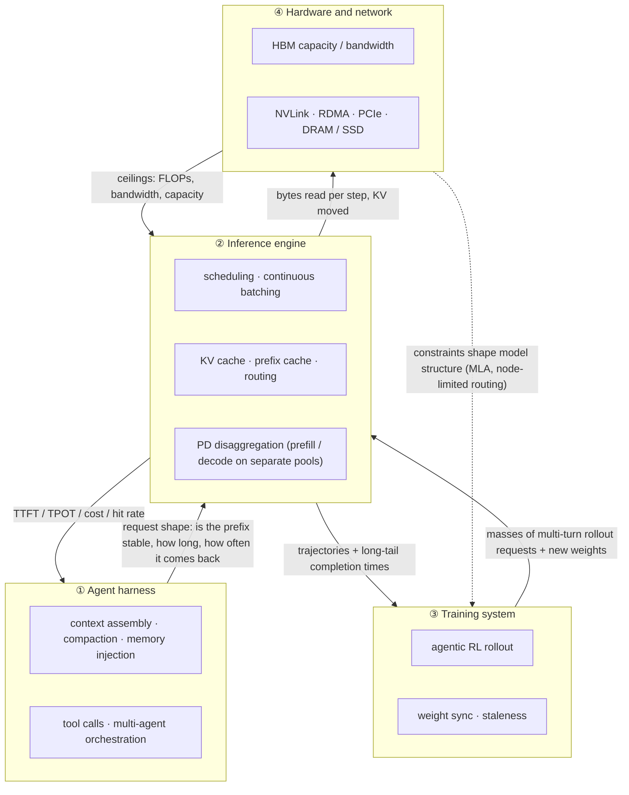

[中文](README.md) · **English**

# Module 00: The Map — Four Layers of Harness × Inference Co-design

> 🕐 Suggested time: 0.5 h ｜ 🎯 After this you can: draw the four-layer stack of an agent system, give 6 examples (with magnitudes) of "a decision in one layer pushes cost onto another", and know which module answers which question ｜ 🧪 Lab: none (reading only) ｜ 📖 Must-read primary sources: [Context Engineering for AI Agents: Lessons from Building Manus](https://manus.im/blog/Context-Engineering-for-AI-Agents-Lessons-from-Building-Manus), [DeepSeek-V3/R1 Inference System Overview](https://github.com/deepseek-ai/open-infra-index/blob/main/202502OpenSourceWeek/day_6_one_more_thing_deepseekV3R1_inference_system_overview.md)

## 0. One sentence

**The cost of an agent system does not live inside any one layer; it lives in the seams between layers**: one line of harness code that "puts a timestamp at the start of the system prompt" can invalidate the inference engine's prefix cache (reuse of already-computed KV) every round and make a whole 8-GPU node redo seconds of prefill (the phase that processes the input prompt) each round. Co-design means treating these seams as first-class design objects.

## 1. Why big labs care

Scenario: a production coding agent / deep research agent service. Each task runs dozens of rounds of "model output → call a tool → append the tool result to the context → call the model again". The context grows from a few thousand tokens to tens of thousands or more than a hundred thousand, while each round outputs only a few hundred tokens.

Four sets of public numbers show where it hurts:

| Fact | Number | Source |
|---|---|---|
| Agents read far more than they write | Manus's average input:output token ratio is about **100:1**; the author calls KV-cache hit rate **the single most important metric** for a production agent | [Manus blog](https://manus.im/blog/Context-Engineering-for-AI-Agents-Lessons-from-Building-Manus) |
| Cache hit vs miss is a 10× price gap | Same post: Claude Sonnet cached input 0.30 USD/MTok vs 3 USD/MTok uncached | Same |
| Multi-agent burns more tokens | Agents typically use about **4×** the tokens of chat, multi-agent systems about **15×** | [Anthropic multi-agent research system](https://www.anthropic.com/engineering/multi-agent-research-system) |
| Prefix reuse is the norm at scale | In 24 hours DeepSeek served 608B input tokens, **56.3%** of which hit the on-disk KV cache; each H800 node does about 73.7k tokens/s of prefill (including hits) or about 14.8k tokens/s of decode | [DeepSeek inference system overview](https://github.com/deepseek-ai/open-infra-index/blob/main/202502OpenSourceWeek/day_6_one_more_thing_deepseekV3R1_inference_system_overview.md) |

How to read this: **agent load = very long, highly reusable input + short output + tool waits in between**. Whoever decides the prompt layout decides the inference cost; yet the people writing the harness usually cannot see where the KV lives or whether it will be evicted. Training is the same: agentic RL rollouts (sampled trajectories) are large batches of exactly these multi-turn sessions. [AReaL](https://arxiv.org/abs/2505.24298) points out that synchronous RL systems must wait for the longest output in the batch before updating the model, which underutilizes GPUs; its asynchronous design gets up to 2.77× training speedup with the same number of GPUs.

## 2. The four-layer stack: who decides, who pays

| Layer | Typical components | Decisions it makes | What it sees | What it usually **cannot see** |
|---|---|---|---|---|
| ① Agent harness | context assembly, compaction, memory injection, tool calls, multi-agent orchestration | which tokens to send each round, in what order, when | task success, token bill | which machine holds the KV, whether it will be evicted |
| ② Inference engine | scheduler, continuous batching (requests join/leave the batch every step), paged KV cache, prefix cache, router, PD disaggregation | which requests run this step, which KV stays in HBM, which instance gets a request | TTFT, TPOT, throughput, hit rate | whether this session will come back with a tool result in a few seconds |
| ③ Training system | rollout workers, reward, trainer, weight sync | how many trajectories one training batch waits for, how stale a policy is allowed to be (staleness = policy version lag) | samples per hour, reward curve | queueing and long tails inside the inference engine |
| ④ Hardware and network | HBM, NVLink, RDMA (InfiniBand / RoCE), PCIe, CPU DRAM, SSD | fixed at purchase time | peak FLOPs, bandwidth, capacity | what the workload looks like |

## 3. Cost transfer: six examples

Read each one as "who decided → who pays → magnitude → the co-design fix → where to dig deeper". Magnitudes use Module 01's formulas; model and hardware parameters are in the [numbers cheatsheet](../../docs/numbers-cheatsheet.en.md).

### 3.1 Harness rewrites the context → prefix cache misses → prefill recomputed

- **Decision**: two common patterns. ① Put a to-the-second timestamp at the very start of the system prompt, or insert retrieved memory at the front; ② when the context grows too long, summarize earlier history (compaction).
- **Bill**: prefix caches match "the exact same prefix from the first token on" ([Anthropic](https://platform.claude.com/docs/en/build-with-claude/prompt-caching) builds cache prefixes in the order tools → system → messages, and a change at any level invalidates that level and everything after it; [OpenAI](https://developers.openai.com/api/docs/guides/prompt-caching) likewise requires the whole rendered prefix to match). Every token after the rewrite point must be prefilled again.
- **Magnitude** (Llama-3-70B, about 70.6B parameters, 8 × H100 at 989 TFLOPS dense BF16 each, 60% MFU, i.e., achieved fraction of peak FLOPs; formulas in [Module 01](../01_inference_basics/README.en.md)):
  - ① The head changes every round: the whole prefix is invalidated **every round**. A 64k context costs about **3.1 seconds of the whole node** to recompute each round (linear layers about 2 × 68.5e9 × 65,536 ≈ 9.0e15 FLOPs, where 68.5B are the parameters without the input embedding and lm_head; attention about 5.6e15), paid dozens of times over dozens of rounds.
  - ② Compact to 8k: only **the one round** after compaction recomputes the shorter 8k context, about **0.25 seconds**; after that each round's prefix is shorter, so both the prefill increment and the KV that decode reads shrink, and it gets cheaper. If the "please summarize" request itself is sent as an append, it can even hit the old prefix.
  - A hit is not free either: a hit in local HBM costs almost nothing; a hit in CPU DRAM, SSD, or a remote tier must bring the KV back. The KV of 64k tokens is about 21.5 GB: about 42 ms split over 8 PCIe Gen5 links (about 64 GB/s one way each), about 0.43 s over one 400 Gb/s NIC. The per-tier accounting is in [Module 05](../05_cache_prefill/README.en.md).
- **Co-design fix**: move the timestamp to the end or lower its precision; append-only context, deterministic serialization (Manus warns that unstable JSON key order silently breaks the cache); compact rarely, only at fixed boundaries, and keep things stable afterwards; on the inference side, keep multiple branches in a prefix tree (radix tree).
- **Dig deeper**: [Module 04](../04_harness_workloads/README.en.md) (workload characterization), [Module 05](../05_cache_prefill/README.en.md) (cache and prefill).

### 3.2 Tool-call wait → keep the KV or drop it

- **Decision**: the model emits a tool call; the harness runs it, which may take seconds to minutes.
- **Bill**: the inference engine must pick one of three. ① Keep it in HBM: memory is held and pushes out other requests' concurrency; ② drop it: prefill again when the tool returns; ③ offload it to CPU DRAM / SSD: costs PCIe and network bandwidth, and it must be moved back on return.
- **Magnitude**: again 70B with a 64k context: the KV is 65,536 × 320 KiB = **20 GiB**. Keep: on an 8 × 80 GB node, after about 141 GB of weights, one session takes about 4–5% of the usable KV space; drop: recomputing costs about 3.1 seconds of the whole node; offload: split 8 ways it is about 2.7 GB per GPU, and at roughly 64 GB/s one way over PCIe Gen5 x16 (the H100 spec page lists 128 GB/s bidirectional) it moves back in about 42 ms in theory. Comparing "share of KV held × wait time" with "recompute time" in the same unit ([Module 01](../01_inference_basics/README.en.md) exercise (d)), this session is worth keeping for tool waits up to about **62 seconds**; beyond that it should be offloaded.
- **Co-design fix**: give the KV a TTL (time to live) based on the expected tool latency, then decide whether to pin or offload. [InferCept](https://arxiv.org/abs/2402.01869) points out that existing systems treat every external interaction as the end of generation and, when the interaction finishes, recompute the already-computed context as a new request; [Continuum](https://arxiv.org/abs/2511.02230) sets a KV TTL from the reload cost and the queueing delay that eviction would cause.
- **Dig deeper**: [Module 04](../04_harness_workloads/README.en.md), [Module 05](../05_cache_prefill/README.en.md).

### 3.3 RL rollout long tail → idle GPUs

- **Decision**: the training system runs synchronous on-policy RL: send a batch of prompts, wait for all trajectories to finish, then take one training step.
- **Bill**: agent trajectory length (turns × output per turn × tool waits) is heavy-tailed. Most trajectories in the batch finish early; the last few long ones hold up the whole cluster. When the batch shrinks, decode step time does not shrink in proportion, so **each token gets more expensive**: under this project's cost model, Llama-3-70B on 8 × H100 at 4k context, shrinking the batch from 256 to 4 only cuts the step from about 22.5 ms to about 6.7 ms (3.3× faster) while throughput drops about 19×. The larger the share of weight reads (short context, big model), the closer it gets to "step time unchanged, throughput down in proportion to batch"; the trajectories left in the tail tend to have the longest contexts, so their step shrinks more (about 15.9× at 32k). See [Module 01](../01_inference_basics/README.en.md) for why.
- **Magnitude** (a made-up example): 256 trajectories average 20 seconds, and the longest one (after truncation) takes 300 seconds. Under strict synchronization, each rollout slot is busy only about 20 / 300 ≈ 7% of the step on average. **The main waste is idle slots**; pricier tokens make it worse.
- **Co-design fix**: partial rollout (unfinished trajectories continue in the next round), asynchronous RL (with bounded staleness), length bucketing. AReaL reports up to 2.77× speedup from going asynchronous.
- **Dig deeper**: [Module 06](../06_long_tail_async/README.en.md).

### 3.4 Multi-agent orchestration → prefix sharing vs routing

- **Decision**: the harness has a lead agent spawn N subagents in parallel.
- **Bill**: tokens multiply (Anthropic reports multi-agent at about 15× chat tokens). If every subagent's prompt is "shared tool definitions + system prompt" first and its own task last, they can share a prefix; if each subagent's role description goes first, the shared prefix is 0. Even with a good layout, the router must send them to the **same** inference instance to hit the cache, which conflicts with load balancing.
- **Magnitude**: a 10k-token shared prefix on Llama-3-8B is 10,000 × 128 KiB ≈ 1.2 GiB of KV; if N = 8 subagents each compute it, that is 7 wasted prefills and 7 duplicate copies in memory. A shared prefix has a third benefit: during decode, a specialized kernel lets many sequences read one copy of the prefix KV together, multiplying attention's arithmetic intensity by the number of sequences ([Module 01](../01_inference_basics/README.en.md) Section 3.5).
- **Co-design fix**: a prompt convention of "shared prefix first, differences last"; cache-affinity routing with a load cap; on the training side, answering "the team got one reward — how is the credit split across agents?"
- **Dig deeper**: [Module 05](../05_cache_prefill/README.en.md) (multi-project cache and routing), [Module 07](../07_multi_agent_credit/README.en.md) (multi-agent credit assignment).

### 3.5 Hardware constraints → shape the model

- **Decision**: DeepSeek trains on an H800 cluster: NVLink inside a node, InfiniBand between nodes.
- **Bill**: the [DeepSeek-V3 technical report](https://arxiv.org/abs/2412.19437) says NVLink offers about 160 GB/s, roughly 3.2× IB (50 GB/s); the later [ISCA paper (arXiv:2505.09343)](https://arxiv.org/abs/2505.09343) is more precise: H800 NVLink is nominally 200 GB/s (one way, about 160 GB/s achievable), each 400 Gb/s IB NIC gives 50 GB/s (about 40 GB/s effective once small messages and latency are considered), so intra- vs inter-node is about 4:1. So cross-node communication for MoE expert parallelism (EP) becomes the bottleneck.
- **Magnitude**: the technical report's answer is to send each token to at most **4 nodes** (node-limited routing). It also does the accounting: IB and NVLink traffic can be fully overlapped, and each token can select on average about 3.2 experts per node without extra NVLink cost, so **although DeepSeek-V3 selects only 8 routed experts in practice, it could scale up to 13 at the same communication cost** (4 nodes × 3.2).
- **Co-design fix**: the bandwidth hierarchy of the hardware is written directly into the model structure and routing rule; MLA (multi-head latent attention) compresses per-token KV to 61 layers × 576 dimensions. The ISCA paper as a whole is about this kind of hardware-aware model co-design.
- **Dig deeper**: [Module 03](../03_deepseek_stack/README.en.md).

### 3.6 The model's KV size → when the PD-disaggregation transfer bill gets expensive

- **Decision**: the inference side wants to put prefill and decode on different machines (PD disaggregation, prefill-decode disaggregation) so they stop interfering ([DistServe](https://arxiv.org/abs/2401.09670), [Splitwise](https://arxiv.org/abs/2311.18677)).
- **Bill**: the KV produced by prefill must be moved to the decode machine over the RDMA network.
- **Magnitude**: for a 64k context, Llama-3-70B's KV (GQA, 320 KiB per token) is about 21.5 GB. Over one 400 Gb/s (50 GB/s) NIC that is about 0.43 s, 14% of the same prefill (about 3.08 s on 8 × H100); over 8 NICs in parallel about 54 ms, 1.7%; pipelined layer by layer so sending overlaps computing, it is mostly hidden. First-hand measurements agree: Splitwise reports the impact of serial KV transfer grows up to 3% of end-to-end latency with large prompts, and its optimized layer-wise transfer only 0.8%; DistServe places corresponding pipeline stages in the same node and moves KV over NVLink, so on OPT-175B KV transfer is under 0.1% of total latency. **Normally, KV transfer is not the bottleneck of PD disaggregation for GQA models.**
- **When it gets expensive**: the transfer is sized by the whole context, while compute is sized only by the uncached tokens. At high hit rates the two fall out of proportion: a 64k context with a 90% hit needs only about 0.41 s of compute, yet 21.5 GB over one NIC still takes 0.43 s. Slow cross-datacenter links and reading KV from an SSD cache tier behave the same way. Here MLA's advantage shows: DeepSeek-V3 at the same 64k is only about 4.6 GB (about 68.6 KiB per token), about 0.09 s over one NIC. **One structural choice in the model layer decides whether one deployment option in the engine layer stays affordable at high hit rates.**
- **Co-design fix**: first compare "KV bytes ÷ FLOPs that must be computed now" with "NIC bandwidth ÷ compute" to see whether it will stall; use multiple NICs in parallel and layer-wise pipelining; shrink the transfer with MLA / FP8 KV.
- **Dig deeper**: [Module 02](../02_inference_engines/README.en.md), [Module 03](../03_deepseek_stack/README.en.md), [Module 05](../05_cache_prefill/README.en.md).

## 4. Where your four research questions live

| Research question | Core tension | Main module | Prerequisites |
|---|---|---|---|
| **Long-tail async** | wait for the slowest (sync) vs staleness (async) | [Module 06](../06_long_tail_async/README.en.md) | Module 01 (why each token costs more when the batch shrinks), Module 04 (where the tail comes from) |
| **Multi-agent reward** | how to split a team reward across agents; gradient variance vs bias | [Module 07](../07_multi_agent_credit/README.en.md) | Module 06 (rollout systems) |
| **Multi-project cache** | hit rate vs load balance; whose prefix stays in HBM | [Module 05](../05_cache_prefill/README.en.md) | Module 01 (KV size), Module 04 (prefix structure) |
| **Prefill** | long-prompt TTFT vs decode TPOT; compute, store, or move | [Module 01](../01_inference_basics/README.en.md) → [Module 02](../02_inference_engines/README.en.md) → [Module 05](../05_cache_prefill/README.en.md) | Module 03 (DeepSeek's PD disaggregation in practice) |

## 5. The 20-hour route

| Module | Time | Question it answers |
|---|---|---|
| [00 The Map](README.en.md) | 0.5h | the four-layer stack; how cost moves across layers |
| [01 Inference First Principles](../01_inference_basics/README.en.md) | 2h | why prefill and decode differ; how big KV is; how to estimate TTFT and concurrency in your head |
| [02 Modern Inference Engines](../02_inference_engines/README.en.md) | 2h | how continuous batching, PagedAttention, chunked prefill, and PD disaggregation schedule work |
| [03 Dissecting the DeepSeek Stack](../03_deepseek_stack/README.en.md) | 2.5h | MLA, MoE / EP, FP8, PD disaggregation at scale |
| [04 Workload Profile of an Agent Harness](../04_harness_workloads/README.en.md) | 1.5h | what agent sessions look like: prefixes, turns, tool waits, rewrites |
| [05 Cache × Prefill Co-design](../05_cache_prefill/README.en.md) | 2.5h | prefix caching, eviction policies, multi-project routing, tiered KV storage |
| [06 Long Tails and Asynchrony](../06_long_tail_async/README.en.md) | 2.5h | throughput and staleness of sync / partial / async rollout |
| [07 Multi-Agent Reward and Credit Assignment](../07_multi_agent_credit/README.en.md) | 1.5h | bias and variance of shared / baseline / difference / Shapley credit |
| [08 System Design and Interviews](../08_system_design/README.en.md) | 2h | assembling everything into one full system design interview |
| [09 Frontiers and Open Problems](../09_frontier/README.en.md) | 0.5h | frontier threads and open research questions: what is still unanswered and how to turn it into a paper |
| [★ Capstone: a mini inference engine](../../capstone/README.en.md) | 2.5h | run a real Transformer forward pass in numpy: paged KV, prefix cache, continuous batching, chunked prefill, preemption, an asyncio front end for concurrent agents |
| **Total** | **20h** | |

Suggested order: 00 → 01 → 02 → 03 → 04 → 05 → 06 → 07 → capstone → 08 → 09. If you are short on time, take the main line "00 → 01 → 04 → 05 → 06" first; it directly covers three of the four research questions.

## 6. Numbers you must know by heart

| Quantity | Typical value | How to derive it | Source |
|---|---|---|---|
| Agent input:output | ~100:1 | production statistics | [Manus](https://manus.im/blog/Context-Engineering-for-AI-Agents-Lessons-from-Building-Manus) |
| Price of cache-hit input | about 0.1× of a miss | vendor price list | [Anthropic prompt caching](https://platform.claude.com/docs/en/build-with-claude/prompt-caching) |
| Llama-3-70B KV per token (BF16) | 320 KiB | 2 × 80 layers × 8 KV heads × 128 dims × 2 B | [Llama 3 paper, Table 3](https://arxiv.org/abs/2407.21783) |
| DeepSeek-V3 KV per token (BF16) | ≈ 68.6 KiB | 61 layers × (512 + 64) × 2 B | [DeepSeek-V3 config.json](https://huggingface.co/deepseek-ai/DeepSeek-V3/blob/main/config.json) |
| 70B prefill of a 64k context | about 3.1 s on 8×H100 | (2 × 68.5e9 × 65,536 + attention term) ÷ (8 × 989e12 × 0.6) | derived, see Module 01 |
| 70B, one recompute after compacting to 8k | about 0.25 s on 8×H100 | same, n = 8,192 | derived, see Module 01 |
| H800 NVLink vs IB (one way) | NVLink nominal 200 GB/s, about 160 GB/s achieved; IB 50 GB/s, about 40 GB/s effective | — | [DeepSeek-V3 technical report](https://arxiv.org/abs/2412.19437), [arXiv:2505.09343](https://arxiv.org/abs/2505.09343) |

More in [Numbers you must know](../../docs/numbers-cheatsheet.en.md) and the [glossary](../../docs/glossary.en.md).

## 7. Self-check

1. Why is agent load "prefill-heavy, decode-light"? Give one public number.
   

Answer
Every round resends an ever-longer context into the model and outputs only a few hundred tokens. Manus reports an average input:output ratio of about 100:1. So prefill (and the prefix cache that avoids it) decides most of the cost.

2. What happens if the harness puts a to-the-second timestamp at the very start of the system prompt?
   

Answer
The prefix changes from the first token, so nothing after it (tool definitions, history) can hit the prefix cache, and every round does a full prefill: about 3.1 seconds of an 8-GPU node per round for 70B with a 64k context. Compare one compaction to 8k: only the round after it recomputes, about 0.25 seconds. Fix: move the time to the end or lower its precision, and keep the prefix stable.

3. During a tool call, what does each of keep, drop, and offload cost? Give a magnitude for each.
   

Answer
Keep: holds HBM and lowers concurrency (about 20 GiB for 70B with a 64k context); drop: recompute prefill on return (about 3.1 seconds of an 8-GPU node); offload: uses PCIe / network bandwidth (2.7 GB per GPU, about 42 ms in theory at roughly 64 GB/s one way on PCIe Gen5), assuming there is DRAM space and the transfer can overlap with compute. Under the cost model of Module 01 exercise (d), this session is worth keeping for tool waits up to about 62 seconds.

4. Why does the RL rollout long tail hurt especially during decode?
   

Answer
The main waste is idle slots: waiting synchronously for the slowest trajectory leaves most rollout slots idle early. On top of that, decode is memory-bound and reads the weights every step, so step time does not shrink in proportion when the batch shrinks, and each token gets pricier: 70B on 8 × H100 at 4k context, shrinking the batch from 256 to 4 makes a step only 3.3× faster while throughput drops about 19×. The larger the share of weight reads, the closer it gets to "step time unchanged, throughput down in proportion".

5. Give an example of a hardware constraint deciding the model's structure.
   

Answer
DeepSeek-V3: on the H800 cluster NVLink (about 160 GB/s achieved) is about 3.2× IB (50 GB/s), so each token is routed to at most 4 nodes to cut cross-node all-to-all traffic; the report also works out that each token could select up to 13 experts at the same communication cost (it actually selects 8).

6. Which module covers each of your four research questions?
   

Answer
Long-tail async → Module 06; multi-agent reward → Module 07; multi-project cache → Module 05; prefill → Modules 01 / 02 / 05 (DeepSeek's practice in Module 03).

## 8. Interview follow-ups

1. **"Where does an agent's inference cost go, and how do you cut it?"**
   Key points: the answer is prefill and prefix reuse. Magnitudes: input:output about 100:1, cache-hit price about 0.1×, 56.3% of DeepSeek's production input hit the on-disk KV cache. Trade-offs: a stable prefix (harness side, free but less flexible) vs more cache capacity (engine side, costs HBM / DRAM / SSD) vs cache-affinity routing (risks load imbalance).
2. **"The harness compacts context. What does that do to the inference system?"**
   Key points: first separate two kinds of rewrite. Compaction causes a miss only in the round right after it, recomputing the shorter context (70B on 8 × H100, 8k: about 0.25 seconds), and afterwards each round's prefill increment and the KV that decode reads are smaller; what is truly expensive is changing the head of the prefix every round (timestamps, memory inserted at the front), about 3.1 seconds per round at 64k. Trade-offs: compact rarely and at fixed boundaries; send the "please summarize" request itself as an append so it hits the old prefix; and check which tier a hit lands in, since DRAM / SSD hits must move KV back.
3. **"What do you do with the KV during a tool call?"**
   Key points: keep / drop / offload, compare "expected tool latency × share of KV held" with "time to recompute or to move back". For 70B, 64k, 8 × H100 the threshold is about 62 seconds; beyond it, with DRAM available, offload is usually cheapest (a few GB per GPU, tens of ms over PCIe); when tool latency is unpredictable, set the TTL from its distribution and pair it with preemption.
4. **"What is the core trade-off between sync and async RL?"**
   Key points: sync waits for the slowest trajectory and GPUs idle; async raises utilization but introduces staleness (data from older policies). AReaL reports up to 2.77× speedup with matched or better final performance. Be ready to name ways to bound staleness (a version-lag cap, importance-sampling correction).
5. **"When does KV transfer become the bottleneck of PD disaggregation?"**
   Key points: conclusion first — normally it does not. The KV of 70B at 64k is about 21.5 GB, 0.43 s over one NIC, 14% of the prefill (about 3.08 s), 1.7% over 8 NICs, and mostly hidden by layer-wise pipelining; Splitwise measured layer-wise transfer at 0.8% of end-to-end latency, DistServe under 0.1% on OPT-175B. When it does stall: high hit rates (move the whole context but compute only a little: at 64k with a 90% hit, 0.41 s of compute vs 0.43 s of transfer), slow cross-datacenter links, reading from an SSD tier. That is when MLA's 4.6 GB (about 1/4.7 of GQA-70B) pays off.

## 9. Further reading

- [Context Engineering for AI Agents: Lessons from Building Manus](https://manus.im/blog/Context-Engineering-for-AI-Agents-Lessons-from-Building-Manus): KV-cache hit rate from the harness side; read it next to Section 3.1.
- [DeepSeek-V3/R1 Inference System Overview](https://github.com/deepseek-ai/open-infra-index/blob/main/202502OpenSourceWeek/day_6_one_more_thing_deepseekV3R1_inference_system_overview.md): rare public numbers from a production inference system: throughput, hit rate, node count, cost.
- [How we built our multi-agent research system](https://www.anthropic.com/engineering/multi-agent-research-system) (Anthropic): token cost and benefit of multi-agent orchestration.
- [AReaL (arXiv:2505.24298)](https://arxiv.org/abs/2505.24298): why synchronous RL idles GPUs and how asynchrony handles staleness.
- [Insights into DeepSeek-V3: Scaling Challenges and Reflections on Hardware for AI Architectures (arXiv:2505.09343)](https://arxiv.org/abs/2505.09343): a first-hand account of hardware × model co-design.
- [InferCept (arXiv:2402.01869)](https://arxiv.org/abs/2402.01869) and [Continuum (arXiv:2511.02230)](https://arxiv.org/abs/2511.02230): two answers from the inference side on managing KV during tool calls.
