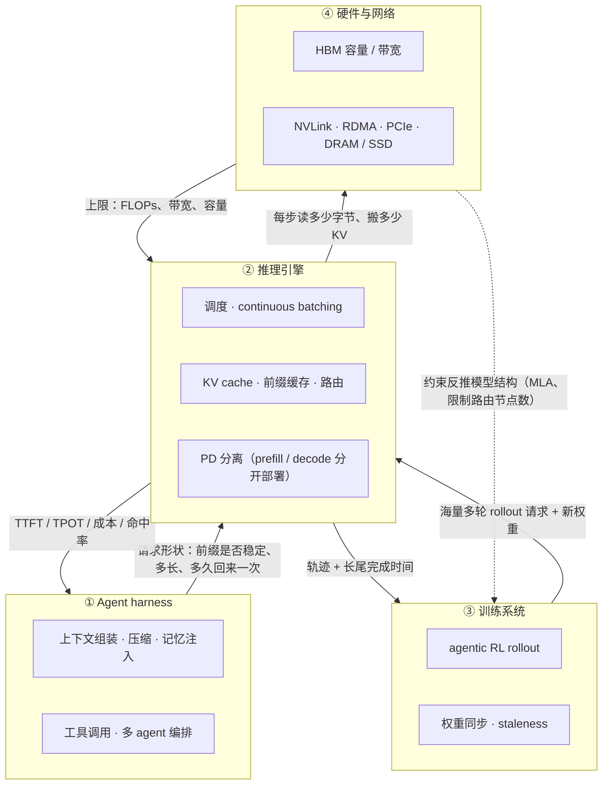

**中文** · [English](README.en.md)

# 模块 00：全景图——Harness × Inference 协同设计的四层

> 🕐 建议时长：0.5 小时 ｜ 🎯 学完你能：画出 agent 系统的四层栈，举出 6 个「一层的决策把成本转嫁到另一层」的例子并给出数量级，知道后面每个模块回答哪个问题 ｜ 🧪 实验：无（纯讲义） ｜ 📖 必读一手资料：[Context Engineering for AI Agents: Lessons from Building Manus](https://manus.im/blog/Context-Engineering-for-AI-Agents-Lessons-from-Building-Manus)、[DeepSeek-V3/R1 Inference System Overview](https://github.com/deepseek-ai/open-infra-index/blob/main/202502OpenSourceWeek/day_6_one_more_thing_deepseekV3R1_inference_system_overview.md)

## 0. 一句话

**Agent 系统的成本不长在某一层里，而长在层与层的接缝上**：harness 里一行「在 system prompt 开头加个时间戳」的代码，可能让推理引擎的前缀缓存（prefix cache，复用已算好的 KV）每一轮都整段失效，让整台 8 卡机器每轮多算几秒 prefill（预填充，处理输入 prompt 的阶段）。协同设计（co-design）就是把这些接缝当成一等公民来设计。

## 1. 大厂为什么在意

场景：一个线上 coding agent / deep research agent 服务。每个任务几十轮「模型输出 → 调工具 → 把工具结果追加进上下文 → 再调模型」，上下文从几千 token 涨到几万甚至十几万 token，每轮只输出几百 token。

四组公开数字说明痛点在哪：

| 事实 | 数字 | 来源 |
|---|---|---|
| agent 的输入远多于输出 | Manus 的平均输入:输出 token 比约 **100:1**；作者认为 KV-cache 命中率是生产级 agent **最重要的单一指标** | [Manus 博客](https://manus.im/blog/Context-Engineering-for-AI-Agents-Lessons-from-Building-Manus) |
| 命中缓存与否，价格差 10 倍 | 同一篇博客举例：Claude Sonnet 缓存命中输入 0.30 USD/MTok，未命中 3 USD/MTok | 同上 |
| 多 agent 更吃 token | agent 通常用约 **4×** 于聊天的 token，多 agent 系统约 **15×** | [Anthropic 多 agent 研究系统](https://www.anthropic.com/engineering/multi-agent-research-system) |
| 前缀复用在大规模线上是常态 | DeepSeek 线上 24 小时内输入 608B token，其中 **56.3%** 命中磁盘上的 KV cache；每台 H800 节点 prefill 约 73.7k token/s（含命中），decode 约 14.8k token/s | [DeepSeek 推理系统概览](https://github.com/deepseek-ai/open-infra-index/blob/main/202502OpenSourceWeek/day_6_one_more_thing_deepseekV3R1_inference_system_overview.md) |

读法：**agent 负载 = 超长、高度可复用的输入 + 很短的输出 + 中间夹着工具等待**。谁决定 prompt 的排布，谁就决定了推理成本；可是写 harness 的人通常看不到推理引擎里 KV 在哪、会不会被淘汰。训练侧同理：agentic RL 的 rollout（采样轨迹）就是一大批这种多轮会话，[AReaL](https://arxiv.org/abs/2505.24298) 指出同步 RL 系统必须等 batch 里最长的输出结束才能更新模型，导致 GPU 利用率低，它用异步方案在相同 GPU 数下拿到最高 2.77× 的训练加速。

## 2. 四层栈：谁做决策，谁付账

| 层 | 典型组件 | 它做的决策 | 它看得到 | 它通常**看不到** |
|---|---|---|---|---|
| ① Agent harness | 上下文组装、压缩（compaction）、记忆注入、工具调用、多 agent 编排 | 每一轮发哪些 token、按什么顺序、什么时候发 | 任务成功率、token 账单 | KV 在哪台机器、会不会被淘汰 |
| ② 推理引擎 | 调度器、continuous batching（连续批处理，按步动态进出 batch）、分页 KV cache、前缀缓存、路由、PD 分离 | 这一步跑哪些请求、哪些 KV 留在显存、请求发到哪个实例 | TTFT、TPOT、吞吐、命中率 | 这个会话几秒后会不会带着工具结果回来 |
| ③ 训练系统 | rollout worker、reward、trainer、权重同步 | 一个训练 batch 等多少条轨迹、允许多旧的策略（staleness，策略版本滞后） | 每小时样本数、reward 曲线 | 推理引擎内部的排队与长尾 |
| ④ 硬件与网络 | HBM、NVLink、RDMA（InfiniBand / RoCE）、PCIe、CPU DRAM、SSD | 采购时一次定死 | 峰值 FLOPs、带宽、容量 | 负载长什么样 |

## 3. 成本转嫁：六个例子

每个例子按「谁做的决策 → 谁付的账 → 数量级 → co-design 的解法 → 去哪个模块深挖」来读。数量级都用模块 01 的公式心算，模型与硬件参数见 [numbers-cheatsheet](../../docs/numbers-cheatsheet.md)。

### 3.1 harness 改写上下文 → 前缀缓存失效 → prefill 重算

- **决策**：两种常见写法。① 在 system prompt 开头放一个精确到秒的时间戳，或者把检索到的记忆插在最前面；② 上下文太长时，把前面的历史总结成一段摘要（compaction，上下文压缩）。
- **账单**：前缀缓存按「从头开始完全一致的前缀」匹配（[Anthropic](https://platform.claude.com/docs/en/build-with-claude/prompt-caching) 按 tools → system → messages 的顺序建缓存前缀，任一层改动都会让它和之后的缓存失效；[OpenAI](https://developers.openai.com/api/docs/guides/prompt-caching) 同样要求渲染后的整个前缀匹配）。改写点之后的所有 token 都要重新 prefill。
- **数量级**（Llama-3-70B，约 70.6B 参数，8 × H100，每卡 989 TFLOPS dense BF16，按 60% MFU 即实际达到的算力占峰值的比例；公式见[模块 01](../01_inference_basics/README.md)）：
  - ① 头部每轮都变：整段前缀**每一轮**都失效。64k 上下文每轮重算约 **3.1 秒整机时间**（线性层约 2 × 68.5e9 × 65,536 ≈ 9.0e15 FLOPs，68.5B 是去掉输入 embedding 和 lm_head 的参数；注意力约 5.6e15），几十轮就付几十次。
  - ② 压缩到 8k：只有压缩后的**那一轮**要重算变短后的 8k 上下文，约 **0.25 秒**；之后每轮的前缀更短，prefill 增量和 decode 要读的 KV 都更少，反而更便宜。如果「请总结」这个请求本身以追加的方式发出，它还能命中旧前缀。
  - 命中也不等于免费：命中在本机 HBM 时几乎为 0；命中在 CPU DRAM、SSD 或远端时，还要把 KV 搬回来。64k 的 KV 约 21.5 GB，分到 8 条 PCIe Gen5（每条单向约 64 GB/s）约 42 ms，走一张 400 Gb/s 网卡约 0.43 秒。各层的账见[模块 05](../05_cache_prefill/README.md)。
- **co-design 解法**：时间戳放末尾或降低精度；上下文只追加（append-only）、序列化保持确定（Manus 提醒 JSON key 顺序不稳定就会悄悄破坏缓存）；压缩少做、只在固定边界做，压缩后保持稳定；推理侧用前缀树（radix tree）保留多个分叉。
- **深挖**：[模块 04](../04_harness_workloads/README.md)（负载刻画）、[模块 05](../05_cache_prefill/README.md)（缓存与 prefill）。

### 3.2 工具调用等待 → KV 该留还是丢

- **决策**：模型输出一个工具调用，harness 去执行，可能要几秒到几分钟。
- **账单**：推理引擎面临三选一。① 留在 HBM：占着显存，挤掉别人的并发；② 丢掉：工具返回后重新 prefill；③ 卸载（offload）到 CPU DRAM / SSD：占 PCIe 和网络带宽，回来时要搬回。
- **数量级**：同样是 70B、64k 上下文，KV 为 65,536 × 320 KiB = **20 GiB**。留着：8 × 80 GB 的机器扣掉约 141 GB 权重后，一个会话就占掉可用 KV 空间的约 4–5%；丢掉：回来时重算约 3.1 秒整机时间；卸载：切成 8 份后每卡约 2.7 GB，按 PCIe Gen5 x16 单向约 64 GB/s（H100 规格页写的是双向 128 GB/s）理论上约 42 ms 就能搬回来。把「占住的 KV 份额 × 等待时间」和「重算时间」放在同一个单位里比（[模块 01](../01_inference_basics/README.md) 练习 (d)），这个会话的工具等待在约 **62 秒**以内值得留，更久就该卸载。
- **co-design 解法**：按预计工具时延给 KV 设 TTL（生存时间）再决定 pin 住还是卸载。[InferCept](https://arxiv.org/abs/2402.01869) 指出现有系统把每次外部交互当作生成结束、交互完成后按新请求重算已经算过的上下文；[Continuum](https://arxiv.org/abs/2511.02230) 按重载代价和排队延迟给 KV 设 TTL。
- **深挖**：[模块 04](../04_harness_workloads/README.md)、[模块 05](../05_cache_prefill/README.md)。

### 3.3 RL rollout 长尾 → GPU 空转

- **决策**：训练系统采用同步 on-policy RL：发出一批 prompt，等所有轨迹结束再训练一步。
- **账单**：agent 轨迹长度（轮数 × 每轮输出 × 工具等待）是重尾分布。batch 里大部分轨迹早早结束，最后几条长轨迹拖住整个集群。batch 缩小时，decode 的每步耗时并不会等比例缩短，**每个 token 变贵了**：按本项目的成本模型，Llama-3-70B、8 × H100、4k 上下文，batch 从 256 缩到 4，每步只从约 22.5 ms 降到约 6.7 ms（快 3.3 倍），吞吐却降了约 19 倍。权重读取占比越高（上下文短、模型大），越接近「步长不变、吞吐按 batch 比例下降」；长尾阶段剩下的往往是上下文最长的轨迹，步长会缩得更多（32k 上下文时约 15.9 倍）。原理见[模块 01](../01_inference_basics/README.md)。
- **数量级**（设想的例子）：256 条轨迹平均 20 秒，被截断的最长一条 300 秒。严格同步的话，每个 rollout 槽位在这一步里平均只有 20 / 300 ≈ 7% 的时间在干活。**主要的浪费是槽位空转**，每 token 变贵是雪上加霜。
- **co-design 解法**：partial rollout（部分展开，没跑完的留到下一轮续写）、异步 RL（允许有界的 staleness）、按长度分桶。AReaL 报告异步化后最高 2.77× 加速。
- **深挖**：[模块 06](../06_long_tail_async/README.md)。

### 3.4 多 agent 编排 → 前缀共享与路由冲突

- **决策**：harness 让一个 lead agent 并行派出 N 个 subagent。
- **账单**：token 量按倍数涨（Anthropic 报告多 agent 约 15× 聊天的 token）。如果每个 subagent 的 prompt 都是「共享的工具定义 + system prompt」在前、自己的任务在后，它们能共享前缀；如果把各自的角色描述放在最前面，共享前缀就是 0。即使 prompt 排得好，路由器也得把它们送到**同一个**推理实例才能命中，这又和负载均衡冲突。
- **数量级**：一段 10k token 的共享前缀在 Llama-3-8B 上是 10,000 × 128 KiB ≈ 1.2 GiB KV；N = 8 个 subagent 各算一遍，就是 7 次白算的 prefill 和 7 份重复占用的显存。共享前缀还有第三个好处：decode 时专门的 kernel 能让多条序列一起读同一份前缀 KV，把注意力的算术强度乘上序列数（[模块 01](../01_inference_basics/README.md) 第 3.5 节）。
- **co-design 解法**：前缀在前、差异在后的 prompt 规范；cache-affinity 路由 + 负载上限；训练侧则要回答「团队拿到一个 reward，功劳怎么分给每个 agent」。
- **深挖**：[模块 05](../05_cache_prefill/README.md)（多项目 cache 与路由）、[模块 07](../07_multi_agent_credit/README.md)（多 agent 信用分配）。

### 3.5 硬件约束 → 反推模型结构

- **决策**：DeepSeek 用的是 H800 集群，节点内 NVLink、节点间 InfiniBand。
- **账单**：[DeepSeek-V3 技术报告](https://arxiv.org/abs/2412.19437)写到，NVLink 带宽约 160 GB/s，大约是 IB（50 GB/s）的 3.2 倍；后来的 [ISCA 论文（arXiv:2505.09343）](https://arxiv.org/abs/2505.09343)说得更细：H800 的 NVLink 标称 200 GB/s（单向，实际约 160 GB/s），每张 400 Gb/s 的 IB 网卡 50 GB/s（考虑小消息和延迟，有效约 40 GB/s），节点内外约 4:1。于是 MoE 的专家并行（EP）跨节点通信会成为瓶颈。
- **数量级**：技术报告的做法是限制每个 token 最多发往 **4 个节点**（node-limited routing）。它还算了一笔账：IB 和 NVLink 的通信可以完全重叠，每个 token 平均在每个节点上能选约 3.2 个专家而不额外占用 NVLink，所以**虽然 DeepSeek-V3 实际只选 8 个 routed expert，在同样的通信代价下最多可以扩到 13 个**（4 个节点 × 3.2）。
- **co-design 解法**：硬件的带宽层级被直接写进了模型结构和路由规则；MLA（多头潜在注意力）把每 token 的 KV 压到 61 层 × 576 维。ISCA 论文整篇讨论的就是这种 hardware-aware 的模型协同设计。
- **深挖**：[模块 03](../03_deepseek_stack/README.md)。

### 3.6 模型的 KV 大小 → PD 分离的传输账什么时候变贵

- **决策**：推理侧想把 prefill 和 decode 放到不同机器上（PD 分离，prefill-decode disaggregation），避免两者互相干扰（[DistServe](https://arxiv.org/abs/2401.09670)、[Splitwise](https://arxiv.org/abs/2311.18677)）。
- **账单**：prefill 算完的 KV 要通过 RDMA 网络搬给 decode 机器。
- **数量级**：64k 上下文，Llama-3-70B（GQA，每 token 320 KiB）的 KV 约 21.5 GB。走单张 400 Gb/s（50 GB/s）网卡约 0.43 秒，是同一段 prefill（8 × H100 约 3.08 秒）的 14%；8 张网卡并行约 54 ms，占 1.7%；再按层流水、边算边发，基本能藏住。一手测量也是这样：Splitwise 报告串行传 KV 的影响随 prompt 变大最多到端到端延迟的 3%，优化后的按层传输只占 0.8%；DistServe 把对应的流水线阶段放在同一节点、走 NVLink 传 KV，在 OPT-175B 上 KV 传输不到总延迟的 0.1%。**常规情况下，GQA 模型做 PD 分离，KV 传输不是瓶颈。**
- **什么时候变贵**：传输量按整段上下文算，计算量却只按没命中的 token 算。命中率高时两者就不成比例了：64k 上下文命中 90% 时只需算约 0.41 秒，21.5 GB 走单网卡却还是 0.43 秒。跨机房的慢链路、从 SSD 缓存层读 KV 也是一样。这时 MLA 的优势才显出来：DeepSeek-V3 同样 64k 只有约 4.6 GB（每 token 约 68.6 KiB），单网卡约 0.09 秒。**模型层的一个结构选择，决定了引擎层的一种部署方式在高命中率下是否还划算。**
- **co-design 解法**：先用「KV 字节 ÷ 需要现算的 FLOPs」对比「网卡带宽 ÷ 算力」判断会不会卡；多网卡并行、按层流水；MLA / FP8 KV 压缩传输量。
- **深挖**：[模块 02](../02_inference_engines/README.md)、[模块 03](../03_deepseek_stack/README.md)、[模块 05](../05_cache_prefill/README.md)。

## 4. 你正在研究的四个问题，分别在哪

| 研究问题 | 核心矛盾 | 主模块 | 需要的前置 |
|---|---|---|---|
| **长尾异步** | 同步等最慢的 vs 异步带来的 staleness | [模块 06](../06_long_tail_async/README.md) | 模块 01（batch 变小后为什么每个 token 更贵）、模块 04（长尾从哪来） |
| **多 agent 奖励** | 团队 reward 怎么分给每个 agent，梯度方差 vs 偏差 | [模块 07](../07_multi_agent_credit/README.md) | 模块 06（rollout 系统） |
| **多项目 cache** | 命中率 vs 负载均衡，谁的前缀留在显存 | [模块 05](../05_cache_prefill/README.md) | 模块 01（KV 大小）、模块 04（前缀结构） |
| **prefill** | 长 prompt 的 TTFT vs decode 的 TPOT，算还是存还是搬 | [模块 01](../01_inference_basics/README.md) → [模块 02](../02_inference_engines/README.md) → [模块 05](../05_cache_prefill/README.md) | 模块 03（DeepSeek 的 PD 分离实践） |

## 5. 20 小时路线

| 模块 | 时长 | 回答什么问题 |
|---|---|---|
| [00 全景图](README.md) | 0.5h | 四层栈、成本如何跨层转嫁 |
| [01 推理第一性原理](../01_inference_basics/README.md) | 2h | prefill / decode 为什么不同；KV 有多大；怎么心算 TTFT、并发 |
| [02 现代推理引擎](../02_inference_engines/README.md) | 2h | continuous batching、PagedAttention、chunked prefill、PD 分离怎么调度 |
| [03 拆解 DeepSeek 技术栈](../03_deepseek_stack/README.md) | 2.5h | MLA、MoE / EP、FP8、PD 分离的大规模实践 |
| [04 Agent Harness 的负载画像](../04_harness_workloads/README.md) | 1.5h | agent 会话长什么样：前缀、轮数、工具等待、改写 |
| [05 Cache × Prefill 协同设计](../05_cache_prefill/README.md) | 2.5h | 前缀缓存、淘汰策略、多项目路由、KV 分层存储 |
| [06 长尾与异步](../06_long_tail_async/README.md) | 2.5h | 同步 / partial / 异步 rollout 的吞吐与 staleness |
| [07 多 agent 奖励与信用分配](../07_multi_agent_credit/README.md) | 1.5h | shared / baseline / difference / Shapley 的偏差与方差 |
| [08 系统设计与面试](../08_system_design/README.md) | 2h | 把前面的东西拼成一次完整的系统设计面试 |
| [09 前沿与开放问题](../09_frontier/README.md) | 0.5h | 前沿线索与开放研究问题：哪些还没有答案、怎么做成论文 |
| [★ 综合实战：迷你推理引擎](../../capstone/README.md) | 2.5h | 用 numpy 真正跑 Transformer 前向：分块 KV、前缀缓存、continuous batching、chunked prefill、抢占、asyncio 并发 agent 前端 |
| **合计** | **20h** | |

建议顺序：00 → 01 → 02 → 03 → 04 → 05 → 06 → 07 → 综合实战 → 08 → 09。时间紧就先走「00 → 01 → 04 → 05 → 06」这条主线，它直接覆盖四个研究问题中的三个。

## 6. 必须会心算的数字

| 量 | 典型值 | 怎么推出来 | 来源 |
|---|---|---|---|
| agent 输入:输出 | ~100:1 | 线上统计 | [Manus](https://manus.im/blog/Context-Engineering-for-AI-Agents-Lessons-from-Building-Manus) |
| 缓存命中输入的价格 | 约为未命中的 0.1× | 厂商价目 | [Anthropic prompt caching](https://platform.claude.com/docs/en/build-with-claude/prompt-caching) |
| Llama-3-70B 每 token KV（BF16） | 320 KiB | 2 × 80 层 × 8 KV 头 × 128 维 × 2 B | [Llama 3 论文 Table 3](https://arxiv.org/abs/2407.21783) |
| DeepSeek-V3 每 token KV（BF16） | ≈ 68.6 KiB | 61 层 × (512 + 64) × 2 B | [DeepSeek-V3 config.json](https://huggingface.co/deepseek-ai/DeepSeek-V3/blob/main/config.json) |
| 70B、64k 上下文 prefill | 8×H100 约 3.1 s | (2 × 68.5e9 × 65,536 + 注意力项) ÷ (8 × 989e12 × 0.6) | 推导，见模块 01 |
| 70B、压缩到 8k 后重算一次 | 8×H100 约 0.25 s | 同上，n = 8,192 | 推导，见模块 01 |
| H800 NVLink vs IB（单向） | NVLink 标称 200 GB/s、实际约 160 GB/s；IB 50 GB/s、有效约 40 GB/s | — | [DeepSeek-V3 技术报告](https://arxiv.org/abs/2412.19437)、[arXiv:2505.09343](https://arxiv.org/abs/2505.09343) |

更多见 [必须会心算的数字](../../docs/numbers-cheatsheet.md) 和 [术语表](../../docs/glossary.md)。

## 7. 自测题

1. 为什么说 agent 负载是「prefill 重、decode 轻」？给出一个公开数字。
   

答案
每轮都要把越来越长的上下文重新送进模型，每轮只输出几百 token。Manus 报告平均输入:输出约 100:1。所以 prefill（以及避免 prefill 的前缀缓存）决定了大部分成本。

2. harness 在 system prompt 最开头加一个精确到秒的时间戳，会发生什么？
   

答案
前缀从第一个 token 就变了，后面整段（工具定义、历史）都无法命中前缀缓存，每一轮都全量 prefill：70B、64k 上下文每轮约 3.1 秒 8 卡整机时间。对比一次压缩到 8k：只有压缩后那一轮重算约 0.25 秒。修法：时间放到末尾或降低精度，保持前缀稳定。

3. 工具调用期间，KV 留、丢、卸载三种做法各自的代价是什么？各举一个数量级。
   

答案
留：占 HBM，降低并发（70B、64k 上下文约 20 GiB）；丢：回来时重算 prefill（约 3.1 秒 8 卡整机时间）；卸载：占 PCIe / 网络带宽（每卡 2.7 GB，按 PCIe Gen5 单向约 64 GB/s 理论约 42 ms），前提是有 DRAM 空间且能和计算重叠。按模块 01 练习 (d) 的成本模型，这个会话的工具等待在约 62 秒以内值得留。

4. 为什么 RL rollout 的长尾在 decode 阶段特别伤？
   

答案
主要的浪费是槽位空转：同步等最慢的轨迹，大部分 rollout 槽位早早闲下来。另外 decode 是 memory-bound 的，每步都要读一遍权重，batch 变小时步长不会等比例缩短，每个 token 变贵：70B、8 × H100、4k 上下文，batch 从 256 缩到 4，每步只快 3.3 倍，吞吐却降约 19 倍。权重读取占比越高，越接近「步长不变、吞吐按比例下降」。

5. 举一个「硬件约束反过来决定模型结构」的例子。
   

答案
DeepSeek-V3：H800 集群上 NVLink（实际约 160 GB/s）约是 IB（50 GB/s）的 3.2 倍，所以限制每个 token 最多路由到 4 个节点，降低跨节点 all-to-all 通信；报告还算出同样通信代价下每个 token 最多可以选 13 个专家（实际选 8 个）。

6. 你研究的四个问题各自对应哪个模块？
   

答案
长尾异步 → 模块 06；多 agent 奖励 → 模块 07；多项目 cache → 模块 05；prefill → 模块 01 / 02 / 05（DeepSeek 的实践在模块 03）。

## 8. 面试追问

1. **「agent 的推理成本主要花在哪？你怎么降？」**
   要点：结论是 prefill 和前缀复用。数量级：输入:输出约 100:1，缓存命中价格约 0.1×，DeepSeek 线上 56.3% 的输入命中磁盘 KV cache。取舍：稳定前缀（harness 侧，零成本但限制灵活性）vs 更大的缓存容量（引擎侧，占显存 / DRAM / SSD）vs cache-affinity 路由（容易负载不均）。
2. **「harness 做上下文压缩，对推理系统有什么影响？」**
   要点：先分清两种改写。压缩只让压缩后的那一轮 miss，重算的是变短后的上下文（70B、8 × H100、8k 约 0.25 秒），之后每轮的 prefill 增量和 decode 读的 KV 都更少；真正贵的是每轮都改前缀头部（时间戳、记忆插在最前面），64k 每轮约 3.1 秒。取舍：压缩频率越低、边界越固定越好；「请总结」请求本身以追加方式发出，还能命中旧前缀；还要看命中在哪一层，在 DRAM / SSD 时要把 KV 搬回来。
3. **「工具调用期间 KV 怎么处理？」**
   要点：留 / 丢 / 卸载三选一，按「预计工具时延 × 占用的 KV 份额」对比「重算或搬回的时间」。70B、64k、8 × H100 的门槛约 62 秒；超过门槛且有 DRAM 时卸载通常最划算（每卡几 GB，PCIe 几十毫秒）；工具时延不可预测时按分布设 TTL，再配合抢占。
4. **「同步 RL 和异步 RL 的核心取舍？」**
   要点：同步等最慢的轨迹，GPU 空转；异步提高利用率但引入 staleness（旧策略产生的数据）。AReaL 报告最高 2.77× 加速且最终效果持平或更好。要能说出限制 staleness 的办法（版本差上限、重要性采样修正）。
5. **「什么情况下 KV 传输会成为 PD 分离的瓶颈？」**
   要点：先说结论——常规情况下不会。70B、64k 的 KV 约 21.5 GB，单网卡 0.43 秒，是 prefill（约 3.08 秒）的 14%，8 张网卡 1.7%，按层流水基本藏住；Splitwise 测得按层传输只占端到端 0.8%，DistServe 在 OPT-175B 上不到 0.1%。会卡的情况：命中率高（传整段、只算一小段：64k 命中 90% 时计算 0.41 秒 vs 传输 0.43 秒）、跨机房慢链路、从 SSD 层读。这时 MLA 的 4.6 GB（约为 GQA-70B 的 1/4.7）才显出优势。

## 9. 延伸阅读

- [Context Engineering for AI Agents: Lessons from Building Manus](https://manus.im/blog/Context-Engineering-for-AI-Agents-Lessons-from-Building-Manus)：从 harness 视角看 KV-cache 命中率，可以直接对照 3.1 节。
- [DeepSeek-V3/R1 Inference System Overview](https://github.com/deepseek-ai/open-infra-index/blob/main/202502OpenSourceWeek/day_6_one_more_thing_deepseekV3R1_inference_system_overview.md)：少有的公开线上推理系统数字：吞吐、命中率、节点数、成本。
- [How we built our multi-agent research system](https://www.anthropic.com/engineering/multi-agent-research-system)（Anthropic）：多 agent 编排的 token 成本与收益。
- [AReaL（arXiv:2505.24298）](https://arxiv.org/abs/2505.24298)：同步 RL 为什么让 GPU 空转，异步怎么补 staleness。
- [Insights into DeepSeek-V3: Scaling Challenges and Reflections on Hardware for AI Architectures（arXiv:2505.09343）](https://arxiv.org/abs/2505.09343)：硬件 × 模型协同设计的第一手总结。
- [InferCept（arXiv:2402.01869）](https://arxiv.org/abs/2402.01869)与 [Continuum（arXiv:2511.02230）](https://arxiv.org/abs/2511.02230)：工具调用期间 KV 怎么管，推理侧的两种回答。
