[中文](README.md) · **English**

# Module 02: Modern Inference Engines

> 🕐 Suggested time: 2 hours (reading 1 h + lab 20 min + exercises 40 min) ｜ 🎯 After this module you can: explain, for every key mechanism in vLLM / SGLang / TensorRT-LLM, **what it solves, what it costs, and when it is not worth it**; infer scheduler settings from a set of TTFT / TPOT numbers; and derive block fragmentation, chunk budgets and "is speculative decoding still worth it at this batch size and context length" on the spot in an interview ｜ 🧪 Lab: [`lab.py`](lab.py) ｜ 📖 Must-read primary sources: [PagedAttention / vLLM (SOSP'23)](https://arxiv.org/abs/2309.06180), [Sarathi-Serve (OSDI'24)](https://arxiv.org/abs/2403.02310)

## 0. One sentence

**An inference engine = a scheduler that works in tokens + a memory manager that works in blocks.** Every mechanism in this module moves cost between three scarce resources:

| Scarce resource | Who competes for it | Mechanisms in this module |
|---|---|---|
| **HBM capacity** (holds the KV cache) | concurrent requests × context length | PagedAttention, prefix caching, preemption, FP8 KV, PD disaggregation |
| **HBM bandwidth** (weights and KV read every step) | decode (memory-bound) | continuous batching, speculative decoding, weight-only quantization |
| **Compute** (FLOPs) | prefill (compute-bound) | chunked prefill, FP8 W8A8, prefix caching (skips repeated prefill) |

Prefill (processing the whole prompt in one pass) vs decode (one new token per step), the roofline, the KV cache formula, the arithmetic intensity of decode attention and of MoE, and the definitions of TTFT / TPOT are covered in [Module 01](../01_inference_basics/README.en.md); we use them directly here.

## 1. Why big labs care

**Scenario: a coding-agent service.** Each request's prompt is "system prompt + tool definitions + repository context + previous turns", often tens of thousands of tokens; each turn outputs a few hundred tokens, waits for a tool, then appends a few thousand tokens for the next turn. Take Llama-3-70B on H100 (architecture from Table 3 of the [Llama 3 report](https://arxiv.org/abs/2407.21783): 80 layers, 64 query heads, 8 KV heads, head_dim = 8192 / 64 = 128):

- **The KV cache eats memory**: KV per token = 2 (K and V) × 80 layers × 8 heads × 128 dims × 2 bytes = **320 KiB**. A 100k-token session ≈ **32.8 GB**. The 70B BF16 weights are ≈ 141 GB; on two 80 GB H100s that leaves about 20 GB, not even enough for this one session. **KV capacity sets concurrency**, concurrency sets the decode batch size, and the batch size sets the cost per token.
- **A long prefill stalls everyone**: an 8k-token prefill needs ≈ 2 × 70.6e9 × 8192 ≈ 1.16e15 FLOPs in the linear layers, ≈ 0.24 s on 8 × H100 (dense BF16 ≈ 989 TFLOPS per GPU) at 60% MFU, or ≈ 0.26 s with attention. If the scheduler puts it into a single step, every user currently decoding waits that long: a TPOT spike.
- **Every turn resends the history**: without prefix caching, turn k re-prefills turns 1..k−1, so total prefill grows **quadratically** with the number of turns (Section 4 works an example: an 8-turn agent session, where caching saves 6× prefill).

These three problems map to PagedAttention, chunked prefill and prefix caching. Speculative decoding, quantization, parallelism and PD disaggregation keep moving cost around on top of that skeleton.

## 2. Continuous batching: from per-request to per-iteration scheduling

**What it solves.** Traditional request-level batching sends a batch into the model and only takes the next batch once **the whole batch is done**: short requests that finish early sit idle in their slots, and new requests wait for the longest request in the batch. LLM output lengths range from a few to thousands of tokens, so the waste is large.

**Mechanism.** [Orca (OSDI'22)](https://www.usenix.org/conference/osdi22/presentation/yu) introduced two ideas:

1. **Iteration-level scheduling**: the scheduler asks the engine to run **one iteration** (one token) at a time; after every step it can evict finished requests and admit new ones.
2. **Selective batching**: requests have different lengths and cannot form a regular tensor. Orca "flattens" per-token operators such as the QKV projection and the MLP into one big matmul across requests, and only runs attention separately per request.

On GPT-3 175B the paper reports **36.9×** the throughput of NVIDIA FasterTransformer at the same latency. Every mainstream engine does this today; TensorRT-LLM calls it **in-flight batching**, and vLLM V1 writes a scheduling decision simply as `{request_id: num_tokens}` — prefill and decode are no longer distinguished, a step just gives each request some number of tokens ([vLLM V1 blog](https://vllm.ai/blog/2025-01-27-v1-alpha-release)).

```mermaid
gantt
    dateFormat X
    axisFormat %s
    section Static batching
    Request A (long)      :a1, 0, 8
    Request B (short then idle) :b1, 0, 3
    Request C (waits for batch)  :c1, 8, 12
    section Iteration-level
    Request A          :a2, 0, 8
    Request B          :b2, 0, 3
    Request C (fills B's slot) :c2, 3, 7
```



**Cost.**
- **CPU scheduling overhead sits on the critical path.** The scheduler runs every step (batch assembly, block allocation, prefix matching, sampling), while a decode step takes only milliseconds to tens of milliseconds. The SGLang v0.4 blog puts it this way: an unoptimized engine can spend as much as half of its time on CPU overhead. The standard fix is to have the CPU prepare the next batch **one step ahead**, overlapped with the GPU forward pass: SGLang's overlap scheduler (disable with `--disable-overlap-schedule`) and vLLM v0.30.0's async scheduling (on by default unless an incompatible option is set). The price is that the scheduler plans the next step before it knows this step's output: SGLang resolves the dependency with "future token" placeholders; vLLM has to handle "in-flight output" specially when it preempts a request (the source marks it stale and notes that dropping it would perturb speculative-decoding acceptance statistics).
- **Dynamic shapes vs CUDA Graphs.** The batch shape changes every step, while a CUDA Graph needs fixed shapes. The approach is to capture graphs for a set of batch sizes ahead of time and **pad** each batch up to the nearest captured size at run time: vLLM V1 defaults to `FULL_AND_PIECEWISE` — full CUDA Graphs for pure decode batches, and piecewise graphs (everything except attention) for batches that contain prefill; SGLang sets the maximum decode CUDA-Graph batch by GPU memory (256 on 80 GB-class GPUs when TP < 4, otherwise 512).
- Requests come and go at any step, so KV memory must be allocated and freed dynamically — which directly motivated PagedAttention in the next section.

**When it is not worth it.** Requests with nearly identical input and output lengths, or a single user (batch = 1): request-level batching is already good enough. Conversely, **offline batch jobs benefit most from continuous batching whenever output lengths vary** — a slot freed by a short request is refilled immediately. RL rollouts are the textbook case: output lengths are long-tailed (see [Module 06](../06_long_tail_async/README.en.md)).

## 3. PagedAttention: manage the KV cache like virtual memory

**What it solves.** Early systems reserved a **contiguous** region per request sized for the maximum length: space for not-yet-generated tokens sits reserved (reservation), unused space is wasted (internal fragmentation), and holes of different sizes cannot be combined (external fragmentation). The vLLM paper measured that only **20.4%–38.2%** of KV memory in existing systems actually held token states.

**Mechanism.** Borrow paging from operating systems:

- Split the KV cache into fixed-size **blocks**, each holding K and V for `block_size` tokens (16 by default in the vLLM paper).
- Each request has a **block table**: logical block i → some physical block number. Physical blocks **need not be contiguous**.
- The next block is allocated only when generation crosses a block boundary; blocks go back to the free list when the request finishes.
- Several sequences can share a physical block (reference counting) and copy it on write — so parallel sampling and beam search store their common prefix only once.

```
Request A (37 tokens, block_size=16)        Physical KV memory
logical 0 ──► physical 7   [16/16 full]     ┌──┬──┬──┬──┬──┬──┬──┬──┐
logical 1 ──► physical 2   [16/16 full]     │  │  │A1│  │B0│  │  │A0│ ...
logical 2 ──► physical 9   [ 5/16, 11 waste] └──┴──┴──┴──┴──┴──┴──┴──┘
```

**The fragmentation formula you must be able to derive.** A sequence of length L occupies ⌈L / B⌉ blocks and wastes `B·⌈L/B⌉ − L ≤ B − 1` slots, **only in its last block**. If L mod B is uniformly distributed, the expected waste per sequence is exactly **(B − 1)/2** (7.5 for B = 16; B/2 is fine for mental math). With 256 concurrent sequences and B = 16: ≈ 256 × 7.5 = 1920 wasted token slots, i.e. 1920 × 320 KiB = 600 MiB for Llama-3-70B — negligible against a KV pool of hundreds of GB. Compare "reserve max_len = 8192 contiguously": a request that only uses 1000 tokens wastes 7192 slots. Exercise (a) makes you compute this yourself.

**The block_size trade-off.** Small blocks → less fragmentation, but the attention kernel moves tiny pieces and there is more metadata; large blocks → more efficient kernels, but more waste in the last block and coarser prefix-caching granularity (vLLM caches only **full** blocks, see Section 4). The paper concludes that 16 is good enough on both counts for most workloads.

**Cost.** The attention kernel must gather through the block table; the paper reports the PagedAttention kernel is **20%–26% slower** than the highly optimized FasterTransformer kernel. But only the attention operator is affected, and in exchange the batch can be several times larger: 2–4× end-to-end throughput (vs FasterTransformer and Orca at the same latency).

### 3.1 When memory runs out: preemption, recompute or swap

The KV cache grows during decode, so blocks eventually run out. The scheduler must then **preempt** some running requests to free their blocks. The vLLM paper is all-or-nothing: either all of a sequence's blocks are kept or all are released. There are two ways to resume:

| | swap (move to CPU memory) | recompute (drop, re-prefill later) |
|---|---|---|
| Resource spent | PCIe bandwidth + CPU memory, once out and once back | GPU compute (one prefill) |
| Order of magnitude for a 70B, TP8, 4k-token request | 4096 × 320 KiB ≈ 1.34 GB of KV in total, but with TP8 the 8 KV heads are one per GPU, so **each GPU holds only 1/8 ≈ 168 MB** and uses its own PCIe Gen5 x16 (NVIDIA's 128 GB/s is the bidirectional total, so 64 GB/s per direction) ≈ **2.6 ms** out + 2.6 ms back (multiply by the sharing factor if several GPUs share a host-side PCIe uplink) | ≈ 5.7e14 FLOPs (a bit more with attention), ≈ **0.12 s** on 8 × H100 at 60% MFU |
| vLLM paper's finding | With small blocks, PCIe transfers are fragmented and swap overhead is excessive | With small blocks recompute is cheaper; for blocks of 16–64 the two are similar |
| vLLM v0.30.0 (V1) | **Swap no longer exists**: preemption = free the blocks + reset the computed-token count; the CPU tier is handled by KV offloading instead (`--kv-offloading-size`, or OffloadingConnector / LMCache) | **The only preemption mode**; the official docs say recomputation has lower overhead in the V1 architecture |

Note that on time alone swap is more than an order of magnitude cheaper than recompute — compare "per-GPU data ÷ per-GPU link" with "total compute ÷ total compute rate", keeping the accounting consistent. V1 still keeps only recompute; one reason worth saying in an interview: on preemption the request's blocks are **freed back to the free queue**, and their hashes survive until those blocks are actually evicted (Section 4). So when a preempted request is recomputed, its prefix often still hits the cache, and recompute redoes far less than "the whole thing".

**When to worry.** V1's periodic stats log includes `Preemptions: N`, and the Prometheus metric is `vllm:num_preemptions`; if it keeps climbing, concurrency exceeds KV capacity (the `PreemptionMode.RECOMPUTE` sample log line in the official tuning docs dates from V0; the name no longer appears anywhere in the v0.30.0 Python source). The knobs from the vLLM docs: raise `gpu_memory_utilization`, raise `tensor_parallel_size` (weights spread over more GPUs leave more KV space per GPU), or lower `max_num_seqs` / `max_num_batched_tokens`.

## 4. Prefix caching: vLLM block hashes vs SGLang RadixAttention

**What it solves.** Multi-turn chat and agents resend almost the same prefix every time. An example: a 20k-token shared prefix, 3k tokens appended per turn, 8 turns.

- No prefix caching: every turn prefills everything, 20k+3k, 20k+6k, …, 20k+24k, totalling 8 × 20k + 3k × (1+2+…+8) = **268k** tokens.
- Perfect hits: 23k in turn 1, then only the new 3k per turn, totalling 23k + 7 × 3k = **44k** tokens — roughly a **6×** difference (ignoring output tokens, whose KV was already computed during decode).

**vLLM: Automatic Prefix Caching (APC), based on block hashes.** ([design doc](https://docs.vllm.ai/en/latest/design/prefix_caching.html))

- Every **full** block gets a hash of `(parent block hash, tokens in this block, extra hashes)`; extra hashes include the LoRA ID, multimodal input hashes and a `cache_salt` for multi-tenant isolation. Because the parent hash is included, **a block's hash implies the entire prefix before it**, so a flat "hash → physical block" table is enough for prefix matching: look blocks up from the start and stop at the first miss.
- **Only full blocks are cached**: the last partial block is not, so up to B − 1 tokens are recomputed.
- When a request finishes, blocks whose reference count drops to 0 go to the **free queue** but keep their hash and can still be hit; allocating a new block pops the least recently used (LRU) block from the head of the queue, and only then is its hash actually evicted. Blocks are enqueued in **reverse** order when freed: a request's last blocks cover the longest prefix and are the least likely to be reused, so they go first.
- This means **the cache lives in memory that is free anyway** and never squeezes running requests. V1 enables it by default; the official blog reports less than 1% throughput loss at a 0% hit rate.

**SGLang: RadixAttention, based on a radix tree.** ([SGLang paper](https://arxiv.org/abs/2312.07104))

- A radix tree stores all cached token sequences, with edges labelled by token runs; KV is stored in pages and the tree matches page by page. The paper uses a page size of one token, so matching works at token granularity.
- Eviction: LRU, **leaves first**; every node has a reference count, and nodes used by running requests cannot be evicted. Ancestors stay reusable until they themselves become leaves.
- **Cache-aware scheduling**: sort by matched prefix length and run the longest first (longest prefix match, `lpm`); the paper proves that processing a batch in the radix tree's DFS order gives the optimal hit rate when the cache is at least as large as the longest request.
- With no reuse at all, tree operations cost < 0.3%; hit rates across the paper's benchmarks range from 50% to 99%.

The engineering details in the table below were checked against the vLLM v0.30.0 / SGLang v0.5.20 source:

| | vLLM APC | SGLang RadixAttention |
|---|---|---|
| Data structure | Flat hash table; the prefix is implied by the hash chain | Explicit radix tree |
| Matching granularity | Full blocks (block_size tokens) | By page: the default `page_size` is 1, but some attention backends force it up — FlashMLA supports only 64, TRT-LLM MLA 32 / 64, TRT-LLM MHA 16–128, FA4 (non-MLA) 128. On DeepSeek-style deployments it can be coarser than vLLM's default of 16 |
| Eviction | Free-queue LRU; a request's tail blocks go first | LRU leaves first; also `lfu` / `slru` / `priority` (`--radix-eviction-policy`) |
| Scheduling support | FCFS by default | `--schedule-policy lpm` orders by prefix hits (the default is `fcfs`, so it must be set explicitly); **when more than 128 requests are waiting, `lpm` silently falls back to FCFS** (source comment: skip the expensive prefix matching and sorting) — i.e. exactly under high load |
| Cold-prefix bursts (a batch of requests arrives together with the same uncached prefix) | — (not verified in this module; no claim made) | In-batch prefix caching: under cache-aware policies, if several queued requests share ≥ 32 tokens of prefix within the waiting queue while matching ≤ 32 tokens in the existing cache, only one is admitted first and the rest are held back, so they hit the cache once it is written (thresholds are the environment variables `IN_BATCH_PREFIX_CACHING_CHECK_THRESHOLD` / `IN_BATCH_PREFIX_CACHING_DEPRIORITIZE_THRESHOLD`, default 32) |
| Multi-tenant isolation | Per-request `cache_salt` mixed into the first block's hash | Per-request `cache_salt` (and `extra_key`) are part of the `RadixKey`, namespacing identical prefixes |
| Turning it off | `--no-enable-prefix-caching` | `--disable-radix-cache` |

**Same hit-rate ceiling, different behaviour.** Both can reuse only prefixes that are **identical and not yet evicted**, and everything after the first differing token is lost (the hash chain breaks / the tree forks); they differ in matching granularity, scheduling under cold-prefix bursts, and ordering under high load.

**Direct implications for harness design (where co-design starts).** A timestamp at the top of the system prompt, shuffling tool definitions every turn, rewriting the middle of the history for compression — each invalidates the whole prefix after it. This is exactly what [Module 04](../04_harness_workloads/README.en.md) and [Module 05](../05_cache_prefill/README.en.md) expand on.

### 4.1 What decides the hit rate: residency and reuse distance

"A shared prefix exists" is only a necessary condition. Under LRU, whether a prefix is still cached at its next use depends on **how much other traffic was written into the cache between the two uses** (reuse distance):

```
hit  ⇔  blocks written between two uses X  <  free capacity available for caching C_free
residency ≈ C_free / R          (R = tokens of new KV written per second on the instance: new prefill + new decode)
```

A derived example (assumed values): 70B on 8 × H100 with 90% of memory usable has a KV pool of about 1.33M tokens; suppose running requests hold half of it, so C_free ≈ 600k tokens; suppose the instance writes R ≈ 20k new tokens per second (say 5 turns per second with 4k new tokens each). A prefix then survives only about **30 seconds** after its last use — an agent returning from a 60-second tool call will most likely find its prefix gone. The hit rate is therefore decided by the distribution of tool-wait times, how fast other projects / sessions on the same instance write (cross-project pollution), whether routing sends a project's sessions to the same instance, KV pool capacity (FP8 KV doubles it), and the eviction policy (plain LRU does not know "this session is coming right back"). These are exactly the experimental variables of [Module 05](../05_cache_prefill/README.en.md); on real GPUs, measure them with Experiment D of the [GPU validation guide](../../docs/gpu-validation.en.md).

### 4.2 Why the hit rate affects tail latency non-linearly

Treat prefill as a single server. Let each request's prefill time be S, the arrival rate λ, and the utilization ρ = λ·S. The mean wait in an M/D/1 queue (Poisson arrivals, fixed service time) is:

```
W_q = ρ · S / (2 (1 − ρ))
```

A prefix hit does two things at once: S shrinks, and so does ρ — and the wait carries a 1/(1 − ρ) factor. An example (derived values, 70B, 8 × H100, 60% MFU, 32k prompts, λ = 0.7 req/s): at 0% hits S ≈ 1.27 s, ρ ≈ 0.89, and the wait ≈ 4.0 S; at 50% hits the new tokens halve, but attention for the new tokens still reads the whole prefix, so S only drops to ≈ 0.71 s (about 56%), ρ ≈ 0.50, and the wait ≈ 0.5 S. **Service time falls by only 44%, but the mean wait falls 14×** — the closer to saturation, the more each point of hit rate is worth. Lab 3 shows the same direction with the simulator.

**When it is not worth it.** The vLLM docs say it plainly: APC only reduces prefill time, not decode time. It does not help when outputs are long and prefill is a small share, or when requests share no prefix. Decode has its own family of optimizations: when many requests share a long prefix, **cascade / shared-prefix attention** splits attention into "shared prefix + per-request suffix" and reads the shared KV only once ([Hydragen](https://arxiv.org/abs/2402.05099) reports up to 32× end-to-end throughput on CodeLlama-13b, with throughput dropping by less than 15% as the prefix grows from 1K to 16K; the intensity derivation is in [Module 01](../01_inference_basics/README.en.md) Section 3.5). In vLLM v0.30.0 it is off by default (`disable_cascade_attn=True`), and even when enabled it is used only when a heuristic says it helps.

## 5. Chunked prefill: split long prefills, buy smooth decode

**What it solves: prefill–decode interference.** [Sarathi-Serve](https://arxiv.org/abs/2403.02310) lays out the problem clearly:

- **Prefill-prioritizing** schedulers (the paper names Orca and vLLM) admit a new prefill whenever memory allows; a long prefill runs for hundreds of milliseconds to seconds, and every request currently decoding is stuck — the paper calls this a **generation stall**, visible as TBT / TPOT spikes.
- **Decode-prioritizing** schedulers (request-level batching systems such as FasterTransformer) only admit new prefills after all current decodes finish; TPOT is smooth, but as requests in the batch finish the batch keeps shrinking, and throughput stays low.

**Mechanism: two independent factors.** Sarathi-Serve's fix has two parts, and you should explain them separately in an interview:

1. **Stall-free / decode-first + mixing**: each step first gives every decoding request 1 token, then fills the remaining budget with prefill, both in the same batch (decodes ride along with prefill).
2. **Chunking (chunked prefill)**: a prefill that does not fit is **chunked automatically** and continues next step, so the number of tokens per step is capped (`max_num_batched_tokens` in vLLM).

vLLM V1 enables both by default. With only the first (no chunking), a long prompt is still put into some step in one piece and that step is still long; only with both is "a step containing prefill" bounded by the budget.

```
token budget = 2048, 64 requests decoding, a 5000-token prompt arrives

step 1: [64 × decode] [prompt chunk 1: 1984 tokens]
step 2: [64 × decode] [prompt chunk 2: 1984 tokens]
step 3: [64 × decode] [prompt chunk 3: 1032 tokens] ← prompt done, decodes from next step
step 4: [65 × decode] [other queued prompts ...]
```

**Why piggybacking is almost free: a knee point you must be able to compute.** In the weight matmuls each token costs 2 × N floating-point operations (N = parameter count) while the weights are read from HBM only once per step, so with T tokens in a step the arithmetic intensity of the linear layers ≈ T FLOPs/Byte (BF16 weights are 2 bytes per parameter: 2N·T / 2N). H100's ridge point ≈ 989 TFLOPS / 3.35 TB/s ≈ **295 FLOPs/Byte**. Therefore, **when contexts are short and KV reads are negligible**:

- T tokens per step < ~300: memory-bound; step time ≈ time to read the weights once, and extra tokens barely slow it down — decodes ride along with prefill almost for free (the "piggybacking" in the title of [Sarathi](https://arxiv.org/abs/2308.16369)).
- T > ~300: compute-bound; step time grows linearly with T.

(With longer contexts, each decode step also reads the whole KV, the memory term grows and the knee moves right — Section 6 uses this.)

**A prefill chunk's step time must include attention.** With a chunk of C tokens and P tokens of the same prompt already processed:

```
step time ≈ [ 2N·C  +  4·n_layers·n_heads·d_head · C·(P + C/2) ] / (peak × MFU × #GPUs)
```

Llama-3-70B, 8 × H100, 60% MFU: for the **last** 8192-token chunk of a 32k prompt (P = 24576), the linear layers take ≈ 0.24 s and attention adds ≈ 0.13 s, for **≈ 0.37 s** in total; the first chunk of the same size takes only ≈ 0.26 s. **A fixed token budget is not a fixed step time**: later chunks of a long prompt are slower, which is one reason parameters such as `--long-prefill-token-threshold` (a separate cap for long prompts) exist. Exercise (d) asks you to invert this formula: see a 0.37-second stall and infer that the budget is 8192. **Whenever a prefill is running, the TPOT of decode users in the same step ≈ that step's duration** — so the token budget almost directly sets "the TPOT ceiling while prefills are running".

**Cost.**
- **TTFT may grow**: a prompt of length L needs at least ⌈L / budget⌉ steps before its first token, and decodes go first in every step.
- **Chunking has its own overhead** (measured in Sarathi-Serve): with N chunks, the first chunk's KV is re-read by the attention of N − 1 later chunks; chunk sizes that do not match GPU tiles also hurt — a chunk of 257 is 32% slower than 256; at chunks as small as 512 the total overhead is at most about 25%.
- **The budget is hard to tune**: in the vLLM docs' words, a small budget (e.g. 2048) favours ITL and a large one favours TTFT; for throughput they suggest `max_num_batched_tokens > 8192` (especially for small models on large GPUs).

**Defaults in real systems (v0.30.0 source, `vllm serve`).** GPU memory ≥ 70 GB and not an A100 (H100 / H200 class): 8192; ≥ 160 GB (B200 / B300 class): 16384; everything else (including A100): 2048 — a source comment says a large budget actually reduced throughput on A100. `--long-prefill-token-threshold` additionally caps how many tokens one long prompt may take per step, leaving the rest of the budget for queued requests. SGLang's equivalent is `--chunked-prefill-size` (−1 disables chunking); v0.5.20 picks the default by GPU memory: 8192 for 60–160 GB (H100, A100-80G, H20, H200) and 16384 for ≥ 160 GB (B200) — note that on A100-80G it differs from vLLM's default by 4×. SGLang also **does not put prefill chunks and decodes in the same batch by default**: when a new prefill batch is available the scheduler runs it first (source comment: "Run prefill first if possible"), decodes do not advance in that step, and chunking only caps the size of each prefill step; `--enable-mixed-chunk` turns mixing on — a real difference hiding behind the same name in the two engines.

**When it is not worth it.** If all prompts are short (they already fit in one step), chunking does nothing; decode nodes after PD disaggregation have no prefill at all. **Offline throughput jobs are not a case of "not worth it" — they just do not need a small budget**: raise the budget to cut chunking overhead, but keep prefill / decode mixing, since piggybacking was designed for throughput in the first place (Sarathi: up to 1.33× end-to-end throughput for LLaMA-13B on A6000, 1.91× with pipeline parallelism; the vLLM docs also say it improves both throughput and latency; DistServe itself recommends it over PD disaggregation for offline throughput-only workloads).

## 6. Speculative decoding: trade cheap guesses for memory reads

**What it solves.** Small-batch decode is memory-bound: to produce 1 token per sequence, all weights are read from HBM once. If several tokens could be "verified" at once, one pass over the weights would yield several tokens.

**Mechanism.** A draft cheaply guesses γ tokens; the target model computes all γ+1 positions in **one forward pass** and accepts them one by one with a modified rejection-sampling rule — **the output distribution is exactly the target model's** ([Leviathan et al., ICML'23](https://arxiv.org/abs/2211.17192); [Chen et al., 2023](https://arxiv.org/abs/2302.01318) report a 2–2.5× decode speedup on Chinchilla 70B).

**The formulas you must be able to derive.** Let each draft token be accepted with probability α (i.i.d.), stop at the first rejection, and let the target model add 1 token where it stopped:

```
Expected tokens per round  E(α, γ) = (1 − α^(γ+1)) / (1 − α)      (paper Eq. 1; γ+1 when α = 1)
Wall-clock speedup         S       = E(α, γ) / (γ·c + 1)           (paper Theorem 3.8; c = draft step / target step time)
```

Some points to compute in your head: α = 0.8, γ = 4 → E = (1 − 0.8⁵) / 0.2 ≈ 3.36; with c = 0.05, S ≈ 3.36 / 1.2 ≈ 2.8. α = 0.85, γ = 1 → E = 1.85. Compare the [DeepSeek-V3 technical report](https://arxiv.org/abs/2412.19437): the acceptance rate of the second token predicted by MTP is **85%–90%**, and the reported decoding speed is **1.8× TPS** — consistent with the upper bound 1 + α (c > 0 and verification overhead take a little away).

In practice acceptance decays with position (the conditional acceptance rate α_i of the i-th draft token usually falls further out), in which case E = 1 + Σ_{k=1..γ} Π_{i≤k} α_i; the i.i.d. formula overestimates the benefit of long γ. One of EAGLE-3's selling points is that its acceptance rate does not fall quickly with position.

**Where drafts come from.**

| Draft source | How | Public numbers |
|---|---|---|
| Separate draft model | A small model from the same family | Extra memory and KV; vocabularies must match |
| [EAGLE](https://arxiv.org/abs/2401.15077) | A small network autoregresses on **second-to-top-layer features**, with the token sequence advanced by one step as extra input | 2.7–3.5× latency speedup on LLaMA2-Chat 70B |
| [EAGLE-3](https://arxiv.org/abs/2503.01840) | Predicts tokens directly, fuses multi-layer features, simulates inference during training ("training-time test") | Up to 6.5×; SGLang throughput measurements below |
| MTP (multi-token prediction) | The model's own multi-token prediction heads serve as the draft | DeepSeek-V3: 85%–90% acceptance for the second token, 1.8× TPS |
| Model-free drafts: n-gram / [SuffixDecoding](https://arxiv.org/abs/2411.04975) | Pattern-match against the prompt and previous outputs, c ≈ 0 | The vLLM docs: suited to highly repetitive tasks such as code editing, agentic loops (self-reflection, self-consistency) and RL rollouts; SuffixDecoding (NeurIPS'25) reports up to 5.3× on agentic benchmarks |

**Costs and where it breaks: the speedup depends on both batch size and context length.** Leviathan's formula assumes that "verifying γ+1 positions" costs the same as "computing 1 position", which holds only while memory-bound. To judge whether it is still worth it at large batch sizes, you must include **KV reads** in the roofline (the term most often forgotten). With B sequences per step, context L each, and q positions per sequence:

```
t(B, q) = max[ B·q·(2N + a·L) / effective FLOPS ,  (W + B·L·k) / effective bandwidth ]
S(B)    = E(α, γ) · t(B, 1) / ( t(B, γ+1) + γ·c·t(B, 1) )
```

W is the weight bytes, a = 4·n_layers·n_heads·d_head is the attention FLOPs per (query, context token) pair, and k is the KV bytes per token. The key is the memory term: **the γ+1 queries of one sequence share one copy of its KV**, which is read only once. Letting B → ∞, the intensity ceiling of a decode step is:

```
I_max(L) = q · ( 2N / (k·L) + n_heads / n_kv_heads )
```

For Llama-3-70B, 2N/k ≈ 431k tokens and n_heads / n_kv_heads = 8: at a 4k context I_max ≈ 113 (q = 1), far below the ridge, so **no batch size makes it compute-bound** — consistent with [Module 01](../01_inference_basics/README.en.md) Section 3.3. Using the model above (derived values: 70B, 8 × H100, MFU 0.6, MBU 0.8, α = 0.8, c = 0.05, best γ chosen from 0–8):

| Context L | Batch | Best γ | Best speedup | With fixed γ = 4 |
|---|---|---|---|---|
| 512 | 1 | 8 | 3.09 | 2.80 |
| 512 | 128 | 1 | 1.69 | 1.23 |
| 512 | 256 | 0 (turn it off) | 1.00 | 0.72 |
| 4096 | 128 | 3 | 2.32 | 2.10 |
| 4096 | 256 | 2 | 2.06 | 1.67 |
| 32768 | 32 | 8 | 3.09 | 2.80 |

Treat three regimes separately:

1. **Short context, dense model**: KV is negligible, and the intuition "compute-bound once B·(γ+1) tokens per step exceeds ~300" roughly holds; shrink γ or turn speculation off at large batch sizes.
2. **Long context, GQA**: KV reads dominate (with the KV pool full, each step reads about 3× as much KV as weights), the extra verification FLOPs hide behind memory time, and **speculative decoding still pays off at large batch sizes**. This is the normal state of agent workloads with tens of thousands of tokens of context. [MagicDec (ICLR'25)](https://arxiv.org/abs/2408.11049) studies exactly this regime: up to 2.51× for LLaMA-3.1-8B at batch sizes 32–256 with moderate to long sequences.
3. **MoE**: each expert receives only about B·k/E tokens (k experts activated per token, E experts in total), so the intensity of an expert GEMM ≈ B·k/E. DeepSeek-V3 (E = 256, k = 8) needs B ≈ 295 × 32 ≈ 9.4k to cross the ridge; the technical report also says that in decoding each expert's batch is usually within 256 tokens and the bottleneck is memory access. That is why MTP still delivers 1.8× TPS in large-scale MoE serving.

Public measurements confirm that "gains shrink with batch size, but do not simply drop below 1": in Table 3 of the EAGLE-3 paper (H100, LLaMA-3.1-8B, SGLang, MT-Bench, chain length 3), EAGLE-3's throughput speedup falls from 1.81× at batch 2 to 1.48× at batch 16, then holds at 1.32–1.39× for batch 24–64; EAGLE-1, with shorter acceptance lengths, drops to 0.88–1.02× from batch 16 on. **Besides the ridge, the large-batch gain is decided by acceptance length, context length and whether the model is MoE.** The method-selection table in the vLLM v0.30.0 docs likewise says EAGLE / MTP give "medium to high gain" at high QPS.

**The engineering answer: adjust γ with batch size.** vLLM's Dynamic Speculative Decoding sets γ per concurrency range with `num_speculative_tokens_per_batch_size` (for example 3 for 1–64, 1 for 65–128, 0 for 129–512), and its docs name two use cases: services with fluctuating concurrency, and **the long-tail phase of RL rollouts** (large batch and small γ at first, larger γ once only a few long requests remain); Adaptive Verification instead decides each step how many positions to verify from draft confidences and a cost model profiled at startup (currently DSpark only). Exercise (c2) asks you to use the model above to find "the best γ for this batch size and context length".

Other costs: the draft model needs memory and KV; the scheduler must handle "a different number of tokens per request per step", which gets complicated in combination with chunked prefill, PD disaggregation and so on; α depends on the task, and the same draft can lose a lot of α in a new domain. One more point for RL: speculative decoding preserves the target distribution mathematically, but it does **not** remove the numerical mismatch between the rollout engine and the training framework (kernels, precision, batch invariance); that has to be monitored and corrected separately, see [Module 06](../06_long_tail_async/README.en.md) Section 6.

## 7. Quantization: which bytes are you saving?

Ask "where is the bottleneck" first, then choose: short-context small-batch decode is bound by **reading weights**, long-context decode by **reading KV**, and prefill by **compute**.

| Scheme | What is quantized | Prefill (compute-bound) | Short-context decode | Long-context decode | Memory / capacity | Main risk |
|---|---|---|---|---|---|---|
| Weight-only INT4 ([AWQ](https://arxiv.org/abs/2306.00978), [GPTQ](https://arxiv.org/abs/2210.17323), i.e. W4A16) | Weights only | About the same or slower (weights are dequantized back to 16-bit for compute) | Weight bytes ÷4, **benefits most**; gains shrink once large batches turn compute-bound | KV reads unchanged, so gains are diluted by KV | Weights ÷4; the freed memory can go to KV | Accuracy; dequant kernel quality |
| INT8 W8A8 | Weights + activations | INT8 Tensor Cores help (A100 has them too: 624 dense TOPS) | Weight bytes ÷2 | Same, diluted by KV | Weights ÷2 | Activation outliers |
| FP8 W8A8 | Weights + activations | FP8 tensor-core dense compute is 2× BF16 (H100: ≈1979 vs ≈989 TFLOPS), **benefits** | Weight bytes ÷2 | Same | Weights ÷2 | Needs compute capability ≥ SM 8.9 (Ada / Hopper / Blackwell) |
| FP4 (NVFP4 / MXFP4) | Weights, or weights + activations | Native FP4 Tensor Cores on Blackwell | Weight bytes ÷4 | Same | Weights ÷4 | Accuracy; mainly on Blackwell today |
| FP8 KV cache | KV | About the same | Small effect | KV reads ÷2, **benefits most at long context** | **KV capacity ×2** | Accuracy; needs calibrated scales |

Official statements you can quote directly:
- AWQ: protecting only 1% of salient weights greatly reduces quantization error; per-channel scaling is chosen from activation statistics without backpropagation. GPTQ: quantizes a 175B model to 3–4 bits in about 4 GPU hours, with about 3.25× inference speedup on A100.
- vLLM docs: INT4 W4A16 suits **low-QPS, latency-sensitive** workloads; FP8 W8A8 gives 2× memory savings and up to 1.6× throughput. On vLLM's FP8 path, Ampere GPUs such as A100 have no FP8 Tensor Cores, so FP8 checkpoints run only as weight-only W8A16 (Marlin kernels); but A100 does have INT8 Tensor Cores, and vLLM's INT8 W8A8 and INT4 weight-only (AWQ / GPTQ) paths support it. FP4: vLLM supports NVFP4 / MXFP4, and the TensorRT-LLM docs list native FP4 on Blackwell (B200).
- vLLM FP8 KV: `--kv-cache-dtype fp8` (`fp8_e4m3` / `fp8_e5m2`), per-tensor and per-head scales, calibration with llm-compressor recommended; without calibration all scales are 1.0.

**Mental math: the theoretical ceiling of weight-only quantization for decode.** Llama-3-8B, one GPU, batch 1: reading 16 GB of BF16 weights ≈ 4.8 ms/token; INT4 ≈ 4 GB ≈ 1.2 ms/token (ignoring scale / zero-point overhead and kernel efficiency). But that is only the "read the weights" term: with longer contexts each step also reads KV, which INT4 does not shrink; and with short contexts and batch sizes in the hundreds decode turns compute-bound, the saved bandwidth is no longer the bottleneck, and the extra dequantization work can slow things down. **For long-context decode, quantize the KV, not the weights.**

**The RL rollout view.** Rolling out in FP8 / INT8 is faster, but it widens the probability gap between the rollout engine and the trainer (train–inference mismatch), making samples more off-policy; the common practice is to record rollout logprobs and correct with truncated importance sampling (TIS). Numbers and practice are in [Module 06](../06_long_tail_async/README.en.md) Section 6.

**When it is not worth it.** W4A16 on a high-throughput, large-batch, short-context service; quantizing only the weights for long-context workloads; expecting FP8 compute gains on an A100; and any quantization whose accuracy you have not checked on your own eval set.

## 8. Parallelism: TP / PP / EP / CP / DP-attention and communication cost

| Strategy | What is split | Communication per layer | Good for | Cost |
|---|---|---|---|---|
| TP (tensor parallel) | Each matrix split by rows / columns across GPUs | **2 all-reduces** per Transformer layer in the forward pass (one after attention, one after the MLP, [Megatron-LM](https://arxiv.org/abs/1909.08053)) | Fewer weights per GPU → lower TPOT; fitting models too large for one GPU | Frequent communication on the critical path; practically limited to one NVLink domain (8 GPUs in a node); **KV is replicated once the TP degree exceeds the number of KV heads** |
| PP (pipeline parallel) | Layers split into stages | Point-to-point activations between stages | Scaling capacity across nodes; low bandwidth needs | Pipeline bubbles; does not reduce per-token latency |
| EP (expert parallel) | MoE experts spread over GPUs | **All-to-all** twice per MoE layer (dispatch + combine) | Large MoE (DeepSeek-V3 class) | Expert load imbalance; all-to-all is network-sensitive |
| CP (context parallel) | One long sequence split across GPUs by token | GPUs exchange KV (ring passing or all-gather); volume grows with sequence length | Prefill of long prompts (agent contexts of 32k–128k) | Not worth it for short sequences; complex. vLLM v0.30.0: `--prefill-context-parallel-size` (splits prefill computation, does not increase the KV shard count), `--decode-context-parallel-size` (shards the decode KV cache across GPUs); SGLang v0.5.20: `--attn-cp-size` |
| DP-attention | Attention is data-parallel over requests; FFN / MoE still use TP / EP | All-gather before MoE, then scatter back | Models like MLA with a single KV head | Unbalanced batches across DP ranks slow each other down |

### 8.1 Communication mental math: the α-β model

One ring all-reduce (p GPUs, n bytes) takes ≈ **2(p − 1)·α + 2(p − 1)/p · n / β**: α is the fixed latency per hop and β the per-direction link bandwidth. The bandwidth term can be computed in your head; measure the latency term on your own machine with nccl-tests (no number is given here).

- **Single-node TP8 over NVLink**: H100's NVLink is 900 GB/s (bidirectional total), so 450 GB/s per direction. Llama-3-70B at decode batch 64 sends 64 × 8192 × 2 bytes = 1 MiB per all-reduce; the bandwidth term ≈ 2 × 7/8 × 1 MiB / 450 GB/s ≈ **4 µs**; 80 layers × 2 = 160 per step, ≈ **0.65 ms** in total plus 160 latency terms. A 70B / TP8 decode step takes ≈ 6.6 ms just to read the weights (at MBU 0.8), and over 20 ms at long contexts, so communication is already a noticeable slice — and in decode it is hard to overlap with compute.
- **Cross-node TP16 over InfiniBand**: each 400 Gb/s NIC gives ≈ 50 GB/s, so the same 1 MiB costs ≈ 2 × 15/16 × 1 MiB / 50 GB/s ≈ **39 µs** in bandwidth alone, ≈ **6.3 ms** per step for 160 of them — the same order as a whole decode step, and on the critical path. Moreover, Llama-3-70B has only 8 KV heads, so with TP16 each KV head is stored on 2 GPUs — **TP degree > number of KV heads ⇒ KV replication**, and per-GPU KV stops shrinking. MLA, with a single "KV head" (the shared latent vector), is the extreme case of this rule, which is why it needs DP-attention.
- **EP data volume**: per token per MoE layer, dispatch ≈ top-k × hidden × bytes, and combine the same. DeepSeek-V3 limits each token to at most 4 nodes: it is first sent over IB to the GPU with the same in-node index on each target node, then forwarded over NVLink to the GPUs hosting its experts, so cross-node traffic is ≤ 4 × hidden × bytes; in training, activations are quantized to FP8 before dispatch while combine stays in BF16. Load imbalance lets the busiest GPU set the layer's time, which is why redundant experts (EPLB) exist.

**What TP4 + SP means.** The SP in DeepSeek-V3's deployment units is Megatron's sequence parallelism ([arXiv 2205.05198](https://arxiv.org/abs/2205.05198)): the parts TP does not split, such as LayerNorm and Dropout, are split along the sequence dimension instead, and each all-reduce becomes an equal-volume reduce-scatter + all-gather, so communication stays the same but activations are no longer stored in full on every GPU.

**Why DP-attention exists.** From SGLang v0.4's [release blog](https://lmsys.org/blog/2024-12-04-sglang-v0-4/): DeepSeek's MLA has only one KV head, so TP across 8 GPUs makes every GPU store a duplicate copy of the KV cache. Switching attention to per-request DP and all-gathering before the MoE gave 1.9× the decode throughput of v0.3.

**A real large-scale EP configuration.** Inference deployment in the DeepSeek-V3 technical report: the minimum prefill unit is 4 nodes / 32 GPUs (attention TP4 + SP, DP8; MoE EP32), and the minimum decode unit is 40 nodes / 320 GPUs (attention TP4 + SP, DP80; MoE EP320 with one expert per GPU, decode dispatch / combine as point-to-point transfers over IB); prefill also hosts 32 redundant experts for load balancing. Details in [Module 03](../03_deepseek_stack/README.en.md).

## 9. PD disaggregation: DistServe, Splitwise, Mooncake

**What it solves.** Chunked prefill "flattens" interference, but prefill and decode still share the same GPUs, leaving two problems: (1) however fine the scheduling, prefill chunks still stretch the decode step they share; (2) both phases must use **the same parallelism strategy and the same hardware**, although their optima differ — prefill is compute-bound and wants low TTFT, decode is memory-bound and wants large batches.

**Mechanism.** A prefill instance processes the prompt and ships the KV cache over the network to a decode instance, which continues generating.

| Work | Core idea | Public numbers |
|---|---|---|
| [DistServe (OSDI'24)](https://arxiv.org/abs/2401.09670) | Optimize **goodput** (the maximum request rate per GPU that meets the SLO attainment target) by choosing parallelism and resources separately for P and D; place P and D in the same node to move KV over NVLink | 7.4× more requests or 12.6× tighter SLOs than existing systems; KV transfer < 0.1% of total latency |
| [Splitwise (ISCA'24)](https://arxiv.org/abs/2311.18677) | Put the two phases on different machines, even different hardware generations (e.g. H100 for prompts, A100 for tokens); transfer KV layer by layer, overlapped with prompt computation | 1.4× throughput at 20% lower cost, or 2.35× throughput at the same cost and power; transfer adds about 0.8% to end-to-end latency |
| Mooncake ([FAST'25 best paper](https://www.usenix.org/conference/fast25/presentation/qin); [arXiv version](https://arxiv.org/abs/2407.00079)) | KVCache-centric: besides P / D separation, pool the idle CPU, DRAM and SSD of the GPU cluster into a distributed KV cache; reject requests early based on predictions under overload | The serving platform of Kimi. FAST'25 version: 59%–498% more effective request capacity than baselines, and 115% / 107% more requests handled on A800 / H800 clusters; arXiv version: up to 525% throughput in simulated scenarios while meeting SLOs, 75% more requests under real workloads |

**Does it raise throughput? It depends on the setting.**
- **On homogeneous hardware, at small scale, without SLOs, it does not raise peak throughput.** The vLLM docs, verbatim: "Disaggregated prefill DOES NOT improve throughput" (vLLM's implementation is marked experimental); the DistServe paper also concedes that for offline, throughput-only workloads chunked prefill may be better, and that with only a few GPUs there is no room to adjust the P / D ratio.
- **With TTFT / TPOT SLOs, what it raises is goodput** — the request rate each GPU can sustain while meeting the SLOs (DistServe's 7.4×).
- **With heterogeneous hardware, or when P and D need very different parallelism, it can raise per-GPU throughput too**: Splitwise's 2.35× at the same cost and power; DeepSeek-V3's decode uses EP320 / DP80 and prefill EP32, which is only possible when they are deployed separately.
- Lab 4 puts these points together in the simulator: on the same 32 GPUs, 3P+1D has 25% more goodput than colocation under a strict TPOT SLO, colocation wins under a loose SLO, and the wrong ratio (2P+2D) loses under any SLO.

**Mental math for the P : D ratio.** #P instances ≈ λ × the prefill time of one request (keeping P's utilization below 1, with headroom for TTFT); #D instances ≈ requests decoding concurrently ÷ the batch one D instance can hold, where requests decoding concurrently = λ × output length × TPOT (Little's law). An example (derived values, 70B, 8 × H100 per instance): an agent workload with λ = 2 req/s, 32k input, 300 output tokens, TPOT around 30 ms. P: each 32k prefill ≈ 1.27 s, so ≈ 2.5 instances; D: ≈ 2 × 300 × 0.03 = 18 requests decoding at once, 18 × 10.7 GB ≈ 193 GB of KV, which fits in one instance's KV pool of about 435 GB, at about 16 ms per step, leaving TPOT headroom. **Long-input, short-output agent workloads need far more P than D**, and a 1 : 1 ratio makes P the bottleneck.

**KV transfer cost: count it per GPU.** Bytes transferred = prompt length × KV bytes per token, but it depends on how the KV is split across GPUs:

- Llama-3-70B (GQA, 320 KiB/token) with an 8k prompt has 8192 × 320 KiB = 2.5 GiB in total. With TP8 on both P and D each GPU holds only 1/8 ≈ **335 MB**; the DGX H100 compute fabric is 8 ConnectX-7 NICs at 400 Gb/s for its 8 GPUs, so with one NIC per GPU in parallel it takes ≈ **6.7 ms**, about 3% of this prefill (≈ 0.26 s). Splitwise-style layer-by-layer transfer can also overlap it with compute.
- DeepSeek-V3 (MLA): KV per token = 61 layers × (512 + 64) × 2 bytes = 70,272 bytes ≈ **68.6 KiB** ([config.json](https://huggingface.co/deepseek-ai/DeepSeek-V3/blob/main/config.json): `kv_lora_rank` 512, `qk_rope_head_dim` 64), so an 8k prompt is ≈ 576 MB in total. But with DP-attention one request's KV sits entirely on one GPU and can only use one NIC, ≈ 11.5 ms — **MLA's advantage is in total bytes (total network load, requests in flight), not necessarily in per-request transfer time.**
- The real bottleneck is often not the ideal bandwidth: different TP degrees on P and D require resharding; across nodes, whether NICs and GPUs are rail-aligned and whether several GPUs share a host-side PCIe link; and when staging through the CPU, host memory bandwidth.

**Other costs.**
- It needs RDMA-class networking and a transfer engine (vLLM's NixlConnector / MooncakeConnector etc., SGLang's Mooncake / NIXL backends); the P : D ratio must follow the workload.
- **Prefix caching gets harder**: is the cache on P or on D? In a multi-turn conversation the KV from the last turn's generation is on D while the next turn's prefill runs on P. vLLM's NixlConnector added bidirectional transfer for this (P first pulls existing KV back from D, then computes only the new tokens), and SGLang has `--disaggregation-decode-enable-radix-cache`. This is exactly the harness × inference boundary.
- Larger failure domains: DistServe notes that a failure in a decode instance can affect the prefill instances that depend on it.

## 10. vLLM / SGLang / TensorRT-LLM: how to choose

| | vLLM | SGLang | TensorRT-LLM |
|---|---|---|---|
| Origin | The PagedAttention paper (SOSP'23) | RadixAttention + a frontend programming language (the SGLang paper) | NVIDIA |
| Hardware | Mainly NVIDIA; docs also cover AMD GPUs, Intel GPUs, x86 / Arm CPUs, TPUs and more | Mainly NVIDIA, with other platforms too (not verified one by one in this module) | NVIDIA GPUs only |
| Prefix caching | Block-hash APC, on by default in V1 | Radix tree, cache-aware scheduling, several eviction policies | Docs describe KV cache block reuse |
| Scheduling | V1 unified token scheduler, chunked prefill by default, decode first, async scheduling | Chunked prefill (not mixed with decode by default), `lpm` and other policies, overlap scheduler | In-flight batching, chunked prefill |
| Large-scale deployment | KV connector ecosystem (NIXL, Mooncake, LMCache, ...); PD disaggregation marked experimental; context parallel | DP-attention, large-scale EP, PD disaggregation (Mooncake / NIXL), a router with cache-aware routing | Disaggregated serving, integration with Dynamo / Triton; native FP4 on Blackwell |
| One-line positioning | The broadest general-purpose engine | Strong at prefix reuse and large-MoE deployment | Deeply tied to NVIDIA hardware, chasing peak performance |

**How to choose (the interview answer).** Start from constraints: day-0 support for your model, whether your hardware is NVIDIA-only, whether you need PD disaggregation and large-scale EP; then benchmark with **your own workload** (degree of prefix sharing, input / output length distribution, SLOs) instead of reading someone else's leaderboard. The three feature lists have largely converged; the differences are in defaults, maturity and how deeply each is optimized for specific models / hardware. For reproducing this module's conclusions with the official tools once you rent GPUs, see the [GPU validation guide](../../docs/gpu-validation.en.md).

## 11. Numbers you must be able to compute in your head

| Quantity | Typical value | How to derive it | Source |
|---|---|---|---|
| Llama-3-70B KV per token | 320 KiB | 2 × 80 × 8 × 128 × 2 B | Llama 3 report, Table 3 |
| Llama-3-8B KV per token | 128 KiB | 2 × 32 × 8 × 128 × 2 B | Llama 3 report, Table 3 |
| DeepSeek-V3 KV per token (MLA) | ≈ 68.6 KiB | 61 × (512 + 64) × 2 B | Official config.json |
| H100 SXM dense BF16 / FP8 | ≈ 989 / ≈ 1979 TFLOPS | NVIDIA spec-page numbers (with sparsity) ÷ 2 | NVIDIA H100 spec page |
| H100 SXM HBM bandwidth / NVLink / PCIe Gen5 | 3.35 TB/s / 900 GB/s / 128 GB/s (the last two bidirectional totals) | Spec-page values | NVIDIA H100 spec page |
| H100 BF16 ridge point | ≈ 295 FLOPs/Byte | 989e12 / 3.35e12 | Same |
| Tokens per step at which the linear layers turn compute-bound | ≈ 300 (only when KV reads are negligible) | Weight-GEMM intensity ≈ tokens per step | Derived in Section 5 |
| Decode intensity ceiling (B → ∞) | q·(2N/(k·L) + n_heads/n_kv); ≈ 113 for 70B, L = 4k, q = 1 | KV in the memory term grows with B·L | Derived in Section 6 |
| Batch at which MoE expert GEMMs cross the ridge | ≈ 9.4k for DeepSeek-V3 | 295 × E / k = 295 × 256 / 8 | Derived in Section 6 |
| PagedAttention internal fragmentation | ≤ B − 1 slots per sequence, (B − 1)/2 expected | Only the last block is partial | vLLM paper |
| KV memory utilization in older systems | 20.4%–38.2% | Reservation + internal and external fragmentation | vLLM paper |
| Minimum prefill steps for a long prompt | ⌈L / budget⌉ | 32k prompt, budget 2048 → 16 steps | Section 5 |
| Step time of the last 8192-token chunk of a 32k prompt (70B, 8 × H100) | ≈ 0.37 s (0.24 s for the linear layers alone) | Linear layers + attention C·(P + C/2) | Derived in Section 5 |
| Expected tokens per speculative round | (1 − α^(γ+1)) / (1 − α) | α = 0.8, γ = 4 → 3.36 | Leviathan et al. |
| MTP second-token acceptance | 85%–90%, 1.8× TPS | — | DeepSeek-V3 report |
| TP communication per layer (forward) | 2 all-reduces, each batch × d_model × 2 B | 70B, batch 64 → 1 MiB × 160 per step; NVLink bandwidth term ≈ 4 µs each | Megatron-LM; Section 8.1 |
| KV transfer for an 8k prompt (70B, TP8, one 400G NIC per GPU) | ≈ 6.7 ms | 8192 × 320 KiB / 8 ÷ 50 GB/s | Section 9 |
| Prefix-cache overhead at 0 hits | vLLM < 1% throughput; SGLang < 0.3% | — | vLLM V1 blog; SGLang paper |

## 12. Lab

```bash
make lab N=02        # same as .venv/bin/python modules/02_inference_engines/lab.py, about 3 seconds on an M1
```

**Setup.** Llama-3.1-70B (BF16), 8 × H100-SXM per instance; the simulator computes each step's time with a roofline model and ignores communication. Labs 1 and 2 use the same 60-second mixed workload: short chats at 4 req/s (prompt 200–1000, output 100–400 tokens) + agent requests at 0.25 req/s (prompt 32k, output 200). Lab 3 has only 32k agent requests (0.7 req/s for 120 seconds) and varies the fraction of each prompt that already hits the prefix cache. Lab 4 compares colocation with P/D disaggregation on 32 GPUs (4 instances). Metrics:
- TTFT / TPOT are request-level percentiles; **ITL max is the longest single token gap across all requests, i.e. "the worst stall"**.
- **Capacity** is measured closed-loop: 64 concurrent clients, each sending its next request as soon as the previous one finishes; reported as output-token throughput. Under open-loop load the output throughput almost equals the offered load (the previous version of this lecture wrongly read it as capacity).
- **Goodput** follows DistServe's definition: the highest request rate at which at least 90% of requests meet both the TTFT and the TPOT SLO (taken on a grid of 1.5–3.5 req/s).

**Real output** (the complete output of `lab.py`):

```text
模型 llama3.1-70b，每实例 8 × H100-SXM

=== 实验 1：调度方式（262 个请求，其中 16 个 32k agent 请求；延迟单位 ms）===
                    mode |  TTFT p50  TTFT p99  TPOT p50  TPOT p99   ITL max
-----------------------------------------------------------------------------
 prefill-first (Orca/V0) |        29      2171        11        45      5366
  decode-first, no chunk |        29      2719        10        43      1241
decode-first, chunk 8192 |        30      2254        10        42       366
decode-first, chunk 2048 |        30      2239         9        35        95

=== 实验 2：token 预算（decode 优先 + 分块；负载同实验 1；延迟单位 ms；容量 = 64 并发闭环）===
                  budget |  TTFT p50  TTFT p99  TPOT p50  TPOT p99   ITL max  容量 tok/s
---------------------------------------------------------------------------------------
                     128 |       324      5942         7         7         7      1562
                     256 |        33      2314         7         9        12      2362
                     512 |        31      2292         8        19        24      2297
                    2048 |        30      2239         9        35        95      2091
                    8192 |        30      2254        10        42       366      2030
                   32768 |        29      2719        10        43      1241      2016

=== 实验 3：前缀命中比例（只有 32k agent 请求，0.7 req/s，预算 8192；延迟单位 ms）===
                  cached |  TTFT p50  TTFT p99  TPOT p50  TPOT p99   ITL max
-----------------------------------------------------------------------------
                      0% |      2748      9068        71       172       366
                     50% |      1004      2093        16        52       366
                     75% |       379       942        10        19       366
                     90% |       153       259         8        11       151
                     99% |        18        22         7         8        16

=== 实验 4：同样 32 张 H100，共置 vs P/D 分离的 goodput（prompt 32k / 输出 200；TTFT SLO 均为 5 s；90% 达标）===
      system |  strict TPOT<=30ms  loose TPOT<=500ms | @2.5 req/s: TTFT p99 / TPOT p99 (ms), KV peak
--------------------------------------------------------------------------------------------------------
colocated x4 |          2.0 req/s       >= 3.5 req/s |   2811 /   57, 0.22
   P/D 2P+2D |          1.5 req/s          1.5 req/s |  16747 /    7, 0.05
   P/D 3P+1D |          2.5 req/s          2.5 req/s |   3809 /    9, 0.15
```

**Reading Lab 1 (scheduling).** This separates Sarathi-Serve's two factors:
- **Prefill first, decodes paused** (what Orca / vLLM V0 did, and close to SGLang's default without mixing: a new prefill batch runs first): the worst stall is **5.4 seconds** — several 32k prompts prefill back to back while every decode waits.
- **Decode first but no chunking** (budget 32768, so a 32k prompt fits in one step; this is what vLLM V1 does with `--no-enable-chunked-prefill`): decodes are no longer paused for whole stretches, and the stall drops to **1.24 seconds** — but that one step is still 1.24 seconds long. This improvement (about 4.3×) comes from decode-first + mixing.
- **Add chunking**: with a budget of 8192 it drops to **366 ms**, exactly the duration of "one step = an 8192-token prefill chunk + all decodes" (the formula in Section 5 gives 0.373 s; the library accounts for embedding / lm_head slightly differently); with a budget of 2048 it is only 95 ms. This improvement (about 3.4×) is what chunking itself buys.
- TTFT barely moves: scheduling changes "who waits, and how long each wait is", not the total amount of compute. TPOT p99 only goes from 45 to 35 ms: TPOT is each request's **average** gap, and a multi-second stall is diluted over hundreds of output tokens. To see stalls, look at ITL (ITL p99 and the maximum gap in real benchmarks) — which is why the [GPU validation guide](../../docs/gpu-validation.en.md) asks you to record ITL.
- TTFT p99 ≈ 2.2–2.7 seconds also includes **short requests queued behind 32k prompts** (FCFS head-of-line blocking; p99 is set by 4 agent requests that arrived in a burst between seconds 56 and 59). Chunking does not fix this. What real systems do: vLLM's `--long-prefill-token-threshold` (caps how many tokens a long prompt may take per step, leaving the rest of the budget for queued requests), priority scheduling, or PD disaggregation.

**Reading Lab 2 (token budget).**
- **ITL max grows monotonically with the budget** (7 → 1241 ms): the budget is the upper bound on "how long a step is while a prefill runs".
- **Too small a budget hurts too**: at 128, decodes already take dozens of tokens per step, little is left for prefill, and every step still reads all 141 GB of weights (memory-bound). Prefill starves: TTFT p50 jumps from 30 ms to 324 ms and p99 to 5.9 seconds; closed-loop capacity falls from 2297 tok/s at budget 512 to 1562 tok/s (**−32%**).
- **Capacity peaks near the knee**: 2362 tok/s at budget 256, then slowly declining as the budget grows, 2016 tok/s at 32768 (about −15%). In the simulator a step turns compute-bound at ≈ ridge × mfu / mbu ≈ 295 × 0.6 / 0.8 ≈ 220 tokens: with a budget near the knee every step is a balanced batch of "memory-bound decodes + prefill filling the idle compute", which is exactly Sarathi's piggybacking argument for throughput; with a very large budget, batches split into compute-bound big-prefill steps and pure-decode steps that leave compute idle. Real systems also pay a fixed cost per step (CPU scheduling, kernel launches; not modelled by default), which small budgets pay more often, so the real optimum sits further right — the vLLM docs recommend budgets above 8192 for throughput.
- When the budget is large enough to swallow a whole 32k prompt in one step (32768), that step takes 1.24 seconds and cannot be interrupted, and TTFT p99 actually rises to 2.7 seconds (self-check question 4).
- In the simulator TTFT barely changes for budgets between 256 and 8192, because chunking has no extra overhead in a roofline model; real systems do have it (Sarathi-Serve measured at most about 25% at chunk 512, and the vLLM docs also say larger budgets help TTFT). This is a known deviation of the simulator; once you rent GPUs you can measure it with Experiment B of the [GPU validation guide](../../docs/gpu-validation.en.md).

**Reading Lab 3 (prefix hits).**
- At 0% hits the GPU is almost saturated (each 32k prefill takes about 1.3 seconds, and 0.7 req/s is close to capacity), with TTFT p50 / p99 = 2.7 / 9.1 seconds. At 50% hits prefill compute drops by only about 44%, yet TTFT p50 falls to 1/2.7 and p99 to 1/4.3 — the queueing model in Section 4.2: service time and utilization fall together, and the wait carries a 1/(1 − ρ) factor.
- Decode benefits too: TPOT p50 drops from 71 to 7–8 ms, because fewer prefill chunks share steps with decodes.
- At 90% hits TTFT is down to one or two hundred milliseconds, and at 99% to about twenty — which is why agent services treat the prefix hit rate as a first-class metric, and where [Module 05](../05_cache_prefill/README.en.md) starts.

**Reading Lab 4 (P/D disaggregation goodput).** Same 32 GPUs, same long-input, short-output workload (32k / 200):
- **With a strict TPOT SLO (≤ 30 ms), P/D with the right ratio wins**: colocated goodput is 2.0 req/s, 3P+1D reaches 2.5 req/s (+25%). At 2.5 req/s colocated TPOT p99 is 57 ms (prefill chunks slow the decodes down) versus 9 ms for 3P+1D; the layer-by-layer KV transfer hides almost entirely behind prefill compute.
- **With the wrong ratio, P/D loses under any SLO**: 2P+2D has only 2 prefill instances, a prefill capacity of about 2 × (1 / 1.27 s) ≈ 1.6 req/s, so at 2.5 req/s its TTFT p99 shoots to 16.7 seconds and its goodput is only 1.5 req/s. Long-input, short-output agent workloads need more P than D (the ratio mental math in Section 9).
- **With a loose TPOT SLO (≤ 500 ms, close to caring only about throughput), colocation wins**: all 4 instances can prefill, goodput ≥ 3.5 req/s (the top of the grid), while 3P+1D is capped at 2.5 req/s by its 3 prefill instances. This is DistServe's own concession that "chunked prefill may be better when only throughput matters", and what the vLLM docs mean by "does not improve throughput".
- Decode instances count prompt + generated tokens against KV capacity (the same accounting as colocation); the last column is the KV peak fraction at 2.5 req/s: the 3P+1D decode instance uses only 15%, so the bottleneck here is prefill capacity and TPOT, not decode-side memory. Simulator simplifications: no DP / EP inside the pools, and no link contention between transfer and compute.

**Which parameter to change to see what.**
- Raise the agent `rate` in `mixed_workload` from 0.25 to 0.5: TTFT p99 worsens from about 2.2 seconds to 3.1–3.2 seconds in every configuration, the longest stall with prefill-first scheduling grows from 5.4 to 8.0 seconds, and ITL max with chunking stays the same (it is set mainly by the budget).
- Lower `CONCURRENCY` from 64 to 16: fewer decodes can be batched per step, capacity drops to 1258–1587 tok/s overall, and the peak stays near budget 256.
- In Lab 4, loosen the TPOT threshold in `slos` from 30 ms step by step to find where colocation overtakes P/D; or change `pd_workload` to short input and long output (e.g. 2k / 1000), sweep the request rate and ratio yourself, and see whether 3:1 is still the best ratio and whether P/D still has an edge.

> For real implementations (not a cost model) of PagedAttention, prefix caching, continuous batching and chunked prefill, see the [Capstone](../../capstone/README.en.md).

## 13. Exercises

Open [`exercise.py`](exercise.py): four problems, five functions:

| Function | Section | Key points |
|---|---|---|
| `paged_allocate` | Section 3 | FCFS + all-or-nothing allocation of physical blocks, count internal fragmentation; physical block ids need not be contiguous; validate bad input |
| `plan_chunked_prefill` | Section 5 | Decode first, slice prompts FCFS with the remaining budget; a request whose prefill finishes takes 1 decode token per step from the next step on |
| `expected_accepted_tokens` | Section 6 | (1 − α^(γ+1)) / (1 − α), handling α = 1 and γ = 0 |
| `spec_speedup_at_batch` | Section 6 | Put KV reads into the roofline: the γ+1 queries of one sequence share one copy of its KV; see how the speedup changes with batch size and context length |
| `infer_chunk_tokens` | Section 5 | **The inverse problem**: from one observed stall (ITL max), infer the prefill chunk size, i.e. the token budget; impossible in the memory-bound region |

```bash
make module N=02                                            # tests your exercise.py (fails until done, which is expected)
INFRA_SOLUTION=1 .venv/bin/python -m pytest modules/02_inference_engines   # see the reference solution pass
```

Tests worth reading: `test_c1_matches_monte_carlo` simulates 200k rounds of "accept one by one, stop at the first rejection" with numpy to check the formula; `test_c2_best_gamma_shrinks_as_batch_grows_at_short_context` searches γ ∈ 0..8 and reproduces the table in Section 6 — at short context and batch 256 speculation should be off, while at the same batch with a 4k context it should stay on; `test_d_recovers_budget_from_stall` infers a budget of 8192 from a 0.373-second stall, in line with ITL max in the budget-8192 row of Lab 2 (366 ms; the library accounts for embedding / lm_head slightly differently). When you are done, think about it: why does `infer_chunk_tokens` need `prefix_done`? For the same stall, how different are the budgets inferred for the first chunk and for the last chunk of a prompt?

## 14. Self-check questions

1. Why does PagedAttention's internal fragmentation "only happen in the last block"? What does changing block_size from 16 to 256 do to fragmentation and to prefix caching?
<details><summary>Answer</summary>

Blocks are allocated on demand: the next block is requested only when the current one is full, so every block except the last is full and the waste is ≤ B − 1, with expectation (B − 1)/2. With B = 256 the expected waste per sequence goes from 7.5 slots to 127.5; and since vLLM caches only full blocks, prefix matching becomes 256-token granular, so up to 255 trailing tokens cannot hit and must be recomputed. The upside is larger transfers per kernel access and shorter block tables.
</details>

2. Does vLLM's prefix cache take memory away from running requests? Why?
<details><summary>Answer</summary>

No. Cached blocks are blocks with reference count 0 sitting in the free queue, i.e. memory that is free anyway; allocation pops the head of the queue (LRU) and evicts its hash at that moment. The cache only uses free memory; the price is that a block may be evicted before it is hit — residency ≈ free capacity ÷ new tokens written per second (Section 4.1).
</details>

3. An agent's system prompt starts with the line `Current time: 2026-09-28 10:31:07`, which changes on every request. What happens on vLLM and on SGLang?
<details><summary>Answer</summary>

Caching is almost completely lost on both. vLLM: the tokens in the first block change, so its hash changes, and every later block's hash depends on its parent's, so nothing is found. SGLang: the radix tree forks at the first differing token, and nothing after it matches (except the few tokens before the timestamp, and even that depends on page_size). The fix is to move volatile content to the end of the prefix or into the user message.
</details>

4. Raising `max_num_batched_tokens` from 2048 to 16384: what happens to TTFT and TPOT?
<details><summary>Answer</summary>

Answer them separately. **TPOT / ITL**: each step now carries far more than the ~300-token knee, step time grows linearly with tokens, decodes batched with a prefill stall longer (with a prefill running, TPOT ≈ step duration), and tail ITL gets clearly worse. **TTFT**: for the long prompt itself, fewer steps are needed (⌈L / budget⌉) and chunking overhead drops, so it usually falls; but in an FCFS mixed workload each step is longer and cannot be interrupted, short requests queued behind wait longer, and **tail TTFT can actually get worse** — in Lab 2, TTFT p99 rises when the budget goes from 8192 to 32768. A budget that is too small (below the knee) is also bad: every step reads all the weights while doing very little prefill, so TTFT explodes and throughput drops. As for throughput: in the simulator closed-loop capacity peaks near the knee (budget 256) and declines slightly as the budget grows (Lab 2: 2362 → 2016 tok/s); real systems pay a fixed cost per step, which moves the optimum right, and the vLLM docs recommend budgets above 8192 for throughput.
</details>

5. Speculative decoding with α = 0.8, γ = 4, c = 0.05: what is the theoretical speedup? Is it still worth it on a service running at batch 256?
<details><summary>Answer</summary>

At small batch E = (1 − 0.8⁵) / 0.2 ≈ 3.36 and S ≈ 3.36 / (4 × 0.05 + 1) ≈ 2.8. At batch 256 it **depends on context length**: with the model in Section 6 (70B, 8 × H100), at a 512-token context a step verifies 256 × 5 = 1280 positions and is already compute-bound, γ = 4 gives only 0.72×, so turn it off; at a 4096-token context KV reads dominate, the extra verification FLOPs hide behind memory time, γ = 4 still gives 1.67×, and the best γ = 2 gives 2.06×. MoE models are even harder to push into the compute-bound regime (DeepSeek-V3 needs B ≈ 9.4k).
</details>

6. Can INT4 weight-only quantization speed up prefill? What about FP8 W8A8? What should you quantize for long-context decode?
<details><summary>Answer</summary>

W4A16 essentially cannot: prefill is compute-bound, the math still runs in 16-bit, and dequantization adds work. FP8 W8A8 can: on H100 the dense FP8 tensor-core throughput is 2× BF16, so prefill benefits directly (provided the GPU supports FP8, e.g. Hopper; A100 does not, though A100 can use INT8 W8A8). Long-context decode mostly reads KV, so quantize the KV cache (FP8 KV halves KV reads and doubles capacity); quantizing only the weights helps little.
</details>

7. With PD disaggregation, how much KV is transferred for an 8k-token prompt on Llama-3-70B (TP8) and on DeepSeek-V3 (MLA + DP-attention)? Which has the shorter per-request transfer time?
<details><summary>Answer</summary>

70B: 8192 × 320 KiB ≈ 2.5 GiB in total, but each GPU holds only 1/8 ≈ 335 MB and the 8 GPUs each use one 400G NIC, ≈ 6.7 ms; DeepSeek-V3: 8192 × 70,272 B ≈ 576 MB in total, about 1/4.7 of the former, but with DP-attention one request's KV sits entirely on one GPU and can only use one NIC, ≈ 11.5 ms. MLA saves total bytes (total network load, requests in flight), not necessarily per-request transfer time.
</details>

8. Someone says "PD disaggregation doesn't improve throughput, so it's useless". How do you respond?
<details><summary>Answer</summary>

That statement only holds on homogeneous hardware, at small scale, without SLOs (the vLLM docs' wording, and the scenario DistServe concedes). With TTFT / TPOT SLOs, PD disaggregation raises goodput (DistServe: 7.4× requests); with heterogeneous hardware it can raise per-GPU throughput too (Splitwise: 2.35× at the same cost and power); and when P and D need very different parallelism (DeepSeek-V3 decode EP320, prefill EP32), deploying them separately is itself a throughput decision. It also depends on whether the P : D ratio matches the workload — long-input, short-output agent workloads need more P.
</details>

## 15. Interview deep-dives

**Q1: Your agent service has good TTFT but bad P99 TPOT. How do you debug it?**
- Conclusion first: most likely prefill and decode interfere on the same GPUs; second, preemption.
- Orders of magnitude: look at tokens per step — with a prefill running, TPOT ≈ step duration ≈ [2N·C + attention term] / (peak × MFU); for 70B, budget 8192, 8 GPUs at 60% MFU, the linear layers alone give 0.24 s, and the later chunks of a long prompt reach 0.37 s with attention. Calibrate the real MFU on your machine with a single-request prefill first, then use the formula from Exercise (d) to infer from ITL max whether the budget is too large. Then check whether `vllm:num_preemptions` is climbing.
- Trade-offs: lower `max_num_batched_tokens` or set `--long-prefill-token-threshold` (TTFT gets worse); if interference is severe and the scale justifies it, move to PD disaggregation (needs RDMA and P : D tuning; it raises goodput under SLOs, not peak throughput on homogeneous small deployments).

**Q2: What is the essential difference between vLLM's APC and SGLang's RadixAttention? Which hits more?**
- Conclusion: the same hit-rate ceiling (both reuse only identical prefixes that have not been evicted); the differences are granularity, scheduling under cold-prefix bursts, and eviction policy.
- Orders of magnitude: vLLM matches full blocks (16 tokens by default); SGLang's default page_size = 1 matches by token, but backends such as FlashMLA force page_size = 64, which is coarser. For agent prompts of tens of thousands of tokens this difference is usually negligible; hit rate is decided by the workload's prefix structure, cache capacity and residency time (Section 4.1), and whether scheduling / routing is cache-aware.
- Trade-offs: a hash table is simple and fast to look up; a radix tree naturally supports tree-shaped sharing, `lpm` ordering and in-batch deduplication, but `lpm` can starve requests that miss, and it silently falls back to FCFS once more than 128 requests are waiting — do not count on it under high load.

**Q3: When memory runs out, should preemption recompute or swap?**
- Conclusion: vLLM V1 only has recompute (swap was removed with V0; the CPU tier is handled by KV offloading); you should be able to cost both, with consistent accounting.
- Orders of magnitude: a 70B, TP8, 4k-token request — swap moves only 1/8 ≈ 168 MB per GPU over each GPU's own PCIe, about 2.6 ms per direction; recompute is about 5.7e14 FLOPs, about 0.12 s on 8 × H100. On time alone swap is more than an order of magnitude cheaper; the vLLM paper found that with small blocks swap's PCIe transfers are too fragmented.
- Trade-offs: recompute can reuse cached blocks still sitting in the free queue and is simple; if preemption is frequent, the root cause is concurrency beyond KV capacity — throttle, add capacity or use FP8 KV rather than optimizing preemption.

**Q4: Why does DeepSeek-V3 use EP across 320 GPUs for decode? Should small deployments do the same?**
- Conclusion: large EP puts only one expert on each GPU, enlarges the batch each expert sees and frees memory for KV; small deployments should not copy it.
- Orders of magnitude: the report's decode unit is 40 nodes / 320 GPUs, MoE EP320, attention DP80; the prefill unit is 32 GPUs, EP32. Even so, the report says each expert's decode batch is usually within 256 tokens and the bottleneck is still memory access — expert GEMMs only cross the ridge at a global batch of ≈ 9.4k.
- Trade-offs: EP needs two all-to-alls per layer and makes heavy demands on the network and on load balancing (redundant experts); with few GPUs and low QPS, communication and imbalance costs outweigh the benefit.

**Q5: Is speculative decoding worth enabling for RL rollouts?**
- Conclusion: it depends on batch size and context. In the main phase of a rollout the batch is large: gains are small or negative at short contexts, but at long contexts (multi-turn agents) KV reads dominate and it still pays off; in the long-tail phase the batch is small and gains are largest.
- Orders of magnitude: with the model in Section 6 — 70B, α = 0.8: at a 512-token context and batch 256 the best γ = 0; at a 4k context and batch 256 the best γ = 2, about 2×. Model-free drafts such as n-gram / SuffixDecoding have c ≈ 0, and the vLLM docs name RL rollouts as a fit.
- Trade-offs: adjust γ with batch size (vLLM's `num_speculative_tokens_per_batch_size`, whose docs use the rollout long tail as the example). Speculative decoding preserves the target distribution in theory; but the numerical mismatch between rollout and trainer has nothing to do with speculation and needs its own logprob-gap monitoring and TIS-style correction (Module 06). The draft must also track policy updates, or α drops.

**Q6: After PD disaggregation, what happens to prefix caching for multi-turn agents?**
- Conclusion: the previous turn's KV lives on D while the new turn's prefill runs on P; either pull the KV back to P, cache on D as well, or build a KV pool shared by P and D (the Mooncake approach).
- Orders of magnitude: 70B with TP8, a 30k-token context is about 1.23 GB per GPU, about 25 ms with one 400G NIC per GPU in parallel; recomputing that 30k-token prefill (8 × H100, 60% MFU, including attention) takes about 1.1 s — transfer is over 40× cheaper, but it consumes network bandwidth and requires the same KV sharding on both sides.
- Trade-offs: vLLM NixlConnector's bidirectional transfer relies on a stateful proxy that tracks D's blocks by `conversation_id`; SGLang's decode-side radix cache is incompatible with speculative decoding and some other features. Every option trades consistency, complexity and network.

## 16. Further reading

- [Orca (OSDI'22)](https://www.usenix.org/conference/osdi22/presentation/yu): where continuous batching comes from — iteration-level scheduling + selective batching.
- [vLLM / PagedAttention (arXiv 2309.06180)](https://arxiv.org/abs/2309.06180): the fragmentation analysis in Section 4 and the preemption discussion in Section 7 are interview favourites.
- [SGLang (arXiv 2312.07104)](https://arxiv.org/abs/2312.07104): RadixAttention and cache-aware scheduling; read Section 3.
- [vLLM prefix caching design doc](https://docs.vllm.ai/en/latest/design/prefix_caching.html): the authoritative description of the hash chain, the free queue and eviction order, with a full step-by-step example.
- [vLLM optimization and tuning docs](https://docs.vllm.ai/en/latest/configuration/optimization.html): official tuning advice for preemption, chunked prefill and parallelism.
- [Sarathi (arXiv 2308.16369)](https://arxiv.org/abs/2308.16369) and [Sarathi-Serve (OSDI'24)](https://arxiv.org/abs/2403.02310): the original chunked-prefill paper and the full scheduler; for "generation stalls", decode-first scheduling and chunking overhead.
- [DistServe (OSDI'24)](https://arxiv.org/abs/2401.09670): the definition of goodput and PD placement algorithms; the limitations section is refreshingly honest.
- [Splitwise (ISCA'24)](https://arxiv.org/abs/2311.18677): PD disaggregation on heterogeneous hardware and layer-wise KV transfer.
- [Mooncake (FAST'25)](https://www.usenix.org/conference/fast25/presentation/qin): a KVCache-centric production architecture, directly related to the multi-tier caching in [Module 05](../05_cache_prefill/README.en.md); the arXiv version reports different numbers from the final version, so name the version when you cite them.
- [Fast Inference via Speculative Decoding (arXiv 2211.17192)](https://arxiv.org/abs/2211.17192): source of the expected-length and speedup formulas (Section 3).
- [EAGLE (arXiv 2401.15077)](https://arxiv.org/abs/2401.15077) and [EAGLE-3 (arXiv 2503.01840)](https://arxiv.org/abs/2503.01840): mainstream feature-level draft methods; Table 3 of EAGLE-3 is first-hand data on speculative-decoding throughput versus batch size.
- [MagicDec (ICLR'25, arXiv 2408.11049)](https://arxiv.org/abs/2408.11049): why speculative decoding still works at long contexts and large batch sizes.
- [SuffixDecoding (NeurIPS'25, arXiv 2411.04975)](https://arxiv.org/abs/2411.04975): model-free drafting aimed at agent workloads.
- [Hydragen (arXiv 2402.05099)](https://arxiv.org/abs/2402.05099): shared-prefix attention, i.e. prefix reuse on the decode side.
- [DeepSeek-V3 technical report (arXiv 2412.19437)](https://arxiv.org/abs/2412.19437): MTP as a draft, the P / D units of the inference deployment, EP scale, and two-level IB / NVLink dispatch.
- [AWQ (arXiv 2306.00978)](https://arxiv.org/abs/2306.00978), [GPTQ (arXiv 2210.17323)](https://arxiv.org/abs/2210.17323): the two mainstream weight-only quantization methods.
- [Megatron-LM (arXiv 1909.08053)](https://arxiv.org/abs/1909.08053) and [Reducing Activation Recomputation (arXiv 2205.05198)](https://arxiv.org/abs/2205.05198): where "2 all-reduces per layer" for TP comes from, and sequence parallelism.
- [SGLang v0.4 blog](https://lmsys.org/blog/2024-12-04-sglang-v0-4/): DP-attention, cache-aware load balancing, the zero-overhead scheduler.
- [SGLang PD disaggregation docs](https://docs.sglang.io/docs/advanced_features/pd_disaggregation): actual launch commands for the Mooncake and NIXL transfer backends.
