**中文** · [English](README.en.md)

# 模块 02：现代推理引擎

> 🕐 建议时长：2 小时（讲义 1 小时 + 实验 20 分钟 + 练习 40 分钟） ｜ 🎯 学完你能：说清 vLLM / SGLang / TensorRT-LLM 里每个关键机制**解决什么、代价是什么、什么时候不划算**，看到一组 TTFT / TPOT 数字能反推调度参数，面试时能当场推出块碎片率、chunk 预算、「这个 batch 和上下文下投机解码还值不值得开」 ｜ 🧪 实验：[`lab.py`](lab.py) ｜ 📖 必读一手资料：[PagedAttention / vLLM（SOSP'23）](https://arxiv.org/abs/2309.06180)、[Sarathi-Serve（OSDI'24）](https://arxiv.org/abs/2403.02310)

## 0. 一句话

**推理引擎 = 一个以 token 为单位的调度器 + 一个以 block 为单位的显存管理器。** 本模块的每个机制，都是在三种稀缺资源之间挪成本：

| 稀缺资源 | 谁在抢 | 本模块里的机制 |
|---|---|---|
| **HBM 容量**（放 KV cache） | 并发请求数 × 上下文长度 | PagedAttention、前缀缓存、抢占、KV FP8、PD 分离 |
| **HBM 带宽**（每步读权重和 KV） | decode（访存瓶颈） | continuous batching、投机解码、weight-only 量化 |
| **算力**（FLOPs） | prefill（计算瓶颈） | chunked prefill、FP8 W8A8、前缀缓存（省掉重复 prefill） |

prefill（预填充：一次性处理整段 prompt）和 decode（解码：每步只生成 1 个 token）的区别、roofline、KV cache 公式、decode 注意力与 MoE 的算术强度、TTFT / TPOT 的定义在 [模块 01](../01_inference_basics/README.md) 讲过，这里直接用。

## 1. 大厂为什么在意

**场景：一个 coding agent 服务。** 每个请求的 prompt 是「system prompt + 工具定义 + 仓库上下文 + 历史轮次」，动辄几万 token；每轮输出几百 token，然后等工具返回，再追加几千 token 进入下一轮。拿 Llama-3-70B 在 H100 上算一下（结构参数来自 [Llama 3 技术报告](https://arxiv.org/abs/2407.21783) 表 3：80 层、64 个 query 头、8 个 KV head、head_dim = 8192 / 64 = 128）：

- **KV cache 吃显存**：每 token 的 KV = 2（K 和 V）× 80 层 × 8 头 × 128 维 × 2 字节 = **320 KiB**。一个 10 万 token 的会话 ≈ **32.8 GB**。70B 的 BF16 权重 ≈ 141 GB，放进 2 张 80 GB 的 H100 后只剩约 20 GB，连这一个会话都放不下。**KV 容量决定并发**，并发决定 decode 的 batch 有多大，batch 决定每 token 的成本。
- **长 prefill 卡住所有人**：一个 8k token 的 prefill，线性层 ≈ 2 × 70.6e9 × 8192 ≈ 1.16e15 FLOPs，在 8 × H100（稠密 BF16 ≈ 989 TFLOPS/卡）、60% MFU 下要 ≈ 0.24 秒，加上注意力 ≈ 0.26 秒。如果调度器把它整个塞进一步，这一步里所有正在 decode 的用户都要多等这么久——TPOT 尖刺。
- **每轮重发历史**：没有前缀缓存时，第 k 轮要把前 k−1 轮再 prefill 一遍，总 prefill 量随轮数**平方**增长（第 4 节算一个例子：8 轮 agent 会话，缓存能省 6 倍 prefill）。

这三件事分别对应本模块的 PagedAttention、chunked prefill、前缀缓存。剩下的投机解码、量化、并行、PD 分离，是在这个骨架上继续挪成本。

## 2. Continuous batching：从「按请求」到「按迭代」调度

**解决什么。** 传统的 request-level batching（按请求组批）把一批请求一起送进模型，**整批做完**才接下一批：先结束的短请求占着位置空转，新来的请求要等整批最长的那个。LLM 的输出长度从几个 token 到几千 token 不等，这种浪费非常大。

**机制。** [Orca（OSDI'22）](https://www.usenix.org/conference/osdi22/presentation/yu) 提出两件事：

1. **iteration-level scheduling（迭代级调度）**：调度器每次只让引擎跑**一次迭代**（生成一个 token），每步之后都可以把做完的请求踢出去、把新请求加进来。
2. **selective batching（选择性组批）**：不同请求长度不同，没法拼成规整的张量。Orca 把 QKV 投影、MLP 这类逐 token 的算子「拍平」成一个大矩阵乘一起算，只有 attention 按请求分开算。

论文在 GPT-3 175B 上报告：同等延迟下吞吐是 NVIDIA FasterTransformer 的 **36.9 倍**。今天所有主流引擎都这么做，TensorRT-LLM 把它叫 **in-flight batching**，vLLM V1 干脆把调度决策写成 `{request_id: num_tokens}`——prefill 和 decode 不再区分，都只是「这一步给这个请求几个 token」（[vLLM V1 博客](https://vllm.ai/blog/2025-01-27-v1-alpha-release)）。

```mermaid
gantt
    dateFormat X
    axisFormat %s
    section 静态组批
    请求 A（长）      :a1, 0, 8
    请求 B（短，做完空转） :b1, 0, 3
    请求 C（等整批结束）  :c1, 8, 12
    section 迭代级调度
    请求 A          :a2, 0, 8
    请求 B          :b2, 0, 3
    请求 C（B 一走就补位） :c2, 3, 7
```



**代价。**
- **CPU 调度开销在关键路径上。** 调度器每步都要跑（组 batch、分配块、前缀匹配、采样），decode 一步只有几毫秒到几十毫秒。SGLang v0.4 博客的说法是：未优化的引擎可能有一半时间花在 CPU 开销上。主流解法是让 CPU **提前一步**准备下一个 batch、与 GPU 前向重叠：SGLang 的 overlap scheduler（`--disable-overlap-schedule` 可关），vLLM v0.30.0 的 async scheduling（没有冲突选项时默认开启）。代价是调度器要在还不知道本步输出的情况下安排下一步：SGLang 用「future token」占位来解决依赖；vLLM 抢占请求时要专门处理「在途输出」（源码把它们标记为 stale，并注明直接丢掉会干扰投机解码的接受统计）。
- **动态形状与 CUDA Graph。** 每步 batch 的形状都在变，而 CUDA Graph 需要固定形状。做法是按一组 batch 尺寸预先捕获、运行时把 batch **padding** 到最近的捕获尺寸：vLLM V1 默认 `FULL_AND_PIECEWISE`——纯 decode 批用完整的 CUDA Graph，含 prefill 的混合批只捕获 attention 之外的分段图；SGLang 按显存设 decode CUDA Graph 的最大 batch（80 GB 级别的卡上 TP < 4 时为 256，否则 512）。
- 请求随时进出，KV cache 的显存必须能动态分配和回收——这直接催生了下一节的 PagedAttention。

**什么时候不划算。** 所有请求输入输出长度几乎一样，或者只有一个用户（batch = 1）时，按请求组批已经够好。反过来，**离线批处理只要输出长度参差不齐，continuous batching 的收益最大**——短请求一结束空位立刻被补上。RL rollout 就是典型：输出长度是长尾分布（见 [模块 06](../06_long_tail_async/README.md)）。

## 3. PagedAttention：把 KV cache 当虚拟内存管

**解决什么。** 早期系统按「最大长度」给每个请求预留一段**连续**显存放 KV：输出还没生成的部分先占着（reservation），实际没用满的浪费掉（内部碎片），不同大小的空洞拼不起来（外部碎片）。vLLM 论文测得现有系统里只有 **20.4%–38.2%** 的 KV 显存真正存了 token。

**机制。** 借鉴操作系统的分页：

- 把 KV cache 切成固定大小的 **block（块）**，每块装 `block_size` 个 token 的 K 和 V（vLLM 论文里默认 16）。
- 每个请求有一张 **block table（块表）**：第 i 个逻辑块 → 某个物理块号。物理块在显存里**不需要连续**。
- 生成到新的块边界时才分配下一块；请求结束就把块还回空闲链表。
- 多个序列可以共享同一物理块（引用计数），写的时候再复制（copy-on-write）——并行采样、beam search 的公共前缀因此只存一份。

```
请求 A（37 token，block_size=16）           物理 KV 显存
逻辑块 0 ──► 物理块 7   [16/16 满]           ┌──┬──┬──┬──┬──┬──┬──┬──┐
逻辑块 1 ──► 物理块 2   [16/16 满]           │  │  │A1│  │B0│  │  │A0│ ...
逻辑块 2 ──► 物理块 9   [ 5/16，浪费 11]      └──┴──┴──┴──┴──┴──┴──┴──┘
```

**必须会推的碎片公式。** 长度 L 的序列占 ⌈L / B⌉ 块，浪费 `B·⌈L/B⌉ − L ≤ B − 1` 个槽位，**只发生在最后一块**。L 对 B 取模均匀分布时，每序列的期望浪费精确地是 **(B − 1)/2**（B = 16 时 7.5，心算可记成 B/2）。256 个并发、B = 16：浪费 ≈ 256 × 7.5 = 1920 个 token 槽位，对 Llama-3-70B 是 1920 × 320 KiB = 600 MiB——相比动辄几百 GB 的 KV 池可以忽略。对比「按 max_len = 8192 连续预留」：一个实际只用 1000 token 的请求就白占 7192 个槽位。练习 (a) 让你亲手算一遍。

**block_size 的取舍。** 块小 → 碎片少，但 attention kernel 每次只能搬很小的块、元数据多；块大 → kernel 效率高，但最后一块浪费多，前缀缓存的粒度也更粗（vLLM 只缓存**写满**的块，见第 4 节）。论文的结论是 16 在大多数负载上两头都够用。

**代价。** attention kernel 要按块表间接寻址（gather），论文报告 PagedAttention kernel 比高度优化的 FasterTransformer kernel **慢 20%–26%**；但它只影响 attention 这一个算子，换来的是 batch 能开大好几倍，端到端吞吐 2–4 倍（同等延迟下对比 FasterTransformer 和 Orca）。

### 3.1 显存不够时：抢占（preemption），recompute 还是 swap

decode 过程中 KV 一直在长，块总会用完。这时调度器必须**抢占**某些正在跑的请求，把它们的块让出来。vLLM 论文采用 all-or-nothing：一个序列的块要么全部保留，要么全部释放。释放后有两种恢复方式：

| | swap（换出到 CPU 内存） | recompute（丢掉，之后重新 prefill） |
|---|---|---|
| 花的资源 | PCIe 带宽 + CPU 内存，来回各一次 | GPU 算力（一次 prefill） |
| 70B、TP8、4k token 请求的数量级 | KV 共 4096 × 320 KiB ≈ 1.34 GB，但 TP8 时 8 个 KV 头每卡 1 个，**每卡只有 1/8 ≈ 168 MB**，各走自己的 PCIe Gen5 x16（NVIDIA 规格 128 GB/s 为双向合计，单向按 64 GB/s）≈ **2.6 ms** 换出 + 2.6 ms 换回（若几张卡共享主机侧的 PCIe 上行，按共享数成倍增加） | ≈ 5.7e14 FLOPs（含注意力略多），8 × H100、60% MFU ≈ **0.12 s** |
| vLLM 论文结论 | 块小时 PCIe 传输碎，swap 开销过大 | 块小时 recompute 更划算；块 16–64 时两者相近 |
| vLLM v0.30.0（V1） | **已没有 swap**：抢占 = 释放块 + 已算 token 数清零；CPU 这一层改由 KV offloading 承担（`--kv-offloading-size`，或 OffloadingConnector / LMCache） | **唯一的抢占方式**；官方文档的理由是 V1 架构下 recompute 开销更低 |

注意单看时间，swap 比 recompute 便宜一个多数量级——算的时候要用「每卡的数据量 ÷ 每卡的链路」对比「总计算量 ÷ 总算力」，口径统一。V1 仍然只保留 recompute，一个值得在面试里说出来的原因是：抢占时请求的块被**释放回空闲队列**，这些块的 hash 在被真正淘汰之前一直保留（第 4 节），所以重算时前缀往往还能命中缓存，真正要重算的比「整段重算」少得多。

**什么时候该担心。** V1 的周期性统计日志里有 `Preemptions: N`，Prometheus 指标是 `vllm:num_preemptions`；它一直在涨，说明并发开得超过了 KV 容量（官方调参文档里那行 `PreemptionMode.RECOMPUTE` 样例日志来自 V0，v0.30.0 的 Python 源码里已经没有这个名字）。vLLM 文档给的旋钮：调大 `gpu_memory_utilization`、调大 `tensor_parallel_size`（权重分到更多卡上，每卡多出 KV 空间），或者调小 `max_num_seqs` / `max_num_batched_tokens`。

## 4. 前缀缓存：vLLM 的 block hash vs SGLang 的 RadixAttention

**解决什么。** 多轮对话和 agent 每次都重发几乎相同的前缀。算一个例子：共享前缀 20k token，每轮追加 3k，跑 8 轮。

- 没有前缀缓存：每轮 prefill 整段，20k+3k、20k+6k、…、20k+24k，合计 8 × 20k + 3k × (1+2+…+8) = **268k** token。
- 完美命中：第 1 轮 23k，之后每轮只 prefill 新增的 3k，合计 23k + 7 × 3k = **44k** token，约 **6 倍**差距（这里忽略了输出 token，它们的 KV 在 decode 时已经算过）。

**vLLM：Automatic Prefix Caching（APC），基于 block hash。**（[设计文档](https://docs.vllm.ai/en/latest/design/prefix_caching.html)）

- 每个**写满**的块算一个 hash，输入是 `(父块 hash, 本块 token, 额外 hash)`；额外 hash 包括 LoRA ID、多模态输入的 hash、多租户隔离用的 `cache_salt`。因为带着父块 hash，**一个块的 hash 隐含了它之前的整段前缀**，所以一张扁平的「hash → 物理块」表就能做前缀匹配：从头逐块查，第一次查不到就停。
- **只缓存写满的块**：最后那个不满的块不进缓存，最多 B − 1 个 token 要重算。
- 请求结束后，引用计数为 0 的块进入**空闲队列**，但 hash 保留，仍可被命中；分配新块时从队头弹出最久未用（LRU）的块，这时才真正「淘汰」它的 hash。释放时按**逆序**入队：一个请求的最后几块包含的前缀最长、最不可能被别人复用，所以先淘汰。
- 这意味着**缓存用的是本来就空闲的显存**，不会挤占正在运行的请求。V1 默认开启，官方博客给的数据：命中率为 0 时吞吐下降不到 1%。

**SGLang：RadixAttention，基于 radix tree。**（[SGLang 论文](https://arxiv.org/abs/2312.07104)）

- 用一棵 radix tree（基数树）存所有缓存过的 token 序列，边上标的是一段 token；KV 按页存放，radix tree 也按页匹配。论文里页大小是 1 个 token，所以可以按 token 粒度匹配。
- 淘汰：LRU，**先淘汰叶子**；每个节点有引用计数，正在被运行中的请求使用的节点不可淘汰。祖先节点在变成叶子之前一直可以被复用。
- **cache-aware scheduling（缓存感知调度）**：按匹配到的前缀长度排序，长的先跑（longest prefix match，`lpm`）；论文证明按 radix tree 的 DFS 顺序处理一批请求，在缓存容量 ≥ 最长请求时命中率最优。
- 没有任何复用时，树操作开销 < 0.3%；论文的各项 benchmark 命中率在 50%–99%。

下表的工程细节按 vLLM v0.30.0 / SGLang v0.5.20 源码核实：

| | vLLM APC | SGLang RadixAttention |
|---|---|---|
| 数据结构 | 扁平哈希表，靠「hash 链」隐含前缀 | 显式 radix tree |
| 匹配粒度 | 写满的块（block_size 个 token） | 按页：默认 `page_size` = 1；但部分 attention 后端会强制改大——FlashMLA 只支持 64，TRT-LLM MLA 为 32 / 64，TRT-LLM MHA 为 16–128，FA4（非 MLA）为 128。DeepSeek 类部署上它的粒度反而可能比 vLLM 默认的 16 更粗 |
| 淘汰 | 空闲队列 LRU；同一请求的尾块先走 | LRU 叶子优先；还可选 `lfu` / `slru` / `priority`（`--radix-eviction-policy`） |
| 调度配合 | 默认 FCFS | `--schedule-policy lpm` 按前缀命中排序（默认值是 `fcfs`，需显式指定）；**等待队列超过 128 个请求时，`lpm` 自动退化为 FCFS**（源码注释：省掉昂贵的前缀匹配和排序）——恰恰是高负载时 |
| 冷前缀突发（一批请求同时带着同一个没缓存的前缀到达） | —（本模块未核实对应机制，不下结论） | in-batch prefix caching：在缓存感知策略下，若多个排队请求在等待队列内部共享 ≥ 32 token 的前缀、而已有缓存只命中 ≤ 32 token，只先放一个进去算，其余暂缓，等它写进缓存后再命中（阈值由环境变量 `IN_BATCH_PREFIX_CACHING_CHECK_THRESHOLD` / `IN_BATCH_PREFIX_CACHING_DEPRIORITIZE_THRESHOLD` 控制，默认 32） |
| 多租户隔离 | 请求级 `cache_salt` 混进第一块的 hash | 请求级 `cache_salt`（以及 `extra_key`）进入 `RadixKey`，给相同前缀划分命名空间 |
| 关掉它 | `--no-enable-prefix-caching` | `--disable-radix-cache` |

**命中上限相同，行为不同。** 两者都只能复用**完全一致且还没被淘汰**的前缀，第一个不同的 token 之后全部失效（hash 链断了 / 树分叉了）；差别在匹配粒度、冷前缀突发时的调度、高负载下的排序行为。

**对 harness 设计的直接含义（co-design 的起点）。** 在 system prompt 开头放时间戳、每轮打乱工具定义的顺序、压缩改写中间的历史——都会让后面整段前缀失效。这正是 [模块 04](../04_harness_workloads/README.md) 和 [模块 05](../05_cache_prefill/README.md) 要展开的话题。

### 4.1 命中率由什么决定：驻留时间与复用距离

「有公共前缀」只是必要条件。LRU 下，一个前缀在下次被用到时还在不在缓存里，取决于**两次使用之间别的请求往缓存里写了多少**（复用距离，reuse distance）：

```
命中  ⇔  两次使用之间新写入的块数 X  <  可用于缓存的空闲容量 C_free
驻留时间 ≈ C_free / R          （R = 实例每秒新写入 KV 的 token 数：新 prefill + 新 decode）
```

推导例（假设值）：70B、8 × H100，按 90% 显存可用算，KV 池约 1.33M token；假设运行中的请求占掉一半，C_free ≈ 600k token；实例每秒新写入 R ≈ 20k token（比如每秒 5 轮、每轮新增 4k）。那么一个前缀在最后一次使用后只能驻留约 **30 秒**——一个要等 60 秒工具调用的 agent 回来时，它的前缀大概率已被挤掉。决定命中率的因素因此是：工具等待时长的分布、同一实例上别的项目 / 会话写入的速率（项目间污染）、路由是否把同一项目的会话送到同一实例、KV 池容量（FP8 KV 直接翻倍）、以及淘汰策略（纯 LRU 不知道「这个会话马上会回来」）。这些正是 [模块 05](../05_cache_prefill/README.md) 的实验变量；真机上可以按 [GPU 验证指南](../../docs/gpu-validation.md) 的实验 D 测。

### 4.2 为什么命中率对尾延迟的影响是非线性的

prefill 近似一个服务台。把每个请求的 prefill 时间记为 S，到达率 λ，利用率 ρ = λ·S。M/D/1 排队（泊松到达、服务时间固定）的平均等待是：

```
W_q = ρ · S / (2 (1 − ρ))
```

前缀命中同时做了两件事：S 变小，ρ 也跟着变小，而等待项里有 1/(1 − ρ)。例（推导值，70B、8 × H100、60% MFU，32k prompt，λ = 0.7 req/s）：0% 命中时 S ≈ 1.27 s、ρ ≈ 0.89，等待 ≈ 4.0 S；命中 50% 时新 token 减半，但新 token 的注意力仍要读整个前缀，S 只降到 ≈ 0.71 s（约 56%），ρ ≈ 0.50，等待 ≈ 0.5 S。**服务时间只少了 44%，平均等待却少了 14 倍**——越接近饱和，命中率的边际价值越大。实验 3 用模拟器看到同样的方向。

**什么时候不划算。** vLLM 文档说得很直接：APC 只减少 prefill 时间，不减少 decode 时间。输出很长、prefill 占比很小的负载，或者请求之间根本没有公共前缀时，它帮不上忙。decode 侧另有一类优化：多个请求共享一段长前缀时，**cascade / shared-prefix attention** 把注意力拆成「共享前缀 + 各自后缀」，共享部分的 KV 只读一次（[Hydragen](https://arxiv.org/abs/2402.05099) 报告 CodeLlama-13b 端到端吞吐最高 32 倍，前缀从 1K 到 16K 吞吐下降不到 15%；强度推导见 [模块 01](../01_inference_basics/README.md) 第 3.5 节）。vLLM v0.30.0 里它默认关闭（`disable_cascade_attn=True`），打开后也只在启发式判断有利时才启用。

## 5. Chunked prefill：拆开长 prefill，换 decode 的平稳

**解决什么：prefill 和 decode 的互相干扰。** [Sarathi-Serve](https://arxiv.org/abs/2403.02310) 把问题讲得很清楚：

- **prefill 优先**的调度器（论文点名 Orca 和 vLLM）只要有显存就把新请求的 prefill 塞进来，长 prefill 一跑就是几百毫秒到几秒，正在 decode 的请求全部卡住——论文称之为 **generation stall（生成停顿）**，表现为 TBT / TPOT 尖刺。
- **decode 优先**的调度器（FasterTransformer 这类按请求组批的系统）等手上的 decode 都做完才接新 prefill，TPOT 平稳了，但批里的请求陆续结束后 batch 越跑越小，吞吐上不去。

**机制：两个独立的因素。** Sarathi-Serve 的解法由两部分组成，面试时要分开讲：

1. **stall-free / decode 优先 + 混合**：每一步先把所有正在 decode 的请求各放 1 个 token，剩下的预算再装 prefill，两者放进同一个 batch（decode 搭 prefill 的车）。
2. **分块（chunked prefill）**：装不下的 prefill **自动切块**，下一步接着做，这样每步的 token 数有上限（vLLM 的 `max_num_batched_tokens`）。

vLLM V1 默认两者都开。只做第 1 条（不分块）时，一条长 prompt 仍会整条塞进某一步，那一步照样很长；只有两条都做，才能把「有 prefill 的一步」限制在预算以内。

```
token 预算 = 2048，64 个请求在 decode，来了一个 5000 token 的 prompt

step 1: [64 × decode] [prompt 块 1：1984 token]
step 2: [64 × decode] [prompt 块 2：1984 token]
step 3: [64 × decode] [prompt 块 3：1032 token] ← prompt 做完，下一步起它也 decode
step 4: [65 × decode] [其他排队的 prompt ...]
```

**为什么「搭车」几乎免费：一个必须会心算的拐点。** 权重矩阵乘里，每个 token 做 2 × N 次浮点运算（N 为参数量），而整层权重只需要从 HBM 读一次，所以一步里有 T 个 token 时，线性层的算术强度 ≈ T FLOPs/Byte（BF16 权重每参数 2 字节，2N·T / 2N）。H100 的 ridge point ≈ 989 TFLOPS / 3.35 TB/s ≈ **295 FLOPs/Byte**。于是，**在上下文较短、KV 读取可以忽略时**：

- 一步 token 数 T < ~300：访存瓶颈，步长 ≈ 读一遍权重的时间，多加 token 几乎不变慢——decode 搭 prefill 的车几乎免费（这就是 [Sarathi](https://arxiv.org/abs/2308.16369) 标题里的 piggybacking）。
- T > ~300：计算瓶颈，步长随 T 线性增长。

（上下文长了以后，decode 每步还要读整段 KV，访存项会变大，拐点随之右移——第 6 节会用到这一点。）

**一个 prefill 块的步长要算上注意力。** 块长 C、这条 prompt 之前已经算了 P 个 token 时：

```
步长 ≈ [ 2N·C  +  4·n_layers·n_heads·d_head · C·(P + C/2) ] / (峰值 × MFU × 卡数)
```

Llama-3-70B、8 × H100、60% MFU：32k prompt 的**最后一个** 8192 块（P = 24576）线性层 ≈ 0.24 s，注意力再加 ≈ 0.13 s，合计 **≈ 0.37 s**；同样大小的第一个块只要 ≈ 0.26 s。**固定 token 预算不等于固定步长**：长 prompt 越往后的块越慢，这是 `--long-prefill-token-threshold` 这类「按长 prompt 单独限额」参数存在的原因之一。练习 (d) 让你反过来用这个公式：看到一次 0.37 秒的卡顿，反推出预算是 8192。**只要有 prefill 在跑，同一步里的 decode 用户的 TPOT 就 ≈ 这一步的时长**——所以 token 预算几乎直接决定了「有 prefill 时的 TPOT 上限」。

**代价。**
- **TTFT 可能变长**：长 L 的 prompt 至少要 ⌈L / 预算⌉ 步才能出第一个 token，每步还要先让 decode。
- **分块本身有开销**（Sarathi-Serve 实测）：切成 N 块时，第一块的 KV 要被后续块的 attention 重复读 N − 1 次；块大小对不上 GPU tile 也会吃亏——块长 257 比 256 慢 32%；块小到 512 时总开销最多约 25%。
- **预算难调**：vLLM 文档的原话是，小预算（如 2048）利于 ITL，大预算利于 TTFT；想要吞吐时建议 `max_num_batched_tokens > 8192`（尤其是小模型、大 GPU）。

**真实系统里的默认值（v0.30.0 源码，`vllm serve` 场景）。** 显存 ≥ 70 GB 且不是 A100（H100 / H200 一类）：8192；显存 ≥ 160 GB（B200 / B300 一类）：16384；其他（包括 A100）：2048——源码注释说在 A100 上开大预算反而掉吞吐。另有 `--long-prefill-token-threshold` 限制单个长 prompt 每步能拿的 token 数，把剩余预算留给排队的请求。SGLang 对应的是 `--chunked-prefill-size`（设成 −1 关闭分块），v0.5.20 按显存给默认值：60–160 GB（H100、A100-80G、H20、H200）为 8192，≥ 160 GB（B200）为 16384——注意在 A100-80G 上它和 vLLM 的默认值差 4 倍。SGLang 还**默认不把 prefill 块和 decode 放进同一个 batch**：调度器有新的 prefill 批时先跑它（源码注释「Run prefill first if possible」），这一步里 decode 不前进，分块只限制了每一步 prefill 的大小；要打开 `--enable-mixed-chunk` 才混合——这是两个引擎在同一个名字下的真实差异。

**什么时候不划算。** prompt 都很短（本来就放得进一步），分块不起作用；PD 分离后的 decode 节点上根本没有 prefill。**离线吞吐任务不是「不划算」，而是不需要小预算**：把预算调大、减少分块开销，但保留 prefill / decode 混合——piggyback 本身就是为吞吐设计的（Sarathi：LLaMA-13B / A6000 端到端吞吐最高 1.33 倍，配合流水线并行 1.91 倍；vLLM 文档也说它同时改善吞吐和延迟；DistServe 在离线纯吞吐场景下也建议用它而不是 PD 分离）。

## 6. 投机解码：用便宜的猜测换访存

**解决什么。** 小 batch 的 decode 是访存瓶颈：为了每个序列 1 个 token，要把全部权重从 HBM 读一遍。如果能一次「验证」多个 token，读一遍权重就能产出多个 token。

**机制。** 草稿（draft）先便宜地猜 γ 个 token，目标模型**一次前向**同时算这 γ+1 个位置，用修正过的拒绝采样逐个接受——**输出分布和目标模型完全一致**（[Leviathan et al., ICML'23](https://arxiv.org/abs/2211.17192)；[Chen et al., 2023](https://arxiv.org/abs/2302.01318) 在 Chinchilla 70B 上得到 2–2.5 倍 decode 加速）。

**必须会推的公式。** 设每个草稿 token 被接受的概率为 α（独立同分布），遇到第一个拒绝就停，目标模型在停下的位置再补 1 个：

```
每轮期望产出 E(α, γ) = (1 − α^(γ+1)) / (1 − α)          （论文 Eq. 1；α = 1 时为 γ+1）
墙钟加速比   S       = E(α, γ) / (γ·c + 1)              （论文 Theorem 3.8；c = 草稿一步 / 目标一步 的耗时比）
```

心算几个点：α = 0.8、γ = 4 → E = (1 − 0.8⁵) / 0.2 ≈ 3.36；c = 0.05 时 S ≈ 3.36 / 1.2 ≈ 2.8。α = 0.85、γ = 1 → E = 1.85。对照 [DeepSeek-V3 技术报告](https://arxiv.org/abs/2412.19437)：MTP 预测的第 2 个 token 接受率 **85%–90%**，报告的解码速度是 **1.8 倍 TPS**——和 1 + α 的上限对得上（c > 0 和验证开销吃掉了一点）。

实际中接受率随位置衰减（第 i 个草稿 token 的条件接受率 α_i 通常越往后越低），这时 E = 1 + Σ_{k=1..γ} Π_{i≤k} α_i；独立同分布公式会高估长 γ 的收益。EAGLE-3 的卖点之一就是让接受率不随位置快速下降。

**草稿从哪来。**

| 草稿来源 | 做法 | 公开数据 |
|---|---|---|
| 独立草稿模型 | 同家族小模型 | 要额外的显存和 KV；词表必须对齐 |
| [EAGLE](https://arxiv.org/abs/2401.15077) | 小网络在**倒数第二层特征**上自回归，输入里带上提前一步的 token | LLaMA2-Chat 70B 延迟加速 2.7–3.5 倍 |
| [EAGLE-3](https://arxiv.org/abs/2503.01840) | 改为直接预测 token，融合多层特征，训练时模拟推理（training-time test） | 最高 6.5 倍；SGLang 实测吞吐见下文 |
| MTP（multi-token prediction） | 模型自带的多 token 预测头直接当草稿 | DeepSeek-V3：第 2 个 token 接受率 85%–90%，1.8 倍 TPS |
| 无模型草稿：n-gram / [SuffixDecoding](https://arxiv.org/abs/2411.04975) | 在 prompt 和历史输出里做模式匹配，c ≈ 0 | vLLM 文档：适合代码编辑、agent 循环（自我反思、自洽）、RL rollout 这类高重复任务；SuffixDecoding（NeurIPS'25）报告在 agent 基准上最高 5.3 倍 |

**代价与失效边界：加速比随 batch 和上下文一起变。** Leviathan 的公式假设「验证 γ+1 个位置」和「算 1 个位置」一样快，只在访存瓶颈时成立。要判断大 batch 下还值不值得开，必须把 **KV 读取**也算进 roofline（这是最容易漏的一项）。一步里 B 条序列、每条上下文 L、每条算 q 个位置：

```
t(B, q) = max[ B·q·(2N + a·L) / 有效算力 ,  (W + B·L·k) / 有效带宽 ]
S(B)    = E(α, γ) · t(B, 1) / ( t(B, γ+1) + γ·c·t(B, 1) )
```

W 是权重字节，a = 4·n_layers·n_heads·d_head 是每个 (query, 上下文 token) 对的注意力 FLOPs，k 是每 token 的 KV 字节。关键在访存项：**同一条序列的 γ+1 个 query 共用一份 KV**，KV 只读一次。令 B → ∞，decode 一步的强度上限是：

```
I_max(L) = q · ( 2N / (k·L) + n_heads / n_kv_heads )
```

Llama-3-70B 上 2N/k ≈ 431k token、n_heads / n_kv_heads = 8：上下文 4k 时 I_max ≈ 113（q = 1），离 ridge 还远，**batch 再大也停在访存瓶颈**——这和 [模块 01](../01_inference_basics/README.md) 第 3.3 节的结论一致。用上面的模型算（推导值，70B、8 × H100、MFU 0.6、MBU 0.8、α = 0.8、c = 0.05，γ 在 0–8 里取最优）：

| 上下文 L | batch | 最优 γ | 最优加速比 | 固定 γ = 4 时 |
|---|---|---|---|---|
| 512 | 1 | 8 | 3.09 | 2.80 |
| 512 | 128 | 1 | 1.69 | 1.23 |
| 512 | 256 | 0（关掉） | 1.00 | 0.72 |
| 4096 | 128 | 3 | 2.32 | 2.10 |
| 4096 | 256 | 2 | 2.06 | 1.67 |
| 32768 | 32 | 8 | 3.09 | 2.80 |

三种情形要分开说：

1. **短上下文、dense 模型**：KV 可以忽略，「每步 token 数 B·(γ+1) 超过 ~300 就进入计算瓶颈」的直觉近似成立，大 batch 时应缩小 γ 甚至关掉。
2. **长上下文、GQA**：KV 读取主导（KV 池装满时每步读的 KV 约是权重的 3 倍），验证多算的 FLOPs 被访存时间盖住，**大 batch 下投机解码依然有效**。这正是 agent 负载（几万 token 的上下文）的常态。[MagicDec（ICLR'25）](https://arxiv.org/abs/2408.11049) 专门研究这个区间：LLaMA-3.1-8B 在 batch 32–256、中长序列上最高 2.51 倍。
3. **MoE**：每个专家平均只分到 B·k/E 个 token（k 为每 token 激活的专家数，E 为专家总数），专家 GEMM 的强度 ≈ B·k/E。DeepSeek-V3（E = 256，k = 8）要 B ≈ 295 × 32 ≈ 9.4k 才越过 ridge；技术报告也写明 decode 阶段每个专家的 batch 通常在 256 token 以内、瓶颈是访存。所以大规模 MoE 服务里 MTP 仍能带来 1.8 倍 TPS。

公开的实测印证了「收益随 batch 下降、但不是简单地降到 1 以下」：EAGLE-3 论文表 3（H100、LLaMA-3.1-8B、SGLang、MT-Bench、链长 3）里 EAGLE-3 的吞吐加速从 batch 2 的 1.81 倍降到 batch 16 的 1.48 倍，之后在 batch 24–64 稳定在 1.32–1.39 倍；接受长度更短的 EAGLE-1 在 batch 16 以后就降到 0.88–1.02 倍。**决定大 batch 收益的除了 ridge，还有接受长度、上下文长度和是否 MoE。** vLLM v0.30.0 文档的方法选型表也写的是：EAGLE / MTP 在高 QPS 下「中到高收益」。

**工程答案：按 batch 动态调 γ。** vLLM 的 Dynamic Speculative Decoding 用 `num_speculative_tokens_per_batch_size` 按并发区间指定 γ（例如 1–64 用 3，65–128 用 1，129–512 用 0），文档点名两个场景：并发波动的服务，以及 **RL rollout 的长尾阶段**（开局 batch 大、γ 小，尾部只剩少数长请求时 γ 变大）；Adaptive Verification 则在每一步按草稿置信度和启动时标定的成本模型决定验证多少个位置（目前只支持 DSpark）。练习 (c2) 让你用上面的模型算出「这个 batch 和上下文下最优的 γ」。

其他代价：草稿模型要占显存和 KV；调度器要处理「每个请求每步产出的 token 数不一样」，和 chunked prefill、PD 分离等特性组合时复杂度上升；α 依赖任务，同一个草稿换一个领域 α 可能明显下降。对 RL 还有一点：投机解码在数学上保持目标分布，但**不消除** rollout 引擎和训练框架之间的数值失配（kernel、精度、batch 不变性），那需要单独监控并修正，见 [模块 06](../06_long_tail_async/README.md) 第 6 节。

## 7. 量化：省的是哪一种字节

先问「瓶颈在哪」，再选量化：短上下文小 batch 的 decode 瓶颈是**读权重**，长上下文 decode 的瓶颈是**读 KV**，prefill 的瓶颈是**算力**。

| 方案 | 量化了什么 | prefill（计算瓶颈） | 短上下文 decode | 长上下文 decode | 显存 / 容量 | 主要风险 |
|---|---|---|---|---|---|---|
| Weight-only INT4（[AWQ](https://arxiv.org/abs/2306.00978)、[GPTQ](https://arxiv.org/abs/2210.17323)，即 W4A16） | 只有权重 | 基本不变甚至变慢（算的时候要反量化回 16 位） | 权重字节 ÷4，**最受益**；batch 大到进入计算瓶颈后收益变小 | KV 读取不变，收益被 KV 稀释 | 权重 ÷4，省下的显存可以给 KV | 精度；反量化 kernel 质量 |
| INT8 W8A8 | 权重 + 激活 | INT8 Tensor Core 受益（A100 也有：稠密 624 TOPS） | 权重字节 ÷2 | 同左，被 KV 稀释 | 权重 ÷2 | 激活离群值 |
| FP8 W8A8 | 权重 + 激活 | FP8 Tensor Core 稠密算力是 BF16 的 2 倍（H100：≈1979 vs ≈989 TFLOPS），**受益** | 权重字节 ÷2 | 同左 | 权重 ÷2 | 需要算力 ≥ SM 8.9（Ada / Hopper / Blackwell） |
| FP4（NVFP4 / MXFP4） | 权重，或权重 + 激活 | Blackwell 上有原生 FP4 Tensor Core | 权重字节 ÷4 | 同左 | 权重 ÷4 | 精度；目前主要在 Blackwell 上 |
| KV cache FP8 | KV | 基本不变 | 影响小 | KV 读取 ÷2，**长上下文最受益** | **KV 容量 ×2** | 精度；需要校准 scale |

几个可以直接引用的官方说法：
- AWQ：只保护 1% 的显著权重就能大幅降低量化误差；按激活统计来决定通道缩放，不需要反向传播。GPTQ：175B 模型约 4 GPU 小时量化到 3–4 bit，A100 上推理加速约 3.25 倍。
- vLLM 文档：INT4 W4A16 适合**低 QPS、要低延迟**的负载；FP8 W8A8 带来 2 倍显存节省、最多 1.6 倍吞吐。在 vLLM 的 FP8 路径上，A100 这类 Ampere 卡没有 FP8 Tensor Core，FP8 checkpoint 只能以 weight-only 的 W8A16（Marlin kernel）运行；但 A100 有 INT8 Tensor Core，vLLM 的 INT8 W8A8 和 INT4 weight-only（AWQ / GPTQ）路径都支持它。FP4：vLLM 已支持 NVFP4 / MXFP4，TensorRT-LLM 文档列出了 Blackwell（B200）上的原生 FP4。
- vLLM 的 KV FP8：`--kv-cache-dtype fp8`（`fp8_e4m3` / `fp8_e5m2`），支持 per-tensor 和 per-head 的 scale，推荐用 llm-compressor 做校准；不校准时 scale 全部为 1.0。

**心算：weight-only 量化给 decode 的理论上限。** Llama-3-8B 单卡 batch 1：BF16 读 16 GB 权重 ≈ 4.8 ms/token；INT4 ≈ 4 GB ≈ 1.2 ms/token（忽略 scale / zero-point 的开销和 kernel 效率）。但这只是「读权重」这一项：上下文长了，每步还要读 KV，INT4 省不到它；短上下文、batch 开到几百时 decode 又会进入计算瓶颈，省下的带宽不再是瓶颈，反量化的额外计算反而可能拖慢。**长上下文的 decode 该量化的是 KV，不是权重。**

**RL rollout 视角。** 用 FP8 / INT8 做 rollout 能提速，但会放大 rollout 引擎与训练端之间的概率差（训推失配），样本因此变得更 off-policy；业界的做法是记录 rollout 的 logprob、用截断重要性采样（TIS）修正。具体数字和做法见 [模块 06](../06_long_tail_async/README.md) 第 6 节。

**什么时候不划算。** 高吞吐、大 batch、短上下文的服务上用 W4A16；长上下文却只量化权重；在 A100 上期待 FP8 的算力收益；以及任何没在自己的评测集上验证过精度的量化。

## 8. 并行：TP / PP / EP / CP / DP-attention 与通信代价

| 策略 | 切什么 | 每层通信 | 适合 | 代价 |
|---|---|---|---|---|
| TP（tensor parallel） | 每个矩阵按行 / 列切到多卡 | 前向每个 Transformer 层 **2 次 all-reduce**（attention 后 1 次、MLP 后 1 次，[Megatron-LM](https://arxiv.org/abs/1909.08053)） | 降低每卡权重 → 降低 TPOT；放下单卡放不下的模型 | 通信频繁、在关键路径上，基本只在 NVLink 域（单机 8 卡）内用；**TP 度超过 KV 头数时 KV 要复制** |
| PP（pipeline parallel） | 按层切成若干段 | 段与段之间点对点传激活 | 跨节点扩容量；对带宽要求低 | 流水线气泡；不降低单 token 延迟 |
| EP（expert parallel） | MoE 的专家分到不同卡 | 每个 MoE 层 **all-to-all** 两次（dispatch + combine） | 大 MoE（DeepSeek-V3 这类） | 专家负载不均；all-to-all 对网络敏感 |
| CP（context parallel） | 把一条长序列按 token 切到多卡 | 各卡之间交换 KV（环形传递或 all-gather），量随序列长度增长 | 长 prompt 的 prefill（agent 的 32k–128k 上下文） | 短序列不划算；实现复杂。vLLM v0.30.0：`--prefill-context-parallel-size`（切 prefill 计算，不增加 KV 分片数）、`--decode-context-parallel-size`（把 decode 的 KV 分片到多卡）；SGLang v0.5.20：`--attn-cp-size` |
| DP-attention | attention 部分按请求做数据并行，FFN / MoE 仍用 TP / EP | MoE 前 all-gather，之后再分回各 rank | MLA 这类只有 1 个 KV 头的模型 | 各 DP rank 的 batch 不均会互相拖慢 |

### 8.1 通信心算：α-β 模型

一次 ring all-reduce（p 张卡、消息 n 字节）的时间 ≈ **2(p − 1)·α + 2(p − 1)/p · n / β**：α 是每一跳的固定延迟，β 是单向链路带宽。带宽项可以心算，延迟项要在你的机器上用 nccl-tests 实测（这里不给数字）。

- **单机 TP8、NVLink**：H100 的 NVLink 是 900 GB/s（双向合计），单向按 450 GB/s。Llama-3-70B decode batch 64，每次 all-reduce 的消息 = 64 × 8192 × 2 字节 = 1 MiB，带宽项 ≈ 2 × 7/8 × 1 MiB / 450 GB/s ≈ **4 µs**；每步 80 层 × 2 = 160 次，合计 ≈ **0.65 ms** 再加 160 份延迟项。一个 70B / TP8 的 decode 步只读权重就要 ≈ 6.6 ms（按 MBU 0.8），长上下文时 20 ms 以上，所以通信已经占到不可忽略的一截——而且 decode 里它很难和计算重叠。
- **跨机 TP16、InfiniBand**：每张 400 Gb/s 网卡 ≈ 50 GB/s，同样 1 MiB 的带宽项 ≈ 2 × 15/16 × 1 MiB / 50 GB/s ≈ **39 µs**，每步 160 次 ≈ **6.3 ms**，和整个 decode 步同一量级，且在关键路径上。另外 Llama-3-70B 只有 8 个 KV 头，TP16 时每个 KV 头要在 2 张卡上各存一份——**TP 度 > KV 头数 ⇒ KV 复制**，每卡的 KV 并没有继续变小。MLA 只有 1 个「KV 头」（共享的潜在向量），是这条规律的极端情形，所以才需要 DP-attention。
- **EP 的数据量**：每个 token、每个 MoE 层，dispatch ≈ top-k × hidden × 字节，combine 同量。DeepSeek-V3 把每个 token 限制在最多 4 个节点：先走 IB 发到目标节点上同一编号的卡，再走 NVLink 转发到持有专家的卡，所以跨节点流量 ≤ 4 × hidden × 字节；训练中 dispatch 前把激活量化为 FP8、combine 保留 BF16。负载不均会让最忙的那张卡决定整层的时间，这就是冗余专家（EPLB）存在的原因。

**TP4 + SP 是什么。** DeepSeek-V3 部署单元里的 SP 是 Megatron 的 sequence parallelism（[arXiv 2205.05198](https://arxiv.org/abs/2205.05198)）：LayerNorm、Dropout 这些 TP 不切的部分改为按序列维切开，把原来的 all-reduce 换成等量的 reduce-scatter + all-gather，通信量不变，但激活不再在每张卡上存一份完整的。

**DP-attention 为什么存在。** SGLang v0.4 的[发布博客](https://lmsys.org/blog/2024-12-04-sglang-v0-4/)：DeepSeek 的 MLA 只有一个 KV head，在 8 卡上做 TP 会让每张卡存一份重复的 KV cache。改成 attention 按请求做 DP、MoE 前再 all-gather 之后，decode 吞吐是 v0.3 的 1.9 倍。

**大规模 EP 的真实配置。** DeepSeek-V3 技术报告里的推理部署：prefill 最小单元 4 节点 32 卡（attention TP4 + SP、DP8；MoE EP32），decode 最小单元 40 节点 320 卡（attention TP4 + SP、DP80；MoE EP320，每卡只放一个专家，decode 的 dispatch / combine 走 IB 点对点）；prefill 阶段还放了 32 个冗余专家来平衡负载。细节见 [模块 03](../03_deepseek_stack/README.md)。

## 9. PD 分离：DistServe、Splitwise、Mooncake

**解决什么。** chunked prefill 把干扰「摊平」了，但 prefill 和 decode 仍在同一批卡上，还有两个问题：(1) 调度粒度再细，prefill 块仍会拉长同一步的 decode；(2) 两个阶段只能用**同一种并行策略和同一种硬件**，而它们的最优配置不同——prefill 是计算瓶颈、要低 TTFT，decode 是访存瓶颈、要大 batch。

**机制。** prefill 实例算完 prompt，把 KV cache 通过网络传给 decode 实例，后者接着生成。

| 工作 | 核心主张 | 公开数据 |
|---|---|---|
| [DistServe（OSDI'24）](https://arxiv.org/abs/2401.09670) | 以 **goodput**（满足 SLO 达标率要求下，每张 GPU 能承受的最大请求率）为目标，分别为 P、D 选并行策略和资源；把 P、D 放在同一节点借 NVLink 传 KV | 比现有系统多服务 7.4 倍请求，或 SLO 收紧 12.6 倍；KV 传输 < 总延迟的 0.1% |
| [Splitwise（ISCA'24）](https://arxiv.org/abs/2311.18677) | 两个阶段放到不同机器，甚至不同代硬件（如 H100 做 prompt、A100 做 token）；KV 逐层传输，和 prompt 计算重叠 | 吞吐 1.4 倍、成本低 20%，或同等成本和功耗下吞吐 2.35 倍；传输对端到端延迟影响约 0.8% |
| Mooncake（[FAST'25 最佳论文](https://www.usenix.org/conference/fast25/presentation/qin)；[arXiv 版](https://arxiv.org/abs/2407.00079)） | 以 KVCache 为中心：P / D 分离之外，用 GPU 集群里闲置的 CPU、DRAM、SSD 组一个分布式 KV 池；过载时按预测提前拒绝请求 | Kimi 的线上服务平台。FAST'25 版：有效请求容量比基线提升 59%–498%，线上在 A800 / H800 集群分别多处理 115% / 107% 的请求；arXiv 版：满足 SLO 时模拟场景最高 525% 吞吐提升，真实负载下多处理 75% 的请求 |

**它到底提不提升吞吐？要分场景说。**
- **同构硬件、小规模、不设 SLO 时，不提升峰值吞吐。** vLLM 文档原话：「Disaggregated prefill DOES NOT improve throughput」（vLLM 的实现目前标注为 experimental）；DistServe 论文也承认：离线、只看吞吐不看延迟的负载，chunked prefill 可能更好；只有几张卡时没有调整 P / D 配比的空间。
- **有 TTFT / TPOT SLO 时，它提升的是 goodput**——在满足 SLO 的前提下每张卡能扛的请求率（DistServe 的 7.4 倍）。
- **异构硬件，或 P、D 需要截然不同的并行度时，也能提升每卡吞吐**：Splitwise 同成本同功耗下 2.35 倍；DeepSeek-V3 的 decode 用 EP320 / DP80、prefill 用 EP32，只有分开部署才能各取所需。
- 实验 4 用模拟器把这三条放在一起：同样 32 张卡，严格 TPOT SLO 下 3P+1D 的 goodput 比共置高 25%，宽松 SLO 下共置反超，配比错成 2P+2D 时在任何 SLO 下都输。

**P : D 配比怎么心算。** P 实例数 ≈ λ × 单条 prefill 时间（让 P 的利用率 < 1，还要留余量给 TTFT）；D 实例数 ≈ 同时在 decode 的请求数 ÷ 每个 D 实例能容纳的 batch，而同时在 decode 的请求数 = λ × 输出长度 × TPOT（Little 定律）。例（推导值，70B、每实例 8 × H100）：agent 负载 λ = 2 req/s、输入 32k、输出 300、TPOT 约 30 ms。P：每条 32k prefill ≈ 1.27 s，需要 ≈ 2.5 个实例；D：同时在 decode 的请求 ≈ 2 × 300 × 0.03 = 18 个，KV 共 18 × 10.7 GB ≈ 193 GB，一个实例约 435 GB 的 KV 池就放得下，每步约 16 ms，TPOT 有余量。**长输入、短输出的 agent 负载要的 P 比 D 多得多**，1 : 1 的配比会让 P 成为瓶颈。

**KV 传输代价：按每卡算。** 传输字节 = prompt 长度 × 每 token KV 字节，但要看 KV 是怎么切在卡上的：

- Llama-3-70B（GQA，320 KiB/token）、8k prompt，总共 8192 × 320 KiB = 2.5 GiB。P、D 都是 TP8 时每卡只有 1/8 ≈ **335 MB**；DGX H100 的计算网络是 8 张 400 Gb/s 的 ConnectX-7，对应 8 张 GPU，按每卡一张网卡并行传 ≈ **6.7 ms**，约为这段 prefill（≈ 0.26 s）的 3%。Splitwise 的逐层传输还能把它和计算重叠。
- DeepSeek-V3（MLA）：每 token KV = 61 层 × (512 + 64) × 2 字节 = 70,272 字节 ≈ **68.6 KiB**（[config.json](https://huggingface.co/deepseek-ai/DeepSeek-V3/blob/main/config.json)：`kv_lora_rank` 512、`qk_rope_head_dim` 64），8k prompt 共 ≈ 576 MB。但配合 DP-attention 时一个请求的 KV 整份在一张卡上，只能走一张网卡 ≈ 11.5 ms——**MLA 的优势在总字节（网络总负载、能同时在飞的请求数），不一定在单请求的传输时间。**
- 真正的瓶颈往往不在理想带宽：P 和 D 的 TP 度不同需要重新分片；跨机时网卡与 GPU 是否一一对应（rail 对齐）、几张卡是否共享主机侧 PCIe；经 CPU 中转时还受内存带宽限制。

**其他代价。**
- 要 RDMA 级网络和传输引擎（vLLM 的 NixlConnector / MooncakeConnector 等，SGLang 的 Mooncake / NIXL 后端）；P : D 比例要跟着负载调。
- **前缀缓存变难**：缓存在 P 上还是 D 上？多轮对话里，上一轮生成的 KV 在 D 上，下一轮 prefill 在 P 上。vLLM 的 NixlConnector 为此加了双向传输（P 先从 D 拉回已有的 KV 再只算新 token），SGLang 有 `--disaggregation-decode-enable-radix-cache`。这正是 harness × inference 的交界。
- 故障域变大：DistServe 指出 decode 实例的故障会影响依赖它的 prefill 实例。

## 10. vLLM / SGLang / TensorRT-LLM 怎么选

| | vLLM | SGLang | TensorRT-LLM |
|---|---|---|---|
| 出身 | PagedAttention 论文（SOSP'23） | RadixAttention + 前端编程语言（SGLang 论文） | NVIDIA 官方 |
| 硬件 | NVIDIA 为主，文档里还覆盖 AMD GPU、Intel GPU、x86 / Arm CPU、TPU 等 | NVIDIA 为主，也支持其他平台（本模块未逐一核实） | 只支持 NVIDIA GPU |
| 前缀缓存 | block hash APC，V1 默认开启 | radix tree，缓存感知调度，可选多种淘汰策略 | 文档称 KV cache block reuse |
| 调度 | V1 统一 token 调度，默认 chunked prefill，decode 优先，async scheduling | chunked prefill（默认不混合 decode），`lpm` 等策略，overlap scheduler | in-flight batching、chunked prefill |
| 大规模部署 | KV connector 生态（NIXL、Mooncake、LMCache 等），PD 分离标注为 experimental；context parallel | DP-attention、大规模 EP、PD 分离（Mooncake / NIXL），带缓存感知路由的 router | 分离式服务，与 Dynamo / Triton 集成；Blackwell 上原生 FP4 |
| 一句话定位 | 覆盖面最广的通用引擎 | 前缀复用与大 MoE 部署见长 | 深度绑定 NVIDIA 硬件，追求极致性能 |

**怎么选（面试时的答法）。** 先看约束：模型是否 day-0 支持、硬件是不是只有 NVIDIA、要不要 PD 分离和大规模 EP；再用**自己的负载**跑 benchmark（前缀共享程度、输入输出长度分布、SLO），而不是看别人的榜单。三者的特性清单高度趋同，差异在默认值、成熟度和对特定模型 / 硬件的优化深度。租到 GPU 后怎么用官方工具复现本模块的结论，见 [GPU 验证指南](../../docs/gpu-validation.md)。

## 11. 必须会心算的数字

| 量 | 典型值 | 怎么推出来 | 来源 |
|---|---|---|---|
| Llama-3-70B 每 token KV | 320 KiB | 2 × 80 × 8 × 128 × 2 B | Llama 3 报告表 3 |
| Llama-3-8B 每 token KV | 128 KiB | 2 × 32 × 8 × 128 × 2 B | Llama 3 报告表 3 |
| DeepSeek-V3 每 token KV（MLA） | ≈ 68.6 KiB | 61 × (512 + 64) × 2 B | 官方 config.json |
| H100 SXM 稠密 BF16 / FP8 | ≈ 989 / ≈ 1979 TFLOPS | NVIDIA 规格页数字（带稀疏）÷ 2 | NVIDIA H100 规格页 |
| H100 SXM HBM 带宽 / NVLink / PCIe Gen5 | 3.35 TB/s / 900 GB/s / 128 GB/s（后两者为双向合计） | 规格页原值 | NVIDIA H100 规格页 |
| H100 BF16 ridge point | ≈ 295 FLOPs/Byte | 989e12 / 3.35e12 | 同上 |
| 线性层一步变成计算瓶颈的 token 数 | ≈ 300（仅当 KV 读取可忽略） | 权重 GEMM 算术强度 ≈ 每步 token 数 | 第 5 节推导 |
| decode 强度上限（B → ∞） | q·(2N/(k·L) + n_heads/n_kv)；70B、L = 4k、q = 1 时 ≈ 113 | 访存项里 KV 随 B·L 增长 | 第 6 节推导 |
| MoE 专家 GEMM 越过 ridge 的 batch | DeepSeek-V3 ≈ 9.4k | 295 × E / k = 295 × 256 / 8 | 第 6 节推导 |
| PagedAttention 内部碎片 | 每序列 ≤ B − 1，期望 (B − 1)/2 个槽位 | 只有最后一块不满 | vLLM 论文 |
| 旧系统 KV 显存利用率 | 20.4%–38.2% | 预留 + 内外碎片 | vLLM 论文 |
| 长 prompt 的最少 prefill 步数 | ⌈L / 预算⌉ | 32k prompt、预算 2048 → 16 步 | 第 5 节 |
| 32k prompt 最后一个 8192 块的步长（70B、8 × H100） | ≈ 0.37 s（只算线性层 0.24 s） | 线性层 + 注意力 C·(P + C/2) | 第 5 节推导 |
| 投机解码每轮期望产出 | (1 − α^(γ+1)) / (1 − α) | α = 0.8、γ = 4 → 3.36 | Leviathan et al. |
| MTP 第 2 个 token 接受率 | 85%–90%，1.8 倍 TPS | — | DeepSeek-V3 报告 |
| TP 每层前向通信 | 2 次 all-reduce，每次 batch × d_model × 2 B | 70B、batch 64 → 1 MiB × 160 次/步；NVLink 带宽项 ≈ 4 µs/次 | Megatron-LM；第 8.1 节 |
| 8k prompt 的 KV 传输（70B、TP8、每卡一张 400G 网卡） | ≈ 6.7 ms | 8192 × 320 KiB / 8 ÷ 50 GB/s | 第 9 节 |
| 前缀缓存 0 命中时的开销 | vLLM < 1% 吞吐；SGLang < 0.3% | — | vLLM V1 博客；SGLang 论文 |

## 12. 实验

```bash
make lab N=02        # 等价于 .venv/bin/python modules/02_inference_engines/lab.py，M1 上约 3 秒
```

**设置。** Llama-3.1-70B（BF16），每个实例 8 × H100-SXM，模拟器按 roofline 算每一步的耗时，不计通信。实验 1、2 用同一个 60 秒的混合负载：短对话 4 req/s（prompt 200–1000、输出 100–400 token）+ agent 请求 0.25 req/s（prompt 32k、输出 200）。实验 3 只有 32k 的 agent 请求（0.7 req/s，持续 120 秒），改变每个请求已命中缓存的前缀比例。实验 4 用 32 张卡（4 个实例）比较共置与 P/D 分离。指标口径：
- TTFT / TPOT 是请求级分位数；**ITL max 是所有请求里最长的一次 token 间隔，也就是「最严重的一次卡顿」**。
- **容量**用闭环测：64 个并发客户端，每完成一个请求立刻发下一个，报告输出 token 吞吐。开环负载下的输出吞吐几乎恒等于提供负载（上一版讲义曾把它当成容量，是错的）。
- **goodput**按 DistServe 的定义：至少 90% 的请求同时满足 TTFT 与 TPOT SLO 时能承受的最大请求率（在 1.5–3.5 req/s 的网格上取）。

**真实输出**（`lab.py` 的完整输出）：

```text
模型 llama3.1-70b，每实例 8 × H100-SXM

=== 实验 1：调度方式（262 个请求，其中 16 个 32k agent 请求；延迟单位 ms）===
                    mode |  TTFT p50  TTFT p99  TPOT p50  TPOT p99   ITL max
-----------------------------------------------------------------------------
 prefill-first (Orca/V0) |        29      2171        11        45      5366
  decode-first, no chunk |        29      2719        10        43      1241
decode-first, chunk 8192 |        30      2254        10        42       366
decode-first, chunk 2048 |        30      2239         9        35        95

=== 实验 2：token 预算（decode 优先 + 分块；负载同实验 1；延迟单位 ms；容量 = 64 并发闭环）===
                  budget |  TTFT p50  TTFT p99  TPOT p50  TPOT p99   ITL max  容量 tok/s
---------------------------------------------------------------------------------------
                     128 |       324      5942         7         7         7      1562
                     256 |        33      2314         7         9        12      2362
                     512 |        31      2292         8        19        24      2297
                    2048 |        30      2239         9        35        95      2091
                    8192 |        30      2254        10        42       366      2030
                   32768 |        29      2719        10        43      1241      2016

=== 实验 3：前缀命中比例（只有 32k agent 请求，0.7 req/s，预算 8192；延迟单位 ms）===
                  cached |  TTFT p50  TTFT p99  TPOT p50  TPOT p99   ITL max
-----------------------------------------------------------------------------
                      0% |      2748      9068        71       172       366
                     50% |      1004      2093        16        52       366
                     75% |       379       942        10        19       366
                     90% |       153       259         8        11       151
                     99% |        18        22         7         8        16

=== 实验 4：同样 32 张 H100，共置 vs P/D 分离的 goodput（prompt 32k / 输出 200；TTFT SLO 均为 5 s；90% 达标）===
      system |  strict TPOT<=30ms  loose TPOT<=500ms | @2.5 req/s: TTFT p99 / TPOT p99 (ms), KV peak
--------------------------------------------------------------------------------------------------------
colocated x4 |          2.0 req/s       >= 3.5 req/s |   2811 /   57, 0.22
   P/D 2P+2D |          1.5 req/s          1.5 req/s |  16747 /    7, 0.05
   P/D 3P+1D |          2.5 req/s          2.5 req/s |   3809 /    9, 0.15
```

**怎么读实验 1（调度方式）。** 这里把 Sarathi-Serve 的两个因素拆开看：
- **prefill 优先、decode 暂停**（Orca / vLLM V0 的做法，也接近 SGLang 默认不混合时的行为：有新的 prefill 批就先跑它）：最严重的一次卡顿是 **5.4 秒**——几条 32k prompt 接连 prefill，这期间所有 decode 都停着。
- **decode 优先但不分块**（预算 32768，一条 32k prompt 能整条放进一步；vLLM V1 加 `--no-enable-chunked-prefill` 时就是这样）：decode 不再被整段暂停，卡顿降到 **1.24 秒**，但那一步本身还是 1.24 秒长。这一步改进（约 4.3 倍）来自 decode 优先 + 混合。
- **再加上分块**：预算 8192 时降到 **366 ms**，这正是「一步 = 8192 token 的 prefill 块 + 所有 decode」的时长（第 5 节的公式算出 0.373 秒，库对 embedding / lm_head 的计法略有不同）；预算 2048 时只剩 95 ms。这一步改进（约 3.4 倍）才来自分块。
- TTFT 几乎不变：调度改变的是「谁在等、一次等多久」，不是总计算量。TPOT p99 只从 45 降到 35 ms：TPOT 是每个请求的**平均**间隔，一次几秒的卡顿被几百个输出 token 摊薄了。看卡顿要看 ITL（真实 benchmark 里的 ITL p99 和最大间隔），这也是 [GPU 验证指南](../../docs/gpu-validation.md) 要求记录 ITL 的原因。
- TTFT p99 ≈ 2.2–2.7 秒，里面也有**排在 32k prompt 后面的短请求**（FCFS 的队头阻塞；p99 由 56–59 秒之间扎堆到达的 4 个 agent 请求决定）。分块解决不了这个问题。真实系统的做法：vLLM 的 `--long-prefill-token-threshold`（限制长 prompt 每步最多拿多少 token，把剩余预算留给排队的请求）、优先级调度，或者 PD 分离。

**怎么读实验 2（token 预算）。**
- **ITL max 随预算单调上升**（7 → 1241 ms）：预算就是「有 prefill 时一步有多长」的上限。
- **预算太小同样有害**：预算 128 时，每步 decode 已经占掉几十个 token，剩给 prefill 的很少，而每一步都要把 141 GB 权重读一遍（访存瓶颈）。prefill 被饿死：TTFT p50 从 30 ms 跳到 324 ms、p99 到 5.9 秒；闭环容量从预算 512 的 2297 tok/s 掉到 1562 tok/s（**−32%**）。
- **容量在拐点附近最高**：预算 256 时 2362 tok/s，之后随预算增大缓慢下降，32768 时 2016 tok/s（约 −15%）。模拟器里一步变成计算瓶颈的拐点 ≈ ridge × mfu / mbu ≈ 295 × 0.6 / 0.8 ≈ 220 个 token：预算在拐点附近时，每一步都是「访存瓶颈的 decode + 用 prefill 填满算力空闲」的均衡批，这正是 Sarathi 用 piggyback 提升吞吐的道理；预算很大时，批次分化成计算瓶颈的大 prefill 步和算力闲置的纯 decode 步。真实系统每一步还有固定开销（CPU 调度、kernel launch，模拟器默认不计），小预算要付更多次，所以真实的最优点更靠右——vLLM 文档建议吞吐场景把预算设到 8192 以上。
- 预算大到能一步吞下整条 32k prompt（32768）时，这一步要 1.24 秒且不可打断，TTFT p99 反而升到 2.7 秒（自测题 4）。
- 预算在 256–8192 之间 TTFT 几乎不变，因为 roofline 模型里分块没有额外开销；真实系统里有（Sarathi-Serve 测得块 512 时最多约 25%，vLLM 文档也说大预算有利于 TTFT）。这是模拟器的已知偏差，租到 GPU 后可以按 [GPU 验证指南](../../docs/gpu-validation.md) 的实验 B 实测。

**怎么读实验 3（前缀命中）。**
- 命中 0% 时 GPU 几乎满载（每条 32k prefill 约 1.3 秒，0.7 req/s 已接近处理能力），TTFT p50 / p99 = 2.7 / 9.1 秒。命中 50% 时 prefill 计算只少了约 44%，但 TTFT p50 降到 1/2.7、p99 降到 1/4.3——第 4.2 节的排队模型：服务时间和利用率一起下降，等待项里有 1/(1 − ρ)。
- decode 也跟着受益：TPOT p50 从 71 降到 7–8 ms，因为需要和 decode 同批的 prefill 块变少了。
- 命中 90% 时 TTFT 降到一两百毫秒，99% 时只剩二十毫秒左右——这就是 agent 服务把「前缀命中率」当一级指标的原因，也是 [模块 05](../05_cache_prefill/README.md) 的出发点。

**怎么读实验 4（P/D 分离的 goodput）。** 同样 32 张卡、同样的长输入短输出负载（32k / 200）：
- **严格 TPOT SLO（≤ 30 ms）时，配比合适的 P/D 分离赢**：共置 goodput 2.0 req/s，3P+1D 为 2.5 req/s（+25%）。在 2.5 req/s 时共置的 TPOT p99 是 57 ms（prefill 块把 decode 拖慢），3P+1D 只有 9 ms；KV 传输按层流水，几乎全部被 prefill 计算盖住。
- **配比不对，P/D 分离在任何 SLO 下都输**：2P+2D 只有 2 个 prefill 实例，prefill 能力约 2 × (1 / 1.27 s) ≈ 1.6 req/s，2.5 req/s 时 TTFT p99 冲到 16.7 秒，goodput 只有 1.5 req/s。长输入短输出的 agent 负载要的 P 比 D 多（第 9 节的配比心算）。
- **宽松 TPOT SLO（≤ 500 ms，接近只看吞吐）时共置赢**：4 个实例都能做 prefill，goodput ≥ 3.5 req/s（网格上限），而 3P+1D 被 3 个 prefill 实例卡在 2.5 req/s。这就是 DistServe 自己承认的「只看吞吐时 chunked prefill 可能更好」、vLLM 文档说的「不提升吞吐」。
- decode 实例按 prompt + 已生成 token 计入 KV 容量（和共置同一口径），表里最后一列是 2.5 req/s 时的 KV 峰值占比：3P+1D 的 decode 实例只用到 15%，所以这里的瓶颈是 prefill 能力和 TPOT，不是 decode 侧显存。模拟器的简化：池内没有 DP / EP，也不建模传输与计算争用链路。

**改哪个参数看什么现象。**
- 把 `mixed_workload` 里 agent 的 `rate` 从 0.25 调到 0.5：各配置的 TTFT p99 从约 2.2 秒恶化到 3.1–3.2 秒，prefill 优先时的最长卡顿从 5.4 秒变成 8.0 秒，而分块后的 ITL max 不变（它主要由预算决定）。
- 把 `CONCURRENCY` 从 64 调到 16：每步能合批的 decode 变少，容量整体降到 1258–1587 tok/s，峰值仍在预算 256 附近。
- 实验 4 里把 `slos` 的 TPOT 阈值从 30 ms 逐步放宽，找共置反超 P/D 的临界点；或者把 `pd_workload` 改成短输入长输出（如 2k / 1000），自己扫请求率和配比，看 3:1 还是不是最合适的配比、P/D 还有没有优势。

> 想看 PagedAttention、前缀缓存、continuous batching、chunked prefill 的真实实现（不是成本模型），见 [综合实战](../../capstone/README.md)。

## 13. 练习

打开 [`exercise.py`](exercise.py)，四道题、五个函数：

| 函数 | 对应小节 | 要点 |
|---|---|---|
| `paged_allocate` | 第 3 节 | FCFS + all-or-nothing 分配物理块，统计内部碎片；物理块号可以不连续；校验非法输入 |
| `plan_chunked_prefill` | 第 5 节 | decode 优先、剩余预算按 FCFS 切 prompt；prefill 做完的请求下一步起占 1 个 decode token |
| `expected_accepted_tokens` | 第 6 节 | (1 − α^(γ+1)) / (1 − α)，处理 α = 1 和 γ = 0 |
| `spec_speedup_at_batch` | 第 6 节 | 把 KV 读取算进 roofline：同一序列的 γ+1 个 query 共用一份 KV；看加速比如何随 batch 和上下文变化 |
| `infer_chunk_tokens` | 第 5 节 | **逆问题**：从观测到的一次卡顿（ITL max）反推 prefill 块大小，也就是 token 预算；访存瓶颈区无法反推 |

```bash
make module N=02                                            # 测你的 exercise.py（没写完会失败，正常）
INFRA_SOLUTION=1 .venv/bin/python -m pytest modules/02_inference_engines   # 看参考答案通过
```

几个值得看的测试：`test_c1_matches_monte_carlo` 用 numpy 模拟 20 万轮「逐个接受、遇拒绝即停」，验证公式；`test_c2_best_gamma_shrinks_as_batch_grows_at_short_context` 在 γ ∈ 0..8 里找最优值，复现第 6 节的表——短上下文 batch 256 时该关掉投机，同样的 batch 上下文到 4k 时仍该开；`test_d_recovers_budget_from_stall` 从 0.373 秒的卡顿反推出预算 8192，和实验 2 里预算 8192 那一行的 ITL max（366 ms，库对 embedding / lm_head 的计法略有不同）基本一致。写完后想一想：`infer_chunk_tokens` 为什么必须知道 `prefix_done`？同样的卡顿，发生在 prompt 的第一块和最后一块，反推出的预算差多少？

## 14. 自测题

1. 为什么说 PagedAttention 的内部碎片「只发生在最后一块」？block_size 从 16 改成 256，对碎片和前缀缓存分别有什么影响？
<details><summary>答案</summary>

块是按需分配的：只有写满一块才申请下一块，所以除最后一块外每块都是满的，浪费 ≤ B − 1，期望 (B − 1)/2。B = 256 时，每序列的期望浪费从 7.5 个槽位变成 127.5 个；同时 vLLM 只缓存写满的块，前缀匹配粒度变成 256 token，末尾最多 255 个 token 无法命中、要重算。好处是 kernel 每次搬的数据更大、块表更短。
</details>

2. vLLM 的前缀缓存会不会挤占正在运行的请求的显存？为什么？
<details><summary>答案</summary>

不会。被缓存的块是引用计数为 0、躺在空闲队列里的块，它们本来就是空闲显存；分配新块时从队头（LRU）弹出，弹出的同时淘汰其 hash。所以缓存只利用空闲显存，代价是「命中之前可能已被淘汰」——驻留时间 ≈ 空闲容量 ÷ 每秒新写入的 token 数（第 4.1 节）。
</details>

3. 一个 agent 的 system prompt 开头有一行 `当前时间：2026-09-28 10:31:07`，每次请求都会变。在 vLLM 和 SGLang 上分别会发生什么？
<details><summary>答案</summary>

两者都几乎完全失效。vLLM：第一个块的 token 变了，它的 hash 变了，后面所有块的 hash 都依赖父块 hash，全部查不到。SGLang：radix tree 在第一个不同的 token 处就分叉，之后的节点都匹配不上（除了时间戳之前的少数 token，而且还要看 page_size）。修法是把易变内容挪到前缀末尾或放进用户消息里。
</details>

4. `max_num_batched_tokens` 从 2048 调到 16384，TTFT 和 TPOT 各会怎样？
<details><summary>答案</summary>

要分开说。**TPOT / ITL**：每步 token 数远超 ~300 的拐点，步长随 token 数线性增长，和 prefill 同批的 decode 卡得更久（有 prefill 时 TPOT ≈ 一步的时长），尾部 ITL 明显变差。**TTFT**：对那条长 prompt 本身，需要的步数变少（⌈L / 预算⌉）、分块开销变小，通常下降；但在 FCFS 的混合负载里，一步变长且不可打断，排在后面的短请求要等更久，**尾部 TTFT 可能反而变差**——实验 2 里预算从 8192 到 32768 时 TTFT p99 就是上升的。预算太小（低于拐点）又会让每步都在「读一遍权重」却只算很少的 prefill，TTFT 暴涨、吞吐下降。至于吞吐：模拟器里闭环容量在拐点附近（预算 256）最高，预算再大反而略降（实验 2：2362 → 2016 tok/s）；真实系统每步有固定开销，最优点更靠右，vLLM 文档建议吞吐场景设到 8192 以上。
</details>

5. 投机解码 α = 0.8、γ = 4、c = 0.05，理论加速比是多少？在 batch 256 的服务上还值得开吗？
<details><summary>答案</summary>

小 batch 时 E = (1 − 0.8⁵) / 0.2 ≈ 3.36，S ≈ 3.36 / (4 × 0.05 + 1) ≈ 2.8。batch 256 时**取决于上下文长度**：按第 6 节的模型（70B、8 × H100），上下文 512 时一步验证 256 × 5 = 1280 个位置，已是计算瓶颈，γ = 4 的加速比只有 0.72，应关掉；上下文 4096 时 KV 读取主导，验证多算的 FLOPs 被访存时间盖住，γ = 4 仍有 1.67 倍，最优 γ = 2 时 2.06 倍。MoE 模型更不容易进入计算瓶颈（DeepSeek-V3 要 B ≈ 9.4k）。
</details>

6. INT4 weight-only 量化能不能让 prefill 变快？FP8 W8A8 呢？长上下文的 decode 该量化什么？
<details><summary>答案</summary>

W4A16 基本不能：prefill 是计算瓶颈，计算仍以 16 位进行，还要额外反量化。FP8 W8A8 能：H100 上 FP8 Tensor Core 的稠密算力是 BF16 的 2 倍，prefill 直接受益（前提是 GPU 支持 FP8，如 Hopper；A100 不行，但 A100 可以用 INT8 W8A8）。长上下文的 decode 主要在读 KV，该量化的是 KV cache（FP8 KV 让 KV 读取减半、容量翻倍），只量化权重收益有限。
</details>

7. 8k token 的 prompt 在 Llama-3-70B（TP8）和 DeepSeek-V3（MLA + DP-attention）上做 PD 分离，KV 传输量分别是多少？单请求传输时间谁更短？
<details><summary>答案</summary>

70B：共 8192 × 320 KiB ≈ 2.5 GiB，但每卡只有 1/8 ≈ 335 MB，8 张卡各走一张 400G 网卡，≈ 6.7 ms；DeepSeek-V3：共 8192 × 70,272 B ≈ 576 MB，只有前者的约 1/4.7，但 DP-attention 下一个请求的 KV 整份在一张卡上，只能走一张网卡，≈ 11.5 ms。MLA 省的是总字节（网络总负载、同时在飞的请求数），不一定是单请求的传输时间。
</details>

8. 有人说「PD 分离不提升吞吐，所以没用」。你怎么回应？
<details><summary>答案</summary>

这句话只在同构硬件、小规模、不设 SLO 时成立（vLLM 文档原话、DistServe 承认的场景）。有 TTFT / TPOT SLO 时，PD 分离提升的是 goodput（DistServe：7.4 倍请求量）；异构硬件时每卡吞吐也能提升（Splitwise：同成本同功耗 2.35 倍）；P、D 需要截然不同的并行度时（DeepSeek-V3 decode EP320、prefill EP32），分开部署本身就是为了吞吐。还要看 P : D 配比是否匹配负载——长输入短输出的 agent 负载需要更多 P。
</details>

## 15. 面试追问

**Q1：你们的 agent 服务 TTFT 很好但 P99 TPOT 很差，怎么排查？**
- 结论先行：大概率是 prefill 和 decode 在同一批卡上互相干扰，其次是抢占。
- 数量级：看每步 token 数——有 prefill 时 TPOT ≈ 一步的时长 ≈ [2N·C + 注意力项] / (峰值 × MFU)；70B、预算 8192、8 卡 60% MFU 时，只算线性层是 0.24 秒，长 prompt 的后段块加上注意力可到 0.37 秒。先用单请求 prefill 标定你机器上的实际 MFU，再用练习 (d) 的公式从 ITL max 反推是不是预算太大。再看 `vllm:num_preemptions` 是否在涨。
- 取舍：调小 `max_num_batched_tokens` 或设 `--long-prefill-token-threshold`（TTFT 变差）；干扰严重且规模够大时上 PD 分离（要 RDMA、要调 P : D 比例；它提升的是 SLO 下的 goodput，同构小规模时不提升峰值吞吐）。

**Q2：vLLM 的 APC 和 SGLang 的 RadixAttention 有什么本质区别？哪个命中率更高？**
- 结论：命中上限相同（都只能复用完全一致、且还没被淘汰的前缀），差别在粒度、冷前缀突发时的调度和淘汰策略。
- 数量级：vLLM 按写满的块（默认 16 token）匹配；SGLang 默认 page_size = 1 可按 token 匹配，但 FlashMLA 这类后端强制 page_size = 64 时反而更粗。对几万 token 的 agent prompt，这点差异通常可以忽略；决定命中率的是负载的前缀结构、缓存容量和驻留时间（第 4.1 节），以及调度 / 路由是否缓存感知。
- 取舍：hash 表实现简单、查找快；radix tree 天然支持树状共享、`lpm` 排序和 in-batch 去重，但 `lpm` 会让不命中的请求饿死，而且等待队列超过 128 时自动退化为 FCFS——高负载时别指望它。

**Q3：显存不够时，抢占用 recompute 还是 swap？**
- 结论：vLLM V1 只有 recompute（swap 随 V0 移除，CPU 层改由 KV offloading 承担）；两者都要会算，而且口径要统一。
- 数量级：70B、TP8、4k token 请求，swap 时每卡只搬 1/8 ≈ 168 MB，各走自己的 PCIe，单向约 2.6 ms；recompute 约 5.7e14 FLOPs，8 × H100 约 0.12 秒。单看时间 swap 便宜一个多数量级，vLLM 论文的结论是块小时 swap 的 PCIe 传输太碎。
- 取舍：recompute 可以复用仍在空闲队列里的缓存块、实现简单；如果抢占频繁，根本问题是并发超出 KV 容量，应当限流、扩容或用 FP8 KV，而不是优化抢占。

**Q4：DeepSeek-V3 为什么 decode 要用 320 卡的 EP？小规模部署也该这么做吗？**
- 结论：大 EP 让每卡只放一个专家、把每个专家分到的 batch 做大，同时省出显存给 KV；小规模部署不该照搬。
- 数量级：报告里 decode 单元为 40 节点 320 卡、MoE EP320、attention DP80；prefill 单元 32 卡、EP32。即便如此，报告也写明 decode 时每个专家的 batch 通常在 256 token 以内、瓶颈仍是访存——专家 GEMM 要到全局 batch ≈ 9.4k 才越过 ridge。
- 取舍：EP 每层两次 all-to-all，对网络和负载均衡（冗余专家）要求高；卡少、QPS 低时通信和负载不均的代价会盖过收益。

**Q5：投机解码在 RL rollout 里值不值得开？**
- 结论：看 batch 和上下文。rollout 主体阶段 batch 大：短上下文时收益小甚至为负，长上下文（agent 多轮）时 KV 读取主导，依然有收益；长尾阶段 batch 小，收益最大。
- 数量级：用第 6 节的模型算——70B、α = 0.8：上下文 512、batch 256 时最优 γ = 0；上下文 4k、batch 256 时最优 γ = 2、约 2 倍。n-gram / SuffixDecoding 这类无模型草稿 c ≈ 0，vLLM 文档点名适合 RL rollout。
- 取舍：按 batch 动态调 γ（vLLM 的 `num_speculative_tokens_per_batch_size`，文档举的例子就是 rollout 长尾）。投机解码理论上保持目标分布；但 rollout 与训练端的数值失配和是否投机无关，需要单独监控 logprob 差并用 TIS 类方法修正（模块 06）。草稿模型还要随策略更新，否则 α 下降。

**Q6：PD 分离后，多轮 agent 的前缀缓存怎么办？**
- 结论：上一轮的 KV 在 D 上，新一轮的 prefill 在 P 上，要么把 KV 拉回 P，要么在 D 上也开缓存，要么做一个 P / D 共享的 KV 池（Mooncake 思路）。
- 数量级：70B、TP8，30k token 的上下文每卡约 1.23 GB，按每卡一张 400G 网卡并行传约 25 ms；重算这 30k token 的 prefill（8 × H100、60% MFU，含注意力）约 1.1 秒——传比算便宜 40 多倍，但要占网络，而且要求两边的 KV 切分方式一致。
- 取舍：vLLM NixlConnector 的双向传输依赖一个有状态的 proxy 按 `conversation_id` 记录 D 上的块；SGLang 的 decode 端 radix cache 与投机解码等特性不兼容。每种方案都在一致性、复杂度和网络之间取舍。

## 16. 延伸阅读

- [Orca（OSDI'22）](https://www.usenix.org/conference/osdi22/presentation/yu)：continuous batching 的出处，iteration-level scheduling + selective batching。
- [vLLM / PagedAttention（arXiv 2309.06180）](https://arxiv.org/abs/2309.06180)：第 4 节的碎片分析和第 7 节的抢占讨论是面试高频点。
- [SGLang（arXiv 2312.07104）](https://arxiv.org/abs/2312.07104)：RadixAttention 与缓存感知调度，看第 3 节。
- [vLLM 前缀缓存设计文档](https://docs.vllm.ai/en/latest/design/prefix_caching.html)：hash 链、空闲队列、淘汰顺序的权威描述，带完整的逐步示例。
- [vLLM 优化与调参文档](https://docs.vllm.ai/en/latest/configuration/optimization.html)：抢占、chunked prefill、并行策略的官方调参建议。
- [Sarathi（arXiv 2308.16369）](https://arxiv.org/abs/2308.16369) 和 [Sarathi-Serve（OSDI'24）](https://arxiv.org/abs/2403.02310)：chunked prefill 的原始论文与完整调度器，理解「generation stall」、decode 优先与分块开销。
- [DistServe（OSDI'24）](https://arxiv.org/abs/2401.09670)：goodput 的定义与 PD 分离的放置算法；局限性一节很诚实。
- [Splitwise（ISCA'24）](https://arxiv.org/abs/2311.18677)：异构硬件的 PD 分离与逐层 KV 传输。
- [Mooncake（FAST'25）](https://www.usenix.org/conference/fast25/presentation/qin)：以 KVCache 为中心的线上架构，和 [模块 05](../05_cache_prefill/README.md) 的多级缓存直接相关；arXiv 版数字与正式版不同，引用时注明版本。
- [Fast Inference via Speculative Decoding（arXiv 2211.17192）](https://arxiv.org/abs/2211.17192)：期望接受长度与加速比公式的出处（第 3 节）。
- [EAGLE（arXiv 2401.15077）](https://arxiv.org/abs/2401.15077) 与 [EAGLE-3（arXiv 2503.01840）](https://arxiv.org/abs/2503.01840)：主流的特征级草稿方法；EAGLE-3 表 3 是「投机解码吞吐随 batch 变化」的一手数据。
- [MagicDec（ICLR'25，arXiv 2408.11049）](https://arxiv.org/abs/2408.11049)：长上下文、大 batch 下投机解码为什么仍然有效。
- [SuffixDecoding（NeurIPS'25，arXiv 2411.04975）](https://arxiv.org/abs/2411.04975)：面向 agent 负载的无模型草稿。
- [Hydragen（arXiv 2402.05099）](https://arxiv.org/abs/2402.05099)：共享前缀注意力，decode 侧的前缀复用。
- [DeepSeek-V3 技术报告（arXiv 2412.19437）](https://arxiv.org/abs/2412.19437)：MTP 当草稿、推理部署的 P / D 单元与 EP 规模、IB / NVLink 两级 dispatch。
- [AWQ（arXiv 2306.00978）](https://arxiv.org/abs/2306.00978)、[GPTQ（arXiv 2210.17323）](https://arxiv.org/abs/2210.17323)：两种主流 weight-only 量化。
- [Megatron-LM（arXiv 1909.08053）](https://arxiv.org/abs/1909.08053) 与 [Reducing Activation Recomputation（arXiv 2205.05198）](https://arxiv.org/abs/2205.05198)：TP 每层两次 all-reduce 的出处，以及 sequence parallelism。
- [SGLang v0.4 博客](https://lmsys.org/blog/2024-12-04-sglang-v0-4/)：DP-attention、缓存感知负载均衡、零开销调度。
- [SGLang PD 分离文档](https://docs.sglang.io/docs/advanced_features/pd_disaggregation)：Mooncake / NIXL 两种传输后端的实际启动命令。
