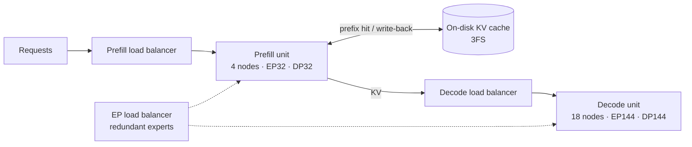

[中文](README.md) · **English**

# Module 03: Dissecting the DeepSeek Stack — Model Architecture × Training/Serving System Co-Design

> 🕐 Suggested time: 2.5 hours ｜ 🎯 After this module you can: explain the system motive behind every architectural choice in DeepSeek-V3/R1 through three budgets — saving KV, saving communication, saving GPU-hours; do the KV-byte, MLA-decode roofline, EP-communication and serving-margin arithmetic on the spot, and work backward from the Day 6 ledger to the state of a single decode GPU; state the verified facts about V4 / V4.1 / DSec (2026) ｜ 🧪 Lab: [`lab.py`](lab.py) ｜ 📖 Must-read primary sources: [DeepSeek-V3 Technical Report](https://arxiv.org/abs/2412.19437), [Day 6: DeepSeek-V3/R1 Inference System Overview](https://github.com/deepseek-ai/open-infra-index/blob/main/202502OpenSourceWeek/day_6_one_more_thing_deepseekV3R1_inference_system_overview.md)

**Where the facts in this module come from**: DeepSeek's official papers and technical reports (arXiv), the deepseek-ai GitHub organization, the official `config.json` files on Hugging Face, official announcements on api-docs.deepseek.com, and the official careers page talent.deepseek.com. Every source was opened and checked on 2026-09-28. Any number that is **our own derivation** is labeled as such.

## 0. One sentence

**Every architectural decision DeepSeek makes has a system budget behind it**:

- MLA shrinks the KV cache to about 69 KB per token, small enough to store on disk.
- Fine-grained MoE activates only 37B of 671B parameters per token. The price is that it needs cross-node expert parallelism (EP) to assemble batches large enough to keep each expert busy.
- System components such as DualPipe, DeepEP, EPLB and dual-micro-batch overlap all exist to hide MoE's **communication overhead** and **load imbalance** behind computation.

## 1. Why big labs care: the ledger of a day with 608B input tokens

On the last day of Open Source Week in February 2025, DeepSeek published a full day of production accounting ([Day 6](https://github.com/deepseek-ai/open-infra-index/blob/main/202502OpenSourceWeek/day_6_one_more_thing_deepseekV3R1_inference_system_overview.md)). The window is 2025-02-27 12:00 to 02-28 12:00 (UTC+8), V3 and R1 combined:

| Metric | Value |
|---|---|
| Input tokens | 608B, of which 342B (56.3%) hit the **on-disk KV cache** |
| Output tokens | 168B; average output speed 20–22 token/s; average KV length per output token 4,989 |
| Nodes occupied (8×H800 each) | peak 278, daily average 226.75 |
| Per-node throughput | prefill (processing the input) ≈ 73.7k token/s including cache hits; decode (generating output token by token) ≈ 14.8k token/s |
| Cost | $87,072 per day at $2 per H800-hour |
| Theoretical revenue | $562,027 per day if every token were billed at R1 prices, a 545% cost-profit margin |

Note that 545% is **theoretical**. DeepSeek lists three reasons actual revenue is much lower: V3 is cheaper than R1; web and app usage are free; night-time discounts apply.

**Where it hurts** (each point is expanded in the sections below):

1. **Extreme sparsity**: each V3 layer activates only 8 of 256 routed experts. For every expert to receive enough tokens, the global batch must be huge, so experts are spread across tens to hundreds of GPUs with cross-node EP: EP32 for prefill, EP144 for decode.
2. **Narrow cross-node bandwidth**: using the usable bandwidths the V3 report gives, NVLink inside an H800 node is ~160 GB/s and InfiniBand (IB) across nodes is ~50 GB/s. During training, compute and communication are roughly 1:1; without overlapping them, GPUs spend half their time waiting for data.
3. **The slowest-barrel effect**: every EP step waits for the slowest GPU. One overly hot expert, or one GPU holding overly long requests, slows everyone down.
4. **Input far exceeds output, and much of it repeats**: input:output is about 3.6:1, and more than half the input hit the cache. This is exactly what multi-turn agent conversations look like, and it requires KV small enough to store and read back cheaply.

## 2. Model side: every architectural choice saves the system money

### 2.1 MLA: compress the KV cache into 576 numbers

**Problem**: the MHA (multi-head attention) KV cache grows linearly with layers × heads × head dimension. At long context and high concurrency, KV is the first thing to fill up GPU memory.

**Mechanism** ([DeepSeek-V2 paper](https://arxiv.org/abs/2405.04434) §2.1; kept in V3). MLA (Multi-head Latent Attention):

- A down-projection `W_DKV` compresses the input `h_t` into a `d_c = 512`-dimensional latent `c_t`. Every head's K and V are up-projected from it: `K = W_UK·c`, `V = W_UV·c`.
- RoPE (rotary position embedding) is incompatible with low-rank compression, so a separate `d_h^R = 64`-dimensional key, **shared by all heads**, carries the position information. This is called "decoupled RoPE".
- **Per layer and per token, only `c_t` (512 dims) and `k^R_t` (64 dims) are cached: 576 numbers in total.**

```
training / prefill (MHA mode)                        decode (MQA mode, after matrix absorption)
h_t ─W_DKV→ c_t (512) ─W_UK→ K^C (128 heads × 128)   q_t ─(W_UK absorbed on query side)→ q̃_t (128 heads × 512)
    └─W_KR→ k^R_t (64, with RoPE, shared by heads)   score_j = q̃_t·c_j + q^R_t·k^R_j  (576-dim dot per head)
            c_t ─W_UV→ V^C (128 heads × 128)         out = Σ_j softmax_j · c_j → W_UV absorbed into W_O
KV cache stores only c_t (512) + k^R_t (64) = 576 numbers per layer per token
```

**Matrix absorption**: because matrix multiplication is associative, `W_UK` can be folded into the query side and `W_UV` into the output projection `W_O` (V2 paper main text §2.1.2; full formulas in Appendix C). Decode therefore never decompresses K/V; it attends directly over the latent. This is what FlashMLA calls **MQA mode**: `head_dim_k = 576`, `head_dim_v = 512`, and all 128 query heads share one KV. Appendix A of the [V3.2 paper](https://arxiv.org/abs/2512.02556) states the split for V3.1-Terminus: **MHA mode for training and prefill, MQA mode for decode**. V3.2's DSA is built on MQA mode, except for short-sequence prefill (see 2.6).

**Why RoPE has to be decoupled**: if RoPE were applied directly to `K^C`, a position-dependent rotation matrix would sit between `W_Q` and `W_UK`. Matrix multiplication does not commute, so `W_UK` could no longer be absorbed, and K would have to be recomputed for every prefix token at every step.

**Roofline of the MLA decode attention kernel** ([FlashMLA deep dive](https://github.com/deepseek-ai/FlashMLA/blob/main/docs/20250422-new-kernel-deep-dive.md); roofline basics in [Module 01](../01_inference_basics/README.en.md)). Apart from the cited inputs, the derivation below is our own:

1. Each KV entry (one layer, one past token) is read from HBM once: `d_k × b` bytes, with `d_k = 576` and `b = 2` for BF16, i.e. 1152 B. V is the first 512 dims of the same latent, so it needs no extra read.
2. That entry is used by `h_q × s_q` queries: `h_q` is the number of query heads on this GPU, and `s_q` is the number of query tokens per request in this step (2 with MTP). Each query does one QK (`d_k` dims) and one PV (`d_v = 512` dims); one multiply-add counts as 2 FLOPs.
3. So the arithmetic intensity is AI = `2·h_q·s_q·(d_k+d_v) / (d_k·b)`, about **1.89·h_q·s_q** in BF16. The FlashMLA blog approximates it as `2·h_q·s_q`.
4. H800 HBM bandwidth is 3.35 TB/s, and the blog says throttling brings the practical peak to about 865 TFLOPS, so the ridge point is 865/3.35 ≈ **258 FLOP/B**. With the approximation the threshold is `h_q·s_q ≥ 128`; with the exact formula it is ≥ 137.
5. **This intensity does not depend on batch size**: each request's KV is private, so a bigger batch just reads proportionally more KV; no single read gets reused by more requests. What batch size raises is the intensity of the projection GEMMs and the MoE GEMMs (see 4.1).

| Query heads per GPU h_q | s_q | KV format | AI (FLOP/B) | Verdict (ridge 258) |
|---|---|---|---|---|
| 128 (no TP, Day 6) | 1 | BF16 (1152 B) | 242 | memory-bound, just below the threshold (94%) |
| 128 | 2 (MTP on) | BF16 | 484 | compute-bound |
| 32 (TP4, the older plan in the V3 report) | 1 | BF16 | 60 | memory-bound |
| 32 | 2 | BF16 | 121 | memory-bound |
| 128 | 1 | FP8 (V3.2 format, 656 B) | 425 | compute-bound |

How to read the table:

- The blog's conclusion: DeepSeek's decode uses no TP, so `h_q = 128`, and the kernel should be optimized for the compute-bound regime; it reaches 660 TFLOPS. By the exact formula, without MTP it actually sits right at the threshold; **what makes it clearly compute-bound is MTP (s_q = 2) and FP8 KV**.
- This is also what "no TP" means for FlashMLA: TP4 cuts the heads per GPU to 32, intensity drops to 60–121, and the kernel is memory-bound again.
- **Why prefill uses MHA mode and decode uses MQA mode**: per (query head, KV token) pair, MHA mode costs 2×(192+128) = 640 FLOPs while the absorbed MQA mode costs 2×(576+512) = 2176 FLOPs, 3.4× more. Prefill is already compute-bound, so it picks the FLOP-cheaper MHA mode; decode is starved for bandwidth, so it picks the byte-cheaper MQA mode (128 heads share one 576-dim latent).
- By contrast, each GQA KV head serves only the few query heads in its group, so in BF16 with s_q = 1 decode attention intensity is roughly the group size, usually far below the ridge.

**Orders of magnitude**:

| Model (BF16) | KV per token | Ratio |
|---|---|---|
| DeepSeek-V3 (MLA, 61 layers × 576) | 70,272 B ≈ 69 KB | 1× |
| Qwen-2.5 72B (GQA, 80 layers × 8 heads × 128) | 327,680 B | 4.66× |
| LLaMA-3.1 405B (GQA, 126 layers × 8 heads × 128) | 516,096 B | 7.28× |

Source: Table 1 of the [ISCA'25 paper](https://arxiv.org/abs/2505.09343).

The V2 paper reports that compared with DeepSeek 67B, V2 **cuts KV by 93.3%** and raises maximum generation throughput to **5.76×**. Note that both numbers include deployment optimizations: the deployed V2 converted its weights to FP8 and quantized its KV to 6 bits per element on average. Looking only at the MLA structure (both sides in BF16): V2 needs 60 layers × 576 × 2 B = 69,120 B and DeepSeek 67B needs 2 × 95 layers × 8 heads × 128 × 2 B = 389,120 B, a **82.2%** cut; counting V2 at 6 bits gives exactly 93.3% (our check).

| Trade-off | Notes |
|---|---|
| ✅ Gains | KV is about 1/4.4 of a same-structure GQA-8 variant (lab A1); after matrix absorption 128 heads share one latent, raising decode attention intensity to 1.89·h_q·s_q, near or above the ridge, so compute actually gets used; KV is small enough for a disk cache (see 4.6) |
| ❌ Costs | the compression is **learned in training**, not something you can retrofit onto an existing model; prefill pays for extra up-projections; RoPE needs its own path |
| ⚠️ Corollary (our derivation) | `c_t` is shared by all heads, so TP that splits by head cannot split the KV: every TP rank must hold the full latent. This matches Day 6 deploying MLA with DP (data parallelism) |

### 2.2 DeepSeekMoE: fine-grained experts + shared experts

The [DeepSeekMoE paper](https://arxiv.org/abs/2401.06066) proposes two changes to conventional top-K MoE:

1. **Fine-grained segmentation**: split each expert into m smaller experts and activate mK of them, which allows more flexible combinations.
2. **Shared experts**: isolate K_s experts that every token passes through. They learn common knowledge and reduce redundancy among routed experts.

Result from the paper's abstract: DeepSeekMoE 16B matches LLaMA2 7B with only about 40% of the compute.

**V3 configuration** ([technical report](https://arxiv.org/abs/2412.19437) §4.2, [config.json](https://huggingface.co/deepseek-ai/DeepSeek-V3/blob/main/config.json)):

- 61 layers, hidden size 7168. The first 3 layers are dense FFNs; all others are MoE.
- Each MoE layer has 1 shared expert + 256 routed experts, each with intermediate size 2048; 8 routed experts are activated per token.
- **Each token is sent to at most 4 nodes** (node-limited routing, M = 4).
- Affinities are computed with a sigmoid and then normalized among the selected experts.
- 671B total parameters, 37B activated.

Training compute from Table 2 of the ISCA paper: V3 ≈ 250 GFLOPs/token, versus 394 for a 72B dense model and 2448 for a 405B dense model.

**System implications**:

- The finer the experts, the smaller each expert's GEMM (intermediate size is only 2048), so only large batches keep the GPU busy. This is what forces cross-node EP.
- Each token goes to 8 routed experts, so all-to-all traffic is heavy. This is what forces node-limited routing, DeepEP and DualPipe. Whether the shared expert also needs remote traffic depends on deployment: the ISCA formula counts 8 + 1 = 9 targets, while in Day 6 every GPU holds its own copy of the shared expert.

**Node-limited routing is implemented as "group-limited" routing** ([config.json](https://huggingface.co/deepseek-ai/DeepSeek-V3/blob/main/config.json): `n_group = 8`, `topk_group = 4`, `topk_method = "noaux_tc"`): the 256 routed experts are split by index into 8 groups of 32. The official inference code ([`inference/model.py`](https://github.com/deepseek-ai/DeepSeek-V3/blob/main/inference/model.py), `Gate`) scores each group by the sum of its top-2 scores (bias included), keeps the best 4 groups, and then picks 8 experts inside them.

- **Training**: the V3 report says each layer's routed experts are spread evenly over 64 GPUs on 8 nodes, and nodes are chosen by "the sum of the highest K_r/M = 8/4 = 2 scores on each node". This matches the group scoring in the code, so during training 1 group corresponds to 1 node and "at most 4 groups" equals "at most 4 nodes" (our inference).
- **Serving** (our inference): prefill's EP32 spans 4 nodes, 2 groups per node, so groups and nodes still line up; decode's EP144 spans 18 nodes, 8 groups cannot be split evenly over 18 nodes, and EPLB switches to the group-agnostic global policy (see 4.3). So "at most 4 nodes" no longer holds for decode. An interviewer may ask: can serving at EP144 still guarantee each token crosses at most 4 nodes?

### 2.3 Auxiliary-loss-free load balancing

**Problem**: load imbalance causes routing collapse, and it lets the hottest GPU slow down EP. The conventional fix is an auxiliary loss that encourages balance, but an auxiliary loss that is too large hurts model quality ([Wang et al. 2024](https://arxiv.org/abs/2408.15664)).

**Mechanism** (V3 report §2.1.2):

- Each expert has a bias `b_i` that is **added only to the scores used for top-K selection**. The gating weight that multiplies the expert output still uses the original score `s_{i,t}`.
- At the end of each training step, overloaded experts get `b_i -= γ` and underloaded experts get `b_i += γ`.
- V3's setting: γ = 0.001 for the first 14.3T tokens and γ = 0 for the last 500B.
- A tiny sequence-wise balance loss (α = 0.0001) is kept to prevent extreme imbalance within a single sequence.
- Result: **no tokens are dropped in either training or inference**.

The original paper measures imbalance with MaxVio = (max load − mean load) / mean load. The "max/mean load" ratio in this module's lab is exactly 1 + MaxVio. The bias is updated from **historical** load to avoid leaking information about future tokens.

**Interview point**: balance at training time ≠ balance at serving time. Online traffic and batch sizes differ from training, so serving needs its own load balancer, EPLB (see 4.3).

### 2.4 MTP: denser supervision in training, a draft model in serving

**Mechanism** (V3 report §2.2):

- MTP (multi-token prediction) has depth D = 1: beyond the main model, it predicts 1 extra token **sequentially**, keeping the full causal chain.
- The MTP module shares the embedding and output head with the main model; it owns only 1 Transformer block and 1 projection matrix.
- Loss weight λ: 0.3 for the first 10T tokens, then 0.1.
- Of the 685B weights on Hugging Face, 671B are the main model and 14B are the MTP module ([V3 README](https://github.com/deepseek-ai/DeepSeek-V3)).

**Two uses at inference time**:

1. Drop the MTP module; the main model works as usual.
2. Use it as the draft for speculative decoding. The acceptance rate of the second token is **85%–90%**, which raises TPS (tokens per second) to **1.8×**. Mental math: each step yields 1 + 0.85~0.9 ≈ 1.85~1.9 tokens on average; after overhead, ≈ 1.8×.

**Links to RL**: the rollout module in the [R1 paper](https://arxiv.org/abs/2501.12948) (v2, Appendix B.1) uses MTP for self-speculative decoding to shorten the completion time of **the longest samples**, i.e. to fight the long tail. There is also a link to decode attention: with MTP, `s_q = 2`, which doubles FlashMLA's arithmetic intensity.

### 2.5 FP8 mixed-precision training

**Mechanism** (V3 report §3.3):

- **Fine-grained quantization**: activations are scaled per 1×128 tile (per token, per 128 channels) and weights per 128×128 block, with max-abs scales computed online. All tensors use E4M3, instead of the earlier practice of E4M3 for forward and E5M2 for backward.
- **Higher-precision accumulation**: on H800, FP8 GEMM accumulation in Tensor Cores keeps only about 14 bits, and at K = 4096 the maximum relative error approaches 2%. So every N_C = 128 elements, partial sums are moved to CUDA cores and accumulated in FP32.
- **What stays in high precision**: the embedding, output head, MoE gating, normalization and attention operators. Master weights, weight gradients and optimizer states are also kept in higher precision; AdamW's first and second moments use BF16.
- **Communication**: activations are quantized to FP8 before MoE up-projections and then dispatched; combine stays in BF16.
- **Validation**: on models close to V2-Lite and V2 scale, each trained for about 1T tokens, the relative loss error versus BF16 stays below 0.25%.

**Training–serving consistency**: in production serving, matrix multiplications and dispatch use FP8, while core MLA computation and combine use BF16, matching training (Day 6). The kernel library is [DeepGEMM](https://github.com/deepseek-ai/DeepGEMM): 1350+ FP8 TFLOPS at launch, updated on 2025-04-18 to up to 1550 TFLOPS on H800.

### 2.6 DSA: DeepSeek Sparse Attention (V3.2-Exp)

**Mechanism** ([V3.2 paper](https://arxiv.org/abs/2512.02556) §2.1; [V3.2-Exp repo](https://github.com/deepseek-ai/DeepSeek-V3.2-Exp)):

- **Lightning indexer**: scores are `I_{t,s} = Σ_j w_{t,j} · ReLU(q_{t,j} · k_s)`. It has few heads (64 heads × 128 dims in the config) and can run in FP8, so it is cheap.
- **Fine-grained token selection**: each query attends only to the **2048** highest-scoring KV entries (`index_topk = 2048`). DSA is built on MLA's MQA mode.
- **Complexity**: main attention drops from O(L²) to O(Lk). The indexer itself is still O(L²), but it costs far less than MLA.
- **Training**: first a dense warm-up that trains only the indexer, aligning it to the main attention distribution with a KL loss: 1000 steps × 16 sequences × 128K = 2.1B tokens. Then sparse training: 15000 steps × 480 sequences × 128K = 943.7B tokens.
- **Serving detail**: short-sequence prefill uses a masked MHA mode to simulate DSA, which is faster.
- **Price**: the official announcement ([2025-09-29](https://api-docs.deepseek.com/news/news250929)) cut API prices by more than 50%.

**Kernel side** ([FlashMLA](https://github.com/deepseek-ai/FlashMLA)): sparse prefill reaches up to 640 TFLOPS and sparse decode up to 410 TFLOPS (H800). Decode uses an FP8 KV cache of 656 bytes per token per layer: 512 bytes of FP8 NoPE part, 16 bytes of scales, and 128 bytes of BF16 RoPE part (left unquantized for accuracy).

| Trade-off | Notes |
|---|---|
| ✅ | at 128K context, main attention looks at only 2048/131072 ≈ 1.6% of tokens |
| ❌ | the indexer is still O(L²); top-k is fixed, so short contexts gain nothing; kernels must handle gathers and irregular memory access |

**Relation to NSA**: [NSA](https://arxiv.org/abs/2502.11089) (Native Sparse Attention, 2025-02, DeepSeek-AI with Peking University) is DeepSeek's earlier sparse-attention work. The V3.2 paper cites it when explaining why DSA is built on MLA's MQA mode: at the kernel level, each KV entry must be shared across many queries to be fast. The three generations compare as follows (V4 in 5.1):

| | NSA (2025-02) | DSA (V3.2, 2025-09) | CSA / HCA (V4, 2026-04) |
|---|---|---|---|
| How tokens are chosen | three branches: compressed coarse-grained tokens, fine-grained tokens selected by block, and a sliding window | the lightning indexer scores every past token and keeps the top 2048 | CSA compresses every 4 tokens into 1 entry and then selects top-k with DSA; HCA compresses every 128 tokens into 1 entry; plus a sliding-window branch |
| Selection granularity | block | single token (the V3.2-Exp README calls this the first fine-grained sparse attention) | compressed entry |
| Shared KV | under GQA/MQA, heads in a group select the same blocks | built on MLA's MQA mode, shared by all heads | shared-KV MQA |
| How it is trained | natively, from scratch | continued training from V3.1-Terminus, after a dense warm-up of the indexer | hybrid attention used from pre-training on |

Structurally, V4's "compression + sparse selection + sliding window" combination looks a lot like NSA's three branches (our observation; the V4 report does not put it this way).

### 2.7 GRPO (R1) and training–inference consistency in RL

**GRPO** ([DeepSeekMath](https://arxiv.org/abs/2402.03300) §4.1):

- For each question, sample G outputs from the old policy and use the group-normalized reward directly as the advantage: `(r_i − mean) / std`.
- **No critic (value model) is needed.** PPO's value model is usually as large as the policy, so dropping it saves a large chunk of memory and compute.
- The KL penalty is added directly to the loss, using an unbiased estimator.
- DeepSeekMath's setting: G = 64, KL coefficient 0.04.

**R1 settings** (R1 paper v2, updated 2026-01-04):

- R1-Zero runs RL directly on the base model. Reasoning tasks use **rule-based rewards only** (answer correctness + format), not neural reward models, because the latter are prone to reward hacking in large-scale RL.
- 16 samples per question, max length 32,768; R1-Zero raises this to 65,536 after step 8.2k.
- **Two levels of batch** (R1-Zero): one rollout generates 8,192 outputs (i.e. 512 questions × 16), randomly split into 16 mini-batches of 512 each, which is what the paper means by "32 questions per training step, batch 512". Each mini-batch is used for a single update (one inner epoch), so one rollout feeds 16 steps, and later steps train on increasingly off-policy data. This is exactly one of the problems V3.2 addresses below. The reference model is replaced by the latest policy every 400 steps.
- Cost (R1 paper v2, Table 7): R1-Zero about 101K H800·h (64×8 GPUs × ~198 hours), R1 about 41K (the same 512 GPUs × ~80 hours), plus 5K for building the SFT data; 147K H800·h in total, about $294K.

**R1's RL infrastructure** (Appendix B.1) has four modules:

1. **Rollout**: vLLM workers sample, with cross-node EP, redundant copies of hot experts, and MTP self-speculative decoding.
2. **Inference**: forward passes of the reward model and the reference model.
3. **Rule-based rewards**: code executors, answer matchers and so on, overlapped **asynchronously** with the first two modules.
4. **Training**: sort by length, Best-Fit packing, then equalize chunk counts across processes; uses DualPipe.

After each phase, models are offloaded from GPU memory to host memory or disk.

**Training–inference mismatch fixes added in V3.2** (V3.2 paper §3.1):

- **A corrected unbiased KL estimate.**
- **Off-Policy Sequence Masking**: when a sequence has negative advantage and the KL between the old policy (as returned by the inference framework) and the current policy exceeds a threshold δ, the whole sequence is masked out of the loss.
- **Keep Routing**: training is forced to use the expert routing paths from rollout. It has been in use since V3-0324, and the paper calls it crucial for RL stability of MoE models.
- **Keep Sampling Mask**: the top-p / top-k truncation masks from rollout are carried into training.
- The post-training compute budget **exceeds 10% of pre-training cost**. For agent tasks, over 1,800 environments and 85,000 complex prompts were synthesized. By category: search agent 50,275 prompts, code agent 24,667, code interpreter 5,908, general agent 4,417 tasks (backed by 1,827 synthesized environments).

These are industry solutions to exactly the asynchronous-RL and staleness (policy lag) problems at the center of [Module 06](../06_long_tail_async/README.en.md).

## 3. System side: training

### 3.1 How V3 was parallelized

- 2048 H800s, on DeepSeek's in-house HAI-LLM framework.
- **16-way PP (pipeline parallelism) + 64-way EP (spanning 8 nodes) + ZeRO-1 DP, no TP.**
- Cross-node EP makes compute:communication ≈ 1:1 (§3.2.1).
- Each trillion training tokens costs 180K H800 GPU-hours, i.e. 3.7 days on 2048 GPUs. The full run is 2.788M GPU-hours, about $5.576M at $2 per GPU-hour. This figure **excludes** prior research and ablations.

### 3.2 DualPipe: bidirectional pipeline

**Core idea**:

- Split each chunk into four parts: attention, all-to-all dispatch, MLP, all-to-all combine. As in ZeroBubble, a backward chunk is further split into "gradient w.r.t. inputs" and "gradient w.r.t. weights".
- Rearrange these parts within a pair of forward and backward chunks so that one side's communication is hidden under the other side's computation, with the SM split between communication and computation tuned by hand.
- **Feed micro-batches from both ends of the pipeline at once** (bidirectional) to further reduce bubbles.

| Method | Bubble | Params per GPU | Activations per GPU |
|---|---|---|---|
| 1F1B | (PP−1)(F+B) | 1× | PP |
| ZB1P | (PP−1)(F+B−2W) | 1× | PP |
| DualPipe | (PP/2−1)(F&B+B−3W) | 2× | PP+1 |

F = time of a forward chunk, B = time of a full backward chunk, W = time of the weight-gradient part of the backward, F&B = time of a pair of mutually overlapped forward and backward chunks (V3 report Table 2; [DualPipe repo](https://github.com/deepseek-ai/DualPipe)).

**Mental-math example**: with PP = 16, F = 1, B = 2, W = 1, F&B = 2.5, the three bubbles are 45, 15 and 10.5.

**Costs**: 2 copies of the parameters (negligible when EP is large). The number of PP stages and the number of micro-batches must both be divisible by 2. The repo also ships DualPipeV, Sea AI Lab's "cut-in-half" variant, which needs only PP/2 GPUs.

### 3.3 Cross-node all-to-all: stacking IB and NVLink

**Mechanism** (V3 report §3.2.2):

- NVLink ≈ 160 GB/s, IB ≈ 50 GB/s, a ratio of about 3.2×.
- Each token first goes over IB to the GPU **with the same in-node index** on the target node, then is forwarded over NVLink to the GPU that actually holds the target expert.
- Because each token goes to at most 4 nodes, it can pick an average of 3.2 experts per node without extra NVLink cost. The paper concludes that **the number of experts could scale up to 13 (4 × 3.2) at the same communication cost**.
- **20 SMs** (out of 132 on H800) are enough to saturate both IB and NVLink: they are split into 10 communication channels using warp specialization with dynamically adjusted warp counts, plus custom PTX instructions and auto-tuned chunk sizes to reduce L2-cache interference.
- In its hardware-suggestion section, the report complains that giving 20 of 132 SMs to communication is expensive and asks vendors for a communication co-processor.

**Open-source implementation: [DeepEP](https://github.com/deepseek-ai/DeepEP)**:

- **V1** ([legacy docs](https://github.com/deepseek-ai/DeepEP/blob/main/docs/legacy.md)), tested on H800 + CX7 400Gb/s IB:
  - Normal kernels: about 153–158 GB/s intra-node (NVLink) and 43–58 GB/s inter-node (RDMA).
  - Low-latency kernels (pure RDMA, 128 tokens per batch, top-8, hidden 7168): dispatch latency grows from 77 µs at EP8 to 194 µs at EP256; at EP128, dispatch takes 192 µs and combine 369 µs (lab C uses this to fit a fixed latency).
  - The low-latency kernels overlap communication with computation through hooks and **occupy no SMs at all**.
- **V2**: the backend switches from NVSHMEM to NCCL Gin, supports up to EP2048, and cuts SM usage for V3-style training from 24 to 4–6. The README now expands DeepEP as DeepEveryParallel and adds experimental primitives for PP, CP and Engram besides EP. Note that V2 **no longer supports the 0-SM RDMA low-latency EP**; the high-throughput and low-latency interfaces are merged into one `ElasticBuffer`.

**Network topology**: the ISCA paper describes the Multi-Plane Fat-Tree used for V3 training: each node has 8 GPUs and 8 IB NICs, and each GPU–NIC pair sits on a different network plane.

## 4. System side: serving

This section covers only DeepSeek's published deployment. For the scheduling loop (continuous batching, chunked prefill, preemption) see [Module 02](../02_inference_engines/README.en.md); for how the hit rate sets the prefill:decode ratio see section 5.2 of [Module 05](../05_cache_prefill/README.en.md); for SLO-driven capacity planning see [Module 08](../08_system_design/README.en.md).

### 4.1 PD disaggregation and deployment scale

PD disaggregation (prefill-decode disaggregation) means prefill and decode run on separate machine pools. The configuration from Day 6:

| Stage | Routed-expert parallelism | MLA / shared expert | Per deployment unit | Experts per GPU | Redundant experts |
|---|---|---|---|---|---|
| Prefill | EP32 | DP32 | 4 nodes | 9 routed + 1 shared | 32 |
| Decode | EP144 | DP144 | 18 nodes | 2 routed + 1 shared | 32 |

**Sanity check**: (256 + 32) / 32 = 9 and (256 + 32) / 144 = 2, matching the "experts per GPU" column.

**The two documents disagree**: the V3 technical report (2024-12) describes a different setup: prefill attention with TP4 + SP + DP8; a minimum decode unit of 40 nodes / 320 GPUs with EP320, one expert per GPU, and 64 GPUs dedicated to redundant and shared experts. The documents are from different dates; this module follows the newer Day 6 (2025-02).

**Why decode wants such a large EP**:

- With only 1–2 experts per GPU, each step reads less expert weight data.
- "The per-expert batch is usually within 256 tokens and the bottleneck is memory access" comes from the V3 report's older EP320 plan with one expert per GPU. Working backward from Day 6 (see 4.5), under EP144 each expert replica gets about 176 tokens per micro-batch without MTP and about 352 with MTP.
- An FP8 expert GEMM does about 2n operations per byte of weight read (n = tokens routed to that expert, ignoring activation I/O), i.e. 350–700 FLOP/B. With the nominal H800 FP8 peak of 1979 TFLOPS from `codesign_sim`, the ridge is 1979 / 3.35 ≈ 591 FLOP/B. So at Day 6 scale the expert GEMMs sit near the ridge, and exceed it with MTP (our arithmetic).
- The consistent way to say it: **whether the attention kernel is compute- or memory-bound depends on h_q·s_q per GPU (2.1); whether the expert GEMMs are depends on how many tokens each expert gets**. Decode is not uniformly memory-bound.

**How Day 6's serving system is organized** (a sketch assembled from the Day 6 text and the 3FS README, not an official architecture diagram):



### 4.2 Dual-micro-batch overlap

- **Prefill**: split a batch into two micro-batches that execute alternately, so one communicates while the other computes. According to [profile-data](https://github.com/deepseek-ai/profile-data), the attention load of the two micro-batches is deliberately balanced, **so the same prompt may be split between them**.
- **Decode**: stage durations are uneven, so attention is split into two steps, forming a **5-stage pipeline**. profile-data (from the DeepEP V1 era) also notes that decode all-to-all goes over RDMA and **stops occupying SMs once issued**. DeepEP V2 no longer supports this 0-SM low-latency mode (see 3.3).

### 4.3 Three load balancers + EPLB

| Balancer | What it balances |
|---|---|
| Prefill load balancer | core-attention compute per GPU, and input tokens per GPU (which set dispatch send volume) |
| Decode load balancer | KV cache usage per GPU (which sets core-attention compute), and request count per GPU |
| EP load balancer | minimize the largest dispatch receive load across all GPUs |

**The [EPLB](https://github.com/deepseek-ai/EPLB) algorithm**:

- **Replication**: repeatedly give one more replica to the expert with the largest load / replica count.
- **Packing**: sort all replicas from heaviest to lightest and put each into the currently lightest GPU that still has a free slot.
- **Two policies**:
  - **Hierarchical**: first spread expert groups evenly across nodes, then replicate and pack within each node, to cut cross-node traffic. The README says it suits prefill, where EP is smaller.
  - **Global**: ignore groups; replicate and pack globally. The README says it suits decode, where EP is larger.
  - **The rule in the official code**: use the hierarchical policy when the number of groups is divisible by the number of nodes, otherwise the global one. V3 has 8 groups: prefill's 4 nodes satisfy 8 % 4 = 0, so it goes hierarchical; decode's 18 nodes do not, so it goes global. This is the same "do groups line up with nodes" question as in 2.2.
  - The hierarchical policy trades balance across GPUs for node locality. In lab B, prefill's `hier` column is slightly worse than `global` (1.06 vs 1.01 at σ = 1); what it buys is less cross-node traffic, which the lab's synthetic load does not model because it ignores group-limited routing.
- **Where the loads come from**: load prediction is outside the repo's scope; the README suggests a moving average of historical statistics. The V3 report says redundant experts are adjusted **periodically** online, e.g. every 10 minutes.

Exercise (b) in this module implements both policies. We cross-checked it against the official `eplb.py` (PyTorch) on 300 random inputs for the global policy and 244 for the hierarchical one: the sorted per-GPU loads match in all but one case (off by 0.03%, from tie ordering when the official code sorts in float32). The example from the official README is also one of the tests.

**The structural cost of redundant slots** (our derivation): decode places 256 + 32 = 288 slots on 144 GPUs, 2 per GPU. With perfectly uniform popularity, the 32 redundant slots can at most split 32 experts in half, giving 64 half-replicas; of the remaining (at least) 224 fully loaded experts, at most 64 can share a GPU with a half-replica, and the other 160 or more must pair up, so at least 80 GPUs end up holding two fully loaded experts. Hence max/mean ≥ 2 ÷ (256/144) = **1.125**, independent of the token count and unavoidable by any replication strategy. By contrast, EP128 with no redundancy (exactly 2 of the 256 experts per GPU) has a floor of 1.0. So the 288 slots only pay off when popularity is skewed.

**Going further**:

- The V3 report mentions exploring **dynamic redundancy** for prefill: each GPU hosts 16 experts but only 9 are active per step, with the globally optimal routing computed on the fly before each layer's all-to-all. The report also says that doing this in decode requires further optimizing the solver and fusing it with the dispatch kernel.
- [LPLB](https://github.com/deepseek-ai/LPLB) (open-sourced 2025-11) targets per-batch fluctuation caused by small batches **in training**: among the redundant replicas EPLB has chosen, it solves a linear program to reassign tokens for each batch. Its README says it is at an early research stage and lists three limitations: it balances only total token count and ignores the non-linear cost of grouped GEMMs; the solver takes about 100 µs within a node (longer across nodes), which is not negligible for small batches; and under extreme global imbalance it can do worse than EPLB. Solving once per layer means about 6 ms per step over 61 layers (our arithmetic), which is not small next to the ~37 ms communication bound derived in 4.5.

Lab B splits decode's imbalance into two parts: the **structural floor** above (1.125 under uniform popularity), which no static or dynamic replication can remove; and the **sampling noise** from having few tokens per GPU (about 7–8 percentage points), which only per-step re-planning on the actual load can suppress, at the solver cost just described.

### 4.4 Re-deriving the production ledger (our own arithmetic)

- **Cost**: 226.75 nodes × 8 GPUs × 24 h × $2 = **$87,072**, exactly the official number.
- **Revenue**: at R1 prices — cache-hit input $0.14/M, cache-miss input $0.55/M, output $2.19/M — we get 342B×0.14 + 266B×0.55 + 168B×2.19 ≈ **$562,100**. The official figure is $562,027; the gap comes from rounded token counts.
- **Converting throughput into node counts**:
  - prefill: 608B / 86,400 s / 73.7k ≈ 95.5 nodes;
  - decode: 168B / 86,400 s / 14.8k ≈ 131.4 nodes;
  - total ≈ 226.9, almost exactly the official daily average of 226.75.
  
  This shows that Day 6's throughput numbers are "averaged over the day", and that **decode uses more nodes than prefill** even though output tokens are only 1/3.6 of input.

### 4.5 The per-GPU view: working backward from Day 6 to one decode GPU (our own arithmetic)

Day 6's public numbers alone are enough to reconstruct the state of one decode GPU. This section corresponds to lab D2 and exercise (d).

1. **Concurrency**: 14.8k token/s per node over 8 GPUs is 1,850 token/s per GPU; each request averages 20–22 token/s, take 21. By Little's law, each GPU is generating ≈ 1,850 / 21 ≈ **88 requests** at once.
2. **KV and weights**: KV takes 88 × 4,989 × 70,272 B ≈ **31 GB**. The non-routed parameters (attention, shared expert, the first 3 dense layers, embedding and output head) are about 17.1B, one copy per GPU; add 2 routed experts × 58 layers ≈ 5.1B. At a rough 1 byte per parameter, weights take about 22 GB. Together that is about 53 GB, which fits in 80 GB, so **at average context a decode GPU is not limited by KV capacity**. The last row of lab A2 says the same: under the same deployment each GPU fits about 142 sessions of average length.
3. **Tokens per expert replica**: with MTP each request feeds 2 tokens per step (`s_q = 2`), so each GPU sends 176 tokens per step, split into 2 micro-batches. Each token picks 8 routed experts, and the tokens of all 144 GPUs are spread over 288 replicas, so each replica gets about **352 tokens per micro-batch**; without MTP it is 176. This is the basis for saying in 4.1 that the expert GEMMs are near the ridge.
4. **Speed bound set by communication**: in Day 6 the shared expert is local, so each token goes to 8 remote experts. With 88 tokens per micro-batch at 50 GB/s IB, dispatch + combine takes about 303 µs; 61 layers × 2 micro-batches ≈ **37 ms per step**. Each step yields 1.85 tokens on average (1 + 85% MTP acceptance), so each request is bounded at about **50 token/s**. Adding the fixed latency fitted in lab C (about 60 µs per all-to-all) lowers the bound to about **36 token/s**; using `codesign_sim`'s communication term instead (58 MoE layers only, 80% link efficiency) gives about 42 ms per step and **44 token/s**.
5. **Against the measurement**: the measured average is 20–22 token/s, 40%–60% of the bound. The rest of the gap comes from what this model leaves out: the attention and GEMM compute itself, load imbalance (at least 1.125× at EP144, see 4.3), cross-node latency jitter, and so on.

**Assumptions**: Day 6 does not say whether MTP is on in production; the ISCA paper says V3 uses MTP for speculative decoding to speed up inference. Lab D2 therefore computes both cases.

### 4.6 Context caching on disk

**Rules at launch on 2024-08-02** ([official announcement](https://api-docs.deepseek.com/news/news0802)):

- Reusable prefixes are stored on a **distributed disk array**.
- A prefix counts as a hit only if it matches exactly **starting from token 0**; the storage unit is 64 tokens.
- Price at the time: $0.014/M for hits, $0.14/M for misses.
- For a 128K prompt with heavy reuse, first-token latency dropped from 13 s to 500 ms.
- Cache entries are cleared automatically within hours to days.
- The announcement **credits MLA** for making KV small enough to cache on disk.

**Day 6 data**: 56.3% of input tokens hit the on-disk KV cache.

**Storage layer, [3FS](https://github.com/deepseek-ai/3FS)**: for inference KVCache lookups, a single client node peaks at 40+ GiB/s (open-infra-index). The README describes it as a cheaper, much larger-capacity alternative to DRAM caching. Its main design trade-offs ([README](https://github.com/deepseek-ai/3FS) and [design notes](https://github.com/deepseek-ai/3FS/blob/main/docs/design_notes.md)):

- **Disaggregated**: it pools the bandwidth of thousands of SSDs and hundreds of storage nodes into one shared layer, so applications need not care which machine holds the data.
- **Strong consistency**: each chunk is replicated along a chain with CRAQ (chain replication with apportioned queries): writes go through the whole chain, reads can go to any replica on it. This "write-all, read-any" scheme suits read-heavy workloads.
- **Stateless metadata services**: file metadata lives in the transactional FoundationDB, so any metadata service can handle any request.
- **Two clients**: most applications use FUSE; performance-critical ones use the native client's asynchronous zero-copy API (USRBIO, modeled on io_uring), which avoids FUSE's shared-queue lock and its concurrent-write limits. Chunk metadata on each SSD is managed with RocksDB.

These keywords (FoundationDB, RocksDB, io_uring, FUSE) also show up in the storage-engineer JD in section 6.

**Mental math (our derivation)**:

- A 32K-token V3 prefix has about 70,272 × 32,768 ≈ 2.3 GB of KV; reading it at 40 GiB/s takes about 54 ms.
- Re-prefilling must be costed at the **cache-miss** rate: Day 6's 73.7k token/s per node includes cache hits and does not represent compute speed. Counting misses only: 266B / 86,400 s / 95.5 nodes ≈ **32k token/s per node**. Recomputing 32K tokens takes about 1.0 node-second; attention at 32K context is more expensive than at the average 4,989, so in reality it is even slower.
- The two differ by about 19×. Put the other way, a cache-hit token costs prefill roughly one disk read.

**What changed by 2026**:

- **Matching rules** ([current docs](https://api-docs.deepseek.com/guides/kv_cache)): because the models now use Sliding Window Attention (SWA), prefixes are stored as independent "cache prefix units", and a request hits only if it **fully matches** one unit. Units are created at three kinds of points: the end of the user input and the end of the model output; whenever a common prefix across requests is detected; and at fixed intervals within long inputs or outputs.
- **Price**: the [pricing page](https://api-docs.deepseek.com/quick_start/pricing), fetched on 2026-09-28, shows `deepseek-flash` at $0.006/M for peak-hour cache hits and $0.3/M for misses, so a hit costs **1/50** of a miss.

**Lesson for harness design**: keep prefixes stable and do not rewrite history. See [Module 05](../05_cache_prefill/README.md).

## 5. New in 2026 (with verification status)

| Date | Event | Source | Status |
|---|---|---|---|
| 2025-09-29 | V3.2-Exp released (DSA); API prices cut by more than 50% | [official announcement](https://api-docs.deepseek.com/news/news250929) | ✅ |
| 2025-12 | V3.2 technical report (arXiv v1 dated 2025-12-02) | [arXiv 2512.02556](https://arxiv.org/abs/2512.02556) | ✅ |
| 2026-04-24 | **V4 Preview** released and open-sourced: Pro 1.6T total / 49B active, Flash 284B / 13B; 1M context becomes the default across official services | [official announcement](https://api-docs.deepseek.com/news/news260424), [arXiv 2606.19348](https://arxiv.org/abs/2606.19348) | ⚠️ content verified, two anomalies in the sources (see below the table) |
| 2026-07-31 | V4-Flash official version enters public API beta | [changelog](https://api-docs.deepseek.com/updates) | ✅ |
| 2026-08-13 | **V4-Pro GA**; peak/off-peak pricing introduced, off-peak at 50% of peak, effective 2026-08-16 | [official announcement](https://api-docs.deepseek.com/news/news260813) | ✅ |
| 2026-09-10 | **V4.1-Flash** released: 552B MoE, Causal Encoder–Decoder architecture, 8B active for prefill and 16B for decode | [official announcement](https://api-docs.deepseek.com/news/news260910), [arXiv 2609.19969](https://arxiv.org/abs/2609.19969) (arXiv v1 is 2026-09-17, after the announcement) | ✅ |
| 2026-09-19 | **DSec** paper | [arXiv 2609.22978](https://arxiv.org/abs/2609.22978) | ✅ |
| — | API prices on the day of the V4 Preview launch | the announcement shows them only as an image; text could not be verified | ❓ not stated |

**Two anomalies in V4's sources** (checked on 2026-09-28):

1. The arXiv page 2606.19348 exists, and its title and abstract numbers (1.6T/49B, 284B/13B, 27% FLOPs, 10% KV) match the announcement; its submission history shows v1 submitted on 2026-04-26. But the ID prefix 2606 corresponds to June 2026, which does not match an April submission. We do not know why and do not speculate. The paper cannot be found by browsing arXiv's listing for April.
2. The technical-report link in the 04-24 announcement (`DeepSeek_V4.pdf` in the DeepSeek-V4-Pro repo on Hugging Face) now returns 404, and the repo no longer contains any PDF.

This module therefore dates V4 by the 04-24 official announcement and takes technical details from the text of arXiv 2606.19348.

### 5.1 DeepSeek-V4: hybrid attention for one million tokens

The following comes from the V4 technical report; structural parameters match the [V4-Pro config.json](https://huggingface.co/deepseek-ai/DeepSeek-V4-Pro/blob/main/config.json).

**Attention**:

- **CSA** (Compressed Sparse Attention): compress every m = 4 tokens into 1 KV entry, then select top-k with DSA. Pro uses k = 1024, Flash k = 512.
- **HCA** (Heavily Compressed Attention): compress every m′ = 128 tokens into 1 entry.
- The two are interleaved, plus a sliding-window attention branch with window 128.
- The attention core is "shared-KV MQA" with head_dim = 512.

**Storage and precision**:

- In KV, RoPE dimensions are stored in BF16 and the rest in FP8, almost halving the size versus pure BF16.
- The indexer's QK computation runs in FP4.
- At 1M context, KV is about 2% of a BF16 GQA8 baseline (head dim 128).
- Compared with V3.2 at 1M context, V4-Pro needs only 27% of the single-token inference FLOPs and 10% of the KV.

**MoE**:

- Still DeepSeekMoE + auxiliary-loss-free balancing + a slight sequence-wise balance loss.
- The affinity function changes from sigmoid to Sqrt(Softplus(·)).
- **The "at most M nodes" routing constraint is removed.**
- The first 3 MoE layers use hash routing instead.
- Pro: 1 shared + 384 routed experts; Flash: 1 shared + 256 routed; both activate 6 per token.
- MTP depth stays at 1. Also new: mHC (manifold-constrained hyper-connections) and the Muon optimizer; pre-training on more than 32T tokens.

**EP** (§3.1):

- Experts are split into **waves**, and communication and computation are fused into one pipelined kernel: as soon as a wave's experts finish communicating, their computation starts.
- Against strong non-fused baselines: 1.50–1.73× faster for general inference, and **up to 1.96× for long-tail small-batch cases like RL rollout**.
- Validated on both NVIDIA GPUs and Huawei Ascend NPUs.
- The CUDA version, MegaMoE, is open-sourced in [DeepGEMM](https://github.com/deepseek-ai/DeepGEMM/pull/304).

**A quantitative recommendation to hardware vendors** (a great interview question):

- Let C be peak compute and B be interconnect bandwidth. Communication can be fully hidden as long as C/B ≤ compute volume / communication volume.
- For V4-Pro, each token–expert pair needs 6hd FLOPs but only 3h bytes of communication. So the threshold is C/B ≤ 2d = 6144 FLOPs/Byte (expert intermediate size d = 3072).
- In other words, **each 1 GB/s of bandwidth is enough to hide 6.1 TFLOP/s of compute**. Beyond that bandwidth, more bandwidth buys nothing.
- **Plugging in V3 and H800** (our arithmetic): V3's expert intermediate size is d = 2048, so the threshold is 2d = 4096 FLOP/B; but H800's nominal FP8 peak of 1979 TFLOPS divided by 50 GB/s IB gives C/B ≈ 39,600 FLOP/B, about 10× the threshold. That is, at full speed **the expert GEMMs take only about 1/10 of the time of cross-node EP communication**. This points the same way as the V3 report's roughly 1:1 compute:communication ratio in training, and shows why DualPipe must use attention and other computation to cover communication too (3.2).

**FP4**:

- In post-training, MXFP4 QAT (quantization-aware training) is applied to MoE expert weights and to the indexer's QK path.
- Dequantizing expert weights from FP4 to FP8 is lossless, so **the existing FP8 training framework is reused unchanged**.

**On-disk KV** (§3.5.2):

- Compressed CSA/HCA entries are all written to disk.
- SWA entries are uncompressed and about 8× larger than the compressed entries. The report gives three strategies: store them all; checkpoint every p tokens and recompute from the latest checkpoint on a hit; or store none and recompute the last n_win × L tokens on a hit.
- The report also points out that this hybrid attention **breaks PagedAttention's basic assumptions**, so SWA state and not-yet-compressed tail tokens are managed separately as a "state cache".

**Preemptible rollout** (§5.2.3, directly relevant to long-tail asynchronous RL):

- Keep a **token-granular WAL** (write-ahead log) for every generation request.
- On preemption, save the KV of unfinished requests; on resume, continue decoding from the WAL and the saved KV.
- If a hardware failure loses the KV, re-run prefill on the tokens in the WAL to rebuild it.
- The report points out that **simply resampling unfinished requests from scratch introduces length bias**: short responses are more likely to finish before an interruption, so restarting would bias the model toward shorter outputs. If the inference stack is batch-invariant (results do not depend on batch composition) and deterministic, regenerating with the same random seed is also mathematically correct, but it costs another full decode pass and is far less efficient than the WAL.

### 5.2 DeepSeek-V4.1-Flash: designed for input-heavy agent workloads

From the V4.1 technical report and the official announcement:

- **Causal Encoder–Decoder**: 40 layers split into a 20-layer encoder and a 20-layer decoder, where the decoder's global KV is projected directly from the encoder output. Prefill therefore only needs the lower half of the layers, nearly halving prefill compute. The report's motivation is that frequent tool calls in agent workloads generate large numbers of prefill requests.
- **CSA2**: supports cross-layer KV reuse and uses an FP4 KV cache. Global KV drops to **890 bytes per token**, about 1/4 of V4-Flash and 1/437 of DeepSeek V1. Mental math: DeepSeek LLM 67B has 95 layers × 8 KV heads × 128 × 2 × 2 B = 389,120 B, and 389,120 / 890 ≈ 437.
- **SWA Bounded Replay**: persistent KV on SSD or host memory drops to about 1/8 of V4-Flash.
- FlashMLA released matching kernels on 2026-09-10. Its KV formats are sized per **KV entry** (one row per layer): 584 B for V4, 528 B for V4.1, and 288 B for V4.1 in FP4 (FP4 is expected for the compressed-attention cache, FP8 for the sliding-window cache). For CSA/HCA one entry is compressed from 4 or 128 original tokens, so to get the "per original token, all layers" figure of the previous bullet you divide by the compression ratio and then sum over layers.

**An API reversal**: the 09-10 announcement said `deepseek-v4-pro` requests would be routed to V4.1-Flash after 09-14, but the [changelog](https://api-docs.deepseek.com/updates) later said V4-Pro would continue to be served. The pricing page currently lists `deepseek-v4-pro` (DeepSeek-V4-Pro-0813).

### 5.3 DSec: the sandbox platform for agentic RL

From [arXiv 2609.22978](https://arxiv.org/abs/2609.22978) and V4 report §5.2.5.

- **What it is**: DSec (DeepSeek Elastic Compute) is a production sandbox platform. A single Python SDK (libdsec) wraps four backends:
  - FnCall: a pre-warmed container pool with no cold start;
  - container: Docker-compatible, with images loaded on demand via EROFS;
  - microVM: based on Firecracker;
  - fullVM: based on QEMU.
  
  The platform itself consists of three Rust components: the Apiserver (API gateway), Edge (a per-host agent) and Watcher (cluster monitor). Images are stored as layers on **3FS** and pulled on demand.
- **Scale**:
  - one scale unit is about 160 CPU nodes, 30K cores and ~250 TB of DRAM;
  - about 3 million sandboxes per day, peak concurrency ~380K, more than 5,000 creations per second;
  - a single job can request up to 32K sandboxes;
  - a single node has run stably with 3,200 containers or 800 microVMs.
- **Workload characteristics** (sampled over one week in early 2026):
  - median sandbox lifetime is 17.4 min for containers and 15.5 min for microVMs; p99 exceeds 3 hours.
  - Image reuse is low: the median fanout (number of sandboxes in one task using the same image) is only 3 for container images and 1 for microVMs.
- **Co-design with RL, in two generations**:
  - **Before V4.1**: the agent loop ran inside the preemptible GPU training pod together with model serving and the RL framework. When the GPU job was preempted, the agent loop was lost while the sandbox survived, and recovery relied on a command log to reconcile the two: completed commands reused their recorded results instead of re-executing, so non-idempotent operations were not done twice (DSec paper §6.2). V4 report §5.2.5 describes this generation too: each sandbox keeps a globally ordered trajectory log for fast-forward recovery after preemption, provenance, and deterministic replay.
  - **From V4.1 on**: the agent loop moved outside the GPU pool, split into an agent sandbox (running a scaffold such as DeepSeek Harness plus its tools) and a worker container (managing the sandbox and providing a scaffold-agnostic control layer). Rollout lifetime is thus decoupled from trainer lifetime; a preempted GPU job simply reconnects and continues, **with no need to rebuild execution state through command-log replay**.
  - When a GPU job is preempted, the RL framework asks DSec to pause the related sandboxes: containers get `docker pause` followed by `memory.reclaim`; microVMs save a snapshot and exit the process.
  - AppArmor and eBPF allowlists restrict what agents can access, to prevent reward hacking.
  - Placement uses power-of-k-choices (sample k nodes at random, pick the least loaded).
- **Evaluation results**:
  - on-demand pulling is 1.71× faster than pulling whole images eagerly, and EROFS layering cuts task time by 1.76×;
  - virtio-pmem cuts peak host memory by 40.2%;
  - core scheduling reduces SMT (hyper-threading) latency inflation from 45.2% to 17.3%.
- **Not verified**: the paper gives no p50/p99 for sandbox start latency. We found no DSec repository under the deepseek-ai organization; the paper says its storage components were open-sourced, under a GitHub organization other than deepseek-ai.

## 6. What DeepSeek infra roles look for

**Basis**: a 2026-09-17 snapshot of the official careers page [talent.deepseek.com](https://talent.deepseek.com/), 34 positions in total, with data from the Moka recruiting system. The table summarizes only what the job descriptions (JDs) state explicitly.

| Role | Responsibilities stated in the JD | Matching open-source projects |
|---|---|---|
| High-performance kernel / communication / compiler engineer | write GEMM and Attention in CUDA, Ascend C and TileLang; write EP, CP/DP and PP communication operators and tune NCCL/HCCL; build DSL compilers; bonus points for PTX ISA and IBGDA | FlashMLA, DeepGEMM, DeepEP |
| LLM training / inference framework engineer | model parallelism, long context, MoE, low-precision training and inference; RL systems (async RL, agent RL, OPD); **on-disk KV cache and load balancing** for serving | DualPipe, EPLB, profile-data |
| Supercomputing cluster engineer | CPU/GPU/NPU pooling and topology-aware scheduling; RDMA (RoCEv2/IB) networking, congestion control, multipath; cluster–model co-design | ISCA'25 paper, Fire-Flyer |
| High-performance distributed storage engineer (Hangzhou) | KVCache storage for inference (millisecond latency, hundreds of millions of IOPS); next-generation distributed file and object storage; Rust/C++, Paxos/Raft | 3FS, smallpond |
| R&D infrastructure engineer | cluster management, runtimes, file systems, packaging and distribution, JIT, CI/CD; attach a GitHub profile, judged by commit history rather than stars | — |
| Agent elastic-compute engineer | DSec: from the OS, virtualization, networking and storage all the way up to the scheduling control plane; Rust/C preferred for the low-level track | DSec paper |

**Common threads that can be read directly from the JDs**:

1. **The theoretical limit is the yardstick**: the kernel team's JD says outright that it compares against no baseline, only against the distance to the hardware's physical limit. Expect to compute rooflines, bandwidth bounds and SM usage in interviews.
2. **Cross-layer co-design**: nearly every JD asks for designing "hardware-friendly" structures together with model or algorithm teams; MLA, node-limited routing and FP8 in this module are all examples.
3. **NVIDIA and domestic hardware side by side**: Ascend C, HCCL and NPUs appear in several JDs, and V4's EP scheme was also validated on Ascend.
4. **Code and open-source track record**: several JDs list open-source contributions as a plus; the R&D infrastructure role explicitly asks for a GitHub profile.
5. **LLM experience is not required**: several JDs welcome people with solid CS fundamentals and no LLM background. The training/inference framework role also asks for being good at working with code agents.

## 7. Numbers you must be able to compute in your head

| Quantity | Typical value | How to derive it | Source |
|---|---|---|---|
| V3 KV per token (BF16) | 70,272 B ≈ 69 KB | 61 × (512 + 64) × 2 | config.json / ISCA Table 1 |
| V3 if it used MHA | ≈ 5.0 MB/token (71×) | 61 × 128 heads × (192 + 128) × 2 | lab A1 in this module |
| V2's KV cut vs 67B | structure only 82.2%; with 6-bit quantization 93.3% | 1 − 69,120/389,120; V2 at 6 bits | V2 paper (our check) |
| V3 total / active params | 671B / 37B (5.5%) | 1 shared + 8/256 routed | V3 report |
| V3 non-routed params | ≈ 17.1B (one copy per GPU under DP-attention) | 671B − 58 layers × 256 × 3 × 7168 × 2048 | config.json (our arithmetic) |
| Training cost per trillion tokens | 180K H800·h ≈ 3.7 days on 2048 GPUs | 180K / 2048 / 24 | V3 report |
| V3 total training cost | 2.788M H800·h ≈ $5.576M | × $2 | V3 report |
| NVLink vs IB | 160 vs 50 GB/s (3.2×) | — | V3 report §3.2.2 |
| SMs spent on communication | 20 / 132 | — | V3 report |
| One layer of EP comm (32 tokens per GPU per micro-batch, IB) | 120.96 µs | 3 B × 32 × 9 × 7000 / 50 GB/s | ISCA §2.3.2 |
| TPOT bound set by communication | IB: 14.76 ms (~67 token/s); NVL72: 0.82 ms | 61 layers × 2 × comm time | ISCA §2.3.2 |
| Fixed all-to-all latency α | about 60 µs each (alternative explanation: ~80% link efficiency) | (DeepEP EP128 measured 561 µs − bandwidth model 440 µs) / 2 | DeepEP legacy (our fit) |
| MLA decode attention intensity | ≈ 1.89·h_q·s_q FLOP/B (BF16) | 2·h_q·s_q·(576+512) / (576×2) | FlashMLA deep dive (our derivation) |
| Threshold for compute-bound attention | h_q·s_q ≥ 137 (blog approximation: 128) | ridge 865 / 3.35 ≈ 258 FLOP/B | FlashMLA deep dive |
| FP8 expert GEMM intensity | ≈ 2n FLOP/B (n = tokens per expert); ridge ≈ 591 | 1979 TFLOPS / 3.35 TB/s | our derivation |
| Experts per GPU | prefill 9, decode 2 | (256 + 32) / 32, (256 + 32) / 144 | Day 6 |
| Structural floor of EP144 + 32 redundant | max/mean ≥ 1.125 | 2 ÷ (256/144) | our derivation |
| Daily serving cost | $87,072 | 226.75 × 8 × 24 × $2 | Day 6 |
| Decode concurrency per GPU | ≈ 88 requests | 14.8k / 8 / 21 | Day 6 (our arithmetic) |
| Decode KV per GPU | ≈ 31 GB | 88 × 4,989 × 70,272 B | Day 6 (our arithmetic) |
| Decode tokens per expert replica per micro-batch | ≈ 352 (MTP on) / 176 (off) | 88 × s_q / 2 × 8 × 144 / 288 | Day 6 (our arithmetic) |
| Prefill throughput counting misses only | ≈ 32k token/s per node | 266B / 86,400 / 95.5 | Day 6 (our arithmetic) |
| MTP speedup | 1.8× TPS | 85–90% acceptance | V3 report |
| Tokens DSA reads at 128K context | 2048 / 131072 ≈ 1.6% | index_topk | V3.2 config |
| 32K prefix: disk read vs recompute | ~54 ms vs ~1.0 node-second (~19×) | 2.3 GB ÷ 40 GiB/s; 32,768 ÷ 32k | 3FS / Day 6 (our arithmetic) |
| V4's C/B threshold applied to V3 and H800 | threshold 4096, actual ≈ 39,600 | 2 × 2048; 1979 TFLOPS / 50 GB/s | V4 report (our arithmetic) |
| R1 RL cost | 147K H800·h ≈ $294K | 101K + 5K (SFT data) + 41K | R1 paper v2 Table 7 |
| V4.1-Flash global KV | 890 B/token | FP4 + cross-layer reuse | V4.1 report |

## 8. Lab

```bash
make lab N=03
# or
.venv/bin/python modules/03_deepseek_stack/lab.py
```

The lab has four parts:

- **A**: compares KV bytes per token across attention types, and how many concurrent sessions fit on 8 / 16 / 144 H800s under different deployments;
- **B**: simulates EP load balancing, splits the imbalance into a structural floor and sampling noise, and compares the global and hierarchical policies;
- **C**: recomputes the ISCA paper's communication bound, adds a fixed latency α fitted to DeepEP measurements, and compares with `codesign_sim`'s EP communication term;
- **D**: re-derives the Day 6 ledger and works backward to the state of one decode GPU.

Output (actual run):

```
A1. KV cache per token (BF16)
model        attn    KV B/token    KV @32K  vs V3-MLA
llama3.1-8b  gqa        131,072      4.3GB       1.9x
qwen3-32b    gqa        262,144      8.6GB       3.7x
llama3.1-70b gqa        327,680     10.7GB       4.7x
v3-if-MHA    mha      4,997,120    163.7GB      71.1x
v3-if-GQA8   gqa        312,320     10.2GB       4.4x
deepseek-v3  mla         70,272      2.3GB       1.0x

A2. Concurrent sessions (H800-SXM, 80 GB/GPU, 90% usable, upper bound)
model        GPUs  deploy  W/GPU  KV/GPU    @4,989   @32,768  @131,072
llama3.1-70b    8      tp    18G     54G       266        40        10
qwen3-32b       8      tp     8G     64G       390        59        14
deepseek-v3     8  pooled    84G       -       OOM       OOM       OOM
deepseek-v3     8   dp+ep    99G       -       OOM       OOM       OOM
deepseek-v3    16  pooled    42G     30G     1,371       208        52
deepseek-v3    16   dp+ep    58G     14G       640        96        16
v3-if-GQA8     16   dp+ep    58G     14G       144        16         0
v3-if-MHA      16   dp+ep    58G     14G         0         0         0
deepseek-v3   144   dp+ep    22G     50G    20,448     3,024       720

B. EP load balance: max/mean dispatch-receive tokens per GPU (1.00 = perfect)
stage          sigma   naive  greedy  global    hier     now  no-noise
prefill EP32     0.0    1.01    1.01    1.01    1.00    1.00     1.000
decode EP144     0.0    1.21    1.21    1.20     n/a    1.10     1.125
decode EP128     0.0    1.09    1.08    1.08     n/a    1.01     1.000
prefill EP32     0.5    1.58    1.03    1.01    1.04    1.01     1.010
decode EP144     0.5    3.24    2.26    1.11     n/a    1.06     1.057
decode EP128     0.5    2.20    2.08    2.08     n/a    2.08     2.088
prefill EP32     1.0    2.09    1.01    1.01    1.06    1.00     1.003
decode EP144     1.0    4.37    4.35    1.34     n/a    1.31     1.318
decode EP128     1.0    5.17    3.86    3.86     n/a    3.86     3.872

C. EP all-to-all per micro-batch (ISCA setup: 9 targets, hidden 7000, FP8+BF16; 61 layers x 2 micro-batches)
  alpha fit: DeepEP EP128 measured 561 us vs bandwidth model 440.4 us -> alpha = 60.3 us per all-to-all
interconnect     tok/GPU/mb    bw us +alpha us  alpha %  TPOT bw  TPOT +a
IB 50GB/s                 8    30.24    150.84      80%     3.69    18.40
IB 50GB/s                32   120.96    241.56      50%    14.76    29.47
IB 50GB/s               128   483.84    604.44      20%    59.03    73.74
NVL72 900GB/s             8     1.68         -        -     0.20        -
NVL72 900GB/s            32     6.72         -        -     0.82        -
NVL72 900GB/s           128    26.88         -        -     3.28        -

C2. Day 6 setup (EP144, 8 remote targets, hidden 7168), us per MoE layer per micro-batch
  check at EP128, 128 tok/GPU: DeepEP measured 561 us, codesign_sim 523.5 us
 tok/GPU/mb  bw only   +alpha  codesign_sim  +alpha / sim
          8     27.5    148.1          39.9          3.7x
         32    110.1    230.7         137.4          1.7x
         88    302.8    423.4         364.8          1.2x
        128    440.4    561.0         527.3          1.1x

D1. Re-deriving the Day 6 ledger
  daily cost   = 226.75 nodes x 8 GPUs x 24 h x $2 = $87,072   (official $87,072)
  revenue @R1  = $562,100   (official $562,027; gap = rounded token counts)
  cost margin  = 546%   (official 545%)
  node-equiv.  = prefill 95.5 + decode 131.4 = 226.9   (official daily average 226.75)
  prefill miss-only = 32.2k tok/s/node; re-prefill 32K = 1.02 node-s vs disk read 54 ms

D2. One decode GPU (EP144, weights ~17.1 + 5.1 GB in FP8)
case                   req/GPU  KV GB tok/replica/mb  step ms tok/s bound
no MTP, bw only           88.1   30.9            176     18.5        54.1
MTP, bw only              88.1   30.9            352     37.0        50.0
MTP, +alpha               88.1   30.9            352     51.7        35.8
MTP, codesign_sim         88.1   30.9            352     42.4        43.7
  observed average: 20-22 tok/s per request
```

**How to read A**:

- In A1, `v3-if-MHA` and `v3-if-GQA8` are **hypothetical** counterfactuals: the rest of the model is unchanged and only the attention is swapped. K is counted at 192 dims (128 nope + 64 rope) and V at 128 dims, separately. MHA needs 5.0 MB/token, 71× MLA; even GQA-8 is 4.4×.
- A2 takes the H800 spec from `codesign_sim.hardware` (80 GB), keeps 10% for activations and fragmentation, and subtracts the weights on each GPU. All numbers are **idealized upper bounds**: they ignore KV paging fragmentation, larger activation workspaces, and request imbalance across DP ranks. The `deploy` column is the deployment:
  - `tp`: dense models on TP8, with weights and KV split evenly over 8 GPUs (Llama-3.1 70B and Qwen3-32B both have 8 KV heads, one per GPU), weights in BF16.
  - `pooled`: treats V3's 671 GB (FP8) of weights as evenly divisible and KV as freely placeable. This was the old lab's assumption and it **overestimates**.
  - `dp+ep`: DeepSeek's actual deployment (Day 6). Attention and the shared expert use DP, so the ~17.1B non-routed parameters are **replicated on every GPU**; routed experts are sharded by slot. On the same 16 GPUs, the per-GPU KV budget drops from 30 GB to 14 GB and 32K sessions drop from 208 to 96, roughly half. Each request's KV sits entirely on one GPU, so sessions are rounded down per GPU first.
- Three things stand out:
  - **V3's weights do not fit on one 8-GPU node**; it needs at least 2 nodes. That alone is one reason DeepSeek must use cross-node EP.
  - Under the same `dp+ep` deployment, MLA fits about 4.4× as many 4,989-token sessions as the GQA-8 variant, and the MHA variant fits none. At 128K even GQA-8 fits none, because under DP each request's KV must fit on a single GPU.
  - The last row is Day 6's decode unit (144 GPUs, 32 redundant): about 22 GB of weights and 50 GB of KV budget per GPU, room for about 142 average-length sessions. Section 4.5 derives an actual concurrency of about 88, so at average context decode GPUs are not limited by KV capacity.

**How to read B**: the metric is max/mean of the **tokens each GPU receives in dispatch**, which is the target Day 6 sets for the EP load balancer. It is not GEMM time: when expert GEMMs are near memory-bound, time is not proportional to token count. Expert popularity is generated as `p ∝ exp(σ·z)`, a **synthetic assumption**; DeepSeek has not published its production expert-load distribution. The sampling also ignores group-limited routing, so the cross-node-traffic benefit of the hierarchical policy does not show up here.

What the columns mean:

| Column | What it does |
|---|---|
| `naive` | experts placed on GPUs round-robin by index, no replication |
| `greedy` | packed by historical load, no replication |
| `global` | EPLB global policy: replicate redundant copies by historical load, then pack (what decode uses online) |
| `hier` | EPLB hierarchical policy: groups to nodes first, then replicate and pack within each node (what prefill uses online; n/a when groups are not divisible by nodes) |
| `now` | re-planned every step from that step's actual load, the ideal case of dynamic adjustment |
| `no-noise` | the global policy when tokens per GPU go to infinity and there is no sampling noise, i.e. the **structural** part |

What the numbers say:

1. **Prefill batches are large** (16K tokens per GPU), so noise is almost zero. A static plan from history is already near ideal (`global` 1.01). The hierarchical policy is slightly worse (1.06 at σ = 1): that is the price of trading balance across GPUs for node locality.
2. **Decode EP144's 1.20 at uniform popularity (σ = 0) splits into two parts**: the 1.125 in `no-noise` is the structural floor of placing 288 slots on 144 GPUs (derived in 4.3), which no replication strategy can remove; only the remaining 7–8 percentage points are sampling noise from having few tokens per GPU. `now` gets down to 1.10, even below 1.125, because it plans on the same step's noise; with more tokens per GPU it also converges to 1.125.
3. **Compare EP128 with no redundancy**: at σ = 0 its structural floor is 1.0 and only noise remains (1.08). But once popularity is skewed, nothing can rescue the hot experts without redundancy: at σ = 1 every policy is stuck at 3.86, while EP144 with 32 redundant copies gets back to 1.34. So the value of 288 slots shows up only under skew.
4. **Packing cannot rescue a single very hot expert; only replication can**: for decode EP144 at σ = 1, `greedy` is stuck at 4.35, and EPLB brings it back to 1.34.
5. **Parameters to change**:
   - raise decode EP144's tokens per GPU from 128 to 1024 and 16384, and watch the `global` column converge to the 1.125 of `no-noise` rather than to 1.0;
   - give `decode EP128` 128 redundant copies (3 slots per GPU) and see how far σ = 1 drops from 3.86;
   - add 1.5 to `SKEWS` and see when prefill's `greedy` starts to fail.

**How to read C**:

- The second line is the α fit from DeepEP measurements: at EP128 with 128 tokens per batch, dispatch + combine measured 561 µs, while the pure bandwidth model at 50 GB/s gives 440 µs. The ~120 µs difference is booked as the fixed latency of two all-to-alls, about 60 µs each. This is a single-point fit; α mixes protocol latency with bandwidth not being fully used, so trust it only for orders of magnitude.
- `tok/GPU/mb` is tokens **per GPU per micro-batch**. The ISCA setup has about 32 tokens per GPU per pass with two alternating micro-batches, i.e. 64 per step.
- The `bw us` and `TPOT bw` columns reproduce ISCA: at 32 tokens one communication takes 120.96 µs, and 61 layers × 2 micro-batches give a TPOT (time per output token) bound of 14.76 ms. NVL72 lowers it to 0.82 ms.
- With α added, the fixed latency dominates at small batches: at 8 tokens per GPU per micro-batch α is 80% of the time; at 128 tokens it is only 20%.
- **But this conclusion depends on how you explain the gap between the measurement and the pure bandwidth model**; C2 compares two explanations:
  - Booking the whole gap as a fixed latency α (this lab's fit) makes small batches **latency-dominated**.
  - `codesign_sim`'s `ep_comm_time_s` books it as the link running at 80% efficiency plus a 3.7 µs latency per phase (and counts only the 58 MoE layers, without same-node deduplication). Under that explanation small batches are still bandwidth-dominated, just at 80%.
  - Both are close to DeepEP's measurement at 128 tokens (561 vs 523.5 µs), yet they differ by 3.7× at 8 tokens per GPU. DeepEP's published low-latency table has only one point, 128 tokens per batch, so **it cannot tell the two apart**. In that table, with the same 128 tokens, dispatch latency rises from 77 µs at EP8 to 194 µs at EP256, which shows there is overhead growing with EP size beyond byte count, but that is not enough to extract α. A conclusion needs latency measured at different batch sizes.
  - V4 built a wave-style fused kernel specifically for long-tail small-batch cases like RL rollout (5.1), which indirectly suggests small-batch communication overhead matters in practice.
- The ISCA paper itself stresses that this is an idealized analysis under dual-micro-batch overlap: real requests have much longer contexts and MLA computation usually dominates. α was fitted on IB/RDMA only, so the NVL72 rows do not extrapolate it.

**How to read D**:

- In D1, the first three lines reproduce the official ledger and the fourth is our conversion of throughput into node counts (4.4); the fifth recomputes prefill throughput counting cache misses only, about 32k token/s per node, and compares recomputing a 32K prefix (~1.0 node-second) with reading it from disk (~54 ms), see 4.6.
- D2 is the per-GPU derivation of 4.5: about 88 concurrent requests and 31 GB of KV per GPU; with MTP about 352 tokens per expert replica per micro-batch; a speed bound of about 50 token/s from bandwidth alone, about 36 token/s with α, and about 44 token/s with `codesign_sim`'s communication term; measured 20–22 token/s. All three put the measurement at roughly half the communication bound.

## 9. Exercises

Implement four functions in [`exercise.py`](exercise.py):

| Function | What to do | Reference numbers |
|---|---|---|
| `kv_bytes_per_token` | KV bytes per token for MHA / GQA / MQA / MLA; K and V may have different dims; sub-byte formats such as FP4 are rounded up to whole physical bytes | V3 70,272; V3 as MHA 4,997,120; Qwen-2.5 72B 327,680 |
| `eplb_gpu_loads` | EPLB global and hierarchical policies: greedy replication + balanced packing, with input validation | the official README example; 1.125 for EP144 + 32 redundant under uniform load |
| `mla_decode_roofline` | **derive it yourself**: how many FLOPs MLA decode attention does per byte of KV, and whether it is compute- or memory-bound | ~242 at h_q = 128, s_q = 1 (memory-bound); ~484 at s_q = 2 |
| `day6_per_gpu` | **derive it yourself**: from the Day 6 ledger, the concurrency, KV, tokens per expert replica and speed bound of one decode GPU | ~88 requests, 31 GB, 352 tokens, 37 ms, 50 token/s |

The docstrings of the last two exercises describe only the physical meaning, not the formulas; derive them yourself following sections 2.1 and 4.5.

```bash
make module N=03                                                        # test your implementation (fails until done — expected)
INFRA_SOLUTION=1 .venv/bin/python -m pytest modules/03_deepseek_stack   # check that the reference solution.py passes
```

## 10. Self-check questions

1. Why is V3's KV per token 70,272 bytes? With V3.2's FP8 sparse-decode format (656 B per entry per layer), how many 4,989-token sessions fit on one Day 6 decode GPU (last row of lab A2, about 50 GB of KV budget per GPU)?
<details><summary>Answer</summary>

61 layers × (512 + 64) × 2 B = 70,272 B. In the FP8 format it is 61 × 656 = 40,016 B, about 57% of the original. Sessions per GPU rise from about 50 GB ÷ (70,272 × 4,989) ≈ 142 to about 50 GB ÷ (40,016 × 4,989) ≈ 250. The indexer also has its own K cache, which is not counted here.
</details>

2. Why does MLA decode attention sit right at the threshold with no TP and no MTP? What happens with the V3 report's TP4 deployment, or with MTP on? Does a bigger batch help?
<details><summary>Answer</summary>

Intensity AI = 2·h_q·s_q·(576 + 512) / (576 × 2) ≈ 1.89·h_q·s_q. At h_q = 128, s_q = 1 it is about 242 FLOP/B, while the ridge is 865 / 3.35 ≈ 258, so it is only 94% of the ridge and slightly memory-bound; even the blog's approximation 2·h_q·s_q = 256 only just reaches the threshold. TP4 cuts the heads per GPU to 32 and the intensity to about 60, clearly memory-bound; MTP (s_q = 2) gives about 484, clearly compute-bound. A bigger batch does not help: each request's KV is private, so a bigger batch just reads proportionally more KV. What batch size raises is the intensity of the projections and expert GEMMs.
</details>

3. Why is the bias `b_i` in auxiliary-loss-free balancing used only for top-K selection and not in the gating weights?
<details><summary>Answer</summary>

If the bias entered the gating, it would change how expert outputs are weighted — directly altering the model function — and it would produce gradients. Adding it only at selection time affects just "which expert a token goes to", not "how outputs are weighted", and produces no interfering gradients. That is precisely why it beats an auxiliary loss.
</details>

4. Derive how many experts each decode GPU holds under Day 6's configuration. With perfectly uniform popularity, what is the lowest possible max/mean load for EP144 with 32 redundant copies? What about EP288 with 32 redundant, or EP128 with none?
<details><summary>Answer</summary>

(256 + 32) / 144 = 2. EP144: the 32 redundant slots can at most split 32 experts in half, at least 80 GPUs must hold two fully loaded experts, and the floor is 2 ÷ (256/144) = 1.125. EP288 with 32 redundant: one slot per GPU, 224 GPUs hold a full expert (load 1) and 64 hold half an expert, mean 256/288, so the floor is again 1 ÷ (256/288) = 1.125. EP128 with none: exactly 2 experts per GPU, floor 1.0. Conclusion: under uniform popularity redundant slots only waste capacity; their value appears only under skew.
</details>

5. If the cache-hit rate drops from 56.3% to 30% with total input tokens unchanged, roughly how many prefill nodes are needed?
<details><summary>Answer</summary>

Using the miss-only throughput of about 32k token/s per node (4.6): cache-miss tokens grow from 266B to 608B × 70% ≈ 426B, and 426B ÷ 86,400 s ÷ 32.2k ≈ 153 nodes, about 57 more than the original 95.5. This assumes cache-hit tokens cost almost no compute. Conversely, it shows how many GPUs a harness saves by keeping prefixes stable (Module 05).
</details>

6. Why does DeepSeek's disk cache require an exact match starting from token 0? What changed after V4?
<details><summary>Answer</summary>

Under causal attention, each position's KV depends on all tokens before it, so only an identical prefix can be reused. V4 introduced SWA and compressed attention, and the cache now stores independent "cache prefix units"; a request hits only if it fully matches one unit. Units are created at request boundaries, when a common prefix is detected, and at fixed intervals.
</details>

7. What does GRPO save compared with PPO? What pressure does it put on the rollout system?
<details><summary>Answer</summary>

It drops a critic as large as the policy, and the GAE computation. The cost is G samples per question (16 in R1, 64 in DeepSeekMath), which multiplies rollout volume. A group must wait for its slowest sample before advantages can be computed, which makes the long tail worse. That is why R1 uses MTP self-speculative decoding and V4 uses wave-style EP to speed up rollout.
</details>

8. After V4's rollout service is preempted, why not simply resample unfinished requests from scratch? Is there an exception?
<details><summary>Answer</summary>

Short responses are more likely to finish before an interruption; long ones are more likely to be interrupted. Resampling interrupted requests from scratch would leave a systematically shorter set of samples, and training would push the model toward shorter outputs. The exception is a batch-invariant, deterministic inference stack: regenerating with the same random seed reproduces what the uninterrupted run would have produced, so it is mathematically correct, but it costs another decode pass. V4 therefore resumes generation from a token-granular WAL plus the saved KV.
</details>

## 11. Interview deep-dives

**Q1. Why does DeepSeek's decode use a huge EP like EP144 instead of TP?**

- **Conclusion**: MoE is very sparse. A large EP leaves only 1–2 experts per GPU, so each step reads little expert weight data, while it also enlarges the global batch. Attention uses DP rather than TP for two reasons: MLA's latent is shared by all heads, so TP cannot split the KV; and TP would cut the heads per GPU, pushing FlashMLA back to memory-bound (2.1).
- **Orders of magnitude**:
  - Working backward from Day 6 (4.5), each GPU runs about 88 requests; with MTP each expert replica gets about 352 tokens per micro-batch, and the FP8 expert GEMM runs at about 700 FLOP/B, near the H800 ridge (~591). The V3 report's "per-expert batch usually within 256" refers to the older EP320 plan.
  - DeepEP V1's low-latency kernels take about 190 µs per dispatch at EP128–256.
- **Trade-offs**:
  - all-to-all latency grows with EP, and at small batches the fixed latency may dominate (lab C; public data is not enough to quantify it);
  - placing 288 slots on 144 GPUs has a structural imbalance of 1.125, about 1.2× with sampling noise (lab B);
  - the failure blast radius grows;
  - the fixes, in order: dual-micro-batch overlap, IBGDA low-latency communication, EPLB static redundancy, dynamic redundancy. The price of dynamic redundancy is a solve per layer (LPLB takes about 100 µs within a node).

**Q2. V3 training has compute:communication ≈ 1:1. How does DualPipe make communication "almost free"?**

- **Conclusion**: overlap computation and all-to-all within each pair of forward and backward chunks, and feed micro-batches from both ends to cut bubbles.
- **Orders of magnitude**:
  - in the PP = 16 example, the bubble drops from 45 to 10.5;
  - only 20 SMs are used for communication;
  - node-limited routing (M = 4) caps IB traffic, and an average of 3.2 experts per node adds no NVLink cost.
  - plugging in H800: at full speed the expert GEMMs take only about 1/10 of the cross-node communication time (5.1), so attention and other computation must help cover it.
- **Trade-offs**: 2 copies of the parameters and one extra copy of activations; the SM split must be tuned by hand; both PP stages and micro-batches must be even.

**Q3. Given the Day 6 data, estimate the ratio of prefill to decode nodes.**

- **Conclusion**: decode takes more nodes, about 58%.
- **Orders of magnitude**: 608B / 86,400 / 73.7k ≈ 95.5 nodes; 168B / 86,400 / 14.8k ≈ 131.4 nodes; total 226.9, matching the official 226.75.
- **Follow-up: what does one decode GPU look like?** 1,850 token/s per GPU ÷ 21 token/s ≈ 88 concurrent requests, about 31 GB of KV and about 22 GB of weights, so at average context it is not KV-capacity-bound; the communication-set speed bound is about 36–50 token/s (depending on the communication model) against a measured 20–22 (4.5).
- **Trade-offs**: decode is SLO-constrained (20–22 token/s on average), so each node produces only 1/5 as many tokens per second as prefill. The 73.7k includes cache hits; counting misses only it is about 32k token/s per node. The higher the cache-hit rate, the cheaper prefill becomes and the more the split tilts toward decode; dropping the hit rate from 56.3% to 30% needs about 57 more prefill nodes (self-check question 5).

**Q4. How does MTP compare with speculative decoding methods like EAGLE, and why does DeepSeek use it in RL rollout?**

- **Conclusion**: both keep the full causal chain. But MTP's primary goal is **better training**, with speculative decoding as a by-product; the draft module shares the embedding and output head with the main model, so it costs little to train.
- **Orders of magnitude**: 85–90% acceptance, 1.8× TPS; D = 1; the MTP module is 14B.
- **Trade-offs**: the draft guesses only 1 token, so the speedup is capped around 2×. It is especially useful for rollout, whose bottleneck is exactly the few longest samples.

**Q5. Design an agent RL rollout and sandbox system that survives GPU preemption.**

- **Conclusion**: keep all state somewhere that is never preempted. DeepSeek did it in two generations:
  - V4: on the generation side, a token-granular WAL plus saved KV (V4 §5.2.3); on the environment side, each sandbox keeps a globally ordered trajectory log for fast-forward recovery after preemption, reusing the results of completed commands.
  - From V4.1 on: the agent loop moved out of the GPU pool into a worker container and an agent sandbox. Rollout lifetime is decoupled from trainer lifetime and recovery no longer depends on command-log replay; on preemption, sandboxes are paused and their memory reclaimed (DSec).
- **Orders of magnitude**: median sandbox lifetime 15–17 minutes, p99 over 3 hours; peak concurrency 380K; up to 32K sandboxes per job; more than 5,000 creations per second.
- **Trade-offs**:
  - WAL and KV snapshots cost extra storage and I/O.
  - Do not simply resample from scratch, or you introduce length bias. The exception is a batch-invariant, deterministic inference stack regenerating with the same seed, which costs another decode pass.
  - Command-log replay keeps non-idempotent tool calls from running twice, but the RL framework has to own the recovery logic and keep it in sync with sandbox state. That is exactly why V4.1 moved the agent loop out, and it makes a good follow-up question: why move the agent loop out of the GPU pod?

**Q6. What do sparse or compressed attention schemes like DSA and CSA do to KV cache management and prefix caching?**

- **Conclusion**: they break PagedAttention's assumption that every layer's KV is homogeneous and paged in fixed blocks.
- **Orders of magnitude**: V4 has three kinds of KV at once: CSA compresses every 4 tokens into 1 entry, HCA every 128, and SWA keeps a window of 128. Block sizes must be multiples of lcm(m, m′). SWA entries are about 8× the size of compressed entries, so writing them to disk means choosing among "store all / periodic checkpoints / store none".
- **Trade-offs**: storage versus recomputation. After a hit, the incomplete compressed block at the tail must be recomputed. The API's cache rules correspondingly changed to require a full match of one cache prefix unit.

## 12. Further reading

| Resource | Why read it |
|---|---|
| [DeepSeek-V2](https://arxiv.org/abs/2405.04434) | the original derivation of MLA, decoupled RoPE and matrix absorption (main text §2.1.2, full formulas in Appendix C) |
| [DeepSeekMoE](https://arxiv.org/abs/2401.06066) | motivation and ablations for fine-grained and shared experts |
| [Auxiliary-Loss-Free Load Balancing](https://arxiv.org/abs/2408.15664) | the bias update rule, the MaxVio metric, and why future-token load must not be used |
| [DeepSeek-V3 Technical Report](https://arxiv.org/abs/2412.19437) | the backbone of this module: MTP, FP8, DualPipe, all-to-all, deployment and hardware suggestions |
| [Insights into DeepSeek-V3 (ISCA'25)](https://arxiv.org/abs/2505.09343) | reflections on hardware–software co-design: KV comparison, TPOT bound, multi-plane network |
| [DeepSeekMath](https://arxiv.org/abs/2402.03300) | the original definition of GRPO |
| [DeepSeek-R1](https://arxiv.org/abs/2501.12948) | rule-based rewards, RL infrastructure (v2 Appendix B.1), training cost |
| [NSA](https://arxiv.org/abs/2502.11089) | DeepSeek's earlier sparse attention: compressed, selected-block and sliding-window branches; cited by the V3.2 paper |
| [DeepSeek-V3.2](https://arxiv.org/abs/2512.02556) | DSA, the lightning indexer, and RL stability tricks such as Keep Routing |
| [DeepSeek-V4](https://arxiv.org/abs/2606.19348) | CSA/HCA, wave-style EP, FP4 QAT, on-disk KV, preemptible rollout |
| [DeepSeek-V4.1-Flash](https://arxiv.org/abs/2609.19969) | the CED architecture and KV compression, designed for prefill-heavy agent workloads |
| [DSec](https://arxiv.org/abs/2609.22978) | production design of a sandbox platform for agentic RL |
| [open-infra-index](https://github.com/deepseek-ai/open-infra-index) | the Open Source Week index and the Day 6 serving-system overview |
| [FlashMLA](https://github.com/deepseek-ai/FlashMLA) and its [deep dive](https://github.com/deepseek-ai/FlashMLA/blob/main/docs/20250422-new-kernel-deep-dive.md) | why MLA decode is compute-bound, and the seesaw schedule |
| [DeepEP](https://github.com/deepseek-ai/DeepEP) | the EP communication library, with V1/V2 performance tables |
| [DeepGEMM](https://github.com/deepseek-ai/DeepGEMM) | FP8/FP4 GEMM, MegaMoE, and the indexer scoring kernels |
| [DualPipe](https://github.com/deepseek-ai/DualPipe), [EPLB](https://github.com/deepseek-ai/EPLB), [profile-data](https://github.com/deepseek-ai/profile-data) | parallelism strategy, load-balancing code, and real profiling traces |
| [3FS](https://github.com/deepseek-ai/3FS), [smallpond](https://github.com/deepseek-ai/smallpond) | the storage layer shared by training data, checkpoints and KVCache |
| [LPLB](https://github.com/deepseek-ai/LPLB) | training-oriented per-batch linear-programming EP load balancing (early research stage); the three limitations in its README are worth reading |
| [Context Caching announcement](https://api-docs.deepseek.com/news/news0802), [cache rules](https://api-docs.deepseek.com/guides/kv_cache) | the product shape and hit rules of the on-disk KV cache |
