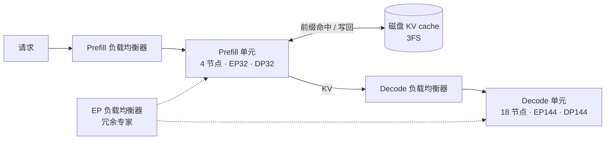

**中文** · [English](README.en.md)

# 模块 03：拆解 DeepSeek 技术栈——模型结构 × 训推系统协同设计

> 🕐 建议时长：2.5 小时 ｜ 🎯 学完你能：用「省 KV、省通信、省 GPU 时」三笔账讲清 DeepSeek-V3/R1 每个结构决策背后的系统动机；当场心算 KV 字节、MLA decode 的 roofline、EP 通信时间、推理成本利润率，并从 Day 6 账本反推一张 decode 卡的状态；说出 2026 年 V4 / V4.1 / DSec 的已核实要点 ｜ 🧪 实验：[`lab.py`](lab.py) ｜ 📖 必读一手资料：[DeepSeek-V3 Technical Report](https://arxiv.org/abs/2412.19437)、[Day 6：DeepSeek-V3/R1 推理系统概览](https://github.com/deepseek-ai/open-infra-index/blob/main/202502OpenSourceWeek/day_6_one_more_thing_deepseekV3R1_inference_system_overview.md)

**本模块的事实来源**：DeepSeek 官方论文和技术报告（arXiv）、deepseek-ai GitHub 组织、Hugging Face 上的官方 `config.json`、api-docs.deepseek.com 的官方公告，以及 talent.deepseek.com 的官方招聘页。所有来源都在 2026-09-28 打开核实过。凡是「我们自己推算」的数字都会注明。

## 0. 一句话

**DeepSeek 的每个模型结构决策背后都有一笔系统账**：

- MLA 把 KV cache（键值缓存）压到每 token 约 69 KB，小到可以存进磁盘。
- 细粒度 MoE 让每个 token 只激活 671B 参数里的 37B，代价是要靠跨节点的专家并行（expert parallelism，EP）凑出足够大的 batch。
- DualPipe、DeepEP、EPLB、双 micro-batch 重叠这些系统组件，都是在把 MoE 带来的**通信开销**和**负载不均**藏到计算后面。

## 1. 大厂为什么在意：一天 6080 亿输入 token 的账本

DeepSeek 在 2025 年 2 月的 Open Source Week 最后一天公开了一整天的线上账本（[Day 6](https://github.com/deepseek-ai/open-infra-index/blob/main/202502OpenSourceWeek/day_6_one_more_thing_deepseekV3R1_inference_system_overview.md)）。统计窗口是 UTC+8 时间 2025-02-27 12:00 到 02-28 12:00，V3 和 R1 合计：

| 指标 | 数值 |
|---|---|
| 输入 token | 608B，其中 342B（56.3%）命中**磁盘上的 KV cache** |
| 输出 token | 168B；平均输出速度 20–22 token/s；每个输出 token 对应的平均 KV 长度 4,989 |
| 占用节点（每节点 8×H800） | 峰值 278 个，日均 226.75 个 |
| 单节点吞吐 | prefill（预填充，处理输入）约 73.7k token/s（含缓存命中）；decode（解码，逐个生成输出）约 14.8k token/s |
| 成本 | 按 H800 每卡每小时 $2 计，一天 $87,072 |
| 理论收入 | 如果全部 token 都按 R1 价格计费，一天 $562,027，成本利润率 545% |

注意 545% 是**理论值**。官方列了三个原因说明实际收入低得多：V3 比 R1 便宜；网页和 App 免费；夜间有折扣。

**痛点在哪里**（下面各节逐个展开）：

1. **稀疏度太高**：V3 每层 256 个路由专家只激活 8 个。要让每个专家都分到足够多的 token，全局 batch 必须很大，所以要把专家摊到几十、上百张卡上做跨节点 EP：prefill 用 EP32，decode 用 EP144。
2. **跨节点带宽太窄**：按 V3 报告给出的可用带宽，H800 节点内 NVLink 约 160 GB/s，跨节点 InfiniBand（IB）约 50 GB/s。训练时计算和通信的比例约 1:1，不把通信和计算重叠起来，GPU 有一半时间在等数据。
3. **木桶效应**：EP 每一步都要等最慢的那张卡。某个专家太热、某张卡上的请求太长，所有卡一起被拖慢。
4. **输入远多于输出，而且大量重复**：输入与输出之比约 3.6:1，一半以上的输入命中了缓存。这正是 agent（智能体）多轮对话的形态，要求 KV 小到能廉价地存下来、再读回来。

## 2. 模型侧：每个结构都在替系统省钱

### 2.1 MLA：把 KV cache 压成 576 个数

**问题**：MHA（多头注意力）的 KV cache 随「层数 × 头数 × 头维度」线性增长。在长上下文、高并发的场景下，显存首先被 KV 占满。

**机制**（[DeepSeek-V2 论文](https://arxiv.org/abs/2405.04434) §2.1；V3 沿用）。MLA（Multi-head Latent Attention，多头潜在注意力）：

- 用下投影矩阵 `W_DKV` 把输入 `h_t` 压成一个 `d_c = 512` 维的 latent（潜变量）`c_t`。所有头的 K 和 V 都由它上投影得到：`K = W_UK·c`，`V = W_UV·c`。
- RoPE（旋转位置编码）和低秩压缩不兼容，所以另外用一个**全头共享**的 `d_h^R = 64` 维 key 来携带位置信息，称为「解耦 RoPE」。
- **每层每 token 只需要缓存 `c_t`（512 维）和 `k^R_t`（64 维），共 576 个数**。

```
训练 / prefill（MHA 模式）                           decode（MQA 模式：矩阵吸收之后）
h_t ─W_DKV→ c_t (512) ─W_UK→ K^C (128 头 × 128)       q_t ─(W_UK 吸收进 query 侧)→ q̃_t (128 头 × 512)
    └─W_KR→ k^R_t (64，带 RoPE，所有头共享)           score_j = q̃_t·c_j + q^R_t·k^R_j  （每头 576 维点积）
            c_t ─W_UV→ V^C (128 头 × 128)             out = Σ_j softmax_j · c_j → W_UV 吸收进 W_O
KV cache 每层每 token 只存 c_t (512) + k^R_t (64) = 576 个数
```

**矩阵吸收**：由于矩阵乘法满足结合律，`W_UK` 可以并入 query 侧，`W_UV` 可以并入输出投影 `W_O`（V2 论文正文 §2.1.2；完整公式见附录 C）。这样 decode 时不用把 K/V 解压出来，直接在 latent 上算注意力。这就是 FlashMLA 所说的 **MQA 模式**：`head_dim_k = 576`，`head_dim_v = 512`，128 个 query 头共享同一份 KV。[V3.2 论文](https://arxiv.org/abs/2512.02556)附录 A 写明了 V3.1-Terminus 的分工：**训练和 prefill 用 MHA 模式，decode 用 MQA 模式**。V3.2 的 DSA 建立在 MQA 模式上，短序列 prefill 例外（见 2.6）。

**RoPE 为什么要解耦**：如果直接对 `K^C` 加 RoPE，`W_Q` 和 `W_UK` 中间会夹一个和当前位置有关的旋转矩阵。矩阵乘法不满足交换律，`W_UK` 就吸收不进去了，每一步都得为所有前缀 token 重算 K。

**MLA decode 注意力 kernel 的 roofline**（[FlashMLA 深度解读](https://github.com/deepseek-ai/FlashMLA/blob/main/docs/20250422-new-kernel-deep-dive.md)；roofline 基础见 [模块 01](../01_inference_basics/README.md)）。下面的推导除了引用处，都是我们自己算的：

1. 每读一个 KV 条目（一层、一个历史 token），要从 HBM 读 `d_k × b` 字节：`d_k = 576`，BF16 时 `b = 2`，合计 1152 B。V 就是这个 latent 的前 512 维，不用另外读。
2. 这个条目要被 `h_q × s_q` 个 query 用到：`h_q` 是每张卡上的 query 头数，`s_q` 是每条请求本步的 query token 数（开 MTP 时为 2）。每个 query 做一次 QK（`d_k` 维）和一次 PV（`d_v = 512` 维），一次乘加算 2 FLOPs。
3. 所以算术强度 AI = `2·h_q·s_q·(d_k+d_v) / (d_k·b)`。BF16 时约为 **1.89·h_q·s_q**；FlashMLA 博客把它近似成 `2·h_q·s_q`。
4. H800 的 HBM 带宽 3.35 TB/s，博客说受降频影响实际算力峰值约 865 TFLOPS，ridge（屋脊点）= 865/3.35 ≈ **258 FLOP/B**。按近似式，门槛是 `h_q·s_q ≥ 128`；按精确式，门槛是 ≥ 137。
5. **这个强度与 batch 无关**：每条请求的 KV 是私有的，batch 变大只会多读 KV，不会让一次读取被更多请求复用。batch 能提高的是投影 GEMM 和 MoE GEMM 的强度（见 4.1）。

| 每卡 query 头 h_q | s_q | KV 格式 | AI（FLOP/B） | 判断（ridge 258） |
|---|---|---|---|---|
| 128（不做 TP，Day 6） | 1 | BF16（1152 B） | 242 | 访存受限，刚好在临界点下方（94%） |
| 128 | 2（开 MTP） | BF16 | 484 | 算力受限 |
| 32（TP4，V3 报告里的旧方案） | 1 | BF16 | 60 | 访存受限 |
| 32 | 2 | BF16 | 121 | 访存受限 |
| 128 | 1 | FP8（V3.2 格式，656 B） | 425 | 算力受限 |

怎么读这张表：

- 博客的结论是：DeepSeek 的 decode 不做 TP，`h_q = 128`，所以要按受限于算力的场景来优化 kernel，实测做到 660 TFLOPS。按精确式，不开 MTP 时其实正好卡在临界点；**真正让它明确受限于算力的是 MTP（s_q = 2）和 FP8 KV**。
- 「不做 TP」对 FlashMLA 的意义也在这里：TP4 会把每卡的头数切到 32，强度掉到 60–121，又回到访存受限。
- **为什么 prefill 用 MHA 模式、decode 用 MQA 模式**：按每对（query 头, KV token）算，MHA 模式要 2×(192+128) = 640 FLOPs，吸收后的 MQA 模式要 2×(576+512) = 2176 FLOPs，是 3.4 倍。prefill 本来就受限于算力，要选 FLOPs 少的 MHA 模式；decode 受限于访存，要选读字节少的 MQA 模式（128 个头共享一份 576 维的 latent）。
- 对比：GQA 的每个 KV 头只服务组内的几个 query 头，BF16、s_q = 1 时 decode 注意力的强度约等于组大小，通常远低于 ridge。

**数量级**：

| 模型（BF16） | 每 token KV | 倍数 |
|---|---|---|
| DeepSeek-V3（MLA，61 层 × 576） | 70,272 B ≈ 69 KB | 1× |
| Qwen-2.5 72B（GQA，80 层 × 8 头 × 128） | 327,680 B | 4.66× |
| LLaMA-3.1 405B（GQA，126 层 × 8 头 × 128） | 516,096 B | 7.28× |

来源：[ISCA'25 论文](https://arxiv.org/abs/2505.09343)表 1。

V2 论文报告，V2 相比 DeepSeek 67B **KV 减少 93.3%**，最大生成吞吐提高到 **5.76 倍**。注意这两个数字里包含了部署优化：V2 上线时权重转成了 FP8，KV 也做了量化，平均每个元素 6 bit。只看 MLA 结构本身（两边都按 BF16）：V2 是 60 层 × 576 × 2 B = 69,120 B，DeepSeek 67B 是 2 × 95 层 × 8 头 × 128 × 2 B = 389,120 B，减少 **82.2%**；把 V2 按 6 bit 算，正好得到 93.3%（我们的核算）。

| 取舍 | 说明 |
|---|---|
| ✅ 收益 | KV 约为同结构 GQA-8 的 1/4.4（实验 A1）；矩阵吸收后 128 个头共享一份 latent，decode 注意力的强度升到 1.89·h_q·s_q，接近或超过 ridge，算力用得上；KV 小到能放进磁盘缓存（见 4.6） |
| ❌ 代价 | 压缩是**训练出来的**，不能事后套用到现成模型上；prefill 要多做上投影；RoPE 要单独一路 |
| ⚠️ 推论（我们的推导） | `c_t` 被所有头共享，按头切分的 TP 切不开 KV，每个 TP rank 都要存完整的 latent。这和 Day 6 里 MLA 用 DP（数据并行）部署一致 |

### 2.2 DeepSeekMoE：细粒度专家 + 共享专家

[DeepSeekMoE 论文](https://arxiv.org/abs/2401.06066)针对传统 top-K MoE 提出两点改进：

1. **细粒度切分**：把每个专家切成 m 个小专家，激活数相应变成 mK，组合更灵活。
2. **共享专家**：隔离出 K_s 个每个 token 都走的专家，专门学通用知识，减少路由专家之间的冗余。

论文摘要里的结果：16B 的 DeepSeekMoE 只用约 40% 的计算量，就与 LLaMA2 7B 相当。

**V3 的配置**（[技术报告](https://arxiv.org/abs/2412.19437) §4.2，[config.json](https://huggingface.co/deepseek-ai/DeepSeek-V3/blob/main/config.json)）：

- 61 层，hidden 7168。前 3 层是 dense FFN，其余都是 MoE。
- 每层 1 个共享专家 + 256 个路由专家，每个专家的中间维度 2048，每 token 激活 8 个路由专家。
- **每个 token 最多发往 4 个节点**（node-limited routing，节点受限路由，M = 4）。
- 亲和度用 sigmoid 计算，再在选中的专家之间归一化。
- 总参数 671B，激活 37B。

ISCA 论文表 2 给出的训练计算量：V3 约 250 GFLOPs/token，72B dense 模型 394，405B dense 模型 2448。

**系统含义**：

- 专家越细，单个专家的 GEMM 越小（中间维度只有 2048），要靠大 batch 才能把 GPU 喂饱。这逼出了跨节点 EP。
- 每个 token 要发往 8 个路由专家，all-to-all（全交换）通信量大。这逼出了节点受限路由、DeepEP 和 DualPipe。共享专家是否也要远程发送取决于部署：ISCA 论文的算式按 8 + 1 = 9 个目标算，而 Day 6 的共享专家在每张卡上都有一份。

**节点受限路由在代码里是「组受限」**（[config.json](https://huggingface.co/deepseek-ai/DeepSeek-V3/blob/main/config.json)：`n_group = 8`、`topk_group = 4`、`topk_method = "noaux_tc"`）：256 个路由专家按编号分成 8 组、每组 32 个。官方推理代码（[`inference/model.py`](https://github.com/deepseek-ai/DeepSeek-V3/blob/main/inference/model.py) 的 `Gate`）先用每组最高 2 个分数（含偏置）之和给组打分，选出 4 个组，再在这 4 组里选 8 个专家。

- **训练时**：V3 报告说每层的路由专家均匀放在 8 个节点的 64 张卡上，并按「每个节点上最高 K_r/M = 8/4 = 2 个分数之和」选节点。这和代码里的组打分方式一致，所以训练时 1 组对应 1 个节点，「最多 4 组」就等于「最多 4 个节点」（我们的推论）。
- **推理时**（我们的推论）：prefill 的 EP32 跨 4 个节点，每节点 2 组，组和节点仍然对齐；decode 的 EP144 跨 18 个节点，8 组无法均分到 18 个节点，EPLB 也改走不分组的全局策略（见 4.3），所以「最多 4 个节点」在 decode 时不再成立。面试可能会问：推理的 EP144 还能保证每个 token 最多跨 4 个节点吗？

### 2.3 无辅助损失的负载均衡（auxiliary-loss-free）

**问题**：负载不均会导致路由坍塌，也会让 EP 被最热的卡拖慢。传统做法是加 auxiliary loss（辅助损失）来鼓励均衡，但辅助损失太大会损害模型效果（[Wang et al. 2024](https://arxiv.org/abs/2408.15664)）。

**机制**（V3 报告 §2.1.2）：

- 每个专家有一个偏置 `b_i`，**只加在选 top-K 的打分上**；乘到专家输出上的 gating 权重仍然用原始分数 `s_{i,t}`。
- 每个训练步结束时，负载过高的专家 `b_i -= γ`，负载过低的 `b_i += γ`。
- V3 的设置：前 14.3T token 用 γ = 0.001，最后 500B token 用 γ = 0。
- 另外保留一个极小的序列级均衡损失（α = 0.0001），防止单条序列内部极端不均。
- 结果：**训练和推理都不丢 token**。

原论文用 MaxVio =（最大负载 − 平均负载）/ 平均负载 来衡量不均衡程度。本模块实验里的「最大/平均负载比」正好等于 1 + MaxVio。偏置之所以按**历史**负载更新，是为了避免泄露未来 token 的信息。

**面试点**：训练时均衡 ≠ 推理时均衡。线上流量的分布、batch 大小都和训练不同，所以推理侧还需要单独的负载均衡器 EPLB（见 4.3）。

### 2.4 MTP：训练时加密监督信号，推理时当 draft

**机制**（V3 报告 §2.2）：

- MTP（multi-token prediction，多 token 预测）的深度 D = 1：在主模型之外，**串行**地多预测 1 个 token，并且保留完整的因果链。
- MTP 模块和主模型共享 embedding 和输出头，自己只有 1 个 Transformer block 和 1 个投影矩阵。
- 损失权重 λ：前 10T token 取 0.3，之后取 0.1。
- Hugging Face 上的 685B 权重里，671B 是主模型，14B 是 MTP 模块（[V3 README](https://github.com/deepseek-ai/DeepSeek-V3)）。

**推理时的两种用法**：

1. 直接丢掉 MTP 模块，主模型照常工作。
2. 当 speculative decoding（投机解码）的 draft 用。第 2 个 token 的接受率在 **85%–90%**，TPS（每秒 token 数）提升到 **1.8 倍**。心算：每步期望产出 1 + 0.85~0.9 ≈ 1.85~1.9 个 token，再扣掉额外开销，≈ 1.8×。

**与 RL 的联系**：[R1 论文](https://arxiv.org/abs/2501.12948)（v2 附录 B.1）的 rollout 模块用 MTP 做 self-speculative decoding（自投机解码），目的是缩短**最长那批样本**的完成时间，也就是治长尾。另一个联系在 decode 注意力上：开 MTP 时 `s_q = 2`，FlashMLA 的算术强度随之翻倍。

### 2.5 FP8 混合精度训练

**机制**（V3 报告 §3.3）：

- **细粒度量化**：激活按 1×128 的 tile（每 token 每 128 个通道）缩放，权重按 128×128 的 block 缩放，缩放因子按 max-abs 在线计算。所有张量都用 E4M3，不再像以往那样前向用 E4M3、反向用 E5M2。
- **提升累加精度**：H800 上 FP8 GEMM 的 Tensor Core 累加只保留约 14 位。K = 4096 时最大相对误差接近 2%。所以每累加 N_C = 128 个元素，就把部分和搬到 CUDA Core 上做 FP32 累加。
- **保留高精度的部分**：embedding、输出头、MoE gating、归一化、注意力算子。master weights、权重梯度、优化器状态也用高精度，其中 AdamW 的一阶、二阶矩用 BF16。
- **通信**：MoE 上投影之前的激活先量化成 FP8 再 dispatch（分发）；combine（回收）保持 BF16。
- **验证**：在接近 V2-Lite 和 V2 规模的模型上各训约 1T token，与 BF16 相比相对 loss 误差始终低于 0.25%。

**训推一致**：线上推理的矩阵乘和 dispatch 用 FP8，MLA 核心计算和 combine 用 BF16，与训练一致（Day 6）。对应的 kernel 库是 [DeepGEMM](https://github.com/deepseek-ai/DeepGEMM)：发布时最高 1350+ FP8 TFLOPS，2025-04-18 更新到在 H800 上最高 1550 TFLOPS。

### 2.6 DSA：DeepSeek Sparse Attention（V3.2-Exp）

**机制**（[V3.2 论文](https://arxiv.org/abs/2512.02556) §2.1；[V3.2-Exp 仓库](https://github.com/deepseek-ai/DeepSeek-V3.2-Exp)）：

- **lightning indexer（闪电索引器）**：打分公式为 `I_{t,s} = Σ_j w_{t,j} · ReLU(q_{t,j} · k_s)`。它头数少（config 里是 64 头 × 128 维），而且可以用 FP8 实现，所以很便宜。
- **细粒度 token 选择**：每个 query 只取打分最高的 **2048** 个 KV 条目做注意力（`index_topk = 2048`）。DSA 建立在 MLA 的 MQA 模式之上。
- **复杂度**：主注意力从 O(L²) 降到 O(Lk)。indexer 本身仍是 O(L²)，但计算量比 MLA 小得多。
- **训练**：先做 dense warm-up（稠密预热），只训 indexer，让它用 KL 散度对齐主注意力的分布：1000 步，每步 16 条 128K 序列，共 2.1B token。然后进入稀疏训练：15000 步，每步 480 条 128K 序列，共 943.7B token。
- **服务端细节**：短序列的 prefill 改用 masked MHA 模式来模拟 DSA，这样更快。
- **价格**：官方公告（[2025-09-29](https://api-docs.deepseek.com/news/news250929)）宣布 API 价格下调 50% 以上。

**kernel 侧**（[FlashMLA](https://github.com/deepseek-ai/FlashMLA)）：稀疏 prefill 最高 640 TFLOPS，稀疏 decode 最高 410 TFLOPS（H800）。decode 使用 FP8 KV cache，每 token 每层 656 字节：512 字节 FP8 的 NoPE 部分，16 字节缩放因子，128 字节 BF16 的 RoPE 部分（RoPE 部分为了精度不量化）。

| 取舍 | 说明 |
|---|---|
| ✅ | 128K 上下文时，主注意力只看 2048/131072 ≈ 1.6% 的 token |
| ❌ | indexer 仍是 O(L²)；top-k 固定，短上下文没有收益；kernel 需要支持 gather 和不规则访存 |

**和 NSA 的关系**：[NSA](https://arxiv.org/abs/2502.11089)（Native Sparse Attention，2025-02，DeepSeek-AI 与北京大学）是 DeepSeek 更早的稀疏注意力工作。V3.2 论文在解释「为什么要基于 MLA 的 MQA 模式实现 DSA」时引用了它：在 kernel 层面，每个 KV 条目必须被多个 query 共享才算得快。三代方案对比如下（V4 见 5.1）：

| | NSA（2025-02） | DSA（V3.2，2025-09） | CSA / HCA（V4，2026-04） |
|---|---|---|---|
| 怎么选 | 三路分支：压缩后的粗粒度 token、按块选出的细粒度 token、滑动窗口 | lightning indexer 给每个历史 token 打分，取 top-2048 | CSA 先每 4 个 token 压成 1 条，再用 DSA 选 top-k；HCA 每 128 个 token 压成 1 条；另加滑窗分支 |
| 选择粒度 | 块 | 单个 token（V3.2-Exp README 称这是首次实现细粒度稀疏注意力） | 压缩后的条目 |
| 共享 KV | GQA/MQA 下，同组的头选同样的块 | 基于 MLA 的 MQA 模式，所有头共享 | 共享 KV 的 MQA |
| 怎么训出来 | 从头原生训练 | 在 V3.1-Terminus 上继续训练，先稠密预热 indexer | 预训练阶段就用混合注意力 |

从结构上看，V4「压缩 + 稀疏选择 + 滑窗」的组合和 NSA 的三路分支很像（这是我们的观察，V4 报告没有这样表述）。

### 2.7 GRPO（R1）与 RL 的训推一致性

**GRPO**（[DeepSeekMath](https://arxiv.org/abs/2402.03300) §4.1）：

- 对每道题从旧策略采 G 条输出，advantage（优势）直接取组内标准化后的奖励：`(r_i − mean) / std`。
- **不需要 critic（价值模型）**。PPO 的价值模型通常和策略模型一样大，省掉它就省掉一大块显存和计算。
- KL 惩罚直接加在 loss 上，并使用无偏估计器。
- DeepSeekMath 的设置：G = 64，KL 系数 0.04。

**R1 的设置**（R1 论文 v2，2026-01-04 更新）：

- R1-Zero 直接在 base 模型上做 RL。推理类任务只用**规则奖励**（答案正确性 + 格式），不用神经网络奖励模型，因为后者在大规模 RL 中容易被 reward hacking（奖励作弊）。
- 每题采 16 条，最大长度 32,768；R1-Zero 在第 8.2k 步之后放宽到 65,536。
- **batch 分两层**（R1-Zero）：一次 rollout 生成 8,192 条输出（相当于 512 道题 × 16 条），随机切成 16 个 mini-batch，每个 512 条，对应论文说的「每个训练 step 32 道题、batch 512」。每个 mini-batch 只更新一次（1 个 inner epoch），所以一次 rollout 要喂 16 个 step，越往后的 step 用的数据越 off-policy。这正是下文 V3.2 要处理的问题之一。每 400 步把参考模型换成最新策略。
- 成本（R1 论文 v2 表 7）：R1-Zero 约 101K H800·h（64×8 卡 × 约 198 小时），R1 约 41K（同样 512 卡 × 约 80 小时），另加构造 SFT 数据用的 5K，合计 147K H800·h，约 $294K。

**R1 的 RL 基础设施**（附录 B.1），分四个模块：

1. **Rollout**：vLLM worker 负责采样，跨节点 EP，热门专家做冗余，用 MTP 做自投机解码。
2. **Inference**：奖励模型和参考模型做前向。
3. **规则奖励**：代码执行器、答案匹配等，**异步**与前两个模块重叠。
4. **Training**：按长度排序，Best-Fit 打包，再把各进程的 chunk 数拉平；使用 DualPipe。

每个阶段结束后，模型从显存 offload（卸载）到内存或磁盘。

**V3.2 补上的训推不一致问题**（V3.2 论文 §3.1）：

- **修正后的无偏 KL 估计**。
- **Off-Policy Sequence Masking**：某条序列的 advantage 为负，并且推理框架给出的旧策略与当前策略的 KL 超过阈值 δ 时，把整条序列从 loss 中屏蔽。
- **Keep Routing**：训练时强制使用 rollout 时的专家路由路径。V3-0324 起就在用，论文称这对 MoE 的 RL 稳定性「至关重要」。
- **Keep Sampling Mask**：把 rollout 时 top-p / top-k 截断的 mask 也带到训练里。
- 后训练算力**超过预训练成本的 10%**。agent 任务合成了超过 1,800 个环境、85,000 条复杂 prompt。按类别：search agent 50,275 条，code agent 24,667 条，code interpreter 5,908 条，general agent 4,417 个任务（对应 1,827 个合成环境）。

这些正是异步 RL 和 staleness（策略陈旧度）问题在工业界的解法，和 [模块 06](../06_long_tail_async/README.md) 的主题直接相关。

## 3. 系统侧：训练

### 3.1 V3 的训练并行方式

- 2048 张 H800，使用自研的 HAI-LLM 框架。
- **16 路 PP（流水线并行）+ 64 路 EP（跨 8 个节点）+ ZeRO-1 DP，不用 TP**。
- 跨节点 EP 让计算:通信 ≈ 1:1（§3.2.1）。
- 每训练 1T token 需要 180K H800 GPU 小时，相当于在 2048 卡上跑 3.7 天。全流程 2.788M GPU 小时，按 $2/GPU 小时算约 $5.576M。这个数字**不含**前期研究和消融实验。

### 3.2 DualPipe：双向流水线

**核心想法**：

- 把每个 chunk 拆成四段：attention、all-to-all dispatch、MLP、all-to-all combine。反向 chunk 再按 ZeroBubble 的做法拆成「对输入求梯度」和「对权重求梯度」两部分。
- 把一对前向 chunk 和反向 chunk 的这些段重新排列，让一方的通信被另一方的计算盖住，并手动调整通信和计算各占多少 SM。
- **从流水线两端同时注入 micro-batch**（双向），进一步减少气泡。

| 方法 | 气泡 | 每卡参数 | 每卡激活 |
|---|---|---|---|
| 1F1B | (PP−1)(F+B) | 1× | PP |
| ZB1P | (PP−1)(F+B−2W) | 1× | PP |
| DualPipe | (PP/2−1)(F&B+B−3W) | 2× | PP+1 |

F = 前向 chunk 耗时，B = 完整反向 chunk 耗时，W = 反向中对权重求梯度那部分的耗时，F&B = 一对互相重叠的前向与反向 chunk 的耗时（V3 报告表 2；[DualPipe 仓库](https://github.com/deepseek-ai/DualPipe)）。

**心算例子**：PP = 16，F = 1，B = 2，W = 1，F&B = 2.5，三种方法的气泡分别是 45、15、10.5。

**代价**：要存 2 份参数（EP 很大时不算什么）。另外 PP 级数和 micro-batch 数都要能被 2 整除。仓库里还提供了 DualPipeV，这是 Sea AI Lab 的「cut-in-half」变体，只需要 PP/2 张卡。

### 3.3 跨节点 all-to-all：把 IB 和 NVLink 叠着用

**机制**（V3 报告 §3.2.2）：

- NVLink 约 160 GB/s，IB 约 50 GB/s，相差约 3.2 倍。
- 每个 token 先经 IB 发到目标节点上**节点内编号相同**的那张卡，再经 NVLink 转发到真正持有目标专家的卡。
- 因为每个 token 最多去 4 个节点，平均每个节点能选 3.2 个专家而不增加 NVLink 开销。论文据此指出，**在通信成本不变的前提下，专家数最多可以扩到 13（4 × 3.2）**。
- 只用 **20 个 SM**（H800 共 132 个）就能打满 IB 和 NVLink：这 20 个 SM 分成 10 个通信通道，用 warp specialization（warp 分工）并动态调整 warp 数量；再用定制 PTX 指令和自动调优的 chunk 大小，减少对 L2 cache 的干扰。
- 论文在硬件建议一节抱怨「132 个 SM 里拿出 20 个做通信」太贵，希望硬件厂商提供通信协处理器。

**开源实现 [DeepEP](https://github.com/deepseek-ai/DeepEP)**：

- **V1**（[legacy 文档](https://github.com/deepseek-ai/DeepEP/blob/main/docs/legacy.md)），在 H800 + CX7 400Gb/s IB 上测试：
  - 普通 kernel：节点内约 153–158 GB/s（NVLink），跨节点 43–58 GB/s（RDMA）。
  - 低延迟 kernel（纯 RDMA，每批 128 token、top-8、hidden 7168）：dispatch 延迟从 EP8 的 77 µs 到 EP256 的 194 µs；EP128 时 dispatch 192 µs、combine 369 µs（实验 C 用它来拟合固定延迟）。
  - 低延迟 kernel 用 hook 的方式做通信与计算重叠，**不占用任何 SM**。
- **V2**：后端从 NVSHMEM 换成 NCCL Gin，最大支持 EP2048。对 V3 这类训练，占用的 SM 从 24 个降到 4–6 个。README 现在把 DeepEP 解释为 DeepEveryParallel，除 EP 外还加了 PP、CP、Engram 的实验性原语。注意 V2 **不再支持 0 SM 的 RDMA 低延迟 EP**，高吞吐和低延迟两套接口合并成了一个 `ElasticBuffer`。

**网络拓扑**：ISCA 论文介绍，V3 训练集群使用 Multi-Plane Fat-Tree（多平面胖树），每个节点 8 卡配 8 张 IB 网卡，每一对「GPU–网卡」属于不同的网络平面。

## 4. 系统侧：推理

本节只讲 DeepSeek 公开的部署方式。调度闭环（continuous batching、chunked prefill、抢占）见 [模块 02](../02_inference_engines/README.md)；命中率如何决定 prefill 与 decode 的配比，见 [模块 05](../05_cache_prefill/README.md) 第 5.2 节；按 SLO 做容量规划，见 [模块 08](../08_system_design/README.md)。

### 4.1 PD 分离与部署规模

PD 分离（prefill-decode disaggregation）指 prefill 和 decode 用不同的机器池。Day 6 公布的配置：

| 阶段 | 路由专家并行 | MLA / 共享专家 | 每个部署单元 | 每卡专家 | 冗余专家 |
|---|---|---|---|---|---|
| Prefill | EP32 | DP32 | 4 节点 | 9 个路由 + 1 个共享 | 32 |
| Decode | EP144 | DP144 | 18 节点 | 2 个路由 + 1 个共享 | 32 |

**心算校验**：(256 + 32) / 32 = 9，(256 + 32) / 144 = 2，和表中的「每卡专家」对得上。

**两份文档不一致**：V3 技术报告（2024-12）描述的是另一套配置：prefill 的注意力用 TP4 + SP + DP8；decode 最小单元是 40 节点 320 卡，EP320，每卡 1 个专家，另有 64 张卡专门放冗余专家和共享专家。两份文档时间不同，本模块以时间较新的 Day 6（2025-02）为准。

**decode 为什么要这么大的 EP**：

- 每卡只放 1–2 个专家，每步要读的专家权重就少。
- 「每个专家的 batch 通常在 256 token 以内、瓶颈在访存」这句出自 V3 报告里 EP320、每卡 1 个专家的旧方案。按 Day 6 的数字反推（见 4.5），EP144 下每个专家副本每个 micro-batch 约 176 个 token（不开 MTP）到 352 个（开 MTP）。
- FP8 专家 GEMM 每读 1 字节权重约做 2n 次运算（n 为该专家分到的 token 数，忽略激活读写），也就是 350–700 FLOP/B。按 `codesign_sim` 里 H800 的标称 FP8 峰值 1979 TFLOPS 算，ridge ≈ 1979 / 3.35 ≈ 591 FLOP/B。所以在 Day 6 的规模下，专家 GEMM 已在 ridge 附近，开 MTP 时还会超过（我们的推算）。
- 统一的说法是：**注意力 kernel 受限于什么，看每卡的 h_q·s_q（2.1）；专家 GEMM 受限于什么，看每个专家分到多少 token**。decode 并不是一律受限于访存。

**Day 6 中推理系统的组织方式**（根据 Day 6 正文和 3FS README 整理的示意图，不是官方架构图）：



### 4.2 双 micro-batch 重叠

- **Prefill**：把一个 batch 切成两个 micro-batch 交替执行，一个在通信时另一个在计算。根据 [profile-data](https://github.com/deepseek-ai/profile-data)，两个 micro-batch 的注意力计算量是刻意配平的，**同一个 prompt 可能被拆到两边**。
- **Decode**：各阶段耗时不均，所以把 attention 再拆成两步，组成 **5 级流水线**。profile-data（DeepEP V1 时期）还提到，decode 的 all-to-all 走 RDMA，**发出之后就不占用 SM**。DeepEP V2 已经不再支持这种 0 SM 的低延迟模式（见 3.3）。

### 4.3 三个负载均衡器 + EPLB

| 均衡器 | 在平衡什么 |
|---|---|
| Prefill 负载均衡器 | 各 GPU 的核心注意力计算量，以及各 GPU 的输入 token 数（决定 dispatch 发送量） |
| Decode 负载均衡器 | 各 GPU 的 KV cache 占用（决定核心注意力计算量），以及各 GPU 的请求数 |
| EP 负载均衡器 | 让所有 GPU 中 dispatch 接收量最大的那张尽量小 |

**[EPLB](https://github.com/deepseek-ai/EPLB) 的算法**：

- **冗余**：反复给「负载 / 副本数」最大的专家加一份副本。
- **装箱**：把所有副本从重到轻排序，依次放进当前最轻、且还有空位的 GPU。
- **两种策略**：
  - **层次策略**：先把专家组均匀分到各节点，再在节点内复制和装箱，以减少跨节点流量。README 说它适合 EP 较小的 prefill。
  - **全局策略**：不分组，全局复制、全局装箱。README 说它适合 EP 较大的 decode。
  - **官方代码的选择规则**：组数能被节点数整除就走层次策略，否则走全局策略。V3 有 8 组：prefill 的 4 个节点满足 8 % 4 = 0，走层次策略；decode 的 18 个节点不满足，走全局策略。这也对应 2.2 节说的「组和节点是否对齐」。
  - 层次策略是在用 GPU 之间的均衡换节点局部性。实验 B 里 prefill 的 `hier` 列比 `global` 列略差（σ = 1 时 1.06 对 1.01），换来的是更少的跨节点流量；实验的合成负载没有模拟组受限路由，所以这部分收益看不到。
- **负载从哪来**：负载预测不在仓库范围内，README 建议用历史统计的滑动平均。V3 报告说线上会**定期**调整冗余专家，例如每 10 分钟一次。

本模块的练习 (b) 同时实现了两种策略。我们用官方 `eplb.py`（PyTorch）对拍过：全局策略 300 组、层次策略 244 组随机输入，排序后每卡负载只有 1 组不完全一致（差 0.03%，来自官方代码按 float32 排序时的并列次序）；官方 README 的示例也写进了测试。

**冗余槽位的结构性代价**（我们的推导）：decode 的 256 + 32 = 288 个槽位摆在 144 张卡上，每卡 2 个。热度完全均匀时，32 个冗余最多把 32 个专家各切成两半，得到 64 个半份副本；剩下至少 224 个满载专家里，最多 64 个能和半份副本同卡，其余至少 160 个只能两两同卡，所以至少有 80 张卡要放两个满载专家。于是 max/mean ≥ 2 ÷ (256/144) = **1.125**，与 token 数无关，任何复制策略都去不掉。对照：EP128 不配冗余（256 个专家正好每卡 2 个）时，这个下限是 1.0。所以 288 个槽位只有在热度偏斜时才划算。

**更进一步**：

- V3 报告提到正在为 prefill 探索**动态冗余**：每张卡放 16 个专家，每步只激活其中 9 个，在每层 all-to-all 之前实时算出全局最优的路由。报告同时说，decode 要做到这一点，还得进一步优化求解算法，并把它和 dispatch kernel 融合。
- [LPLB](https://github.com/deepseek-ai/LPLB)（2025-11 开源）面向**训练**中小 batch 造成的逐 batch 波动：在 EPLB 选好的冗余副本之间，用线性规划为每个 batch 重新分配 token。README 自述仍处于早期研究阶段，并列了三条限制：只平衡 token 总数，没考虑 grouped GEMM 耗时的非线性；节点内求解约需 100 µs（跨节点更久），小 batch 时不可忽略；全局极端不均时可能不如 EPLB。按每层求解一次算，61 层就是约 6 ms/步（我们的推算），和 4.5 节推出的约 37 ms 通信上限相比并不小。

实验 B 把 decode 的不均拆成两部分：一部分是上面的**结构性下限**（热度均匀时 1.125），任何静态或动态的复制方案都去不掉；另一部分是每卡 token 少带来的**采样噪声**（约 7–8 个百分点），只有每步按实际负载重排才能压下去，代价就是上面说的求解开销。

### 4.4 核对线上账本（我们自己推算）

- **成本**：226.75 节点 × 8 卡 × 24 h × $2 = **$87,072**，与官方完全一致。
- **收入**：按 R1 价格计，命中缓存的输入 $0.14/M，未命中 $0.55/M，输出 $2.19/M，得到 342B×0.14 + 266B×0.55 + 168B×2.19 ≈ **$562,100**。官方是 $562,027，差异来自 token 数取整。
- **把吞吐折算成节点数**：
  - prefill：608B / 86,400 s / 73.7k ≈ 95.5 个节点；
  - decode：168B / 86,400 s / 14.8k ≈ 131.4 个节点；
  - 合计 ≈ 226.9 个，与官方公布的日均 226.75 个几乎相同。
  
  这说明 Day 6 的吞吐数字是「一天平均」的口径，也说明 **decode 用的节点比 prefill 多**，尽管输出 token 只有输入的 1/3.6。

### 4.5 每张 GPU 的视角：从 Day 6 反推一张 decode 卡（我们自己推算）

只用 Day 6 的公开数字，就能推出一张 decode GPU 的状态。这一节对应实验 D2 和练习 (d)。

1. **并发**：每节点 14.8k token/s、8 张卡，每卡 1,850 token/s；每条请求平均 20–22 token/s，取 21。按 Little 定律，每卡同时在生成的请求 ≈ 1,850 / 21 ≈ **88 条**。
2. **KV 与权重**：KV 占 88 × 4,989 × 70,272 B ≈ **31 GB**。非路由参数（注意力、共享专家、前 3 层 dense、embedding 与输出头）约 17.1B，每卡一份；再加 2 个路由专家 × 58 层 ≈ 5.1B。按每参数 1 字节粗估，权重约 22 GB。两者合计约 53 GB，放得进 80 GB，所以**在平均上下文下，decode 卡不受 KV 容量限制**。实验 A2 最后一行也说明了这一点：同样的部署下，每卡能放约 142 条 4,989 长度的会话。
3. **每个专家副本分到多少 token**：开 MTP 时每条请求每步送进 2 个 token（`s_q = 2`），每卡每步 176 个，分成 2 个 micro-batch。每个 token 选 8 个路由专家，144 张卡的 token 摊到 288 个副本上，每个副本每个 micro-batch 约 **352 个 token**；不开 MTP 时是 176 个。这就是 4.1 说专家 GEMM 已接近 ridge 的依据。
4. **通信决定的速度上限**：Day 6 的共享专家在本卡，每个 token 发往 8 个远端专家。每个 micro-batch 88 个 token，按 IB 50 GB/s 算，dispatch + combine 约 303 µs；61 层 × 2 个 micro-batch ≈ **37 ms/步**。每步平均产出 1.85 个 token（1 个 + MTP 接受率 85%），每条请求的速度上限约 **50 token/s**。再加上实验 C 拟合的固定延迟（每次 all-to-all 约 60 µs），上限降到约 **36 token/s**；改用 `codesign_sim` 的通信项（只算 58 个 MoE 层、链路效率 80%）则约 42 ms/步、**44 token/s**。
5. **与实测对照**：实测平均 20–22 token/s，是上限的 40%–60%。剩下的差距来自这个模型没算的部分：注意力和 GEMM 本身的计算、负载不均（EP144 至少 1.125×，见 4.3）、跨节点延迟抖动等。

**假设说明**：Day 6 没说线上是否开了 MTP；ISCA 论文说 V3 用 MTP 做投机解码来提速。所以实验 D2 两种情况都算了。

### 4.6 磁盘上的上下文缓存（Context Caching on Disk）

**2024-08-02 上线时的规则**（[官方公告](https://api-docs.deepseek.com/news/news0802)）：

- 可复用的前缀存在**分布式磁盘阵列**上。
- 前缀必须**从第 0 个 token 开始**完全一致才算命中；存储单位是 64 token。
- 当时命中价格 $0.014/M，未命中 $0.14/M。
- 128K 高复用 prompt 的首 token 延迟从 13 秒降到 500 毫秒。
- 缓存在几小时到几天内自动清理。
- 公告把能做磁盘缓存**归功于 MLA** 让 KV 足够小。

**Day 6 的数据**：56.3% 的输入 token 命中了磁盘 KV cache。

**存储底座 [3FS](https://github.com/deepseek-ai/3FS)**：用于推理 KVCache 查询时，单个客户端节点峰值 40+ GiB/s（open-infra-index）。README 称它是比 DRAM 缓存更便宜、容量大得多的替代方案。它的几个设计取舍（[README](https://github.com/deepseek-ai/3FS) 与 [设计文档](https://github.com/deepseek-ai/3FS/blob/main/docs/design_notes.md)）：

- **存算分离**：把几千块 SSD、几百个存储节点的带宽聚成一个共享层，应用不必关心数据在哪台机器上。
- **强一致**：每个数据块沿一条副本链用 CRAQ（带分摊查询的链式复制）复制：写要走完整条链，读可以打到链上任意副本。这种「写全部、读任一」适合读多写少的负载。
- **元数据服务无状态**：文件元数据存在支持事务的 FoundationDB 里，任何一个元数据服务都能接请求。
- **两种客户端**：大多数应用走 FUSE；性能敏感的应用用原生客户端的异步零拷贝接口（USRBIO，设计参考 io_uring），绕开 FUSE 的共享队列锁和并发写限制。每块 SSD 上的块元数据用 RocksDB 管理。

这些关键词（FoundationDB、RocksDB、io_uring、FUSE）也出现在第 6 节的存储岗位 JD 里。

**心算（我们的推导）**：

- 一个 32K token 的 V3 前缀，KV 约为 70,272 × 32,768 ≈ 2.3 GB，按 40 GiB/s 读取约 54 ms。
- 重新 prefill 要按**未命中**的算力算：Day 6 的 73.7k token/s/节点包含缓存命中，不能代表计算速度。只算未命中：266B / 86,400 s / 95.5 个节点 ≈ **32k token/s/节点**。重算 32K 约占一个节点 1.0 秒；32K 上下文的注意力开销比平均的 4,989 更大，实际只会更慢。
- 两者相差约 19 倍。反过来看，命中的 token 在 prefill 上的成本近似于一次读盘。

**2026 年的变化**：

- **匹配规则**（[当前文档](https://api-docs.deepseek.com/guides/kv_cache)）：因为模型改用了 Sliding Window Attention（滑动窗口注意力，SWA），前缀改为以独立的「cache prefix unit」为单位存储，只有**完整匹配**某个 unit 才算命中。unit 在三种时机生成：用户输入结尾和模型输出结尾；检测到多个请求有公共前缀时；长输入或长输出按固定间隔切分。
- **价格**：2026-09-28 抓取的 [价格页](https://api-docs.deepseek.com/quick_start/pricing)显示，`deepseek-flash` 峰时命中 $0.006/M、未命中 $0.3/M，命中价是未命中的 **1/50**。

**对 harness 设计的启示**：前缀要稳定，不要改写历史。详见 [模块 05](../05_cache_prefill/README.md)。

## 5. 2026 年新进展（逐条核实状态）

| 日期 | 事件 | 来源 | 状态 |
|---|---|---|---|
| 2025-09-29 | V3.2-Exp 发布（DSA），API 降价 50% 以上 | [官方公告](https://api-docs.deepseek.com/news/news250929) | ✅ |
| 2025-12 | V3.2 技术报告（arXiv v1 日期 2025-12-02） | [arXiv 2512.02556](https://arxiv.org/abs/2512.02556) | ✅ |
| 2026-04-24 | **V4 Preview** 发布并开源：Pro 1.6T 总参 / 49B 激活，Flash 284B / 13B；1M 上下文成为官方服务默认 | [官方公告](https://api-docs.deepseek.com/news/news260424)，[arXiv 2606.19348](https://arxiv.org/abs/2606.19348) | ⚠️ 内容已核实，出处有两处异常（见表后说明） |
| 2026-07-31 | V4-Flash 正式版 API 公测 | [更新日志](https://api-docs.deepseek.com/updates) | ✅ |
| 2026-08-13 | **V4-Pro GA**；引入峰谷价，闲时为峰时的 50%，2026-08-16 生效 | [官方公告](https://api-docs.deepseek.com/news/news260813) | ✅ |
| 2026-09-10 | **V4.1-Flash** 发布：552B MoE，Causal Encoder–Decoder 架构，prefill 激活 8B、decode 激活 16B | [官方公告](https://api-docs.deepseek.com/news/news260910)，[arXiv 2609.19969](https://arxiv.org/abs/2609.19969)（arXiv v1 为 2026-09-17，晚于公告） | ✅ |
| 2026-09-19 | **DSec** 论文 | [arXiv 2609.22978](https://arxiv.org/abs/2609.22978) | ✅ |
| — | V4 Preview 发布当天的 API 价格 | 公告里只有图片，文字未能核实 | ❓ 不写 |

**V4 出处的两处异常**（2026-09-28 核实）：

1. arXiv 2606.19348 这个页面真实存在，标题、摘要里的数字（1.6T/49B、284B/13B、27% FLOPs、10% KV）都和公告一致，submission history 显示 v1 提交于 2026-04-26。但 arXiv 编号前缀 2606 对应 2026 年 6 月，和 4 月的提交时间对不上。原因我们不知道，不做推测。按月份在 arXiv 列表里是找不到这篇的。
2. 04-24 官方公告里附的技术报告链接（Hugging Face 上 DeepSeek-V4-Pro 仓库的 `DeepSeek_V4.pdf`）现在返回 404，仓库里也已经没有 PDF 文件。

因此本模块引用 V4 的时间一律以 04-24 官方公告为准，技术细节以 arXiv 2606.19348 的正文为准。

### 5.1 DeepSeek-V4：面向 100 万 token 的混合注意力

以下内容出自 V4 技术报告，结构参数与 [V4-Pro config.json](https://huggingface.co/deepseek-ai/DeepSeek-V4-Pro/blob/main/config.json) 一致。

**注意力**：

- **CSA**（Compressed Sparse Attention，压缩稀疏注意力）：每 m = 4 个 token 压成 1 个 KV 条目，再用 DSA 选 top-k。Pro 取 k = 1024，Flash 取 k = 512。
- **HCA**（Heavily Compressed Attention，重度压缩注意力）：每 m′ = 128 个 token 压成 1 个条目。
- 两者交替使用，另外加一条窗口为 128 的滑动窗口注意力分支。
- 注意力核心是「共享 KV 的 MQA」，head_dim = 512。

**存储与精度**：

- KV 里 RoPE 维度用 BF16，其余维度用 FP8，比纯 BF16 小将近一半。
- indexer 的 QK 计算用 FP4。
- 1M 上下文时，KV 约为 BF16 GQA8（头维 128）基线的 2%。
- 与 V3.2 相比，V4-Pro 在 1M 上下文下单 token 推理 FLOPs 只需 27%，KV 只需 10%。

**MoE**：

- 仍是 DeepSeekMoE + 无辅助损失均衡 + 轻微的序列级均衡损失。
- 亲和度函数从 sigmoid 改为 Sqrt(Softplus(·))。
- **取消了「最多发往 M 个节点」的路由限制**。
- 前 3 个 MoE 层改用 Hash 路由。
- Pro：1 个共享 + 384 个路由专家；Flash：1 个共享 + 256 个路由专家；都是每 token 激活 6 个。
- MTP 深度仍为 1。另外新增了 mHC（流形约束超连接）和 Muon 优化器，预训练超过 32T token。

**EP**（§3.1）：

- 把专家分成 **wave（波次）**，把通信和计算融合进一个流水 kernel：某一波的专家通信一完成就立刻开始计算。
- 对比不融合的强基线，一般推理快 1.50–1.73 倍，**RL rollout 这类长尾小 batch 场景最高快 1.96 倍**。
- 在 NVIDIA GPU 和华为昇腾 NPU 上都做了验证。
- CUDA 版 MegaMoE 已开源进 [DeepGEMM](https://github.com/deepseek-ai/DeepGEMM/pull/304)。

**给硬件厂商的量化建议**（面试好题）：

- 设峰值算力为 C、互联带宽为 B，只要 C/B ≤ 计算量 / 通信量，通信就能被完全藏住。
- 以 V4-Pro 为例：每个 token–专家对要做 6hd FLOPs，却只需通信 3h 字节。所以阈值为 C/B ≤ 2d = 6144 FLOPs/Byte（专家中间维 d = 3072）。
- 也就是说，**每 1 GB/s 的带宽足以藏住 6.1 TFLOP/s 的算力**。超过这个带宽，再多带宽也不会有收益。
- **代回 V3 和 H800**（我们的推算）：V3 的专家中间维 d = 2048，阈值 2d = 4096 FLOP/B；而 H800 的 FP8 标称峰值 1979 TFLOPS 除以 IB 的 50 GB/s，C/B ≈ 39,600 FLOP/B，约为阈值的 10 倍。也就是说，满速时**专家 GEMM 的耗时只有跨节点 EP 通信的约 1/10**。这和 V3 报告说的训练时计算:通信约 1:1 方向一致，也说明 DualPipe 为什么要把 attention 等其他计算一起拿来盖住通信（3.2）。

**FP4**：

- 后训练阶段对 MoE 专家权重和 indexer 的 QK 路径做 MXFP4 的 QAT（量化感知训练）。
- 专家权重「FP4 → FP8」的反量化是无损的，所以**完全复用原有的 FP8 训练框架**。

**磁盘 KV**（§3.5.2）：

- CSA/HCA 的压缩条目直接全部落盘。
- SWA 条目没有压缩，体积约是压缩条目的 8 倍。论文给了三种处理策略：全量存储；每 p 个 token 存一次检查点，命中后从最近的检查点重算；完全不存，命中后重算最后 n_win × L 个 token。
- 论文还指出，这种混合注意力**打破了 PagedAttention 的基本假设**，所以把 SWA 状态和尚未压缩的尾部 token 当作「状态缓存」单独管理。

**可抢占 rollout**（§5.2.3，和长尾异步 RL 直接相关）：

- 为每个生成请求记录**逐 token 的 WAL**（write-ahead log，预写日志）。
- 被抢占时，保存未完成请求的 KV；恢复后从 WAL 和 KV 继续 decode。
- 如果硬件故障导致 KV 丢失，就用 WAL 里的 token 重新 prefill，把 KV 重建出来。
- 论文指出，把未完成的请求**直接从头重新采样会引入长度偏差**：短回复更容易在中断前完成，从头重来会让模型偏向更短的输出。如果推理栈是 batch-invariant（结果不随 batch 组成变化）且确定性的，用同一个随机种子重新生成在数学上也正确，但要多跑一遍 decode，远不如 WAL 高效。

### 5.2 DeepSeek-V4.1-Flash：为输入远多于输出的 agent 负载设计

依据 V4.1 技术报告与官方公告：

- **Causal Encoder–Decoder**：40 层分成 20 层 encoder 和 20 层 decoder，decoder 的全局 KV 直接由 encoder 输出投影得到。所以 prefill 只需要算下半部分的层，prefill 计算量接近减半。论文的出发点是 agent 场景里工具调用频繁，产生大量 prefill 请求。
- **CSA2**：支持跨层复用 KV，并且使用 FP4 KV cache。全局 KV 降到 **每 token 890 字节**，约为 V4-Flash 的 1/4，是 DeepSeek V1 的 1/437。心算：DeepSeek LLM 67B 是 95 层 × 8 个 KV 头 × 128 × 2 × 2 B = 389,120 B，389,120 / 890 ≈ 437。
- **SWA Bounded Replay**：落在 SSD 或主存上的持久 KV 降到 V4-Flash 的约 1/8。
- FlashMLA 在 2026-09-10 发布了对应的 kernel。它的 KV 格式按「每个 KV 条目」（每层一行）计：V4 为 584 B，V4.1 为 528 B，V4.1 的 FP4 格式为 288 B（FP4 预期用于压缩注意力的缓存，滑窗缓存用 FP8）。对 CSA/HCA 来说，一个条目由 4 或 128 个原始 token 压缩而来，要先除以压缩率、再按层累加，才能换算成上一条那种「每个原始 token、所有层合计」的口径。

**API 的一次反复**：9-10 的公告说 9-14 之后 `deepseek-v4-pro` 的请求会转到 V4.1-Flash；但[更新日志](https://api-docs.deepseek.com/updates)随后改为继续提供 V4-Pro。价格页当前列出的是 `deepseek-v4-pro`（DeepSeek-V4-Pro-0813）。

### 5.3 DSec：智能体 RL 的沙箱平台

依据 [arXiv 2609.22978](https://arxiv.org/abs/2609.22978) 和 V4 报告 §5.2.5。

- **是什么**：DSec（DeepSeek Elastic Compute）是生产环境的沙箱平台。一个 Python SDK（libdsec）统一封装四种后端：
  - FnCall：预热的容器池，没有冷启动；
  - 容器：兼容 Docker，镜像用 EROFS 按需加载；
  - microVM：基于 Firecracker；
  - fullVM：基于 QEMU。
  
  平台本身由三个 Rust 组件组成：API 网关 Apiserver、每台主机上的代理 Edge、集群监控 Watcher。镜像按层存放在 **3FS** 上，按需拉取。
- **规模**：
  - 一个规模单元约 160 个 CPU 节点、30K 核、约 250 TB DRAM；
  - 每天约 300 万个沙箱，峰值并发约 38 万，每秒创建超过 5,000 个；
  - 单个任务最多申请 32K 个沙箱；
  - 单节点稳定运行过 3,200 个容器或 800 个 microVM。
- **负载特征**（2026 年初一周的采样）：
  - 沙箱寿命中位数：容器 17.4 分钟，microVM 15.5 分钟；p99 超过 3 小时。
  - 镜像复用率低：容器镜像的中位 fanout（同一任务内使用同一镜像的沙箱数）只有 3，microVM 只有 1。
- **与 RL 的协同设计，分两代看**：
  - **V4.1 之前**：agent loop 和模型服务、RL 框架一起跑在可被抢占的 GPU 训练 pod 里。GPU 任务被抢占时 agent loop 丢了，沙箱还在，恢复要靠命令日志去对齐两边的状态：已完成的命令直接复用记录下来的结果，不重新执行，避免非幂等操作被做两次（DSec 论文 §6.2）。V4 报告 §5.2.5 写的也是这一代：每个沙箱记录全局有序的轨迹日志，用于被抢占后的快进恢复、溯源和确定性重放。
  - **从 V4.1 起**：agent loop 移到 GPU pool 之外，拆成 agent 沙箱（运行 DeepSeek Harness 这类脚手架和工具）和 worker 容器（管理沙箱，提供与脚手架无关的控制层）。rollout 的生命周期因此和 trainer 解耦，被抢占的 GPU 任务重新连上就能接着跑，**不再需要靠命令日志重放来重建执行状态**。
  - GPU 任务被抢占时，RL 框架主动让 DSec 暂停相关沙箱：容器执行 `docker pause` 再触发 `memory.reclaim` 回收内存；microVM 保存快照后退出进程。
  - 用 AppArmor 和 eBPF 白名单限制 agent 的访问，防止 reward hacking。
  - 放置调度用 power-of-k-choices（随机抽 k 个节点，选最空的那个）。
- **评估结果**：
  - 按需拉取比一次性拉全镜像快 1.71 倍，EROFS 分层把任务耗时缩短 1.76 倍；
  - virtio-pmem 让宿主机内存峰值降低 40.2%；
  - 核心调度把 SMT（超线程）带来的延迟膨胀从 45.2% 压到 17.3%。
- **未能核实**：论文没有给出沙箱启动延迟的 p50/p99。我们在 deepseek-ai 组织下没有找到 DSec 仓库；论文说开源了其中的存储组件，地址在 deepseek-ai 之外的 GitHub 组织下。

## 6. DeepSeek infra 岗位看重什么

**依据**：官方招聘页 [talent.deepseek.com](https://talent.deepseek.com/) 在 2026-09-17 的抓取快照，共 34 个岗位，数据来自 Moka 招聘系统。下表只总结 JD 原文里写明的内容。

| 岗位 | JD 里写明的职责 | 对应的开源项目 |
|---|---|---|
| 高性能算子/通信/编译器工程师 | 用 CUDA、Ascend C、TileLang 写 GEMM 和 Attention；写 EP、CP/DP、PP 等通信算子并调优 NCCL/HCCL；开发 DSL 编译器；加分项有 PTX ISA、IBGDA | FlashMLA、DeepGEMM、DeepEP |
| 大模型训练/推理框架工程师 | 模型并行、长上下文、MoE、低精度训推；RL 系统（异步 RL、Agent RL、OPD）；推理服务的 **KV Cache 磁盘缓存与负载均衡** | DualPipe、EPLB、profile-data |
| 超算集群研发工程师 | CPU/GPU/NPU 资源池化和拓扑感知调度；RDMA（RoCEv2/IB）网络、拥塞控制、多路径；集群与模型的协同设计 | ISCA'25 论文、Fire-Flyer |
| 高性能分布式存储工程师（杭州） | 推理用的 KVCache 存储（毫秒级延迟、上亿级 IOPS）；下一代分布式文件系统和对象存储；Rust/C++、Paxos/Raft | 3FS、smallpond |
| 研发基础设施工程师 | 集群管理、运行时、文件系统、打包分发、JIT、CI/CD；简历附 GitHub，看 commit 记录而不是 star 数 | — |
| Agent 弹性计算研发工程师 | DSec：从操作系统、虚拟化、网络、存储一直到调度控制面；底层方向偏好 Rust/C | DSec 论文 |

**从 JD 原文能读出的共同点**：

1. **以理论上限为标尺**：算子团队的 JD 明确说不跟任何 baseline 比，只看离硬件物理极限还有多远。面试时要会算 roofline（屋顶线模型）、带宽上限、SM 占用。
2. **跨层协同设计**：几乎每个 JD 都要求和模型或算法团队一起设计「硬件友好」的结构，本模块讲的 MLA、节点受限路由、FP8 都是例子。
3. **NVIDIA 和国产硬件并行**：Ascend C、HCCL、NPU 在多个 JD 中出现，V4 的 EP 方案也在昇腾上验证过。
4. **看代码和开源记录**：多个 JD 把开源贡献列为加分项。研发基础设施岗位明确要求附 GitHub 主页。
5. **不强制要求大模型经验**：多个 JD 写明欢迎「计算机基础扎实」但没有 LLM 背景的人。训推框架岗还要求「擅长与 Code Agent 合作」。

## 7. 必须会心算的数字

| 量 | 典型值 | 怎么推出来 | 来源 |
|---|---|---|---|
| V3 每 token KV（BF16） | 70,272 B ≈ 69 KB | 61 × (512 + 64) × 2 | config.json / ISCA 表 1 |
| V3 若用 MHA | ≈ 5.0 MB/token（71×） | 61 × 128 头 × (192 + 128) × 2 | 本模块实验 A1 |
| V2 相比 67B 的 KV 降幅 | 纯结构 82.2%；含 6 bit 量化 93.3% | 1 − 69,120/389,120；按 6 bit 算 V2 | V2 论文（我们的核算） |
| V3 总参数 / 激活参数 | 671B / 37B（5.5%） | 1 共享 + 8/256 路由 | V3 报告 |
| V3 非路由参数 | ≈ 17.1B（DP-attention 下每卡一份） | 671B − 58 层 × 256 × 3 × 7168 × 2048 | config.json（我们的推算） |
| 训练每 T token 的成本 | 180K H800·h ≈ 2048 卡 3.7 天 | 180K / 2048 / 24 | V3 报告 |
| V3 训练总成本 | 2.788M H800·h ≈ $5.576M | × $2 | V3 报告 |
| NVLink vs IB | 160 vs 50 GB/s（3.2×） | — | V3 报告 §3.2.2 |
| 通信占用的 SM | 20 / 132 | — | V3 报告 |
| 一层 EP 通信（每卡每个 micro-batch 32 token，IB） | 120.96 µs | 3 B × 32 × 9 × 7000 / 50 GB/s | ISCA §2.3.2 |
| 通信决定的 TPOT 上限 | IB：14.76 ms（约 67 token/s）；NVL72：0.82 ms | 61 层 × 2 × 通信时间 | ISCA §2.3.2 |
| all-to-all 固定延迟 α | 每次约 60 µs（另一种解释是链路效率约 80%） | DeepEP EP128 实测 561 µs − 纯带宽模型 440 µs，再除以 2 | DeepEP legacy（我们的拟合） |
| MLA decode 注意力的强度 | ≈ 1.89·h_q·s_q FLOP/B（BF16） | 2·h_q·s_q·(576+512) / (576×2) | FlashMLA 深度解读（我们的推导） |
| 注意力转为受限于算力的门槛 | h_q·s_q ≥ 137（博客近似为 128） | ridge 865 / 3.35 ≈ 258 FLOP/B | FlashMLA 深度解读 |
| FP8 专家 GEMM 的强度 | ≈ 2n FLOP/B（n = 每专家 token 数）；ridge ≈ 591 | 1979 TFLOPS / 3.35 TB/s | 我们的推导 |
| 每卡专家数 | prefill 9，decode 2 | (256 + 32) / 32，(256 + 32) / 144 | Day 6 |
| EP144 + 32 冗余的结构性下限 | max/mean ≥ 1.125 | 2 ÷ (256/144) | 我们的推导 |
| 日推理成本 | $87,072 | 226.75 × 8 × 24 × $2 | Day 6 |
| decode 每卡并发 | ≈ 88 条 | 14.8k / 8 / 21 | Day 6（我们的推算） |
| decode 每卡 KV | ≈ 31 GB | 88 × 4,989 × 70,272 B | Day 6（我们的推算） |
| decode 每个专家副本每个 micro-batch | ≈ 352 token（开 MTP）/ 176（不开） | 88 × s_q / 2 × 8 × 144 / 288 | Day 6（我们的推算） |
| prefill 只算未命中的吞吐 | ≈ 32k token/s/节点 | 266B / 86,400 / 95.5 | Day 6（我们的推算） |
| MTP 加速 | 1.8× TPS | 接受率 85–90% | V3 报告 |
| DSA 在 128K 上下文时看多少 token | 2048 / 131072 ≈ 1.6% | index_topk | V3.2 config |
| 32K 前缀：读盘 vs 重算 | 约 54 ms vs 约 1.0 节点·秒（约 19×） | 2.3 GB ÷ 40 GiB/s；32,768 ÷ 32k | 3FS / Day 6（我们的推算） |
| V4 的 C/B 阈值代回 V3 与 H800 | 阈值 4096，实际 ≈ 39,600 | 2 × 2048；1979 TFLOPS / 50 GB/s | V4 报告（我们的推算） |
| R1 的 RL 成本 | 147K H800·h ≈ $294K | 101K + 5K（SFT 数据）+ 41K | R1 论文 v2 表 7 |
| V4.1-Flash 的全局 KV | 890 B/token | FP4 + 跨层复用 | V4.1 报告 |

## 8. 实验

```bash
make lab N=03
# 或
.venv/bin/python modules/03_deepseek_stack/lab.py
```

实验分四部分：

- **A**：比较不同注意力下每 token 的 KV 字节，以及 8 / 16 / 144 张 H800 在不同部署方式下能放下多少并发会话；
- **B**：模拟 EP 负载均衡，把不均拆成结构性下限和采样噪声，并对比全局策略与层次策略；
- **C**：复算 ISCA 论文的通信上限，再加上用 DeepEP 实测拟合的固定延迟 α，并与 `codesign_sim` 的 EP 通信项对照；
- **D**：核对 Day 6 账本，并反推一张 decode GPU 的状态。

输出如下（实际运行结果）：

```
A1. KV cache per token (BF16)
model        attn    KV B/token    KV @32K  vs V3-MLA
llama3.1-8b  gqa        131,072      4.3GB       1.9x
qwen3-32b    gqa        262,144      8.6GB       3.7x
llama3.1-70b gqa        327,680     10.7GB       4.7x
v3-if-MHA    mha      4,997,120    163.7GB      71.1x
v3-if-GQA8   gqa        312,320     10.2GB       4.4x
deepseek-v3  mla         70,272      2.3GB       1.0x

A2. Concurrent sessions (H800-SXM, 80 GB/GPU, 90% usable, upper bound)
model        GPUs  deploy  W/GPU  KV/GPU    @4,989   @32,768  @131,072
llama3.1-70b    8      tp    18G     54G       266        40        10
qwen3-32b       8      tp     8G     64G       390        59        14
deepseek-v3     8  pooled    84G       -       OOM       OOM       OOM
deepseek-v3     8   dp+ep    99G       -       OOM       OOM       OOM
deepseek-v3    16  pooled    42G     30G     1,371       208        52
deepseek-v3    16   dp+ep    58G     14G       640        96        16
v3-if-GQA8     16   dp+ep    58G     14G       144        16         0
v3-if-MHA      16   dp+ep    58G     14G         0         0         0
deepseek-v3   144   dp+ep    22G     50G    20,448     3,024       720

B. EP load balance: max/mean dispatch-receive tokens per GPU (1.00 = perfect)
stage          sigma   naive  greedy  global    hier     now  no-noise
prefill EP32     0.0    1.01    1.01    1.01    1.00    1.00     1.000
decode EP144     0.0    1.21    1.21    1.20     n/a    1.10     1.125
decode EP128     0.0    1.09    1.08    1.08     n/a    1.01     1.000
prefill EP32     0.5    1.58    1.03    1.01    1.04    1.01     1.010
decode EP144     0.5    3.24    2.26    1.11     n/a    1.06     1.057
decode EP128     0.5    2.20    2.08    2.08     n/a    2.08     2.088
prefill EP32     1.0    2.09    1.01    1.01    1.06    1.00     1.003
decode EP144     1.0    4.37    4.35    1.34     n/a    1.31     1.318
decode EP128     1.0    5.17    3.86    3.86     n/a    3.86     3.872

C. EP all-to-all per micro-batch (ISCA setup: 9 targets, hidden 7000, FP8+BF16; 61 layers x 2 micro-batches)
  alpha fit: DeepEP EP128 measured 561 us vs bandwidth model 440.4 us -> alpha = 60.3 us per all-to-all
interconnect     tok/GPU/mb    bw us +alpha us  alpha %  TPOT bw  TPOT +a
IB 50GB/s                 8    30.24    150.84      80%     3.69    18.40
IB 50GB/s                32   120.96    241.56      50%    14.76    29.47
IB 50GB/s               128   483.84    604.44      20%    59.03    73.74
NVL72 900GB/s             8     1.68         -        -     0.20        -
NVL72 900GB/s            32     6.72         -        -     0.82        -
NVL72 900GB/s           128    26.88         -        -     3.28        -

C2. Day 6 setup (EP144, 8 remote targets, hidden 7168), us per MoE layer per micro-batch
  check at EP128, 128 tok/GPU: DeepEP measured 561 us, codesign_sim 523.5 us
 tok/GPU/mb  bw only   +alpha  codesign_sim  +alpha / sim
          8     27.5    148.1          39.9          3.7x
         32    110.1    230.7         137.4          1.7x
         88    302.8    423.4         364.8          1.2x
        128    440.4    561.0         527.3          1.1x

D1. Re-deriving the Day 6 ledger
  daily cost   = 226.75 nodes x 8 GPUs x 24 h x $2 = $87,072   (official $87,072)
  revenue @R1  = $562,100   (official $562,027; gap = rounded token counts)
  cost margin  = 546%   (official 545%)
  node-equiv.  = prefill 95.5 + decode 131.4 = 226.9   (official daily average 226.75)
  prefill miss-only = 32.2k tok/s/node; re-prefill 32K = 1.02 node-s vs disk read 54 ms

D2. One decode GPU (EP144, weights ~17.1 + 5.1 GB in FP8)
case                   req/GPU  KV GB tok/replica/mb  step ms tok/s bound
no MTP, bw only           88.1   30.9            176     18.5        54.1
MTP, bw only              88.1   30.9            352     37.0        50.0
MTP, +alpha               88.1   30.9            352     51.7        35.8
MTP, codesign_sim         88.1   30.9            352     42.4        43.7
  observed average: 20-22 tok/s per request
```

**怎么读 A**：

- A1 里 `v3-if-MHA` 和 `v3-if-GQA8` 是**假设的**反事实版本：模型其他部分不变，只把注意力换掉。K 按 192 维（128 nope + 64 rope）、V 按 128 维分别计算。MHA 要 5.0 MB/token，是 MLA 的 71 倍；就算换成 GQA-8 也是 4.4 倍。
- A2 用 `codesign_sim.hardware` 里的 H800 规格（80 GB），留出 10% 给激活和碎片，再扣掉每卡的权重。所有数字都是**理想上界**：没算 KV 分页的碎片、更大的激活 workspace，也没算 DP 之间的请求不均。`deploy` 列是部署方式：
  - `tp`：dense 模型按 TP8 部署，权重和 KV 都平均切到 8 张卡上（Llama-3.1 70B 与 Qwen3-32B 都是 8 个 KV 头，正好每卡 1 个），按 BF16 权重计。
  - `pooled`：把 V3 的 671 GB（FP8）权重当成能平均切开、KV 能随便摆。这是旧版实验的口径，会**高估**。
  - `dp+ep`：DeepSeek 实际的部署方式（Day 6）。注意力和共享专家用 DP，非路由参数约 17.1B **每卡一份**；路由专家按槽位分片。同样 16 张卡，每卡 KV 预算从 30 GB 降到 14 GB，32K 会话数从 208 降到 96，约少一半。一条请求的 KV 整条放在一张卡上，所以先按卡取整。
- 可以看到三点：
  - **V3 的权重在单个 8 卡节点上放不下**，至少要 2 个节点。这本身就是 DeepSeek 必须做跨节点 EP 的原因之一。
  - 在同样的 `dp+ep` 部署下，MLA 能放下的 4,989 长度会话数是 GQA-8 版本的约 4.4 倍；MHA 版本一条都放不下。128K 时连 GQA-8 也放不下一条，因为 DP 下每条请求的 KV 必须整条放在一张卡上。
  - 最后一行是 Day 6 的 decode 单元（144 卡、32 个冗余）：每卡权重约 22 GB、KV 预算约 50 GB，能放约 142 条平均长度的会话。4.5 节反推的实际并发约 88 条，说明平均上下文下 decode 卡不受 KV 容量限制。

**怎么读 B**：指标是每张 GPU 在 dispatch 阶段**接收的 token 数**的 max/mean，也就是 Day 6 给 EP 负载均衡器定的目标。它不等于 GEMM 耗时：专家 GEMM 接近访存受限时，耗时并不和 token 数成正比。专家热度用 `p ∝ exp(σ·z)` 生成，这是**合成假设**，DeepSeek 没有公开线上的专家负载分布。采样也忽略了组受限路由，所以层次策略减少跨节点流量的收益在这里看不到。

各列的含义：

| 列 | 做法 |
|---|---|
| `naive` | 专家按编号轮流放到各卡，不复制 |
| `greedy` | 按历史负载装箱，但不复制 |
| `global` | EPLB 全局策略：按历史负载复制冗余副本再装箱（decode 线上用的策略） |
| `hier` | EPLB 层次策略：先按组分到节点，再在节点内复制、装箱（prefill 线上用的策略；组数不能被节点数整除时为 n/a） |
| `now` | 每一步都按当步的真实负载重新规划，是动态调整的理想情况 |
| `no-noise` | 每卡 token 数趋于无穷、没有采样噪声时的全局策略结果，也就是**结构性**的那部分 |

读出来的规律：

1. **prefill 的 batch 大**（每卡 16K token），噪声几乎为零。按历史静态规划就接近理想（`global` 1.01）。层次策略略差（σ = 1 时 1.06），这是它用 GPU 间的均衡换节点局部性的代价。
2. **decode EP144 在热度均匀时（σ = 0）的 1.20 要拆成两部分**：`no-noise` 列的 1.125 是 288 个槽位摆在 144 张卡上的结构性下限（推导见 4.3），任何复制策略都去不掉；剩下约 7–8 个百分点才是每卡 token 少带来的采样噪声。`now` 能压到 1.10、甚至低于 1.125，是因为它按同一步的噪声来规划；每卡 token 数变大后，它同样会收敛到 1.125。
3. **对照 EP128 不配冗余**：σ = 0 时结构性下限是 1.0，只剩噪声（1.08）。但一旦热度偏斜，没有冗余就救不了热门专家：σ = 1 时所有策略都卡在 3.86。EP144 配 32 个冗余则能拉回到 1.34。所以 288 个槽位的价值只在热度偏斜时体现。
4. **单个超热的专家，装箱救不了，只有复制能救**：decode EP144 在 σ = 1 时，`greedy` 卡在 4.35，EPLB 把它拉回到 1.34。
5. **可以改的参数**：
   - 把 decode EP144 的每卡 token 数从 128 调到 1024、16384，看 `global` 列向 `no-noise` 的 1.125 收敛，而不是趋近 1.0；
   - 给 `decode EP128` 配 128 个冗余（每卡 3 个槽位），看 σ = 1 时能从 3.86 降到多少；
   - 在 `SKEWS` 里加上 1.5，看 prefill 的 `greedy` 什么时候开始失效。

**怎么读 C**：

- 第二行是用 DeepEP 实测拟合 α 的过程：EP128、每批 128 个 token 时，dispatch + combine 实测 561 µs，按 50 GB/s 纯带宽算只要 440 µs，差出来的约 120 µs 记为两次 all-to-all 的固定延迟，每次约 60 µs。这是单点拟合，α 里同时混着协议延迟和带宽没跑满两部分，只能看数量级。
- `tok/GPU/mb` 是**每张卡每个 micro-batch** 的 token 数。ISCA 的设定是每卡每次约 32 个 token、两个 micro-batch 交替，所以每步是 64 个。
- `bw us` 与 `TPOT bw` 两列复现 ISCA 的数字：32 个 token 时单次通信 120.96 µs，61 层 × 2 个 micro-batch 得到 TPOT（每个输出 token 的耗时）上限 14.76 ms。NVL72 下降到 0.82 ms。
- 加上 α 之后，小 batch 时固定延迟占大头：每卡每个 micro-batch 8 个 token 时，α 占 80%；128 个 token 时只占 20%。
- **但这个结论取决于怎么解释实测与纯带宽模型之间的缺口**，C2 对比了两种解释：
  - 把缺口全算成固定延迟 α（本实验的拟合），小 batch 就是**延迟主导**。
  - `codesign_sim` 的 `ep_comm_time_s` 把它算成链路只跑到 80% 效率，再加每阶段 3.7 µs 的延迟（还只算 58 个 MoE 层、不做同节点去重）。按这种解释，小 batch 仍以带宽为主，只是打了八折。
  - 两者在 128 个 token 时都和 DeepEP 实测接近（561 对 523.5 µs）；到每卡 8 个 token 时却差 3.7 倍。DeepEP 公开的低延迟表只有每批 128 token 这一个点，**区分不了这两种解释**。表里同样 128 个 token，dispatch 延迟从 EP8 的 77 µs 涨到 EP256 的 194 µs，说明除了字节数还有随 EP 规模增长的开销，但这不足以拆出 α。要下结论，得实测不同 batch 下的延迟。
  - V4 用 wave 式融合 kernel 专门优化 RL rollout 这类长尾小 batch（5.1），从侧面说明小 batch 的通信开销在实践中确实要紧。
- ISCA 论文自己也强调，这只是双 micro-batch 重叠下的理想化分析：实际请求的上下文长得多，MLA 的计算通常占主导。α 只在 IB/RDMA 上拟合，所以 NVL72 行不外推。

**怎么读 D**：

- D1 前三行复现官方账本，第四行是我们把吞吐折算成节点数（4.4）；第五行按「只算未命中」重算 prefill 吞吐，约 32k token/s/节点，并对比重算 32K 前缀（约 1.0 节点·秒）和从磁盘读回（约 54 ms），见 4.6。
- D2 是 4.5 节的每卡反推：每卡约 88 条并发、31 GB KV；开 MTP 时每个专家副本每个 micro-batch 约 352 个 token；纯带宽时速度上限约 50 token/s，加上 α 后约 36 token/s，按 `codesign_sim` 的通信项约 44 token/s；实测 20–22 token/s。三种口径都说明实测只有通信上限的一半左右。

## 9. 练习

在 [`exercise.py`](exercise.py) 中实现四个函数：

| 函数 | 要做什么 | 对照数字 |
|---|---|---|
| `kv_bytes_per_token` | MHA / GQA / MQA / MLA 每 token 的 KV 字节；K 与 V 可以不同维；FP4 这类不足 1 字节的格式按物理字节向上取整 | V3 70,272；V3 若用 MHA 4,997,120；Qwen-2.5 72B 327,680 |
| `eplb_gpu_loads` | EPLB 的全局策略和层次策略：贪心复制 + 均衡装箱，带输入校验 | 官方 README 示例；EP144 + 32 冗余在均匀负载下为 1.125 |
| `mla_decode_roofline` | **自己推**：MLA decode 注意力每读 1 字节 KV 做多少 FLOPs，受限于算力还是带宽 | h_q = 128、s_q = 1 时约 242（访存受限）；s_q = 2 时约 484 |
| `day6_per_gpu` | **自己推**：从 Day 6 账本反推每张 decode GPU 的并发、KV、每个专家副本的 token 数和速度上限 | 约 88 条、31 GB、352 个 token、37 ms、50 token/s |

后两个练习的 docstring 只给了物理含义，不给公式，需要你按 2.1 节和 4.5 节的思路自己推。

```bash
make module N=03                                                        # 测你的实现（没写完会失败，正常）
INFRA_SOLUTION=1 .venv/bin/python -m pytest modules/03_deepseek_stack   # 看参考答案 solution.py 能否通过
```

## 10. 自测题

1. V3 每 token 的 KV 为什么是 70,272 字节？如果改用 V3.2 的 FP8 稀疏 decode 格式（每层每个条目 656 B），Day 6 的一张 decode 卡（实验 A2 最后一行，每卡 KV 预算约 50 GB）能放下多少条平均长度 4,989 的会话？
<details><summary>答案</summary>

61 层 × (512 + 64) × 2 B = 70,272 B。换成 FP8 格式后是 61 × 656 = 40,016 B，约为原来的 57%。每卡能放的会话数从约 50 GB ÷ (70,272 × 4,989) ≈ 142 条升到约 50 GB ÷ (40,016 × 4,989) ≈ 250 条。indexer 自己还有一份 K cache，这里没算进去。
</details>

2. 为什么说 MLA decode 注意力在「不做 TP、不开 MTP」时正好卡在临界点？改成 V3 报告里的 TP4 部署、或者开 MTP，会怎样？把 batch 加大有没有用？
<details><summary>答案</summary>

强度 AI = 2·h_q·s_q·(576 + 512) / (576 × 2) ≈ 1.89·h_q·s_q。h_q = 128、s_q = 1 时约 242 FLOP/B，而 ridge 是 865 / 3.35 ≈ 258，只有 ridge 的 94%，略偏访存受限；按博客的近似式 2·h_q·s_q = 256，也只是刚好到门槛。TP4 把每卡头数切到 32，强度降到约 60，明确访存受限；开 MTP（s_q = 2）强度约 484，明确算力受限。加大 batch 没用：每条请求的 KV 是私有的，batch 变大只会按比例多读 KV。batch 能提高的是投影和专家 GEMM 的强度。
</details>

3. 无辅助损失均衡里的偏置 `b_i` 为什么只用来选 top-K，而不参与 gating 权重？
<details><summary>答案</summary>

如果偏置参与 gating，它就会改变专家输出的加权方式，相当于直接改了模型函数，还会产生梯度。只在选择环节加偏置，就只影响「token 去哪个专家」，不影响「输出怎么加权」，也不产生干扰梯度。这正是它比辅助损失好的地方。
</details>

4. 由 Day 6 的配置推出 decode 每卡几个专家。热度完全均匀时，EP144 配 32 个冗余的最大/平均负载至少是多少？改成 EP288 配 32 个冗余，或者 EP128 不配冗余呢？
<details><summary>答案</summary>

(256 + 32) / 144 = 2 个。EP144：32 个冗余最多把 32 个专家各切成两半，至少 80 张卡要放两个满载专家，下限是 2 ÷ (256/144) = 1.125。EP288 配 32 个冗余：每卡 1 个槽位，224 张卡放满载专家（负载 1），64 张卡放半个专家，平均 256/288，下限仍是 1 ÷ (256/288) = 1.125。EP128 不配冗余：每卡正好 2 个专家，下限 1.0。结论：热度均匀时冗余槽位只会白白占容量，它的价值在热度偏斜时才体现。
</details>

5. 如果缓存命中率从 56.3% 降到 30%，总输入 token 不变，prefill 大约要多少个节点？
<details><summary>答案</summary>

按「只算未命中」的吞吐约 32k token/s/节点（4.6）算：未命中的 token 从 266B 变成 608B × 70% ≈ 426B，426B ÷ 86,400 s ÷ 32.2k ≈ 153 个节点，比原来的 95.5 个多约 57 个。这里假设命中的 token 几乎不耗算力。反过来，这也说明 harness 保住前缀稳定能省多少卡（模块 05）。
</details>

6. DeepSeek 的磁盘缓存为什么要求从第 0 个 token 开始完全匹配？V4 之后规则又变了什么？
<details><summary>答案</summary>

因果注意力下，每个位置的 KV 依赖它之前的全部 token，所以只有完全相同的前缀才能复用。V4 引入了 SWA 和压缩注意力，缓存改为以独立的「cache prefix unit」为单位，必须完整匹配某个 unit 才算命中。unit 在请求边界、检测到公共前缀、以及固定间隔处生成。
</details>

7. GRPO 相比 PPO 省了什么？它给 rollout 系统带来什么压力？
<details><summary>答案</summary>

省掉了和策略模型一样大的 critic，以及 GAE 的计算。代价是每题要采 G 条输出（R1 取 16，DeepSeekMath 取 64），rollout 量成倍增加。一组要等最慢的那条才能算 advantage，长尾更加突出。这也是 R1 用 MTP 做自投机解码、V4 用 wave 式 EP 加速 rollout 的原因。
</details>

8. V4 的 rollout 服务被抢占后，为什么不直接把未完成的请求从头重新采样？有没有例外？
<details><summary>答案</summary>

短回复更可能在中断前完成，长回复更可能被中断。如果把被中断的请求从头重新采样，保留下来的样本就会系统性偏短，训练会把模型推向更短的输出。例外是推理栈 batch-invariant 且确定性的情况：用同一个随机种子重新生成，结果和没被打断时一样，数学上也正确，但要多跑一遍 decode。所以 V4 选择用逐 token 的 WAL 加上保存的 KV 接着生成。
</details>

## 11. 面试追问

**Q1. DeepSeek 的 decode 为什么用 EP144 这种超大 EP，而不是 TP？**

- **结论**：MoE 稀疏度高。大 EP 让每卡只放 1–2 个专家，每步要读的专家权重少，同时把全局 batch 做大。注意力用 DP 而不用 TP，有两个原因：MLA 的 latent 被所有头共享，TP 切不开 KV；TP 还会把每卡的头数切小，让 FlashMLA 回到访存受限（2.1）。
- **数量级**：
  - 按 Day 6 反推（4.5），每卡约 88 条并发；开 MTP 时每个专家副本每个 micro-batch 约 352 个 token，FP8 专家 GEMM 约 700 FLOP/B，已在 H800 的 ridge（约 591）附近。V3 报告里「每专家 batch 通常在 256 以内」说的是 EP320 的旧方案。
  - DeepEP V1 的低延迟 kernel 在 EP128–256 时，dispatch 约 190 µs。
- **取舍**：
  - all-to-all 延迟随 EP 增大；小 batch 时固定延迟可能占大头（实验 C，公开数据还不足以定量）。
  - 288 个槽位摆在 144 张卡上，本身就有 1.125 的结构性不均，加上采样噪声约 1.2×（实验 B）。
  - 故障影响面更大。
  - 解法依次是：双 micro-batch 重叠、IBGDA 低延迟通信、EPLB 静态冗余、动态冗余。动态冗余的代价是每层都要求解一次（LPLB 节点内约 100 µs）。

**Q2. V3 训练时计算:通信约 1:1，DualPipe 怎么做到通信「几乎零开销」？**

- **结论**：在一对前向和反向 chunk 内部重叠计算与 all-to-all，同时双向注入 micro-batch 来减少气泡。
- **数量级**：
  - PP = 16 的例子里气泡从 45 降到 10.5；
  - 只用 20 个 SM 做通信；
  - 节点受限路由（M = 4）把 IB 流量压住，每个节点平均 3.2 个专家不增加 NVLink 开销。
  - 代回 H800：满速时专家 GEMM 的耗时只有跨节点通信的约 1/10（5.1），所以必须拿 attention 等其他计算一起来盖。
- **取舍**：要 2 份参数，激活多 1 份；要手动调 SM 配比；PP 级数和 micro-batch 数都要是偶数。

**Q3. 给你 Day 6 的数据，估算 prefill 和 decode 的节点比例。**

- **结论**：decode 节点更多，约 58%。
- **数量级**：608B / 86,400 / 73.7k ≈ 95.5 个节点；168B / 86,400 / 14.8k ≈ 131.4 个节点；合计 226.9，与官方的 226.75 吻合。
- **追问：每张 decode 卡上是什么状态？**每卡 1,850 token/s ÷ 21 token/s ≈ 88 条并发，KV 约 31 GB，权重约 22 GB，平均上下文下不受 KV 容量限制；通信决定的速度上限约 36–50 token/s（不同通信模型），实测 20–22（4.5）。
- **取舍**：decode 受 SLO 约束（平均 20–22 token/s），每节点每秒产出的 token 只有 prefill 的 1/5。73.7k 含缓存命中，只算未命中约 32k token/s/节点。缓存命中率越高，prefill 越便宜，节点比例越向 decode 倾斜；命中率从 56.3% 降到 30%，prefill 要多约 57 个节点（自测第 5 题）。

**Q4. MTP 和 EAGLE 这类投机解码有什么异同？为什么 DeepSeek 在 RL rollout 里用它？**

- **结论**：两者都保留完整的因果链。但 MTP 的主要目标是**改善训练**，投机解码只是它的副产品；draft 模块与主模型共享 embedding 和输出头，训练成本很低。
- **数量级**：接受率 85–90%，1.8× TPS；D = 1；MTP 模块 14B。
- **取舍**：draft 只能猜 1 个 token，加速上限约 2×。它对 rollout 特别有用，因为 rollout 的瓶颈就是最长的那几条样本。

**Q5. 设计一个 agent RL 的 rollout 与沙箱系统，要能扛住 GPU 抢占。**

- **结论**：把「状态」放在不会被抢占的地方。DeepSeek 分两代来做：
  - V4：生成侧用逐 token WAL + 保存 KV（V4 §5.2.3）；环境侧每个沙箱记录全局有序的轨迹日志，被抢占后快进恢复，已完成的命令直接复用结果。
  - 从 V4.1 起：agent loop 移出 GPU pool，放进 worker 容器和 agent 沙箱。rollout 的生命周期和 trainer 解耦，恢复不再依赖命令日志重放；被抢占时暂停沙箱、回收内存（DSec）。
- **数量级**：沙箱寿命中位数 15–17 分钟，p99 超过 3 小时；峰值并发 38 万；单任务最多 32K 个沙箱；每秒创建超过 5,000 个。
- **取舍**：
  - WAL 和 KV 快照要额外的存储与 I/O。
  - 不要直接从头重新采样，否则会引入长度偏差。例外是推理栈 batch-invariant 且确定性、用同一个种子重算，但那要多跑一遍 decode。
  - 命令日志重放能防止非幂等的工具调用被执行两次，但恢复逻辑要由 RL 框架来维护、还要和沙箱状态对齐。这正是 V4.1 把 agent loop 移出去的原因，也是一个好的追问：为什么要把 agent loop 移出 GPU pod？

**Q6. DSA、CSA 这类稀疏或压缩注意力，对 KV cache 管理和前缀缓存有什么冲击？**

- **结论**：它打破了 PagedAttention「每层 KV 同构、按 block 分页」的假设。
- **数量级**：V4 同时有三类 KV：CSA 每 4 token 压 1 条，HCA 每 128 token 压 1 条，SWA 窗口为 128。block 大小要取 lcm(m, m′) 的倍数。SWA 条目体积约是压缩条目的 8 倍，落盘要在「全量存储 / 周期检查点 / 完全不存」三种策略里取舍。
- **取舍**：用存储换重算。命中之后，尾部不完整的压缩块必须重新计算。API 侧的缓存规则也相应改成必须完整匹配某个 cache prefix unit。

## 12. 延伸阅读

| 资料 | 为什么读 |
|---|---|
| [DeepSeek-V2](https://arxiv.org/abs/2405.04434) | MLA 的原始推导、解耦 RoPE、矩阵吸收（正文 §2.1.2，完整公式见附录 C） |
| [DeepSeekMoE](https://arxiv.org/abs/2401.06066) | 细粒度专家和共享专家的动机与消融实验 |
| [Auxiliary-Loss-Free Load Balancing](https://arxiv.org/abs/2408.15664) | 偏置更新规则、MaxVio 指标、为什么不能用未来 token 的负载 |
| [DeepSeek-V3 Technical Report](https://arxiv.org/abs/2412.19437) | 本模块的主干：MTP、FP8、DualPipe、all-to-all、部署方案和给硬件厂商的建议 |
| [Insights into DeepSeek-V3（ISCA'25）](https://arxiv.org/abs/2505.09343) | 软硬件协同设计的反思：KV 对比、TPOT 上限、多平面网络 |
| [DeepSeekMath](https://arxiv.org/abs/2402.03300) | GRPO 的原始定义 |
| [DeepSeek-R1](https://arxiv.org/abs/2501.12948) | 规则奖励、RL 基础设施（v2 附录 B.1）、训练成本 |
| [NSA](https://arxiv.org/abs/2502.11089) | DeepSeek 更早的稀疏注意力：压缩、选块、滑窗三路分支，V3.2 论文引用了它 |
| [DeepSeek-V3.2](https://arxiv.org/abs/2512.02556) | DSA、lightning indexer、Keep Routing 等 RL 稳定性技巧 |
| [DeepSeek-V4](https://arxiv.org/abs/2606.19348) | CSA/HCA、wave 式 EP、FP4 QAT、磁盘 KV、可抢占 rollout |
| [DeepSeek-V4.1-Flash](https://arxiv.org/abs/2609.19969) | 为 prefill 很重的 agent 负载设计的 CED 架构与 KV 压缩 |
| [DSec](https://arxiv.org/abs/2609.22978) | 智能体 RL 沙箱平台的生产级设计 |
| [open-infra-index](https://github.com/deepseek-ai/open-infra-index) | Open Source Week 的索引和 Day 6 推理系统概览 |
| [FlashMLA](https://github.com/deepseek-ai/FlashMLA) 及其[深度解读](https://github.com/deepseek-ai/FlashMLA/blob/main/docs/20250422-new-kernel-deep-dive.md) | MLA decode 为什么受限于算力，以及 seesaw 调度 |
| [DeepEP](https://github.com/deepseek-ai/DeepEP) | EP 通信库，V1/V2 的性能表 |
| [DeepGEMM](https://github.com/deepseek-ai/DeepGEMM) | FP8/FP4 GEMM、MegaMoE、indexer 打分 kernel |
| [DualPipe](https://github.com/deepseek-ai/DualPipe)、[EPLB](https://github.com/deepseek-ai/EPLB)、[profile-data](https://github.com/deepseek-ai/profile-data) | 并行策略、负载均衡代码、真实的 profiling trace |
| [3FS](https://github.com/deepseek-ai/3FS)、[smallpond](https://github.com/deepseek-ai/smallpond) | 训练数据、检查点和 KVCache 共用的存储底座 |
| [LPLB](https://github.com/deepseek-ai/LPLB) | 面向训练的逐 batch 线性规划 EP 负载均衡（早期研究阶段），README 里的三条限制值得读 |
| [Context Caching 公告](https://api-docs.deepseek.com/news/news0802)、[缓存规则](https://api-docs.deepseek.com/guides/kv_cache) | 磁盘 KV 缓存的产品形态和命中规则 |
