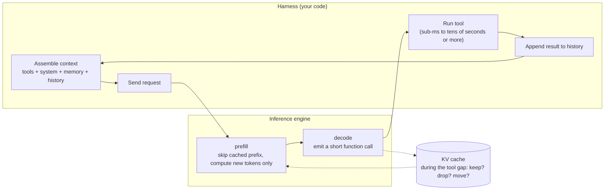

[中文](README.md) · **English**

# Module 04: Workload Profile of an Agent Harness

> 🕐 Suggested time: 1.5 hours ｜ 🎯 After this module you can: translate every harness action (assembling the system prompt, injecting memory, compacting, calling tools, spawning sub-agents) into the token stream the inference engine sees; do mental math for the total prefill, the cache reuse factor and the bill of one agent task; tell apart the two cache semantics, "self-hosted engines match by block" and "hosted APIs match by breakpoint"; explain 9 "cache-friendly" harness rules and the invisible invalidations caused by inference parameters ｜ 🧪 Lab: [`lab.py`](lab.py) ｜ 📖 Required primary sources: [Context Engineering for AI Agents: Lessons from Building Manus](https://manus.im/blog/Context-Engineering-for-AI-Agents-Lessons-from-Building-Manus), [Anthropic prompt caching docs](https://platform.claude.com/docs/en/build-with-claude/prompt-caching)

## 0. One sentence

**The harness decides the token sequence the inference engine sees. The harness is the outer program that drives the agent loop: it assembles prompts, calls tools and manages context. An agent workload has three traits: the same ever-growing context is resubmitted in full every turn; outputs are very short; there are idle gaps between tool calls. So agent inference cost is dominated by prefill, the phase that runs all input tokens through the model once and produces the KV cache. How much prefill you can save depends almost entirely on whether the harness keeps the prefix stable.**



This module answers "what does an agent workload look like, and how should a harness be written so it wastes nothing". [Module 05](../05_cache_prefill/README.en.md) answers "how should the engine and the cluster absorb this workload". To watch the same effects happen in a mini engine that really computes, see `agent_harness.py` in the [capstone](../../capstone/README.en.md).

## 1. Why big companies care

**Scenario.** A general agent (e.g. Manus) or a coding agent loops through dozens of tool calls per task. The Manus team published three numbers ([Manus blog, 2025-07-18](https://manus.im/blog/Context-Engineering-for-AI-Agents-Lessons-from-Building-Manus)):

- a typical task needs about **50 tool calls** on average;
- the average **input : output ratio is about 100 : 1**: the context grows every step, while the output is usually one structured function call;
- they consider the **KV-cache hit rate the single most important metric for a production agent**. With Claude Sonnet, cached input cost 0.30 USD/MTok and uncached input 3 USD/MTok, a 10x gap. These are the prices at the time of the blog; 2026 prices are in Section 4.

An independent public dataset is the FAST'25 request trace released by Kimi's Mooncake team ([trace README](https://github.com/kvcache-ai/Mooncake/blob/main/FAST25-release/README.md)). It is sampled from one hour of online traffic:

| trace | requests | avg input tokens | avg output tokens | input:output |
|---|---:|---:|---:|---:|
| Tool and Agent | 23,608 | 8,596 | 182 | ≈ 47 : 1 |
| Conversation | 12,031 | 12,035 | 343 | ≈ 35 : 1 |

**Keep the two accounting bases apart.** Mooncake's ratios are **per request**, and there the conversation workload actually has longer inputs; the two are the same order of magnitude. Manus's 100:1 is **cumulative per task**: the prefix resubmitted at every step, mostly already cached, is counted as input too. So the real difference between agents and chat is not the per-request input/output ratio, but "the same context is resubmitted dozens of times" and "there are tool gaps between requests" (Section 3).

**Mental math for one task.** The parameters below are round numbers chosen for the demo, not any company's real configuration: shared prefix P = 8k tokens (tools + system), each step appends a = 1k tokens (the previous function call + tool result), each step outputs o = 300 tokens, T = 50 steps in total.

- Without caching, total input = T·P + a·T(T−1)/2 = 400k + 1,225k = **1.625M tokens**. Total output = 15k. The cumulative input:output is ≈ 108:1, the same order of magnitude Manus reports.
- With a perfect prefix-cache hit, only P + (T−1)·a ≈ **57k tokens** really need prefill. That is a token reuse factor of about 28x, or a hit rate of about 96.5%.
- The bill at Claude Sonnet 5 prices (input $2, 5-minute cache write $2.50, cache read $0.20, output $10, all per million tokens, checked 2026-09-28):
  - no caching: 1.625M × $2 + 15k × $10 ≈ **$3.40**;
  - perfect caching: 57k × $2.5 + 1.568M × $0.2 + 15k × $10 ≈ **$0.61**, about 5.6x cheaper.

**The pain.** Section 5 covers several harness habits: a timestamp precise to the second at the top of the system prompt, JSON serialized without sorted keys, adding and removing tools by phase, switching reasoning effort per turn. Any one of them drops the hit rate from 96% to nearly 0. The bill goes back to $3.40, and every step's TTFT (time to first token) goes from "compute 1k new tokens" to "recompute tens of thousands of tokens". **And nothing raises an error**: requests still succeed, just more slowly and more expensively. That is why large companies treat the cache hit rate as a first-class harness metric, and treat "how the harness is written" as something the inference team must be involved in.

## 2. What the harness does: six actions → token stream

### 2.1 What one request looks like

Taking Anthropic as the example, the cache prefix is built in the order `tools → system → messages` ([docs](https://platform.claude.com/docs/en/build-with-claude/prompt-caching)). To the engine, one agent request is a sequence like this:

```
[tool defs][system prompt][project/repo context][memory]  [user][asst: call][tool result][asst: call][tool result] ... [new this turn]
|<----------- stable prefix: shared by all sessions of a project ----------->|<----- this session's history: append only ----->|<-new->|
           thousands to tens of thousands of tokens; one byte changed = all invalid     +hundreds to thousands of tokens per turn
```

### 2.2 What the six actions mean for the engine

| # | harness action | what the engine sees | effect on the KV cache |
|---|---|---|---|
| 1 | **system prompt and tool definitions** | a prefix of thousands to tens of thousands of tokens on every request | the most valuable shared prefix, reusable by every session of the same product/project. Change one byte and everything after it is invalid |
| 2 | **context assembly** (ordering, serializing tool results) | prefix + new tail | with non-deterministic serialization (e.g. unstable JSON key order), identical content looks like new content |
| 3 | **memory injection** (long-term memory, RAG snippets) | depends on where it is inserted | inserted before the history: everything after the insertion point is invalid. Appended at the end: just one extra chunk of prefill |
| 4 | **compaction / summarization** (when the context is nearly full, summarize history into a short summary and start a new context) | a brand-new, shorter prompt | the prefix breaks and everything after the summary is recomputed once; producing the summary itself costs a decode |
| 5 | **tool calls** | a very short decode, then an idle gap from sub-millisecond to tens of seconds or more | during the gap the KV occupies HBM without doing work: keep it, drop it or move it, see [Module 05](../05_cache_prefill/README.en.md) |
| 6 | **sub-agent fork** | fan-out: N requests sharing the parent prefix arrive almost at once; fan-in: N results appended back to the parent context | whether they can share the parent prefix depends on byte-identical prefixes and on how the engine or API handles concurrent writes (3.3) |

### 2.3 Why prefix caching "only recognizes prefixes": engine semantics and API semantics

Transformers use causal attention: the K and V of token i at every layer depend on all tokens before it. So whether a piece of KV can be reused depends on whether **the whole prefix before it** is identical, not just on the piece's own content. On this common basis, self-hosted engines and hosted APIs cache at different granularities.

**Self-hosted engines: a hit at any block boundary.** vLLM's automatic prefix caching cuts tokens into fixed-size blocks and gives each block a **chained hash** ([design doc](https://docs.vllm.ai/en/stable/design/prefix_caching/)):

```
h_0 = hash(initial value, tokens[0:B],     extra keys + cache_salt)   # cache_salt is injected into the first block only
h_i = hash(h_{i-1}, tokens[i·B:(i+1)·B], extra keys)                # extra keys: LoRA ID, multimodal input hashes, etc.
```

- **Only full blocks are cached.** Tokens in the trailing partial block are recomputed every time.
- Change token j and the hash of block ⌊j/B⌋ **and every block after it** changes. This is the mechanism behind "a timestamp at the top wipes out the whole cache".
- The same content at a different position (e.g. the same file read into different places of two sessions' contexts) **does not hit**. Reusing non-prefix content needs "position-independent caching", see [Module 05](../05_cache_prefill/README.en.md) Section 5.4.
- `cache_salt` acts like an invisible token at the root of the chain. Give each tenant its own salt and caches are isolated, which defends against side-channel attacks that "guess other people's prompts by measuring TTFT".

**Hosted APIs: writes only at breakpoints, bounded lookback on reads.** Both are exact prefix matches, but writes and lookups happen only at specific positions:

- **Anthropic**: cache writes **happen only at breakpoints**, each writing one "hash of the prefix up to that block". Reads walk back block by block from the breakpoint looking for entries that earlier requests **wrote**, checking at most 20 positions (content blocks, not token blocks; a run of consecutive `tool_use` or `tool_result` blocks counts as one position). The docs give a counterexample: with the breakpoint on a last block that carries a timestamp, every request writes a fresh entry and never reads one ([docs](https://platform.claude.com/docs/en/build-with-claude/prompt-caching)).
- **OpenAI** (GPT-5.6 and later): lookups happen only at "cache lookup boundaries": explicit breakpoints (the first 2 and latest 50), the implicit breakpoint, up to 20 earlier eligible message endings, and the end of the initial block of consecutive developer messages ([docs](https://developers.openai.com/api/docs/guides/prompt-caching)).

**Consequence**: for different sessions of the same project to share "tools + system + project context" across sessions on an API, **you must place a breakpoint at the end of the shared prefix** (rule 9 in Section 5). With automatic caching alone (the breakpoint falls on the last block of each request), multi-turn reuse within a session works, but the cross-session shared prefix is lost. The lab accounts for both semantics side by side. Exercises (a)(b) implement the engine semantics, and exercise (d) practices "where to put the breakpoint".

## 3. Agent workloads vs chat workloads

| dimension | chat | agent | implication for infra | evidence |
|---|---|---|---|---|
| per-request input/output ratio | from about 4:1 (Azure chat trace) to 35:1 (Mooncake conversation trace) | 47:1 (Mooncake toolagent trace); about 100:1 cumulative per task (Manus) | both are prefill-dominated; the agent's cumulative ratio is larger because the same prefix is resubmitted again and again | Mooncake trace README; the Preble paper reports prompt/output ratios from 4x (Azure chat) to 2494x (video QA) ([arXiv:2407.00023](https://arxiv.org/abs/2407.00023)); Manus blog |
| how many times the same context is submitted | once per human reply | resubmitted in full after every tool call, about 50 times per task | without caching, total prefill grows **quadratically** with steps; with caching, linearly | Manus "about 50 tool calls" |
| gap between two requests | human reply time | tool time: from sub-millisecond (calculator) to tens of seconds; different tools differ by orders of magnitude | whether KV should stay in HBM during the gap depends on the tool-time distribution | interception durations measured in the InferCept paper: math about 0.1 ms, QA (retrieval) about 0.69 s, image generation about 20 s, chatbot (waiting for a human) about 28.6 s ([arXiv:2402.01869](https://arxiv.org/abs/2402.01869)) |
| context rewriting | rare | compaction, clearing old tool results, adding/removing tools | every rewrite is a "prefix break + large recompute" | Anthropic: compaction and tool result clearing ([blog](https://www.anthropic.com/engineering/effective-context-engineering-for-ai-agents)) |
| concurrency structure | one question, one answer | fan-out / fan-in: the lead agent spawns several sub-agents, then aggregates | a batch of requests sharing a prefix arrives at once; total tokens multiply | multi-agent systems use about 15x the tokens of chat ([Anthropic multi-agent research system blog](https://www.anthropic.com/engineering/multi-agent-research-system)); sub-agents usually return only a 1,000–2,000-token summary ([Anthropic context engineering blog](https://www.anthropic.com/engineering/effective-context-engineering-for-ai-agents)) |

### 3.1 Formula: quadratic growth of multi-turn prefill

With shared prefix P, a tokens appended per step and T steps:

```
total prefill without cache:      N_none(T) = T·P + a·T(T−1)/2          ← grows quadratically in T
prefill with perfect prefix cache: N_cache(T) ≈ P + (T−1)·a              ← grows linearly in T
reuse factor:                      R(T) = N_none / N_cache ∈ [T/2, T]    ← ≈ T/2 when P is negligible; ≈ T when a is negligible
```

Mental rule: **for a T-step agent task, prefix caching cuts the number of tokens to prefill to between 1/(T/2) and 1/T of the original.** For 50 steps that is 25x to 50x; the example above is 28x. Conversely, every time the harness invalidates the cache, that step pays prefill for "the whole context" again.

**The token reuse factor is not the compute reuse factor.** After a hit, new tokens still attend over the whole cached prefix, so the FLOPs saved are smaller, and TTFT after a hit still grows with context. Recomputing the example above (P = 8k, a = 1k, T = 50) with `codesign_sim.model.prefill_flops`:

- counting tokens, R = 28.5; counting FLOPs, R ≈ 24.1 for Qwen3-32B and ≈ 22.5 for DeepSeek-V3.
- the prefill FLOPs for the 1k new tokens at step 50 are 2.9x (Qwen3-32B) and 5.0x (DeepSeek-V3) the GEMM-only (matrix multiply) figure; the extra is all attention over the 57k cached prefix.

### 3.2 One agent session on the engine's timeline

```
time →
req 1 [prefill 8k ████████][decode 300 ▒▒▒]  tool 2s ......  
req 2        [hit 9k ░░░░░░░░░][prefill 1k █][decode ▒▒▒]  tool 40s .....................
req 3                                     [hit 10k ░░░░░░░░░░][prefill 1k █][decode ▒▒▒] ...
                     ↑ tool gap: the KV of these 9k~10k tokens sits "idle" in HBM. If evicted, req 3 recomputes everything
```

Two key quantities: **gap length** (decides whether the KV is kept, dropped or moved) and **new tokens between two requests** (decides how much prefill remains after a hit). Mental math for the dilemma in the gap: on 8×H100 running Qwen3-32B, recomputing a 100k-token context takes about 3.5 s (`prefill_flops` including attention, MFU 0.6); keeping it in HBM occupies about 26 GB of KV. The gaps InferCept measured range from 0.1 ms to about 29 s. How to decide between the two is the subject of [Module 05](../05_cache_prefill/README.en.md) Section 2.

### 3.3 fan-out / fan-in

In its engineering blog on the multi-agent research system, Anthropic reports that agents use about 4x the tokens of chat and multi-agent systems about 15x ([blog](https://www.anthropic.com/engineering/multi-agent-research-system)). For the inference system, fan-out has two concrete consequences:

1. **Whether concurrent requests can share the parent prefix depends on three layers.**
   - **Hosted APIs**: Anthropic's docs state that a cache entry only becomes available after the first response begins; to get cache hits for parallel requests, "wait for the first response before sending subsequent requests". Otherwise N sub-agents sent at once mean N misses and N writes.
   - **Self-hosted engine schedulers**: they can "deduplicate prefixes within a batch". For example, when several waiting requests share a prefix that is not yet cached, SGLang's scheduler schedules only one of them first so the rest hit afterwards (in-batch prefix caching in [schedule_policy.py](https://github.com/sgl-project/sglang/blob/main/python/sglang/srt/managers/schedule_policy.py)).
   - **The harness itself**: send one request to warm the shared prefix first, then release the rest. This works under both deployments.
2. **Prefix consistency.** If each sub-agent tweaks the system prompt a little (e.g. puts the subtask description into the system prompt), they no longer share a prefix. The subtask description belongs after the shared prefix.

### 3.4 RL rollouts are harnesses too

For readers doing post-training, the RL rollouts they run every day are the largest harness workload of all, with prefix structures both like and unlike tool agents:

- **Group sampling = fan-out.** GRPO ([DeepSeekMath, arXiv:2402.03300](https://arxiv.org/abs/2402.03300)) samples a group of G answers for the same prompt and uses the group mean as the baseline (see [Module 07](../07_multi_agent_credit/README.en.md) Section 2.2). To the engine, that is a G-way fan-out sharing one prompt: the prompt should be prefilled only once.
- **Multi-turn tool rollouts = the agent workload of this module**, relying on the engine's prefix cache, with a severe long tail (see [Module 06](../06_long_tail_async/README.en.md)).
- **Weight syncs invalidate the whole prefix cache.** KV is a function of the weights; once the weights change, old KV is no longer the new policy's KV, so cache lifetime is capped by the weight-update period (see the discussion of versioned caches in [Module 09](../09_frontier/README.en.md)). PipelineRL and Magistral choose to keep generating in-flight sequences with the old KV after a weight update, a deliberately accepted inconsistency (see Module 06 Section 4.6).
- **Verifiers / reward models**: they read "prompt + answer", which is another prefill of the same prompt. If it is the same model as the policy, the prompt part can share the prefix; a different model cannot (caches are separate per model).
- **best-of-N, tree search**: the prefixes form a tree, and everything before each branch point can be shared, which maps exactly onto a radix tree.

## 4. Prompt caching APIs compared (checked on 2026-09-28)

> Prices and rules change quickly. The content below was compiled from the official docs on 2026-09-28; check the official docs before relying on it.

| | Anthropic | OpenAI | DeepSeek |
|---|---|---|---|
| how to enable | put `cache_control` breakpoints on content blocks (at most 4 per request), or add a top-level `cache_control` that is placed automatically on the last cacheable block | on by default. GPT-5.6 and later: implicit breakpoint at the end of the latest eligible message, or `explicit` mode to use only explicit breakpoints (content after the breakpoint is billed at the uncached rate with no write charge). Earlier models: implicit breakpoints at fixed intervals (every 2,048 tokens for GPT-5.5) | on by default, no code changes ("context caching on disk"): every request triggers building a disk cache |
| hit granularity | writes only at breakpoints; on reads each breakpoint looks back at most 20 positions | GPT-5.6+: looks up only at cache lookup boundaries (explicit breakpoints, the implicit breakpoint, up to 20 earlier message endings, the end of the initial developer block) | the unit is the "cache prefix unit": one unit is stored at the end of the user input and one at the end of the model output; when a common prefix across requests is detected, it is stored as its own unit; long inputs are cut at fixed token intervals. A later request must **fully match** a unit to hit |
| minimum cacheable length | model-dependent: 512 to 4,096 tokens | GPT-5.6+: 1,024 visible input tokens; earlier models vary with request settings | not given in the current docs; at the 2024-08 launch the stated storage unit was 64 tokens |
| lifetime | 5 minutes by default, refreshed for free on each hit; optional 1 hour. The lifetime is measured from the **start** of the request that reads or writes the entry | GPT-5.6+: `ttl="30m"`, at least 30 minutes after the latest read/write. GPT-5.5: `24h` only. Earlier models: `in_memory` (typically expires after 5–10 minutes of inactivity, up to 1 hour) or `24h` | building the cache takes seconds; unused entries are cleared automatically, usually within a few hours to a few days; best-effort, no hit guarantee |
| write price | 5 minutes: 1.25x input price; 1 hour: 2x | GPT-5.6+: 1.25x; earlier models: no extra charge | no separate write fee; missed tokens are billed at the cache-miss price |
| read price | 0.1x input price (0.05x for Claude Opus 5.5; 0.025x for Claude Fable 5.1 and Mythos 5.1) | GPT-5.6+: 0.1x; earlier models: model-dependent | `deepseek-flash`: hit $0.006 vs miss $0.3, about 1/50; `deepseek-v4-pro`: $0.044 vs $1.32, about 1/30 (peak prices, halved off-peak) |
| usage fields | `cache_creation_input_tokens`, `cache_read_input_tokens`, `input_tokens` (the part after the last breakpoint) | `usage.input_tokens_details.cached_tokens`, `cache_write_tokens` | `prompt_cache_hit_tokens`, `prompt_cache_miss_tokens` |
| worth noting | caches are isolated per organization, and per workspace on the Claude API | caches live on **individual machines**; routing depends on "machine load + a hash of the initial tokens", and before GPT-5.6 also on `prompt_cache_key`; traffic above about 15 requests per minute for the same prefix/key can overflow to other machines. From GPT-5.6 on, `prompt_cache_key` is no longer needed to optimize routing and is used only for separate billing and to prevent cross-user hit probing; the docs mention encrypted KV tensors may be stored in GPU-local storage | KV is stored on disk. The 2024-08 announcement says that for a 128K prompt with heavy reuse, first-token latency drops from 13 s to 500 ms, and credits MLA's much smaller KV for making disk caching possible. A 24-hour statistic published in 2025-02: of 608B input tokens, 342B (56.3%) hit the on-disk KV cache |

Sources: [Anthropic docs](https://platform.claude.com/docs/en/build-with-claude/prompt-caching), [OpenAI docs](https://developers.openai.com/api/docs/guides/prompt-caching), [DeepSeek context caching guide](https://api-docs.deepseek.com/guides/kv_cache), [DeepSeek pricing](https://api-docs.deepseek.com/quick_start/pricing), [2024-08-02 announcement](https://api-docs.deepseek.com/news/news0802), [DeepSeek-V3/R1 inference system overview](https://github.com/deepseek-ai/open-infra-index/blob/main/202502OpenSourceWeek/day_6_one_more_thing_deepseekV3R1_inference_system_overview.md).

**Reading the three side by side gives four takeaways:**

1. **All are exact prefix matches, but they write and look up at different positions.** Self-hosted engines can hit at any block boundary; Anthropic writes only at breakpoints with a bounded lookback; OpenAI looks up only at lookup boundaries; DeepSeek requires a full match of a "cache prefix unit". DeepSeek's docs say: "Due to the Sliding Window Attention mechanism, the storage and matching of cached prefixes differs from before." The DeepSeek-V4 technical report ([arXiv:2606.19348](https://arxiv.org/abs/2606.19348) §3.5) explains why: SWA KV is uncompressed and exists in every layer, about 8 times the volume of the compressed KV, so the on-disk SWA state is either stored in full, checkpointed every p tokens, or not stored at all and restored after a hit by recomputing the last n_win·L tokens. This is a first-hand example of **model architecture changing cache semantics**. For the harness it means request boundaries must be stable: make each new request fully contain the previous turn's "input + output".
2. **Cache reads cost about 1/10 of uncached input or less** (Anthropic 0.1x, 0.05x or 0.025x on some models; OpenAI GPT-5.6+ 0.1x; DeepSeek about 1/30 to 1/50). Pricing roughly mirrors the cost structure: a hit saves the prefill compute, and what is left is the cost of storing and moving the KV.
3. **The differences are in two places: who places breakpoints, and where the KV lives and for how long.** Anthropic has developers mark breakpoints explicitly, with TTLs of minutes to an hour; OpenAI is automatic by default and its docs mention GPU-local storage; DeepSeek uses disk, with retention measured in hours to days. The cheaper the storage tier, the longer the TTL. This is the commercial projection of the HBM / DRAM / SSD tiering in [Module 05](../05_cache_prefill/README.en.md) Section 4.
4. **Routing decides hits.** OpenAI's docs say outright that caches live on individual machines and a request can only hit if it is routed to a machine holding a matching entry, and they give an overflow threshold of about 15 RPM. The docs do not explain the number. It is far below one machine's capacity (on 8×H100 running a 32B-class model, a 30k-token request with a 90% hit prefills in about 0.08 s), so it looks more like coarse per-key load spreading when tenants share machines (this is speculation). The lesson: affinity routing needs an overflow cap, see Module 05 Section 3.

**Anthropic's cache break-even** (derived from the multipliers above): a 5-minute write (1.25x) plus one read (0.1x) is 1.35x, less than 2x for two uncached requests, so **it pays off on the 2nd request**. A 1-hour write (2x) pays off on the 3rd: 2 + 0.1 + 0.1 = 2.2 < 3.

## 5. A cache-friendly harness

### 5.1 Nine rules

| # | rule | mechanism | typical anti-pattern | source |
|---|---|---|---|---|
| 1 | **Stable first, volatile last**: tools → system → project context → history → this turn | prefix matching, chained hash | writing "current user: Alice" or "mode: read-only" into the system prompt | Anthropic, OpenAI docs |
| 2 | **No timestamp at the top.** If you need the time, put it at the end, or coarsen it to "date" | once block 0 changes, everything is invalid. On Anthropic, a timestamp at the top of system does not affect the tools cache that comes before it, but invalidates system and everything after | `Current time: …` precise to the second on the first line of the system prompt | Manus; Anthropic docs |
| 3 | **Append only; never modify history** | modify turn k and everything after turn k is recomputed | going back to rewrite old tool results; injecting a reminder each turn and deleting it the next | Manus |
| 4 | **Deterministic serialization**: sort JSON keys, sort tools by name | different bytes mean a miss | `json.dumps(d)` without `sort_keys=True`; building the tool list by iterating a `set` | Manus |
| 5 | **Mask tools; do not remove them** | tool definitions sit at the very front of the prefix; adding or removing any tool invalidates everything after it | adding/removing tools dynamically by task phase | Manus (self-hosted: mask logits during decoding, give tool names consistent prefixes such as `browser_`, `shell_`); OpenAI (`tool_choice: "none"` instead of removing tools, `allowed_tools` to restrict callable tools, tool search appending newly found tools at the end); Anthropic (the beta `tool_addition` block appends tool definitions in a message while `tools` stays unchanged). See 5.2 |
| 6 | **Compact rarely, in batches, and restorably** | each compaction = one full recompute + one summary decode | cutting the oldest message every turn (sliding window): the beginning changes every turn and the hit rate is near 0 | Manus: use the file system as external memory and keep only restorable references (URLs, file paths) when compressing; the LMCache paper reports that context truncation halves the prefix cache hit ratio ([arXiv:2510.09665](https://arxiv.org/abs/2510.09665)) |
| 7 | **Sub-agents reuse the parent prefix byte for byte; for concurrent fan-out, send one first** | on APIs, concurrent requests cannot read what the others are writing | every sub-agent's system prompt differs slightly; N sub-agents sent at once | Anthropic docs; Section 3.3 |
| 8 | **When self-hosting: enable prefix caching and make routing session-sticky** | the cache lives on a single machine | per-request round-robin load balancing | Manus: route requests consistently to the same worker with session IDs; OpenAI docs; see [Module 05](../05_cache_prefill/README.en.md) Section 3.3 |
| 9 | **Put an explicit breakpoint at the end of the stable prefix** (on hosted APIs) | APIs write cache entries only at breakpoints; an automatic breakpoint falls on the last block of each request, so the cross-session shared prefix is lost | relying on automatic caching alone while expecting new sessions of the same project to hit tools + system + project context | Manus: mark cache breakpoints explicitly, at minimum ensure the breakpoint includes the end of the system prompt; Anthropic docs; OpenAI's `explicit` mode also avoids paying write fees for a volatile tail |

One meta-rule runs through all of them: **make the cache hit rate a monitored metric**, e.g. Anthropic's `cache_read_input_tokens` or OpenAI's `cached_tokens`. Cache invalidation never raises an error; only monitoring catches it.

### 5.2 Why "mask, don't remove" is a good co-design example

Removing a tool changes the **prefix**; masking a tool changes a **decoding constraint**. The latter does not touch the KV; it only blocks certain tokens at sampling time. But its cost differs between the two deployments:

- **Self-hosted engines**: a logit mask can be applied directly during decoding, leaving the prefix untouched, truly for free. Manus describes three function-calling modes: Auto (may or may not call), Required (must call, any tool), Specified (must call from a given subset), all implementable by prefilling the start of the response (response prefill) plus logit masks. Consistent tool-name prefixes only solve "which kind of tool"; guaranteeing strictly valid JSON arguments also needs a grammar- or JSON-Schema-constrained decoding state machine.
- **Hosted APIs**: arbitrary logit masks are generally not exposed. On Anthropic, changing `tool_choice` invalidates the messages cache (tools and system caches stay valid); OpenAI offers dedicated prefix-preserving ways (`allowed_tools`, `tool_choice: "none"`).

So "mask" is an interface that requires the inference engine and the API to support constrained decoding: the harness's needs shape the engine interface in return.

### 5.3 The invisible prefix: inference and request parameters

One of the most common sources of cache invalidation in a 2026 harness is parameters that look separate from the prompt but are in fact rendered into it.

**Anthropic** (the "What invalidates the cache" table in the docs):

| what changes | tools cache | system cache | messages cache |
|---|---|---|---|
| tool definitions | invalidated | invalidated | invalidated |
| web search / citations toggles, `speed` (fast mode) | valid | invalidated | invalidated |
| `tool_choice`, adding/removing images | valid | valid | invalidated |
| thinking parameters, `output_config.effort` | model-specific | model-specific | invalidated |

- Setting effort explicitly to the model's default is the same as omitting it and does not invalidate. On supported models, changing effort through a `role: "system"` message inside `messages` keeps the cached prefix.
- On earlier Opus / Sonnet models and all Haiku models, appending non-`tool_result` user content while extended thinking is on strips previously cached thinking blocks, and every message after them falls out of the cache. Opus 4.5+ and Sonnet 4.6+ preserve thinking blocks by default and are unaffected.
- When some models' thinking blocks are passed back to a model that cannot read them, the API drops them and the cached prefix changes from that position on.

**OpenAI** (the docs' "Which settings affect the cached prefix?"): `model`, `tools`, `parallel_tool_calls`, `text.format` (the structured-output schema), `reasoning.effort`, `text.verbosity` and `context_management` (compaction) all change the cached prefix. GPT-6 models can append a `configuration_update` input item to change reasoning effort without changing the request-level `reasoning.effort`, keeping the prefix.

**DeepSeek**: cache units are built at "the end of the user input" and "the end of the model output". If the harness rewrites the previous turn's reasoning or output before resubmitting, the "end of output" unit is no longer a prefix of the new request, and only the "end of user input" unit can still hit.

**Conclusion**: pin the thinking configuration, reasoning effort, `tool_choice` and structured-output schema **per route**, not per request; when you must change them mid-conversation, use each vendor's "append-style" mechanism.

### 5.4 The economics of compaction

Compaction breaks rule 3, but the context eventually fills up; you cannot avoid compacting forever. The question is **when and how much**. Split the context into the stable prefix P (tools + system + project context) and the session history H. Compaction replaces only H with an S-token summary; P is untouched and still hits. Use "uncached input" as the price unit with read multiplier r, write multiplier w and output multiplier o:

```
one-time cost   = r·(P + H) (read the whole context to summarize) + o·S (generate the summary) + w·S (only S is new in P + S)
saving per turn = r·(H − S) (each later turn reads H − S fewer cached tokens; P is read either way and cancels)
break-even      n* = (r·(P + H) + o·S + w·S) / (r·(H − S))
```

With Anthropic's multipliers (r = 0.1, w = 1.25) and Sonnet 5's output/input price ratio o = 5:

- P = 0, H = 100k, S = 5k: n* = (10k + 25k + 6.25k) / 9.5k ≈ **4.3 turns**;
- P = 20k, H = 80k, S = 5k: n* = 41.25k / 7.5k = **5.5 turns** (for the same 100k-token context, a larger stable prefix makes payback slower);
- P = 0, H = 30k, S = 5k: n* ≈ **13.7 turns**.

Conclusion: **the summary's output cost dominates, so compacting often on short histories is usually not worth it**. Generating an S-token summary also takes S decode steps, a delay users can feel. Exercise (c) is this formula. Note that this counts money, not quality: Anthropic's blog treats compaction as a core technique for long tasks, with the emphasis on keeping key information such as architectural decisions and unresolved bugs ([blog](https://www.anthropic.com/engineering/effective-context-engineering-for-ai-agents)).

## 6. Numbers you must be able to do in your head

| quantity | typical value | how to derive it | source |
|---|---|---|---|
| agent input : output | about 47:1 per request (Kimi toolagent trace); about 100:1 cumulative per task (Manus) | context grows every step, output is just a function call | Mooncake trace README; Manus blog |
| tool calls per typical task | about 50 | — | Manus blog |
| multi-turn token reuse factor R | T/2 to T; lower in FLOPs (e.g. 28.5 → 24.1) | N_none / N_cache, see 3.1 | derived in this module |
| cache read price / input price | 0.1x (lower on some models) | — | Anthropic; OpenAI GPT-5.6+ |
| Anthropic 5-minute cache break-even | 2nd request | 1.25 + 0.1 < 2 | derived from official multipliers |
| Anthropic 1-hour cache break-even | 3rd request | 2 + 0.2 < 3 | derived from official multipliers |
| KV per token (BF16) | Qwen3-32B: 256 KiB; DeepSeek-V3: 68.6 KiB | GQA: 2 × 64 layers × 8 KV heads × 128 dims × 2 B; MLA: 61 layers × (512 + 64) × 2 B | official config.json ([Qwen3-32B](https://huggingface.co/Qwen/Qwen3-32B/blob/main/config.json), [DeepSeek-V3](https://huggingface.co/deepseek-ai/DeepSeek-V3/blob/main/config.json)) |
| KV of a 100k-token context | Qwen3-32B: about 26 GB; DeepSeek-V3: about 7 GB | previous row × 100k | same as above |
| how many 100k contexts stay resident | 8×H100 running Qwen3-32B: about 17 | about 1.75M tokens of KV space ÷ 100k (see Module 05 Section 1) | derived in this module |
| prefill to recompute 100k tokens | 8×H100 running Qwen3-32B: about 3.5 s | linear layers 2 × 32.8B × 100k ≈ 6.6e15 FLOPs, plus attention, MFU 0.6 | `codesign_sim.model.prefill_flops` |
| tail-block waste from block size | about B/2 tokens recomputed per request on average: about 8 at B = 16, about 256 at B = 512 | only full blocks are cached | vLLM design doc |
| block size and metadata | 100k context: 6,250 hash entries at B = 16, about 195 at B = 512 | 100k / B | derived |
| compaction break-even turns | about 4.3 turns at P = 0, H = 100k, S = 5k | formula in 5.4 | derived in this module |
| sub-agent summary returned | 1,000–2,000 tokens | — | Anthropic context engineering blog |

## 7. Lab

```bash
.venv/bin/python modules/04_harness_workloads/lab.py      # or make lab N=04; finishes in seconds on a laptop
```

**What it does.** It uses `codesign_sim.workload.generate_sessions` to generate 160 sessions (8 projects, fixed seed, with the library's default "auto-compact near 100k" turned off so each row reflects only its own habit) and feeds requests in time order into a `PrefixCache` large enough never to evict, isolating the effect of the harness habits themselves.

- **The habits**: the lab explicitly builds "the token segments this request actually sends" and chain-hashes them into blocks the way vLLM does. Timestamps are real token segments inserted at the very front or at the end; "automatic caching only" is simulated by giving each session its own chain (a different chain root) and caching only the request input: hosted APIs do not cache this turn's output, so the previous output is written only when it is submitted as input in the next turn (at the write price); dynamic tools make the prefix differ from token 0.
- **Compaction / rewriting**: the library's `rewrite_prob` and `rewrite_keep_frac`. keep = 1 means rewriting without shortening; keep = 0.1 means compressing the session history into a summary 10% as long, so the context really gets shorter. The compaction rows also include the cost of the summarization call: reading the whole pre-compaction context (at the hit price) and generating the summary (at the output price).
- **The bill**: at Claude Sonnet 5 prices (2026-09-28). It assumes every request ends with a cache breakpoint (automatic caching), so missed tokens are charged at the 5-minute write price and hits at the read price. All rows except `api_auto_only` use self-hosted engine semantics (hits at any block boundary, project prefixes shared across sessions, the KV of this turn's output stays in the cache). On a hosted API these rows are an unreachable upper bound: an explicit breakpoint recovers the project prefix shared across sessions, but not the previous turn's output (see point 2 below).

**Real output** (seed=0; the lab prints Chinese labels):

```
========================================================================================================
A. 负载概况：160 个会话 / 8 个项目 / 1316 次请求（seed=0，block=64 token）
   只追加时 prompt 总量 27.67M token，输出总量 0.380M token，按任务累计的输入:输出 ≈ 73:1
--------------------------------------------------------------------------------------------------------
harness 写法              prompt 总量      命中率   重算 prefill    × 理想     账单($)     不缓存($)     省下
append_only                27.67M    92.8%        2.00M     1.0     13.94      59.14    76%
api_auto_only              27.67M    87.7%        3.40M     1.7     17.15      59.14    71%
ts_head_seconds            27.69M     8.9%       25.22M    12.6     67.35      59.18   -14%
ts_head_day                27.69M    92.8%        2.00M     1.0     13.93      59.18    76%
ts_tail_kept               27.85M    92.7%        2.02M     1.0     14.02      59.49    76%
ts_tail_dropped            27.69M    91.5%        2.36M     1.2     14.77      59.18    75%
dynamic_tools_0.2          27.67M    75.9%        6.66M     3.3     24.65      59.14    58%
rewrite_p0.1_keep1.0       27.67M    85.9%        3.91M     2.0     18.34      59.14    69%
compact_p0.1_keep0.1       20.00M    89.5%        2.10M     1.1     14.00      48.40    71%
compact_p0.3_keep0.1       14.69M    85.2%        2.17M     1.1     14.20      43.00    67%
rewrite_every_turn         27.67M    32.8%       18.60M     9.3     52.12      59.14    12%
========================================================================================================
B. 只追加的 harness：按会话轮数 T 分组看复用倍数 R = prompt 总量 / 重算量（README 3.1）
   「会话内」只看本会话的复用，应落在 [T/2, T]；「含跨会话」再加上同项目共享前缀带来的复用
--------------------------------------------------------------------------------------------------------
      轮数 T     会话数     平均 T      [T/2, T]        R（会话内）         R（含跨会话）
       2-3      16      3.0    [1.5, 3.0]           2.6             7.4
       4-7      94      5.0    [2.5, 5.0]           4.1             7.9
      8-15      34     10.8   [5.4, 10.8]           7.8            10.7
     16-31      13     22.5  [11.3, 22.5]          14.3            17.3
     32-64       3     47.0  [23.5, 47.0]          30.6            32.7
```

Column guide: part A columns are harness habit, prompt total, hit rate, prefill to recompute, × the ideal, bill ($), bill without cache ($), saving. Part B columns are turns T, sessions, mean T, [T/2, T], R within a session, R including cross-session sharing.

**How to read it.**

1. **The ideal habit (append only)**: 92.8% of prompt tokens hit the cache; only 2.0M of 27.7M need recomputing, and the bill is 76% cheaper than without caching. The cumulative input:output is about 73:1, the same order of magnitude as Manus's 100:1.
2. **A hosted API with automatic caching only** (no breakpoint at the end of the shared prefix): the hit rate drops to 87.7%, misses are 1.7x the ideal, and the bill is 23% higher ($17.15 vs $13.94). Two things are lost: the project prefix shared across sessions, and the previous turn's output, which the API does not cache and which is written once at the write price when submitted as new input in the next turn. So a bill computed as "engine semantics × API prices" is a lower bound on a hosted API bill; an explicit breakpoint recovers only the project-prefix part.
3. **Timestamps**: at the very front, precise to the second, the hit rate drops to 8.9%; what remains comes from requests of the same project arriving within the same second. Recompute is 12.6x, and **the bill is 14% higher than with no caching at all**: every request pays the 1.25x write price and almost never reads. Precise to the day, it is the same as the ideal. At the end and kept in history (`ts_tail_kept`), it is nearly free. **At the end but dropped next turn** (`ts_tail_dropped`), recompute is 1.2x the ideal: the previous output was generated right after the timestamp, so its KV depends on it; once the next turn's history no longer contains the timestamp, that output no longer matches, and every turn recomputes the previous output.
4. **Dynamically adding/removing tools** (20% probability per turn): 3.3x recompute. Tool definitions sit at the very front of the prefix; one change invalidates the whole chain.
5. **The cost and benefit of compaction**:
   - Rewriting without shortening (`rewrite_p0.1_keep1.0`) is pure loss: recompute doubles and the bill is 32% higher.
   - Real compaction (`keep0.1`): compacting with 10% probability per turn cuts the prompt total from 27.7M to 20.0M (−28%); at 30% it drops to 14.7M (−47%). The cost is the broken prefix and the summarization: recompute rises only 5–9% (2.00M → 2.10M, 2.17M), and with the summarization calls included the bill is almost level with no compaction ($14.00, $14.20 vs $13.94).
   - **Conclusion**: at Anthropic's prices, compaction roughly breaks even in money; what it really buys is a shorter context, i.e. less KV memory, cheaper attention, and staying under the window limit. The cost is the broken prefix, the latency of decoding the summary, and quality risk. This agrees with the break-even formula of 5.4: the harder you compress and the more turns follow, the more it pays.
   - Rewriting every turn (`rewrite_every_turn`, the effect of sliding-window truncation): 32.8% hit rate, 9.3x recompute.
6. **Part B** confirms the formula in 3.1: the within-session reuse factor R always falls in [T/2, T]. The project's shared prefix helps short sessions most (3-turn sessions go from 2.6x to 7.4x). That is the value of "put the shared prefix first and keep it identical across sessions".

**Knobs to turn and what to look for.**

- Set `BLOCK` to 16: less waste in the trailing partial block, so the hit rate rises slightly, but the run gets slower. Think about why Mooncake's public trace uses 512-token blocks.
- Set `N_PROJECTS` to 1 or 64: more or fewer project prefixes shared across sessions; watch the gap between `api_auto_only` and `append_only`, and the last column of part B.
- Swap `PRICE_*` for DeepSeek's prices (the hit price is about 1/50 of the miss price, with no write fee): would `ts_head_seconds` still cost more than no caching? Does compaction still break even?
- Increase `TS_TOKENS` (e.g. the timestamp comes with a status line that changes every turn): how does the loss of `ts_tail_dropped` change?
- Add a row `sessions_with(rewrite_prob=0.1, rewrite_keep_frac=0.5)` in `part_a`: with a longer summary, does compaction still pay?

## 8. Exercises

Open [`exercise.py`](exercise.py) and implement four functions:

| function | what to do | section |
|---|---|---|
| `chain_block_hashes(tokens, block_size, salt)` | compute chained block hashes like vLLM, full blocks only | 2.3 |
| `replay_prefix_cache(requests, block_size)` | replay a sequence of requests through an unbounded prefix cache; return (reused tokens, recomputed tokens) | 2.3, 3.1 |
| `compaction_breakeven_turns(P, H, S, r, w, o)` | break-even turns for compacting the session history | 5.4 |
| `render_request(tools, system, history, volatile)` | render one request deterministically and return where the explicit breakpoint goes | 5.1 rules 1, 2, 4, 9 |

```bash
make module N=04                                              # tests your implementation (fails until you finish, which is expected)
INFRA_SOLUTION=1 .venv/bin/python -m pytest modules/04_harness_workloads   # the reference solution passes
```

The reference solution is in [`solution.py`](solution.py). Try on your own first; look only after being stuck for more than 10 minutes.

## 9. Self-check questions

1. An agent task has 40 steps, a 20k shared prefix and 500 tokens appended per step. How many tokens need prefill without caching and with perfect caching? What is the reuse factor? Would the reuse factor counted in FLOPs be higher or lower?
   <details><summary>Answer</summary>No cache: T·P + a·T(T−1)/2 = 40 × 20k + 500 × 780 = 800k + 390k = 1.19M. Perfect cache: P + (T−1)·a = 20k + 19.5k = 39.5k. The token reuse factor is about 30x, inside [T/2, T] = [20, 40]; because P is a large share, it sits closer to T. In FLOPs it is lower: after a hit, new tokens still attend over the whole cached prefix.</details>
2. Why does the same 5k-token file content miss the prefix cache when it appears at different positions in two sessions?
   <details><summary>Answer</summary>Under causal attention, each token's K/V depends on all tokens before it, so the cache key must encode the whole prefix (chained hash). Same content with a different prefix means different KV values, which cannot be reused directly. Reuse needs position-independent caching (CacheBlend, EPIC), at the cost of partial recomputation to repair cross-attention; see Module 05.</details>
3. Your agent updates a line "remaining budget: xxx tokens" at the end of the system prompt every turn. What happens to the cache? How do you fix it?
   <details><summary>Answer</summary>The system prompt comes after tools and before all history, so changing it invalidates the cache for system and all history (on Anthropic the tools segment still hits), and every turn recomputes almost everything. Fix: append the budget as a new message at the end of the history (or place it after the last breakpoint; on supported models use a `role: "system"` message inside `messages`), and keep the system prompt unchanged.</details>
4. Two requests share the same prefix and start 5 to 60 minutes apart. Is Anthropic's 1-hour TTL cheaper than the 5-minute TTL? Than no caching at all?
   <details><summary>Answer</summary>Use two baselines. Versus the 5-minute TTL: the 5-minute entry has expired each time and must be rewritten (1.25 + 1.25 = 2.5), while the 1-hour one writes once and reads once (2 + 0.1 = 2.1), so **one read already makes it cheaper**. Versus no caching: two uncached requests cost 2, and the 1-hour TTL with one read costs 2.1, slightly more; it needs 2 reads (2 + 0.2 = 2.2 < 3) to pay off. If the gap is under 5 minutes, every hit refreshes the entry for free and the 5-minute TTL suffices.</details>
5. Eight sub-agents fan out at once over a hosted API and share a 30k-token parent prefix. In the worst case how many extra cache writes happen? What about self-hosted SGLang?
   <details><summary>Answer</summary>On the API, none of the 8 concurrent requests can read the entry another is still writing, so in the worst case each writes its own: 7 × 30k = 210k extra written tokens (billed at 1.25x), plus 7 extra 30k prefills. Avoid it by sending 1 first and the other 7 after it starts responding, or by pre-warming the shared prefix once. Self-hosted SGLang's scheduler deduplicates prefixes within a batch: when several waiting requests share the same uncached prefix, it schedules only one first and the rest hit afterwards.</details>
6. Why is sliding-window truncation (dropping the oldest message each turn) especially bad for caching?
   <details><summary>Answer</summary>It changes the beginning of the history every turn. The chained hashes of all history blocks change with it, and only tools + system still hit. The LMCache paper reports that context truncation halves the prefix hit ratio. Better: compact in batches (compress a lot at once, then append only again), or write large tool outputs to the file system and keep only paths in the context.</details>
7. Using the formula in 5.4 with P = 10k, H = 60k, S = 3k, r = 0.1, w = 1.25, o = 5, how many turns until break-even? What conclusion do you get if you wrongly count P as compressible (using C = 70k in place of H)?
   <details><summary>Answer</summary>Correct: (0.1 × 70k + 5 × 3k + 1.25 × 3k) / (0.1 × 57k) = (7k + 15k + 3.75k) / 5.7k ≈ 4.5 turns. Wrong basis: (7k + 18.75k) / (0.1 × 67k) = 25.75k / 6.7k ≈ 3.8 turns, overestimating the benefit of compaction. The stable prefix is never compressed and is read every turn anyway, so it cannot count as savings.</details>
8. Your harness switches reasoning effort every turn based on task difficulty. What happens to the cache on Anthropic and OpenAI? How do you fix it?
   <details><summary>Answer</summary>Anthropic: changing `output_config.effort` always invalidates the messages cache, and on some models the tools and system caches too; on supported models, carrying the effort change in a `role: "system"` message inside `messages` keeps the prefix. OpenAI: `reasoning.effort` changes hidden system instructions and hence the prefix; GPT-6 models can append a `configuration_update` input item instead. The safest approach is to pin reasoning effort per route.</details>

## 10. Interview follow-ups

1. **"Where does agent inference cost go? How would you prove it?"**
   Key points: conclusion first, most of it is prefill, specifically the long prefix resubmitted over and over. Then the orders of magnitude: about 100:1 input:output cumulative per task (Manus) and about 47:1 per request (Mooncake toolagent trace), noting the different bases; without caching, total prefill tokens are T·P + aT²/2, quadratic in steps. Then the trade-off: prefix caching brings it back to linear but depends on the harness keeping the prefix stable, and the FLOPs saved are less than the tokens saved. To prove it, look at the ratio `cached_tokens / input_tokens` and at how TTFT correlates with context length.
2. **"Design a cache-friendly context layout for a coding agent."**
   Key points: give the layout first, `tools (sorted, fixed) → system (frozen) → repo-level context (versioned by commit) → [explicit breakpoint] → session history (append only) → this turn's input and dynamic info`. Then the orders of magnitude: tens of thousands of tokens of repo context shared by every session of the project. Then the trade-offs: any repo update invalidates every session's shared prefix, so update in versioned batches; mask tools rather than removing them (on APIs, `allowed_tools` or `tool_addition`); pin reasoning effort and `tool_choice` per route; write large tool outputs to the file system and keep only paths in the context.
3. **"When should the context be compacted?"**
   Key points: estimate with the break-even formula in 5.4, counting only the session history H and not the stable prefix P: the summary's output cost dominates; H = 100k, S = 5k pays off in about 4 turns, H = 30k takes about 14, and a larger P makes payback slower. Add latency (S decode steps) and quality risk. Conclusion: compact only near the window limit or when many turns clearly remain, and compress thoroughly in one go. Moving compaction to the server saves a network round trip, but the cost of the broken prefix does not go away.
4. **"OpenAI's docs say traffic above about 15 RPM for the same prefix overflows to other machines. What does that tell you?"**
   Key points: separate documented facts from speculation. Facts: caches are stored **per machine**, routing decides hits, and there is an overflow threshold. Speculation: 15 RPM is far below one machine's capacity (a 30k-token request with a 90% hit prefills in about 0.08 s on 8×H100, so one machine handles hundreds per minute), so it is not a compute limit; it looks more like per-key load spreading when tenants share machines. Lesson: affinity routing needs an overflow cap, the same idea as bounded-load consistent hashing (Module 05 Section 3).
5. **"What is the risk of several tenants sharing the cache of the same system prompt?"**
   Key points: a timing side channel. An attacker can craft candidate prompts and measure TTFT to infer whether someone else sent the same content; audits have detected cross-user cache sharing at several API providers (Module 05 Section 2.4). Mitigations: per-tenant salts (vLLM's `cache_salt`); Anthropic isolates by organization or workspace; OpenAI uses separate `prompt_cache_key`s for separate billing and to prevent probing. Cost: the same content is stored once per tenant, lowering the hit rate.
6. **"How do RL rollouts and online agent serving differ in what they need from the prefix cache?"**
   Key points: GRPO group sampling in rollouts is a G-way fan-out sharing one prompt, which should be prefilled only once; multi-turn tool rollouts rely on the prefix cache just like online agents, but with a heavier long tail; the biggest difference is that **the weights change**: after every weight sync the old KV no longer matches the new policy, so cache lifetime cannot exceed the weight-update period, while in-flight updates (PipelineRL, Magistral) deliberately keep generating with the old KV. Verifiers / reward models prefill "prompt + answer" again and can share the prefix when they are the same model.

## 11. Further reading

- [Context Engineering for AI Agents: Lessons from Building Manus](https://manus.im/blog/Context-Engineering-for-AI-Agents-Lessons-from-Building-Manus): first-hand production experience; most rules in Section 5 come from here.
- [Anthropic: prompt caching docs](https://platform.claude.com/docs/en/build-with-claude/prompt-caching): breakpoints, TTLs, the 20-block lookback window, the invalidation hierarchy; the most detailed API doc on the topic.
- [OpenAI: prompt caching docs](https://developers.openai.com/api/docs/guides/prompt-caching): the only vendor doc that states "stored per machine, routed by prefix hash, overflow at about 15 RPM", and it also gives "append-style" ways to manage tools and reasoning effort.
- [DeepSeek: context caching guide](https://api-docs.deepseek.com/guides/kv_cache) and the [DeepSeek-V4 technical report (arXiv:2606.19348)](https://arxiv.org/abs/2606.19348) §3.5: disk caching, and the storage strategies behind "cache prefix units" under SWA.
- [Anthropic: Effective context engineering for AI agents](https://www.anthropic.com/engineering/effective-context-engineering-for-ai-agents): compaction, structured note-taking and sub-agents as the three techniques for long tasks.
- [Anthropic: How we built our multi-agent research system](https://www.anthropic.com/engineering/multi-agent-research-system): the token accounting of fan-out/fan-in.
- [Mooncake FAST'25 trace](https://github.com/kvcache-ai/Mooncake/blob/main/FAST25-release/README.md): a public real agent/conversation request trace (with 512-token block hashes) that you can replay directly to measure cache hit rates.
- [vLLM Automatic Prefix Caching design doc](https://docs.vllm.ai/en/stable/design/prefix_caching/): implementation details of chained block hashes, `cache_salt` and eviction order.
- [Preble (arXiv:2407.00023)](https://arxiv.org/abs/2407.00023): prompt-structure statistics over five workloads and the Azure trace, first-hand data for "prompts are far longer than outputs" and "most tokens are shared with other requests".
