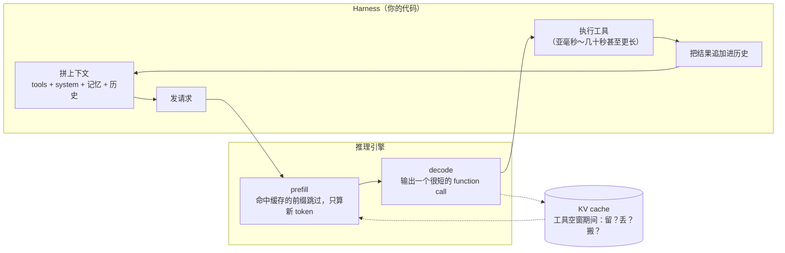

**中文** · [English](README.en.md)

# 模块 04：Agent Harness 的负载画像

> 🕐 建议时长：1.5 小时 ｜ 🎯 学完你能：把 harness 的每个动作（拼 system prompt、注入记忆、压缩、调工具、开子 agent）翻译成推理引擎看到的 token 流；心算一次 agent 任务的 prefill 总量、缓存复用倍数和账单；分清「自托管引擎按 block 匹配」和「托管 API 按断点匹配」两种缓存语义；讲清 9 条「对缓存友好」的 harness 规则和推理参数导致的隐形失效 ｜ 🧪 实验：[`lab.py`](lab.py) ｜ 📖 必读一手资料：[Context Engineering for AI Agents: Lessons from Building Manus](https://manus.im/blog/Context-Engineering-for-AI-Agents-Lessons-from-Building-Manus)、[Anthropic Prompt caching 文档](https://platform.claude.com/docs/en/build-with-claude/prompt-caching)

## 0. 一句话

**Harness 决定了推理引擎看到的 token 序列。Harness 指驱动 agent 循环的外壳程序，负责拼提示词、调工具、管上下文。Agent 负载有三个特点：同一段越来越长的上下文每轮都要整条重新提交；输出很短；工具调用之间有空窗。所以 agent 的推理成本主要花在 prefill（预填充，把输入 token 一次性过一遍模型、生成 KV cache 的阶段）上，而 prefill 能省多少，几乎完全取决于 harness 有没有把前缀保持稳定。**



本模块回答「agent 负载长什么样、harness 怎么写才不浪费」。[模块 05](../05_cache_prefill/README.md) 回答「引擎和集群该怎么接住这种负载」。想看同样的现象在一个真正会算的迷你引擎里怎么发生，见 [capstone](../../capstone/README.md) 的 `agent_harness.py`。

## 1. 大厂为什么在意

**场景。** 一个通用 agent（例如 Manus）或 coding agent，每个任务要循环调用几十次工具。Manus 团队公开过三个数字（[Manus 博客，2025-07-18](https://manus.im/blog/Context-Engineering-for-AI-Agents-Lessons-from-Building-Manus)）：

- 一个典型任务平均约 **50 次工具调用**；
- 平均**输入 : 输出 ≈ 100 : 1**：上下文每一步都在变长，输出通常只是一个结构化的 function call；
- 他们认为 **KV-cache 命中率是生产级 agent 最重要的单一指标**。以 Claude Sonnet 为例，缓存命中的输入是 0.30 USD/MTok，未命中是 3 USD/MTok，差 10 倍。这是博客发布时的价格，2026 年的价格见第 4 节。

另一份独立的公开数据是 Kimi 的 Mooncake 团队发布的 FAST'25 请求 trace（[trace 说明](https://github.com/kvcache-ai/Mooncake/blob/main/FAST25-release/README.md)）。它来自一小时的线上请求：

| trace | 请求数 | 平均输入 token | 平均输出 token | 输入:输出 |
|---|---:|---:|---:|---:|
| Tool and Agent | 23,608 | 8,596 | 182 | ≈ 47 : 1 |
| Conversation | 12,031 | 12,035 | 343 | ≈ 35 : 1 |

**两个口径要分清。** Mooncake 的比值是**按单个请求**算的，对话负载的输入反而更长，两者在同一量级。Manus 的 100:1 是**按任务累计**的：每一步重复提交的、大部分已命中缓存的前缀也算在输入里。所以 agent 和聊天真正的区别，不在单个请求的输入输出比，而在「同一段上下文被重复提交几十次」和「请求之间有工具空窗」（第 3 节）。

**心算一次任务。** 下面的参数是为了演示取的整数，不是某家公司的真实配置：共享前缀 P = 8k token（tools + system），每一步追加 a = 1k token（上一步的 function call + 工具结果），每步输出 o = 300 token，一共 T = 50 步。

- 不用缓存时，总输入 = T·P + a·T(T−1)/2 = 400k + 1,225k = **1.625M token**。总输出 = 15k。按任务累计的输入:输出 ≈ 108:1，和 Manus 说的量级一致。
- 前缀缓存完美命中时，真正需要 prefill 的只有 P + (T−1)·a ≈ **57k token**。按 token 计的复用倍数约 28 倍，命中率约 96.5%。
- 账单按 Claude Sonnet 5 算（输入 $2、5 分钟缓存写入 $2.50、缓存读取 $0.20、输出 $10，单位都是每百万 token，查询日期 2026-09-28）：
  - 不缓存：1.625M × $2 + 15k × $10 ≈ **$3.40**；
  - 完美缓存：57k × $2.5 + 1.568M × $0.2 + 15k × $10 ≈ **$0.61**，便宜约 5.6 倍。

**痛点。** 第 5 节会讲到几种 harness 写法：system prompt 开头加一个精确到秒的时间戳、JSON 序列化不排序 key、按阶段增删工具、每轮切换推理强度。任何一种都能让命中率从 96% 掉到接近 0。这时账单回到 $3.40，每一步的 TTFT（首 token 延迟）也从「只算 1k 新 token」变成「重算几万 token」。**而且没有任何报错**：请求照样成功，只是更贵、更慢。所以大厂把「缓存命中率」当成 harness 的一级监控指标，也把「harness 该怎么写」当成推理团队必须参与的事。

## 2. Harness 在做什么：六个动作 → token 流

### 2.1 一次请求长什么样

以 Anthropic 为例，缓存前缀按 `tools → system → messages` 的顺序构成（[文档](https://platform.claude.com/docs/en/build-with-claude/prompt-caching)）。一次 agent 请求在引擎眼里是这样一条序列：

```
[工具定义][system prompt][项目/仓库上下文][记忆]  [user][asst: call][tool result][asst: call][tool result] ... [本轮新增]
|<------------ 稳定前缀：同一 project 的所有 session 共享 ------------>|<------ 本 session 历史：只应追加 ------>|<-新->|
          几千～几万 token，改一个字节全部失效                              每轮 +几百～几千 token
```

### 2.2 六个动作对引擎意味着什么

| # | harness 动作 | 引擎看到什么 | 对 KV cache 的影响 |
|---|---|---|---|
| 1 | **system prompt 与工具定义** | 每个请求都带着的几千到几万 token 前缀 | 最值钱的共享前缀，同一产品/项目的所有 session 都能复用。改一个字节，后面全部失效 |
| 2 | **上下文组装**（排顺序、序列化工具结果） | 前缀 + 新尾巴 | 序列化不确定（例如 JSON key 顺序不固定）时，内容相同的东西也会被当成新内容 |
| 3 | **记忆注入**（长期记忆、RAG 片段） | 取决于插在哪里 | 插在历史前面：插入点之后全部失效。追加在末尾：只多一段 prefill |
| 4 | **压缩 / 摘要**（compaction：上下文快满时把历史总结成短摘要，再开一个新上下文） | 一个全新的、更短的 prompt | 前缀断裂，摘要之后的内容全部重算一次；生成摘要本身还要一次 decode |
| 5 | **工具调用** | 一段很短的 decode，然后是亚毫秒到几十秒甚至更长的空窗 | 空窗期间 KV 占着显存却不干活：留着、丢掉还是搬走，见[模块 05](../05_cache_prefill/README.md) |
| 6 | **子 agent 分叉**（fork） | fan-out：N 个共享父前缀的请求几乎同时到达；fan-in：N 段结果追加回父上下文 | 能不能共享父前缀，取决于前缀是否逐字节一致，以及引擎或 API 如何处理并发写入（3.3 节） |

### 2.3 前缀缓存为什么「只认前缀」：引擎语义与 API 语义

Transformer 是因果注意力：第 i 个 token 在每一层的 K、V 都依赖它前面的全部 token。所以一段 KV 能不能复用，取决于**它之前的整个前缀**是否完全相同，而不只是这一段内容本身。在这个共同基础上，自托管引擎和托管 API 的缓存粒度不一样。

**自托管引擎：任意 block 边界都能命中。** vLLM 的 automatic prefix caching 把 token 切成固定大小的 block，给每个 block 算一个**链式 hash**（[设计文档](https://docs.vllm.ai/en/stable/design/prefix_caching/)）：

```
h_0 = hash(初始值,  tokens[0:B],           额外 key + cache_salt)   # cache_salt 只注入第一个 block
h_i = hash(h_{i-1}, tokens[i·B:(i+1)·B], 额外 key)                # 额外 key：LoRA ID、多模态输入 hash 等
```

- **只缓存满 block**。末尾不满一个 block 的 token 每次都要重算。
- 第 j 个 token 一变，第 ⌊j/B⌋ 个 block **及之后所有** block 的 hash 都变。这就是「开头放时间戳，整段缓存全废」的机制。
- 同样的内容出现在不同位置（例如同一份文件在两个 session 里被读到上下文的不同地方）**不会命中**。想复用非前缀内容需要「位置无关缓存」，见[模块 05](../05_cache_prefill/README.md) 第 5.4 节。
- `cache_salt` 相当于在链的根部插一个看不见的 token。不同租户用不同 salt，缓存就天然隔离，可以防止「靠测 TTFT 猜别人 prompt」的侧信道攻击。

**托管 API：只在断点处写入，读取时有限回看。** 两家都是精确前缀匹配，但写入和查找只发生在特定位置：

- **Anthropic**：缓存写入**只发生在断点处**，每个断点写一个「到该块为止的前缀 hash」。读取时从断点往回逐块查找之前的请求**写过**的条目，最多查 20 个位置（content block，不是 token block；连续的 `tool_use` 或 `tool_result` 算一个位置）。文档专门举了反例：断点放在带时间戳的最后一块上，每次都写新条目，永远读不到（[文档](https://platform.claude.com/docs/en/build-with-claude/prompt-caching)）。
- **OpenAI**（GPT-5.6 及以后）：只在「缓存查找边界」上查找，包括显式断点（前 2 个和最近 50 个）、隐式断点、最多 20 个更早的合格消息结尾，以及开头连续 developer 消息块的末尾（[文档](https://developers.openai.com/api/docs/guides/prompt-caching)）。

**后果**：同一 project 的不同 session 想在 API 上跨会话共享「tools + system + 项目上下文」，**必须在共享前缀末尾放一个断点**（第 5 节规则 9）。只用自动缓存（断点落在每个请求的最后一块）时，会话内部的多轮复用没问题，但跨会话的共享前缀拿不到。实验里会把两种语义并列算账。练习 (a)(b) 实现引擎语义，练习 (d) 练习「断点放在哪」。

## 3. Agent 负载 vs 聊天负载

| 维度 | 聊天 | Agent | 对 infra 的含义 | 证据 |
|---|---|---|---|---|
| 单请求输入/输出比 | 从约 4:1（Azure 聊天 trace）到 35:1（Mooncake 对话 trace） | 47:1（Mooncake toolagent trace）；按任务累计约 100:1（Manus） | 两类负载都以 prefill 为主；agent 的累计比值更大，是因为同一前缀被反复提交 | Mooncake trace README；Preble 论文统计的 prompt/输出比从 4×（Azure chat）到 2494×（视频 QA）（[arXiv:2407.00023](https://arxiv.org/abs/2407.00023)）；Manus 博客 |
| 同一上下文被提交的次数 | 人每回一句提交一次 | 每次工具调用后都整条重交，一个任务约 50 次 | 不缓存时 prefill 总量随步数**平方**增长；缓存后线性增长 | Manus「约 50 次工具调用」 |
| 两次请求之间的间隔 | 人的回复时间 | 工具耗时：从亚毫秒级（计算器）到几十秒，不同工具差几个数量级 | KV 该不该在空窗里留在显存，要看工具耗时分布 | InferCept 论文统计的中断时长：数学计算类约 0.1 ms，QA（检索）类约 0.69 s，图像生成类约 20 s，聊天（等人回复）类约 28.6 s（[arXiv:2402.01869](https://arxiv.org/abs/2402.01869)） |
| 上下文改写 | 很少 | 压缩、清理旧工具结果、增删工具 | 每次改写都是一次「前缀断裂 + 大段重算」 | Anthropic：compaction 与 tool result clearing（[博客](https://www.anthropic.com/engineering/effective-context-engineering-for-ai-agents)） |
| 并发结构 | 一问一答 | fan-out / fan-in：主 agent 分出多个子 agent，再汇总 | 一批共享前缀的请求同时到达；token 总量成倍增加 | 多 agent 系统的 token 用量约为聊天的 15 倍（[Anthropic 多 agent 研究系统博客](https://www.anthropic.com/engineering/multi-agent-research-system)）；子 agent 通常只回传 1,000–2,000 token 的摘要（[Anthropic context engineering 博客](https://www.anthropic.com/engineering/effective-context-engineering-for-ai-agents)） |

### 3.1 公式：多轮 prefill 的平方增长

记共享前缀 P、每步追加 a、共 T 步：

```
不缓存的 prefill 总量：   N_none(T) = T·P + a·T(T−1)/2          ← 随 T 平方增长
完美前缀缓存的 prefill：  N_cache(T) ≈ P + (T−1)·a               ← 随 T 线性增长
复用倍数：               R(T) = N_none / N_cache ∈ [T/2, T]     ← P 可忽略时 ≈ T/2；a 可忽略时 ≈ T
```

心算规则：**一个 T 步的 agent 任务，前缀缓存能把需要 prefill 的 token 数省到原来的 1/(T/2) 到 1/T。** 50 步就是 25 到 50 倍，上面的例子是 28 倍。反过来说，只要 harness 让缓存失效一次，这一步就要多付「整条上下文」的 prefill。

**token 复用倍数不等于算力复用倍数。** 命中缓存后，新 token 仍要对整段缓存前缀做注意力，所以按 FLOPs 算的节省更少，而且命中后的 TTFT 仍随上下文变长。用 `codesign_sim.model.prefill_flops` 复算上面的例子（P = 8k、a = 1k、T = 50）：

- 按 token 算，R = 28.5；按 FLOPs 算，Qwen3-32B 的 R ≈ 24.1，DeepSeek-V3 的 R ≈ 22.5。
- 第 50 步那 1k 个新 token 的 prefill FLOPs，是只算 GEMM（矩阵乘）时的 2.9 倍（Qwen3-32B）和 5.0 倍（DeepSeek-V3），多出来的都是对 57k 缓存前缀的注意力。

### 3.2 一个 agent session 在引擎眼里的时间线

```
时间 →
请求1 [prefill 8k ████████][decode 300 ▒▒▒]  工具 2s ......  
请求2        [命中 9k ░░░░░░░░░][prefill 1k █][decode ▒▒▒]  工具 40s .....................
请求3                                     [命中 10k ░░░░░░░░░░][prefill 1k █][decode ▒▒▒] ...
                     ↑ 工具空窗：这 9k~10k token 的 KV 在显存里「闲着」。若被淘汰，请求 3 要整段重算
```

两个关键量：**空窗长度**（决定 KV 是留、丢还是搬），**两次请求之间新增的 token 数**（决定命中后还剩多少 prefill）。心算一下空窗里的两难：在 8×H100 上跑 Qwen3-32B，重算一段 100k token 的上下文约需 3.5 s（`prefill_flops` 含注意力，MFU 0.6）；把它留在显存里，要占约 26 GB KV。InferCept 统计的空窗从 0.1 ms 到约 29 s 不等。怎么在两者之间做决定，是[模块 05](../05_cache_prefill/README.md) 第 2 节的主题。

### 3.3 fan-out / fan-in

Anthropic 在多 agent 研究系统的工程博客里报告：agent 的 token 用量约为聊天的 4 倍，多 agent 系统约为 15 倍（[博客](https://www.anthropic.com/engineering/multi-agent-research-system)）。对推理系统来说，fan-out 有两个具体后果：

1. **并发请求能不能共享父前缀，要分三层看。**
   - **托管 API**：Anthropic 文档写明，缓存条目要等第一个响应开始返回后才可用；想让并行请求命中缓存，就先等第一个响应，再发其余请求（"wait for the first response before sending subsequent requests"）。不这样做，N 个子 agent 同时发出就是 N 次 miss、N 份写入。
   - **自托管引擎的调度器**：可以做「同批前缀去重」。例如 SGLang 的调度器在多个等待中的请求共享同一段前缀、而这段前缀还不在缓存里时，只先调度其中一个，让其余请求随后命中（[schedule_policy.py](https://github.com/sgl-project/sglang/blob/main/python/sglang/srt/managers/schedule_policy.py) 中的 in-batch prefix caching）。
   - **harness 自己**：先发一个请求预热共享前缀，再放出其余请求。这在两种部署下都有效。
2. **前缀一致性。** 子 agent 如果各自改一点 system prompt（比如把子任务说明插在 system 里），它们就互相不共享前缀。子任务说明应该放在共享前缀之后。

### 3.4 RL rollout 也是 harness

做 post-training 的读者，每天跑的 RL rollout 本身就是规模最大的 harness 负载，前缀结构和工具 agent 有同有异：

- **组采样 = fan-out。** GRPO（[DeepSeekMath，arXiv:2402.03300](https://arxiv.org/abs/2402.03300)）对同一个 prompt 采样一组 G 个回答，用组内平均做基线（见[模块 07](../07_multi_agent_credit/README.md) 第 2.2 节）。对引擎来说，这是 G 路共享同一段 prompt 的 fan-out：prompt 只应 prefill 一次。
- **多轮工具 rollout = 本模块描述的 agent 负载**，依赖引擎的前缀缓存，而且长尾严重（见[模块 06](../06_long_tail_async/README.md)）。
- **权重同步会让前缀缓存整体失效。** KV 是权重的函数，权重一变，旧 KV 就不再是新策略的 KV，缓存寿命的上限就是权重更新周期（见[模块 09](../09_frontier/README.md) 关于版本化缓存的讨论）。PipelineRL、Magistral 选择在权重更新后带着旧 KV 继续生成进行中的序列，这是有意接受的不一致（见模块 06 第 4.6 节）。
- **verifier / reward model**：读「prompt + 回答」，相当于对同一段 prompt 再做一次 prefill。如果和策略模型是同一个模型，prompt 部分可以共享前缀；不同模型则不能（缓存按模型隔离）。
- **best-of-N、树搜索**：前缀是树形的，每个分叉点之前的部分都能共享，正好对应 radix tree 的结构。

## 4. 各家 prompt caching API（查询日期：2026-09-28）

> 价格和规则变化很快。下面的内容是 2026-09-28 按官方文档整理的，使用前请以官方文档为准。

| | Anthropic | OpenAI | DeepSeek |
|---|---|---|---|
| 怎么开启 | 在内容块上加 `cache_control` 断点（每个请求最多 4 个），或在请求顶层加 `cache_control` 自动放在最后一个可缓存块 | 默认开启。GPT-5.6 及以后：隐式断点放在最新一条合格消息末尾，也可设 `explicit` 模式只用显式断点（断点之后的内容按未缓存价计费，不收写入费）。更早的模型：按固定间隔放隐式断点（GPT-5.5 为每 2,048 token） | 默认开启，不用改代码（「硬盘缓存」）：每个请求都会触发硬盘缓存的构建 |
| 命中粒度 | 只在断点处写入；读取时每个断点最多往回查 20 个位置 | GPT-5.6+：只在缓存查找边界上查找（显式断点、隐式断点、最多 20 个更早的消息结尾、开头 developer 块的末尾） | 以「缓存前缀单元」为单位：在用户输入末尾和模型输出末尾各存一个单元；检测到多个请求有公共前缀时，把公共前缀存成一个单元；长输入按固定 token 间隔切。后续请求必须**完整匹配**某个单元才算命中 |
| 最小可缓存长度 | 与模型有关：512 到 4,096 token | GPT-5.6+：1,024 个可见输入 token；更早的模型随请求设置变化 | 当前文档未给出；2024-08 上线时的说明是以 64 token 为存储单位 |
| 存活时间 | 默认 5 分钟，每次命中免费续期；可选 1 小时。计时从读写该条目的请求**开始**时算起 | GPT-5.6+：`ttl="30m"`，最近一次读写后至少 30 分钟。GPT-5.5：只支持 `24h`。更早的模型：`in_memory`（通常闲置 5–10 分钟失效，最长 1 小时）或 `24h` | 构建缓存需要秒级时间；不再使用后自动清除，通常在几小时到几天之内；尽力而为（best-effort），不保证命中 |
| 写入价 | 5 分钟：1.25× 输入价；1 小时：2× | GPT-5.6+：1.25×；更早的模型：不额外收费 | 没有单独的写入费，未命中部分按 cache miss 价计费 |
| 读取价 | 0.1× 输入价（Claude Opus 5.5 为 0.05×；Claude Fable 5.1 与 Mythos 5.1 为 0.025×） | GPT-5.6+：0.1×；更早的模型：按模型定价 | `deepseek-flash`：命中 $0.006，未命中 $0.3，约 1/50；`deepseek-v4-pro`：$0.044 对 $1.32，约 1/30（高峰价，低峰减半） |
| 用量字段 | `cache_creation_input_tokens`、`cache_read_input_tokens`、`input_tokens`（最后一个断点之后的部分） | `usage.input_tokens_details.cached_tokens`、`cache_write_tokens` | `prompt_cache_hit_tokens`、`prompt_cache_miss_tokens` |
| 值得注意 | 缓存按组织隔离，Claude API 上还按 workspace 隔离 | 缓存存在**单台机器**上，路由看「机器负载 + 开头若干 token 的 hash」，GPT-5.6 之前还看 `prompt_cache_key`；同一前缀/key 超过约 15 次/分钟可能溢出到别的机器。从 GPT-5.6 起，`prompt_cache_key` 不再需要用来优化路由，只用于分开计费和防止跨用户的命中探测；文档提到可能把加密后的 KV 张量存在 GPU 本地存储 | KV 存在硬盘上。2024-08 的公告称，128K 且大量复用的 prompt，首 token 延迟从 13 s 降到 500 ms，并把硬盘缓存的可行性归功于 MLA 大幅减小了 KV。2025-02 公布的 24 小时统计：608B 输入 token 中有 342B（56.3%）命中了硬盘 KV 缓存 |

来源：[Anthropic 文档](https://platform.claude.com/docs/en/build-with-claude/prompt-caching)、[OpenAI 文档](https://developers.openai.com/api/docs/guides/prompt-caching)、[DeepSeek Context Caching 指南](https://api-docs.deepseek.com/guides/kv_cache)、[DeepSeek 定价页](https://api-docs.deepseek.com/quick_start/pricing)、[2024-08-02 公告](https://api-docs.deepseek.com/news/news0802)、[DeepSeek-V3/R1 推理系统概览](https://github.com/deepseek-ai/open-infra-index/blob/main/202502OpenSourceWeek/day_6_one_more_thing_deepseekV3R1_inference_system_overview.md)。

**把三家放在一起看，能读出四件事：**

1. **都是精确前缀匹配，但写入和查找的位置不同。** 自托管引擎可以在任意 block 边界命中；Anthropic 只在断点处写入、有限回看；OpenAI 只在查找边界上查；DeepSeek 必须完整匹配一个「缓存前缀单元」。DeepSeek 文档的原话是：「由于 Sliding Window Attention 机制，缓存前缀的存储与匹配方式与之前不同」（"Due to the Sliding Window Attention mechanism, the storage and matching of cached prefixes differs from before."）。DeepSeek-V4 技术报告（[arXiv:2606.19348](https://arxiv.org/abs/2606.19348) §3.5）解释了原因：SWA 的 KV 没有压缩、每层都有，体积约为压缩 KV 的 8 倍，所以硬盘上的 SWA 状态要么全存，要么每隔 p 个 token 做一次检查点，要么不存、命中后重算最后 n_win·L 个 token 来恢复。这是**模型结构改变缓存语义**的一手例子。对 harness 的含义是请求边界要稳定：尽量让新请求完整包含上一轮的「输入 + 输出」。
2. **缓存读取价约为未缓存输入价的 1/10 或更低**（Anthropic 0.1×，部分模型 0.05× 或 0.025×；OpenAI GPT-5.6+ 0.1×；DeepSeek 约 1/30 到 1/50）。定价大致反映了成本结构：命中时省掉的是 prefill 的算力，剩下的是存储和搬运的钱。
3. **差别在两处：谁来放断点，KV 放哪、活多久。** Anthropic 让开发者显式标断点，TTL 为分钟到小时级；OpenAI 默认自动，文档提到 GPU 本地存储；DeepSeek 用硬盘，保存时间以小时到天计。存储层级越便宜，TTL 越长。这正是[模块 05](../05_cache_prefill/README.md) 第 4 节 HBM / DRAM / SSD 分层的商业投影。
4. **路由决定命中。** OpenAI 文档直接写了「缓存存在单台机器上，请求必须被路由到持有匹配条目的机器才能命中」，并给了约 15 RPM 的溢出阈值。文档没有解释这个数怎么来的。它远低于单机的处理能力（8×H100 跑 32B 级模型，一个 30k token、命中 90% 的请求 prefill 约 0.08 s），所以更像多租户共享机器时按 key 做的粗粒度负载分摊（这是推测）。启示是：亲和路由必须配一个溢出上限，见模块 05 第 3 节。

**Anthropic 缓存的回本点**（由上面的倍数推出）：5 分钟写入（1.25×）加一次读取（0.1×）共 1.35×，小于两次不缓存的 2×，所以**第 2 次请求就回本**。1 小时写入（2×）要到第 3 次：2 + 0.1 + 0.1 = 2.2 < 3。

## 5. 对缓存友好的 harness

### 5.1 九条规则

| # | 规则 | 机制 | 典型反例 | 出处 |
|---|---|---|---|---|
| 1 | **稳定的在前，易变的在后**：tools → system → 项目上下文 → 历史 → 本轮新增 | 前缀匹配，链式 hash | 在 system 里写「当前用户：张三」「模式：只读」 | Anthropic、OpenAI 文档 |
| 2 | **最前面不放时间戳**。确实需要时间，就放在末尾，或降到「日期」粒度 | 第 0 个 block 一变，全部失效。在 Anthropic 上，system 开头的时间戳不影响排在它前面的 tools 缓存，但 system 和之后的全部失效 | 精确到秒的 `Current time: …` 放在 system prompt 第一行 | Manus；Anthropic 文档 |
| 3 | **只追加，不修改历史** | 改第 k 轮，第 k 轮之后全部重算 | 回头改写旧的工具结果；每轮注入一条 reminder，下轮再删掉 | Manus |
| 4 | **确定性序列化**：JSON 排序 key、工具按名字排序 | 字节不同就是 miss | `json.dumps(d)` 不加 `sort_keys=True`；遍历 `set` 生成工具列表 | Manus |
| 5 | **工具用 mask 屏蔽，不要删除** | 工具定义在前缀最前面，增删任何一个都让之后的全部失效 | 按任务阶段动态增删工具 | Manus（自托管：解码时 mask logits，工具名加统一前缀如 `browser_`、`shell_`）；OpenAI（`tool_choice: "none"` 代替删工具、`allowed_tools` 限制可调用的工具、工具搜索把新发现的工具追加在末尾）；Anthropic（beta 的 `tool_addition` 块在消息里追加工具定义，`tools` 保持不变）。见 5.2 节 |
| 6 | **压缩要少做、成批做、做成可恢复的** | 每次压缩 = 一次整段重算 + 一次摘要 decode | 每轮截掉最老的一条消息（滑动窗口），开头每轮都变，命中率接近 0 | Manus：把文件系统当外部记忆，压缩时只保留可恢复的引用（如 URL、文件路径）；LMCache 论文报告上下文截断会让前缀命中率降为一半（[arXiv:2510.09665](https://arxiv.org/abs/2510.09665)） |
| 7 | **子 agent 逐字节复用父前缀；并发 fan-out 先发一个** | API 上并发请求读不到彼此正在写的缓存 | 每个子 agent 的 system prompt 都略有不同；N 个子 agent 同时发出 | Anthropic 文档；3.3 节 |
| 8 | **自托管时：开 prefix caching，按 session 做路由粘性** | 缓存在单台机器上 | 按请求轮询的负载均衡 | Manus：用 session ID 把请求一致地路由到同一个 worker；OpenAI 文档；详见[模块 05](../05_cache_prefill/README.md) 第 3.3 节 |
| 9 | **在稳定前缀末尾放显式断点**（用托管 API 时） | API 只在断点处写入缓存；自动断点落在每个请求的最后一块，跨会话的共享前缀拿不到 | 只用自动缓存，却指望同一项目的新会话命中 tools + system + 项目上下文 | Manus：显式标断点，至少确保断点包含 system prompt 的末尾；Anthropic 文档；OpenAI 的 `explicit` 模式还能避免为易变的尾巴付写入费 |

还有一条贯穿全部的元规则：**把缓存命中率做成监控指标**。例如看 Anthropic 的 `cache_read_input_tokens` 或 OpenAI 的 `cached_tokens`。缓存失效不会报错，只能靠监控发现。

### 5.2 为什么「mask 而不是删除」是 co-design 的好例子

删除工具，改的是**前缀**；mask 工具，改的是**解码约束**。后者不碰 KV，只在采样时屏蔽某些 token。但这件事在两种部署下成本不同：

- **自托管引擎**：可以直接在解码时加 logit mask，前缀完全不变，真正免费。Manus 描述了三种 function calling 模式：Auto（可调可不调）、Required（必须调，不限哪个）、Specified（必须从指定子集里调），都可以靠预填回复开头的 token（response prefill）加 logit mask 实现。给工具名加统一前缀，只解决「选哪一类工具」；要保证参数是严格合法的 JSON，还需要基于语法或 JSON Schema 的约束解码状态机。
- **托管 API**：一般不开放任意 logit mask。在 Anthropic 上，改 `tool_choice` 会让 messages 级缓存失效（tools 和 system 的缓存仍有效）；OpenAI 给了保留前缀的专门做法（`allowed_tools`、`tool_choice: "none"`）。

所以「mask」是一个要求推理引擎和 API 支持约束解码的接口，也就是 harness 的需求反过来塑造了引擎接口。

### 5.3 看不见的前缀：推理参数与请求参数

2026 年 harness 让缓存失效最常见的来源之一，是那些看起来不属于 prompt、其实被渲染进 prompt 的参数。

**Anthropic**（文档「What invalidates the cache」表）：

| 改了什么 | tools 缓存 | system 缓存 | messages 缓存 |
|---|---|---|---|
| 工具定义 | 失效 | 失效 | 失效 |
| web search / citations 开关、`speed`（fast 模式） | 有效 | 失效 | 失效 |
| `tool_choice`、增删图片 | 有效 | 有效 | 失效 |
| thinking 参数、`output_config.effort` | 视模型而定 | 视模型而定 | 失效 |

- 把 effort 显式设成模型默认值，等于不设，不会失效。在支持的模型上，用消息里的 `role: "system"` 消息改 effort，可以保留缓存前缀。
- 较早的 Opus / Sonnet 和所有 Haiku 模型：开着 extended thinking 时追加非 `tool_result` 的 user 内容，会剥掉之前缓存的 thinking 块，其后的消息都掉出缓存。Opus 4.5+ 和 Sonnet 4.6+ 默认保留 thinking 块，不受影响。
- 把某些模型的 thinking 块回传给读不了它的模型时，API 会丢弃它，缓存前缀从那个位置起改变。

**OpenAI**（文档「Which settings affect the cached prefix?」）：`model`、`tools`、`parallel_tool_calls`、`text.format`（结构化输出的 schema）、`reasoning.effort`、`text.verbosity`、`context_management`（compaction）都会改变缓存前缀。GPT-6 模型可以追加一个 `configuration_update` 输入项来改推理强度，而不改请求级的 `reasoning.effort`，从而保留前缀。

**DeepSeek**：缓存单元建在「用户输入末尾」和「模型输出末尾」。如果 harness 把上一轮的推理内容或输出改写后再提交，「输出末尾」那个单元就不再是新请求的前缀，只剩「用户输入末尾」那个单元可能命中。

**结论**：thinking 配置、推理强度、`tool_choice`、结构化输出 schema 都要**按路由固定**，不要按请求变；需要中途改，就用各家提供的「追加式」机制。

### 5.4 压缩的账

压缩（compaction）打破了规则 3，但上下文终究会满，不可能永远不压缩。问题在于**何时压、压多少**。把上下文拆成稳定前缀 P（tools + system + 项目上下文）和会话历史 H，压缩只把 H 换成 S 个 token 的摘要，P 不动、仍然命中。价格用「未缓存输入」做单位，读取倍数 r、写入倍数 w、输出倍数 o：

```
一次性成本 = r·(P + H)（做摘要时读一遍整段上下文） + o·S（生成摘要） + w·S（新上下文 P + S 里只有 S 要写缓存）
每轮节省   = r·(H − S)（之后每轮少读 H − S 个缓存 token；P 两边都要读，抵消）
回本轮数   n* = (r·(P + H) + o·S + w·S) / (r·(H − S))
```

按 Anthropic 的倍数（r = 0.1、w = 1.25），Sonnet 5 的输出/输入价格比 o = 5：

- P = 0，H = 100k，S = 5k：n* = (10k + 25k + 6.25k) / 9.5k ≈ **4.3 轮**；
- P = 20k，H = 80k，S = 5k：n* = 41.25k / 7.5k = **5.5 轮**（同样 10 万 token 的上下文，稳定前缀越大越难回本）；
- P = 0，H = 30k，S = 5k：n* ≈ **13.7 轮**。

结论：**摘要的输出成本是大头，在短历史上频繁压缩往往不划算**，而且生成 S 个 token 的摘要要花 S 步 decode，这段延迟用户能感觉到。练习 (c) 就是这个公式。注意这只算钱，没算质量：Anthropic 的博客把 compaction 当作长任务的核心手段，重点在保留架构决策、未解决的 bug 这类关键信息（[博客](https://www.anthropic.com/engineering/effective-context-engineering-for-ai-agents)）。

## 6. 必须会心算的数字

| 量 | 典型值 | 怎么推出来 | 来源 |
|---|---|---|---|
| agent 输入 : 输出 | 单请求约 47:1（Kimi toolagent trace）；按任务累计约 100:1（Manus） | 上下文每步增长，输出只是一个 function call | Mooncake trace README；Manus 博客 |
| 典型任务工具调用次数 | 约 50 | — | Manus 博客 |
| 多轮 token 复用倍数 R | T/2 到 T；按 FLOPs 算更低（例：28.5 → 24.1） | N_none / N_cache，见 3.1 | 本模块推导 |
| 缓存读价 / 输入价 | 0.1×（部分模型更低） | — | Anthropic；OpenAI GPT-5.6+ |
| Anthropic 5 分钟缓存回本 | 第 2 次请求 | 1.25 + 0.1 < 2 | 由官方倍数推出 |
| Anthropic 1 小时缓存回本 | 第 3 次请求 | 2 + 0.2 < 3 | 由官方倍数推出 |
| 每 token 的 KV（BF16） | Qwen3-32B：256 KiB；DeepSeek-V3：68.6 KiB | GQA：2 × 64 层 × 8 KV 头 × 128 维 × 2 B；MLA：61 层 × (512 + 64) × 2 B | 官方 config.json（[Qwen3-32B](https://huggingface.co/Qwen/Qwen3-32B/blob/main/config.json)、[DeepSeek-V3](https://huggingface.co/deepseek-ai/DeepSeek-V3/blob/main/config.json)） |
| 100k token 上下文的 KV | Qwen3-32B：约 26 GB；DeepSeek-V3：约 7 GB | 上一行 × 100k | 同上 |
| 100k 上下文能同时驻留几个 | 8×H100 跑 Qwen3-32B：约 17 个 | 约 175 万 token 的 KV 空间 ÷ 100k（见模块 05 第 1 节） | 本模块推导 |
| 重算 100k token 的 prefill | 8×H100 跑 Qwen3-32B：约 3.5 s | 线性层 2 × 32.8B × 100k ≈ 6.6e15 FLOPs，加注意力，MFU 0.6 | `codesign_sim.model.prefill_flops` |
| block 大小的尾块浪费 | 平均每请求约 B/2 个 token 要重算：B = 16 时约 8 个，B = 512 时约 256 个 | 只缓存满 block | vLLM 设计文档 |
| block 大小与元数据 | 100k 上下文：B = 16 时 6,250 个 hash 条目，B = 512 时约 195 个 | 100k / B | 推导 |
| 压缩回本轮数 | P = 0、H = 100k、S = 5k 时约 4.3 轮 | 5.4 节公式 | 本模块推导 |
| 子 agent 回传摘要 | 1,000–2,000 token | — | Anthropic context engineering 博客 |

## 7. 实验

```bash
.venv/bin/python modules/04_harness_workloads/lab.py      # 或 make lab N=04；笔记本上几秒跑完
```

**做了什么。** 用 `codesign_sim.workload.generate_sessions` 生成 160 个会话（8 个项目，固定 seed，关掉库里默认的「接近 100k 自动压缩」，让每一行只体现这一行的写法），按请求时间顺序送进一个足够大、不会淘汰的 `PrefixCache`，只看 harness 写法本身的影响。

- **各种写法**：lab 显式构造「这次请求真正发出去的 token 段序列」，再按 vLLM 的方式做链式 block hash。时间戳是真的插在最前面或末尾的一段 token；「只用自动缓存」用每个会话一条独立的链（链根不同）来模拟，并且只缓存请求的输入：托管 API 不缓存本轮输出，上一轮的输出要等下一轮作为输入提交时才写入（按写入价）；动态工具让前缀从第 0 个 token 起就不同。
- **压缩 / 改写**：用库里的 `rewrite_prob` 和 `rewrite_keep_frac`。keep = 1 表示只改写、不缩短；keep = 0.1 表示把会话历史压成原来 10% 长的摘要，上下文真的变短。压缩的那几行还计入做摘要那次调用的代价：读一遍压缩前的整段上下文（按命中价），生成摘要（按输出价）。
- **账单**：按 Claude Sonnet 5 的价格（2026-09-28）。假设每个请求末尾都有一个缓存断点（自动缓存），所以未命中的 token 都按 5 分钟写入价计，命中的按读取价计。除 `api_auto_only` 外，其他行用的都是自托管引擎语义（任意 block 边界都能命中，跨会话共享项目前缀，本轮输出的 KV 直接留在缓存里）。它们在托管 API 上是达不到的上界：放了显式断点只能拿回跨会话共享的项目前缀，拿不回上一轮输出（见下面第 2 点）。

**真实输出**（seed=0）：

```
========================================================================================================
A. 负载概况：160 个会话 / 8 个项目 / 1316 次请求（seed=0，block=64 token）
   只追加时 prompt 总量 27.67M token，输出总量 0.380M token，按任务累计的输入:输出 ≈ 73:1
--------------------------------------------------------------------------------------------------------
harness 写法              prompt 总量      命中率   重算 prefill    × 理想     账单($)     不缓存($)     省下
append_only                27.67M    92.8%        2.00M     1.0     13.94      59.14    76%
api_auto_only              27.67M    87.7%        3.40M     1.7     17.15      59.14    71%
ts_head_seconds            27.69M     8.9%       25.22M    12.6     67.35      59.18   -14%
ts_head_day                27.69M    92.8%        2.00M     1.0     13.93      59.18    76%
ts_tail_kept               27.85M    92.7%        2.02M     1.0     14.02      59.49    76%
ts_tail_dropped            27.69M    91.5%        2.36M     1.2     14.77      59.18    75%
dynamic_tools_0.2          27.67M    75.9%        6.66M     3.3     24.65      59.14    58%
rewrite_p0.1_keep1.0       27.67M    85.9%        3.91M     2.0     18.34      59.14    69%
compact_p0.1_keep0.1       20.00M    89.5%        2.10M     1.1     14.00      48.40    71%
compact_p0.3_keep0.1       14.69M    85.2%        2.17M     1.1     14.20      43.00    67%
rewrite_every_turn         27.67M    32.8%       18.60M     9.3     52.12      59.14    12%
========================================================================================================
B. 只追加的 harness：按会话轮数 T 分组看复用倍数 R = prompt 总量 / 重算量（README 3.1）
   「会话内」只看本会话的复用，应落在 [T/2, T]；「含跨会话」再加上同项目共享前缀带来的复用
--------------------------------------------------------------------------------------------------------
      轮数 T     会话数     平均 T      [T/2, T]        R（会话内）         R（含跨会话）
       2-3      16      3.0    [1.5, 3.0]           2.6             7.4
       4-7      94      5.0    [2.5, 5.0]           4.1             7.9
      8-15      34     10.8   [5.4, 10.8]           7.8            10.7
     16-31      13     22.5  [11.3, 22.5]          14.3            17.3
     32-64       3     47.0  [23.5, 47.0]          30.6            32.7
```

**怎么读。**

1. **理想写法（只追加）**：92.8% 的 prompt token 命中缓存，27.7M 里只有 2.0M 需要重算，账单比不缓存便宜 76%。按任务累计的输入:输出约 73:1，和 Manus 说的 100:1 同一量级。
2. **托管 API 只用自动缓存**（没在共享前缀末尾放断点）：命中率掉到 87.7%，未命中量是理想的 1.7 倍，账单贵 23%（$17.15 对 $13.94）。丢掉的有两部分：跨会话共享的项目前缀；以及上一轮的输出，API 不缓存输出，它要在下一轮作为新输入按写入价写入一次。所以「引擎语义 × API 价格」算出来的账单，是托管 API 账单的下界；放了显式断点也只能拿回项目前缀那一部分。
3. **时间戳**：放在最前面、精确到秒，命中率掉到 8.9%，剩下那点来自同一秒内到达的同项目请求。重算量 12.6 倍，**账单比完全不缓存还贵 14%**：每次都付 1.25 倍的写入价，却几乎读不到。精确到天，就和理想写法一样。放在末尾并留在历史里（`ts_tail_kept`），几乎无损。**放在末尾但下一轮删掉**（`ts_tail_dropped`），重算量是理想的 1.2 倍：上一轮的输出是紧跟在时间戳后面生成的，它的 KV 依赖那个时间戳，下一轮历史里没了时间戳，这段输出就对不上了，每轮都要重算上一轮的输出。
4. **动态增删工具**（每轮 20% 的概率）：重算量 3.3 倍。工具定义在前缀最前面，一改就整条失效。
5. **压缩的代价与收益**：
   - 只改写、不缩短（`rewrite_p0.1_keep1.0`）：纯亏，重算量翻倍，账单贵 32%。
   - 真压缩（`keep0.1`）：每轮 10% 的概率压缩时，prompt 总量从 27.7M 降到 20.0M（−28%）；30% 的概率时降到 14.7M（−47%）。代价是前缀断裂和做摘要：重算量只增加 5–9%（2.00M → 2.10M、2.17M），把摘要调用算进去后，账单和不压缩几乎持平（$14.00、$14.20 对 $13.94）。
   - **结论**：按 Anthropic 的价格，压缩在钱上大致打平；它真正买到的是更短的上下文，也就是更少的 KV 显存、更便宜的注意力、不撞窗口上限。代价是前缀断裂、摘要 decode 的延迟和质量风险。这和 5.4 节的回本公式一致：压缩得越狠、之后的轮数越多，越划算。
   - 每轮都改写（`rewrite_every_turn`，相当于滑动窗口截断）：命中率 32.8%，重算量 9.3 倍。
6. **B 部分**验证了 3.1 节的公式：会话内的复用倍数 R 都落在 [T/2, T] 里。同项目的共享前缀让短会话额外受益最多（3 轮的会话从 2.6 倍涨到 7.4 倍），这就是「共享前缀要放最前面、跨会话保持一致」的价值。

**改参数看什么现象。**

- `BLOCK` 改成 16：末尾不满一个 block 的浪费变少，命中率会略升，但运行变慢。可以想想为什么 Mooncake 的公开 trace 用 512 token 的 block。
- `N_PROJECTS` 改成 1 或 64：跨会话共享的项目前缀变多或变少，重点看 `api_auto_only` 与 `append_only` 的差距，以及 B 部分最后一列。
- 把 `PRICE_*` 换成 DeepSeek 的价格（命中价约为未命中价的 1/50，没有写入费）：`ts_head_seconds` 还会比不缓存更贵吗？压缩在钱上还打平吗？
- `TS_TOKENS` 改大（例如时间戳旁边还带着一段每轮都变的状态说明）：`ts_tail_dropped` 的损失怎么变？
- 在 `part_a` 里加一行 `sessions_with(rewrite_prob=0.1, rewrite_keep_frac=0.5)`：摘要更长时，压缩还划算吗？

## 8. 练习

打开 [`exercise.py`](exercise.py)，实现四个函数：

| 函数 | 要做什么 | 对应小节 |
|---|---|---|
| `chain_block_hashes(tokens, block_size, salt)` | 像 vLLM 一样算链式 block hash，只算满 block | 2.3 |
| `replay_prefix_cache(requests, block_size)` | 用无限大的前缀缓存重放一串请求，返回（复用 token，重算 token） | 2.3、3.1 |
| `compaction_breakeven_turns(P, H, S, r, w, o)` | 压缩会话历史的回本轮数 | 5.4 |
| `render_request(tools, system, history, volatile)` | 确定性渲染一次请求，并返回显式断点的位置 | 5.1 规则 1、2、4、9 |

```bash
make module N=04                                              # 测你的实现（没写完会失败，这是正常的）
INFRA_SOLUTION=1 .venv/bin/python -m pytest modules/04_harness_workloads   # 看参考答案能通过
```

参考答案在 [`solution.py`](solution.py)。建议先自己写，卡住超过 10 分钟再看。

## 9. 自测题

1. 一个 agent 任务共 40 步，共享前缀 20k，每步追加 500 token。不用缓存和完美缓存时，prefill 各是多少 token？复用倍数是多少？按 FLOPs 算的复用倍数会更高还是更低？
   <details><summary>答案</summary>不缓存：T·P + a·T(T−1)/2 = 40 × 20k + 500 × 780 = 800k + 390k = 1.19M。完美缓存：P + (T−1)·a = 20k + 19.5k = 39.5k。token 复用倍数约 30 倍，落在 [T/2, T] = [20, 40] 区间里；因为 P 占比大，所以更靠近 T。按 FLOPs 算会更低：命中后新 token 仍要对整段缓存前缀做注意力。</details>
2. 为什么同一段 5k token 的文件内容，在两个 session 里出现在不同位置时，前缀缓存命中不了？
   <details><summary>答案</summary>因果注意力下，每个 token 的 K/V 依赖它前面的全部 token，所以缓存键必须编码整个前缀（链式 hash）。内容相同但前缀不同，KV 数值本身就不同，不能直接复用。要复用只能用位置无关缓存（CacheBlend、EPIC），代价是需要部分重算来修正 cross-attention，见模块 05。</details>
3. 你的 agent 每轮在 system prompt 末尾更新一行「剩余预算：xxx token」。缓存会怎样？怎么改？
   <details><summary>答案</summary>system 在 tools 之后、全部历史之前，改它会让 system 和所有历史的缓存失效（Anthropic 上 tools 段仍命中），每轮都要重算几乎整段。改法：把预算信息作为一条新消息追加在历史末尾（或放在最后一个断点之后；支持的模型上可以用消息里的 `role: "system"` 消息），system 保持不变。</details>
4. 共享同一前缀的两次请求，开始时间相隔 5 到 60 分钟。用 Anthropic 的 1 小时 TTL 比 5 分钟 TTL 划算吗？比完全不缓存呢？
   <details><summary>答案</summary>要分两条基线。相对 5 分钟 TTL：5 分钟的条目每次都已过期、要重写（1.25 + 1.25 = 2.5），1 小时的只写一次再读一次（2 + 0.1 = 2.1），所以**读 1 次就更划算**。相对完全不缓存：两次请求不缓存是 2，1 小时 TTL 读 1 次是 2.1，略贵；要读 2 次（2 + 0.2 = 2.2 < 3）才回本。间隔小于 5 分钟时，每次命中都会免费续期，5 分钟 TTL 就够了。</details>
5. 8 个子 agent 同时 fan-out，共享 30k token 的父前缀，走托管 API。最坏情况下多写了多少缓存？如果是自托管的 SGLang 呢？
   <details><summary>答案</summary>API 上 8 个并发请求谁也读不到别人正在写的条目，最坏各写一次，多出 7 × 30k = 210k token 的写入（按 1.25× 计费），还多了 7 次 30k 的 prefill。避免办法：先发 1 个，等它开始返回后再发其余 7 个，或预先对共享前缀做一次预热。自托管的 SGLang 调度器有同批前缀去重：多个等待中的请求共享同一段未缓存前缀时，先只调度一个，其余随后命中。</details>
6. 滑动窗口截断（每轮丢掉最老的一条消息）为什么对缓存特别糟？
   <details><summary>答案</summary>它每轮都改变历史的开头。所有历史 block 的链式 hash 都跟着变，只剩 tools + system 能命中。LMCache 论文报告上下文截断会让前缀命中率降为一半。更好的做法是成批压缩（一次压很多，之后再只追加），或者把大块工具输出写进文件系统，只在上下文里保留路径。</details>
7. 按 5.4 节公式，P = 10k、H = 60k、S = 3k、r = 0.1、w = 1.25、o = 5，多少轮回本？如果把 P 也算进可压缩部分（错误地用 C = 70k 代替 H），会得到什么结论？
   <details><summary>答案</summary>正确：(0.1 × 70k + 5 × 3k + 1.25 × 3k) / (0.1 × 57k) = (7k + 15k + 3.75k) / 5.7k ≈ 4.5 轮。错误口径：(7k + 18.75k) / (0.1 × 67k) = 25.75k / 6.7k ≈ 3.8 轮，高估了压缩的收益。稳定前缀不会被压缩，每轮也都要读，不能算进节省里。</details>
8. 你的 harness 每轮按任务难度切换推理强度（effort）。在 Anthropic 和 OpenAI 上，缓存会怎样？怎么改？
   <details><summary>答案</summary>Anthropic：改 `output_config.effort` 一定会让 messages 级缓存失效，部分模型连 tools 和 system 一起失效；在支持的模型上改用消息里的 `role: "system"` 消息携带 effort 变化，可以保留前缀。OpenAI：`reasoning.effort` 会改变隐藏的系统指令，从而改变前缀；GPT-6 模型可以追加 `configuration_update` 输入项来改。最稳妥的做法是按路由固定推理强度。</details>

## 10. 面试追问

1. **「agent 的推理成本主要在哪？你怎么证明？」**
   要点：先说结论，大头是 prefill，确切地说是重复提交的长前缀。再给数量级：按任务累计的输入:输出约 100:1（Manus），单请求约 47:1（Mooncake toolagent trace），注意两个口径不同；不缓存时 prefill token 总量是 T·P + aT²/2，随步数平方增长。最后讲取舍：前缀缓存把它压回线性，但依赖 harness 的前缀稳定，而且按 FLOPs 算的节省低于按 token 算的；证明方法是看 `cached_tokens / input_tokens` 这个比值，以及 TTFT 和上下文长度的相关性。
2. **「设计一个对缓存友好的 coding agent 上下文布局。」**
   要点：先给出布局 `tools（排序、固定）→ system（冻结）→ 仓库级上下文（按 commit 版本化）→ [显式断点] → 会话历史（只追加）→ 本轮输入与动态信息`。再给数量级：仓库上下文几万 token 在同一 project 的所有 session 间共享。然后讲取舍：仓库一更新就会让所有 session 的共享前缀失效，所以要按版本批量更新；工具要 mask 不要删（API 上用 `allowed_tools` 或 `tool_addition`）；推理强度、`tool_choice` 按路由固定；大块工具输出写进文件系统，上下文里只放路径。
3. **「什么时候应该压缩上下文？」**
   要点：按 5.4 节的回本公式估算，只算会话历史 H，不算稳定前缀 P：摘要输出成本是大头，H = 100k、S = 5k 约 4 轮回本，H = 30k 要约 14 轮，P 越大越难回本。再加上延迟（S 步 decode）和质量风险。结论是只在接近窗口上限或确定还有很多轮时才压，并且一次压到底。把 compaction 挪到服务端做，能省掉一次网络往返，但前缀断裂的成本不会消失。
4. **「OpenAI 文档说同一前缀超过约 15 RPM 会溢出到别的机器，这说明了什么？」**
   要点：先分清文档事实和推测。事实：缓存按**机器**存，路由决定命中，存在一个溢出阈值。推测：15 RPM 远低于单机处理能力（一个 30k token、命中 90% 的请求在 8×H100 上 prefill 约 0.08 s，单机每分钟能处理数百个），所以它不是算力上限，更像多租户共享机器时按 key 做的负载分摊。启示：亲和路由必须配一个溢出上限，这和有界负载一致性哈希是同一个思路（模块 05 第 3 节）。
5. **「多个租户共享同一段 system prompt 的缓存，有什么风险？」**
   要点：timing 侧信道。攻击者可以构造候选 prompt、测 TTFT，推断别人是否发过相同内容；已有审计在多家 API 提供商那里检测到跨用户的缓存共享（模块 05 第 2.4 节）。缓解办法：按租户加 salt（vLLM 的 `cache_salt`）；Anthropic 按组织或 workspace 隔离；OpenAI 用不同的 `prompt_cache_key` 分开计费、防止探测。代价：同样的内容在每个租户下各存一份，命中率下降。
6. **「RL rollout 和线上 agent 服务，对前缀缓存的需求有什么不同？」**
   要点：rollout 的 GRPO 组采样是 G 路共享 prompt 的 fan-out，prompt 应只 prefill 一次；多轮工具 rollout 和线上 agent 一样依赖前缀缓存，但长尾更重；最大的不同是**权重会变**：每次权重同步后旧 KV 都不再对应新策略，缓存寿命不超过权重更新周期，in-flight 更新（PipelineRL、Magistral）则有意带着旧 KV 继续生成。verifier / reward model 对「prompt + 回答」再做一次 prefill，同一模型时能共享前缀。

## 11. 延伸阅读

- [Context Engineering for AI Agents: Lessons from Building Manus](https://manus.im/blog/Context-Engineering-for-AI-Agents-Lessons-from-Building-Manus)：第一手的生产经验，本模块第 5 节的大部分规则出自这里。
- [Anthropic：Prompt caching 文档](https://platform.claude.com/docs/en/build-with-claude/prompt-caching)：断点、TTL、20 块回看窗口、失效层级，写得最细的一份 API 文档。
- [OpenAI：Prompt caching 文档](https://developers.openai.com/api/docs/guides/prompt-caching)：唯一公开写明「按机器存、按前缀 hash 路由、约 15 RPM 溢出」的厂商文档，还给了「追加式」管理工具与推理强度的做法。
- [DeepSeek：Context Caching 指南](https://api-docs.deepseek.com/guides/kv_cache) 与 [DeepSeek-V4 技术报告（arXiv:2606.19348）](https://arxiv.org/abs/2606.19348) §3.5：硬盘缓存、SWA 下的「缓存前缀单元」及其背后的存储策略。
- [Anthropic：Effective context engineering for AI agents](https://www.anthropic.com/engineering/effective-context-engineering-for-ai-agents)：compaction、结构化笔记、子 agent 三种长任务手段。
- [Anthropic：How we built our multi-agent research system](https://www.anthropic.com/engineering/multi-agent-research-system)：fan-out/fan-in 的 token 账。
- [Mooncake FAST'25 trace](https://github.com/kvcache-ai/Mooncake/blob/main/FAST25-release/README.md)：公开的真实 agent/对话请求 trace（带 512-token block hash），可以直接用来重放、测缓存命中率。
- [vLLM Automatic Prefix Caching 设计文档](https://docs.vllm.ai/en/stable/design/prefix_caching/)：链式 block hash、`cache_salt`、淘汰顺序的实现细节。
- [Preble（arXiv:2407.00023）](https://arxiv.org/abs/2407.00023)：对五类负载和 Azure trace 的 prompt 结构统计，是「prompt 远长于输出」「大部分 token 与其他请求共享」的一手数据。
