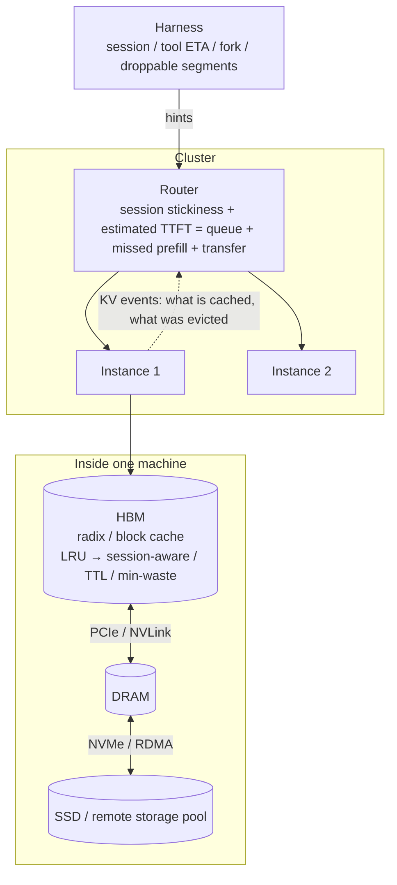

[中文](README.md) · **English**

# Module 05: Cache × Prefill Co-design

> 🕐 Suggested time: 2.5 hours ｜ 🎯 After this module you can: say which signals LRU actually lacks under agent workloads ("finished" vs "paused", the ETA of each tool call), and judge under which tool-latency distributions LRU agrees or disagrees with optimal eviction; use the InferCept / Continuum accounting to decide whether KV is kept, dropped or moved; split the gain of cache-aware routing into "session stickiness" and "cross-session shared prefixes", and derive the unified routing cost "estimated TTFT"; use one inequality to decide whether KV on a given storage tier should be loaded or recomputed; propose a harness → engine "co-design interface" built on existing industrial interfaces, and explain how to degrade when hints are wrong or abused ｜ 🧪 Lab: [`lab.py`](lab.py) ｜ 📖 Required primary sources: [Mooncake (arXiv:2407.00079)](https://arxiv.org/abs/2407.00079), [Continuum (arXiv:2511.02230)](https://arxiv.org/abs/2511.02230)

## 0. One sentence

**Under agent workloads, the core tension of the inference system is that the KV cache wants to "stick" while load balancing wants to "spread". Sticking means requests of the same session return to the same machine (the simplest way is sticky routing by session id), new sessions of the same project ideally land on a machine that already holds the project prefix, and the KV is not evicted too early during tool gaps. The solution has three layers:**

1. **Single machine**: tell "finished" sessions from "paused" ones, and decide how long to keep KV from the tool-latency distribution (TTL, min-waste) rather than from recency alone.
2. **Cluster**: take most of the gain with session stickiness first, then put affinity and load into one cost, **estimated TTFT = queueing + prefill of the missed part + transfer**, to handle cross-session sharing, migration and hot spots.
3. **Storage**: use the "load vs recompute" inequality to decide whether KV lives in HBM, DRAM or SSD.

**All three layers need information only the harness has: session boundaries, expected tool time, the fork structure, and which segments can be dropped. Part of it already has industrial interfaces; the rest is what co-design has to fill in.**



Prerequisite: [Module 04](../04_harness_workloads/README.en.md) (what the workload looks like). For KV size and the prefill compute model, see [Module 01](../01_inference_basics/README.en.md); for MLA and DP attention, see [Module 03](../03_deepseek_stack/README.en.md).

## 1. Why big companies care

**Scenario 1: how many machines does DeepSeek's on-disk KV cache actually save?** DeepSeek published a 24-hour production statistic ([inference system overview](https://github.com/deepseek-ai/open-infra-index/blob/main/202502OpenSourceWeek/day_6_one_more_thing_deepseekV3R1_inference_system_overview.md), UTC+8 2025-02-27 12:00 to 12:00 the next day):

- 608B input tokens, of which 342B (**56.3%**) hit the on-disk KV cache; 168B output tokens;
- per H800 node, about **73.7k tokens/s** of prefill input (including cache hits) and about **14.8k tokens/s** of decode output;
- **226.75** nodes occupied on average.

Mental math with these numbers (assumption: node count is proportional to compute):

```
input rate    608B / 86,400 s ≈ 7.04M tokens/s   → 7.04M / 73.7k ≈  96 prefill nodes
output rate   168B / 86,400 s ≈ 1.94M tokens/s   → 1.94M / 14.8k ≈ 131 decode nodes
total ≈ 227, consistent with the published 226.75. But this holds by definition (per-node throughput is total tokens divided by node-time), so it is not an independent check.

tokens actually computed per prefill node: (608B − 342B)/86,400 / 96 ≈ 32k tokens/s
without the disk cache: 7.04M / 32k ≈ 218 prefill nodes → about 123 more nodes, total ≈ 350 (+54%)
```

**Conclusion: on this public workload, the on-disk KV cache saves at most about a third of the machines. "At most" because this first-order estimate overestimates in two ways:** first, with caching the tokens actually computed sit behind long prefixes, so each does more attention than the average token would without a cache, and 32k tokens/s understates the per-token throughput without a cache; second, hit tokens are not free either (loading from SSD, MLA up-projection, see 4.2), and that work is also counted in those 96 nodes.

On averages, storage bandwidth is not the main bottleneck: if the KV is stored in BF16 MLA format (70,272 bytes per token, derived in 4.2), the 342B hit tokens read about 24 PB per day, about 278 GB/s on average, only around 4% of the cluster read throughput 3FS has published (about 6.6 TiB/s, [3FS README](https://github.com/deepseek-ai/3FS)). The 3FS README also has a KVCache client read-throughput chart: each client peaks at about 40 GiB/s but averages only about 2–3 GiB/s (our reading of the chart). If we take the number of clients to be roughly the 96 prefill nodes above, the averages add up to about 200–300 GB/s, the same order as 278 GB/s. The two datasets cover different periods, so this is only order-of-magnitude consistency. **Averages cannot prove there is no bottleneck in the tail**: the peak is already close to the line rate of one 400 Gbps NIC, and hot prefixes, prefill storms and background training traffic all squeeze bandwidth in the tail.

**Scenario 2: Kimi's Mooncake.** The Mooncake paper ([arXiv:2407.00079](https://arxiv.org/abs/2407.00079), FAST'25 Best Paper) analyzes cache policies on a real trace:

- Growing an LRU cache from 1,000 to 50,000 blocks raises the hit ratio from 30% to 50%; with infinite capacity it is only 51%. **That 51% is the reuse ceiling of this trace itself**: blocks seen for the first time must miss (compulsory misses), and no amount of capacity or policy can get past that. The paper explicitly warns that this does not mean large caches are unnecessary, because the sample trace is only a subset of real workloads and real capacity needs scale with size.
- On this trace LRU beats both LFU and the paper's LengthAwareCache; the paper attributes this to temporal proximity in request usage.
- Over 50% of blocks are never reused, while some are accessed tens of thousands of times. The paper says replicating these hot blocks is essential **to avoid transfer congestion**: a bandwidth and queueing problem, not a hit-rate problem.

**The pain of multi-project agents.** Mental math with round numbers (assumptions): 20 projects, each with a 20k-token shared prefix (repo context + tools + system); 200 active sessions, each with 40k tokens of private history. The working set is about 20 × 20k + 200 × 40k ≈ **8.4M tokens**. One 8×H100 (80 GB) node running Qwen3-32B has about 66 GB of BF16 weights. Assuming 80% of the remaining memory goes to KV at 256 KiB per token, it holds only about **1.75M tokens**, roughly 21% of the working set. Eviction is unavoidable; the only question is **what to evict**.

## 2. Single machine: KV cache contention and eviction with many projects / tenants

### 2.1 Data structures recap

The two mainstream organizations have different eviction semantics:

- **SGLang's RadixAttention** ([arXiv:2312.07104](https://arxiv.org/abs/2312.07104), NeurIPS'24): an explicit radix tree (compressed prefix tree). **Only leaves not locked by a running request can be evicted**; an internal node is someone else's prefix, and deleting it invalidates all its descendants. The order is set by `--radix-eviction-policy`: `lru` by default, plus `lfu`, `slru`, `priority` and `tlru` ([docs](https://docs.sglang.io/docs/advanced_features/radix_eviction_policy)).
- **vLLM's automatic prefix caching**: no explicit tree, but a hash table from "chained block hash → block" plus a per-block reference count ([design doc](https://docs.vllm.ai/en/stable/design/prefix_caching/)). Blocks whose count drops to 0 go into a free queue while keeping their content and hash, so they can still be hit; when a new block is needed, the least recently used one is popped from the head (LRU). When a request frees its blocks, they are appended to the tail in **reverse order**, because "the last block of a request must hash more tokens and is less likely to be reused", so it is evicted first. Chained hashing guarantees that if an earlier block is gone, later blocks cannot hit either, which in effect resembles "evict from the tail", but there is no hard "only leaves" constraint.

### 2.2 What LRU lacks under agent workloads

Continuum's abstract points out that existing engines evict **finished** requests' KV when new requests are waiting; agents interleave LLM calls with tools, so this policy prevents effective KV reuse across turns ([arXiv:2511.02230](https://arxiv.org/abs/2511.02230)). InferCept ([arXiv:2402.01869](https://arxiv.org/abs/2402.01869), ICML'24) quantified the waste: in the inference systems of the time, each external interaction was treated as the end of generation and resubmitted as a new request, and the resulting recomputation accounts for **37–40%** of total model forwarding time.

But the problem is **not** that "LRU's signal points the wrong way". Among paused sessions, LRU evicts the one that has waited longest. Whether that is right depends on the tool-latency distribution:

- Look at the **mean residual life** MRL(t) = E[T − t | T > t], i.e. "having waited t seconds, how much longer to go".
- **Heavy-tailed distributions** (Pareto-like distributions with a decreasing hazard rate; the lognormal hazard rises and then falls, decreasing in the tail): over the range where the hazard decreases, the longer you have waited, the longer you expect to keep waiting. The library's tool latency is lognormal with median 2 s and σ = 1 (clipped to [0.05, 120] s); computing numerically with 2M samples: MRL(1 s) ≈ 3.2 s, MRL(4 s) ≈ 4.4 s, MRL(16 s) ≈ 8.5 s, MRL(32 s) ≈ 12.8 s. At these waiting times the session that has waited longest is exactly the one expected back last, so **LRU agrees with Belady (evict whoever is used furthest in the future, the offline optimum)**. This is not a general result for every "heavy-tailed" tool: at very short waits the lognormal hazard is still rising, and near the clip (120 s here, a timeout in practice) the MRL falls to 0. Look at MRL(t) of each tool's empirical distribution over the waits that actually occur, not just at the "heavy-tailed" label.
- InferCept uses the same intuition: without an offline profile it estimates tool time as T̂_INT = t_now − t_call, i.e. "the longer a request is intercepted, the larger the estimate", and reports reaching 93% of the performance of an oracle with exact durations. Mooncake found LRU best on its trace; SGLang's docs describe `lru` as matching "how prefix reuse decays with time".
- **When LRU opposes Belady**: distributions with an increasing hazard rate, i.e. tools with a hard upper bound or near-constant duration (fixed-length builds, tests with timeouts). For tool time uniform on [0, 10] s: MRL(0) = 5 s, MRL(4 s) = 3 s, MRL(8 s) = 1 s. The session that has waited longest is about to return, and LRU evicts the wrong one.
- **When tools are mixed**: comparing the idle time of a session that just started a 60 s test with one that has waited 1 s on `read_file` is meaningless. What is needed is a distribution per tool type.

**What LRU actually lacks are three signals:**

1. **"Finished" or "paused"**: once a session ends, its private tail is dead weight (the shared prefix is still useful); a paused session will definitely come back. The engine only sees a request end and cannot tell the two apart.
2. **The ETA or latency distribution of each tool call**: decides how long to keep the KV.
3. **The objective**: LRU optimizes hit rate, while agents care about TTFT and job completion time (JCT). SGLang's `tlru` is designed for this (see 2.5).

### 2.3 Three options and their accounting

During a tool call, a request's KV can be handled in three ways:

| action | what it does | cost | when it pays |
|---|---|---|---|
| **preserve** (stay in HBM) | nothing; keeps occupying HBM | HBM held for tool time × context size | fast tools (sub-second to a few seconds) |
| **swap** (move to DRAM) | copy out over PCIe, copy back on return | slows the batch during the copies | slower tools with ample PCIe bandwidth |
| **discard** (drop, recompute on return) | frees HBM | time to recompute prefill, which also stalls other requests | short context, very slow tool |

InferCept unifies the three as "memory waste = tokens held in memory without doing work × seconds" (in the paper each term is also multiplied by the per-token KV size M, which cancels when comparing), and picks the least-waste action per tool call (min-waste):

```
t_fwd    = C / prefill rate                                    # C: context tokens of this request
discard  = t_fwd · C + t_fwd · C_other                         # C_other: contexts of the other running requests
preserve = T_INT · C                                           # T_INT: tool-call duration
swap     = 2 · T_swap(C) · C_batch                             # swap out + swap in, both stall the current batch
```

**Where this model applies.** It assumes swaps are synchronous, that both copies fully stall the whole batch, and that there is a single shared PCIe channel. In real systems swap-in and swap-out can use asynchronous DMA, load layer by layer and overlap with compute, in which case swap is overestimated; it can also be underestimated when several workers contend for PCIe or pinned memory is short. A more general form counts only the copy time not hidden by compute: swap ≈ exposed swap-out time × affected tokens + exposed swap-in time × affected tokens. **Exercise (a)** implements the paper's version.

**Continuum's TTL.** For requests that make tool calls, Continuum **pins the KV in GPU memory for a TTL** and evicts it automatically on expiry. Paper §4 converts both cost and benefit into their effect on total job completion time (in units of time):

```
Cost(τ, r)     = MemUsage(r) / M̄ × τ                  # pinning r blocks about MemUsage/M̄ average requests for τ seconds
Benefit(r)     = CacheMissCost(r) + OutofOrderCost(r)  # reload/recompute saved, plus the requeueing delay after eviction
τ*             = argmax_τ  P(τ, f) · (T̄ · η + PrefillReload(r)) − τ     # form after cancelling MemUsage/M̄
```

- P(τ, f): the probability that tool f returns within τ seconds, estimated from the empirical CDF of that tool's history; with fewer than 100 records it falls back to all tools' records, and with too few of those to a fixed default TTL.
- T̄: the average queueing delay of evicted requests (sliding average); η = −Corr(k, N − k) measures whether the number of turns done predicts the number remaining (η = 1 when every program has a fixed number of turns, η = 0 for a geometric distribution).
- τ* is enumerated over all historical durations (including 0). **It follows directly from the formula** that for long-tail tools, where P(τ, f) grows slowly with τ, τ* is short or even 0 (no pin), which is quite different from "pin until the expected return time".

Continuum also uses program-level FCFS scheduling. Evaluated on real agent workloads (SWE-Bench, BFCL, OpenHands) with Llama-3.1 8B/70B, Gemma-3 12B and GLM-4.5 355B, it improves the average job completion time by **over 8x** (abstract).

**Other work in the same direction:**

- **KVFlow** ([arXiv:2507.07400](https://arxiv.org/abs/2507.07400), NeurIPS'25): uses an Agent Step Graph to compute each agent's "steps to next execution", evicts by it, and fully overlaps CPU→GPU prefetching with compute. Against "SGLang with hierarchical radix cache", up to 1.83x speedup for a single workflow and up to 2.19x for multiple concurrent workflows.
- **TokenCake** ([arXiv:2510.18586](https://arxiv.org/abs/2510.18586), arXiv notes acceptance at EuroSys'27): proactively offloads idle KV during function calls and uploads it back predictively; also reserves memory for agents on the critical path.
- For newer work such as "have tools report progress while running", see the "harness-aware inference engines" part of [Module 09](../09_frontier/README.en.md).

### 2.4 Multi-tenancy: share or isolate

**The benefit of shared prefixes**: all sessions of one company share tool definitions and the system prompt. This part has the highest hit rate and the highest value per byte, so it should be evicted last.

**Reason to isolate #1: timing side channels. Attack surface, granularity and defense cost:**

- **Evidence**: an ICML'25 audit ([arXiv:2502.07776](https://arxiv.org/abs/2502.07776)) detected global cache sharing across users at 7 API providers, including OpenAI, and pointed out that it can leak information about users' prompts. Another work published in IEEE TIFS ([arXiv:2409.20002](https://arxiv.org/abs/2409.20002)) exploits timing differences from shared caches and GPU memory allocation, uses a token-by-token search to recover shared prefixes, and demonstrates the feasibility of stealing system prompts and other users' prompts.
- **Leak granularity** is set by the cache unit: vLLM's default 16-token block lets an attacker guess block by block; DeepSeek's 2024 description used 64-token storage units; Anthropic works per breakpoint, OpenAI per cache lookup boundary.
- **Routing itself leaks too**: which machine a request lands on, and how long it queues, both correlate with other tenants' cache state.
- **Defenses**: vLLM's `cache_salt` injects a salt into the first block's hash, so only requests with the same salt can reuse each other's blocks; Anthropic isolates caches by organization (and by workspace on the Claude API); OpenAI's docs recommend separate `prompt_cache_key`s for separate billing and to prevent cross-user hit probing. **Cost**: a public system prompt is stored once per tenant. A compromise is **selective sharing**: share public prefixes (e.g. published tool definitions) across tenants and salt per tenant from the first private segment on. In vLLM the salt only goes into the first block, so selective sharing needs an engine extension that "salts from a given block onward".

**Reason to isolate #2: fairness.**

- **Eviction layer**: a high-traffic tenant can flush everyone else's prefixes under LRU.
- **Queue layer**: cache-aware queue ordering keeps requests with more hits at the front. SGLang's `CacheAwarePolicy` has `lpm` (longest prefix match first) and `dfs-weight`, and `CacheAgnosticPolicy` has `fcfs`, `lof` and `random` ([schedule_policy.py](https://github.com/sgl-project/sglang/blob/main/python/sglang/srt/managers/schedule_policy.py)). Under `lpm`, tenants with cold prefixes can stay at the back for a long time. [Locality-aware Fair Scheduling (arXiv:2501.14312)](https://arxiv.org/abs/2501.14312) targets exactly this tension: existing fair schedulers (e.g. VTC) ignore prefix locality, and locality-aware schedulers do not guarantee fairness. It proposes DLPM (Deficit Longest Prefix Match), which keeps locality while guaranteeing fairness on one server; the distributed version D²LPM also balances load. The abstract reports up to 2.87x the throughput of VTC and up to 7.18x lower per-client latency than state-of-the-art distributed systems.

**Trade-offs of the options:**

| approach | global hit rate | guarantee for small tenants | cost |
|---|---|---|---|
| fully shared + LRU | highest | none: big tenants flush small ones | side channels; poor fairness |
| hard partition (cache split per tenant) | lower: unused quota is unavailable to others | strongest | fragmentation; partition sizes must track working sets |
| soft quota (guaranteed minimum + shared remainder) | close to fully shared | guaranteed for the minimum | complex to implement; minimums must track per-tenant working sets |
| per-tenant weighted eviction | medium | by weight | choosing weights is a business question |
| per-tenant salt | public prefixes copied many times | comes with isolation | duplicated memory, lower hit rate |

### 2.5 Industrial implementations: session-aware and SLO-aware eviction

Several of these ideas already ship, and they are the baseline for the interface proposal in Section 7:

- **SGLang session radix cache** (`--enable-session-radix-cache`, [docs](https://docs.sglang.io/docs/advanced_features/session_radix_cache)): requests carry a `session_id`, and the engine gives KV referenced by an active session "soft protection", evicting unreferenced KV first; referenced KV can still be reclaimed if necessary. The application calls `/close_session` to end a session, which drops its references and returns the KV to normal eviction. For sliding-window attention (SWA) layers it only protects "the reusable tail covering the sliding window plus page-alignment allowance". This closes gap 1 of Section 2.2: telling finished from paused.
- **SGLang `tlru`** ([docs](https://docs.sglang.io/docs/advanced_features/radix_eviction_policy)): first evicts the tail of a conversation beyond what its next prefill needs to meet the TTFT budget, then falls back to LRU. It is configured with a threshold ξ (in tokens; the docs suggest converting a TTFT target by dividing it by the measured milliseconds per uncached token) and `next_prompt_estimate` (the expected new tokens of the next turn). The docs describe it as suited to agentic / multi-turn workloads "where tail TTFT matters more than raw hit rate". This addresses gap 3 of Section 2.2: it optimizes TTFT, not hit rate.
- **SGLang `priority`**: evicts the prefixes of the lowest-priority requests first, falling back to LRU within equal priority. NVIDIA Dynamo's docs describe forwarding `nvext.agent_hints.priority` to the SGLang backend for use with `--radix-eviction-policy priority` ([Dynamo: SGLang for Agentic Workloads](https://github.com/ai-dynamo/dynamo/blob/main/docs/fern/pages/developer-guide/knowledge-base/modular-components/backends/sglang/agents-on-sglang.md)).
- **Dynamo session control** (experimental, same doc): open / close for sub-agents; the SGLang backend keeps sub-agent KV in session slots outside the radix tree, invisible to eviction and freed on close or timeout, so short-lived sub-agents do not pollute the lead agent's prefix cache.

**The policies compared:**

| policy | signal | where the signal comes from | failure mode | existing implementation |
|---|---|---|---|---|
| LRU | last access time | the engine itself | cannot tell finished from paused; opposes the optimum when tool times are near-constant | vLLM, SGLang default |
| session soft protection | whether the session is still alive | the harness's session_id and close | degrades when sessions leak (never closed) | SGLang session radix cache |
| point-estimate pin (pin until expected return) | one tool-time estimate | the harness | hogs memory when estimates are noisy (see lab B) | the simplified version in this module's lab |
| Continuum TTL | tool-time distribution + recompute/queueing cost | per-tool history | cold start; distribution drift | Continuum |
| min-waste | tool duration, context, batch state | engine + tool profiles | needs an accurate T_INT and cost models | InferCept |
| TTFT-budget eviction | next turn's prefill budget | operator config + estimated next-turn length | protects too much or too little when estimates are off | SGLang `tlru` |
| workflow-aware | steps to next execution | the orchestrator's DAG | only for workflows with known structure | KVFlow |
| priority eviction | request priority | harness / product layer | starvation of low-priority tenants | SGLang `priority` |

## 3. Cluster: cache-aware routing vs load balancing

### 3.1 Where the tension is

- **Pure affinity** (go wherever the longest prefix hit is): hot projects or very long sessions stick to a few machines, queues grow and p99 TTFT gets worse.
- **Pure balancing** (per-request round-robin / least loaded): consecutive turns of one session scatter across machines, and every machine must cache every project's prefix, which effectively divides cache capacity by the number of instances. Note that "per-request round-robin" is a very weak baseline that almost nobody uses for agent traffic in production; as shown below, the real contender is session stickiness.
- OpenAI's docs describe this tension at the API level: caches live on individual machines, a request can only hit if it is routed to a machine holding a matching entry, and traffic above about **15 requests per minute** for the same prefix / `prompt_cache_key` can overflow to other machines ([docs](https://developers.openai.com/api/docs/guides/prompt-caching), checked 2026-09-28).

### 3.2 A unified cost: estimated TTFT

Put both goals into one quantity:

```
TTFT_i ≈ queue_i + (L − hit_i) / prefill_rate_i + transfer_i + decode_interference_i
          queueing    prefill of the missed part       moving cache from a lower tier/elsewhere   decode on the same machine competing for compute
```

`transfer_i` depends on the tier of the hit: an HBM hit needs no transfer, while DRAM and SSD hits must be loaded at each tier's bandwidth. Pick argmin_i TTFT_i for each new request. **Exercise (b)** implements this version with tiered transfer and decode interference, and **exercise (c)** the simpler "affinity with a load cap". What real systems do:

| system | instance-selection rule | cache view | source |
|---|---|---|---|
| **Mooncake Conductor** | for each prefill instance compute "queue time + prefill time (from the hit length, via a model fitted offline) + KVCache transfer time" and take the smallest TTFT; proactively replicate hot blocks, swap out cold ones | looks up each instance's cache by block hash | [arXiv:2407.00079](https://arxiv.org/abs/2407.00079) |
| **NVIDIA Dynamo KV router** | v1.0.0: `cost = overlap_score_weight × prefill_blocks + decode_blocks`, take the minimum, optionally softmax-sample with a temperature. The current version subtracts "overlap credits" from the prefill load: device hits are credited with a default weight of 1.0, host (CPU) hits 0.75, disk hits 0.25. The queue can be `fcfs` (optimizes tail TTFT) or `wspt`, which orders by `(1 + priority_jump) / max(1, input tokens − cached tokens)` and optimizes average TTFT | KV events reported by engines; TTL-based prediction when events are off | [v1.0.0 Router Guide](https://docs.nvidia.com/dynamo/v1.0.0/components/router/router-guide), [current configuration doc](https://github.com/ai-dynamo/dynamo/blob/main/docs/fern/pages/developer-guide/knowledge-base/modular-components/router/configuration-and-tuning.md) |
| **SGLang router** (now SGLang Model Gateway) | first check for imbalance: `max_load − min_load > balance_abs_threshold` and `max_load > balance_rel_threshold × min_load`. If imbalanced, go to the shortest queue; otherwise, if the prefix match rate > `cache_threshold`, go to the worker with the longest match, else to the worker with the smallest (emptiest) cache tree | the router keeps an **approximate** radix tree per worker (raw text, updated lazily, pruned periodically by LRU) | [v0.4 blog](https://lmsys.org/blog/2024-12-04-sglang-v0-4/), [v0.4.10 router doc](https://github.com/sgl-project/sglang/blob/v0.4.10/docs/router/router.md), [current doc](https://docs.sglang.io/advanced_features/sgl_model_gateway.html) |
| **llm-d** | Filter → Score → Pick. `prefix-cache-affinity-filter` probabilistically narrows candidates to "sticky" endpoints with high prefix scores, with a "TTFT load gate" that breaks stickiness when sticky endpoints are much slower. Then several scorers (`prefix-cache-scorer`, `kv-cache-utilization-scorer`, `queue-depth-scorer`, `session-affinity-scorer`, …) each output a 0–1 score; take the highest weighted sum | approximate mode, or precise mode based on engine KV events | [scheduling architecture doc](https://github.com/llm-d/llm-d/blob/main/docs/architecture/core/router/epp/scheduling.md) |
| **Preble** | E2 (Exploitation + Exploration): if the cached part is longer than the missed part, send to the GPU with the longest prefix (exploit); otherwise pick the GPU with the lowest total of "compute load + eviction cost + new-request cost" (explore); plus hierarchical scheduling | global prefix tree | [arXiv:2407.00023](https://arxiv.org/abs/2407.00023) (ICLR'25) |
| **Autellix** | route long calls to the engine where their program already is (respecting data locality), and load-balance short calls, whose input is mostly the system prompt | program-level process table | [arXiv:2502.13965](https://arxiv.org/abs/2502.13965) |

Dynamo's choice to credit "host hits only 0.75 and disk hits only 0.25" is worth noticing: it writes Section 4's conclusion, "loading is cheaper than recomputing, but not free", directly into the routing cost. llm-d's TTFT load gate and SGLang's imbalance thresholds are two ways of writing "affinity needs an overflow cap", the same idea as bounded-load consistent hashing ([Consistent Hashing with Bounded Loads, arXiv:1608.01350](https://arxiv.org/abs/1608.01350): no bin gets a load above ⌈c·m/n⌉, with c = 1 + ε).

### 3.3 The strongest simple baseline: session stickiness

Before discussing prefix-aware routing, it has to beat a nearly free baseline: **sticky routing by session id** (consistent hashing, or remembering the binding after the first assignment).

- Manus recommends exactly this: use session IDs to route requests consistently to the same worker ([Manus blog](https://manus.im/blog/Context-Engineering-for-AI-Agents-Lessons-from-Building-Manus)).
- Dynamo session affinity: with `--router-session-affinity-ttl-secs` enabled, a session's first successful request binds the session id to the chosen worker (and DP rank, when present), and later requests use the binding in `hard` (exact dispatch) or `soft` (advisory target) mode. Experimental parent-session grouping lets sub-agents of the same parent share one binding ([configuration doc](https://github.com/ai-dynamo/dynamo/blob/main/docs/fern/pages/developer-guide/knowledge-base/modular-components/router/configuration-and-tuning.md)).
- llm-d's `session-affinity-scorer` gives the highest score to the endpoint that handled the session before.

Most of an agent prompt is **the session's own private history** (in Module 04's workload, session history is usually much longer than the shared prefix), so as long as a session returns to the same machine, most of the reuse is captured. **Prefix-aware routing earns more than session stickiness in four situations:**

1. **Cross-session shared project prefixes**: a new session of the same project can land, from its very first turn, on a machine that already holds that project's prefix. The longer the shared prefix and the shorter the sessions, the more this matters.
2. **Session migration**: when stickiness is broken by a load cap or a failure, prefix-aware routing finds the "next best" machine instead of a random one.
3. **Hot spots**: sticky hashing never rebalances, so one very long session or a hot project can saturate a machine; a cost function with a load term can steer new sessions away.
4. **Fork / sub-agents**: sub-agents share the parent prefix and should land where the parent session is, or the router should decide to replicate the parent prefix (Dynamo's parent-session grouping is designed for this).

Lab A compares session stickiness and prefix-aware routing side by side to see where the gain actually comes from.

### 3.4 The cache view: approximate or precise

The router must know what each machine caches, but the cache state lives in the engine and is evicted continuously. Two approaches:

- **Approximate**: the router infers cache contents from the requests it sent (SGLang router's approximate radix tree). Cheap to implement, but wrong as soon as the engine evicts.
- **Precise**: the engine reports "which blocks were cached and which were evicted" as events (KV events).

llm-d's blog gives a comparison ([KV-Cache Wins You Can See](https://llm-d.ai/blog/kvcache-wins-you-can-see), 2025-09-24). Setup: a Qwen 32B model, 8 vLLM pods on 16 H100s in total; 150 simulated enterprise customers, each with a 6,000-token context. **Key precondition**: the KV demand of this workload is about 73% of the cluster's total KV capacity, about 6 times the capacity of any single pod.

| scheduler | output tokens/s | TTFT p90 | TTFT mean |
|---|---:|---:|---:|
| precise prefix-aware | 8,730 | 0.542 s | 0.298 s |
| approximate prefix-aware | 6,944 | 31.1 s | 13.3 s |
| load only | 4,429 | 94.9 s | 47.0 s |
| random | 4,429 | 92.6 s | 45.3 s |

These numbers say two things, both to be read with the precondition. First, **when the working set is far larger than one instance's capacity**, cache-blind scheduling is one to two orders of magnitude worse on TTFT and about 2x worse on throughput (precise beats approximate by about 25%). Second, the "engine → router" KV event stream is also part of the co-design interface, flowing in the opposite direction.

### 3.5 Hot spots: replicate or queue

Mooncake observed extremely skewed block popularity and says replicating hot blocks is there **to avoid transfer congestion**: when many prefill instances pull the same hot block at once, the bandwidth of a single location becomes the bottleneck, so hot blocks are copied to several nodes while the coldest are swapped out. In the formula of 3.2, this lowers the `transfer_i` and queueing terms of hot prefixes, at the cost of storage redundancy.

OpenAI's "about 15 RPM" should not be read as a threshold on single-instance prefill capacity. Mental math with this course's compute model: on 8×H100 running Qwen3-32B, a 30k-token request with a 90% hit needs about 3.7e14 FLOPs of prefill, about 0.08 s (MFU 0.6), so one machine can handle hundreds of such requests per minute on prefill alone, one to two orders of magnitude above 15 RPM. OpenAI's docs do not explain where the number comes from; a more likely explanation is coarse per-key load spreading when tenants share machines, the same class of policy as bounded-load consistent hashing (this is speculation). Also, from GPT-5.6 on, the docs say OpenAI handles routing automatically and `prompt_cache_key` is no longer needed to optimize caching; it is used only for separate billing and to prevent cross-user hit probing.

### 3.6 Routing granularity under DP attention

MLA's latent is shared by all heads and cannot be split by head for tensor parallelism, so large deployments often use DP attention (see [Module 03](../03_deepseek_stack/README.en.md)): each DP rank keeps the KV of its own share of requests. The prefix cache then belongs to one DP rank, and **the granularity of cache-aware routing is (node, DP rank), not the instance**. The tension between affinity and balance exists inside a single machine as well.

- DeepSeek's inference system overview lists "uneven request counts and sequence lengths across DP instances" as the key load-balancing problem: on the prefill side, balance core-attention computation and input tokens per GPU; on the decode side, "balance KVCache usage across GPUs" (i.e. core-attention load) and request counts.
- Dynamo's session binding, when DP is present, binds (worker, DP rank); the docs add that if the backend routes again internally (e.g. TensorRT-LLM's attention-DP conversation affinity), the engine must record the DP rank Dynamo chose, or a session group can still be split across ranks.

## 4. Tiered KV storage: HBM / DRAM / SSD / remote

### 4.1 Tiers, bandwidths and systems

| tier | example and bandwidth | source |
|---|---|---|
| HBM | H100 SXM: 80 GB, 3.35 TB/s | [NVIDIA H100](https://www.nvidia.com/en-us/data-center/h100/) |
| GPU ↔ host DRAM | H100 SXM lists PCIe Gen5 at 128 GB/s (both directions combined, about 64 GB/s each way) | same as above |
| cross-node RDMA | measured by Mooncake Transfer Engine: about 87 GB/s on 4×200 Gbps RoCE, about 190 GB/s on 8×400 Gbps | [Mooncake README](https://github.com/kvcache-ai/Mooncake) |
| distributed SSD | 3FS KVCache reads: in the README chart a **single client** (one 400 Gbps NIC per node) peaks at about 40 GiB/s (the highest peak among the clients), close to NIC line rate (400 Gbps ≈ 46.6 GiB/s); the per-client average in the chart is about 2–3 GiB/s (our reading). Whole-cluster read throughput about 6.6 TiB/s (180 storage nodes, with background traffic from training jobs) | [3FS README](https://github.com/deepseek-ai/3FS) |

How systems do the tiering:

- **LMCache**: a KV layer for vLLM / SGLang whose backends include CPU memory, local SSD, Redis/Valkey, Mooncake, InfiniStore, S3-compatible object storage and more ([GitHub](https://github.com/LMCache/LMCache)). The paper reports up to 15x higher throughput ([arXiv:2510.09665](https://arxiv.org/abs/2510.09665)).
- **Mooncake Store**: a distributed KV store built on the Transfer Engine, spanning DRAM and SSD; integrated with vLLM, SGLang (HiCache) and LMCache.
- **Dynamo KVBM**: four tiers, G1 GPU HBM → G2 pinned DRAM → G3 local / pooled SSD → G4 remote storage ([design doc](https://docs.nvidia.com/dynamo/v-0-8-1/components/kvbm/design-deep-dive)).
- **CachedAttention** ([arXiv:2403.19708](https://arxiv.org/abs/2403.19708), ATC'24): tiered KV built for multi-turn conversations. Layer-wise preloading and asynchronous saving hide the data movement behind compute. It reports TTFT reduced by up to 87%, prefill throughput up to 7.8x, and end-to-end cost reduced by up to 70%.
- **DeepSeek's on-disk cache**: DeepSeek's 2024-08-02 announcement says disk caching is possible because DeepSeek V2's MLA architecture improves model performance while significantly reducing the size of the context KV cache, enabling efficient storage on low-cost disks ([announcement](https://api-docs.deepseek.com/news/news0802)). The DeepSeek-V4 technical report ([arXiv:2606.19348](https://arxiv.org/abs/2606.19348) §3.5) describes how the disk cache works under hybrid attention. The compressed CSA / HCA KV is stored in full; on a hit it is read up to the last complete compression block, and tokens in the incomplete tail block are recomputed. SWA KV is uncompressed and exists in every layer, about 8 times the volume of the compressed KV, so the report gives three strategies:
  - store it all: zero recomputation, but only a small subset is ever read, producing an unbalanced write-heavy access pattern;
  - checkpoint every p tokens: load the most recent checkpoint and recompute the remaining tail tokens, trading storage against compute via p;
  - store none: using the cached compressed KV, recomputing the last n_win·L tokens (L = number of layers) is enough to restore the last n_win SWA entries.

  This is a first-hand example of **model architecture deciding cache semantics**, and it explains why the DeepSeek API moved to "cache prefix units" (see [Module 04](../04_harness_workloads/README.en.md) Section 4).

### 4.2 Recompute vs load: the break-even formula

For a prefix of n tokens:

```
recompute: t_recompute(n) ≈ n · 2·N_active / (F · MFU)     (linear layers only; attention over long contexts makes recompute more expensive)
load:      t_load(n)      = t0 + n · b_kv / B              (b_kv: KV bytes per token; B: bandwidth of this tier; t0: fixed latency)

ignoring t0, loading is faster  ⟺  B > b_kv · F · MFU / (2·N_active)  ≡  B*   (break-even bandwidth)
```

B\* does not depend on n; it depends only on "**how many FLOPs one byte of KV is worth**": ρ = 2·N_active / b_kv. The larger ρ, the more valuable the cache and the slower a storage tier it can tolerate. The table uses the H100 SXM's dense compute (BF16 about 989 TFLOPS, FP8 about 1,979 TFLOPS; NVIDIA's listed values are with sparsity, twice these), MFU = 0.6, per GPU:

| model | N_active | b_kv (BF16) | ρ (FLOPs/byte) | per-GPU prefill (linear term, BF16) | B\* (BF16 GEMM) | B\* (FP8 GEMM) |
|---|---:|---:|---:|---:|---:|---:|
| Qwen3-32B (GQA, 64 layers × 8 KV heads × 128) | 32.8B | 262,144 B | about 250k | about 9.0k tokens/s | **about 2.4 GB/s** | about 4.7 GB/s |
| DeepSeek-V3 (MLA, 61 layers × (512 + 64)) | 37B | 70,272 B | about 1.05M | about 8.0k tokens/s | **about 0.56 GB/s** | about 1.1 GB/s |

Architecture parameters come from the official [Qwen3-32B](https://huggingface.co/Qwen/Qwen3-32B) and [DeepSeek-V3 config.json](https://huggingface.co/deepseek-ai/DeepSeek-V3/blob/main/config.json); DeepSeek-V3's 671B total and 37B activated parameters come from the [technical report](https://arxiv.org/abs/2412.19437). DeepSeek's production inference uses FP8 for matrix multiplications (inference system overview), so the FP8 column is closer to its reality.

**Cross-check with production data.** Section 1 backed out about 32k tokens/s actually computed per prefill node, i.e. about 4k tokens/s per GPU, which gives B\* ≈ 4,000 × 70,272 B ≈ 0.28 GB/s. It is lower than the linear-term estimate in the table because production prefill also includes attention, communication and other overhead; it almost matches lab E's estimate that includes a 32k attention term (about 0.27 GB/s).

Now compare with each tier's per-GPU bandwidth:

- PCIe at about 64 GB/s each way: about 14x (Qwen3-32B, FP8) to 114x (DeepSeek-V3, BF16) above B\*. **The DRAM tier is almost always worth loading from.**
- 3FS at a 40 GiB/s peak per node, split across 8 GPUs, is about 5.4 GB/s per GPU: about 5–10x B\* for DeepSeek-V3, plenty of margin; only about 1.1–2.3x for Qwen3-32B, a thin margin. An 8B dense model (128 KiB of KV per token) has a linear-term B\* of about 4.8 GB/s, roughly break-even on the SSD tier. Note that 5.4 GB/s per GPU is a **peak** figure; sustained bandwidth is lower.

DeepSeek has officially credited MLA's smaller KV for making the disk cache feasible (see 4.1). **The other half, which is our derivation**: MoE keeps N_active large, and the two together push ρ to about 10⁶ FLOPs per byte.

**The hidden cost of MLA hits.** For MLA, "hit tokens cost almost no compute" does not hold:

- vLLM's MLA implementation ([mla_attention.py](https://github.com/vllm-project/vllm/blob/main/vllm/model_executor/layers/attention/mla_attention.py) docstring) uses the "compute friendly" MHA path for chunked prefill. For every chunk of new tokens, the cached latents are up-projected into per-head K and V with W_UK / W_UV (`k_nope = kv_c @ W_UK`).
- Mental math with DeepSeek-V3's shape: each up-projection costs about 2 × 512 × (128 × 128 + 128 × 128) × 61 ≈ **2.05 GFLOPs** per cached token, versus about 74 GFLOPs of linear layers per new token. Prefilling 1k new tokens on top of a 50k cache spends about 102 TFLOPs on up-projection alone, 1.4x the linear term (74 TFLOPs).
- The other, "data-movement friendly" MQA path needs no up-projection, but the attention QK dimension grows from 192 to 576 (512 + 64). vLLM's comment says it may switch to that path in the future when chunks are small.
- DeepSeek's internal prefill implementation has not been published.

Caveats:

1. **Fixed latency t0**: loading does not pay for very short prefixes; offloading only makes sense above some length (the tests for exercise (d) include an example).
2. **Bandwidth is shared**: many requests load at once, and background traffic such as training competes for bandwidth. 3FS's 6.6 TiB/s was measured with background traffic from training jobs.
3. **Pipelining**: layer-wise loading that overlaps with compute (CachedAttention, LMCache) hides most of t_load.
4. **Compression**: CacheGen ([arXiv:2310.07240](https://arxiv.org/abs/2310.07240), SIGCOMM'24) shrinks KV by 3.5–4.3x, effectively dividing b_kv by 4, and B\* drops proportionally.
5. **B\* is a per-request latency criterion, not a cluster throughput criterion.** At cluster level, look at which resource is the bottleneck: as long as loading overlaps with compute and aggregate bandwidth suffices, loading raises throughput even when B < B\*, because it frees GPU compute for other requests. Section 1's "278 GB/s vs 6.6 TiB/s" is the throughput view.

**Exercise (d)** implements this decision. Part E of the lab extends the table to more models using `codesign_sim`'s hardware and model parameters, and also includes the **attention term** of recomputing a 32k prefix. Attention makes recompute slower, so B\* is lower. The linear-only mental-math values above are a conservative upper bound on B\*.

## 5. Prefill optimizations for agent workloads

### 5.1 Chunked prefill: don't let one big miss block everyone

A session that returns after compaction, or after its KV was evicted, may bring tens of thousands of missed prefill tokens. Done in one go, that step monopolizes the GPU and every other session's decode stalls. Sarathi-Serve ([arXiv:2403.02310](https://arxiv.org/abs/2403.02310), OSDI'24) splits prefill into chunks and mixes them with decodes in the same batch (stall-free scheduling). Against vLLM, serving capacity improves 2.6x for Mistral-7B on one A100 and up to 3.7x for Yi-34B on two A100s.

Trade-off: smaller chunks make decode TPOT steadier, but lengthen TTFT for large requests and add per-step overhead.

### 5.2 PD disaggregation and ratios: the hit rate decides how many GPUs prefill needs

Putting prefill and decode on separate GPU pools lets each tune its parallelism for TTFT or TPOT. Representative work:

- DistServe ([arXiv:2401.09670](https://arxiv.org/abs/2401.09670), OSDI'24): up to 7.4x more requests served within latency constraints.
- Splitwise ([arXiv:2311.18677](https://arxiv.org/abs/2311.18677), ISCA'24).
- Mooncake.

DeepSeek's deployment: prefill runs in 4-node units (routed experts EP32), decode in 18-node units (EP144).

**First-order estimate**: prefill pool compute ∝ input tokens × (1 − hit rate); decode pool ∝ output tokens. With Section 1's DeepSeek numbers (56.3% hit rate) we derived about 96 prefill nodes vs 131 decode nodes. If the harness pushes the hit rate to 90%, prefill compute drops to 0.1 / 0.437 ≈ 23% of the original. Under the linear assumption the prefill pool could shrink to about 22 nodes, and **the bottleneck moves to decode, KV transfer and storage bandwidth**. That is what "a well-written harness changes the cluster's ratio" concretely means.

### 5.3 Under PD disaggregation, where does a multi-turn agent's KV live?

With PD disaggregation, turn t + 1 runs on a **prefill node**, but the KV generated by turn t's decode sits on a **decode node**. For a multi-turn agent to hit "the previous turn's input + output", there are three paths:

```
turn t:    prefill node ──(write newly computed incremental KV back to the shared pool)──► KV pool (DRAM / SSD)
                │
                └──(stream KV layer by layer)──► decode node ── generates output o_t ──(write back?)──► KV pool
turn t+1:  prefill node ◄──(read prefix: input_t + o_t)── KV pool
```

- **The input part**: Mooncake's prefill node completes prefill using the prefix cache and **stores the newly generated incremental KVCache back into CPU memory**, then transfers the KV to the decode node ([arXiv:2407.00079](https://arxiv.org/abs/2407.00079) §3).
- **The output part**: if the KV of o_t generated on the decode node is not written back to the shared pool, turn t + 1 must recompute o_t as new input. A reasoning model can output thousands of tokens per turn, so this recomputation is not small. The DeepSeek API builds a cache prefix unit at "the end position of the model output" ([docs](https://api-docs.deepseek.com/guides/kv_cache)), which shows its service lets the output side be hit as well (the implementation is not public).
- **The harness's effect**: if the harness drops the previous turn's reasoning from history or rewrites the previous output, the "end of output" unit is no longer a prefix of the new request, and the write-back is wasted.
- **P→D transfer volume**: every request must ship its prefill KV to decode. At 32k context in BF16, Qwen3-32B is about 262,144 B × 32,768 ≈ **8.6 GB** and DeepSeek-V3 about 70,272 B × 32,768 ≈ **2.3 GB**. At the roughly 190 GB/s Mooncake Transfer Engine measured on 8×400 Gbps, that is about 45 ms and 12 ms. This is MLA's second dividend under PD disaggregation, and the break-even framework of 4.2 applies: when transfer is worse than recomputation, let the decode node prefill by itself.

### 5.4 Position-independent caching: reusing "non-prefix" content

Agents often read the same file or the same tool output in different sessions at different positions. Prefix caching cannot help here (see Module 04 Section 2.3). Two approaches:

- **CacheBlend** ([arXiv:2405.16444](https://arxiv.org/abs/2405.16444), EuroSys'25): reuses each chunk's precomputed KV and recomputes only a small set of selected tokens to restore cross-attention between chunks. Against full recompute, TTFT drops 2.2–3.3x and throughput rises 2.8–5x.
- **EPIC** ([arXiv:2410.15332](https://arxiv.org/abs/2410.15332), ICML'25): Position-Independent Caching, with the LegoLink algorithm to mitigate the attention sink at the start of each document. Up to 8x better TTFT and up to 7x throughput.

Trade-offs: quality risk (approximate attention), engine support required, and you must know which segments are independently cacheable "documents". Only the harness knows the last one, which brings us back to the interface question.

### 5.5 Prefill storms after a prefix break

Once a large project's shared prefix is updated (e.g. the repo context moves to a new commit), all sessions of that project miss within minutes of each other, creating a prefill storm. Countermeasures:

- On the harness side: update prefixes in versioned batches; after an update, send one request to warm the cache before releasing the rest.
- On the engine side: give this batch of recomputation lower priority and smooth it with chunked prefill.

Dynamo offers a related hint, `speculative_prefill`: after the current turn completes, it sends a `max_tokens=1` request to prefill "the predicted next-turn prefix" and warm the KV.

## 6. Program-level scheduling

Request-level scheduling (FCFS, SJF) sees only individual LLM calls. But an agent is a **program**: its end-to-end latency (JCT) is the sum of the queueing, execution and tool times of all its calls, and when the next call arrives and with what prefix is mostly predictable.

| work | key idea | reported gain |
|---|---|---|
| **Parrot** ([arXiv:2405.19888](https://arxiv.org/abs/2405.19888), OSDI'24) | Semantic Variables expose application-level data flow to the service, which can then analyze and optimize across requests | up to an order of magnitude |
| **SGLang** ([arXiv:2312.07104](https://arxiv.org/abs/2312.07104), NeurIPS'24) | a frontend language expresses program structure such as fork/join explicitly; the runtime reuses KV via RadixAttention | up to 6.4x throughput |
| **Autellix** ([arXiv:2502.13965](https://arxiv.org/abs/2502.13965); listed on the NSDI'26 program as Agentix) | PLAS: prioritize by the program's cumulative service (execution) time so far, extending least-attained-service (LAS) to the program level; ATLAS: for multi-threaded DAG programs, prioritize by cumulative service along the critical path; priorities are discretized into multi-level queues, with preemption | 4–15x program throughput at the same latency |
| **KVFlow** ([arXiv:2507.07400](https://arxiv.org/abs/2507.07400)) | workflow graph → steps to next execution → eviction and prefetching | 1.83x / 2.19x |
| **Continuum** ([arXiv:2511.02230](https://arxiv.org/abs/2511.02230)) | TTL pinning plus program-level FCFS | over 8x better average job completion time |

**An operational model.** To discuss program-level scheduling at the depth interviewers probe, answer five questions:

1. **Objective**: average JCT (program completion time minus arrival) or tail JCT.
2. **How "service" is counted**: Autellix's PLAS uses the program's cumulative model execution time (the `service` field in its process table); you could also count prefill FLOPs or tokens, and different accounting favors differently shaped programs.
3. **Critical path**: in a DAG program, ATLAS gives a new call the maximum over its parents of "parent priority + parent execution time", i.e. the cumulative service along the critical path.
4. **Coupling with stickiness and caching**: LAS demotes long programs that have already run for a while, and those are exactly the programs holding the most KV. Once demoted, their KV may be evicted and they pay recomputation on return. Continuum chooses program-level FCFS plus TTL, Autellix chooses LAS plus locality-aware routing: two different trade-offs.
5. **Preemption granularity**: preempt per decode step (fine-grained, but the preempted request either holds its KV or is swapped out), or only switch at call boundaries.

**A small example** (assumptions): one engine, non-preemptive calls of 2 s each. At t = 0 two calls are queued: the 6th call of program A, which has already run 10 s (arrived first), and the 1st call of a new program B (B has only this one call).

- Request-level FCFS: A [0, 2], B [2, 4]; B's JCT = 4 s.
- PLAS: B has 0 cumulative service and runs first. B [0, 2], A [2, 4]; B's JCT = 2 s; A's total grows by 2 s, only about +17% for a program already over 12 s.
- Average JCT improves at the cost of slowing the long program. If A's KV is evicted while it waits, add recomputation time on top, which is exactly the coupling in point 4.

**Fairness at the queue layer** (echoing 2.4): cache-aware queue ordering (`lpm`) can starve tenants with cold prefixes, and DLPM uses deficit counters to trade locality against fairness; Autellix's PLAS is another kind of fairness, between programs.

The common thread: **the unit of scheduling moves from "request" to "program / session"**. All the information needed (which program this is, what comes next, how many steps remain) is in the harness's hands.

## 7. A co-design interface proposal: what the harness should tell the engine

### 7.1 Existing industry interfaces

- **Anthropic**: `cache_control` breakpoints plus a TTL (5 minutes / 1 hour). The harness declares "which part is the stable prefix, and how much it is willing to pay to keep it".
- **OpenAI**: `prompt_cache_options` (explicit breakpoints and TTL from GPT-5.6 on); `prompt_cache_retention` (earlier models); `prompt_cache_key` was used for routing groups before GPT-5.6 and afterwards only for separate billing and anti-probing (see 3.5).
- **vLLM**: `cache_salt`, an isolation domain.
- **SGLang**: `session_id` + `--enable-session-radix-cache` + `/close_session` (session soft protection); the `priority` and `tlru` values of `--radix-eviction-policy` (see 2.5).
- **NVIDIA Dynamo** ([Agent Hints](https://github.com/ai-dynamo/dynamo/blob/main/docs/fern/pages/use-cases/agents/agent-hints.md), [configuration doc](https://github.com/ai-dynamo/dynamo/blob/main/docs/fern/pages/developer-guide/knowledge-base/modular-components/router/configuration-and-tuning.md)):
  - `nvext.agent_hints` with `priority`, `strict_priority`, `osl` (expected output length) and `speculative_prefill` (after the current turn, prefill the predicted next-turn prefix);
  - the `X-Dynamo-Session-ID` request header identifies the session; the docs stress it is passive identity only, and **sticky routing is enabled only when `--router-session-affinity-ttl-secs` is configured**, in `hard` or `soft` mode; parent-session headers such as `X-Dynamo-Parent-Session-ID` let sub-agents share the parent's binding (experimental);
  - the experimental `nvext.session_control`: open / bind / close for sub-agents, where the SGLang backend keeps sub-agent KV in session slots outside the radix tree;
  - the router queue can use `wspt`, which corrects the scheduling cost with "cached tokens".
- **llm-d**: `session-affinity-scorer`, `prefix-cache-affinity-filter` (with a TTFT load gate).

### 7.2 The proposal: what is still missing

Taking these interfaces as the baseline, the table marks each hint as "exists" or "gap". **What is really missing are four things: tool-latency distributions (not a single ETA), droppable segments, prefix segments with versions and scopes, and engine → harness feedback on the hit tier.** All hints are advisory; the engine may ignore them.

| hint | meaning | why only the harness knows | how the engine / router uses it | status | when the harness is wrong or lies |
|---|---|---|---|---|---|
| `session_id` / `program_id` | which session / agent program this belongs to | the engine only sees a stream of independent requests | sticky routing (with a load cap); session soft protection; program-level scheduling | **exists**: SGLang sessions, Dynamo session affinity, llm-d scorer, OpenAI `prompt_cache_key` (before GPT-5.6) | too much stickiness creates hot spots: needs the load cap from Section 3 |
| session end (close) | this session will not come back | only the harness knows the task has ended | free the session's private tail, keep shared prefixes | **exists**: SGLang `/close_session`, Dynamo session_control | forgetting to close leaks sessions; timeouts are the fallback |
| `prefix_segments` | id, version, token range and scope (global / project / session) of shared prefixes | only the harness knows which part is "repo context v17" | cache granularity and retention priority; batch pre-warming on version updates; hot-spot replication; selective cross-tenant sharing | **partly exists**: Anthropic / OpenAI breakpoints mark positions only, not versions or scopes | mislabels waste writes. Anthropic's 1.25x/2x write price is itself the penalty for careless marking |
| `after_call.tool` + latency distribution | which tool is called after this output, and its latency distribution (p50/p90 or a histogram) | the harness knows whether it called `run_tests` or `read_file` | Continuum-style τ*, min-waste, session-aware eviction (Section 2) | **gap**: Continuum builds per-tool statistics inside the engine; there is no standard interface for the harness to pass distributions | distribution drift: the engine should correct with its own history and cap the TTL |
| `fork` | fan-out group id, group size, shared parent prefix | only the orchestrator knows how many sub-agents it will spawn | prefill the parent prefix once, then distribute; route the group to one instance or spread it under a load cap | **partly exists**: Dynamo parent session, session_control; SGLang fork | a very large group can overwhelm one instance: load cap |
| `next_steps` | the next agent / step to run in the workflow | the orchestrator's DAG | KVFlow-style eviction and prefetching by steps | research prototypes: KVFlow, Parrot | unused prefetches waste bandwidth |
| `priority` / `deadline_ms` | interactive or background, and the SLO | product semantics | queue order, priority eviction, admission control | **exists**: Dynamo `priority`, SGLang `priority` eviction; Mooncake early rejection | priority inflation: needs quotas or priority-based pricing |
| `ephemeral_ranges` | which tokens will be cleared next turn (large tool outputs, one-off reminders) | the harness decides what it deletes next turn | skip the shared cache or evict first; do not replicate; do not write back to the KV pool | **gap** (Anthropic's tool result clearing has the same semantics, but server-side) | mislabels cause a miss next turn |
| `retention` | how much it will pay to keep the cache (5m / 1h / 24h) | business-level patience | choose the storage tier | **exists**: Anthropic TTL, OpenAI retention | constrained by pricing |
| `osl` | expected output length | the harness knows whether this step "writes code" or "picks a tool" | SJF, reserving decode capacity | **exists**: Dynamo `osl` | wrong estimates degrade scheduling to FCFS |

The metadata of one request could look like this (illustrative, not any existing API):

```json
{
  "session_id": "s-7f3a", "program_id": "task-1234",
  "prefix_segments": [
    {"id": "proj-42/tools+system", "version": 17, "tokens": [0, 18432], "scope": "project"}
  ],
  "after_call": {"tool": "run_tests", "tool_eta_s": {"p50": 8, "p90": 45}},
  "fork": {"group": "g-9", "size": 6},
  "priority": "interactive", "deadline_ms": 3000,
  "ephemeral_ranges": [[40960, 45056]],
  "retention": "1h", "osl": 256
}
```

**The reverse direction (engine → harness)** is needed as well: how many tokens hit, on which tier (HBM / DRAM / SSD), and whether the session's KV has been offloaded. With that, the harness can decide better, e.g. "the KV has already fallen to SSD, so compacting the context now is actually cheaper". This is currently the most obvious gap.

### 7.3 How to degrade when hints are wrong or abused

Lab B shows that a point-estimate pin does worse than LRU when hints are noisy and the cache is not very tight. So the engine must assume hints will be wrong, and will be abused:

1. **Caps**: every pin / TTL has a global upper bound; the total pinned amount is capped too (e.g. at most some fraction of the cache), beyond which the engine falls back to session soft protection or LRU.
2. **Correct with the engine's own statistics**: record, per tool and per tenant, "the hint said X seconds, it took Y", and automatically down-weight sources with large errors (Continuum already uses a historical CDF instead of trusting a single estimate).
3. **Soft rather than hard**: prefer soft protection such as "evict unreferenced KV first" over hard pins; reserve hard pins for requests with an SLO and within quota.
4. **Quotas and pricing**: hints that buy resources, such as priority and retention time, get per-tenant quotas or prices.
5. **Observability**: record "KV·seconds kept because of a hint but never used" as a metric for tuning.

### 7.4 Design principles

1. **Hints are advice, not commands.** When hints are missing or wrong, the engine must fall back to LRU / FCFS and still be correct; TTLs must have an upper bound.
2. **Incentive compatibility.** Hints that buy resources (priority, retention time) must carry a price or a quota; otherwise every harness will claim to be the most important. Anthropic charging a 2x write price for the 1-hour TTL is a ready-made example.
3. **No leakage.** Hints and cache-hit information must not be visible across tenants (see the side channel in 2.4).
4. **Versioning.** The interface will evolve and must be negotiable (Dynamo placing hints in the `nvext` extension field is one way to do it).

## 8. Numbers you must be able to do in your head

| quantity | typical value | how to derive it | source |
|---|---|---|---|
| DeepSeek disk-cache hit rate | 56.3% (of input tokens) | 342B / 608B | DeepSeek inference system overview |
| nodes saved by the disk cache | first-order upper bound of about 1/3 (about 123 / 350) | derived in Section 1; two sources of overestimate in the text | derived from public data |
| H800 node prefill / decode throughput | about 73.7k / 14.8k tokens/s | — | DeepSeek inference system overview |
| recompute waste from tool gaps | 37–40% of forwarding time (systems of the time) | — | InferCept |
| mean residual wait of tool time | lognormal (median 2 s, σ=1): about 3.2 s more after waiting 1 s, about 8.5 s more after waiting 16 s | MRL(t) = E[T − t \| T > t], computed numerically | computed in this module |
| break-even bandwidth B\* | Qwen3-32B about 2.4 GB/s per GPU; DeepSeek-V3 about 0.56 GB/s per GPU (BF16 linear term; FP8 roughly doubles it; lower with 32k attention) | b_kv · F · MFU / (2·N_active) | derived in 4.2, lab part E |
| B\* backed out of DeepSeek production data | about 0.28 GB/s per GPU | 4k tokens/s per GPU × 70,272 B | Section 4.2 |
| MLA up-projection per cached token | about 2.05 GFLOPs per token per pass | 2 × 512 × 32,768 × 61 | Section 4.2 |
| PCIe Gen5 (H100) | 128 GB/s both directions, about 64 GB/s each way | — | NVIDIA spec page |
| 3FS KVCache reads | per-client peak about 40 GiB/s (close to NIC line rate), average about 2–3 GiB/s | — | 3FS README chart |
| P→D transfer at 32k context (BF16) | Qwen3-32B about 8.6 GB; DeepSeek-V3 about 2.3 GB | b_kv × 32,768 | Section 5.3 |
| precise vs approximate prefix routing | TTFT p90: 0.54 s vs 31 s (when the working set is about 6x one pod's capacity) | — | llm-d blog |
| Mooncake capacity vs hit rate | 1k → 50k blocks: 30% → 50%; 51% with infinite capacity (the trace's reuse ceiling) | — | Mooncake paper |
| OpenAI per-prefix overflow threshold | about 15 RPM (about 1/50 of one machine's prefill capacity) | — | OpenAI docs (2026-09-28) |
| KV that fits for Qwen3-32B on 8×H100 | about 1.75M tokens | (640 − 66) GB × 80% / 256 KiB | assumption in Section 1 |

## 9. Lab

```bash
.venv/bin/python modules/05_cache_prefill/lab.py      # or make lab N=05; finishes in seconds on a laptop
```

**Real output** (seed=0; the lab prints Chinese labels):

```
========================================================================================================
A1. 路由策略：4 个实例（每个 4×H100 跑 Qwen3-32B），120 个 agent 会话 / 4 个项目（热度 Zipf s=1），闭环
    全部会话最终上下文之和约 2.5M token；缓存容量按比例缩小（真实 4 卡实例约能放 77 万 token）
    round_robin 按请求轮询，同一会话的相邻轮次被打散，是个稻草人；真正的对手是 session_sticky（A2 里有 least_loaded）
--------------------------------------------------------------------------------------------------------
    每实例前缀缓存 5,000 个 block（×16 token = 80k token）
   策略                           命中率      负载不均衡       最热实例占比  TTFT p50  TTFT p99    JCT 均值
   round_robin（稻草人）           49.2%       1.11        25.0%     0.25s     2.46s     67.5s
   session_sticky             72.2%       1.52        30.0%     0.11s     2.29s     59.9s
   cache_affinity             75.8%       1.41        42.9%     0.11s     1.96s     67.4s
   affinity_with_load_cap     76.2%       1.33        33.2%     0.11s     1.77s     59.8s
--------------------------------------------------------------------------------------------------------
    每实例前缀缓存 20,000 个 block（×16 token = 320k token）
   策略                           命中率      负载不均衡       最热实例占比  TTFT p50  TTFT p99    JCT 均值
   round_robin（稻草人）           68.7%       1.04        25.0%     0.16s     1.86s     60.3s
   session_sticky             92.1%       1.46        28.5%     0.05s     0.46s     49.7s
   cache_affinity             92.3%       1.28        43.2%     0.05s     0.49s     54.8s
   affinity_with_load_cap     92.3%       1.28        43.2%     0.05s     0.49s     54.8s
========================================================================================================
A2. 热点：4 个实例（每个只有 2×H100），150 个会话 / 4 个项目，热度极度集中（Zipf s=3），更高到达率；缓存 20,000 block
--------------------------------------------------------------------------------------------------------
   策略                           命中率      负载不均衡       最热实例占比  TTFT p50  TTFT p99    JCT 均值
   least_loaded               67.0%       1.03        25.7%     0.33s     4.91s    120.2s
   session_sticky             92.1%       1.40        27.6%     0.10s     1.15s     87.6s
   cache_affinity             91.1%       2.80        82.4%     0.15s     1.89s    159.7s
   affinity_with_load_cap     91.5%       1.98        73.2%     0.14s     1.33s    149.1s
========================================================================================================
B. 淘汰策略（只看命中率）：单实例，120 个会话 / 8 个项目，按时间顺序重放
   σ=1：提示的工具耗时乘上 exp(N(0,1))，误差中位数约 2 倍；括号里是被拒绝插入的 block 数（全被 pin 住时新 KV 进不来）
--------------------------------------------------------------------------------------------------------
   策略 \ 缓存容量                                64k token          128k token          256k token
   lru                                 40.9%   (6084)      62.5%      (0)      80.8%      (0)
   会话软保护（只知会回来）                        43.2%   (6084)      67.9%      (0)      85.1%      (0)
   点估计 pin（精确，上界）                      49.1% (173381)      71.9%  (82474)      90.4%   (7920)
   点估计 pin（σ=1）                        43.0% (178989)      59.7% (106553)      79.2%  (25060)
   点估计 pin（σ=1，≤p90=7.6s）              43.4% (168191)      62.0%  (81362)      82.5%   (3752)
   软提示 ETA（σ=1）                        44.7%   (6084)      64.8%      (0)      82.6%      (0)
========================================================================================================
C. Continuum 的 τ*：Benefit = 重载时间 + T̄·η，τ* = argmax P(τ)·Benefit − τ（README 2.3），工具耗时用本负载的经验分布
   本负载（D 部分的 80 个会话）：η = −Corr(已做轮数, 剩余轮数) = -0.15；T̄ ≈ LRU 下平均 TTFT = 1.38 s
   上下文均值 22k token → 重算 0.81 s；p90 50k token → 重算 2.44 s（4×H100，Qwen3-32B）
--------------------------------------------------------------------------------------------------------
   情形                              Benefit（秒）     τ*（秒）         P(工具在 τ* 内返回)
   本负载，平均上下文                             0.60      0.00                  0.0%
   本负载，p90 上下文                           2.23      0.00                  0.0%
   假设：Benefit = 10 s                    10.00      3.46                 73.3%
   假设：Benefit = 30 s                    30.00      5.21                 84.5%
   假设：Benefit = 100 s                  100.00     11.18                 96.4%
========================================================================================================
D. 端到端（闭环、真实排队）：1 个实例（4×H100，Qwen3-32B），80 个会话，前缀缓存 3,000 block（48k token）
   注意：本库的前缀缓存容量独立于引擎运行时的 KV，pin 的代价只体现为挤掉别人的缓存、不会挡住新请求准入
--------------------------------------------------------------------------------------------------------
   淘汰策略 + 提示                              命中率  TTFT p50  TTFT p99    JCT 均值   JCT p90
   lru                                  36.4%     0.88s     7.30s    162.8s    392.5s
   Continuum τ*（本负载）=0.0s               36.4%     0.88s     7.30s    162.8s    392.5s
   ttl 固定 τ*=3.5s（Benefit=10s）          40.8%     0.76s     5.48s    151.9s    379.0s
   ttl + 带噪声 ETA（σ=1）                   40.2%     0.77s     5.46s    154.8s    381.8s
   session_aware + 带噪声 ETA              37.5%     0.89s     5.26s    158.5s    392.2s
   ttl + 精确 ETA（上界）                     46.6%     0.78s     5.42s    143.8s    353.5s
========================================================================================================
E. 加载 vs 重算：在 H800-SXM 上重算 32k token 前缀（含注意力，MFU 0.6）vs 从下层存储加载
   B* = 每 token KV 字节 × 单卡重算速率；加载带宽高于 B* 就该加载（README 4.2）。注意力统一按 BF16 计时
--------------------------------------------------------------------------------------------------------
   模型              注意力   KV/token   ρ=2N/b_kv    B*（BF16）    B*（FP8）    PCIe 余量     SSD 峰值余量
   llama3.1-8b     gqa    128.0KiB       123k     3.45GB/s    5.00GB/s        19×         1.6×
   qwen3-32b       gqa    256.0KiB       250k     1.61GB/s    2.37GB/s        40×         3.3×
   llama3.1-70b    gqa    320.0KiB       431k     1.08GB/s    1.75GB/s        59×         5.0×
   deepseek-v3     mla     68.6KiB      1053k     0.27GB/s    0.36GB/s       234×        19.6×
   （余量按 BF16 的 B* 算；PCIe 单向按 64 GB/s/卡；SSD 按 3FS 峰值 40 GiB/s/节点 ÷ 8 = 5.37 GB/s/卡）
========================================================================================================
F. 命中率 × chunked prefill：96 个请求，每个 prompt 40k token、输出 300 token，平均 1.25 s 到达一个（4×H100，Qwen3-32B）
--------------------------------------------------------------------------------------------------------
      命中率  chunked  TTFT p50  TTFT p99  TPOT p50  TPOT p99    GPU 忙碌
       0%     True    27.70s    56.65s     135ms     136ms      100%
       0%    False    32.14s    66.47s     115ms     144ms      100%
      50%     True     2.10s     7.52s     127ms     170ms       97%
      50%    False     2.73s    12.21s     146ms     186ms       98%
      90%     True     0.24s     0.69s      11ms      20ms       84%
      90%    False     0.24s     0.69s      11ms      20ms       84%
```

Column guide: in A, the columns are policy, token hit rate, load imbalance, share of requests on the busiest instance, TTFT p50, TTFT p99, mean JCT ("稻草人" = strawman); in B, rows are policies ("会话软保护（只知会回来）" = session soft protection with only an "alive" hint, "点估计 pin（精确，上界）" = point-estimate pin with exact ETA, the upper bound, "σ=1" = noisy, "≤p90" = capped at p90, "软提示 ETA" = soft ETA hint), columns are cache capacities, and parentheses hold rejected blocks; in C, the rows are "this workload, mean / p90 context" and "assume Benefit = …", with columns Benefit, τ* and P(tool returns within τ*); in D, rows are eviction policy + hint, with hit rate, TTFT p50/p99 and JCT mean/p90; in E, the columns are model, attention, KV/token, ρ, B\* (BF16), B\* (FP8), PCIe margin, SSD peak margin; in F, hit rate, chunked, TTFT p50/p99, TPOT p50/p99, GPU busy.

**How to read it.**

**A1. Session stickiness captures most of the gain.**

- **With a large cache** (320k tokens per instance): `session_sticky` matches `cache_affinity` on hit rate (92.1% vs 92.3%) and TTFT p99 (0.46 s vs 0.49 s), and is even better on mean JCT (49.7 s vs 54.8 s), because pure affinity puts 43% of requests on one instance while stickiness puts only 28.5% there. With these parameters the imbalance test of `affinity_with_load_cap` never triggers, so it is identical to pure affinity. **Almost all of cache-aware routing's gain over per-request round-robin (68.7%, 1.86 s) comes from "the same session returns to the same machine".**
- **With a small cache** (80k tokens per instance): prefix awareness gains about 4 points of hit rate (75.8% / 76.2% vs 72.2%), because sessions of the same project gather together and shared prefixes are not stored on every machine. On p99, the load-capped version is best (1.77 s), pure affinity 1.96 s, stickiness 2.29 s. But pure affinity's JCT (67.4 s) is as bad as round-robin, because 43% of requests pile onto one machine; with the load cap, JCT comes back level with stickiness (59.8 s vs 59.9 s).
- "Load imbalance" here is computed from instance busy time (max / mean; 1.0 is perfectly balanced); "busiest share" is the fraction of requests handled by the busiest instance.

**A2. Hot spots: pure affinity is worst, the load cap recovers part of it, stickiness is best.** With only 2 GPUs per instance, extremely concentrated project popularity (Zipf s=3) and a higher arrival rate:

- `cache_affinity` sends 82.4% of requests to one instance (imbalance 2.80), TTFT p99 1.89 s, mean JCT 159.7 s;
- `affinity_with_load_cap` (the two-threshold structure of SGLang's cache_aware policy) brings that share down to 73.2%, p99 to 1.33 s and JCT to 149.1 s. Its imbalance test only fires once the absolute gap is large, so it recovers only part of the loss;
- `session_sticky` places new sessions by load on their first turn only, so the busiest instance handles just 27.6% of requests, with p99 1.15 s, JCT 87.6 s, and a hit rate (92.1%) slightly above pure affinity;
- `least_loaded` is the most balanced but hits only 67%, with p99 4.91 s.

**Conclusion**: on agent workloads where session history dominates the prompt, session stickiness is the baseline to beat first. Prefix-aware routing adds a clear increment only when the cache is tight and cross-session shared prefixes carry weight; pure affinity pulls every new session of a hot project onto the same machine and must be paired with a load cap.

**B. Eviction (hit rate only).**

- **Knowing only "will come back" is worth 2–5 points**: session soft protection (the equivalent of SGLang's session radix cache) beats LRU by 2.3, 5.4 and 4.3 percentage points at the three capacities. This closes gap 1 of Section 2.2: telling finished from paused.
- **Knowing exactly "when" is the upper bound**: pinning until the true return time beats LRU by 8–10 points.
- **Noisy hard pins backfire**: with σ=1, the point-estimate pin is worse than LRU at 128k and 256k (59.7% vs 62.5%, 79.2% vs 80.8%); the rejected-block counts in parentheses show newly computed KV being turned away because the cache is full of pins. Capping the pin (p90 ≈ 7.6 s) brings it back to around LRU (62.0%, 82.5%).
- **Soft hints are the most robust**: the same noisy ETA used as a soft hint (`session_aware`: evict unhinted or expired entries first, then the one expected back last) beats LRU at all three capacities (44.7%, 64.8%, 82.6%) with no rejected inserts.
- In the 64k column LRU also has 6,084 rejected blocks: a few individual requests are larger than the whole cache.

**C. Continuum's model says: do not pin for this workload.** The library's turn counts are heavy-tailed, so η = −0.15 (sessions that have already run many turns have even more left), making the queueing term T̄·η negative; the mean context is only 22k tokens and recomputes in 0.8 s on 4 GPUs, so Benefit is only 0.6–2.2 s. With a median tool time of 2 s, the expected gain of pinning cannot cover the cost of holding memory, and τ* = 0. Only when Benefit reaches 10 s or more (longer contexts, heavier queueing, more "predictable" turn counts) does τ* become a few seconds.

**D. End to end: look at TTFT and JCT, not just hit rate.**

- The Continuum-style τ* is 0 on this workload, so the result is identical to LRU.
- A fixed 3.5 s TTL (the τ* at Benefit = 10 s) and a hard pin with a noisy ETA both cut TTFT p99 from 7.30 s to about 5.5 s and mean JCT by 5–7%; the exact-ETA upper bound cuts it by 12%.
- The soft hint with a noisy ETA (`session_aware`) raises the hit rate by only 1 point but has the lowest p99 (5.26 s).
- **The benefit of pinning is overstated here**: the library's prefix-cache capacity is independent of the engine's runtime KV, so a pin only crowds out other entries in the cache and never blocks admission of new requests as it would in a real engine. The Cost term in Continuum's model (how many average requests are blocked by the held memory) is essentially absent here, which is why its model says "do not pin" while the simulator shows a benefit. The gap between the two makes the point: **whether to pin depends on the opportunity cost of memory**, not on the hit rate itself.

**E. Load vs recompute.** With the attention term of a 32k prefix included, B\* is lower than the linear-only mental math of Section 4.2: 1.61 GB/s per GPU for Qwen3-32B and 0.27 GB/s for DeepSeek-V3, almost exactly the 0.28 GB/s backed out of production data in Section 4.2. FP8 GEMMs double GEMM speed, but for DeepSeek-V3 B\* only rises from 0.27 to 0.36: at 32k context, MLA attention timed in BF16 dominates recompute time. PCIe's margin over B\* ranges from 19x to 234x, so the DRAM tier is essentially always worth loading from. The SSD margin at 3FS peak ranges from 1.6x for the 8B model to 19.6x for DeepSeek-V3.

**F. Hit rate × chunked prefill.**

- As the hit rate goes from 0% to 50% to 90%, TTFT p50 drops from 27.7 s to 2.1 s to 0.24 s. At a 0% hit rate, prefill demand at this arrival rate exceeds compute and the queue keeps growing.
- At 0% and 50% hit rates chunked prefill gives better TTFT (at 50%, p99 7.52 s vs 12.21 s) and steadier TPOT. At 90% the two are identical, because there are no large prefills left to chunk.
- **Conclusion: for agent workloads, raising the hit rate is a first-order effect; chunked prefill is second-order.**

**Knobs to turn and what to look for** (left for you to run):

- A2: set `project_zipf_s` back from 3 to 1, or raise GPUs per instance from 2 to 4: once the hot spot is gone, how much of the gap between pure affinity and the load cap remains?
- A: pass `sticky_migrate=True` to `route_and_simulate`: when stickiness migrates on imbalance, how do p99 and hit rate change?
- B: set `noise` to 0.5 or 2: how large must the error be before a hard pin loses to LRU?
- C: change the workload in `d_sessions()` (e.g. longer shared prefixes, a larger `tail_alpha` for more predictable turn counts): when does τ* become positive?
- E: change `n` from 32k to 4k: with a smaller attention term, how does FP8 affect B\*?
- F: set `max_batch_tokens` (an `EngineConfig` parameter) to 2048 or 32768: how does chunk size trade TTFT against TPOT?

## 10. Exercises

Open [`exercise.py`](exercise.py) and implement four functions:

| function | what to do | section |
|---|---|---|
| `min_waste_action(...)` | InferCept's discard / preserve / swap decision | 2.3 |
| `route_min_est_ttft(...)` | pick an instance by "queueing + tiered transfer + missed prefill + decode interference" | 3.2 |
| `route_affinity_with_cap(...)` | affinity routing with a load cap | 3.2, 3.3 |
| `load_or_recompute(...)` | load or recompute | 4.2 |

```bash
make module N=05
INFRA_SOLUTION=1 .venv/bin/python -m pytest modules/05_cache_prefill   # the reference solution should pass everything
```

The reference solution is in [`solution.py`](solution.py).

## 11. Self-check questions

1. The library's tool time is lognormal (median 2 s), with MRL(1 s) ≈ 3.2 s and MRL(16 s) ≈ 8.5 s. Between two paused sessions, is LRU right to evict the one that has waited longer? What if tool time is uniform on [0, 10] s?
   <details><summary>Answer</summary>Over the waits that actually occur with the library's lognormal (about 1–32 s), yes: the longer the wait so far, the longer the expected remaining wait, so LRU agrees with Belady (except at very short waits and near the clip). For the uniform distribution MRL(t) = (10 − t)/2 decreases with t: a session that has waited 8 s is expected back in 1 s, one that has waited 1 s in 4.5 s, so LRU evicts exactly the wrong one. What LRU lacks is not direction but "finished or paused" and per-tool latency distributions.</details>
2. Context of 8k tokens, other running requests total 40k tokens, the batch totals 48k tokens, prefill at 10k tokens/s, swap at 200k tokens/s, expected tool time 3 seconds. Which action does InferCept's rule pick? What if half of the swap-in/out overlaps with compute?
   <details><summary>Answer</summary>t_fwd = 0.8 s. discard = 0.8 × (8k + 40k) = 38,400; preserve = 3 × 8k = 24,000; swap = 2 × (8k / 200k) × 48k = 3,840. Pick swap. If the tool takes only 0.4 s, preserve = 3,200 < 3,840, so pick preserve. If half the copy is hidden by compute, the exposed swap waste is about 1,920 and swap wins in more cases.</details>
3. An 8B dense model has 128 KiB of KV per token and prefills about 37k tokens/s per GPU in BF16. What is its break-even bandwidth? Is a distributed SSD at "5 GB/s per GPU" worth it? What if it switches to FP8 GEMMs and prefill doubles in speed?
   <details><summary>Answer</summary>B* = 131,072 B × 37k/s ≈ 4.8 GB/s, roughly break-even with 5 GB/s; counting fixed latency and bandwidth contention it is basically not worth it. With FP8, B* doubles to about 9.7 GB/s and the SSD clearly loses; DRAM (about 64 GB/s each way) is still worth it. Compare DeepSeek-V3's B* of about 0.56 GB/s (BF16): the same SSD has close to 10x margin. The faster the compute, the faster a storage tier the cache needs.</details>
4. In the lab, cache_affinity's hit rate and TTFT are close to session sticky hashing. Under what workload does prefix-aware routing clearly beat sticky hashing? Design a workload that widens the gap.
   <details><summary>Answer</summary>When cross-session shared prefixes are a large share of the prompt (long project prefixes + short sessions), sessions migrate often (scaling, failures, load caps kicking in), hot spots are pronounced (a few very long sessions or hot projects), or there are many forks. For example: a 50k-token repo context per project, only 2–3 turns per session, heavy-tailed project popularity, and a frequently changing instance count. Sticky hashing only guarantees a session returns to where it was, so a new session's first turn recomputes the whole project prefix; prefix-aware routing can land it on a machine that already holds the project prefix.</details>
5. The router maintains its view with KV events, but events arrive with an average delay d = 0.5 s. An instance caches 20,000 blocks and evicts 2,000 blocks per second. Roughly what fraction of the blocks the router believes are cached have actually been evicted? What does that mean for routing?
   <details><summary>Answer</summary>About E·d / C = 2,000 × 0.5 / 20,000 = 5% (first-order, assuming evictions are spread uniformly over the cache). The faster the evictions and the slower the events, the staler the view. In practice LRU evicts cold blocks, so hot prefixes are affected less. Implication: when estimating TTFT, discount "hits" (e.g. by block age or eviction rate), since hits on high-eviction instances are less trustworthy; this is one reason llm-d's precise mode beats approximate mode.</details>
6. The harness raises the hit rate from 56% to 90%. How should the ratio of a PD-disaggregated cluster change? How does turn t + 1 of a multi-turn agent hit the KV decoded in turn t?
   <details><summary>Answer</summary>Prefill compute ∝ (1 − h), falling from 0.44 to 0.10, about 23% of before, so the prefill pool can shrink a lot and nodes should move to decode; the bottleneck shifts to KV transfer and storage bandwidth. The KV decoded in turn t lives on a decode node: either write it back to the shared KV pool (DRAM / SSD) for turn t + 1's prefill node to read, or recompute the output as new input in turn t + 1. Write-back only pays if the harness does not rewrite the previous output (e.g. does not drop the reasoning).</details>
7. One tenant marks every request as top priority with 1-hour retention. How should the engine degrade?
   <details><summary>Answer</summary>Treat hints as advice only: per-tenant quotas for priority and pins, with the excess falling back to normal priority and LRU; a global cap on the total pinned amount; track that tenant's "KV·seconds kept but never used" and down-weight sources with large errors; price the hints that buy resources (e.g. Anthropic charges a 2x write price for the 1-hour TTL) so lying has a cost.</details>
8. What does position-independent caching (CacheBlend / EPIC) do for agents? What does it cost?
   <details><summary>Answer</summary>Benefit: the same file, tool output or memory snippet appears at different positions in different sessions; prefix caching cannot reuse it, position-independent caching can. Cost: attention is approximate (only a few tokens are recomputed to patch cross-attention), so there is quality risk; it needs engine support; and the harness must mark which segments are independently cacheable documents.</details>

## 12. Interview follow-ups

1. **"Design the KV cache layer for multi-tenant coding agents, with capacity and bandwidth estimates."**
   Key points: conclusion first, three tiers (HBM hot, DRAM warm, SSD / remote cold), organized by session and project, with shared prefixes retained first and a session's private tail freed when it ends. Orders of magnitude: 8×H100 running a 32B-class GQA model holds about 1.75M tokens in HBM; the multi-project working set is several times that, so tiering is mandatory. With B\* ≈ 2.4 GB/s per GPU (BF16), the DRAM tier has over 20x margin; the SSD tier has about 2x at peak, so put only long prefixes there and recompute short ones. Trade-offs: tiering brings consistency problems (eviction events must be reported to the router); tenant isolation (salts) lowers the hit rate of public prefixes, which selective sharing can mitigate.
2. **"How is cache-aware routing better than session sticky hashing? How do you avoid hot spots?"**
   Key points: first admit that sticky hashing takes most of the gain (an agent prompt is mostly the session's private history). The increment from prefix awareness comes from cross-session shared prefixes, session migration, hot spots and forks. Avoiding hot spots: a unified cost, "estimated TTFT = queueing + missed prefill + transfer" (Mooncake, Dynamo); a load cap or imbalance thresholds (SGLang's two thresholds, llm-d's TTFT load gate, essentially bounded-load consistent hashing); hot-spot replication (Mooncake, to avoid transfer congestion). Trade-offs: more replicas mean more storage redundancy; more stickiness means worse tail latency.
3. **"When an agent calls a tool, what should the engine do with its KV?"**
   Key points: first correct a common misconception: under heavy-tailed tool times LRU's direction is not wrong; what it lacks is "finished or paused" and per-tool latency distributions. Options: session soft protection (SGLang session radix cache); a TTL chosen from the distribution (Continuum's τ* = argmax P(τ,f)·(T̄η + reload time) − τ, which may not pin long-tail tools at all); min-waste (InferCept); TTFT-budget eviction (SGLang `tlru`). Orders of magnitude: on older systems recomputation was 37–40% of forwarding time; Continuum improves average job completion time by over 8x. Trade-offs: hard pins lose to LRU when estimates are noisy, so they need caps and fallbacks.
4. **"Why can DeepSeek keep its KV cache on disk?"**
   Key points: start with the official statement: the 2024-08 announcement credits MLA's much smaller KV. Then the derivation: V3's MLA KV is only 70 KB per token (BF16) with 37B active parameters, so ρ ≈ 10⁶ FLOPs/byte and B\* ≈ 0.56 GB/s per GPU (about 1.1 with FP8), while 3FS peaks at 40 GiB/s per client and averages only 2–3 GiB/s. In the public data 56.3% of input tokens hit the disk cache, saving at most about a third of the nodes as a first-order upper bound. Extension: in V4's hybrid attention, SWA KV is about 8 times the compressed KV, and the technical report gives three strategies (store all, periodic checkpoints, store none); the API also moved to "cache prefix units", which places new demands on the harness's request boundaries.
5. **"If the harness could send hints to the engine, what would you send? How do you prevent abuse?"**
   Key points: first list what exists (session id and close, priority, expected output length, breakpoints and retention, parent-session grouping), then the gaps: tool-latency distributions, droppable segments, prefix segments with versions and scopes, and engine → harness feedback on the hit tier (Section 7.2). Abuse prevention: hints are advisory, with caps and fallbacks; correct with the engine's own statistics; soft protection before hard pins; pricing or quotas keep them incentive-compatible; hints must not leak across tenants; the interface is versioned.
6. **"A multi-turn agent runs on a PD-disaggregated cluster. How does turn t + 1 hit turn t's KV? How do you set the ratio?"**
   Key points: for the input part, the prefill node writes incremental KV back to a shared pool (Mooncake); the output part lives on a decode node and is either written back to the shared pool or recomputed next turn (reasoning models produce long outputs, so recomputation is not cheap); the harness must not rewrite the previous output. P→D transfer per request: at 32k context, about 8.6 GB for Qwen3-32B and 2.3 GB for DeepSeek-V3. Ratio: prefill pool ∝ input × (1 − hit rate); DeepSeek's public data back out to about 96 prefill nodes vs 131 decode nodes; as the hit rate rises the prefill pool shrinks and the bottleneck moves to KV transfer and storage bandwidth, so the ratio should scale elastically with hit-rate monitoring.

## 13. Further reading

- [Mooncake (arXiv:2407.00079)](https://arxiv.org/abs/2407.00079): a KVCache-centric PD-disaggregated architecture with Conductor scheduling and hot-spot replication; the FAST'25 version is titled "Trading More Storage for Less Computation", which is exactly the theme of Section 4.
- [Continuum (arXiv:2511.02230)](https://arxiv.org/abs/2511.02230): KV TTLs during tool calls (the cost model in §4), plus program-level FCFS.
- [InferCept (arXiv:2402.01869)](https://arxiv.org/abs/2402.01869): the min-waste accounting of discard / preserve / swap.
- [SGLang: Session-aware radix cache](https://docs.sglang.io/docs/advanced_features/session_radix_cache) and [Radix eviction policy](https://docs.sglang.io/docs/advanced_features/radix_eviction_policy): first-hand docs for session soft protection and `tlru`.
- [KVFlow (arXiv:2507.07400)](https://arxiv.org/abs/2507.07400): workflow-aware eviction and prefetching.
- [Autellix (arXiv:2502.13965)](https://arxiv.org/abs/2502.13965): scheduling agents as programs, PLAS / ATLAS and locality-aware routing.
- [Parrot (arXiv:2405.19888)](https://arxiv.org/abs/2405.19888): Semantic Variables that let the service see the application's data flow.
- [Preble (arXiv:2407.00023)](https://arxiv.org/abs/2407.00023): distributed prefix-sharing scheduling, the E2 algorithm.
- [Locality-aware Fair Scheduling (arXiv:2501.14312)](https://arxiv.org/abs/2501.14312): the tension between prefix locality and fairness, DLPM / D²LPM.
- [Auditing Prompt Caching in Language Model APIs (arXiv:2502.07776)](https://arxiv.org/abs/2502.07776) and [The Early Bird Catches the Leak (arXiv:2409.20002)](https://arxiv.org/abs/2409.20002): auditing and attacking cache timing side channels.
- [CachedAttention (arXiv:2403.19708)](https://arxiv.org/abs/2403.19708): tiered KV for multi-turn conversations with layer-wise preloading.
- [LMCache (arXiv:2510.09665)](https://arxiv.org/abs/2510.09665) and [GitHub](https://github.com/LMCache/LMCache): an engineering implementation of an enterprise KV layer.
- [DeepSeek-V4 technical report (arXiv:2606.19348)](https://arxiv.org/abs/2606.19348) §3.5: KV management and on-disk caching strategies under hybrid attention.
- [CacheBlend (arXiv:2405.16444)](https://arxiv.org/abs/2405.16444), [EPIC (arXiv:2410.15332)](https://arxiv.org/abs/2410.15332): position-independent caching.
- [Sarathi-Serve (arXiv:2403.02310)](https://arxiv.org/abs/2403.02310), [DistServe (arXiv:2401.09670)](https://arxiv.org/abs/2401.09670): the starting points for chunked prefill and PD disaggregation.
- [KVCache Cache in the Wild (arXiv:2506.02634)](https://arxiv.org/abs/2506.02634): a characterization of real KV cache traces at Alibaba Cloud (ATC'25; the title really is worded this way); it finds reuse across single-turn requests as important as multi-turn reuse, and reuse predictable per request category.
- [NVIDIA Dynamo: Agent Hints](https://github.com/ai-dynamo/dynamo/blob/main/docs/fern/pages/use-cases/agents/agent-hints.md): the industrial interface closest to the proposal in Section 7.
- [DeepSeek-V3/R1 inference system overview](https://github.com/deepseek-ai/open-infra-index/blob/main/202502OpenSourceWeek/day_6_one_more_thing_deepseekV3R1_inference_system_overview.md): rare public production data on PD disaggregation and caching.
- [llm-d: KV-Cache Wins You Can See](https://llm-d.ai/blog/kvcache-wins-you-can-see): a controlled comparison of precise vs approximate prefix routing.
