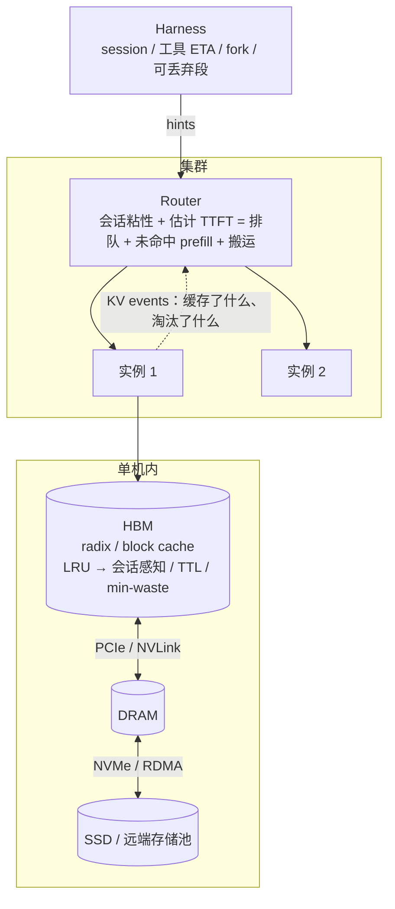

**中文** · [English](README.en.md)

# 模块 05：Cache × Prefill 协同设计

> 🕐 建议时长：2.5 小时 ｜ 🎯 学完你能：说清 LRU 在 agent 负载下真正缺的信号（「结束」还是「暂停」、每次工具调用的 ETA），并判断在什么工具耗时分布下 LRU 与最优淘汰同向或反向；用 InferCept / Continuum 的账决定 KV 是留、丢还是搬；把 cache-aware 路由的收益拆成「会话粘性」和「跨会话共享前缀」两部分，并推导「估计 TTFT」这个统一路由代价；用一个不等式判断某层存储上的 KV 该加载还是重算；给出一份以现有工业接口为基线的 harness → 引擎「协同设计接口」提案，并说清 hint 错了或被滥用时怎么降级 ｜ 🧪 实验：[`lab.py`](lab.py) ｜ 📖 必读一手资料：[Mooncake（arXiv:2407.00079）](https://arxiv.org/abs/2407.00079)、[Continuum（arXiv:2511.02230）](https://arxiv.org/abs/2511.02230)

## 0. 一句话

**Agent 负载下，推理系统的核心矛盾是：KV cache 想「粘」，负载均衡想「散」。粘，指同一会话的请求回到同一台机器（最简单的办法就是按 session id 做粘性路由），同一项目的新会话最好也落到已有项目前缀的机器上，而且 KV 在工具空窗里别被过早淘汰。解法分三层：**

1. **单机**：分清「已结束」和「暂停中」的会话，按工具耗时分布决定保留多久（TTL、min-waste），而不是只看最近访问时间。
2. **集群**：先用会话粘性拿到大部分收益，再把亲和与负载写进同一个代价，**估计 TTFT = 排队 + 未命中部分的 prefill + 搬运**，处理跨会话共享、迁移和热点。
3. **存储**：按「加载 vs 重算」的不等式，决定 KV 放在 HBM、DRAM 还是 SSD。

**三层都需要只有 harness 才知道的信息：会话边界、预计工具耗时、fork 结构、哪些段可以丢。其中一部分已经有工业接口，剩下的就是协同设计（co-design）要补的。**



前置：[模块 04](../04_harness_workloads/README.md)（负载长什么样）。KV 大小与 prefill 的算力模型见[模块 01](../01_inference_basics/README.md)，MLA 与 DP attention 见[模块 03](../03_deepseek_stack/README.md)。

## 1. 大厂为什么在意

**场景一：DeepSeek 的硬盘 KV 缓存到底省了多少机器？** DeepSeek 公开过一份 24 小时的线上统计（[推理系统概览](https://github.com/deepseek-ai/open-infra-index/blob/main/202502OpenSourceWeek/day_6_one_more_thing_deepseekV3R1_inference_system_overview.md)，UTC+8 2025-02-27 12:00 到次日 12:00）：

- 输入 608B token，其中 342B（**56.3%**）命中了硬盘 KV 缓存；输出 168B token；
- 每个 H800 节点 prefill 约 **73.7k token/s**（含缓存命中），decode 约 **14.8k token/s**；
- 平均占用 **226.75** 个节点。

用这几个数心算一下（假设：节点数与计算量成正比）：

```
输入速率   608B / 86,400 s ≈ 7.04M token/s   → 7.04M / 73.7k ≈  96 个 prefill 节点
输出速率   168B / 86,400 s ≈ 1.94M token/s   → 1.94M / 14.8k ≈ 131 个 decode 节点
合计 ≈ 227，与公布的 226.75 自洽。但这是由定义保证的（每节点吞吐本来就是用总 token 除以节点·时间算的），不是独立验证。

每个 prefill 节点真正计算的 token：(608B − 342B)/86,400 / 96 ≈ 32k token/s
如果没有硬盘缓存：7.04M / 32k ≈ 218 个 prefill 节点 → 多约 123 个节点，总数 ≈ 350（+54%）
```

**结论：在这份公开负载上，硬盘 KV 缓存最多省下约三分之一的机器。「最多」是因为这个一阶估计有两个高估来源：** 第一，有缓存时真正计算的 token 排在长前缀后面，每个 token 要做的注意力比无缓存时的平均 token 更多，所以 32k token/s 低估了无缓存时的单 token 吞吐；第二，命中的 token 也不是零成本（从 SSD 加载、MLA 的上投影，见 4.2 节），这部分工作也算进了那 96 个节点。

按平均值看，存储带宽不是主瓶颈：如果 KV 按 BF16 的 MLA 格式存储（每 token 70,272 字节，推导见 4.2 节），342B 命中 token 每天约读 24 PB，平均约 278 GB/s，只是 3FS 公布的集群读吞吐（约 6.6 TiB/s，[3FS README](https://github.com/deepseek-ai/3FS)）的 4% 左右。3FS README 里还有一张 KVCache 客户端读吞吐图：每个客户端峰值约 40 GiB/s，平均只有约 2–3 GiB/s（我们读图所得）。如果把客户端数近似为上面约 96 个 prefill 节点，平均值乘起来约 200–300 GB/s，与 278 GB/s 同一量级。两份数据的时间段不同，只能算量级上的自洽。**平均值不能证明尾部没有瓶颈**：峰值已接近单卡 400 Gbps 网卡的线速，热点前缀、prefill 风暴、后台训练流量都会在尾部挤带宽。

**场景二：Kimi 的 Mooncake。** Mooncake 论文（[arXiv:2407.00079](https://arxiv.org/abs/2407.00079)，FAST'25 Best Paper）在真实 trace 上做了缓存策略分析：

- LRU 缓存容量从 1,000 个 block 加到 50,000 个，命中率从 30% 升到 50%；容量无穷大时也只有 51%。**这个 51% 是这份 trace 本身的复用上限**：首次出现的 block 必然 miss（compulsory miss），加容量、换策略都越不过去。论文特意提醒，这不说明大缓存没用，因为样本 trace 只是真实负载的一个子集，实际容量需求要按规模放大。
- 在这份 trace 上 LRU 比 LFU 和论文的 LengthAwareCache 都好，论文认为原因是请求使用在时间上相邻。
- 超过 50% 的 block 从未被再用，同时某些 block 被访问了上万次。论文说复制这些热点 block 是为了**避免传输拥塞**，这是一个带宽和排队问题，不是命中率问题。

**多项目 agent 的痛点。** 用一组整数心算（假设）：20 个项目，每个项目有 2 万 token 的共享前缀（仓库上下文 + 工具 + system）；200 个活跃会话，各自有 4 万 token 的私有历史。工作集约为 20 × 20k + 200 × 40k ≈ **840 万 token**。一台 8×H100（80 GB）跑 Qwen3-32B，BF16 权重约 66 GB。假设剩余显存的 80% 给 KV，按每 token 256 KiB 算，只装得下约 **175 万 token**，大约是工作集的 21%。所以淘汰不可避免，问题只在于**淘汰谁**。

## 2. 单机：多项目 / 多租户下 KV cache 的争用与淘汰

### 2.1 数据结构回顾

两种主流组织方式，淘汰语义不一样：

- **SGLang 的 RadixAttention**（[arXiv:2312.07104](https://arxiv.org/abs/2312.07104)，NeurIPS'24）：显式的 radix tree（压缩前缀树）。**只能淘汰没有被正在运行的请求锁住的叶子**；内部节点是别人的前缀，删掉它，子孙节点全部失效。淘汰顺序由 `--radix-eviction-policy` 决定，默认 `lru`，另有 `lfu`、`slru`、`priority`、`tlru`（[文档](https://docs.sglang.io/docs/advanced_features/radix_eviction_policy)）。
- **vLLM 的 automatic prefix caching**：没有显式的树，而是「链式 block hash → block」的哈希表，加上每个 block 的引用计数（[设计文档](https://docs.vllm.ai/en/stable/design/prefix_caching/)）。引用计数降到 0 的 block 进入空闲队列，但内容和 hash 仍然保留，可以被命中；需要新 block 时从队头弹出最久没用的那个（LRU）。一个请求释放 block 时按**逆序**放进队尾，因为「请求最后一个 block 包含的 token 最多，最不可能被复用」，所以先被淘汰。链式 hash 保证了只要前面的 block 不在，后面的 block 也命中不了，效果上接近「从尾部开始淘汰」，但没有「只能淘汰叶子」这条硬约束。

### 2.2 LRU 在 agent 负载下缺的是什么

Continuum 的摘要指出：现有引擎在有新请求等待时，会淘汰**已完成**请求的 KV；agent 在 LLM 调用之间穿插工具调用，这个策略就会让 KV 无法跨轮复用（[arXiv:2511.02230](https://arxiv.org/abs/2511.02230)）。InferCept（[arXiv:2402.01869](https://arxiv.org/abs/2402.01869)，ICML'24）量化过浪费：在当时的推理系统上，每次外部交互都被当作生成结束，交互完成后再作为新请求提交，由此产生的重复计算占模型前向总时间的 **37–40%**。

但问题**不是**「LRU 的信号是反的」。在暂停中的会话之间，LRU 先淘汰等得最久的那个。这对不对，取决于工具耗时的分布：

- 看**平均剩余等待时间** MRL(t) = E[T − t | T > t]，即「已经等了 t 秒，还要等多久」。
- **重尾分布**（Pareto 这类危险率递减的分布；lognormal 的危险率先升后降，在尾部递减）：在危险率递减的区间里，等得越久，预期还要等得越久。本库的工具耗时是中位 2 s、σ = 1 的 lognormal（截断到 [0.05, 120] s），我们用 200 万个样本数值计算：MRL(1 s) ≈ 3.2 s，MRL(4 s) ≈ 4.4 s，MRL(16 s) ≈ 8.5 s，MRL(32 s) ≈ 12.8 s。在这些等待时长上，等得最久的会话恰好是预计最晚回来的，**LRU 与 Belady（淘汰下次使用最晚者，离线最优）同向**。这不是所有「重尾」工具的通用结论：lognormal 在很短的等待上危险率还在上升，截断上限（这里是 120 s，现实里是超时）附近 MRL 会降到 0，所以要看每个工具的经验分布在实际等待区间上的 MRL(t)，而不是只看「重尾」这个标签。
- InferCept 也用了同一个直觉：没有离线画像时用 T̂_INT = t_now − t_call 估计工具时长，即「被打断得越久，估计时长越长」，论文报告这样做达到了用精确时长 oracle 时 93% 的性能。Mooncake 发现 LRU 在其 trace 上最好；SGLang 文档对 `lru` 的描述是「与前缀复用随时间衰减的规律一致」。
- **LRU 与 Belady 反向的情形**：危险率递增的分布，即有确定上限、接近定长的工具（固定时长的编译、带超时的测试）。例如工具耗时在 [0, 10] s 上均匀分布：MRL(0) = 5 s、MRL(4 s) = 3 s、MRL(8 s) = 1 s。等得最久的会话恰好马上要回来，LRU 会淘汰错的那个。
- **不同工具混在一起时**：刚开始跑 60 s 测试的会话，和等了 1 s `read_file` 的会话，按空闲时长比较没有意义。需要的是按工具类型区分的分布。

**LRU 真正缺的是三样信号：**

1. **「已结束」还是「暂停中」**：会话结束后，它的私有尾巴就是死重（共享前缀仍有用）；暂停中的会话则一定会回来。引擎只看到请求结束，分不清这两种情况。
2. **每次工具调用的 ETA 或耗时分布**：决定该保留多久。
3. **目标**：LRU 优化的是命中率，而 agent 关心的是 TTFT 和任务完成时间（JCT）。SGLang 的 `tlru` 就是为此设计的（见 2.5 节）。

### 2.3 三种处理和它们的账

工具调用期间，一个请求的 KV 有三种处理方式：

| 动作 | 做法 | 代价 | 什么时候划算 |
|---|---|---|---|
| **preserve**（留在 HBM） | 什么都不做，占着显存 | 工具耗时 × 上下文大小的显存占用 | 工具很快（亚秒到几秒） |
| **swap**（换到 DRAM） | 经 PCIe 拷出去，回来再拷回 | 拷贝期间拖慢 batch | 工具较慢，且 PCIe 带宽充足 |
| **discard**（丢掉，回来重算） | 释放显存 | 重算 prefill 的时间，重算期间还拖住其他请求 | 上下文短、工具很慢 |

InferCept 把三者统一成「显存浪费 = 占着显存却没干活的 token × 秒」（论文里每一项再乘每 token 的 KV 字节数 M，比较大小时可以约掉），对每次工具调用选浪费最小的动作（min-waste）：

```
t_fwd    = C / prefill 速率                                    # C：该请求的上下文 token 数
discard  = t_fwd · C + t_fwd · C_other                         # C_other：其他正在跑的请求的上下文
preserve = T_INT · C                                           # T_INT：工具调用时长
swap     = 2 · T_swap(C) · C_batch                             # 换出 + 换入，都拖住当前 batch
```

**这个模型的适用边界。** 它假设 swap 是同步的、两次拷贝都完整地拖住整个 batch、只有一条共享的 PCIe 通道。真实系统里，换入换出可以异步 DMA、逐层加载、与计算重叠，这时 swap 被高估；也可能因为多个 worker 抢 PCIe、pinned memory 不够而被低估。更一般的写法是只计「没被计算掩盖掉的那部分拷贝时间」：swap ≈ 暴露的换出时间 × 受影响 token + 暴露的换入时间 × 受影响 token。**练习 (a)** 实现论文口径的版本。

**Continuum 的 TTL。** 对产生工具调用的请求，Continuum 把 KV **pin 在 GPU 上一段 TTL**，到期自动淘汰。论文 §4 把成本和收益都折算成对全体任务完成时间的影响（时间单位）：

```
Cost(τ, r)     = MemUsage(r) / M̄ × τ                  # pin 住 r，相当于挡住 MemUsage/M̄ 个平均请求 τ 秒
Benefit(r)     = CacheMissCost(r) + OutofOrderCost(r)  # 省下的重载/重算，以及被淘汰后重新排队的延迟
τ*             = argmax_τ  P(τ, f) · (T̄ · η + PrefillReload(r)) − τ     # 约掉 MemUsage/M̄ 之后的形式
```

- P(τ, f)：工具 f 在 τ 秒内返回的概率，用该工具历史耗时的经验 CDF 估计；记录不足 100 条时退回全体工具的记录，再不足就用固定的默认 TTL。
- T̄：被淘汰请求的平均排队延迟（滑动平均）；η = −Corr(k, N − k) 衡量「已做的轮数能不能预示剩余轮数」（每个程序轮数固定时 η = 1，几何分布时 η = 0）。
- τ* 在所有历史耗时（含 0）里枚举。**由公式可以直接看出**：P(τ, f) 随 τ 增长很慢的长尾工具，τ* 会很短，甚至是 0（不 pin）；这和「pin 到预计返回时刻」完全不同。

Continuum 同时配合 program 级 FCFS 调度。在 SWE-Bench、BFCL、OpenHands 等真实 agent 负载上，用 Llama-3.1 8B/70B、Gemma-3 12B、GLM-4.5 355B 评测，平均任务完成时间改善超过 **8 倍**（摘要）。

**同一方向的其他工作：**

- **KVFlow**（[arXiv:2507.07400](https://arxiv.org/abs/2507.07400)，NeurIPS'25）：用 Agent Step Graph 给每个 agent 算「距离下次执行还有几步」，按它淘汰，并把 CPU→GPU 预取与计算完全重叠。相对「带分层 radix cache 的 SGLang」，单个工作流最高提速 1.83×，多个并发工作流最高 2.19×。
- **TokenCake**（[arXiv:2510.18586](https://arxiv.org/abs/2510.18586)，arXiv 注明已被 EuroSys'27 接收）：在 function call 期间主动 offload 闲置的 KV，并预测性地提前传回；同时给关键路径上的 agent 预留显存。
- 更多「让工具在运行中上报进度」之类的新工作，见[模块 09](../09_frontier/README.md)里「harness 感知的推理引擎」一节。

### 2.4 多租户：共享还是隔离

**共享前缀的收益**：同一家公司的所有会话共享工具定义和 system prompt。这部分命中率最高、每字节最值钱，应该最后淘汰。

**隔离的理由一：timing 侧信道。攻击面、粒度与防御代价：**

- **实证**：ICML'25 的一篇审计工作（[arXiv:2502.07776](https://arxiv.org/abs/2502.07776)）在包括 OpenAI 在内的 7 家 API 提供商那里检测到跨用户的全局缓存共享，指出这会泄漏用户 prompt 的信息。发表在 IEEE TIFS 的另一篇工作（[arXiv:2409.20002](https://arxiv.org/abs/2409.20002)）利用共享缓存和 GPU 显存分配带来的时序差异，用逐 token 搜索恢复共享的前缀，演示了窃取 system prompt 和其他用户 prompt 的可行性。
- **泄漏粒度**由缓存单位决定：vLLM 默认 16-token block，攻击者可以逐块猜；DeepSeek 2024 年的说明是 64 token 存储单位；Anthropic 按断点，OpenAI 按缓存查找边界。
- **路由本身也会泄漏**：请求被送到哪台机器、排队多久，都与别的租户的缓存状态相关。
- **防御**：vLLM 的 `cache_salt` 把 salt 注入第一个 block 的 hash，只有 salt 相同的请求才能互相复用；Anthropic 按组织（Claude API 上还按 workspace）隔离缓存；OpenAI 文档建议用不同的 `prompt_cache_key` 分开计费，并防止跨用户的命中探测。**代价**：公共的 system prompt 在每个租户下各存一份。折中的做法是**选择性共享**：公开的前缀（例如公开的工具定义）跨租户共享，从第一个私有段开始按租户加 salt。在 vLLM 里，salt 只能加在第一个 block 上，要做选择性共享，需要把「从某个 block 开始加盐」作为引擎扩展。

**隔离的理由二：公平性。**

- **淘汰层**：一个流量大的租户能用 LRU 把别人的前缀全部冲掉。
- **队列层**：cache-aware 的队列调度会让命中多的请求一直排在前面。SGLang 的 `CacheAwarePolicy` 有 `lpm`（最长前缀匹配优先）和 `dfs-weight`，`CacheAgnosticPolicy` 有 `fcfs`、`lof`、`random`（[schedule_policy.py](https://github.com/sgl-project/sglang/blob/main/python/sglang/srt/managers/schedule_policy.py)）。按 `lpm` 排序时，前缀冷的租户可能长期排在后面。[Locality-aware Fair Scheduling（arXiv:2501.14312）](https://arxiv.org/abs/2501.14312)针对的就是这个矛盾：已有的公平调度（如 VTC）忽略前缀局部性，局部性感知的调度又不保证公平。它提出 DLPM（Deficit Longest Prefix Match），在单机上保持局部性并保证公平；分布式版本 D²LPM 同时兼顾负载均衡。摘要报告吞吐最高为 VTC 的 2.87×，每客户端延迟最多比现有分布式系统低 7.18×。

**几种做法的取舍：**

| 做法 | 全局命中率 | 小租户保障 | 代价 |
|---|---|---|---|
| 全共享 + LRU | 最高 | 无：大租户冲掉小租户 | 侧信道；公平性差 |
| 硬分区（按租户切缓存） | 下降：空着的配额别人用不上 | 最强 | 碎片化；分区大小要按工作集调 |
| 软配额（保底 + 共享剩余） | 接近全共享 | 保底部分有保障 | 实现复杂；保底要按租户工作集设 |
| 按租户加权淘汰 | 中 | 按权重 | 权重怎么定是业务问题 |
| 按租户加 salt | 公共前缀要复制多份 | 与隔离同时获得 | 显存冗余，命中率下降 |

### 2.5 工业实现：会话感知与 SLO 感知的淘汰

上面几种思路已经有现成实现，是第 7 节接口提案的基线：

- **SGLang session radix cache**（`--enable-session-radix-cache`，[文档](https://docs.sglang.io/docs/advanced_features/session_radix_cache)）：请求里带 `session_id`，引擎给被活跃会话引用的 KV 做「软保护」，先淘汰没有会话引用的 KV；必要时被引用的 KV 仍可回收。应用调用 `/close_session` 结束会话，去掉引用，KV 回到普通淘汰。对滑动窗口注意力（SWA）层，它只保护「覆盖滑动窗口的可复用尾部，再加页对齐余量」。这正好解决 2.2 节的第 1 个缺口：分清结束和暂停。
- **SGLang `tlru`**（[文档](https://docs.sglang.io/docs/advanced_features/radix_eviction_policy)）：先淘汰「超出下一次 prefill 在 TTFT 预算内所需部分」的会话尾部，再按 LRU。配置参数是阈值 ξ（token 数，文档建议用 TTFT 目标除以实测的每个未缓存 token 的毫秒数换算）和 `next_prompt_estimate`（下一轮新增 token 的估计）。文档说它适合「尾部 TTFT 比原始命中率更重要」的 agent / 多轮负载。这对应 2.2 节的第 3 个缺口：它优化的是 TTFT，不是命中率。
- **SGLang `priority`**：先淘汰最低优先级请求的前缀，同优先级退回 LRU。NVIDIA Dynamo 的文档说明，它会把 `nvext.agent_hints.priority` 转发给 SGLang 后端，配合 `--radix-eviction-policy priority` 使用（[Dynamo：SGLang for Agentic Workloads](https://github.com/ai-dynamo/dynamo/blob/main/docs/fern/pages/developer-guide/knowledge-base/modular-components/backends/sglang/agents-on-sglang.md)）。
- **Dynamo session control**（实验性，同一文档）：对子 agent 做 open / close，SGLang 后端把子 agent 的 KV 放进 radix tree 之外的会话槽，不参与淘汰，close 或超时即释放，避免短命的子 agent 污染主 agent 的前缀缓存。

**几种策略对比：**

| 策略 | 用什么信号 | 信号从哪来 | 失效模式 | 现成实现 |
|---|---|---|---|---|
| LRU | 最近访问时间 | 引擎自己 | 分不清结束与暂停；工具耗时近似定长时与最优反向 | vLLM、SGLang 默认 |
| 会话软保护 | 会话是否还活着 | harness 的 session_id 与 close | 会话泄漏（忘了 close）时退化 | SGLang session radix cache |
| 点估计 pin（pin 到预计返回时刻） | 单次工具耗时估计 | harness | 估计有噪声时白占显存（见实验 B） | 本模块 lab 的简化版 |
| Continuum TTL | 工具耗时分布 + 重算/排队代价 | 按工具的历史统计 | 冷启动；分布漂移 | Continuum |
| min-waste | 工具时长、上下文、batch 状态 | 引擎 + 工具画像 | 需要准确的 T_INT 与代价模型 | InferCept |
| TTFT 预算淘汰 | 下一轮 prefill 预算 | 运维配置 + 下一轮长度估计 | 估计不准时保护过多或过少 | SGLang `tlru` |
| 工作流感知 | 距离下次执行的步数 | 编排器的 DAG | 只适用于结构已知的工作流 | KVFlow |
| 优先级淘汰 | 请求优先级 | harness / 产品层 | 低优先级租户饥饿 | SGLang `priority` |

## 3. 集群：cache-aware 路由 vs 负载均衡

### 3.1 矛盾在哪

- **纯亲和**（前缀命中最长就去哪）：热门项目或超长会话粘在少数机器上，排队变长，p99 TTFT 变差。
- **纯均衡**（按请求轮询 / 最少负载）：同一会话的相邻轮次被打散到不同机器，每台机器都要缓存所有项目的前缀，相当于把缓存容量除以实例数。注意：「按请求轮询」是一个很弱的基线，生产上几乎没人这样做 agent 流量，下面会看到真正的对手是会话粘性。
- OpenAI 文档在 API 层描述了这种张力：缓存存在单台机器上，请求只有被路由到持有匹配条目的机器才能命中；同一前缀 / `prompt_cache_key` 的流量超过约 **15 次/分钟**可能溢出到别的机器（[文档](https://developers.openai.com/api/docs/guides/prompt-caching)，查询于 2026-09-28）。

### 3.2 统一代价：估计 TTFT

把两个目标写进同一个量：

```
TTFT_i ≈ queue_i + (L − hit_i) / prefill_rate_i + transfer_i + decode 干扰_i
          排队          未命中部分的 prefill           把缓存从下层存储/别处搬过来   同机 decode 抢算力
```

其中 `transfer_i` 按命中所在的层计：HBM 命中不用搬，DRAM、SSD 命中要按各自的带宽加载。对新请求选 argmin_i TTFT_i。**练习 (b)** 实现这个带分层搬运和 decode 干扰的版本，**练习 (c)** 实现更简单的「带负载上限的亲和」。各家的实际做法：

| 系统 | 选实例的规则 | 缓存视图 | 出处 |
|---|---|---|---|
| **Mooncake Conductor** | 对每个 prefill 实例算「排队时间 + prefill 时间（按命中长度，用离线拟合的模型预测）+ KVCache 传输时间」，取 TTFT 最小的；热点 block 主动复制，冷块换出 | 按 block hash 查每个实例的缓存 | [arXiv:2407.00079](https://arxiv.org/abs/2407.00079) |
| **NVIDIA Dynamo KV router** | v1.0.0：`cost = overlap_score_weight × prefill_blocks + decode_blocks`，取最小，可用 temperature 做 softmax 采样。当前版本从 prefill 负载中减去「重叠抵扣」：设备命中抵扣权重默认 1.0，host（CPU）命中 0.75，disk 命中 0.25。队列可选 `fcfs`（优化尾部 TTFT）或 `wspt`：按 `(1 + priority_jump) / max(1, 输入 token − 已缓存 token)` 排序，优化平均 TTFT | 引擎上报 KV events；关掉 events 时按 TTL 预测 | [v1.0.0 Router Guide](https://docs.nvidia.com/dynamo/v1.0.0/components/router/router-guide)、[当前配置文档](https://github.com/ai-dynamo/dynamo/blob/main/docs/fern/pages/developer-guide/knowledge-base/modular-components/router/configuration-and-tuning.md) |
| **SGLang router**（现为 SGLang Model Gateway） | 先判断是否失衡：`max_load − min_load > balance_abs_threshold` 且 `max_load > balance_rel_threshold × min_load`。失衡就走最短队列；否则当前缀匹配率 > `cache_threshold` 时去匹配最长的 worker，不够时去缓存树最小（最空）的 worker | router 侧为每个 worker 维护一棵**近似** radix tree（存原始文本，惰性更新，定期 LRU 清理） | [v0.4 博客](https://lmsys.org/blog/2024-12-04-sglang-v0-4/)、[v0.4.10 router 文档](https://github.com/sgl-project/sglang/blob/v0.4.10/docs/router/router.md)、[当前文档](https://docs.sglang.io/advanced_features/sgl_model_gateway.html) |
| **llm-d** | Filter → Score → Pick。`prefix-cache-affinity-filter` 按概率把候选缩到前缀分数高的「粘性」实例，带一个「TTFT 负载闸门」：粘性实例明显更慢时打破粘性。之后多个 scorer（`prefix-cache-scorer`、`kv-cache-utilization-scorer`、`queue-depth-scorer`、`session-affinity-scorer` 等）各输出 0–1 分，加权求和取最高 | 近似模式，或基于引擎 KV events 的精确模式 | [调度架构文档](https://github.com/llm-d/llm-d/blob/main/docs/architecture/core/router/epp/scheduling.md) |
| **Preble** | E2（Exploitation + Exploration）：命中部分比未命中部分长时，发给前缀最长的 GPU（exploit）；否则按「计算负载 + 淘汰代价 + 新请求代价」选总代价最低的 GPU（explore）；另有分层调度 | 全局前缀树 | [arXiv:2407.00023](https://arxiv.org/abs/2407.00023)（ICLR'25） |
| **Autellix** | 长调用路由到其程序已在的引擎（尊重数据局部性），短调用做负载均衡，因为短调用的输入大部分是 system prompt | 程序级进程表 | [arXiv:2502.13965](https://arxiv.org/abs/2502.13965) |

Dynamo 的「host 命中只抵扣 0.75、disk 只抵扣 0.25」这个设计值得注意：它把第 4 节「加载比重算便宜，但不是免费」的结论直接写进了路由代价。llm-d 的 TTFT 负载闸门和 SGLang 的失衡阈值，则是「亲和要配溢出上限」的两种写法，和有界负载一致性哈希（[Consistent Hashing with Bounded Loads，arXiv:1608.01350](https://arxiv.org/abs/1608.01350)：任何 bin 的负载不超过 ⌈c·m/n⌉，c = 1 + ε）是同一个思路。

### 3.3 最强的简单基线：会话粘性

在讨论前缀感知路由之前，先要打败一个几乎零成本的基线：**按 session id 做粘性路由**（一致性哈希，或首次分配后记住绑定）。

- Manus 的建议就是用 session ID 把请求一致地路由到同一个 worker（[Manus 博客](https://manus.im/blog/Context-Engineering-for-AI-Agents-Lessons-from-Building-Manus)）。
- Dynamo 的 session affinity：`--router-session-affinity-ttl-secs` 开启后，会话的第一个成功请求把 session id 绑定到选中的 worker（有 DP 时还绑定 DP rank），后续请求按 `hard`（精确派发）或 `soft`（作为建议目标）使用这个绑定。实验性的 parent session 分组让同一个父会话的子 agent 共享一个绑定（[配置文档](https://github.com/ai-dynamo/dynamo/blob/main/docs/fern/pages/developer-guide/knowledge-base/modular-components/router/configuration-and-tuning.md)）。
- llm-d 的 `session-affinity-scorer` 给处理过该会话的实例打最高分。

agent 的 prompt 大头是**本会话的私有历史**（模块 04 的负载里，会话历史通常比共享前缀长得多），所以只要同一会话回到同一台机器，大部分复用就拿到了。**前缀感知路由比会话粘性多出来的收益来自四种情形：**

1. **跨会话共享的项目前缀**：同一项目的新会话，第一轮就能落到已有该项目前缀的机器上。共享前缀越长、会话越短，这部分越重要。
2. **会话迁移**：粘性因负载上限或故障被打破时，前缀感知路由能找到「次好」的机器，而不是随机一台。
3. **热点**：粘性哈希不会主动再平衡，一个超长会话或热门项目会把一台机器压满；带负载项的代价函数可以把新会话引走。
4. **fork / 子 agent**：子 agent 共享父前缀，应该落到父会话所在的机器，或者由路由器决定复制父前缀（Dynamo 的 parent session 分组就是为此设计）。

实验 A 把会话粘性和前缀感知路由并列比较，看收益到底从哪来。

### 3.4 缓存视图：近似还是精确

路由器必须知道每台机器缓存了什么，但缓存状态在引擎里，而且随时在淘汰。有两种做法：

- **近似**：路由器按自己发出去的请求推测缓存内容（SGLang router 的近似 radix tree）。实现便宜，但引擎一淘汰，推测就错了。
- **精确**：引擎把「缓存了哪些块、淘汰了哪些块」作为事件（KV events）上报。

llm-d 的博客给了一组对比（[KV-Cache Wins You Can See](https://llm-d.ai/blog/kvcache-wins-you-can-see)，2025-09-24）。实验配置：Qwen 32B 模型，8 个 vLLM pod，共 16 张 H100；模拟 150 个企业客户，每个客户有 6,000 token 的上下文。**关键前提**：这个负载产生的 KV 需求约占集群总 KV 容量的 73%，约为任何单个 pod 容量的 6 倍。

| 调度方式 | 输出 token/s | TTFT p90 | TTFT 均值 |
|---|---:|---:|---:|
| 精确前缀感知 | 8,730 | 0.542 s | 0.298 s |
| 近似前缀感知 | 6,944 | 31.1 s | 13.3 s |
| 只看负载 | 4,429 | 94.9 s | 47.0 s |
| 随机 | 4,429 | 92.6 s | 45.3 s |

这组数说明两件事，但都要带上前提读。第一，**当工作集远大于单实例容量时**，不看缓存的调度在 TTFT 上会差一到两个数量级，吞吐上约差 2 倍（精确比近似高约 25%）。第二，「引擎 → 路由器」的 KV 事件流也是 co-design 接口的一部分，而且是反方向的。

### 3.5 热点：复制还是排队

Mooncake 观察到 block 热度极度倾斜，论文说复制热点 block 是为了**避免传输拥塞**：同一个热点 block 被很多 prefill 实例同时拉取时，单个存放点的带宽会成为瓶颈，所以要把热点复制到多个节点，同时换出最冷的块。在 3.2 节的公式里，这相当于降低热点前缀的 `transfer_i` 和排队项，代价是存储冗余。

OpenAI 的「约 15 RPM」不应该被理解成单实例 prefill 能力的阈值。按本课程的算力模型心算：8×H100 跑 Qwen3-32B，一个 30k token、命中 90% 的请求，prefill 约需 3.7e14 FLOPs，约 0.08 s（MFU 0.6），单机光是 prefill 每分钟就能处理数百个这样的请求，比 15 RPM 高一到两个数量级。OpenAI 文档没有解释这个数是怎么来的；更可能的解释是多租户共享机器时，按 key 做粗粒度的负载分摊，和有界负载一致性哈希是同一类策略（这是推测）。另外，从 GPT-5.6 起，文档写明路由由 OpenAI 自动处理，`prompt_cache_key` 不再需要用来优化缓存，只用来分开计费，以及防止跨用户的命中探测。

### 3.6 DP attention 下的路由粒度

MLA 的 latent 是所有头共享的，没法按头做张量并行切分，大规模部署常用 DP attention（见[模块 03](../03_deepseek_stack/README.md)）：每个 DP rank 维护自己那部分请求的 KV。于是前缀缓存属于某一个 DP rank，**cache-aware 路由的粒度是（节点，DP rank），而不是实例**。亲和与均衡的矛盾在一台机器内部同样存在。

- DeepSeek 的推理系统概览把「各 DP 实例的请求数和序列长度不均」列为负载均衡的关键问题：prefill 侧要平衡核心注意力计算和每 GPU 的输入 token 数；decode 侧要「平衡各 GPU 的 KVCache 使用量」（即核心注意力计算负载）和请求数。
- Dynamo 的会话绑定在有 DP 时绑定的是（worker，DP rank）；文档还提到，如果后端内部会再次路由（例如 TensorRT-LLM 的 attention DP 会话亲和），要让引擎记录 Dynamo 选定的 DP rank，否则同一组会话仍可能被拆到不同 rank。

## 4. KV 分层存储：HBM / DRAM / SSD / 远端

### 4.1 层级、带宽与系统

| 层 | 例子与带宽 | 出处 |
|---|---|---|
| HBM | H100 SXM：80 GB，3.35 TB/s | [NVIDIA H100](https://www.nvidia.com/en-us/data-center/h100/) |
| GPU ↔ 主机 DRAM | H100 SXM 标称 PCIe Gen5 128 GB/s（双向合计，单向约 64 GB/s） | 同上 |
| 跨机 RDMA | Mooncake Transfer Engine 实测：4×200 Gbps RoCE 约 87 GB/s，8×400 Gbps 约 190 GB/s | [Mooncake README](https://github.com/kvcache-ai/Mooncake) |
| 分布式 SSD | 3FS 的 KVCache 读：README 图中**单个客户端**（每节点 1×400 Gbps 网卡）的峰值约 40 GiB/s（各客户端峰值里的最高者），接近网卡线速（400 Gbps ≈ 46.6 GiB/s）；图中每客户端平均约 2–3 GiB/s（读图所得）。整个集群读吞吐约 6.6 TiB/s（180 个存储节点，有训练任务的背景流量） | [3FS README](https://github.com/deepseek-ai/3FS) |

各系统怎么做分层：

- **LMCache**：面向 vLLM / SGLang 的 KV 层，后端可以是 CPU 内存、本地 SSD、Redis/Valkey、Mooncake、InfiniStore、S3 兼容对象存储等（[GitHub](https://github.com/LMCache/LMCache)）。论文报告吞吐最高提升 15×（[arXiv:2510.09665](https://arxiv.org/abs/2510.09665)）。
- **Mooncake Store**：建在 Transfer Engine 之上的分布式 KV 存储，横跨 DRAM 和 SSD；已接入 vLLM、SGLang（HiCache）和 LMCache。
- **Dynamo KVBM**：分四层，G1 GPU HBM → G2 pinned DRAM → G3 本地 / 池化 SSD → G4 远端存储（[设计文档](https://docs.nvidia.com/dynamo/v-0-8-1/components/kvbm/design-deep-dive)）。
- **CachedAttention**（[arXiv:2403.19708](https://arxiv.org/abs/2403.19708)，ATC'24）：专为多轮对话做的分层 KV。逐层预加载、异步保存，把搬运藏在计算后面。报告 TTFT 最多降低 87%，prefill 吞吐最高 7.8×，端到端成本最多降低 70%。
- **DeepSeek 硬盘缓存**：DeepSeek 2024-08-02 的公告写明，硬盘缓存之所以可行，是因为 DeepSeek V2 的 MLA 架构在提升性能的同时大幅减小了 KV cache，使其可以高效存放在低成本硬盘上（[公告](https://api-docs.deepseek.com/news/news0802)）。DeepSeek-V4 技术报告（[arXiv:2606.19348](https://arxiv.org/abs/2606.19348) §3.5）写了混合注意力下的硬盘缓存怎么做。CSA / HCA 的压缩 KV 全部存盘，命中时读到最后一个完整压缩块为止，尾部不完整块里的 token 要重算。SWA 的 KV 没有压缩、每层都有，体积约为压缩 KV 的 8 倍，所以给了三种策略：
  - 全存：零重算，但只有很小一部分会被读到，形成写多读少的不均衡访问；
  - 每 p 个 token 做一次检查点：加载最近的检查点，再重算其余尾部 token，用 p 在存储和计算之间调节；
  - 不存：利用已缓存的压缩 KV，重算最后 n_win·L 个 token（L 为层数），就能恢复最后 n_win 个 SWA 条目。

  这就是**模型结构决定缓存语义**的一手例子，也解释了 DeepSeek API 为什么改用「缓存前缀单元」（见[模块 04](../04_harness_workloads/README.md) 第 4 节）。

### 4.2 重算 vs 加载：盈亏平衡公式

对一段 n 个 token 的前缀：

```
重算：t_recompute(n) ≈ n · 2·N_active / (F · MFU)      （只算线性层；长上下文的注意力项会让重算更贵）
加载：t_load(n)      = t0 + n · b_kv / B               （b_kv：每 token 的 KV 字节数；B：这一层的带宽；t0：固定延迟）

忽略 t0 时，加载更快  ⟺  B > b_kv · F · MFU / (2·N_active)  ≡  B*   （盈亏平衡带宽）
```

B\* 与 n 无关，只取决于「**每字节 KV 值多少 FLOPs**」：ρ = 2·N_active / b_kv。ρ 越大，缓存越值钱，越能忍受慢的存储层。下表按 H100 SXM 的稠密算力（BF16 约 989 TFLOPS、FP8 约 1,979 TFLOPS；NVIDIA 标称值是稀疏值的两倍），MFU = 0.6，按每张 GPU 计算：

| 模型 | N_active | b_kv（BF16） | ρ（FLOPs/字节） | 单卡 prefill（线性项，BF16） | B\*（BF16 GEMM） | B\*（FP8 GEMM） |
|---|---:|---:|---:|---:|---:|---:|
| Qwen3-32B（GQA，64 层 × 8 KV 头 × 128） | 32.8B | 262,144 B | 约 25 万 | 约 9.0k token/s | **约 2.4 GB/s** | 约 4.7 GB/s |
| DeepSeek-V3（MLA，61 层 × (512 + 64)） | 37B | 70,272 B | 约 105 万 | 约 8.0k token/s | **约 0.56 GB/s** | 约 1.1 GB/s |

结构参数来自官方 [Qwen3-32B](https://huggingface.co/Qwen/Qwen3-32B) 与 [DeepSeek-V3 config.json](https://huggingface.co/deepseek-ai/DeepSeek-V3/blob/main/config.json)；DeepSeek-V3 的总参数 671B、激活 37B 来自[技术报告](https://arxiv.org/abs/2412.19437)。DeepSeek 线上推理的矩阵乘法用 FP8（推理系统概览），所以 FP8 那一列更接近它的实际情况。

**用线上数据交叉验证。** 第 1 节反推出每个 prefill 节点真正计算约 32k token/s，即每卡约 4k token/s，对应 B\* ≈ 4,000 × 70,272 B ≈ 0.28 GB/s。它比上表的线性项估计低，因为线上 prefill 还包含注意力、通信和其他开销；和实验 E 含 32k 注意力项的估计（约 0.27 GB/s）几乎一致。

再和各存储层的单卡带宽对比：

- PCIe 单向约 64 GB/s：比 B\* 高约 14 倍（Qwen3-32B，FP8）到 114 倍（DeepSeek-V3，BF16）。**DRAM 层几乎永远值得加载。**
- 3FS 每节点峰值 40 GiB/s，按 8 卡平分约 5.4 GB/s/卡：对 DeepSeek-V3 是 B\* 的约 5–10 倍，余量很足；对 Qwen3-32B 只有约 1.1–2.3 倍，余量很薄。8B 稠密模型（每 token KV 128 KiB）只算线性项时 B\* 约 4.8 GB/s，在 SSD 层基本打平。注意 5.4 GB/s/卡是**峰值**口径，持续可用带宽更低。

DeepSeek 官方已经把硬盘缓存的可行性归功于 MLA 压小了 KV（见 4.1 节）。**我们补充的另一半推导是**：MoE 让 N_active 足够大，两者一起把 ρ 推高到约 10⁶ FLOPs/字节。

**MLA 命中的隐藏成本。** 对 MLA 来说，「命中的 token 几乎不花算力」并不成立：

- vLLM 的 MLA 实现（[mla_attention.py](https://github.com/vllm-project/vllm/blob/main/vllm/model_executor/layers/attention/mla_attention.py) 文档串）在 chunked prefill 时用「compute friendly」的 MHA 路径。每处理一个新 token 块，都要把缓存的 latent 用 W_UK / W_UV 上投影成每头的 K、V（`k_nope = kv_c @ W_UK`）。
- 按 DeepSeek-V3 的结构心算：每个缓存 token 每次上投影约 2 × 512 × (128 × 128 + 128 × 128) × 61 ≈ **2.05 GFLOPs**，而每个新 token 的线性层约 74 GFLOPs。在 50k 缓存上 prefill 1k 新 token，光上投影就约 102 TFLOPs，是线性项（74 TFLOPs）的 1.4 倍。
- 另一条「data-movement friendly」的 MQA 路径不用上投影，但注意力的 QK 维度从 192 变成 576（512 + 64）。vLLM 的注释说，将来在 chunk 很小时可能切到这条路径。
- DeepSeek 内部的 prefill 实现没有公开。

需要打折扣的地方：

1. **固定延迟 t0**：前缀很短时加载不划算，只有超过某个长度才值得 offload（练习 (d) 的测试里有例子）。
2. **带宽是共享的**：多个请求同时加载，还有训练等后台流量抢带宽。3FS 的 6.6 TiB/s 就是在有训练任务背景流量的情况下测的。
3. **流水线**：逐层加载、边加载边算（CachedAttention、LMCache）可以把 t_load 大部分藏起来。
4. **压缩**：CacheGen（[arXiv:2310.07240](https://arxiv.org/abs/2310.07240)，SIGCOMM'24）把 KV 压小 3.5–4.3 倍，等效把 b_kv 除以 4，B\* 同比下降。
5. **B\* 是单个请求的延迟判据，不是集群的吞吐判据**。集群层面要看哪种资源是瓶颈：只要加载能和计算流水线重叠、总带宽够，即使 B < B\*，加载也能提高吞吐，因为 GPU 算力被腾出来做别的请求。第 1 节「278 GB/s 对 6.6 TiB/s」就是吞吐视角。

**练习 (d)** 实现这个判断。lab 第 E 部分用 `codesign_sim` 的硬件和模型参数把这张表扩展到更多模型，并且把重算一段 32k 前缀的**注意力项**也算了进去。注意力让重算更慢，所以 B\* 会更低。上面只算线性项的心算值是 B\* 的保守上界。

## 5. Agent 负载下的 prefill 优化

### 5.1 Chunked prefill：别让一个大 miss 卡住所有人

一个会话压缩上下文之后，或者 KV 被淘汰之后回来，可能带着几万 token 的未命中 prefill。如果一次性做完，这一步会独占 GPU，其他会话的 decode 全部停顿。Sarathi-Serve（[arXiv:2403.02310](https://arxiv.org/abs/2403.02310)，OSDI'24）把 prefill 切成块，和 decode 混在同一个 batch 里（stall-free scheduling）。相对 vLLM，服务容量提升：Mistral-7B 单卡 A100 为 2.6×，Yi-34B 两卡 A100 最高 3.7×。

取舍：块越小，decode 的 TPOT 越平稳，但大请求的 TTFT 越长，每步的固定开销也越多。

### 5.2 PD 分离与配比：命中率决定 prefill 要多少卡

prefill 和 decode 分到不同的 GPU 池上，可以各自按 TTFT、TPOT 调并行策略。代表工作：

- DistServe（[arXiv:2401.09670](https://arxiv.org/abs/2401.09670)，OSDI'24）：在满足延迟约束的前提下，最多能多服务 7.4× 的请求。
- Splitwise（[arXiv:2311.18677](https://arxiv.org/abs/2311.18677)，ISCA'24）。
- Mooncake。

DeepSeek 的部署：prefill 以 4 节点为一个单元（routed expert EP32），decode 以 18 节点为一个单元（EP144）。

**一阶估计**：prefill 池需要的算力 ∝ 输入 token × (1 − 命中率)，decode 池 ∝ 输出 token。用第 1 节的 DeepSeek 数字（命中率 56.3%）推出约 96 个 prefill 节点对 131 个 decode 节点。如果 harness 把命中率做到 90%，prefill 的计算量降到原来的 0.1 / 0.437 ≈ 23%。在线性假设下，prefill 池可以缩到约 22 个节点，**瓶颈就转移到 decode、KV 传输和存储带宽上**。这就是「harness 写得好，推理集群的配比就要改」的具体含义。

### 5.3 PD 分离下，多轮 agent 的 KV 放在哪

PD 分离时，第 t + 1 轮在 **prefill 节点**上做，但第 t 轮 decode 生成的那段 KV 在 **decode 节点**上。一个多轮 agent 要命中「上一轮的输入 + 输出」，有三条路径：

```
第 t 轮:  prefill 节点 ──(新算的增量 KV 写回共享池)──► KV 池（DRAM / SSD）
                │
                └──(按层流式传 KV)──► decode 节点 ── 生成输出 o_t ──(写回？)──► KV 池
第 t+1 轮: prefill 节点 ◄──(读前缀：输入_t + o_t)── KV 池
```

- **输入部分**：Mooncake 的 prefill 节点用前缀缓存完成 prefill，并把**新生成的增量 KVCache 存回 CPU 内存**，随后把 KV 传给 decode 节点（[arXiv:2407.00079](https://arxiv.org/abs/2407.00079) §3）。
- **输出部分**：decode 节点生成的 o_t 的 KV，如果不写回共享池，第 t + 1 轮就只能把 o_t 当作新输入重算。推理模型一轮可能输出几千个 token，这笔重算不小。DeepSeek API 会在「模型输出末尾」建立一个缓存前缀单元（[文档](https://api-docs.deepseek.com/guides/kv_cache)），说明它的服务端让输出侧也可以被命中（具体实现未公开）。
- **harness 的影响**：如果 harness 从历史里删掉上一轮的推理内容，或者改写了上一轮输出，那么「输出末尾」那个单元就不再是新请求的前缀，写回也就白做了。
- **P→D 传输量**：每个请求都要把 prefill 的 KV 传给 decode。32k 上下文、BF16 时，Qwen3-32B 约 262,144 B × 32,768 ≈ **8.6 GB**，DeepSeek-V3 约 70,272 B × 32,768 ≈ **2.3 GB**。按 Mooncake Transfer Engine 在 8×400 Gbps 上实测的约 190 GB/s，分别约 45 ms 和 12 ms。这是 MLA 在 PD 分离下的第二个红利，可以套用 4.2 节的盈亏框架：传输不如重算划算时，就该让 decode 节点自己 prefill。

### 5.4 位置无关缓存：复用「非前缀」的内容

agent 经常在不同会话、不同位置读到同一份文件或同一段工具输出。前缀缓存对此无能为力（见模块 04 第 2.3 节）。两种思路：

- **CacheBlend**（[arXiv:2405.16444](https://arxiv.org/abs/2405.16444)，EuroSys'25）：复用各个 chunk 预先算好的 KV，只挑少量 token 重算，补上 chunk 之间的 cross-attention。相对全量重算，TTFT 降低 2.2–3.3×，吞吐提升 2.8–5×。
- **EPIC**（[arXiv:2410.15332](https://arxiv.org/abs/2410.15332)，ICML'25）：位置无关缓存（Position-Independent Caching），配合 LegoLink 算法缓解每个文档开头的 attention sink 问题。TTFT 最高改善 8×，吞吐最高 7×。

取舍：有质量风险（近似的注意力）、需要引擎支持、需要知道哪些段是可以独立缓存的「文档」。最后一点只有 harness 知道，所以又回到接口问题。

### 5.5 前缀断裂引发的 prefill 风暴

一个大项目的共享前缀一更新（例如仓库上下文换到新 commit），该项目所有会话会在几分钟内同时 miss，形成 prefill 风暴。对策：

- harness 侧：按版本批量更新前缀；更新后先发一个请求预热，再放开其余请求。
- 引擎侧：给这批重算设较低的优先级，并用 chunked prefill 平滑。

Dynamo 提供了一个相关的 hint：`speculative_prefill`。当前轮结束后，它用一个 `max_tokens=1` 的请求预先 prefill「预测的下一轮前缀」，把 KV 暖好。

## 6. Program 级调度

请求级调度（FCFS、SJF）只看单个 LLM 调用。但 agent 是一个**程序**：它的端到端延迟（JCT）等于所有调用的排队时间、执行时间与工具时间之和，下一次调用什么时候来、带着什么前缀，大多是可以预测的。

| 工作 | 关键想法 | 报告的收益 |
|---|---|---|
| **Parrot**（[arXiv:2405.19888](https://arxiv.org/abs/2405.19888)，OSDI'24） | 用 Semantic Variable 把应用层的数据流暴露给服务端，服务端可以做跨请求的分析与优化 | 最高一个数量级 |
| **SGLang**（[arXiv:2312.07104](https://arxiv.org/abs/2312.07104)，NeurIPS'24） | 前端语言显式表达 fork / join 等程序结构，运行时用 RadixAttention 复用 | 吞吐最高 6.4× |
| **Autellix**（[arXiv:2502.13965](https://arxiv.org/abs/2502.13965)；NSDI'26 程序页上的标题为 Agentix） | PLAS：按程序已累计的服务时间（执行时间）排优先级，把「已获服务最少者优先」（LAS）推广到程序级；ATLAS：对多线程的 DAG 程序，按关键路径上的累计服务时间排；用多级队列离散化优先级，并允许抢占 | 同等延迟下程序吞吐提升 4–15× |
| **KVFlow**（[arXiv:2507.07400](https://arxiv.org/abs/2507.07400)） | 工作流图 → 距离下次执行的步数 → 淘汰与预取 | 1.83× / 2.19× |
| **Continuum**（[arXiv:2511.02230](https://arxiv.org/abs/2511.02230)） | TTL pin 加 program 级 FCFS | 平均任务完成时间改善超过 8× |

**一个可操作的模型。** 要把程序级调度讲到面试官追问的深度，需要回答五个问题：

1. **目标**：平均 JCT（程序的完成时间减到达时间），还是尾部 JCT。
2. **「服务量」怎么计**：Autellix 的 PLAS 用程序已累计的模型执行时间（进程表里的 `service`）；也可以按 prefill FLOPs 或 token 数计，口径不同，会偏向不同形状的程序。
3. **关键路径**：DAG 程序里，ATLAS 给新调用的优先级取「父调用优先级 + 父调用执行时间」的最大值，这就是关键路径上的累计服务。
4. **与粘性和缓存的耦合**：LAS 会让「已经跑了很久」的长程序降级，而长程序恰恰持有最多的 KV。降级后它的 KV 可能被淘汰，回来时付重算。Continuum 选择程序级 FCFS 加 TTL，Autellix 选择 LAS 加数据局部性路由，是两种不同的取舍。
5. **抢占粒度**：按 decode 步抢占（细粒度，但被抢占的请求要么占着 KV，要么被换出），还是只在调用边界切换。

**小例子**（假设）：单个引擎，调用不可抢占，每次调用 2 s。t = 0 时有两个调用在排队：程序 A 已经累计执行了 10 s 的第 6 个调用（先到），和新程序 B 的第 1 个调用（B 只有这一个调用）。

- 按请求 FCFS：A [0, 2]，B [2, 4]，B 的 JCT = 4 s。
- 按 PLAS：B 的累计服务是 0，先跑。B [0, 2]，A [2, 4]，B 的 JCT = 2 s；A 的总时长多了 2 s，对一个已经跑了 12 s 以上的程序只是 +17% 左右。
- 平均 JCT 改善，代价是长程序变慢。如果 A 在等待期间 KV 被淘汰，还要再加上重算时间，这正是第 4 点说的耦合。

**队列层的公平**（与 2.4 节呼应）：cache-aware 的队列排序（`lpm`）会饿死前缀冷的租户，DLPM 用 deficit 计数在局部性与公平之间折中；Autellix 的 PLAS 在程序之间做的是另一种公平。

共同点：**调度的单位从「请求」变成「程序 / 会话」**。所需的信息（这是哪个程序、下一步是什么、还剩多少步）全部在 harness 手里。

## 7. 协同设计接口提案：harness 应该告诉引擎什么

### 7.1 已有的工业接口

- **Anthropic**：`cache_control` 断点加 TTL（5 分钟 / 1 小时）。harness 声明「哪段是稳定前缀、愿意为保留付多少钱」。
- **OpenAI**：`prompt_cache_options`（GPT-5.6 起可设显式断点、TTL）；`prompt_cache_retention`（更早的模型）；`prompt_cache_key` 在 GPT-5.6 之前用于路由分组，之后只用于分开计费与防探测（见 3.5 节）。
- **vLLM**：`cache_salt`，隔离域。
- **SGLang**：`session_id` + `--enable-session-radix-cache` + `/close_session`（会话软保护）；`--radix-eviction-policy` 的 `priority` 与 `tlru`（见 2.5 节）。
- **NVIDIA Dynamo**（[Agent Hints](https://github.com/ai-dynamo/dynamo/blob/main/docs/fern/pages/use-cases/agents/agent-hints.md)、[配置文档](https://github.com/ai-dynamo/dynamo/blob/main/docs/fern/pages/developer-guide/knowledge-base/modular-components/router/configuration-and-tuning.md)）：
  - `nvext.agent_hints` 包含 `priority`、`strict_priority`、`osl`（预计输出长度）、`speculative_prefill`（本轮结束后预先 prefill 预测的下一轮前缀）；
  - 请求头 `X-Dynamo-Session-ID` 标识会话；文档强调它只是被动的身份信息，**只有配置了 `--router-session-affinity-ttl-secs` 才开启粘性路由**，可选 `hard` / `soft` 模式；`X-Dynamo-Parent-Session-ID` 等父会话头让子 agent 共享父会话的绑定（实验性）；
  - 实验性的 `nvext.session_control`：对子 agent 做 open / bind / close，SGLang 后端把子 agent 的 KV 放进 radix tree 之外的会话槽；
  - 路由队列可选 `wspt`，用「已缓存 token」修正调度代价。
- **llm-d**：`session-affinity-scorer`、`prefix-cache-affinity-filter`（带 TTFT 负载闸门）。

### 7.2 提案：还缺什么

把上面的接口当作基线，下表把每个 hint 标成「已有」或「缺口」。**真正还缺的是四样：工具耗时分布（而不是单个 ETA）、可丢弃段、带版本和作用域的前缀分段、引擎 → harness 的命中层级回报。** 全部 hint 都是建议性的，引擎可以忽略。

| hint | 含义 | 只有 harness 知道的原因 | 引擎 / 路由怎么用 | 现状 | harness 估错或说谎时 |
|---|---|---|---|---|---|
| `session_id` / `program_id` | 属于哪个会话 / 哪个 agent 程序 | 引擎只看到一串独立请求 | 路由粘性（配负载上限）；会话软保护；program 级调度 | **已有**：SGLang session、Dynamo session affinity、llm-d scorer、OpenAI `prompt_cache_key`（GPT-5.6 前） | 粘性过强造成热点：需要第 3 节的负载上限 |
| 会话结束（close） | 这个会话不会再来了 | 只有 harness 知道任务结束 | 释放会话私有尾巴，保留共享前缀 | **已有**：SGLang `/close_session`、Dynamo session_control | 忘了 close：会话泄漏，靠超时兜底 |
| `prefix_segments` | 共享前缀的 id、版本、token 范围、作用域（全局 / 项目 / 会话） | 只有 harness 知道哪段是「仓库上下文 v17」 | 缓存粒度与保留优先级；版本更新时批量预热；热点复制；选择性跨租户共享 | **部分已有**：Anthropic / OpenAI 的断点只标位置，不标版本和作用域 | 标错会浪费写入。Anthropic 1.25×/2× 的写入价本身就是对乱标的惩罚 |
| `after_call.tool` + 耗时分布 | 这次输出之后调用哪个工具，以及它的耗时分布（p50/p90 或直方图） | harness 知道调用的是 `run_tests` 还是 `read_file` | Continuum 式 τ*、min-waste、会话感知淘汰（第 2 节） | **缺口**：Continuum 在引擎侧按工具自行统计；没有标准接口让 harness 传分布 | 分布漂移：引擎要用自己的历史校正，并设 TTL 上限 |
| `fork` | fan-out 组 id、组大小、共享的父前缀 | 只有编排器知道要开几个子 agent | 父前缀先 prefill 一次再分发；同组路由到同一实例或按负载上限分摊 | **部分已有**：Dynamo parent session、session_control；SGLang fork | 组太大会压垮一个实例：负载上限 |
| `next_steps` | 工作流里下一个要执行的 agent / 步骤 | 编排器的 DAG | KVFlow 式按步数淘汰与预取 | 研究原型：KVFlow、Parrot | 预取了用不上，浪费带宽 |
| `priority` / `deadline_ms` | 交互式还是后台，SLO 是多少 | 产品语义 | 队列顺序、按优先级淘汰、准入控制 | **已有**：Dynamo `priority`、SGLang `priority` 淘汰；Mooncake 早拒绝 | 优先级通胀：需要配额或按优先级计价 |
| `ephemeral_ranges` | 哪些 token 下一轮就会被清掉（大块工具输出、一次性提示） | harness 自己决定下一轮删什么 | 不写入共享缓存或最早淘汰；不复制；不写回 KV 池 | **缺口**（Anthropic 的 tool result clearing 是同一类语义，但在服务端） | 标错会导致下一轮 miss |
| `retention` | 愿意为保留付多少（5m / 1h / 24h） | 业务上的耐心 | 选择存储层级 | **已有**：Anthropic TTL、OpenAI retention | 由定价约束 |
| `osl` | 预计输出长度 | harness 知道这一步是「写代码」还是「选工具」 | SJF、decode 容量预留 | **已有**：Dynamo `osl` | 估错会让调度退化成 FCFS |

一个请求的元数据可以长这样（示意，不是任何现有 API）：

```json
{
  "session_id": "s-7f3a", "program_id": "task-1234",
  "prefix_segments": [
    {"id": "proj-42/tools+system", "version": 17, "tokens": [0, 18432], "scope": "project"}
  ],
  "after_call": {"tool": "run_tests", "tool_eta_s": {"p50": 8, "p90": 45}},
  "fork": {"group": "g-9", "size": 6},
  "priority": "interactive", "deadline_ms": 3000,
  "ephemeral_ranges": [[40960, 45056]],
  "retention": "1h", "osl": 256
}
```

**反方向（引擎 → harness）** 也要有：命中了多少 token、命中在哪一层（HBM / DRAM / SSD）、会话的 KV 是否已被 offload。有了这些，harness 可以做出更好的决定，例如「KV 已经掉到 SSD 上了，这时压缩上下文反而更便宜」。这是目前最明显的缺口。

### 7.3 hint 错了或被滥用时怎么降级

实验 B 会看到：点估计 pin 在 hint 有噪声、缓存又不太紧时比 LRU 还差。所以引擎必须假设 hint 会错，也会被滥用：

1. **有上限**：任何 pin / TTL 都有全局上限；被 pin 的总量有上限（例如不超过缓存的某个比例），超出时退回会话软保护或 LRU。
2. **用引擎自己的统计校正**：按工具、按租户记录「hint 说 X 秒，实际 Y 秒」，误差大的来源自动降权（Continuum 本来就用历史 CDF，而不是信任单次估计）。
3. **软而不硬**：优先用「先淘汰没人引用的」这种软保护，而不是硬 pin；硬 pin 只给有 SLO 且配额内的请求。
4. **配额与计价**：优先级、保留时长这类能换来资源的 hint，按租户设配额或收费。
5. **可观测**：把「因 hint 保留却没被用上的 KV·秒」记成指标，作为调参依据。

### 7.4 设计原则

1. **hint 是建议，不是命令**。引擎在 hint 缺失或错误时要退回 LRU / FCFS 仍然正确，TTL 必须有上限。
2. **激励相容**。能换来资源的 hint（优先级、保留时间）必须有价格或配额，否则每个 harness 都会说自己最重要。Anthropic 对 1 小时 TTL 收 2× 写入价，就是一个现成的例子。
3. **不泄漏**。hint 和缓存命中信息不能跨租户可见（见 2.4 节的侧信道）。
4. **版本化**。接口会演进，要能协商（Dynamo 把 hint 放在 `nvext` 扩展字段里，就是一种做法）。

## 8. 必须会心算的数字

| 量 | 典型值 | 怎么推出来 | 来源 |
|---|---|---|---|
| DeepSeek 硬盘缓存命中率 | 56.3%（按输入 token） | 342B / 608B | DeepSeek 推理系统概览 |
| 硬盘缓存省下的节点 | 一阶上界约 1/3（约 123 / 350） | 第 1 节推导；两个高估来源见正文 | 由公开数据推导 |
| H800 节点 prefill / decode 吞吐 | 约 73.7k / 14.8k token/s | — | DeepSeek 推理系统概览 |
| 工具空窗重算浪费 | 占前向时间 37–40%（当时的系统） | — | InferCept |
| 工具耗时的平均剩余等待 | lognormal（中位 2 s，σ=1）：等 1 s 后还要约 3.2 s，等 16 s 后还要约 8.5 s | MRL(t) = E[T − t \| T > t]，数值计算 | 本模块计算 |
| 盈亏平衡带宽 B\* | Qwen3-32B 约 2.4 GB/s/卡；DeepSeek-V3 约 0.56 GB/s/卡（BF16 线性项；FP8 约翻倍；含 32k 注意力时更低） | b_kv · F · MFU / (2·N_active) | 第 4.2 节推导、lab E 部分 |
| DeepSeek 线上反推的 B\* | 约 0.28 GB/s/卡 | 4k token/s/卡 × 70,272 B | 第 4.2 节 |
| MLA 缓存 token 的上投影 | 约 2.05 GFLOPs / token / 次 | 2 × 512 × 32,768 × 61 | 第 4.2 节 |
| PCIe Gen5（H100） | 128 GB/s 双向，单向约 64 GB/s | — | NVIDIA 规格页 |
| 3FS KVCache 读 | 每客户端峰值约 40 GiB/s（接近网卡线速），平均约 2–3 GiB/s | — | 3FS README 图 |
| 32k 上下文的 P→D 传输量（BF16） | Qwen3-32B 约 8.6 GB；DeepSeek-V3 约 2.3 GB | b_kv × 32,768 | 第 5.3 节 |
| 精确 vs 近似前缀路由 | TTFT p90：0.54 s vs 31 s（工作集约为单 pod 容量 6 倍时） | — | llm-d 博客 |
| Mooncake 容量 vs 命中率 | 1k → 50k block：30% → 50%；容量无穷大时 51%（trace 复用上限） | — | Mooncake 论文 |
| OpenAI 单前缀溢出阈值 | 约 15 RPM（单机 prefill 能力的约 1/50） | — | OpenAI 文档（2026-09-28） |
| 8×H100 跑 Qwen3-32B 能装的 KV | 约 175 万 token | (640 − 66) GB × 80% / 256 KiB | 第 1 节假设 |

## 9. 实验

```bash
.venv/bin/python modules/05_cache_prefill/lab.py      # 或 make lab N=05；笔记本上几秒跑完
```

**真实输出**（seed=0）：

```
========================================================================================================
A1. 路由策略：4 个实例（每个 4×H100 跑 Qwen3-32B），120 个 agent 会话 / 4 个项目（热度 Zipf s=1），闭环
    全部会话最终上下文之和约 2.5M token；缓存容量按比例缩小（真实 4 卡实例约能放 77 万 token）
    round_robin 按请求轮询，同一会话的相邻轮次被打散，是个稻草人；真正的对手是 session_sticky（A2 里有 least_loaded）
--------------------------------------------------------------------------------------------------------
    每实例前缀缓存 5,000 个 block（×16 token = 80k token）
   策略                           命中率      负载不均衡       最热实例占比  TTFT p50  TTFT p99    JCT 均值
   round_robin（稻草人）           49.2%       1.11        25.0%     0.25s     2.46s     67.5s
   session_sticky             72.2%       1.52        30.0%     0.11s     2.29s     59.9s
   cache_affinity             75.8%       1.41        42.9%     0.11s     1.96s     67.4s
   affinity_with_load_cap     76.2%       1.33        33.2%     0.11s     1.77s     59.8s
--------------------------------------------------------------------------------------------------------
    每实例前缀缓存 20,000 个 block（×16 token = 320k token）
   策略                           命中率      负载不均衡       最热实例占比  TTFT p50  TTFT p99    JCT 均值
   round_robin（稻草人）           68.7%       1.04        25.0%     0.16s     1.86s     60.3s
   session_sticky             92.1%       1.46        28.5%     0.05s     0.46s     49.7s
   cache_affinity             92.3%       1.28        43.2%     0.05s     0.49s     54.8s
   affinity_with_load_cap     92.3%       1.28        43.2%     0.05s     0.49s     54.8s
========================================================================================================
A2. 热点：4 个实例（每个只有 2×H100），150 个会话 / 4 个项目，热度极度集中（Zipf s=3），更高到达率；缓存 20,000 block
--------------------------------------------------------------------------------------------------------
   策略                           命中率      负载不均衡       最热实例占比  TTFT p50  TTFT p99    JCT 均值
   least_loaded               67.0%       1.03        25.7%     0.33s     4.91s    120.2s
   session_sticky             92.1%       1.40        27.6%     0.10s     1.15s     87.6s
   cache_affinity             91.1%       2.80        82.4%     0.15s     1.89s    159.7s
   affinity_with_load_cap     91.5%       1.98        73.2%     0.14s     1.33s    149.1s
========================================================================================================
B. 淘汰策略（只看命中率）：单实例，120 个会话 / 8 个项目，按时间顺序重放
   σ=1：提示的工具耗时乘上 exp(N(0,1))，误差中位数约 2 倍；括号里是被拒绝插入的 block 数（全被 pin 住时新 KV 进不来）
--------------------------------------------------------------------------------------------------------
   策略 \ 缓存容量                                64k token          128k token          256k token
   lru                                 40.9%   (6084)      62.5%      (0)      80.8%      (0)
   会话软保护（只知会回来）                        43.2%   (6084)      67.9%      (0)      85.1%      (0)
   点估计 pin（精确，上界）                      49.1% (173381)      71.9%  (82474)      90.4%   (7920)
   点估计 pin（σ=1）                        43.0% (178989)      59.7% (106553)      79.2%  (25060)
   点估计 pin（σ=1，≤p90=7.6s）              43.4% (168191)      62.0%  (81362)      82.5%   (3752)
   软提示 ETA（σ=1）                        44.7%   (6084)      64.8%      (0)      82.6%      (0)
========================================================================================================
C. Continuum 的 τ*：Benefit = 重载时间 + T̄·η，τ* = argmax P(τ)·Benefit − τ（README 2.3），工具耗时用本负载的经验分布
   本负载（D 部分的 80 个会话）：η = −Corr(已做轮数, 剩余轮数) = -0.15；T̄ ≈ LRU 下平均 TTFT = 1.38 s
   上下文均值 22k token → 重算 0.81 s；p90 50k token → 重算 2.44 s（4×H100，Qwen3-32B）
--------------------------------------------------------------------------------------------------------
   情形                              Benefit（秒）     τ*（秒）         P(工具在 τ* 内返回)
   本负载，平均上下文                             0.60      0.00                  0.0%
   本负载，p90 上下文                           2.23      0.00                  0.0%
   假设：Benefit = 10 s                    10.00      3.46                 73.3%
   假设：Benefit = 30 s                    30.00      5.21                 84.5%
   假设：Benefit = 100 s                  100.00     11.18                 96.4%
========================================================================================================
D. 端到端（闭环、真实排队）：1 个实例（4×H100，Qwen3-32B），80 个会话，前缀缓存 3,000 block（48k token）
   注意：本库的前缀缓存容量独立于引擎运行时的 KV，pin 的代价只体现为挤掉别人的缓存、不会挡住新请求准入
--------------------------------------------------------------------------------------------------------
   淘汰策略 + 提示                              命中率  TTFT p50  TTFT p99    JCT 均值   JCT p90
   lru                                  36.4%     0.88s     7.30s    162.8s    392.5s
   Continuum τ*（本负载）=0.0s               36.4%     0.88s     7.30s    162.8s    392.5s
   ttl 固定 τ*=3.5s（Benefit=10s）          40.8%     0.76s     5.48s    151.9s    379.0s
   ttl + 带噪声 ETA（σ=1）                   40.2%     0.77s     5.46s    154.8s    381.8s
   session_aware + 带噪声 ETA              37.5%     0.89s     5.26s    158.5s    392.2s
   ttl + 精确 ETA（上界）                     46.6%     0.78s     5.42s    143.8s    353.5s
========================================================================================================
E. 加载 vs 重算：在 H800-SXM 上重算 32k token 前缀（含注意力，MFU 0.6）vs 从下层存储加载
   B* = 每 token KV 字节 × 单卡重算速率；加载带宽高于 B* 就该加载（README 4.2）。注意力统一按 BF16 计时
--------------------------------------------------------------------------------------------------------
   模型              注意力   KV/token   ρ=2N/b_kv    B*（BF16）    B*（FP8）    PCIe 余量     SSD 峰值余量
   llama3.1-8b     gqa    128.0KiB       123k     3.45GB/s    5.00GB/s        19×         1.6×
   qwen3-32b       gqa    256.0KiB       250k     1.61GB/s    2.37GB/s        40×         3.3×
   llama3.1-70b    gqa    320.0KiB       431k     1.08GB/s    1.75GB/s        59×         5.0×
   deepseek-v3     mla     68.6KiB      1053k     0.27GB/s    0.36GB/s       234×        19.6×
   （余量按 BF16 的 B* 算；PCIe 单向按 64 GB/s/卡；SSD 按 3FS 峰值 40 GiB/s/节点 ÷ 8 = 5.37 GB/s/卡）
========================================================================================================
F. 命中率 × chunked prefill：96 个请求，每个 prompt 40k token、输出 300 token，平均 1.25 s 到达一个（4×H100，Qwen3-32B）
--------------------------------------------------------------------------------------------------------
      命中率  chunked  TTFT p50  TTFT p99  TPOT p50  TPOT p99    GPU 忙碌
       0%     True    27.70s    56.65s     135ms     136ms      100%
       0%    False    32.14s    66.47s     115ms     144ms      100%
      50%     True     2.10s     7.52s     127ms     170ms       97%
      50%    False     2.73s    12.21s     146ms     186ms       98%
      90%     True     0.24s     0.69s      11ms      20ms       84%
      90%    False     0.24s     0.69s      11ms      20ms       84%
```

**怎么读。**

**A1. 会话粘性拿走了大部分收益。**

- **缓存够大时**（每实例 320k token）：`session_sticky` 的命中率（92.1%）和 TTFT p99（0.46 s）与 `cache_affinity`（92.3%、0.49 s）几乎一样。JCT 均值反而更好（49.7 s 对 54.8 s），因为纯亲和把 43% 的请求压到了一个实例上，粘性只有 28.5%。在这组参数下，`affinity_with_load_cap` 的失衡判据始终没有触发，结果与纯亲和完全相同。**cache-aware 路由相对按请求轮询（68.7%、1.86 s）的收益，几乎全部来自「同一会话回到同一台机器」。**
- **缓存很小时**（每实例 80k token）：前缀感知多拿了约 4 个点的命中率（75.8% / 76.2% 对 72.2%），因为同项目的会话聚到一起，共享前缀不用在每台机器上各存一份。p99 上，带负载上限的最好（1.77 s），纯亲和 1.96 s，粘性 2.29 s。但纯亲和的 JCT（67.4 s）和按请求轮询一样差，因为 43% 的请求挤在一台机器上；加了负载上限后，JCT 回到与粘性持平（59.8 s 对 59.9 s）。
- 这里的「负载不均衡」按实例忙碌时间算（max / mean，1.0 表示完全均衡）；「最热实例占比」是最忙实例处理的请求比例。

**A2. 热点：纯亲和最差，负载上限能救一部分，粘性最好。** 每实例只有 2 张卡、项目热度极度集中（Zipf s=3）、到达率更高时：

- `cache_affinity` 把 82.4% 的请求送到同一个实例（不均衡 2.80），TTFT p99 1.89 s，JCT 均值 159.7 s；
- `affinity_with_load_cap`（按 SGLang cache_aware 的双阈值结构）把这个比例降到 73.2%，p99 降到 1.33 s，JCT 149.1 s。它的失衡判据要等绝对差距足够大才触发，所以只救回一部分；
- `session_sticky` 只看首轮负载来放新会话，最热实例只有 27.6% 的请求，p99 1.15 s，JCT 87.6 s，命中率（92.1%）还略高于纯亲和；
- `least_loaded` 最均衡，但命中率只有 67%，p99 4.91 s。

**结论**：在「会话历史占 prompt 大头」的 agent 负载上，会话粘性是必须先打败的基线。前缀感知路由的增量只在缓存紧、跨会话共享前缀有分量时才明显；纯亲和会把热门项目的新会话全吸到同一台机器上，一定要配负载上限。

**B. 淘汰（只看命中率）。**

- **只知道「会回来」就值 2–5 个点**：会话软保护（相当于 SGLang session radix cache）在三个容量下分别比 LRU 高 2.3、5.4、4.3 个百分点。这对应 2.2 节的第 1 个缺口：分清结束和暂停。
- **精确的「何时回来」是上界**：pin 到真实返回时刻，比 LRU 高 8–10 个点。
- **带噪声的硬 pin 会反噬**：σ=1 时，在 128k、256k 两个容量下点估计 pin 比 LRU 还差（59.7% 对 62.5%，79.2% 对 80.8%）；括号里被拒绝插入的 block 数说明，新算出来的 KV 因为缓存被 pin 满而进不来。给 pin 加一个上限（p90 ≈ 7.6 s）能回到 LRU 附近（62.0%、82.5%）。
- **软提示最稳**：同样带噪声的 ETA，作为软提示用（`session_aware`：先淘汰没提示或已过期的，不够时再淘汰「预计最晚回来」的），在三个容量下都比 LRU 好（44.7%、64.8%、82.6%），也没有拒绝插入。
- 64k 那一列里 LRU 也有 6,084 个被拒绝的 block：个别请求本身就比缓存还大。

**C. Continuum 的模型说：这份负载不该 pin。** 本库的会话轮数是重尾分布，η = −0.15（已经做了很多轮的会话，剩下的轮数反而更多），排队项 T̄·η 是负的；再加上平均上下文只有 22k token，4 卡上重算只要 0.8 s，Benefit 只有 0.6–2.2 s。而工具耗时中位数是 2 s，pin 住的期望收益抵不过占着显存的代价，τ* = 0。只有当 Benefit 到 10 s 以上（上下文更长、排队更重、轮数更「可预测」）时，τ* 才是几秒。

**D. 端到端：看 TTFT 和 JCT，而不只是命中率。**

- Continuum 式 τ* 在这份负载上等于 0，结果与 LRU 相同。
- 固定 TTL 3.5 s（Benefit 取 10 s 时的 τ*）和带噪声 ETA 的硬 pin，都把 TTFT p99 从 7.30 s 降到约 5.5 s，JCT 均值降低 5–7%；精确 ETA 的上界降低 12%。
- 带噪声 ETA 的软提示（`session_aware`）命中率只高 1 个点，但 p99 最低（5.26 s）。
- **这里的 pin 收益被高估了**：本库的前缀缓存容量独立于引擎运行时的 KV，pin 只会挤掉别人的缓存，不会像真实引擎那样挡住新请求的准入。Continuum 的 Cost 项（占着显存会挡住多少个平均请求）在这里基本不存在，所以它的模型说「不 pin」，模拟器却显示 pin 有好处。两者的差距正好说明：**要不要 pin，取决于显存的机会成本**，而不是命中率本身。

**E. 加载 vs 重算。** 算上 32k 前缀的注意力项之后，B\* 比 4.2 节只算线性项的心算值更低：Qwen3-32B 1.61 GB/s/卡，DeepSeek-V3 0.27 GB/s/卡，与第 4.2 节用线上数据反推的 0.28 GB/s 几乎一致。FP8 GEMM 让 GEMM 快一倍，但对 DeepSeek-V3，B\* 只从 0.27 升到 0.36：在 32k 上下文上，按 BF16 计时的 MLA 注意力占了重算时间的大头。PCIe 相对 B\* 的余量在 19 到 234 倍之间，DRAM 层基本总是值得加载。按 3FS 峰值算的 SSD 余量，从 8B 模型的 1.6 倍到 DeepSeek-V3 的 19.6 倍不等。

**F. 命中率 × chunked prefill。**

- 命中率从 0% 到 50% 再到 90%，TTFT p50 从 27.7 s 降到 2.1 s，再到 0.24 s。0% 命中时，这个到达率下的 prefill 需求超过了算力，队列一直在增长。
- 0% 和 50% 命中时，chunked prefill 的 TTFT 都更好（50% 时 p99 7.52 s 对 12.21 s），TPOT 也更平稳。90% 命中时两者没有差别，因为已经没有大块 prefill 可切了。
- **结论：对 agent 负载，提高命中率是一阶效应，chunked prefill 是二阶效应。**

**改参数看什么现象**（下面这些留给你自己跑）：

- A2 把 `project_zipf_s` 从 3 调回 1，或把每实例的卡数从 2 改成 4：热点消失后，纯亲和与负载上限的差距还剩多少？
- A 部分给 `route_and_simulate` 传 `sticky_migrate=True`：粘性在失衡时迁移，p99 和命中率怎么变？
- B 部分把 `noise` 设成 0.5 或 2：硬 pin 在误差多大时开始输给 LRU？
- C 部分改 `d_sessions()` 的负载（例如更长的共享前缀、`tail_alpha` 更大让轮数更可预测）：τ* 什么时候开始大于 0？
- E 部分把 `n` 从 32k 改成 4k：注意力项变小以后，FP8 对 B\* 的影响会怎么变？
- F 部分把 `max_batch_tokens` 改成 2048 或 32768（`EngineConfig` 的参数）：chunk 大小如何在 TTFT 和 TPOT 之间取舍？

## 10. 练习

打开 [`exercise.py`](exercise.py)，实现四个函数：

| 函数 | 要做什么 | 对应小节 |
|---|---|---|
| `min_waste_action(...)` | InferCept 的 discard / preserve / swap 决策 | 2.3 |
| `route_min_est_ttft(...)` | 按「排队 + 分层搬运 + 未命中 prefill + decode 干扰」选实例 | 3.2 |
| `route_affinity_with_cap(...)` | 带负载上限的亲和路由 | 3.2、3.3 |
| `load_or_recompute(...)` | 加载还是重算 | 4.2 |

```bash
make module N=05
INFRA_SOLUTION=1 .venv/bin/python -m pytest modules/05_cache_prefill   # 参考答案应全部通过
```

参考答案在 [`solution.py`](solution.py)。

## 11. 自测题

1. 本库工具耗时是 lognormal（中位 2 s），MRL(1 s) ≈ 3.2 s、MRL(16 s) ≈ 8.5 s。在两个暂停中的会话之间，LRU 淘汰等得久的那个，对不对？如果工具耗时在 [0, 10] s 上均匀分布呢？
   <details><summary>答案</summary>在本库 lognormal 的实际等待区间（约 1–32 s）上是对的：等得越久，预期还要等得越久，LRU 与 Belady 同向（很短的等待和截断上限附近例外）。均匀分布时 MRL(t) = (10 − t)/2 随 t 递减：等了 8 s 的会话预计 1 s 后就回来，等了 1 s 的预计还要 4.5 s，LRU 恰好淘汰错的那个。所以 LRU 缺的不是方向，而是「结束还是暂停」和按工具区分的耗时分布。</details>
2. 上下文 8k token，其他正在跑的请求共 40k token，batch 共 48k token，prefill 1 万 token/s，swap 速率 20 万 token/s，工具预计 3 秒。按 InferCept 的规则选哪个动作？如果换入换出能和计算重叠一半呢？
   <details><summary>答案</summary>t_fwd = 0.8 s。discard = 0.8 × (8k + 40k) = 38,400；preserve = 3 × 8k = 24,000；swap = 2 × (8k / 200k) × 48k = 3,840。选 swap。如果工具只要 0.4 s，preserve = 3,200 < 3,840，就选 preserve。若拷贝一半被计算掩盖，暴露的 swap 浪费约 1,920，swap 的适用范围更大。</details>
3. 某 8B 稠密模型每 token 的 KV 是 128 KiB，单卡 BF16 prefill 约 37k token/s。它的盈亏平衡带宽是多少？放在「每卡 5 GB/s」的分布式 SSD 上值得吗？如果改用 FP8 GEMM、prefill 快一倍呢？
   <details><summary>答案</summary>B* = 131,072 B × 37k/s ≈ 4.8 GB/s，和 5 GB/s 几乎打平，算上固定延迟和带宽争用基本不值得。FP8 时 B* 翻倍到约 9.7 GB/s，SSD 明显不划算；DRAM（单向约 64 GB/s）仍然值得。对比 DeepSeek-V3 的 B* 约 0.56 GB/s（BF16）：同样的 SSD 余量接近 10 倍。算力越快，缓存越需要快的存储层。</details>
4. 实验里 cache_affinity 的命中率和 TTFT 与 session 粘性哈希接近。什么负载下前缀感知路由会明显赢过粘性哈希？设计一个能让差距变大的负载。
   <details><summary>答案</summary>跨会话共享的前缀占 prompt 比例大（长项目前缀 + 短会话）、会话经常迁移（实例扩缩容、故障、负载上限触发）、热点明显（少数超长会话或热门项目）、大量 fork。例如：每个项目 50k token 的仓库上下文、每个会话只有 2–3 轮、项目热度重尾、实例数经常变。粘性哈希只保证同一会话回到原处，新会话的第一轮要重算整个项目前缀；前缀感知路由能让它落到已有项目前缀的机器上。</details>
5. 路由器用 KV events 维护视图，但事件平均延迟 d = 0.5 s。某实例缓存 20,000 个 block，每秒淘汰 2,000 个 block。路由器视图里认为「在缓存中」的 block，大约有多少比例其实已被淘汰？这对路由意味着什么？
   <details><summary>答案</summary>约 E·d / C = 2,000 × 0.5 / 20,000 = 5%（一阶近似，假设淘汰均匀分布在缓存里）。淘汰越快、事件越慢，视图越陈旧。实际上 LRU 淘汰集中在冷块上，热前缀受影响更小。含义：估计 TTFT 时要给「命中」打折扣（例如按块龄或淘汰速率），淘汰率高的实例上命中更不可信；这也是 llm-d 精确模式胜过近似模式的原因之一。</details>
6. harness 把命中率从 56% 提到 90%，PD 分离集群的配比应该怎么变？多轮 agent 的第 t + 1 轮怎么命中第 t 轮 decode 出来的 KV？
   <details><summary>答案</summary>prefill 计算量 ∝ (1 − h)，从 0.44 降到 0.10，约为原来的 23%，prefill 池可以大幅缩小，节点应该挪给 decode；瓶颈转向 KV 传输和存储带宽。第 t 轮 decode 生成的 KV 在 decode 节点上，要么写回共享 KV 池（DRAM / SSD）供第 t + 1 轮的 prefill 节点读取，要么在第 t + 1 轮把输出当作新输入重算。写回的前提是 harness 不改写上一轮输出（例如不删推理内容）。</details>
7. 一个租户把所有请求都标成最高优先级、保留 1 小时。引擎该怎么降级？
   <details><summary>答案</summary>hint 只作建议：按租户设优先级与 pin 配额，超出部分退回普通优先级与 LRU；pin 总量有全局上限；统计该租户「保留却没用上的 KV·秒」，误差大的自动降权；能换来资源的 hint 要计价（如 Anthropic 对 1 小时 TTL 收 2× 写入价），让说谎有成本。</details>
8. 位置无关缓存（CacheBlend / EPIC）对 agent 有什么用？代价是什么？
   <details><summary>答案</summary>用处：同一份文件、同一段工具输出、同一段记忆会出现在不同会话的不同位置，前缀缓存无法复用，位置无关缓存可以。代价：注意力是近似的（只重算少量 token 来修补 cross-attention），存在质量风险；需要引擎支持；需要 harness 标出哪些段是可独立缓存的文档。</details>

## 12. 面试追问

1. **「为多租户 coding agent 设计 KV cache 层，给出容量和带宽估算。」**
   要点：先说结论，三层（HBM 热、DRAM 温、SSD / 远端冷），按会话和项目组织，共享前缀优先保留，会话结束即释放私有尾巴。数量级：8×H100 跑 32B 级 GQA 模型，HBM 约装 175 万 token；多项目工作集是它的数倍，所以必须分层。按 B\* ≈ 2.4 GB/s/卡（BF16）算，DRAM 层有 20 倍以上的余量；SSD 层按峰值余量约 2 倍，只放长前缀，短前缀直接重算。取舍：分层带来一致性问题（淘汰事件要上报给路由器）；租户隔离（salt）会降低公共前缀的命中率，可以做选择性共享。
2. **「cache-aware 路由比 session 粘性哈希好在哪？怎么避免热点？」**
   要点：先承认粘性哈希拿走了大部分收益（agent prompt 主要是会话私有历史）。前缀感知的增量来自跨会话共享前缀、会话迁移、热点和 fork。避免热点：统一代价「估计 TTFT = 排队 + 未命中 prefill + 搬运」（Mooncake、Dynamo）；负载上限或失衡阈值（SGLang 双阈值、llm-d TTFT 负载闸门，本质是有界负载一致性哈希）；热点复制（Mooncake，为避免传输拥塞）。取舍：复制越多存储冗余越大，粘性越强尾延迟越差。
3. **「agent 调工具的时候，引擎该怎么处理它的 KV？」**
   要点：先纠正常见误解：LRU 的方向在重尾工具耗时下并不错，缺的是「结束还是暂停」和按工具的耗时分布。做法：会话软保护（SGLang session radix cache）；按分布选 TTL（Continuum 的 τ* = argmax P(τ,f)·(T̄η + 重载时间) − τ，长尾工具可能不 pin）；min-waste（InferCept）；按 TTFT 预算淘汰（SGLang `tlru`）。数量级：旧系统上重算占前向时间 37–40%；Continuum 的平均任务完成时间改善超过 8×。取舍：硬 pin 在估计有噪声时会输给 LRU，要有上限和兜底。
4. **「为什么 DeepSeek 能把 KV 缓存放在硬盘上？」**
   要点：先引用官方说法：2024-08 的公告把它归功于 MLA 大幅减小了 KV。再补推导：V3 的 MLA 每 token KV 只有 70 KB（BF16），激活参数 37B，ρ ≈ 10⁶ FLOPs/字节，B\* ≈ 0.56 GB/s/卡（FP8 约 1.1），而 3FS 每客户端峰值 40 GiB/s，平均只有 2–3 GiB/s。公开数据里 56.3% 的输入 token 命中硬盘缓存，一阶上界约省三分之一的节点。延伸：V4 的混合注意力里，SWA 的 KV 约为压缩 KV 的 8 倍，技术报告给了全存、周期检查点、不存三种策略，API 也改为「缓存前缀单元」，对 harness 的请求边界提出了新要求。
5. **「如果让 harness 给引擎传 hint，你会传什么？怎么防止滥用？」**
   要点：先列已有的（session id 与 close、优先级、预计输出长度、断点与保留时长、父会话分组），再说缺口：工具耗时分布、可丢弃段、带版本和作用域的前缀分段、引擎 → harness 的命中层级回报（第 7.2 节）。防滥用：hint 只作建议，有上限和兜底；用引擎自己的统计校正；软保护优先于硬 pin；用定价或配额保证激励相容；hint 不能跨租户泄漏；接口要版本化。
6. **「多轮 agent 跑在 PD 分离集群上，第 t + 1 轮怎么命中第 t 轮的 KV？配比怎么定？」**
   要点：输入部分由 prefill 节点把增量 KV 写回共享池（Mooncake）；输出部分在 decode 节点上，要么写回共享池，要么下一轮重算（推理模型输出长，重算代价不小）；harness 不能改写上一轮输出。P→D 每请求传输量：32k 上下文 Qwen3-32B 约 8.6 GB，DeepSeek-V3 约 2.3 GB。配比：prefill 池 ∝ 输入 × (1 − 命中率)，用 DeepSeek 公开数据反推约 96 个 prefill 节点对 131 个 decode 节点；命中率上去后 prefill 池缩小，瓶颈转向 KV 传输和存储带宽，配比要按命中率监控弹性调整。

## 13. 延伸阅读

- [Mooncake（arXiv:2407.00079）](https://arxiv.org/abs/2407.00079)：以 KVCache 为中心的 PD 分离架构，Conductor 调度与热点复制；FAST'25 版标题为 "Trading More Storage for Less Computation"，正是本模块第 4 节的主题。
- [Continuum（arXiv:2511.02230）](https://arxiv.org/abs/2511.02230)：工具调用期间的 KV TTL（§4 的成本模型），以及 program 级 FCFS。
- [InferCept（arXiv:2402.01869）](https://arxiv.org/abs/2402.01869)：discard / preserve / swap 的 min-waste 账本。
- [SGLang：Session-aware radix cache](https://docs.sglang.io/docs/advanced_features/session_radix_cache) 与 [Radix eviction policy](https://docs.sglang.io/docs/advanced_features/radix_eviction_policy)：会话软保护和 `tlru` 的一手文档。
- [KVFlow（arXiv:2507.07400）](https://arxiv.org/abs/2507.07400)：工作流感知的淘汰与预取。
- [Autellix（arXiv:2502.13965）](https://arxiv.org/abs/2502.13965)：把 agent 当作程序来调度，PLAS / ATLAS 与局部性路由。
- [Parrot（arXiv:2405.19888）](https://arxiv.org/abs/2405.19888)：Semantic Variable，让服务端看到应用的数据流。
- [Preble（arXiv:2407.00023）](https://arxiv.org/abs/2407.00023)：分布式前缀共享调度，E2 算法。
- [Locality-aware Fair Scheduling（arXiv:2501.14312）](https://arxiv.org/abs/2501.14312)：前缀局部性与公平性的矛盾，DLPM / D²LPM。
- [Auditing Prompt Caching in Language Model APIs（arXiv:2502.07776）](https://arxiv.org/abs/2502.07776) 与 [The Early Bird Catches the Leak（arXiv:2409.20002）](https://arxiv.org/abs/2409.20002)：缓存时序侧信道的审计与攻击。
- [CachedAttention（arXiv:2403.19708）](https://arxiv.org/abs/2403.19708)：多轮对话的分层 KV，逐层预加载。
- [LMCache（arXiv:2510.09665）](https://arxiv.org/abs/2510.09665) 与 [GitHub](https://github.com/LMCache/LMCache)：企业级 KV 层的工程实现。
- [DeepSeek-V4 技术报告（arXiv:2606.19348）](https://arxiv.org/abs/2606.19348) §3.5：混合注意力下的 KV 管理与硬盘缓存策略。
- [CacheBlend（arXiv:2405.16444）](https://arxiv.org/abs/2405.16444)、[EPIC（arXiv:2410.15332）](https://arxiv.org/abs/2410.15332)：位置无关缓存。
- [Sarathi-Serve（arXiv:2403.02310）](https://arxiv.org/abs/2403.02310)、[DistServe（arXiv:2401.09670）](https://arxiv.org/abs/2401.09670)：chunked prefill 与 PD 分离的起点。
- [KVCache Cache in the Wild（arXiv:2506.02634）](https://arxiv.org/abs/2506.02634)：阿里云真实 KV cache trace 的刻画（ATC'25，标题原文如此）；发现单轮请求之间的复用和多轮一样重要，且按请求类别看复用是可预测的。
- [NVIDIA Dynamo：Agent Hints](https://github.com/ai-dynamo/dynamo/blob/main/docs/fern/pages/use-cases/agents/agent-hints.md)：目前最接近本模块第 7 节提案的工业接口。
- [DeepSeek-V3/R1 推理系统概览](https://github.com/deepseek-ai/open-infra-index/blob/main/202502OpenSourceWeek/day_6_one_more_thing_deepseekV3R1_inference_system_overview.md)：少有的公开线上 PD 分离与缓存数据。
- [llm-d：KV-Cache Wins You Can See](https://llm-d.ai/blog/kvcache-wins-you-can-see)：精确 vs 近似前缀路由的对照实验。
