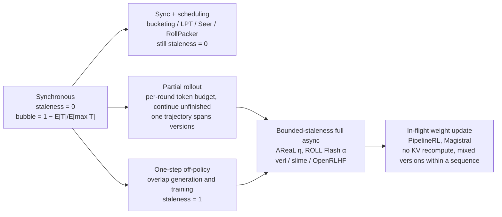

[中文](README.md) · **English**

# Module 06: Long Tails and Asynchrony — Stop Making the Whole Cluster Wait for the Slowest Trajectory

> 🕐 Suggested time: 2.5 hours ｜ 🎯 After this module you can: derive and mentally compute the bubble ratio of synchronous RL; explain what partial rollout, over-provisioning, bounded-staleness asynchrony, and in-flight weight updates each buy and cost; use decoupled PPO, truncated importance sampling (TIS), and routing replay to argue why "async + low-precision rollout + MoE" can still train stably; estimate weight-sync time and sandbox concurrency ｜ 🧪 Lab: [`lab.py`](lab.py) ｜ 📖 Required primary sources: [AReaL (arXiv 2505.24298)](https://arxiv.org/abs/2505.24298) Sections 4–5, [Kimi k1.5 (arXiv 2501.12599)](https://arxiv.org/abs/2501.12599) Section 2.6

## 0. One sentence

**The length of a synchronous RL step is set by the slowest trajectory in the batch; the long tail of agentic workloads makes "slowest" an order of magnitude longer than "average", and the difference is pure GPU idle time.** There are only three kinds of fixes: **make it less slow** (scheduling, length bucketing, timeouts, redundant environments), **don't wait for it to finish** (partial rollout: unfinished trajectories are continued next round), and **don't wait at all** (asynchrony: decouple generation from training). The last two trade staleness (the training samples were generated by a policy several versions old) for throughput, and how much you can trade is decided by off-policy correction. More importantly: even fully synchronous, the inference engine and the training framework usually compute different probabilities for the same token (training–inference mismatch), so **many large-scale RL systems are "effectively off-policy" even when synchronous**. This is not fate: with batch-invariant kernels, unified training/inference precision, the same sampling mask and MoE routing on both sides, and the true rollout logprobs recorded, training–inference KL can be brought close to 0, at the cost of slower inference and engineering complexity (§6.1).

## 1. Why big labs care

Scenario (illustrative): RL for agentic coding. Each step takes 512 SWE tasks and samples 8 trajectories per task for within-group comparison (a GRPO group), 4096 trajectories in total. Each trajectory runs 5–100 turns of "generate → call a tool (read files, compile, run tests) → append the result to the context"; generation lengths range from hundreds to tens of thousands of tokens, tool latency ranges from milliseconds to minutes, and occasionally a sandbox hangs. The rule of synchronous training: gradients are computed only after **all** 4096 have finished.

Public numbers:

| Fact | Number | Source |
|---|---|---|
| Rollout (sampling trajectories) dominates an RL iteration | 63%–87% of iteration time across three production workloads (Moonlight 84%, Qwen2-VL-72B 63%, Kimi-K2 87%) | [Seer (arXiv 2511.14617)](https://arxiv.org/abs/2511.14617) |
| The tail dominates rollout | Generation lengths from a few hundred to 96k tokens; the last 10% of requests to finish consume up to 50% of the time; the gap between the earliest and latest finishing inference instance is 70% of total time, with each instance idle 1,580 s on average (37%); 13,686 preemptions in a single iteration | Same |
| Agentic trajectories vary even more | Long trajectories have two orders of magnitude more tokens than short ones; trajectories with over 100 tool-call turns and over 400k output tokens appear during training | [ASearcher (arXiv 2508.07976)](https://arxiv.org/abs/2508.07976) |
| How much asynchrony recovers | AReaL up to 2.77× training speedup at the same GPU count (relative to its own synchronous implementation; 2.27× relative to verl); ROLL Flash up to 2.24× on RLVR and 2.72× (ALFWorld) / 1.81× (SWE) on agentic tasks | [AReaL](https://arxiv.org/abs/2505.24298), [ROLL Flash (arXiv 2510.11345)](https://arxiv.org/abs/2510.11345) |
| RL is already big money | DeepSeek-V3.2's post-training compute budget exceeds 10% of the pre-training cost | [DeepSeek-V3.2 (arXiv 2512.02556)](https://arxiv.org/abs/2512.02556) |
| Environments are large systems too | Kimi K2's code sandbox supports over 10,000 concurrent instances; DeepSeek DSec supports over 380,000 concurrent sandboxes and over 5,000 creations per second in production | [Kimi K2 (arXiv 2507.20534)](https://arxiv.org/abs/2507.20534), [DSec (arXiv 2609.22978)](https://arxiv.org/abs/2609.22978) |

How to read it: **rollout is the big cost, the tail is the big cost within rollout, and the tail comes from variance stacking across generation, turns, tools, and environments.** That is why 2025–2026 saw a burst of systems work in this direction: AReaL, ROLL Flash, APRIL, Seer, RollPacker, PipelineRL, and more.

## 2. Where the long tail comes from

Wall-clock time of one agentic trajectory:

$$T=\sum_{k=1}^{K}\big(g_k+w_k\big),\qquad g_k\approx(\text{output tokens in turn }k)\times\text{TPOT}$$

where $K$ is the (random) number of turns, $g_k$ the generation time of turn $k$ (TPOT: time per output token; see [Module 01](../01_inference_basics/README.en.md)), and $w_k$ the tool/environment wait. Four sources of variance:

| Source | Symptom | Public example | Typical fix (section in this module) |
|---|---|---|---|
| Generation length | Reasoning length is heavy-tailed, cut off at max_tokens | Hundreds to 96k tokens (Seer) | Partial rollout, bucketing, early stop on repetition (§4) |
| Number of turns | The same task takes 3 turns on one try and 50 on another | Over 100 turns (ASearcher) | Asynchrony, turn-level continuation (§4) |
| Tool latency | Reading a file takes ms, running tests takes minutes | ROLL Flash environment-level async under high latency variance | Environment-level async, timeouts (§4.7) |
| Environment failures | fail-slow and fail-stop, in ROLL Flash's terms | ROLL Flash redundant environments | Redundant environments, retries, masking failed samples (§4.7) |

One more amplifier: long sequences occupy KV cache, and when memory runs out the engine preempts and later recomputes them, stretching the tail further (Seer's 13,686 preemptions in one iteration).

**Why is the sum still heavy-tailed?** Heavy-tailed (subexponential) distributions obey the "single big jump" principle: $P(\sum_i X_i>x)\approx n\,P(X>x)$ — a large sum is almost always caused by **one** large term. So a slow trajectory usually has one very long generation turn or one stuck tool call — exactly why partial rollout (cut by budget) and timeouts (cut the single big jump) work.

## 3. The synchronous bubble: derivation

### 3.1 Minimal model

$n$ trajectories start together, each occupying one slot (a rollout worker, or one concurrent sequence position inside an inference engine), with i.i.d. durations $T_i$. The synchronization barrier waits for $M_n=\max_i T_i$. Slot busy fraction and bubble (idle fraction):

$$\text{busy}=\frac{\mathbb E\big[\sum_i T_i\big]}{n\,\mathbb E[M_n]}=\frac{\mathbb E[T]}{\mathbb E[M_n]},\qquad \text{bubble}=1-\text{busy}$$

### 3.2 Closed form for a Pareto tail

Let $T\sim\text{Pareto}(\alpha,x_m)$: $P(T>t)=(x_m/t)^\alpha,\ t\ge x_m$. Smaller $\alpha$ means a heavier tail (infinite variance for $\alpha\le2$). $\mathbb E[T]=\alpha x_m/(\alpha-1)$.

Write $T=x_mU^{-1/\alpha}$ with $U$ uniform. The maximum corresponds to the smallest $U$, and $U_{(1)}\sim\text{Beta}(1,n)$, so

$$\mathbb E[M_n]=x_m\,\frac{\Gamma(n+1)\,\Gamma(1-1/\alpha)}{\Gamma(n+1-1/\alpha)}\;\approx\;x_m\,\Gamma(1-1/\alpha)\,n^{1/\alpha}$$

$$\text{busy}\approx\frac{\alpha}{(\alpha-1)\,\Gamma(1-1/\alpha)}\;n^{-1/\alpha}\approx 1.1\,n^{-1/\alpha}$$

(For $1.2\le\alpha\le3$ the prefactor lies between 1.08 and 1.13; use 1.1 for mental math.)

| Slot busy fraction | n = 64 | n = 256 | n = 1024 |
|---|---|---|---|
| Exponential (light tail, $1/H_n$) | 21.1% | 16.3% | 13.3% |
| Pareto α = 3 | 27.6% | 17.4% | 11.0% |
| Pareto α = 2 | 14.1% | 7.0% | 3.5% |
| Pareto α = 1.5 | 7.0% | 2.8% | 1.1% |

Two conclusions: (1) **bigger batches are worse** — slowly as $1/\ln n$ for a light tail, but as a power law $n^{-1/\alpha}$ for a heavy tail; (2) **heavier tails are worse**. Large batches exist to reduce gradient variance and amortize communication, yet in synchronous rollout they directly inflate the bubble — the fundamental tension of synchronous systems. Exercise (a) implements this closed form.

Note one "counterexample" in the table: at n = 64 and 256 the light-tailed exponential is actually worse than Pareto α = 3. The reason is that Pareto has a floor $x_m=\frac{\alpha-1}{\alpha}\times$mean, so at α = 3 its coefficient of variation (CV) is only $1/\sqrt{\alpha(\alpha-2)}\approx0.58$, below the exponential's 1 — the table mixes tail index with dispersion, and the two only cross at n ≈ 373. So conclusion (2) refers to comparisons within one family, or to large n. Where the constant comes from: $\Gamma(1-1/\alpha)$ is the mean of the Fréchet extreme-value distribution, so "the max grows as $n^{1/\alpha}$" holds for any power-law (regularly varying) tail; the max of a lognormal tail grows only as $\exp(\sigma\sqrt{2\ln n})$, much more slowly. The prefactor $\alpha/((\alpha-1)\Gamma(1-1/\alpha))$ lies in (1, 1.13] for every α > 1 (peaking at α ≈ 1.86), so the mental-math rule busy ≈ $n^{-1/\alpha}$ is off by at most 13%.

### 3.3 Real systems truncate: the mental-math version

Pure Pareto is too pessimistic because real systems have max_tokens, max_turns, and timeouts that cap $T$ at $L$. Once $n$ is large enough that someone almost surely hits the cap (probability $1-(1-p_L)^n$, $p_L=P(T\ge L)$), $\mathbb E[M_n]\approx L$:

$$\text{busy}\approx\frac{\mathbb E[\min(T,L)]}{L}=\frac{\text{mean length}}{\text{max length}}$$

Mental math: mean 8k tokens, cap 32k → 25% busy, 75% bubble. How easy is "someone almost surely hits the cap"? If only 1% of responses hit it, $n=256$ gives $1-0.99^{256}\approx92\%$; at $n=4096$ it is essentially 100%.

### 3.4 The continuous-batching view: the same formula

Inside an inference engine it is not "one worker per trajectory" but a batch decoding together. Decode is memory-bound (see [Module 01](../01_inference_basics/README.en.md)): step time is dominated by reading the weights and barely shrinks with a smaller batch, so **engine token throughput is roughly proportional to the number of active sequences**. In synchronous mode, finished sequences are not replaced by new requests, and the active count falls from $B$ down to 1:

$$\text{utilization}\approx\frac{\sum_i L_i}{B\cdot\max_i L_i}$$

The same expression as §3.1, with "time" replaced by "tokens". But it only holds approximately when **weight reads dominate**. Step time ≈ (weight bytes + KV bytes of all active sequences) / bandwidth, and long-context GQA dense models are often dominated by KV reads. Using `codesign_sim`'s `kv_bytes_per_token`: Qwen3-32B has about 262 KB of KV per token and about 66 GB of BF16 weights, so 128 sequences × 16k context read about 615 GB per step, while a tail of 4 sequences × 32k reads about 100 GB — **each step is about 6× faster**; Llama-3-70B in the same scenario is about 4.5×. So a token-based bubble clearly overstates the time-based bubble. The real loss in the tail lies elsewhere: compute is almost entirely idle at small batch (MFU near 0), the fixed per-step weight read, and load imbalance across instances (Seer measured 37% average idle time per instance). Spare compute is also exactly why the tail suits speculative decoding (Seer's grouped speculative decoding). MLA models (e.g., DeepSeek-V3, about 70 KB of KV per token) have much smaller KV and stay weight-read dominated; MoE activates fewer experts at small batch, so weight reads shrink as well.

### 3.5 Including the training phase (colocated synchronous)

With colocation (training and inference sharing the same GPUs in turn), one step's wall clock = rollout phase + training phase. If rollout takes a fraction $f$ of each step and the slot busy fraction within rollout is busy, the cluster idle fraction is roughly

$$\text{idle}\approx f\,(1-\text{busy})$$

Mental math: $f=80\%$ (Seer's table: Moonlight 84%, K2 87%) and 40% busy within rollout → about 48% of cluster GPU time is idle.

### 3.6 The serving side: the same problem under another name

The fan-out/fan-in barrier in multi-agent execution is synchronous rollout: a lead agent dispatches $k$ subagents in parallel and waits for **all** of them. Anthropic has publicly stated that the lead agent in its multi-agent research system currently executes subagents synchronously, waiting for each set to complete before proceeding, and lists this as a bottleneck ([Anthropic engineering blog](https://www.anthropic.com/engineering/multi-agent-research-system)).

- Barrier latency $=\mathbb E[M_k]$. Exponential: $\mathbb E[M_k]=H_k\times$mean; for $k=8$, $H_8\approx2.72$, so **an 8-way fan-out waits 2.7× the mean on average**; Pareto α = 2, $k=8$: $5.09\,x_m$ versus a mean of $2\,x_m$, about 2.5×.
- The classic online-serving version: if a single server's p99 is 1 second and a request fans out to 100 servers, $1-0.99^{100}\approx63\%$ of requests take over 1 second ([The Tail at Scale](https://research.google/pubs/the-tail-at-scale/), Dean & Barroso, CACM 2013).
- The fixes map one-to-one to the training side:
  - **Program-level scheduling**: Autellix schedules whole agent programs rather than individual LLM calls, mitigating head-of-line blocking, and reports 4–15× higher program throughput than systems like vLLM at the same latency ([arXiv 2502.13965](https://arxiv.org/abs/2502.13965)) ↔ length bucketing in training.
  - **Hedged requests**: send a backup if a request is still outstanding past p95, at about 5% extra load (The Tail at Scale) ↔ redundant environments in training.
  - **Quorum fan-in**: continue after $k'$ of $k$ return ↔ over-provisioning + early termination in training.
  - **Keeping KV during tool waits**: a slow agent waiting on a tool still holds KV cache — evict or keep? (see [Module 05](../05_cache_prefill/README.en.md)) ↔ whether partial rollout recomputes KV when continuing.

## 4. The spectrum of solutions



Timelines (`=` means working, `.` means idle):

```
Synchronous (colocated)
GPU    |==gen==........|=train=|==gen==........|=train=|
               ^ the tail: only a few sequences still running

One-step off-policy (disaggregated)
gen    |== gen v0 ==|== gen v1 ==|== gen v2 ==|
train               |= train(batch0) =|= train(batch1) =|
                     trains on the previous step's data: staleness exactly 1; the tail stays in gen

Full async + bounded staleness
gen    |a1 a2 a3 a4 a5 a6 a7 a8 ...  each trajectory starts and ends independently
train       |step1|step2|step3|...   train whenever B are ready; admission keeps version gap ≤ η
```

### 4.1 Fixes that add no staleness: scheduling and bucketing

- **Length bucketing / tail batching**: RollPacker consolidates prompts that produce long-tail responses into a few steps (long rounds), so most steps are short, balanced rollouts, cutting end-to-end training time by 2.03–2.56× versus veRL ([arXiv 2509.21009](https://arxiv.org/abs/2509.21009)).
- **Exploiting within-group similarity**: Seer observes that responses to the same prompt are highly similar in length and pattern, so it splits groups into smaller chunks scheduled incrementally (divided rollout), schedules long-tail requests using that context, and applies grouped speculative decoding — up to 2.04× rollout throughput and 72–94% lower tail latency, while staying synchronous ([arXiv 2511.14617](https://arxiv.org/abs/2511.14617)).
- **Length prediction**: StreamRL uses an output-length ranker to identify long-tail samples and applies skewness-aware dispatching and scheduling, up to 2.66× throughput ([arXiv 2504.15930](https://arxiv.org/abs/2504.15930)).
- **Queue scheduling and prompt replication**: ROLL Flash treats each prompt as an independent task and computes its reward as soon as it finishes; with dynamic filtering, per-step generation drops from 125 s to 37 s; expanding a prompt's multiple responses into independent tasks spread across GPUs reduces the 64×16 configuration from 149 s to 81 s ([arXiv 2510.11345](https://arxiv.org/abs/2510.11345)).
- **Classic scheduling**: with known (or predicted) lengths, dispatch the longest first to the currently least-loaded worker (LPT, Longest Processing Time first); the makespan (time when everything finishes) is at most $4/3-1/(3m)$ times optimal (Graham 1969, [SIAM J. Appl. Math.](https://doi.org/10.1137/0117039)). Exercise (d) implements it.

Cost: you need length prediction, and mispredictions leave the tail in place; nor does scheduling change a trajectory's intrinsic length — if one trajectory needs 30 minutes, scheduling can only keep others from waiting with it.

### 4.2 Partial rollout: a per-round budget, continue the unfinished next round

Kimi k1.5 (Section 2.6.2): each rollout round has a fixed **output-token budget**; for trajectories that exceed it, the unfinished part is saved to a replay buffer and continued in the next iteration; segments from earlier rounds can be reused from the buffer, and some segments can be excluded from the loss; the system also detects repeated content and terminates it early. Because rollout workers are asynchronous, while some are busy with long trajectories, others can independently process new short tasks ([arXiv 2501.12599](https://arxiv.org/abs/2501.12599)). Kimi K2 applies it to long-horizon agentic tasks: to keep long-tail trajectories from blocking the whole rollout, unfinished long-tail tasks are paused and resumed in the next RL iteration ([arXiv 2507.20534](https://arxiv.org/abs/2507.20534) Section 3.3.4).

In a one-wave toy model where n trajectories start together with one slot each, each round's duration changes from $\max_i T_i$ to $\min(\max_i T_i,\;L_b)$ ($L_b$ is the budget). Real systems schedule in multiple waves with a cross-round backlog: unfinished work does not disappear, it just moves to later rounds (work conservation), and a round's length is often set by "the time to fill one batch" rather than by the budget. Nor is a smaller budget always better: the finer you cut, the more continuation and recompute, and the more versions long trajectories span — in lab Table [5], shrinking the per-trajectory per-round budget from 120 s to 15 s lowers throughput by about 13% and raises token-weighted staleness from 0.44 to 1.13. The continued share is large: APRIL reports that tokens carried over from truncated instances make up about 40% of the tokens in subsequent steps.

Cost: **one trajectory is written by several policy versions** — the first half by $\pi_{v}$, the second half by $\pi_{v+1}$. The correctness conditions are in §5.7; APRIL reports it never encountered a rollout that needed more than five successive policy versions to finish ([arXiv 2509.18521](https://arxiv.org/abs/2509.18521)). On the engineering side you also manage the buffer, version metadata, and KV reconstruction on continuation.

### 4.3 Over-provisioning + early termination: APRIL

APRIL (Active Partial Rollouts): each step issues $N'>N$ requests, **stops as soon as $N$ responses have completed**, puts the unfinished ones in a continuation buffer, and in the next step resumes them before starting new ones. With GRPO on Qwen3-8B it raises rollout throughput by 26.4%–49.5%, about 22.5% on average across all experiments; final accuracy improves by about 2.1% on average; it is integrated into slime ([arXiv 2509.18521](https://arxiv.org/abs/2509.18521), [slime](https://github.com/THUDM/slime)).

**Why not simply discard the unfinished ones?** (derivation) If each step keeps only the first $N$ to finish and discards the rest, the training batch distribution becomes

$$q(y)\;\propto\;\mu(y)\cdot P\big(y\text{ is among the first }N\mid \text{length}(y)\big)$$

This is a **length-dependent selection bias** (survivor bias): long responses are systematically under-represented and the gradient pushes the policy toward "short". It cannot be fixed with per-token importance weights, because the selection probability depends on the lengths of other samples in the same batch and the inference engine never records it. APRIL's emphasis on discarding no rollouts is exactly how it avoids this.

**But not discarding ≠ unbiased.** Second-order biases remain: (1) in any step, completed samples skew short and fresh while long ones are deferred and staler; add TIS truncation, staleness masking, or V3.2-style sequence masking (§5.4–§5.5) and long samples get systematically down-weighted or removed. (2) Seer's production comparison (Section 4.4.3): compared with the synchronous method, partial rollout generates a significantly lower proportion of long outputs, which the authors say may hurt RL training; in memory-constrained long-CoT scenarios, partial rollout doubles the request volume and exacerbates preemption; Seer's average throughput is 43% higher than partial rollout's. (3) The 40% of carried-over tokens above is exactly the off-policy share of a step. Conversely, lab Table [4] shows the magnitude of actually dropping: at α = 1.2, "abort and drop once the version gap exceeds η" leaves the trained samples with a mean length only 0.67 of all started samples, while throughput counted in trajectories goes up 20% and in tokens goes down 11% — a metric that counts trajectories rewards this bias.

### 4.4 One-step off-policy: the simplest asynchrony

verl's one-step off-policy runs generation and training in parallel on different GPUs: training uses the samples generated in the previous step while the next step's samples are generated, so staleness is exactly 1. Training Qwen2.5-Math-7B on 2 nodes with 16 H20s (4 for generation, 12 for training), the FSDP2 backend is 23% faster (19h18m → 15h34m) and the Megatron backend 40% faster (18h21m → 13h06m); weights are broadcast tensor by tensor from actor to rollout over NCCL, and the documentation says the latency is under 300 ms most of the time ([verl docs](https://verl.readthedocs.io/en/latest/advance/one_step_off.html)).

Limitation: it hides training time behind generation, but **cannot remove the long tail inside generation**. The documentation explicitly says that if waiting for the previous generation is high and there are long-tail sequences, adding resources won't help — optimize the stopping criteria instead.

### 4.5 Bounded-staleness full asynchrony: AReaL

AReaL's architecture ([arXiv 2505.24298](https://arxiv.org/abs/2505.24298)):

1. **Full decoupling**: rollout workers generate continuously; training workers update whenever a batch has been collected; experiments fix three quarters of the devices for inference.
2. **Interruptible rollout** (Section 4.1): when new weights arrive, all ongoing generations are interrupted, the KV cache is discarded and recomputed with the new weights, and decoding continues.
3. **Staleness admission control** (Section 5.1): with current policy version $i$, total generated trajectories $N_r$ (including this new request), and batch size $B$, a new generation request is accepted only if

$$\left\lfloor\frac{N_r-1}{B}\right\rfloor\le i+\eta$$

How to read it: Eq. (3) limits the **submission rate**. The $N_r$-th trajectory "should" land in batch number $\lfloor (N_r-1)/B\rfloor$ (counting from 0); it is generated by a policy of version at least $i$; **if trajectories are consumed in submission order**, its staleness is at most $\eta$. The long tail breaks exactly this assumption: a long trajectory submitted early finishes late and lands in a later batch. AReaL's answer is to prioritize older trajectories when forming a batch, and it acknowledges that with too small an η extremely long trajectories slow generation down; ROLL Flash describes AReaL's control as "average sample freshness within a batch", whereas its own α is a per-sample bound (the SampleBuffer is capped at (1+α) × batch size). So a system must choose among three options: continue (AReaL's interrupt-and-continue with new weights), abort (wasting compute and introducing §4.3's length bias), or block generation. In lab Tables [1][2], with AReaL-style continuation at η = 1, the max per-trajectory staleness still reaches 10–11. Exercise (c) uses this formula in pool planning (§7.2).

4. **Decoupled PPO objective** (Section 5.2; detailed in §5.3).

Results: training time for a 1.5B model drops from 41.0 hours to 14.8 hours (2.77×) without performance loss. Note the baseline is AReaL's own synchronous implementation (Sync.AReaL); the verl baseline in the same table takes 33.6 hours, i.e., 2.27× relative to verl. Ablation (AIME24, Table 2 of the paper):

| Max staleness η | Naive PPO | Decoupled PPO |
|---|---|---|
| 0 (synchronous, oracle) | 42.0 | — |
| 1 | 41.8 | 42.1 |
| 2 | 40.0 | 41.8 |
| 4 | 23.3 | 42.2 |
| 8 | 35.7 | 41.0 |
| 16 | 35.8 | 38.7 |
| ∞ | 34.0 | 36.9 |

Reading: naive PPO already loses about 2 points at η = 2 and trails steadily by about 6 points for η ≥ 8; decoupled PPO holds up for η ≤ 8 (≥ 41.0) and starts slipping at η = 16. The η = 4 row (23.3) is a non-monotonic outlier — it is also naive PPO's worst row on AIME25, AMC23, and MATH500, while η = 8 and 16 recover — so don't build a rule on that single point. With unbounded η both degrade — **correction enlarges the usable staleness budget but cannot make it infinite**.

### 4.6 In-flight weight updates: not even recomputing KV

PipelineRL only briefly pauses generation to receive new weights, then **continues the in-progress sequences with the stale KV cache**; the paper finds that reusing stale KV does not cause high divergence, and on long-form reasoning with 128 H100s it reaches the same reward about 2× faster than a conventional RL baseline ([arXiv 2509.19128](https://arxiv.org/abs/2509.19128)). Mistral's Magistral does the same: generators replace weights mid-generation, in-flight sequences continue with a slightly outdated KV cache, and the authors found recomputing the KV cache unnecessary ([arXiv 2506.10910](https://arxiv.org/abs/2506.10910) Section 3).

Scope of the evidence: PipelineRL's stale-KV experiments use Qwen2.5 7B, maximum sequence length L = 2048, and maximum lag 32; extrapolating to agentic trajectories of $10^4$–$10^5$ tokens has no public validation yet — the longer the prefix covered by old KV, the larger the risk. The paper also notes the risk can be mitigated by recomputing the KV cache after each update, at a throughput cost. Monitor the KL gap between in-flight samples and recomputed samples.

Consequence: within a single sequence, **earlier tokens have a larger version lag** (PipelineRL says token lag varies along the sequence), and the conditional distribution of later tokens is a hybrid of "new weights + old KV" that equals no single policy version. §5.7 explains why this can still be mathematically correct.

### 4.7 Timeouts, retries, and redundant environments

- **Environment-level async**: ROLL Flash overlaps LLM generation with environment interaction, a 2.46× improvement in simulation at batch size 512 with high environment-latency variance.
- **Redundant environments**: launch extra environment groups to hedge against fail-slow / fail-stop; increasing the number of environment groups (`num_env_groups`) is more resilient than increasing `group_size`, for a 7%–16% throughput gain (ROLL Flash).
- **Hedged requests**: send a backup once a request is past p95, at about 5% extra load (The Tail at Scale).
- Engineering rules (this module's analysis, not a finding of any specific paper):
  1. Set timeouts per tool type, based on a high percentile of that tool's latency; a timeout is the cheapest way to cut off the "single big jump" (§2).
  2. Retry only idempotent operations; before retrying a tool with side effects (writing files, running migrations), roll the sandbox back to a snapshot.
  3. **Infrastructure failure is not a negative reward**: if a sandbox dies, mask the sample out (or resample the whole group) instead of scoring it 0, otherwise the policy learns a spurious correlation — "some actions cause failure" — that really comes from infrastructure noise.
  4. Track failure and timeout rates as training metrics next to the reward curve.

### 4.8 Async capabilities of mainstream frameworks (only what official docs or papers confirm)

| Framework | Form of asynchrony | Staleness control | Off-policy correction | Source |
|---|---|---|---|---|
| verl | One-step off-policy; fully async (Rollouter, MessageQueue, Trainer, ParameterSynchronizer, streaming at single-sample granularity); `partial_rollout` interrupts and continues via sleep/resume during parameter sync; AgentLoop runs samples concurrently within a step but still has a barrier before training | `staleness_threshold` (cap on the fraction of stale samples), `trigger_parameter_sync_step` | Rollout correction: decoupled / bypass modes; token / sequence / geometric TIS and rejection sampling | [fully async](https://verl.readthedocs.io/en/latest/advance/fully_async.html), [one-step](https://verl.readthedocs.io/en/latest/advance/one_step_off.html), [agent loop](https://verl.readthedocs.io/en/latest/advance/agent_loop.html), [rollout correction](https://verl.readthedocs.io/en/latest/algo/rollout_corr.html) |
| slime | Megatron training + SGLang rollout + Data Buffer; `examples/fully_async` targets long-tail agentic generation; APRIL integrated; delta weight sync | Specific parameters not confirmed in the README | Not confirmed in the README | [GitHub](https://github.com/THUDM/slime) |
| ROLL Flash | Fine-grained parallelism (queue scheduling, prompt replication, environment-level async, redundant environments) + rollout–train decoupling | Asynchronous ratio α: max allowed version gap per sample; α = 2 suffices for most scenarios | Implements and compares Decoupled PPO, TIS, CISPO, TOPR, with comparable accuracy at async ratios 2 and 8 | [arXiv 2510.11345](https://arxiv.org/abs/2510.11345) |
| OpenRLHF | `--train.async_enable`; `--train.partial_rollout_enable` (vLLM pause/resume; in-flight samples mix old and new weights) | `--train.async_queue_size` (larger = more off-policy) | `--algo.advantage.is_correction_type` with `tis` / `icepop` / `seq-mask-tis`, default thresholds `0.5 5.0` | [docs](https://openrlhf.readthedocs.io/en/latest/agent_training.html) |
| AReaL | Full async + interruptible generation | η | Decoupled PPO | [arXiv 2505.24298](https://arxiv.org/abs/2505.24298) |

verl fully async measurements: 2.35–2.67× for Qwen2.5-Math-7B on 128 GPUs, 1.7× for a 30B model. OpenRLHF's documentation gives advice worth remembering: **validate convergence in synchronous mode first, then switch to async**.

### 4.9 How long-tail optimizations interact with GRPO groups

GRPO's advantage is "reward minus the group mean (divided by the group std)", which can only be computed once **all** G responses to a prompt have finished. So every long-tail optimization above has to answer "when does a group close":

- **The scheduling unit is the group, and there is a barrier inside it.** A group finishes at the max of its G responses. For Pareto α = 1.5 and G = 8, $\mathbb E[M_8]/\mathbb E[T]=1/\text{busy}(1.5,8)\approx3.6$: a group's expected completion time is about 3.6× the single-trajectory mean (exercise (a) computes it directly). APRIL likewise judges completion per "input instance" (a prompt and all its responses).
- **Lengths are correlated within a group, but groups differ more.** APRIL measures within-prompt response-length std typically below 1,500 tokens (GRPO) versus about 4,000–4,500 across the batch. The correlation makes the within-group barrier smaller than the 3.6× of the independence assumption, but makes "whole groups run long together" — scheduling groups as indivisible units causes load imbalance across instances, which is exactly what Seer's divided rollout splits apart.
- **Biases from splitting groups** (analysis): (1) if samples of one group start under different versions, the group baseline mixes samples from different policies; either pin a group to one version, or allow mixing but correct with per-token $\mu$. (2) Quorum / early termination computes the baseline from the first $G'$ finishers only: the baseline is set by shorter samples, the dropped long samples get no feedback at all (not even negative), and the correlation between length and reward is swallowed — §4.3's survivor bias happening inside a group. (3) Dynamic filtering (dropping all-correct or all-wrong groups) combined with "first finished, first queued" skews toward easy, short prompts. (4) Tail batching makes some steps contain only long prompts, so batches are no longer identically distributed across steps, which interacts with token-level normalization and optimizer statistics.
- **A warning from official docs**: verl's fully async documentation notes that if fewer samples are issued at once, the order of data distribution can cause training instability and longer response lengths.

Summary of practices: schedule and continue at group granularity; record per-token $\mu$ and versions within a group; with quorum, compute the baseline over the full group; under tail batching, mind token-level normalization.

## 5. Cost 1: staleness and off-policy correction (the math)

### 5.1 Three policies, three factors

Notation: $\mu$ is the **actual sampling distribution** (the version-$\theta_{t-k}$ policy inside the inference engine, including temperature, top-p, and other sampling transforms); $\pi_{\text{old}}$ is the probability recomputed by the training framework at the current version $\theta_t$ (AReaL calls it $\pi_{\text{prox}}$); $\pi_\theta$ is the policy being optimized. The per-token importance ratio decomposes as an identity:

$$\rho_t=\frac{\pi_\theta}{\mu}=\underbrace{\frac{\pi_\theta}{\pi_{\text{old}}}}_{\text{updates within this step}}\cdot\underbrace{\frac{\pi^{\text{train}}_{\theta_t}}{\pi^{\text{train}}_{\theta_{t-k}}}}_{\text{staleness (version gap }k\text{)}}\cdot\underbrace{\frac{\pi^{\text{train}}_{\theta_{t-k}}}{\mu}}_{\text{training–inference mismatch}}$$

(Every factor is evaluated at the same token $y_t$ and prefix.) PPO's clip handles the first factor; asynchrony creates the second; the third exists **even when $k=0$**. The Qwen team decomposes the IS weight into "training–inference discrepancy × policy staleness", the same idea ([arXiv 2512.01374](https://arxiv.org/abs/2512.01374)).

**Observability**: this is a conceptual identity. The trainer recomputes $\pi_{\text{old}}$ only at the current version $\theta_t$ (both AReaL and verl do this) and does not keep $\theta_{t-k}$, so factors 2 and 3 are **observable only as the product $\pi_{\text{old}}/\mu$**. Consequence: under asynchrony, the "training–inference KL" monitored in §6.4 is contaminated by staleness, and on its own it cannot tell you whether to fix kernels or tighten η. Ways to separate them: compute training–inference KL only on samples with $k=0$; or bucket KL by version gap $k$ — the intercept at $k=0$ reflects training–inference mismatch and the slope in $k$ reflects staleness. With in-flight updates (new weights + old KV), factor 3 is no longer pure training–inference mismatch either.

### 5.2 Why not use sequence-level IS directly

Objective $J(\theta)=\mathbb E_{y\sim\pi_\theta}[R(y)]$, off-policy gradient:

$$\nabla J=\mathbb E_{y\sim\mu}\Big[W(y)\,R(y)\,\nabla\log\pi_\theta(y)\Big],\qquad W(y)=\prod_{t=1}^{T}\rho_t$$

$W$ is unbiased, but its variance grows exponentially with length: if tokens are independent, $\mathbb E_\mu[W^2]=\prod_t\big(1+\chi^2_t\big)$ ($\chi^2_t$ is the χ² divergence between the two distributions at step $t$). The verl documentation's example: with a per-token ratio of about 1.1, a 10-token sequence has $W\approx2.6$ while a 100-token sequence has about 13,780 — long responses get systematically inflated or deflated weights, which the docs call the length trap. Agentic trajectories easily reach $10^4$–$10^5$ tokens, so sequence-level IS is essentially unusable.

In practice we therefore use a **per-token surrogate objective**:

$$L(\theta)=\mathbb E_{y\sim\mu}\Big[\sum_t \rho_t(\theta)\,\hat A_t\Big]$$

Its gradient matches the true objective at $\pi_\theta=\mu$, and away from that point the error is higher-order — it drops the term for "the prefix (state) distribution changed too". This is the same as TRPO's local approximation $L_{\pi_{\text{old}}}$, with the error controlled by the KL between policies ([arXiv 1502.05477](https://arxiv.org/abs/1502.05477)); the Qwen team interprets the token-level objective as a first-order approximation of the sequence-level one ([arXiv 2512.01374](https://arxiv.org/abs/2512.01374)). **Conclusion: token-level IS holds only when $\pi_\theta$ and $\mu$ are close enough**, so staleness and training–inference mismatch are spending the same "trust-region budget". For you with an offline-RL background: this is the online version of offline RL's distribution shift, except that the behavior policy is yourself a few steps ago, so the shift is controllable.

### 5.3 Decoupled PPO: separating the trust-region center from the behavior policy

Naive PPO uses the stale $\mu$ as $\pi_{\text{old}}$: the ratio $r=\pi_\theta/\mu$ is already away from 1 at the start of the step. The PPO objective $\min\big(rA,\ \text{clip}(r,1-\epsilon,1+\epsilon)A\big)$ has four out-of-range cases:

| | $r>1+\epsilon$ | $r<1-\epsilon$ |
|---|---|---|
| $A>0$ | Clipped value, zero gradient | Takes $rA$, gradient flows |
| $A<0$ | Takes $rA$, gradient flows, and $\lvert rA\rvert$ is unbounded | Clipped value, zero gradient |

Zero gradient happens only when the ratio has **already moved in the direction the advantage favors** — that data is wasted. When it moves the opposite way (especially $A<0$ with $r\gg1+\epsilon$), the min picks the unclipped term, the gradient flows, and $rA$ has no lower bound. On stale data $r$ can be far above $1+\epsilon$, which is one of the main sources of instability in asynchronous training and exactly what dual-clip PPO addresses: for $A<0$ it takes $\max\big(\min(rA,\text{clip}(r,1-\epsilon,1+\epsilon)A),\ cA\big)$ with $c>1$, putting a lower bound on the objective ([arXiv 1912.09729](https://arxiv.org/abs/1912.09729)). On top of that, the trust region is centered on the old policy, constraining the wrong thing.

Hilton, Cobbe, and Schulman proposed decoupling the "proximal policy that controls update size" from the "behavior policy used for off-policy correction" ([arXiv 2110.00641](https://arxiv.org/abs/2110.00641)). AReaL's objective (Section 5.2, Eq. 5):

$$J(\theta)=\mathbb E_{y\sim\pi_{\text{behav}}}\Big[\sum_t\frac{\pi_{\text{prox}}(y_t)}{\pi_{\text{behav}}(y_t)}\min\Big(u_t(\theta)\hat A_t,\;\text{clip}\big(u_t(\theta),1-\epsilon,1+\epsilon\big)\hat A_t\Big)\Big],\quad u_t(\theta)=\frac{\pi_\theta(y_t)}{\pi_{\text{prox}}(y_t)}$$

- The trust region is centered on $\pi_{\text{prox}}$ (the recent policy): AReaL simply uses "the parameters before each model update" as $\pi_{\text{prox}}$ and recomputes token probabilities when each training batch arrives.
- $\pi_{\text{prox}}/\pi_{\text{behav}}$ is constant in $\theta$ and only corrects the distribution shift; in practice it is often truncated as well, which is verl's `decoupled_token_is`: the weight is $\min(\pi_{\text{old}}/\pi_{\text{rollout}},C)$.
- Cost: one extra forward pass per training step (to recompute $\pi_{\text{prox}}$). verl's bypass mode sets $\pi_{\text{old}}=\pi_{\text{rollout}}$ to save that pass, at the price of putting the trust-region center back on the stale policy.
- The decoupled objective only fixes the "trust-region center": the weight $\pi_{\text{prox}}/\pi_{\text{behav}}$ itself is unbounded and its variance grows with staleness, so in practice truncation is layered on top (§5.4).

### 5.4 Truncated IS: bias, variance, and V-trace

Truncated importance sampling (TIS): $w=\min(\rho,C)$. For any bounded function $g$ (say a component of $\hat A\,\nabla\log\pi$) there is an identity:

$$\mathbb E_\mu\big[\min(\rho,C)\,g\big]=\mathbb E_\pi[g]-\mathbb E_\pi\Big[\big(1-\tfrac{C}{\rho}\big)_+\,g\Big]$$

(Proof: $\min(\rho,C)=\rho-(\rho-C)_+$, then use $\mathbb E_\mu[\rho f]=\mathbb E_\pi[f]$.) Two premises must be stated: (1) the last step requires $\text{supp}(\pi)\subseteq\text{supp}(\mu)$. top-p / top-k sampling sets $\mu$ to zero on part of the vocabulary and breaks this condition, in which case the right-hand side loses an extra term $\mathbb E_\pi[g\cdot\mathbb 1\{\mu=0\}]$ — exactly the term §5.5's Keep Sampling Mask removes. (2) It holds per token **given the prefix**, and does not cover the shift of the prefix distribution itself (§5.2). Hence:

- **Bias** $\le\|g\|_\infty\cdot P_\pi(\rho>C)$: it comes only from the probability mass that $\pi$ prefers much more than $\mu$ does.
- **Second moment** $\mathbb E_\mu[w^2g^2]\le C\,\mathbb E_\mu[\rho g^2]=C\,\mathbb E_\pi[g^2]$: variance is inflated by at most a factor of $C$.

$C$ is the bias–variance knob. Public settings: verl's FP8 rollout recommends token-level TIS with $C=2$, and the rollout-correction docs recommend token-level thresholds of 1.5–5.0 and sequence-level 2.0–10.0; LlamaRL's AIPO uses $\min(\pi/\mu,\rho)$ and finds $\rho\in[2,10]$ generally works ([arXiv 2505.24034](https://arxiv.org/abs/2505.24034)); OpenRLHF's default interval is 0.5–5.0. Using TIS to correct training–inference mismatch in LLM RL comes from Yao et al.'s blog post "Your Efficient RL Framework Secretly Brings You Off-Policy RL Training" ([blog](https://fengyao.notion.site/off-policy-rl)). Exercise (b) implements the token and sequence levels.

**Connection to off-policy / offline RL**: IMPALA's V-trace uses two truncated weights, $\rho_t=\min(\bar\rho,\pi/\mu)$ and $c_i=\lambda\min(\bar c,\pi/\mu)$. The paper proves its fixed point is the value function of the policy

$$\pi_{\bar\rho}(a\mid x)=\frac{\min\big(\bar\rho\,\mu(a\mid x),\,\pi(a\mid x)\big)}{\sum_b\min\big(\bar\rho\,\mu(b\mid x),\,\pi(b\mid x)\big)}$$

— a policy between $\mu$ and $\pi$; $\bar\rho$ decides what you converge to, $\bar c$ only affects how fast ([arXiv 1802.01561](https://arxiv.org/abs/1802.01561)). Retrace(λ)'s trace coefficient $c_s=\lambda\min(1,\pi/\mu)$ belongs to the same family ([arXiv 1606.02647](https://arxiv.org/abs/1606.02647)). TIS is isomorphic to this, and it can be written as an identity rather than an analogy:

$$\mathbb E_\mu\big[\min(\rho,C)\,g\big]=\sum_y\min\big(\pi(y),C\mu(y)\big)\,g(y)=Z_C\,\mathbb E_{\pi_C}[g],\qquad \pi_C\propto\min(\pi,C\mu),\quad Z_C=1-\mathbb E_\pi\big[(1-\tfrac{C}{\rho})_+\big]$$

That is, **the TIS gradient is the gradient for "a policy pushed toward the behavior policy", $\pi_C$, times a scale factor** — the harder you truncate, the harder the pull. For you with an offline-RL background, the more accurate counterpart is a constraint of the form "the density ratio between the policy and the behavior policy is at most $C$", not generic behavior regularization. (IMPALA and Retrace themselves are online off-policy methods.)

**Truncate or mask?** Truncation keeps the sample and caps its weight; masking (verl calls it rejection sampling; OpenRLHF's `icepop`) zeros out tokens or sequences whose ratio falls outside $[\text{lo},\text{hi}]$. Masking is more aggressive and discards signal; truncation keeps the direction and limits the magnitude. verl's IS weights come in only two levels, token and sequence (config key `rollout_is`); the geometric mean $\rho_{\text{geo}}=\exp\big(\frac1{|T|}\sum_t\log\rho_t\big)$ is used only for rejection sampling (Geo-RS, `rollout_rs = "seq_mean_k1"`). It is not a likelihood ratio between any two distributions and has none of IS's unbiasedness; it is just a **filtering statistic** that does not explode with length.

**CISPO** (MiniMax-M1): instead of clipping the update, clip the IS weight and stop its gradient: $\text{sg}\big(\text{clip}(r_t,1-\epsilon^{IS}_{low},1+\epsilon^{IS}_{high})\big)\,\hat A_t\,\log\pi_\theta(y_t)$, so every token keeps its gradient, which matters especially for long responses ([arXiv 2506.13585](https://arxiv.org/abs/2506.13585)). Contrast: in PPO, clipped tokens get zero gradient.

### 5.5 DeepSeek-V3.2: mask only sequences that are "negative-advantage and too off-policy"

DeepSeek-V3.2's (Section 3.1) off-policy sequence masking:

$$M_{i,t}=\begin{cases}0,&\hat A_{i,t}<0\ \text{and}\ \dfrac1{|o_i|}\sum_t\log\dfrac{\mu(o_{i,t})}{\pi_\theta(o_{i,t})}>\delta\\[4pt]1,&\text{otherwise}\end{cases}$$

Notation note: the paper writes $\pi_{\text{old}}$, but it explicitly says this denotes **the sampling probability returned directly by the inference framework** — this module's $\mu$, not §5.1's trainer-recomputed $\pi_{\text{old}}$. So this KL covers both multiple mini-batch updates (§5.1 factor 1) and training–inference mismatch (factor 3), and under asynchrony staleness too (factor 2). If the sequence really was sampled from $\mu$, the expectation of the average log-ratio in the condition is the token-averaged $\mathrm{KL}(\mu\,\|\,\pi_\theta)$; the value on a single sequence is only a high-variance proxy. The paper's rationale: discrepancies between inference and training frameworks, compounded by multiple mini-batch updates, make samples off-policy, and **highly off-policy negative samples can mislead or destabilize optimization**. Intuition (this module's analysis): an update on a positive sample pulls $\pi_\theta$ back toward that sample, so the deviation self-corrects; pushing down a negative sample that $\pi_\theta$ is already unlikely to produce carries little information but shoves probability mass toward other tokens in an uncontrolled way.

The same section has two more practices directly relevant here:

- **Keep Sampling Mask**: top-p / top-k truncated part of the vocabulary at sampling time; apply the same truncation mask to $\pi_\theta$ during training, otherwise $\pi_\theta$ and $\mu$ have different action spaces (supports) and the ratio itself is wrong.
- **Keep Routing**: see §6.3.

### 5.6 How "expensive" is staleness: KL growth with version gap

For small updates, $\mathrm{KL}(\pi_{\theta+\Delta}\,\|\,\pi_\theta)\approx\tfrac12\Delta^\top F\Delta$ ($F$ is the Fisher information matrix). With a version gap $k$, $\Delta=\sum_{j=1}^k\Delta_j$:

- Updates aligned in direction: $\|\Delta\|\approx k\|\Delta_1\|$, so $\mathrm{KL}\propto k^2$;
- Updates uncorrelated: $\mathbb E\|\Delta\|^2\approx k\|\Delta_1\|^2$, so $\mathrm{KL}\propto k$.

So **the drift caused by staleness grows between $k$ and $k^2$**, and scales with the square of the learning rate — the staleness budget and the learning rate are two ways of spending the same trust-region budget. This matches the direction of the evidence: in AReaL's Table 2 naive PPO starts losing points from η = 2, while the decoupled objective holds up for η ≤ 8; ROLL Flash finds α = 2 suffices for most scenarios.

**Staleness and length are coupled.** Under partial rollout and asynchrony, longer trajectories span more versions, so per-trajectory staleness understates token-weighted staleness — and the loss is computed per token. Meanwhile, the error of the token-level surrogate grows superlinearly with length (verl's math docs: token-level correction has $O(T^2\Delta_{\max})$ bias, where $T$ is the sequence length and $\Delta_{\max}$ the maximum per-token divergence). So **the longest trajectories are both the stalest and the most sensitive to staleness**. Actionable consequences: measure and cap staleness token-weighted; apply stricter truncation or masking to long trajectories, or prioritize continuing them.

For monitoring, don't look only at the maximum version gap. PipelineRL points out that its maximum lag is higher than every conventional RL configuration, yet its effective sample size (ESS) is comparable to a conventional configuration with a much smaller lag:

$$\text{ESS}=\frac{\big(\sum_i w_i\big)^2}{\sum_i w_i^2}\in[1,n]$$

ESS / n close to 1 means the weights are uniform and the data is essentially on-policy.

### 5.7 Why partial rollout and in-flight updates remain mathematically correct

Key observation: **importance sampling only requires the denominator to be "the probability actually used to sample"**. No matter how many versions a trajectory spans or whether its later half used stale KV, as long as the inference engine records the sampling probability $\mu_t(y_t\mid y_{<t})$ for every token,

$$\prod_t\frac{\pi_\theta(y_t\mid y_{<t})}{\mu_t(y_t\mid y_{<t})}$$

is the exact likelihood ratio of the sequence — a pure-text sequence's sampling probability is just the product of per-token sampling probabilities, whatever distribution each step used. So the "new weights + old KV" hybrid needs no extra mathematical treatment; the only question is how far it is from $\pi_\theta$ (variance).

**Agentic trajectories need one more premise.** A full trajectory also contains tool results and environment transitions: $p(\tau)=\prod_t\mu(a_t\mid s_t)\cdot\prod_t P(s_{t+1}\mid s_t,a_t)$. Only when environment transitions are independent of the policy, and training and rollout face the same environment distribution, do the environment terms cancel between numerator and denominator, reducing the likelihood ratio to a product of per-token probabilities (alternatively, condition on the environment randomness). Tool randomness, sandbox failures, and changes in timeout policy cannot be corrected by token-level IS; they can only be masked / resampled, or the selection probability modeled explicitly (§4.7).

The engineering requirements are therefore three:

1. The inference engine must return logprobs **under the sampling distribution** (including temperature and top-p/top-k truncation; otherwise you get the Keep Sampling Mask problem of §5.5). Watch the defaults: vLLM's `logprobs_mode` defaults to `"raw_logprobs"`, i.e., values **before** temperature, top-k/top-p and other processing; to get the sampling distribution set it to `"processed_logprobs"`, or reproduce the same temperature and truncation mask on the trainer — both sides must match;
2. The trainer must **use the recorded values** as $\mu$, not values recomputed by the training framework (the `use_rollout_log_probs=True` switch in verl's fully async docs is exactly this);
3. Every token carries the version that generated it, so you can measure the staleness distribution and enforce admission control; the version should also be attached to **where the KV came from**, not just to the sampling moment (§7.5).

## 6. Cost 2: training–inference mismatch

### 6.1 Same weights, different probabilities

Sources: different attention / GEMM kernels, different operator fusion, different batch shapes (which change reduction order), precision (BF16 rounding), LM-head precision, quantized rollout, and MoE routing flips.

| Phenomenon | Public number | Source |
|---|---|---|
| Nondeterministic even at temperature 0 | 1000 samples of one prompt on Qwen3-235B yield 80 distinct completions; the main cause is lack of batch invariance under varying load (batch size); with batch-invariant kernels all 1000 are identical | [Thinking Machines](https://thinkingmachines.ai/blog/defeating-nondeterminism-in-llm-inference/) |
| The price of determinism | Qwen3-8B: vLLM default 26 s, unoptimized deterministic 55 s, 42 s with an improved attention kernel; SGLang deterministic inference is 34.35% slower on average on FlashInfer / FA3 backends | Same; [LMSYS](https://www.lmsys.org/blog/2025-09-22-sglang-deterministic/) |
| True on-policy is achievable | Thinking Machines' trainer–sampler KL stays at 0; Miles uses FA3, DeepGEMM, batch-invariant kernels, and torch.compile to bring training–inference KL to 0; SGLang with slime achieved two independent training runs with identical curves | Same; [Miles](https://www.lmsys.org/blog/2025-11-19-miles/) |
| BF16 itself is a problem | BF16 rounding error breaks training–inference consistency; reverting to FP16 eliminates the mismatch | [arXiv 2510.26788](https://arxiv.org/abs/2510.26788) |
| LM-head precision | MiniMax-M1 raised the output head to FP32, improving training–inference probability correlation from about 0.9x to 0.99x | [arXiv 2506.13585](https://arxiv.org/abs/2506.13585) |
| Mismatch is dynamic | Instability couples with the optimization trajectory; a surge in response length is an early warning of collapse; proposes an LR schedule that decays as gradient noise rises | [When Speed Kills Stability](https://richardli.xyz/rl-collapse) |

### 6.2 FP8 rollout: trading precision for rollout speed

Rollout is the long pole, so quantizing it to FP8 is tempting. verl's FP8 rollout quantizes BF16 weights at sync time with DeepSeek-style blockwise scaling (1×128 for activations, 128×128 for weights) before loading them into the inference engine: dense Qwen3-8B rollout is about 12% faster (CUDA 12.6 + DeepGEMM) and up to about 18% with CUDA 12.9; the MoE Qwen3-30B-A3B is over 35% faster. Without correction there is an obvious accuracy drop; with token-level TIS (C = 2) it matches BF16; the docs also note that **MoE generally shows a larger training–inference distribution gap even in BF16** ([verl FP8](https://verl.readthedocs.io/en/latest/low_precision/fp8.html)). The "unified FP8" approach from LMSYS and collaborators uses FP8 in both training and rollout to eliminate quantization-induced inconsistency, and reports that under mixed precision the inconsistency grows as MoE models get larger ([LMSYS blog](https://www.lmsys.org/blog/2025-11-25-fp8-rl/)).

Trade-off: 12%–35% faster rollout, paid for with larger $\rho$ deviations → more tokens truncated or masked → lower effective sample size. Whether it pays off depends on how much ESS you lose.

### 6.3 MoE routing mismatch and routing replay

MoE top-k routing is a discrete choice: a tiny logit difference can flip the expert selection, and a flip means using a different set of parameters.

- **Before vs after an update**: the GSPO paper measures that, for the same rollout sample, about 10% of the experts activated by the new policy after one gradient update differ from the old policy's (48-layer Qwen3-30B-A3B-Base). The earlier fix, Routing Replay, caches the experts activated under $\pi_{\text{old}}$ and replays the same routing when computing $\pi_\theta$; GSPO's sequence-level ratio removes the need for it ([arXiv 2507.18071](https://arxiv.org/abs/2507.18071)).
- **Training vs inference**: R3 (Rollout Routing Replay) measures that without intervention 94% of tokens select a different expert in at least one layer; R3 records the inference engine's routing and replays it in training, cutting training–inference KL from $1.5\times10^{-3}$ to $7.5\times10^{-4}$, close to a dense model's $6.4\times10^{-4}$; routing masks can be cached and reused together with the prefix KV cache ([arXiv 2510.11370](https://arxiv.org/abs/2510.11370)).
- **DeepSeek-V3.2's Keep Routing**: preserve the expert routing paths used during sampling in the inference framework, and enforce the same paths during training.
- **The Qwen team's distinction**: R2 replays the training engine's routing (mitigating staleness), R3 replays the inference engine's routing (mitigating both mismatch and staleness); R2 is better under small off-policiness, R3 is necessary under larger off-policiness ([arXiv 2512.01374](https://arxiv.org/abs/2512.01374)).

Order of magnitude (estimate): take DeepSeek-V3 (61 layers, the first 3 dense, each token picks 8 of 256 routed experts; see [config.json](https://huggingface.co/deepseek-ai/DeepSeek-V3/blob/main/config.json)). At 1 byte per expert id, each token needs $58\times8=464$ bytes, so a 100k-token trajectory needs about 46 MB — far smaller than its KV cache, but it has to travel with the sample all the way from inference to training. Another cost: with replayed routing you train "$\pi_\theta$ with frozen routing", not the true $\pi_\theta$ — a deliberately introduced approximation.

### 6.4 What to monitor

- Training–inference KL (between rollout logprobs and trainer-recomputed logprobs; the verl docs give the K3 estimate $\frac1{|T|}\sum_t(\rho_t-\log\rho_t-1)$). Under asynchrony it is contaminated by staleness (§5.1), so bucket it by version gap $k$ or compute it only on $k=0$ samples;
- TIS truncation fraction, masking fraction, ESS / n;
- Whether response length suddenly surges (When Speed Kills Stability uses it as a collapse precursor);
- The per-batch staleness distribution (mean, p99, max, **token-weighted**), not just the configured cap;
- Mean length of trained samples / mean length of all started samples: below 1 means aborting, dropping, or masking is systematically removing long samples (§4.3).

## 7. Cost 3: deployment, pool sizing, and weight synchronization

### 7.1 Colocated or disaggregated

| Dimension | Colocated (training and inference share GPUs) | Disaggregated |
|---|---|---|
| Examples | Kimi K2: training and inference engines live on the same workers, and one releases or offloads GPU resources while the other works; verl's HybridFlow (3D-HybridEngine reshards the actor model between training and generation) | AReaL (3/4 of devices for inference), verl one-step / fully async, slime's external rollout engines |
| Weight sync | Same GPU or same node, via device memory / CUDA IPC, fast | Across nodes via RDMA / NCCL, needs dedicated design |
| Async possible? | Usually alternates in phases, leaning synchronous; async on shared GPUs requires explicit resource isolation / partitioning, with gains limited by memory and bandwidth contention | Natively supports async |
| Idle time | The whole cluster pays for the generation-tail bubble | The two pools must be sized; get the ratio wrong and one side idles |
| Other | Switching has overhead (offload/onload, resharding) | Each side scales independently, can use different hardware; failure isolation |

HybridFlow paper: [arXiv 2409.19256](https://arxiv.org/abs/2409.19256) (reports 1.53×–20.57× throughput improvement).

### 7.2 Pool sizing and backpressure

Once you disaggregate, the first interview question is "how many GPUs for inference and how many for training". Let the generation pool have $n_{\text{gen}}$ GPUs, each producing $g$ trajectories per second, and the training pool $n_{\text{train}}$ GPUs, each consuming $\tau$ per second. Steady-state throughput is

$$X=\min\big(n_{\text{gen}}\,g,\;n_{\text{train}}\,\tau\big),\qquad\text{balance point: }\ \frac{n_{\text{gen}}}{n_{\text{train}}}=\frac{\tau}{g}$$

A training step takes $T_{\text{step}}=B/X$. The long tail lowers the effective $g$ and makes it fluctuate, so leave headroom on the generation side. Public calibration points:

- AReaL fixes three quarters of the devices for inference; in early experiments the 75/25 split gave higher training throughput than 50/50 ([arXiv 2505.24298](https://arxiv.org/abs/2505.24298)).
- ROLL Flash: a well-tuned async configuration (16 GPUs for training + 24 for inference) reaches nearly 2×. For Qwen3-8B at 32K length: with 32 training + 8 inference GPUs the bottleneck is generation itself, and async ratio α = 1's 25% is the best this configuration can get; with 24 training + 16 inference, α = 1 gives 28% and α = 2 unlocks the full benefit (64%), with no further gain beyond that because a larger α no longer relieves the long tail ([arXiv 2510.11345](https://arxiv.org/abs/2510.11345)).

**How large should η be?** While one trajectory is being generated, the trainer advances about $t_{\text{gen}}/T_{\text{step}}$ steps. PipelineRL gives the maximum lag $g_{\max}=\lceil t_{\text{gen}}/t_{\text{train}}\rceil$ ([arXiv 2509.19128](https://arxiv.org/abs/2509.19128)). Mental math: for high-percentile (say p99) trajectories not to be aborted or blocked for exceeding η, you need $\eta_{\min}\approx\lceil t_{\text{gen,p99}}/T_{\text{step}}\rceil$; beyond that you only add staleness, not throughput (the knee in lab Table [2]). AReaL's admission condition allows at most $(\eta+1)B$ "submitted but not yet consumed" trajectories — the cap on buffer plus in-flight; ROLL Flash caps the SampleBuffer at $(1+\alpha)\times$ batch size.

**What if the buffer is full (backpressure)?** Each option has a cost: block generation (inference GPUs idle), drop the oldest samples (mostly long trajectories — §4.3's length bias), or abort in-flight generations (wasted compute, likewise biased toward removing long samples). AReaL prioritizes consuming older trajectories when forming a batch. Backpressure on the generation side also comes from KV capacity: too many in-flight requests trigger preemption (13,686 in a single Seer iteration; partial rollout doubling the request volume makes it worse, §4.3).

Exercise (c) turns this into a function: given GPU count, per-GPU throughput, batch size, and p99 trajectory duration, compute the split, step time, $\eta_{\min}$, and the admission window. Example: 64 GPUs, $g=1$, $\tau=3$ trajectories/s → 48 inference GPUs and 16 training GPUs, exactly AReaL's 3:1.

### 7.3 Orders of magnitude for weight sync

$$t_{\text{sync}}\approx\frac{S}{BW_{\text{eff}}}+\text{fixed overhead},\qquad S=\text{parameters}\times\text{bytes per parameter}$$

A pipelined / ring broadcast of a large message takes roughly $S/BW$, nearly independent of the number of receivers; fixed overhead comes from per-tensor communication launches, host→device copies, and the inference engine reloading weights. So many small tensors should be **bucketed** into fixed-size chunks before sending, which amortizes launch overhead and bounds peak memory (verl's delta sync keeps the sender's peak at about 2 buckets).

| Case | Estimate / measurement | Source |
|---|---|---|
| 7B BF16 = 14 GB over one 400 Gb/s (50 GB/s) NIC | Lower bound about 0.28 s; verl one-step measures < 300 ms most of the time | Estimate; [verl](https://verl.readthedocs.io/en/latest/advance/one_step_off.html) |
| 1T parameters in FP8 ≈ 1 TB, one node with 8×400 Gb/s ≈ 400 GB/s | If every node must receive a full copy, the lower bound is about 2.5 s | Estimate (K2's cluster has 8×400 Gbps RoCE per node) |
| Kimi-K2 (FP8) on 256 H20s (TP16) | checkpoint-engine broadcast 16.04 s (P2P 16.75 s); the K2 report gives < 30 s for a full parameter update | [checkpoint-engine](https://github.com/MoonshotAI/checkpoint-engine), [K2 Section 3.3.2](https://arxiv.org/abs/2507.20534) |
| Qwen3-235B (BF16) on 8×H800 (TP8) | checkpoint-engine broadcast 6.22 s | Same |
| 405B, LlamaRL's distributed direct GPU memory access (DDMA) | 2.31 s | [arXiv 2505.24034](https://arxiv.org/abs/2505.24034) |
| Send only the delta | Over 99% of BF16 weight bytes are unchanged step over step; about 21× faster than a full broadcast on a 235B MoE, with sync time roughly flat from 32B to 235B | [verl delta sync](https://verl.readthedocs.io/en/latest/advance/delta_weight_sync.html) |

K2's measurement is an order of magnitude above the network bandwidth bound; the gap lies in stages other than the network — which is why checkpoint-engine overlaps three stages (H2D copy, broadcast among workers, inference-engine reload) in a pipeline. checkpoint-engine also has a P2P mode for pulling weights into newly joined inference instances without disturbing existing ones — elastic scaling needs it.

### 7.4 How weight sync couples with asynchrony

- Sync frequency is the granularity of a "version": sync every step and staleness is counted in steps; verl's `trigger_parameter_sync_step` > 1 syncs only every several steps.
- What happens to in-flight requests during sync: interrupt and recompute KV (AReaL), sleep/resume and continue (verl, OpenRLHF), or continue with old KV (PipelineRL, Magistral). The former keeps versions clean but wastes recomputation; the latter wastes nothing but mixes versions within a sequence.
- With disaggregation, sync can overlap the next training step (the Relax framework built on slime and described in the slime README has a DCS that streams weights asynchronously via NCCL broadcast and overlaps the transfer with the next training step, [slime](https://github.com/THUDM/slime)); as long as sync is shorter than a training step, it is fully hidden.

### 7.5 Weight versions × KV / prefix caches

KV is an intermediate result computed by a particular weight version, but caching systems don't know that by default:

1. **The key of a prefix / radix cache is a hash of the token sequence and does not include the weight version** (see [Module 05](../05_cache_prefill/README.en.md)). If you update weights without flushing, new requests silently reuse KV computed by the old weights. SGLang's weight-update requests (e.g., `UpdateWeightsFromDistributedReqInput`) default to `flush_cache=True` and also have `abort_all_requests` and `weight_version` fields; pausing generation has three modes: `abort` (abort and return), `retract` (move back to the waiting queue; KV can be flushed and is recomputed on continue), and `in_place` (pause in place and continue with the old KV) — corresponding to abort, AReaL-style recompute, and PipelineRL-style old KV. vLLM's `LLM` provides `reset_prefix_cache()`. (Both checked against main-branch source: SGLang `python/sglang/srt/managers/io_struct.py`, vLLM `vllm/entrypoints/llm.py`.)
2. **Multi-turn agentic rollouts cross versions naturally**: turn k+1 reuses turn k's KV; if the weights change between turns, you get "new weights + old KV" even without in-flight updates — labeling versions only at sampling time understates the true staleness.
3. **Partial continuation + colocation**: the training phase must free GPU memory, so the KV cannot be kept and continuation requires a fresh prefill. Magnitudes (estimated with `codesign_sim.model.prefill_flops`): a 32k prefix on Llama-3-70B is about $6.0\times10^{15}$ FLOPs, about 1.5 s on 8×H100 at 50% MFU (BF16 KV about 10.7 GB); a 100k prefix is about $2.7\times10^{16}$ FLOPs, about 6.9 s (KV about 33 GB). Continuing 256 long trajectories costs minutes of whole-machine time.
4. **The G responses of a GRPO group share the prompt-prefix KV**: when samples of one group start under different versions, the shared prefix is either stale or recomputed.
5. **The routing masks cached by R3** (§6.3) must likewise be invalidated per version.

| KV handling on continuation | Cost | Correctness |
|---|---|---|
| Keep in GPU memory | Occupies KV size × waiting time, crowding out concurrency | Old-version KV; needs IS with the true sampling probability |
| Offload to CPU / remote | PCIe / network transfer; retrieval latency | Same |
| Evict and re-prefill (AReaL-style) | The FLOPs computed above | Clean version |
| Continue with old KV (PipelineRL-style) | Zero extra compute | Evidence limited to 7B, 2k length (§4.6) |

## 8. Cost 4: scaling sandboxes — environments as a service

The "environment" in agentic RL is a stateful sandbox: a repository, a shell, tests, a browser. Sandboxes have their own long tail (slow startup, large images, occasional hangs), and under partial rollout / asynchrony **a sandbox's lifetime spans several policy versions, even preemptions of the GPU training job**.

- **Kimi K2**: heavy environments are deployed as dedicated services that scale independently; a large number of concurrent rollouts amortizes the latency of expensive interactions; the code sandbox supports over 10,000 concurrent instances ([arXiv 2507.20534](https://arxiv.org/abs/2507.20534) Sections 3.2.1 and 3.3.4).
- **DeepSeek DSec** (September 2026): exposes FnCall, container, microVM, and full-VM backends through a unified SDK; a single production unit spans about 160 nodes and serves about 3 million sandboxes per day; production supports over 380,000 concurrent sandboxes and over 5,000 creations per second; image data is loaded on demand from 3FS. Most relevant here: it is co-designed with the RL framework to **decouple stateful rollout execution from preemptible GPU training** — a preempted GPU job can reconnect to its sandboxes and continue instead of rebuilding state by replaying command logs; idle sandboxes are paused to reclaim resources (containers via `docker pause` plus swapping memory out, microVMs via snapshots) and transparently resumed on the next request; composable layered environments cut one task set's completion time from 79 to 45 minutes ([arXiv 2609.22978](https://arxiv.org/abs/2609.22978) Sections 6.2–6.3 and 8.3).
- **How many concurrent sandboxes?** Use Little's law (in steady state, concurrency = arrival rate × mean residence time): finishing 10 trajectories per second, each holding a sandbox for 10 minutes, requires about 6,000 concurrent sandboxes. Asynchrony flattens the arrival rate; synchrony creates a creation spike at the start of every step — exactly the "large bursts" of sandbox creation the DSec abstract emphasizes.

## 9. Trade-off table

| Dimension | Synchronous (+ scheduling) | One-step off-policy | Partial rollout | Bounded-staleness full async | In-flight weight update |
|---|---|---|---|---|---|
| Throughput | Low: bubble = 1 − E[T]/E[max T]; scheduling recovers about 2× (Seer, RollPacker) | Medium: hides training time, not the generation tail | High: trains once the batch is full, no waiting for the tail; about 3.6× at α = 1.5 in this module's equal-resource simulation | High: AReaL 2.77× (relative to its own sync implementation), ROLL Flash up to 2.72×; about 3.7× in this module's equal-resource simulation, nearly all from not waiting for the tail | High: PipelineRL about 2× |
| Staleness | 0 (training–inference mismatch remains) | Exactly 1 | Segments span a few versions (APRIL: never more than 5; in the simulation up to 16 for one trajectory, 0.55 token-weighted) | ≤ η at submission; with interrupt-and-continue a single trajectory can far exceed η (up to 11 at η = 1 in the simulation); a hard per-sample bound requires aborting (length-biased) or ROLL Flash-style α | Per token, varies within a sequence |
| Stability | Best | Good | Good (needs per-token logprobs and versions recorded) | Needs decoupled PPO / TIS; still degrades if η is too large | Relies on correction; Magistral shows it works in practice |
| Implementation complexity | Low to medium | Low | Medium: continuation, buffer, version metadata | High: admission control, interrupt/continue, disaggregation, pool sizing | High: hot-swapping weights inside the inference engine |
| Reproducibility | High (identical curves possible with deterministic kernels) | High | Medium | Low: results depend on event interleaving | Low |
| When to use | Algorithm research, ablations, debugging | Generation and training take similar time; minimal change | Long-tail generation, multi-turn long-horizon tasks | Large-scale agentic, high tool-latency variance | Very long generations, maximum utilization |

One-sentence selection guide: **first get the algorithm working synchronously with determinism and monitoring; if the tail is visible, add scheduling / bucketing; if that isn't enough, partial rollout; once at scale with high tool latency, move to bounded-staleness async with the decoupled objective + TIS.** Before each move to the right, wire up the monitoring in §6.4.

## 10. Numbers you must be able to compute in your head

| Quantity | Typical value | How to derive it | Source |
|---|---|---|---|
| Slot busy fraction of synchronous rollout (Pareto tail) | $\approx1.1\,n^{-1/\alpha}$; 2.8% at α = 1.5, n = 256 | $\mathbb E[\max]\propto n^{1/\alpha}$ | §3.2 derivation |
| Busy fraction with a cap | mean length / max length; 8k / 32k → 25% | $\mathbb E[M_n]\approx L$ | §3.3 derivation |
| Probability at least one hits the cap | $1-(1-p)^n$; p = 1%, n = 256 → 92% | Independent events | §3.3 |
| Cluster idle fraction | $f\times(1-\text{busy})$; 80% × 60% ≈ 48% | Training phase counts as busy | §3.5 |
| k-way fan-out barrier wait (exponential) | $H_k$ times the mean; k = 8 → 2.7× | Harmonic number | §3.6 |
| Rollout share of an RL iteration | 63%–87% | Measured | Seer |
| Time spent on the last 10% of requests | Up to 50% | Measured | Seer |
| Async speedup | 2–3× (AReaL 2.77×, 2.27× relative to verl; ROLL Flash 2.24× / 2.72×; verl fully async 2.35–2.67×) | Measured | Papers / docs |
| Usable staleness | Naive PPO loses points from η = 2; decoupled holds up to η = 8; unbounded degrades | AReaL Table 2, ROLL Flash α = 2 | §4.5, §5.6 |
| Minimum η | $\lceil t_{\text{gen,p99}}/T_{\text{step}}\rceil$ | Training steps elapsed while one trajectory generates | §7.2, PipelineRL |
| Inference : training GPUs | $n_{\text{gen}}/n_{\text{train}}=\tau/g$; AReaL uses 3 : 1 | Equal pool throughput | §7.2 |
| GRPO group completion time | About 3.6× the single-trajectory mean at α = 1.5, G = 8 | $1/\text{busy}(\alpha,G)$ | §4.9 |
| Where the async gain comes from (this module's simulation, equal resources) | Not waiting for the tail: about 3.7× at α = 1.5; overlapping training with generation: about 0.95× | Colocated sync → colocated async → disaggregated async at the best split | Lab Tables [1][3] |
| Sequence-level IS explosion | 1.1 per token → about 13,780 at 100 tokens | $1.1^{100}$ | verl docs |
| TIS threshold C | 2 is common at token level (range 1.5–5) | Bias ≤ $P_\pi(\rho>C)$, variance ≤ C× | verl, LlamaRL |
| MoE routing flips | About 10% of experts change after one update; 94% of tokens differ in at least one layer between training and inference | Measured | GSPO, R3 |
| Routing-replay data volume | DeepSeek-V3: 464 bytes per token, 100k tokens ≈ 46 MB | 58 layers × top-8 × 1 byte | Estimate |
| FP8 rollout speedup | About 12%–18% dense, over 35% MoE | Measured | verl docs |
| Price of deterministic inference | SGLang 34.35% slower on average; Qwen3-8B 26 s → 42 s (about 62% slower) | Measured | LMSYS, Thinking Machines |
| Weight sync: bandwidth lower bound | 1T FP8 ≈ 1 TB ÷ 400 GB/s ≈ 2.5 s; 7B BF16 about 0.28 s | S / BW | §7.3 estimate |
| Weight sync: measured end to end | 7B < 0.3 s (verl); 1T FP8 about 16–30 s (checkpoint-engine / K2; bottlenecks include H2D, reload, per-tensor overhead); delta sync sends under 1% of bytes | Measured | verl, checkpoint-engine, K2 |
| Sandbox concurrency | Arrival rate × residence time; 10/s × 600 s = 6,000 | Little's law | §8 |

## 11. Lab

Run it (a few seconds on an M1 laptop):

```bash
.venv/bin/python modules/06_long_tail_async/lab.py     # or make lab N=06
```

Simulator setup (`codesign_sim.rollout.simulate_rollout`, default `RolloutConfig`; full description in [Section 9 of the codesign_sim docs](../../docs/codesign-sim.en.md#9-rollout--rl-rollout-sync--partial--async-equal-resource-comparison)): a cluster of 64 units and 256 trajectories trained per step; a trajectory = generation time (Pareto heavy tail, truncated at 50× the mean, with the truncated mean calibrated to 20 s, like max_new_tokens) + tool wait (exponential, mean 5 s); one training step occupies the whole cluster for 30 s. **All modes use the same total GPU count**: colocated by default, with generation paused during training; with disaggregation, a `trainer_frac` share of the units only trains. The three modes:

- `sync`: wait for the slowest trajectory, then train (equivalent to async with η = 0);
- `partial` (the APRIL / Kimi k1.5 idea): over-provision, end the round as soon as 256 trajectories have finished, pause the in-flight ones and continue them next round under the new policy; `partial_budget_s` is how far each trajectory may advance **per round**; the training batch is always 256;
- `async` (AReaL semantics): rollout runs continuously, throttled by Eq. (3); on a weight update, in-flight generations are interrupted, the old KV discarded, and decoding continues after **recomputing** with the new weights (`stale_policy="interrupt"`), with no data dropped. `stale_policy="abort"` is the contrast: abort and drop once the version gap exceeds η.

Continued and interrupted trajectories must re-prefill their context; that compute counts as GPU-busy but produces no tokens ("recompute share"). The main metric is **trained tokens per hour** (independent of trajectory length; counting trajectories rewards "dropping long samples"); staleness is token-weighted; "length ratio" = mean generation time of trained trajectories / mean generation time of all started trajectories. `worker_busy_frac` (generation busy) counts only slot time spent generating, so its ceiling is 20 / (20 + 5) = 80%.

Real output (the lab prints Chinese labels: 配置 = configuration, M token/h = million trained tokens per hour, 相对 sync [区间] = relative to sync [range], 生成忙碌 = generation busy, 最大 staleness = max staleness, 长度比 = length ratio, 共置 = colocated, 分离 = disaggregated, 均值/最大 = mean/max, 槽位被限流空闲 = slots idle due to throttling, 训练占 = trainer share, 参照 = reference, 轨迹/小时 = trajectories/hour, 被中止浪费 = wasted by aborts, 重算占比 = recompute share, 闭式解 = closed form, 截断数值解 = truncated numerical solution):

```text
[1] 尾部越重，同步越吃亏（共置、GPU 总数相同；partial 每轮预算 60 s，async η = 1；10 个 seed）
配置                 M token/h    相对 sync [区间]  生成忙碌  token staleness  最大 staleness   长度比
-----------------  ---------  --------------  ----  ---------------  ------------  ----
alpha=3.0 sync           9.5  1.0x [1.0-1.0]   41%             0.00             0  1.00
alpha=3.0 partial       13.7  1.5x [1.4-1.6]   60%             0.17             6  1.00
alpha=3.0 async         13.8  1.5x [1.4-1.7]   60%             0.14             4  1.00
alpha=1.5 sync           3.5  1.0x [1.0-1.0]   15%             0.00             0  1.00
alpha=1.5 partial       12.7  3.6x [3.1-4.0]   57%             0.55            16  0.93
alpha=1.5 async         13.0  3.7x [3.1-4.2]   58%             0.40            11  0.95
alpha=1.2 sync           2.6  1.0x [1.0-1.0]   11%             0.00             0  1.00
alpha=1.2 partial       11.6  4.4x [3.7-4.8]   54%             0.89            17  0.87
alpha=1.2 async         12.2  4.7x [3.9-5.2]   56%             0.71            11  0.92

[2] async 的 η（tail_alpha = 1.5，3 个 seed）：左 = 默认共置 64 单位；右 = 分离部署 256 单位（槽位 192，训练占 1/4）
配置     共置 M token/h  staleness 均值/最大  分离 M token/h  staleness 均值/最大  槽位被限流空闲
-----  ------------  ---------------  ------------  ---------------  -------
eta=0           3.4         0.00 / 0           3.0         0.00 / 0      95%
eta=1          13.0        0.44 / 10          13.7         1.22 / 8      73%
eta=2          13.0        0.44 / 10          14.8         2.00 / 9      70%
eta=4          13.0        0.44 / 10          14.8         3.48 / 9      67%

[3] 分离部署的配比（async，η = 2，tail_alpha = 1.5，64 单位，3 个 seed）
配置            M token/h  token staleness  槽位被限流空闲
------------  ---------  ---------------  -------
共置（参照）             13.0             0.44       0%
分离 训练占 0.125        7.4             1.89      49%
分离 训练占 0.25        12.3             1.22       0%
分离 训练占 0.375       10.6             0.78       0%
分离 训练占 0.5          8.6             0.54       0%

[4] async（共置，η = 1，3 个 seed）：AReaL 式中断续写 vs 超过 η 就中止并丢弃
配置                   轨迹/小时  M token/h   长度比  被中止浪费   重算占比  最大 staleness
-------------------  -----  ---------  ----  -----  -----  ------------
alpha=1.5 interrupt  6,860       13.0  0.95   0.0%   7.5%            10
alpha=1.5 abort      7,535       12.3  0.82   8.1%   0.0%             1
alpha=1.2 interrupt  6,699       12.2  0.92   0.0%  12.6%            11
alpha=1.2 abort      8,062       10.9  0.67  14.2%   0.0%             1

[5] partial：每条轨迹每轮最多推进多久（tail_alpha = 1.5，共置，3 个 seed）
配置                   M token/h  token staleness  最大 staleness   重算占比   长度比
-------------------  ---------  ---------------  ------------  -----  ----
partial budget=15s        11.3             1.13            17  11.1%  0.82
partial budget=30s        11.9             0.75            17  11.1%  0.87
partial budget=60s        12.6             0.63            16   9.9%  0.93
partial budget=120s       13.0             0.44            10   7.7%  0.95

[6] 同步忙碌比例：闭式解（不截断）/ 截断在 50× 均值处的数值解 / 模拟器（200 步）
配置                 闭式解  截断数值解  simulate_rollout
---------------  -----  -----  ----------------
alpha=3.0, n=64  27.6%  27.7%             28.0%
alpha=2.0, n=64  14.1%  14.7%             14.8%
alpha=1.5, n=64   7.0%   8.8%              8.6%
```

How to read it:

1. **Table [1]: nearly all the gain comes from "not waiting for the tail", and it is large only when the tail is heavy.** At equal resources, async over sync is only 1.5× at α = 3, 3.7× at α = 1.5 (range over 10 seeds 3.1–4.2×), and 4.7× at α = 1.2 (3.9–5.2×). Partial is almost as good (1.5× / 3.6× / 4.4×) — when colocated, both amount to "train once the batch is full, continue the unfinished". Sync's generation busy fraction falls from 41% to 11%, while async stays at 56%–60% (the ceiling is 80%; the gap comes from pausing generation during training and from recompute). The cost: partial's token-weighted staleness is higher than async's (0.55 vs 0.40 at α = 1.5), and **a single trajectory's staleness can far exceed η** — up to 11 (async) and 16 (partial) at η = 1, because interrupt-and-continue lets one long trajectory span many versions. The length ratio is slightly below 1 because long trajectories are still in flight when the simulation ends (deferred, not dropped); it approaches 1 with more steps.
2. **Table [2]: η matters only when throttling actually binds.** Left, the default 64 units: the throttle window (η + 1) · 256 ≥ 512 trajectories is far larger than 64 slots, so for η ≥ 1 throttling never triggers and the results are identical; yet the max per-trajectory staleness is 10 — η limits the submission rate, not a per-sample bound (§4.5). Right, 256 units disaggregated (192 slots, trainer share 1/4, 120 s per step): going from η = 1 to 2 gives +8% throughput (13.7 → 14.8), η = 4 adds nothing more, while token staleness rises from 1.22 to 3.48 — the knee is §7.2's $\eta_{\min}\approx\lceil t_{\text{gen}}/T_{\text{step}}\rceil$. Here slots are blocked by throttling 67%–73% of the time: training is the bottleneck, and throttling propagates the backpressure to the generation side.
3. **Table [3]: disaggregated pool sizing, and the real value of "overlap".** A 1/4 trainer share is best (12.3 M token/h), reproducing AReaL's 3:1; at 1/8 training is the bottleneck (slots 49% idle), at 1/2 generation is. But even at the best split, disaggregation is not faster than colocation (12.3 vs 13.0, about 0.95×): at equal resources, "overlapping training with generation" adds almost no throughput, because colocated training already uses all GPUs. The real benefits of disaggregation (each side choosing its best parallelism, no switching or resharding, no pause-and-recompute) are mostly outside this model — a limitation of the model, not a conclusion.
4. **Table [4]: "abort and drop" inflates trajectory counts, deflates tokens, and deletes long samples.** At α = 1.2, abort's trajectories/hour is 20% higher than interrupt's (8,062 vs 6,699), but trained tokens per hour are 11% lower (10.9 vs 12.2); the trained samples' mean length is only 0.67 of all started samples, and 14% of generation compute is wasted on aborts. What it buys is a hard bound: max staleness = 1. Interrupt instead pays 7.5%–12.6% recompute overhead and drops nothing. This is the magnitude of §4.3's survivor bias, and why the first version of the simulator (abort by default, counting trajectories) overstated the async gain.
5. **Table [5]: partial's per-round budget is not "the smaller the better".** Shrinking the budget from 120 s to 15 s lowers throughput by about 13% (13.0 → 11.3), raises token staleness from 0.44 to 1.13, and drops the length ratio from 0.95 to 0.82: the finer you cut, the more continuation and recompute, and the more versions long trajectories span. At 120 s the budget already exceeds a round's length and no longer binds.
6. **Table [6]: the closed form checks out.** With `n_workers = batch_size = 64`, no tools, and no training, the simulator reduces to "wait for the slowest one". At α = 3 the closed form 27.6% matches the simulated 28.0%; at α = 1.5 the closed form 7.0% is low, and the numerical solution truncated at 50× the mean, 8.8%, matches the simulated 8.6% — this is §3.3's "real systems truncate".

Change parameters and watch:

- Raise `mean_tool_s` (say to 20): the ceiling on generation busy becomes gen / (gen + tool); you then need more slots, with slots waiting on tools not holding GPUs — the motivation for environment-level async (§4.7).
- On the right side of Table [2], set `train_step_s` to 60 or 15: find the smallest η beyond which throughput stops growing, and check $\eta_{\min}\approx\lceil t_{\text{gen}}/T_{\text{step}}\rceil$.
- Set `resume_kv` to `"retain"` (keep the old KV, no recompute cost): async and partial throughput rise — the upper bound of PipelineRL-style "continue with old KV", with the costs discussed in §4.6.
- Increase `N_STEPS` (say to 100): the length ratio of interrupt / partial moves closer to 1 (in-flight long trajectories are deferred, not dropped), while abort's barely changes (a structural bias).

## 12. Exercises

Open [`exercise.py`](exercise.py) and implement four functions (all pure functions depending only on the standard library and numpy):

| Function | What it does | Section |
|---|---|---|
| `sync_busy_frac_pareto(alpha, n)` | Closed-form slot busy fraction $\mathbb E[T]/\mathbb E[M_n]$ of synchronous rollout under a Pareto tail, using `math.lgamma` to avoid overflow | §3.2 |
| `truncated_is_weights(logp_train, logp_rollout, cap, level)` | Truncated IS weights for one sequence at the `"token"` / `"sequence"` level (the geometric mean is not an IS weight, see §5.4) | §5.2, §5.4 |
| `plan_async_pools(n_gpus, gen_rate_per_gpu, train_rate_per_gpu, batch_size, traj_latency_p99_s)` | System-design problem: inference / training GPU split for disaggregated deployment, training step time, minimum η, and AReaL's admission window | §4.5, §7.2 |
| `lpt_schedule(lengths, n_workers)` | LPT scheduling by predicted length, returning the makespan and the assignment; lengths must be finite and non-negative | §4.1 |

```bash
make module N=06                                   # test your implementation (fails until done — expected)
INFRA_SOLUTION=1 .venv/bin/python -m pytest modules/06_long_tail_async   # check that the reference solution passes
```

The reference solution is in [`solution.py`](solution.py). After finishing (a), compare it with the closed form / simulator in lab Table [6].

## 13. Self-check questions

1. Synchronous rollout with n = 64 trajectories whose durations follow Pareto α = 2. Roughly what is the slot busy fraction? What if the batch grows to 1024?
   <details><summary>Answer</summary>busy ≈ 1.1 × n^(−1/2): about 14% at n = 64 and about 3.5% at n = 1024. A 16× larger batch cuts the busy fraction to 1/4 — power-law degradation under a heavy tail.</details>
2. Mean response 6k tokens, max_tokens 24k, 2% of responses hit the cap, batch 512. Roughly what is the busy fraction in the rollout phase? If that phase is 80% of a step, what is the cluster idle fraction?
   <details><summary>Answer</summary>The probability that at least one hits the cap is 1 − 0.98^512 ≈ 1, so E[max] ≈ 24k and busy ≈ 6/24 = 25% (strictly, the numerator is the truncated mean, slightly below 6k). Cluster idle ≈ 0.8 × 0.75 = 60%.</details>
3. What bias do you introduce by over-provisioning N′ > N requests, stopping at N, and discarding the rest? Why can't per-token importance weights fix it?
   <details><summary>Answer</summary>Survivor bias: the batch distribution becomes μ(y) times the probability of finishing among the first N, so short responses are over-represented, long ones under-represented, and the policy is pushed to get shorter. The selection probability depends on the lengths of other samples in the same batch and the inference engine never records it, so there is no usable IS denominator. APRIL avoids this by not discarding: unfinished responses are continued in the next step. But not discarding is not unbiased either: in every step, completed samples still skew short and fresh while long ones are staler, and truncation or masking then down-weights them systematically; Seer measured that partial rollout produces a significantly lower proportion of long outputs than the synchronous method (§4.3).</details>
4. In partial rollout, a trajectory's first half was written by version v and its second half by v+1, without recomputing KV for the continuation. How do you compute a correct IS ratio in training? What must the inference engine provide?
   <details><summary>Answer</summary>Use as the denominator the probability μ_t actually used when each token was sampled (the logprob recorded by the inference engine at that moment), and the trainer's π_θ as the numerator. A sequence's sampling probability is the product of per-token sampling probabilities, so however many versions are mixed and whether the KV was stale, this ratio is the exact likelihood ratio. The engine must return per-token logprobs under the sampling distribution (including temperature and top-p) plus version ids; the trainer must not substitute recomputed values.</details>
5. AReaL with η = 2, B = 256, and current version i = 10. With 3,300 trajectories already submitted, can a new request be issued? After how many submissions does admission stop?
   <details><summary>Answer</summary>The new request is number N_r = 3,301, and ⌊3,300/256⌋ = 12 ≤ 10 + 2, so yes. After 3,328 = 13 × 256 submissions, the next one gives ⌊3,328/256⌋ = 13 > 12 and is rejected until the version reaches 11.</details>
6. If you raise the TIS cap C from 2 to 10, how do bias and variance change? From the V-trace viewpoint, what does the target become?
   <details><summary>Answer</summary>The bias bound ‖g‖·P_π(ρ > C) shrinks and the variance bound C·E_π[g²] grows. In V-trace terms, the truncated fixed point corresponds to π_ρ̄ ∝ min(ρ̄μ, π): the larger C, the closer to the target policy π; the smaller, the closer to the behavior policy μ.</details>
7. Why is training–inference mismatch usually larger for MoE than for dense models? How do R2 and R3 differ, and when do you use each?
   <details><summary>Answer</summary>Top-k routing is a discrete choice, so numerical noise can flip expert selection, which amounts to switching parameter sets; the R3 paper measures 94% of tokens choosing a different expert in at least one layer. R2 replays the training engine's routing under π_old and only mitigates staleness; R3 replays the inference engine's routing and mitigates both mismatch and staleness. The Qwen team's conclusion: R2 is better under small off-policiness, R3 is needed under larger off-policiness.</details>
8. GRPO groups have G = 8 and single-trajectory durations follow Pareto α = 1.5. Roughly how many times the single-trajectory mean is a group's expected completion time? If, to remove this within-group barrier, you only wait for the first 6 of each group (quorum), how does the advantage estimate change?
   <details><summary>Answer</summary>1/busy(1.5, 8) ≈ 3.6× (smaller in practice when lengths are positively correlated within a group). Under quorum the baseline comes only from the 6 earlier, shorter finishers, and the 2 dropped long samples get no feedback at all, not even negative, so the correlation between length and reward is systematically swallowed — §4.3's survivor bias inside a group. Safer options: continue at group granularity, or compute the baseline over the full group.</details>

## 14. Interview deep-dives

1. **"GPU utilization in your agentic RL is only 40%. How do you diagnose and fix it?"**
   - Conclusion: decompose before prescribing, and escalate in the order "caps → scheduling → partial → async"; each step pays one more unit of staleness or complexity than the previous one.
   - Magnitudes: idle ≈ f(1 − busy); rollout share f is typically 63%–87%; busy can be read directly from the active-sequence curve and the finish-time gap across instances (Seer's instances average 37% idle).
   - Trade-offs: timeouts / max_tokens are cheapest but truncate samples that genuinely need long reasoning; scheduling (bucketing, LPT, within-group similarity) adds zero staleness but depends on length prediction; partial / async gain the most but require algorithm changes (IS correction) and monitoring.
2. **"Why does asynchronous RL converge? How large should staleness be?"**
   - Conclusion: the token-level IS objective is a first-order approximation that holds as long as π_θ stays close to μ; decoupled PPO centers the trust region on the recent policy, and TIS controls variance.
   - Magnitudes: drift KL grows between k and k² with the version gap; in AReaL's Table 2 naive PPO loses points from η = 2 (42.0 → 40.0) and trails steadily by about 6 points for η ≥ 8, while decoupled stays above 41.0 for η ≤ 8 (naive PPO's 23.3 at η = 4 is an outlier); ROLL Flash finds α = 2 sufficient; the lower bound on η is set by ⌈t_gen,p99 / T_step⌉.
   - Trade-offs: η and the learning rate share one trust-region budget; larger η means more throughput but lower ESS; monitor ESS, truncation fraction, and p99 staleness.
3. **"Does fully synchronous training still need IS correction?"**
   - Conclusion: yes, because of training–inference mismatch. With the same weights, the inference engine and the trainer compute different probabilities (kernels, batch invariance, BF16, FP8, MoE routing).
   - Magnitudes: 80 distinct completions in 1000 samples at temperature 0; deterministic inference is 34%–62% slower; FP8 rollout is 12%–35% faster but needs TIS (C = 2).
   - Trade-offs: numerical alignment (deterministic kernels, FP16, FP32 head, unified FP8) drives KL to zero at the cost of slower inference; algorithmic correction (TIS / masking) is cheap but biased. Research leans toward alignment (reproducibility), production toward correction plus monitoring.
4. **"Your MoE RL run collapsed. What do you suspect first?"**
   - Conclusion: routing mismatch. Look first at per-layer training–inference KL and the routing flip rate.
   - Magnitudes: about 10% of experts change after one update (GSPO); 94% of tokens route differently in at least one layer between training and inference (R3); R3 cuts KL from 1.5e-3 to 7.5e-4.
   - Trade-offs: routing replay (R2 / R3 / Keep Routing) stabilizes training but trains an approximation with frozen routing and must ship hundreds of bytes of routing data per token; GSPO sidesteps it with sequence-level ratios but changes the granularity of the objective.
5. **"Design weight synchronization for RL on a 1T-parameter MoE."**
   - Conclusion: disaggregated deployment + bucketed, pipelined broadcast (overlapping H2D, broadcast, reload), P2P for new instances, deltas when possible, overlapped with the next training step.
   - Magnitudes: 1 TB in FP8, bandwidth lower bound about 2.5 s; measured 16–30 s (checkpoint-engine / K2); deltas need under 1% of the bytes.
   - Trade-offs: colocation saves network but forces synchrony and has switching overhead; disaggregation enables async but needs pool sizing and network, and in-flight requests during sync must be interrupted, continued, or kept on old KV.
6. **"In a multi-agent serving system, one slow subagent holds up the whole task. What do you do?"**
   - Conclusion: this is the inference-side synchronization barrier, and the fixes mirror training: program-level scheduling, hedged requests, quorum fan-in, and a KV policy during tool waits.
   - Magnitudes: an 8-way fan-out waits about 2.7× the mean (exponential); with 100-way fan-out and per-server p99 = 1 s, 63% of requests exceed 1 s; Autellix delivers 4–15× throughput at the same latency.
   - Trade-offs: quorum sacrifices completeness; hedging costs about 5% extra load; keeping KV occupies memory while evicting it means recomputing prefill (see [Module 05](../05_cache_prefill/README.en.md)).

## 15. Further reading

- [AReaL (arXiv 2505.24298)](https://arxiv.org/abs/2505.24298): a complete fully asynchronous RL system design and the source of staleness admission and decoupled PPO; required.
- [Kimi k1.5 (arXiv 2501.12599)](https://arxiv.org/abs/2501.12599) Section 2.6: the original description of partial rollout.
- [Kimi K2 (arXiv 2507.20534)](https://arxiv.org/abs/2507.20534) Section 3.3: engineering practice for colocation, the checkpoint engine, and agentic rollout.
- [APRIL (arXiv 2509.18521)](https://arxiv.org/abs/2509.18521): over-provisioning + early termination + continuation, one of the easiest long-tail optimizations to deploy.
- [ROLL Flash (arXiv 2510.11345)](https://arxiv.org/abs/2510.11345): theoretical completion-time bounds for sync vs async, plus environment-level async and redundant environments for agentic workloads.
- [Seer (arXiv 2511.14617)](https://arxiv.org/abs/2511.14617): production-scale long-tail measurements and the "no staleness" synchronous optimization route.
- [PipelineRL (arXiv 2509.19128)](https://arxiv.org/abs/2509.19128): in-flight weight updates, and why ESS rather than max lag should measure on-policyness.
- [Stabilizing RL with LLMs (arXiv 2512.01374)](https://arxiv.org/abs/2512.01374): the Qwen team's first-order-approximation view, the IS decomposition, and a systematic comparison of R2 / R3.
- [R3 (arXiv 2510.11370)](https://arxiv.org/abs/2510.11370): measuring MoE training–inference routing mismatch, and routing replay.
- [DeepSeek-V3.2 (arXiv 2512.02556)](https://arxiv.org/abs/2512.02556) Section 3.1: off-policy sequence masking, Keep Routing, Keep Sampling Mask.
- [verl rollout-correction math docs](https://verl.readthedocs.io/en/latest/algo/rollout_corr_math.html): the three-policy framework and the formulas and trade-offs of token / sequence / geometric IS; the best engineering reference.
- [Defeating Nondeterminism in LLM Inference](https://thinkingmachines.ai/blog/defeating-nondeterminism-in-llm-inference/): the root cause of training–inference mismatch (batch invariance) and a "true on-policy" experiment.
- [IMPALA / V-trace (arXiv 1802.01561)](https://arxiv.org/abs/1802.01561): the classic theory of truncated IS, with the clearest account of where the bias goes (the fixed point π_ρ̄).
- [DSec (arXiv 2609.22978)](https://arxiv.org/abs/2609.22978): a primary source on co-designing sandbox infrastructure with RL training.
- [checkpoint-engine](https://github.com/MoonshotAI/checkpoint-engine): an open-source implementation of trillion-parameter weight sync with measured numbers.
