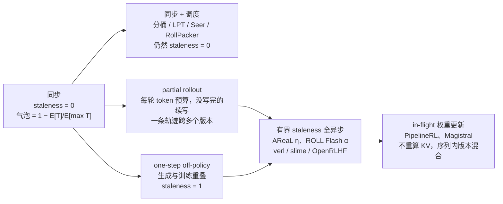

**中文** · [English](README.en.md)

# 模块 06：长尾与异步——别让整个集群等最慢的那条轨迹

> 🕐 建议时长：2.5 小时 ｜ 🎯 学完你能：推导并心算同步 RL 的气泡比例；讲清 partial rollout、过量发射、有界 staleness 异步、in-flight 权重更新各自换来什么、付出什么；用 decoupled PPO、截断重要性采样（TIS）和 routing replay 论证「异步 + 低精度 rollout + MoE」为什么还能稳定训练；估算权重同步时间与沙箱并发量 ｜ 🧪 实验：[`lab.py`](lab.py) ｜ 📖 必读一手资料：[AReaL（arXiv 2505.24298）](https://arxiv.org/abs/2505.24298) 第 4–5 节、[Kimi k1.5（arXiv 2501.12599）](https://arxiv.org/abs/2501.12599) 第 2.6 节

## 0. 一句话

**同步 RL 的一步有多长，由 batch 里最慢的那条轨迹决定；agentic 负载的长尾让「最慢」比「平均」长出一个数量级，差值全是 GPU 空转。** 解法只有三类：**别让它慢**（调度、按长度分桶、超时、冗余环境）、**不等它写完**（partial rollout：没写完的轨迹留到下一轮续写）、**根本不等**（异步：生成和训练解耦）。后两类都拿 staleness（陈旧度：训练用的样本是几个版本之前的策略生成的）换吞吐，能换多少由 off-policy 修正决定。更要紧的是：即使完全同步，推理引擎和训练框架对同一个 token 算出的概率通常也不一样（训推不一致），所以**很多大规模 RL 系统即使同步也是「有效 off-policy」的**。这不是宿命：用 batch-invariant kernel、统一训推精度、两端使用相同的采样 mask 与 MoE 路由、并记录真实的 rollout logprob，可以把训推 KL 做到接近 0，代价是推理变慢和工程复杂度（§6.1）。

## 1. 大厂为什么在意

场景（示意）：agentic coding 的 RL。一步取 512 道 SWE 题，每题采 8 条轨迹做组内对比（GRPO 的 group），一共 4096 条。每条轨迹 5–100 轮「生成 → 调工具（读文件、编译、跑测试）→ 把结果追加进上下文」；生成长度从几百到几万 token，工具延迟从毫秒到分钟，偶尔沙箱卡死。同步训练的规则是：4096 条**全部**结束，才开始算梯度。

公开数字：

| 事实 | 数字 | 来源 |
|---|---|---|
| rollout（采样轨迹）是 RL 迭代的大头 | 三个生产负载中占迭代时间 63%–87%（Moonlight 84%、Qwen2-VL-72B 63%、Kimi-K2 87%） | [Seer（arXiv 2511.14617）](https://arxiv.org/abs/2511.14617) |
| rollout 里的大头是尾巴 | 生成长度从几百到 96k token；最后完成的 10% 请求最多吃掉 50% 的时间；推理实例间最早与最晚完成相差总时间的 70%，每个实例平均空闲 1,580 秒（占 37%）；单次迭代出现 13,686 次抢占 | 同上 |
| agentic 轨迹差异更极端 | 长轨迹比短轨迹多两个数量级的 token；训练中出现超过 100 轮工具调用、超过 400k 输出 token 的轨迹 | [ASearcher（arXiv 2508.07976）](https://arxiv.org/abs/2508.07976) |
| 异步能拿回多少 | AReaL 相同 GPU 数下最高 2.77× 训练加速（相对其自身的同步实现；相对 verl 为 2.27×）；ROLL Flash 在 RLVR 上最高 2.24×，agentic 任务 ALFWorld 2.72×、SWE 1.81× | [AReaL](https://arxiv.org/abs/2505.24298)、[ROLL Flash（arXiv 2510.11345）](https://arxiv.org/abs/2510.11345) |
| RL 已经是大钱 | DeepSeek-V3.2 的后训练算力预算超过预训练成本的 10% | [DeepSeek-V3.2（arXiv 2512.02556）](https://arxiv.org/abs/2512.02556) |
| 环境也是大规模系统 | Kimi K2 的代码沙箱支持超过 10,000 个并发实例；DeepSeek DSec 生产中支撑超过 380,000 个并发沙箱、每秒超过 5,000 次创建 | [Kimi K2（arXiv 2507.20534）](https://arxiv.org/abs/2507.20534)、[DSec（arXiv 2609.22978）](https://arxiv.org/abs/2609.22978) |

读法：**rollout 是大头，rollout 里的大头是尾巴，尾巴来自生成、多轮、工具、环境四处方差的叠加。** 这也是 2025–2026 年这一方向密集出现 AReaL、ROLL Flash、APRIL、Seer、RollPacker、PipelineRL 等系统工作的原因。

## 2. 长尾从哪里来

一条 agentic 轨迹的墙钟时间：

$$T=\sum_{k=1}^{K}\big(g_k+w_k\big),\qquad g_k\approx(\text{第 }k\text{ 轮输出 token 数})\times\text{TPOT}$$

其中 $K$ 是轮数（随机），$g_k$ 是第 $k$ 轮生成时间（TPOT：time per output token，每个输出 token 的解码时间，见 [模块 01](../01_inference_basics/README.md)），$w_k$ 是工具/环境等待时间。四个方差源：

| 来源 | 表现 | 公开例子 | 典型对策（本模块位置） |
|---|---|---|---|
| 生成长度 | reasoning 长度重尾，被 max_tokens 截断 | 几百到 96k token（Seer） | partial rollout、分桶、重复检测提前截断（§4） |
| 轮数 | 同一道题有的 3 轮解决、有的 50 轮 | 超过 100 轮（ASearcher） | 异步、按轮续写（§4） |
| 工具延迟 | 读文件毫秒级、跑测试分钟级 | ROLL Flash 在高延迟方差下做环境级异步 | 环境级异步、超时（§4.7） |
| 环境失败 | fail-slow（变慢）与 fail-stop（挂掉），ROLL Flash 的用语 | ROLL Flash 冗余环境 | 冗余环境、重试、把失败样本 mask 掉（§4.7） |

还有一个放大器：长序列占 KV cache，显存不够时引擎会抢占（preempt）并在之后重算，进一步拉长尾部（Seer 单次迭代的 13,686 次抢占）。

**为什么「和」仍然是重尾？** 重尾（次指数）分布有「一次大跳」原理：$P(\sum_i X_i>x)\approx n\,P(X>x)$，即总和很大几乎总是因为**某一项**很大。所以一条轨迹慢，通常是某一轮生成特别长、或某一次工具调用卡住——这正是 partial rollout（按预算切开）和超时（切掉单次大跳）有效的原因。

## 3. 同步模式的气泡：推导

### 3.1 最小模型

$n$ 条轨迹同时开始，每条占一个 slot（槽位：一个 rollout worker，或推理引擎里一个并发序列位置），时长 $T_i$ 独立同分布。同步屏障（barrier）要等到 $M_n=\max_i T_i$。槽位忙碌比例与气泡（bubble，空转比例）：

$$\text{busy}=\frac{\mathbb E\big[\sum_i T_i\big]}{n\,\mathbb E[M_n]}=\frac{\mathbb E[T]}{\mathbb E[M_n]},\qquad \text{bubble}=1-\text{busy}$$

### 3.2 Pareto 尾的闭式解

设 $T\sim\text{Pareto}(\alpha,x_m)$：$P(T>t)=(x_m/t)^\alpha,\ t\ge x_m$。$\alpha$ 越小尾越重（$\alpha\le2$ 时方差无穷）。$\mathbb E[T]=\alpha x_m/(\alpha-1)$。

写成 $T=x_mU^{-1/\alpha}$（$U$ 为均匀分布），最大值对应最小的 $U$，而 $U_{(1)}\sim\text{Beta}(1,n)$，于是

$$\mathbb E[M_n]=x_m\,\frac{\Gamma(n+1)\,\Gamma(1-1/\alpha)}{\Gamma(n+1-1/\alpha)}\;\approx\;x_m\,\Gamma(1-1/\alpha)\,n^{1/\alpha}$$

$$\text{busy}\approx\frac{\alpha}{(\alpha-1)\,\Gamma(1-1/\alpha)}\;n^{-1/\alpha}\approx 1.1\,n^{-1/\alpha}$$

（$1.2\le\alpha\le3$ 时前面的系数在 1.08–1.13 之间，心算取 1.1。）

| 槽位忙碌比例 | n = 64 | n = 256 | n = 1024 |
|---|---|---|---|
| 指数分布（轻尾，$1/H_n$） | 21.1% | 16.3% | 13.3% |
| Pareto α = 3 | 27.6% | 17.4% | 11.0% |
| Pareto α = 2 | 14.1% | 7.0% | 3.5% |
| Pareto α = 1.5 | 7.0% | 2.8% | 1.1% |

两条结论：(1) **batch 越大越糟**，轻尾时按 $1/\ln n$ 缓慢下降，重尾时按幂律 $n^{-1/\alpha}$ 下降；(2) **尾越重越糟**。大 batch 本来是为了降梯度方差、摊薄通信，却在同步 rollout 里直接放大气泡——这是同步系统的根本矛盾。练习 (a) 实现这个闭式解。

注意表里的一个「反例」：n = 64、256 时，轻尾的指数分布反而比 Pareto α = 3 更糟。原因是 Pareto 有下限 $x_m=\frac{\alpha-1}{\alpha}\times$均值，α = 3 时变异系数（CV）只有 $1/\sqrt{\alpha(\alpha-2)}\approx0.58$，比指数分布的 1 小——表里把尾指数和离散程度混在了一起，两者要到 n ≈ 373 才交叉。所以结论 (2) 指的是同一分布族内比较，或 n 很大时。常数从哪来：$\Gamma(1-1/\alpha)$ 是 Fréchet 极值分布的均值，所以「最大值按 $n^{1/\alpha}$ 增长」对任何幂律（正则变化）尾都成立；lognormal 尾的最大值只按 $\exp(\sigma\sqrt{2\ln n})$ 增长，慢得多。系数 $\alpha/((\alpha-1)\Gamma(1-1/\alpha))$ 对所有 α > 1 都落在 (1, 1.13] 内（峰值在 α ≈ 1.86），所以心算 busy ≈ $n^{-1/\alpha}$ 的误差不超过 13%。

### 3.3 真实系统都有截断：心算版

纯 Pareto 太悲观，因为真实系统有 max_tokens、max_turns、超时，把 $T$ 截在 $L$。只要 $n$ 大到几乎一定有人撞上限（概率 $1-(1-p_L)^n$，$p_L=P(T\ge L)$），就有 $\mathbb E[M_n]\approx L$：

$$\text{busy}\approx\frac{\mathbb E[\min(T,L)]}{L}=\frac{\text{平均长度}}{\text{最大长度}}$$

心算：平均 8k token、上限 32k → 忙碌 25%、气泡 75%。「几乎一定有人撞上限」有多容易？若只有 1% 的回答会撞上限，$n=256$ 时 $1-0.99^{256}\approx92\%$；$n=4096$ 时几乎是 100%。

### 3.4 continuous batching 视角：同一个公式

推理引擎里不是「一条轨迹一个 worker」，而是一个 batch 一起 decode。decode 是访存受限的（见 [模块 01](../01_inference_basics/README.md)），每步时间主要由读权重决定，batch 小了每步也快不了多少，所以**引擎的 token 吞吐近似正比于活跃序列数**。同步模式下完成的序列不会被新请求补位，活跃数从 $B$ 一路掉到 1：

$$\text{利用率}\approx\frac{\sum_i L_i}{B\cdot\max_i L_i}$$

和 §3.1 同一个式子，只是把「时间」换成「token 数」。但它只在**权重读取主导**时近似成立。每步时间 ≈（权重字节 + 所有活跃序列的 KV 字节）/ 带宽；长上下文的 GQA 稠密模型往往是 KV 读取主导。用 `codesign_sim` 的 `kv_bytes_per_token` 算：Qwen3-32B 每 token KV 约 262 KB、BF16 权重约 66 GB，128 条 × 16k 上下文每步要读约 615 GB，尾部只剩 4 条 × 32k 时约 100 GB，**每步快约 6 倍**；Llama-3-70B 同样场景约 4.5 倍。所以按 token 算的气泡会明显高估按时间算的气泡。尾部的真实损失在别处：小 batch 下算力几乎全闲（MFU 趋近 0）、每步固定的权重读取、实例之间的负载不均（Seer 测到每个实例平均空闲 37%）。算力富余也正是尾部适合做推测解码的原因（Seer 的组内推测解码）。MLA 模型（如 DeepSeek-V3，每 token KV 约 70 KB）KV 小得多，权重读取仍占主导；MoE 在小 batch 下被激活的专家变少，权重读取也会随之下降。

### 3.5 把训练阶段算进来（colocated 同步）

colocated（训推共卡：同一批 GPU 轮流做生成和训练）时，一步墙钟 = rollout 阶段 + 训练阶段。若 rollout 占一步时间的比例为 $f$，rollout 阶段内槽位忙碌比例为 busy，则集群的空转比例约为

$$\text{idle}\approx f\,(1-\text{busy})$$

心算：$f=80\%$（Seer 表中 Moonlight 84%、K2 87%），rollout 阶段忙碌 40% → 集群约 48% 的 GPU 时间在空转。

### 3.6 推理服务侧：同一个问题换了个名字

多 agent 执行里的 fan-out/fan-in（扇出/汇合）屏障就是同步 rollout：lead agent 并行派出 $k$ 个 subagent，等**全部**返回再继续。Anthropic 公开说明其多 agent 研究系统的 lead agent 目前同步执行 subagent，等每一组都完成才继续，并把这列为瓶颈（[Anthropic 工程博客](https://www.anthropic.com/engineering/multi-agent-research-system)）。

- 屏障延迟 $=\mathbb E[M_k]$。指数分布：$\mathbb E[M_k]=H_k\times$均值，$k=8$ 时 $H_8\approx2.72$，**8 路扇出平均要等 2.7 倍均值**；Pareto α = 2、$k=8$：$5.09\,x_m$ 对均值 $2\,x_m$，约 2.5 倍。
- 在线服务的经典版本：单台服务器 p99 是 1 秒，一个请求扇出到 100 台，就有 $1-0.99^{100}\approx63\%$ 的请求超过 1 秒（[The Tail at Scale](https://research.google/pubs/the-tail-at-scale/)，Dean & Barroso，CACM 2013）。
- 对策与训练侧一一对应：
  - **按程序调度**：Autellix 把整个 agent 程序而非单次 LLM 调用当作调度单位，缓解队头阻塞（head-of-line blocking），相同延迟下吞吐比 vLLM 等系统高 4–15×（[arXiv 2502.13965](https://arxiv.org/abs/2502.13965)）↔ 训练侧的按长度分桶。
  - **对冲请求**（hedged request）：请求超过 p95 仍未返回就发备份，额外负载约 5%（The Tail at Scale）↔ 训练侧的冗余环境。
  - **quorum 汇合**：等到 $k$ 个里的 $k'$ 个就继续 ↔ 训练侧的过量发射 + 提前截断。
  - **工具等待期间保留 KV**：慢 agent 等工具时占着 KV cache，驱逐还是保留（见 [模块 05](../05_cache_prefill/README.md)）↔ 训练侧 partial rollout 续写时 KV 重不重算。

## 4. 方案谱系



时间线（`=` 表示在干活，`.` 表示空转）：

```
同步（colocated）
GPU    |==gen==........|=train=|==gen==........|=train=|
               ^ 尾巴：只剩几条序列在跑

one-step off-policy（分离部署）
gen    |== gen v0 ==|== gen v1 ==|== gen v2 ==|
train               |= train(batch0) =|= train(batch1) =|
                     用上一步的数据训练：staleness 恰好 = 1；长尾仍在 gen 里

全异步 + 有界 staleness
gen    |a1 a2 a3 a4 a5 a6 a7 a8 ...  每条轨迹独立开始、独立结束
train       |step1|step2|step3|...   攒够 B 条就训；准入控制保证版本差 ≤ η
```

### 4.1 不引入 staleness 的办法：调度与分桶

- **按长度分桶 / tail batching**：RollPacker 把会产生长尾回答的 prompt 集中到少数几步（long rounds），多数步都是短而均衡的 rollout，端到端训练时间比 veRL 减少 2.03–2.56×（[arXiv 2509.21009](https://arxiv.org/abs/2509.21009)）。
- **利用组内相似性**：Seer 观察到同一 prompt 的多条回答在长度和模式上高度相似，于是把 group 拆成更小的块增量调度（divided rollout）、按上下文调度长尾请求、做组内推测解码，rollout 吞吐最高提升 2.04×、长尾延迟降低 72–94%，并且保持同步（[arXiv 2511.14617](https://arxiv.org/abs/2511.14617)）。
- **长度预测**：StreamRL 用输出长度排序模型识别长尾样本，做偏度感知的派发与调度，吞吐最高提升 2.66×（[arXiv 2504.15930](https://arxiv.org/abs/2504.15930)）。
- **队列调度与 prompt 复制**：ROLL Flash 把每个 prompt 当独立任务、完成即算奖励，配合动态过滤时每步生成从 125 秒降到 37 秒；把一个 prompt 的多条回答拆成独立任务分散到多卡，64×16 配置下从 149 秒降到 81 秒（[arXiv 2510.11345](https://arxiv.org/abs/2510.11345)）。
- **经典调度**：已知（或预测）长度时，最长的先派、派给当前最闲的 worker（LPT，Longest Processing Time first），makespan（全部完成的时刻）不超过最优的 $4/3-1/(3m)$ 倍（Graham 1969，[SIAM J. Appl. Math.](https://doi.org/10.1137/0117039)）。练习 (d) 实现它。

代价：需要长度预测，预测错了尾巴还在；也不改变单条轨迹的内在长度——一条轨迹本身要跑 30 分钟，调度只能让别人别陪它等。

### 4.2 Partial rollout：给每轮设预算，没写完的下轮续写

Kimi k1.5（第 2.6.2 节）的做法：每轮 rollout 设一个固定的**输出 token 预算**；超出预算的轨迹，未完成部分存入 replay buffer（回放缓冲区），下一轮继续写；之前各轮的片段可以直接从 buffer 复用，某些片段可以不参与 loss 计算；系统还会检测重复内容并提前终止。由于 rollout worker 彼此异步，有的 worker 在写长轨迹时，其他 worker 可以处理新的短任务（[arXiv 2501.12599](https://arxiv.org/abs/2501.12599)）。Kimi K2 把它用到了 agentic 长程任务上：为了防止长尾轨迹阻塞整个 rollout，未完成的长尾任务暂停、下一轮 RL 迭代再恢复（[arXiv 2507.20534](https://arxiv.org/abs/2507.20534) 第 3.3.4 节）。

在「n 条同时开始、每条一个槽」的一波玩具模型里，每轮 rollout 时长从 $\max_i T_i$ 变成 $\min(\max_i T_i,\;L_b)$（$L_b$ 为预算）。真实系统是多波次调度加跨轮积压（backlog）：没写完的工作不会消失，只是挪到后面几轮（工作守恒）；轮时长往往由「凑满一个 batch 的时间」而不是预算决定。预算也不是越小越好：切得越碎，续写与重算越多，长轨迹跨的版本越多——实验表 [5] 里每条轨迹每轮的预算从 120 s 降到 15 s，吞吐下降约 13%，token 加权 staleness 从 0.44 涨到 1.13。续写的份额不小：APRIL 报告被截断实例续写的 token 约占后续步 token 的 40%。

代价：**一条轨迹由多个版本的策略写成**——前半段是 $\pi_{v}$ 写的，后半段是 $\pi_{v+1}$ 写的。正确性条件见 §5.7；APRIL 报告实践中完成一条 rollout 从未跨越超过 5 个连续策略版本（[arXiv 2509.18521](https://arxiv.org/abs/2509.18521)）。工程上还要管理 buffer、版本元数据、续写时的 KV 重建。

### 4.3 过量发射 + 提前截断：APRIL

APRIL（Active Partial Rollouts）：每步发出 $N'>N$ 个请求，**凑够 $N$ 条完成的回答就停**，没写完的放进续写缓冲区，下一步优先续写、再开新请求。GRPO 下 Qwen3-8B 的 rollout 吞吐提升 26.4%–49.5%，全部实验平均约 22.5%；最终准确率平均提升约 2.1%；已集成进 slime（[arXiv 2509.18521](https://arxiv.org/abs/2509.18521)、[slime](https://github.com/THUDM/slime)）。

**为什么不能直接丢掉没写完的？**（推导）若每步只取最先完成的 $N$ 条、其余丢弃，训练 batch 的分布变成

$$q(y)\;\propto\;\mu(y)\cdot P\big(y\text{ 进入前 }N\text{ 名}\mid \text{长度}(y)\big)$$

这是**依赖长度的选择偏差**（survivor bias，幸存者偏差）：长回答被系统性低估，梯度把策略往「短」推。它不能用逐 token 重要性权重修正，因为选择概率取决于同一批里其他样本的长度，推理引擎不会记录它。APRIL 强调不丢弃任何 rollout，正是为了避开这一点。

**但不丢弃 ≠ 无偏。** 还有二阶偏差：(1) 在任何一步里，已完成的样本天然偏短、偏新，长样本被推迟、也更陈旧；一旦再叠加 TIS 截断、按 staleness 屏蔽或 V3.2 式的序列屏蔽（§5.4–§5.5），长样本会被系统性降权或删掉。(2) Seer 的生产对照（第 4.4.3 节）：与同步方法相比，partial rollout 产出的长回答比例明显更低，作者认为这一偏差可能损害 RL 训练；在显存受限的长 CoT 场景下，partial rollout 让在途请求量翻倍，加剧抢占；Seer 的平均吞吐比 partial rollout 高 43%。(3) 上面 40% 的续写 token 就是这一步的 off-policy 份额。反过来，真正丢弃的量级见实验表 [4]：α = 1.2 时「版本差超过 η 就中止并丢弃」让被训练样本的平均长度只有全部已发起样本的 0.67，按条计的吞吐反而高 20%、按 token 计低 11%——按条计数的指标会奖励这种偏差。

### 4.4 One-step off-policy：最简单的异步

verl 的 one-step off-policy 把生成和训练放在不同 GPU 上并行：训练用上一步生成的样本，同时生成下一步的样本，staleness 恰好为 1。在 2 节点 16 张 H20（4 卡生成、12 卡训练）上训练 Qwen2.5-Math-7B，FSDP2 后端快 23%（19h18m → 15h34m），Megatron 后端快 40%（18h21m → 13h06m）；权重用 NCCL 逐 tensor 从 actor 广播到 rollout，文档称大多数时候延迟低于 300 ms（[verl 文档](https://verl.readthedocs.io/en/latest/advance/one_step_off.html)）。

局限：它把训练时间藏到生成背后，但**消不掉生成内部的长尾**。文档明确说，如果等待上一轮生成的时间高、又有长尾序列，加资源没用，要去优化停止条件。

### 4.5 有界 staleness 的全异步：AReaL

AReaL 的架构（[arXiv 2505.24298](https://arxiv.org/abs/2505.24298)）：

1. **完全解耦**：rollout worker 不停地生成，训练 worker 每攒够一个 batch 就更新；实验里固定 3/4 的设备做推理。
2. **可中断生成**（interruptible rollout，第 4.1 节）：新权重到达时，打断所有进行中的生成，丢弃 KV cache，用新权重重算后继续解码。
3. **staleness 准入控制**（第 5.1 节）：设当前策略版本为 $i$、已生成（含这条新请求）的轨迹总数为 $N_r$、batch 大小为 $B$，只有满足

$$\left\lfloor\frac{N_r-1}{B}\right\rfloor\le i+\eta$$

才接受新的生成请求。读法：式 (3) 限制的是**提交速率**。第 $N_r$ 条轨迹「应当」落进第 $\lfloor (N_r-1)/B\rfloor$ 个 batch（从 0 数）；它由版本不低于 $i$ 的策略生成；**若轨迹按提交顺序被消费**，它的 staleness 不超过 $\eta$。长尾恰恰破坏这个假设：先提交的长轨迹晚完成，会落进更靠后的 batch。AReaL 的做法是组 batch 时优先用较旧的轨迹，并承认 η 太小时极长轨迹会拖慢生成；ROLL Flash 把 AReaL 的控制描述为「批内平均新鲜度」，而它自己的 α 是逐样本上界（SampleBuffer 限制在 (1+α) × batch size）。所以系统必须在三者之间选：续写（AReaL 的中断后用新权重继续）、中止（浪费算力并带来 §4.3 的长度偏差）、阻塞生成。实验表 [1][2] 里，按 AReaL 语义续写、η = 1 时，单条轨迹的最大 staleness 仍到 10–11。练习 (c) 在池配比设计里用到这个式子（§7.2）。

4. **decoupled PPO 目标**（第 5.2 节，§5.3 详解）。

结果：1.5B 模型训练时间从 41.0 小时降到 14.8 小时（2.77×），性能不降。注意基线是 AReaL 自己的同步实现（Sync.AReaL）；同表 verl 基线为 33.6 小时，相对 verl 是 2.27×。消融（AIME24，论文表 2）：

| 最大 staleness η | 朴素 PPO | decoupled PPO |
|---|---|---|
| 0（同步，oracle） | 42.0 | — |
| 1 | 41.8 | 42.1 |
| 2 | 40.0 | 41.8 |
| 4 | 23.3 | 42.2 |
| 8 | 35.7 | 41.0 |
| 16 | 35.8 | 38.7 |
| ∞ | 34.0 | 36.9 |

读法：朴素 PPO 在 η = 2 时已掉约 2 分，η ≥ 8 时稳定落后约 6 分；decoupled PPO 在 η ≤ 8 时基本保持（≥ 41.0），η = 16 开始下滑。η = 4 那一行（23.3）是非单调的离群点——它在 AIME25、AMC23、MATH500 上也都是朴素 PPO 最差的一行，而 η = 8、16 反而回升，不宜据此单点定规则。η 无界时两者都退化——**修正能扩大可用的 staleness 预算，但不能让预算无限大**。

### 4.6 In-flight 权重更新：连 KV 都不重算

PipelineRL 在生成过程中只短暂暂停来接收新权重，然后**带着旧的 KV cache 继续生成**进行中的序列；论文实测复用陈旧 KV 不会造成高发散，在 128 张 H100 的长推理任务上，达到相同奖励比传统 RL 基线快约 2×（[arXiv 2509.19128](https://arxiv.org/abs/2509.19128)）。Mistral 的 Magistral 也是如此：生成器在生成中途替换权重，进行中的序列带着稍旧的 KV cache 继续，作者发现重算 KV 并不必要（[arXiv 2506.10910](https://arxiv.org/abs/2506.10910) 第 3 节）。

证据的适用范围：PipelineRL 的陈旧 KV 实验是在 Qwen2.5 7B、最大序列长度 L = 2048、最大 lag 32 的设置下做的；外推到 $10^4$–$10^5$ token 的 agentic 轨迹尚无公开验证——旧 KV 覆盖的前缀越长，风险越大。论文也指出可以在每次更新后重算 KV 来缓解，但会降低吞吐。建议监控 in-flight 样本与重算样本之间的 KL 差。

后果：同一条序列内，**越早的 token 版本差越大**（PipelineRL 称 token lag 沿序列变化），而且后半段 token 的条件分布是「新权重 + 旧 KV」的混合体，不等于任何一个版本的策略。§5.7 说明为什么这在数学上仍然可以是正确的。

### 4.7 超时、重试与冗余环境

- **环境级异步**：ROLL Flash 让 LLM 生成与环境交互重叠，在 batch 512、环境延迟方差大的模拟中提升 2.46×。
- **冗余环境**：多开环境组来对冲 fail-slow / fail-stop；增加环境组数（`num_env_groups`）比增大 `group_size` 更抗故障，吞吐提升 7%–16%（ROLL Flash）。
- **对冲请求**：超过 p95 还没回来就发备份，额外负载约 5%（The Tail at Scale）。
- 工程规则（本模块的分析，不是某篇论文的结论）：
  1. 超时按工具类型设，参考该类工具延迟的高分位；超时是把「一次大跳」切掉的最便宜手段（§2）。
  2. 只重试幂等操作；有副作用的工具（写文件、跑迁移）重试前要回滚沙箱快照。
  3. **基础设施失败不是负奖励**：沙箱挂了就把这条样本 mask 掉（或整组重采），不要给 0 分，否则策略会学到「某些动作会导致失败」这种由基础设施噪声带来的虚假相关。
  4. 失败率、超时率要作为训练监控指标，和 reward 曲线放在一起看。

### 4.8 主流框架的异步能力（只列官方文档或论文可核实的）

| 框架 | 异步形态 | staleness 控制 | off-policy 修正 | 来源 |
|---|---|---|---|---|
| verl | one-step off-policy；fully async（Rollouter、MessageQueue、Trainer、ParameterSynchronizer，单样本粒度流式）；`partial_rollout` 在同步参数时用 sleep/resume 中断并续写；AgentLoop 在一步内按样本并发，但训练前仍有屏障 | `staleness_threshold`（陈旧样本比例上限）、`trigger_parameter_sync_step` | rollout correction：decoupled / bypass 两种模式；token / sequence / geometric 级 TIS 与拒绝采样 | [fully async](https://verl.readthedocs.io/en/latest/advance/fully_async.html)、[one-step](https://verl.readthedocs.io/en/latest/advance/one_step_off.html)、[agent loop](https://verl.readthedocs.io/en/latest/advance/agent_loop.html)、[rollout correction](https://verl.readthedocs.io/en/latest/algo/rollout_corr.html) |
| slime | Megatron 训练 + SGLang rollout + Data Buffer；`examples/fully_async` 面向长尾 agentic 生成；集成 APRIL；delta weight sync | README 中未核实到具体参数 | README 中未核实到 | [GitHub](https://github.com/THUDM/slime) |
| ROLL Flash | 细粒度并行（队列调度、prompt 复制、环境级异步、冗余环境）+ rollout–train 解耦 | asynchronous ratio α：单样本最大允许版本差；α = 2 对多数场景够用 | 实现并比较了 Decoupled PPO、TIS、CISPO、TOPR，异步比率 2 和 8 下精度相当 | [arXiv 2510.11345](https://arxiv.org/abs/2510.11345) |
| OpenRLHF | `--train.async_enable`；`--train.partial_rollout_enable`（vLLM pause/resume，进行中的样本混合新旧权重） | `--train.async_queue_size`（越大越 off-policy） | `--algo.advantage.is_correction_type` 可选 `tis` / `icepop` / `seq-mask-tis`，阈值默认 `0.5 5.0` | [文档](https://openrlhf.readthedocs.io/en/latest/agent_training.html) |
| AReaL | 全异步 + 可中断生成 | η | decoupled PPO | [arXiv 2505.24298](https://arxiv.org/abs/2505.24298) |

verl fully async 的实测：Qwen2.5-Math-7B 在 128 卡上 2.35–2.67×，30B 模型 1.7×。OpenRLHF 文档的建议值得记住：**先在同步模式下验证收敛，再切异步**。

### 4.9 长尾优化与 GRPO 组的交互

GRPO 的优势是「组内奖励减组内均值（再除以标准差）」，要等同一 prompt 的 G 条回答**全部**完成才能算。所以上面每一种长尾优化，都要回答「组何时闭合」：

- **调度单位是组，组内还有一道屏障。** 组的完成时间是 G 条中的最大值。Pareto α = 1.5、G = 8 时，$\mathbb E[M_8]/\mathbb E[T]=1/\text{busy}(1.5,8)\approx3.6$：一组的期望完成时间约为单条均值的 3.6 倍（练习 (a) 直接算）。APRIL 也是按「输入实例」（一个 prompt 及其全部回答）判断完成的。
- **组内长度相关，但组间更不均。** APRIL 测得同一 prompt 内回答长度的标准差通常低于 1,500 token（GRPO），而全 batch 约 4,000–4,500 token。相关性让组内屏障比独立假设下的 3.6 倍小，却让「整组一起长」——把组当不可分割的整体调度会造成实例间负载不均，这正是 Seer 的 divided rollout 要拆开的。
- **拆组带来的偏差**（分析）：(1) 同组样本在不同版本下启动，组内基线就混进了不同策略的样本；要么锁定同组同一版本，要么允许混版本但用逐 token 的 $\mu$ 做修正。(2) quorum / 提前截断只用先完成的 $G'$ 条算基线：基线只由较短样本决定，被丢的长样本连负反馈都得不到，长度与奖励的相关信号被吃掉——这是 §4.3 的幸存者偏差发生在组内。(3) 动态过滤（丢掉全对或全错的组）配合「先完成先入队」，会偏向简单、短的题。(4) tail batching 让某些步只含长题，步与步之间 batch 不再同分布，会与 token 级归一化、优化器统计量相互作用。
- **官方文档的提醒**：verl fully async 文档指出，一次下发的样本太少时，由于数据分布的顺序，可能造成训练不稳定和回答变长。

做法小结：以组为调度与续写单位；同组记录逐 token 的 $\mu$ 与版本；quorum 时基线用完整组；tail batching 下注意 token 级归一化。

## 5. 代价一：staleness 与 off-policy 修正（数学）

### 5.1 三个策略、三个因子

记号：$\mu$ 是**实际采样分布**（推理引擎里版本 $\theta_{t-k}$ 的策略，包含温度、top-p 等采样变换）；$\pi_{\text{old}}$ 是训练框架在当前版本 $\theta_t$ 上重算的概率（AReaL 称 $\pi_{\text{prox}}$）；$\pi_\theta$ 是正在优化的策略。逐 token 重要性比率（importance ratio）有恒等分解：

$$\rho_t=\frac{\pi_\theta}{\mu}=\underbrace{\frac{\pi_\theta}{\pi_{\text{old}}}}_{\text{本步内的更新}}\cdot\underbrace{\frac{\pi^{\text{train}}_{\theta_t}}{\pi^{\text{train}}_{\theta_{t-k}}}}_{\text{staleness（版本差 }k\text{）}}\cdot\underbrace{\frac{\pi^{\text{train}}_{\theta_{t-k}}}{\mu}}_{\text{训推不一致}}$$

（每一项都在同一个 token $y_t$、同一个前缀上取值。）第一项由 PPO 的 clip 管；第二项是异步带来的；第三项**即使 $k=0$ 也存在**。Qwen 团队把 IS 权重分解为「训推不一致 × 策略陈旧」两项，是同一思路（[arXiv 2512.01374](https://arxiv.org/abs/2512.01374)）。

**可观测性**：这是概念上的恒等式。训练端只在当前版本 $\theta_t$ 上重算 $\pi_{\text{old}}$（AReaL、verl 都是如此），不保存 $\theta_{t-k}$，所以因子 2 和因子 3 **只有乘积 $\pi_{\text{old}}/\mu$ 可观测**。后果：异步下 §6.4 监控的「训推 KL」其实混进了 staleness，单看它分不清该修 kernel 还是该收紧 η。分开的办法：只在 $k=0$ 的样本上统计训推 KL；或按版本差 $k$ 分桶画 KL——$k=0$ 处的截距反映训推不一致，随 $k$ 的斜率反映 staleness。in-flight 更新（新权重 + 旧 KV）时，因子 3 也不再是纯粹的训推不一致。

### 5.2 为什么不能直接用序列级 IS

目标 $J(\theta)=\mathbb E_{y\sim\pi_\theta}[R(y)]$，off-policy 梯度：

$$\nabla J=\mathbb E_{y\sim\mu}\Big[W(y)\,R(y)\,\nabla\log\pi_\theta(y)\Big],\qquad W(y)=\prod_{t=1}^{T}\rho_t$$

$W$ 无偏，但方差随长度指数增长：若各 token 独立，$\mathbb E_\mu[W^2]=\prod_t\big(1+\chi^2_t\big)$（$\chi^2_t$ 为第 $t$ 步两分布的 χ² 散度）。verl 文档的例子：每个 token 比率约 1.1，10 个 token 的序列 $W\approx2.6$，100 个 token 约 13,780——长回答的权重被系统性放大或压缩，文档称之为 length trap。agentic 轨迹动辄 $10^4$–$10^5$ token，序列级 IS 基本不可用。

于是实践中用**逐 token 的代理目标**：

$$L(\theta)=\mathbb E_{y\sim\mu}\Big[\sum_t \rho_t(\theta)\,\hat A_t\Big]$$

它在 $\pi_\theta=\mu$ 处的梯度与真目标一致，偏离后误差是高阶的——它丢掉了「前缀（状态）分布也变了」这一项。这和 TRPO 的局部近似 $L_{\pi_{\text{old}}}$ 是同一回事，误差由策略间 KL 控制（[arXiv 1502.05477](https://arxiv.org/abs/1502.05477)）；Qwen 团队把 token 级目标解释为序列级目标的一阶近似（[arXiv 2512.01374](https://arxiv.org/abs/2512.01374)）。**结论：token 级 IS 只在 $\pi_\theta$ 与 $\mu$ 足够接近时成立**，所以 staleness 和训推不一致本质上在消耗同一份「信任域预算」。对做过 offline RL 的你：这是 offline RL 里 distribution shift 的在线版，区别是这里的行为策略就是几步之前的自己，偏离可控。

### 5.3 Decoupled PPO：把「信任域中心」和「行为策略」拆开

朴素 PPO 直接拿陈旧的 $\mu$ 当 $\pi_{\text{old}}$：比率 $r=\pi_\theta/\mu$ 在这一步刚开始就偏离 1。PPO 的目标 $\min\big(rA,\ \text{clip}(r,1-\epsilon,1+\epsilon)A\big)$ 在越界时分四种情况：

| | $r>1+\epsilon$ | $r<1-\epsilon$ |
|---|---|---|
| $A>0$ | 取截断值，梯度为 0 | 取 $rA$，梯度照常 |
| $A<0$ | 取 $rA$，梯度照常，且 $\lvert rA\rvert$ 无上界 | 取截断值，梯度为 0 |

零梯度只出现在比率**已经朝优势偏好的方向**越界时——这部分数据被浪费。反方向越界时（尤其 $A<0$ 且 $r\gg1+\epsilon$），min 取未截断项，梯度照常流动，而 $rA$ 没有下界。陈旧数据上 $r$ 可以远大于 $1+\epsilon$，这正是异步训练不稳定的主要来源之一，也是 dual-clip PPO 要解决的问题：$A<0$ 时再取 $\max\big(\min(rA,\text{clip}(r,1-\epsilon,1+\epsilon)A),\ cA\big)$，$c>1$，给目标加下界（[arXiv 1912.09729](https://arxiv.org/abs/1912.09729)）。此外，信任域以旧策略为中心，约束的对象也错了。

Hilton、Cobbe、Schulman 提出把「控制更新幅度的近端策略」与「做 off-policy 修正的行为策略」解耦（[arXiv 2110.00641](https://arxiv.org/abs/2110.00641)）。AReaL 的目标（第 5.2 节式 5）：

$$J(\theta)=\mathbb E_{y\sim\pi_{\text{behav}}}\Big[\sum_t\frac{\pi_{\text{prox}}(y_t)}{\pi_{\text{behav}}(y_t)}\min\Big(u_t(\theta)\hat A_t,\;\text{clip}\big(u_t(\theta),1-\epsilon,1+\epsilon\big)\hat A_t\Big)\Big],\quad u_t(\theta)=\frac{\pi_\theta(y_t)}{\pi_{\text{prox}}(y_t)}$$

- 信任域以 $\pi_{\text{prox}}$（最近的策略）为中心：AReaL 直接用「每次模型更新前的参数」当 $\pi_{\text{prox}}$，在每个训练步 batch 到达时重算 token 概率。
- $\pi_{\text{prox}}/\pi_{\text{behav}}$ 对 $\theta$ 是常数，只负责修正分布偏差；实践里常再截断，即 verl 的 `decoupled_token_is`：权重取 $\min(\pi_{\text{old}}/\pi_{\text{rollout}},C)$。
- 代价：每个训练步多一次前向（重算 $\pi_{\text{prox}}$）。verl 的 bypass 模式令 $\pi_{\text{old}}=\pi_{\text{rollout}}$ 省掉这次前向，换来的是信任域中心回到陈旧策略上。
- decoupled 目标只解决「信任域中心」问题：权重 $\pi_{\text{prox}}/\pi_{\text{behav}}$ 本身没有上界，陈旧越严重方差越大，所以实践中还要叠加截断（§5.4）。

### 5.4 截断 IS：偏差、方差与 V-trace

截断重要性采样（TIS，truncated importance sampling）：$w=\min(\rho,C)$。对任意有界函数 $g$（比如 $\hat A\,\nabla\log\pi$ 的某个分量）有恒等式：

$$\mathbb E_\mu\big[\min(\rho,C)\,g\big]=\mathbb E_\pi[g]-\mathbb E_\pi\Big[\big(1-\tfrac{C}{\rho}\big)_+\,g\Big]$$

（证明：$\min(\rho,C)=\rho-(\rho-C)_+$，再用 $\mathbb E_\mu[\rho f]=\mathbb E_\pi[f]$。）两个前提要写清楚：(1) 最后一步要求 $\text{supp}(\pi)\subseteq\text{supp}(\mu)$。top-p / top-k 采样把一部分词表的 $\mu$ 置零，破坏了这一条件，这时右边还要再减一项 $\mathbb E_\pi[g\cdot\mathbb 1\{\mu=0\}]$——正是 §5.5 的 Keep Sampling Mask 要消掉的那一项。(2) 这是**给定前缀**时对单个 token 成立的，不覆盖前缀分布本身的偏移（§5.2）。于是：

- **偏差** $\le\|g\|_\infty\cdot P_\pi(\rho>C)$：只来自 $\pi$ 比 $\mu$ 偏好得多的那部分概率质量。
- **二阶矩** $\mathbb E_\mu[w^2g^2]\le C\,\mathbb E_\mu[\rho g^2]=C\,\mathbb E_\pi[g^2]$：方差最多放大 $C$ 倍。

$C$ 就是偏差–方差旋钮。公开取值：verl 的 FP8 rollout 推荐 token 级 TIS、$C=2$，rollout correction 文档推荐 token 级阈值 1.5–5.0、序列级 2.0–10.0；LlamaRL 的 AIPO 用 $\min(\pi/\mu,\rho)$，$\rho\in[2,10]$ 通常都行（[arXiv 2505.24034](https://arxiv.org/abs/2505.24034)）；OpenRLHF 默认区间 0.5–5.0。在 LLM RL 里用 TIS 修正训推不一致的做法，出自 Yao 等人的博客《Your Efficient RL Framework Secretly Brings You Off-Policy RL Training》（[博客](https://fengyao.notion.site/off-policy-rl)）。练习 (b) 实现 token 与 sequence 两个级别。

**与 off-policy / offline RL 的联系**：IMPALA 的 V-trace 用 $\rho_t=\min(\bar\rho,\pi/\mu)$、$c_i=\lambda\min(\bar c,\pi/\mu)$ 两种截断权重。论文证明其不动点是策略

$$\pi_{\bar\rho}(a\mid x)=\frac{\min\big(\bar\rho\,\mu(a\mid x),\,\pi(a\mid x)\big)}{\sum_b\min\big(\bar\rho\,\mu(b\mid x),\,\pi(b\mid x)\big)}$$

的价值函数——一个介于 $\mu$ 和 $\pi$ 之间的策略；$\bar\rho$ 决定收敛到什么，$\bar c$ 只影响收敛速度（[arXiv 1802.01561](https://arxiv.org/abs/1802.01561)）。Retrace(λ) 的迹系数 $c_s=\lambda\min(1,\pi/\mu)$ 属于同一族（[arXiv 1606.02647](https://arxiv.org/abs/1606.02647)）。TIS 与它同构，而且可以写成恒等式而不只是类比：

$$\mathbb E_\mu\big[\min(\rho,C)\,g\big]=\sum_y\min\big(\pi(y),C\mu(y)\big)\,g(y)=Z_C\,\mathbb E_{\pi_C}[g],\qquad \pi_C\propto\min(\pi,C\mu),\quad Z_C=1-\mathbb E_\pi\big[(1-\tfrac{C}{\rho})_+\big]$$

即 **TIS 的梯度就是「被压向行为策略的策略 $\pi_C$」的梯度乘一个缩放因子**，截断越狠拉得越多。对有 offline RL 背景的你，更准确的对应是「策略与行为策略的密度比不超过 $C$」这类约束，而不是笼统的行为正则。（IMPALA 与 Retrace 本身是 online off-policy 方法。）

**截断还是屏蔽（mask）？** 截断保留样本、压低权重；屏蔽（verl 称 rejection sampling，OpenRLHF 的 `icepop`）把比率超出 $[\text{lo},\text{hi}]$ 的 token 或序列直接置零。屏蔽更激进，丢掉的是信号；截断保留方向、限制幅度。verl 的 IS 权重只有 token 与 sequence 两级（配置项 `rollout_is`）；几何平均 $\rho_{\text{geo}}=\exp\big(\frac1{|T|}\sum_t\log\rho_t\big)$ 只用于拒绝采样（Geo-RS，`rollout_rs = "seq_mean_k1"`）。它不是任何两个分布之间的似然比，没有 IS 的无偏性，只是一个不随长度爆炸的**过滤统计量**。

**CISPO**（MiniMax-M1）：不 clip 更新，而是 clip IS 权重并 stop-gradient：$\text{sg}\big(\text{clip}(r_t,1-\epsilon^{IS}_{low},1+\epsilon^{IS}_{high})\big)\,\hat A_t\,\log\pi_\theta(y_t)$，好处是所有 token 都保留梯度，这对长回答尤其重要（[arXiv 2506.13585](https://arxiv.org/abs/2506.13585)）。对照：PPO 里被 clip 的 token 梯度为 0。

### 5.5 DeepSeek-V3.2：只屏蔽「负优势且太 off-policy」的序列

DeepSeek-V3.2（第 3.1 节）的 off-policy sequence masking：

$$M_{i,t}=\begin{cases}0,&\hat A_{i,t}<0\ \text{且}\ \dfrac1{|o_i|}\sum_t\log\dfrac{\mu(o_{i,t})}{\pi_\theta(o_{i,t})}>\delta\\[4pt]1,&\text{否则}\end{cases}$$

记号提醒：论文原式写的是 $\pi_{\text{old}}$，但原文特意说明它指**推理框架直接返回的采样概率**，也就是本模块的 $\mu$，而不是 §5.1 里训练端重算的 $\pi_{\text{old}}$。所以这个 KL 同时覆盖多次 mini-batch 更新（§5.1 因子 1）与训推不一致（因子 3），异步时还包括 staleness（因子 2）。若序列确实由 $\mu$ 采样，条件里平均对数比率的期望是按 token 平均的 $\mathrm{KL}(\mu\,\|\,\pi_\theta)$；单条序列上的值只是高方差的代理量。论文给出的理由：推理与训练框架的差异加上多次 mini-batch 更新会让样本变得 off-policy，**高度 off-policy 的负样本可能误导或破坏优化**。直觉（本模块的分析）：正样本的更新把 $\pi_\theta$ 拉回这条样本，偏离会自我修正；而 $\pi_\theta$ 已经不太会生成的负样本，再往下压带来的信息很少，却把概率质量推向不可控的其他 token。

同一节还有两条与本模块直接相关的做法：

- **Keep Sampling Mask**：采样时 top-p / top-k 截掉了部分词表，训练时把同一个截断 mask 施加到 $\pi_\theta$ 上；否则 $\pi_\theta$ 与 $\mu$ 的动作空间（支撑集）不一致，比率本身就是错的。
- **Keep Routing**：见 §6.3。

### 5.6 staleness 有多「贵」：KL 随版本差增长

小步更新时 $\mathrm{KL}(\pi_{\theta+\Delta}\,\|\,\pi_\theta)\approx\tfrac12\Delta^\top F\Delta$（$F$ 为 Fisher 信息矩阵）。版本差为 $k$ 时 $\Delta=\sum_{j=1}^k\Delta_j$：

- 各步更新方向一致：$\|\Delta\|\approx k\|\Delta_1\|$，$\mathrm{KL}\propto k^2$；
- 各步更新互不相关：$\mathbb E\|\Delta\|^2\approx k\|\Delta_1\|^2$，$\mathrm{KL}\propto k$。

所以 **staleness 带来的漂移介于 $k$ 和 $k^2$ 之间**，并且和学习率的平方成正比——staleness 预算和学习率是同一份信任域预算的两种花法。这与实证方向一致：AReaL 表 2 中朴素 PPO 从 η = 2 起开始掉分，decoupled 目标在 η ≤ 8 时基本保持；ROLL Flash 发现 α = 2 对多数场景够用。

**staleness 与长度是耦合的。** 在 partial rollout 与异步下，越长的轨迹跨越的版本越多，所以按条数统计的 staleness 会低估按 token 加权的 staleness——而 loss 是按 token 算的。同时，token 级代理目标的误差随长度超线性增长（verl 数学文档：token 级修正的偏差为 $O(T^2\Delta_{\max})$，$T$ 为序列长度，$\Delta_{\max}$ 为最大逐 token 偏离）。于是**最长的轨迹既最陈旧、又对陈旧最敏感**。可操作的做法：staleness 按 token 加权统计与设上限；对长轨迹用更严格的截断或屏蔽，或优先续写长轨迹。

监控上不要只看最大版本差。PipelineRL 指出它的最大 lag 比所有传统 RL 配置都高，有效样本量（ESS，effective sample size）却与 lag 小得多的传统配置相当：

$$\text{ESS}=\frac{\big(\sum_i w_i\big)^2}{\sum_i w_i^2}\in[1,n]$$

ESS / n 接近 1 说明权重很均匀、数据基本 on-policy。

### 5.7 Partial rollout 与 in-flight 更新为什么在数学上仍然正确

关键观察：**重要性采样只要求分母是「真正用来采样的那个概率」**。无论一条轨迹跨了几个版本、后半段是否带着旧 KV，只要推理引擎在采样每个 token 时记录下采样概率 $\mu_t(y_t\mid y_{<t})$，那么

$$\prod_t\frac{\pi_\theta(y_t\mid y_{<t})}{\mu_t(y_t\mid y_{<t})}$$

就是这条序列的精确似然比——纯文本序列的采样概率就是逐 token 采样概率之积，不管每一步用的是什么分布。所以「新权重 + 旧 KV」的混合体在数学上不需要额外处理，问题只在于它离 $\pi_\theta$ 有多远（方差）。

**agentic 轨迹多一个前提。** 完整轨迹还包含工具结果与环境转移：$p(\tau)=\prod_t\mu(a_t\mid s_t)\cdot\prod_t P(s_{t+1}\mid s_t,a_t)$。只有当环境转移与策略无关、且训练与 rollout 面对同一个环境分布时，环境项才在分子分母中相消，似然比才化为逐 token 概率之积（或者把环境随机性当作条件）。工具随机性、沙箱故障、超时策略的变化都不能靠 token 级 IS 修正，只能 mask / 重采，或显式建模选择概率（§4.7）。

工程要求因此是三条：

1. 推理引擎必须返回**采样分布下**的 logprob（含温度、top-p/top-k 截断；否则就是 §5.5 的 Keep Sampling Mask 问题）。注意默认值：vLLM 的 `logprobs_mode` 默认是 `"raw_logprobs"`，即施加温度、top-k/top-p 等处理**之前**的值；要拿到采样分布需设为 `"processed_logprobs"`，或在训练端复现同样的温度与截断 mask——两端必须一致；
2. 训练端必须**用记录下来的值**当 $\mu$，不能用训练框架重算的值代替（verl fully async 文档里的 `use_rollout_log_probs=True` 就是这个开关）；
3. 每个 token 带上生成它的版本号，才能统计 staleness 分布、做准入控制；版本号还应标在 **KV 的来源**上，而不只是采样时刻（§7.5）。

## 6. 代价二：训推不一致

### 6.1 同样的权重，不一样的概率

来源：注意力 / GEMM kernel 不同、算子融合不同、batch 形状不同（归约顺序随之变化）、精度（BF16 舍入）、LM head 精度、量化 rollout、MoE 路由翻转。

| 现象 | 公开数字 | 来源 |
|---|---|---|
| 温度 0 也不确定 | Qwen3-235B 同一 prompt 采 1000 次得到 80 种不同结果；主因是负载（batch 大小）变化导致的 batch 不变性缺失；换 batch-invariant kernel 后 1000 次完全一致 | [Thinking Machines](https://thinkingmachines.ai/blog/defeating-nondeterminism-in-llm-inference/) |
| 确定性的代价 | Qwen3-8B：vLLM 默认 26 s，未优化的确定性版本 55 s，改进注意力 kernel 后 42 s；SGLang 确定性推理在 FlashInfer / FA3 后端平均慢 34.35% | 同上；[LMSYS](https://www.lmsys.org/blog/2025-09-22-sglang-deterministic/) |
| 真 on-policy 可以做到 | Thinking Machines 的训练与采样 KL 恒为 0；Miles 用 FA3、DeepGEMM、batch-invariant kernel 与 torch.compile 把训推 KL 做到 0；SGLang 与 slime 合作做到两次独立训练曲线完全一致 | 同上；[Miles](https://www.lmsys.org/blog/2025-11-19-miles/) |
| BF16 本身就是问题 | BF16 的舍入误差破坏训推一致，换回 FP16 可消除 mismatch | [arXiv 2510.26788](https://arxiv.org/abs/2510.26788) |
| LM head 精度 | MiniMax-M1 把输出头提到 FP32，训推概率相关性从约 0.9x 提升到 0.99x | [arXiv 2506.13585](https://arxiv.org/abs/2506.13585) |
| mismatch 是动态的 | 不稳定与优化轨迹耦合；回答长度突增可作崩溃前兆；提出随梯度噪声上升而衰减的学习率调度 | [When Speed Kills Stability](https://richardli.xyz/rl-collapse) |

### 6.2 FP8 rollout：用精度换 rollout 速度

rollout 是长杆，把 rollout 量化到 FP8 很诱人。verl 的 FP8 rollout 在权重同步时把 BF16 权重按 DeepSeek 式分块量化（激活 1×128、权重 128×128）后装进推理引擎：稠密 Qwen3-8B rollout 提速约 12%（CUDA 12.6 + DeepGEMM），CUDA 12.9 下最高约 18%；MoE 的 Qwen3-30B-A3B 提速超过 35%。不做修正会有明显精度下降，加 token 级 TIS（C = 2）后与 BF16 对齐；文档还指出 **MoE 即使在 BF16 下训推分布差异也普遍更大**（[verl FP8](https://verl.readthedocs.io/en/latest/low_precision/fp8.html)）。LMSYS 等团队的 unified FP8 让训练和 rollout 都用 FP8，消除量化带来的不一致，并报告混合精度下 MoE 越大训推不一致越严重（[LMSYS 博客](https://www.lmsys.org/blog/2025-11-25-fp8-rl/)）。

取舍：rollout 快 12%–35%，代价是 $\rho$ 偏离变大 → 更多 token 被截断或屏蔽 → 有效样本量下降。划不划算，看 ESS 掉了多少。

### 6.3 MoE 路由不一致与 routing replay

MoE 的 top-k 路由是离散选择，logit 的微小差异就会让专家选择翻转，一翻转就等于换了一组参数。

- **更新前后**：GSPO 论文测得，对同一条 rollout 样本，一次梯度更新后新策略激活的专家约有 10% 与旧策略不同（48 层的 Qwen3-30B-A3B-Base）。此前的做法 Routing Replay 缓存 $\pi_{\text{old}}$ 激活的专家，计算 $\pi_\theta$ 时回放同样的路由；GSPO 改用序列级比率后不再需要它（[arXiv 2507.18071](https://arxiv.org/abs/2507.18071)）。
- **训练 vs 推理**：R3（Rollout Routing Replay）测得不做处理时 94% 的 token 至少在一层选了不同的专家；R3 记录推理引擎的路由并在训练时回放，把训推 KL 从 $1.5\times10^{-3}$ 降到 $7.5\times10^{-4}$，接近稠密模型的 $6.4\times10^{-4}$；路由 mask 可以跟前缀 KV cache 一起缓存复用（[arXiv 2510.11370](https://arxiv.org/abs/2510.11370)）。
- **DeepSeek-V3.2 的 Keep Routing**：保留推理框架采样时的专家路由路径，训练时强制使用同样的路径。
- **Qwen 团队的区分**：R2 回放训练引擎的路由（缓解 staleness 的影响），R3 回放推理引擎的路由（同时缓解训推不一致和 staleness）；off-policy 程度小时 R2 更好，程度大时 R3 必要（[arXiv 2512.01374](https://arxiv.org/abs/2512.01374)）。

数量级（推算）：以 DeepSeek-V3 为例（61 层、前 3 层稠密、每 token 从 256 个路由专家中选 8 个，见 [config.json](https://huggingface.co/deepseek-ai/DeepSeek-V3/blob/main/config.json)），专家编号 1 字节，每 token 要记录 $58\times8=464$ 字节，一条 100k token 的轨迹约 46 MB——比 KV cache 小得多，但要随样本一路从推理端传到训练端。另一个代价：回放路由时训练的是「路由被固定的 $\pi_\theta$」，而不是真正的 $\pi_\theta$，这是有意引入的近似。

### 6.4 该监控什么

- 训推 KL（rollout logprob 与训练端重算 logprob 之间；verl 文档给出 K3 估计 $\frac1{|T|}\sum_t(\rho_t-\log\rho_t-1)$）。异步下它混进了 staleness（§5.1），要按版本差 $k$ 分桶看，或只统计 $k=0$ 的样本；
- TIS 截断比例、屏蔽比例、ESS / n；
- 回答长度是否突增（When Speed Kills Stability 用它做崩溃前兆）；
- 每个 batch 的 staleness 分布（均值、p99、最大值，**按 token 加权**），而不只是配置里的上限；
- 被训练样本的平均长度 / 全部已发起样本的平均长度：低于 1 说明中止、丢弃或屏蔽在系统性地删长样本（§4.3）。

## 7. 代价三：部署、配比与权重同步

### 7.1 colocated 还是分离部署

| 维度 | colocated（训推共卡） | 分离部署（disaggregated） |
|---|---|---|
| 例子 | Kimi K2：训练与推理引擎在同一批 worker 上，一方工作时另一方释放或卸载 GPU 资源；verl 的 HybridFlow（3D-HybridEngine 在训练和生成之间重分片 actor 模型） | AReaL（3/4 设备做推理）、verl one-step / fully async、slime 的外部 rollout 引擎 |
| 权重同步 | 同卡或同机，走显存 / CUDA IPC，快 | 跨机走 RDMA / NCCL，需要专门设计 |
| 能否异步 | 通常阶段性交替，天然偏同步；要在同卡上异步，需要显式做资源隔离 / 分区，收益受显存与带宽竞争限制 | 天然支持异步 |
| 空转 | 生成阶段的长尾气泡由整个集群一起承担 | 两个池子要配比，配错了一边空转 |
| 其他 | 切换有开销（卸载/加载、重分片） | 两边可独立扩缩、用不同硬件；故障隔离 |

HybridFlow 论文见 [arXiv 2409.19256](https://arxiv.org/abs/2409.19256)（报告 1.53×–20.57× 吞吐提升）。

### 7.2 配比与背压

分离部署后，第一道面试题就是「多少卡推理、多少卡训练」。设生成池 $n_{\text{gen}}$ 张卡、每卡每秒产出 $g$ 条轨迹；训练池 $n_{\text{train}}$ 张卡、每卡每秒消化 $\tau$ 条。稳态吞吐

$$X=\min\big(n_{\text{gen}}\,g,\;n_{\text{train}}\,\tau\big),\qquad\text{平衡点：}\ \frac{n_{\text{gen}}}{n_{\text{train}}}=\frac{\tau}{g}$$

训练一步的时长 $T_{\text{step}}=B/X$。长尾让 $g$ 的有效值更低、波动更大，所以生成侧要留余量。公开的校准点：

- AReaL 固定 3/4 的设备做推理；早期实验里 75/25 的划分比 50/50 训练吞吐更高（[arXiv 2505.24298](https://arxiv.org/abs/2505.24298)）。
- ROLL Flash：调好的异步配置（16 卡训练 + 24 卡推理）接近 2× 加速。Qwen3-8B、32K 长度下：32 卡训练 + 8 卡推理时瓶颈在生成本身，异步比率 α = 1 的 25% 就是这一配置能拿到的最高提升；24 卡训练 + 16 卡推理时，α = 1 提升 28%，α = 2 才把收益全部释放（64%），再加大 α 不再提升，因为它已经不再缓解长尾（[arXiv 2510.11345](https://arxiv.org/abs/2510.11345)）。

**η 该设多大？** 一条轨迹生成期间，训练端大约走了 $t_{\text{gen}}/T_{\text{step}}$ 步。PipelineRL 给出最大 lag $g_{\max}=\lceil t_{\text{gen}}/t_{\text{train}}\rceil$（[arXiv 2509.19128](https://arxiv.org/abs/2509.19128)）。心算：要让高分位（比如 p99）的轨迹不因超过 η 被中止或阻塞，需要 $\eta_{\min}\approx\lceil t_{\text{gen,p99}}/T_{\text{step}}\rceil$；再大只加陈旧、不加吞吐（实验表 [2] 的拐点）。AReaL 的准入式允许「已提交未消费」的轨迹最多 $(\eta+1)B$ 条，这就是 buffer 加在途的上限；ROLL Flash 把 SampleBuffer 限制在 $(1+\alpha)\times$ batch size。

**buffer 满了怎么办（背压）？** 三种选择各有代价：阻塞生成（生成卡空转）、丢弃最旧样本（丢的多半是长轨迹，§4.3 的长度偏差）、中止在途生成（浪费算力，同样偏向删长样本）。AReaL 的做法是组 batch 时优先消费较旧的轨迹。生成侧的背压还来自 KV 容量：在途请求太多会触发抢占（Seer 单次迭代 13,686 次；partial rollout 让请求量翻倍会加剧，§4.3）。

练习 (c) 把这一套写成函数：给定卡数、单卡吞吐、batch 大小和 p99 轨迹时长，求配比、步时长、$\eta_{\min}$ 与准入窗口。例：64 卡、$g=1$、$\tau=3$ 条/秒 → 48 卡推理、16 卡训练，正好是 AReaL 的 3:1。

### 7.3 权重同步的数量级

$$t_{\text{sync}}\approx\frac{S}{BW_{\text{eff}}}+\text{固定开销},\qquad S=\text{参数量}\times\text{每参数字节数}$$

大消息的流水线 / 环形广播时间近似 $S/BW$，与接收方数量基本无关；固定开销来自逐 tensor 的通信启动、host→device 拷贝、推理引擎重新装载权重。所以要把许多小 tensor **分桶（bucketing）**成固定大小的块再发，既摊薄启动开销，又限制峰值显存（verl delta sync 的发送端峰值约为 2 个桶）。

| 情形 | 推算 / 实测 | 来源 |
|---|---|---|
| 7B BF16 = 14 GB，走一张 400 Gb/s（50 GB/s）网卡 | 下限约 0.28 s；verl one-step 实测大多数时候 < 300 ms | 推算；[verl](https://verl.readthedocs.io/en/latest/advance/one_step_off.html) |
| 1T 参数 FP8 ≈ 1 TB，单节点 8×400 Gb/s ≈ 400 GB/s | 若每个节点要收完整一份，下限约 2.5 s | 推算（K2 集群每节点 8×400 Gbps RoCE） |
| Kimi-K2（FP8）在 256 张 H20（TP16）上 | checkpoint-engine 广播 16.04 s（P2P 16.75 s）；K2 报告完整参数更新 < 30 s | [checkpoint-engine](https://github.com/MoonshotAI/checkpoint-engine)、[K2 第 3.3.2 节](https://arxiv.org/abs/2507.20534) |
| Qwen3-235B（BF16）在 8×H800（TP8）上 | checkpoint-engine 广播 6.22 s | 同上 |
| 405B，LlamaRL 的分布式直接显存访问（DDMA） | 2.31 s | [arXiv 2505.24034](https://arxiv.org/abs/2505.24034) |
| 只发变化量（delta） | 每步超过 99% 的 BF16 权重字节不变；235B MoE 上比全量广播快约 21×，32B 到 235B 同步时间基本持平 | [verl delta sync](https://verl.readthedocs.io/en/latest/advance/delta_weight_sync.html) |

K2 的实测比网络带宽下限高一个数量级，差距在网络以外的阶段；这正是 checkpoint-engine 把 H2D 拷贝、worker 间广播、推理引擎 reload 三段做成重叠流水线的原因。checkpoint-engine 还有 P2P 模式，给动态加入的新推理实例拉权重而不打扰现有实例——弹性扩缩需要它。

### 7.4 权重同步与异步的耦合

- 同步频率就是「版本」的粒度：每步都同步，staleness 以步计；verl 的 `trigger_parameter_sync_step` > 1 则多步才同步一次。
- 同步时进行中的请求怎么办：中断并重算 KV（AReaL）、sleep/resume 续写（verl、OpenRLHF）、带旧 KV 继续（PipelineRL、Magistral）。前者版本干净但浪费重算，后者零浪费但序列内版本混合。
- 分离部署下同步可以与下一步训练重叠（slime README 介绍的、基于 slime 构建的 Relax 框架，其 DCS 用 NCCL 广播异步推送权重，并与下一步训练重叠，[slime](https://github.com/THUDM/slime)），只要同步时间短于一步训练就被完全隐藏。

### 7.5 权重版本 × KV / 前缀缓存

KV 是某个权重版本算出来的中间结果，但缓存系统默认不知道这一点：

1. **前缀 / radix 缓存的 key 是 token 序列的 hash，不含权重版本**（见 [模块 05](../05_cache_prefill/README.md)）。更新权重后不清缓存，新请求会静默复用旧权重算出的 KV。SGLang 的权重更新请求（如 `UpdateWeightsFromDistributedReqInput`）默认 `flush_cache=True`，另有 `abort_all_requests` 与 `weight_version` 字段；暂停生成有三种模式：`abort`（中止并返回）、`retract`（撤回到等待队列，KV 可清空，继续时自动重算）、`in_place`（原地暂停，继续时沿用旧 KV）——分别对应中止、AReaL 式重算、PipelineRL 式旧 KV。vLLM 的 `LLM` 提供 `reset_prefix_cache()`。（均按两者 main 分支源码核实：SGLang `python/sglang/srt/managers/io_struct.py`，vLLM `vllm/entrypoints/llm.py`。）
2. **多轮 agentic 天然会跨版本**：第 k+1 轮复用第 k 轮的 KV；两轮之间换了权重，就是「新权重 + 旧 KV」，即使没做 in-flight 更新也一样——只按采样时刻标版本会低估真实的 staleness。
3. **partial 续写 + colocated**：训练阶段要释放显存，KV 保不住，续写只能重新 prefill。量级（用 `codesign_sim.model.prefill_flops` 推算）：Llama-3-70B 的 32k 前缀约 $6.0\times10^{15}$ FLOPs，8×H100 按 50% MFU 约 1.5 s（BF16 KV 约 10.7 GB）；100k 前缀约 $2.7\times10^{16}$ FLOPs、约 6.9 s（KV 约 33 GB）。256 条长轨迹续写就是几分钟的整机时间。
4. **GRPO 的 G 条回答共享 prompt 前缀 KV**：同组样本跨版本启动时，共享前缀要么过期、要么重算。
5. **R3 缓存的路由 mask**（§6.3）同样要按版本失效。

| 续写时 KV 的处理 | 代价 | 正确性 |
|---|---|---|
| 保留在显存 | 占用 = KV 大小 × 等待时间，挤占并发 | 旧版本 KV，需按真实采样概率做 IS |
| 卸载到 CPU / 远端 | PCIe / 网络传输；取回有延迟 | 同上 |
| 驱逐后重新 prefill（AReaL 式） | 上面算的 FLOPs | 版本干净 |
| 带旧 KV 继续（PipelineRL 式） | 零额外计算 | 证据限于 7B、2k 长度（§4.6） |

## 8. 代价四：沙箱规模化——环境即服务

agentic RL 的「环境」是有状态的沙箱：仓库、shell、测试、浏览器。它们有自己的长尾（启动慢、镜像大、偶发卡死）；而在 partial rollout / 异步下，**一个沙箱的寿命要跨越多个策略版本，甚至跨越 GPU 训练任务的抢占**。

- **Kimi K2**：把重环境部署成可独立扩展的专用服务；用大量并发 rollout 摊薄昂贵交互的延迟；代码沙箱支持超过 10,000 个并发实例（[arXiv 2507.20534](https://arxiv.org/abs/2507.20534) 第 3.2.1、3.3.4 节）。
- **DeepSeek DSec**（2026 年 9 月）：通过统一 SDK 提供 FnCall、容器、microVM、完整 VM 四种后端；单个生产单元约 160 个节点，每天约 300 万个沙箱；生产中超过 380,000 个并发沙箱、每秒超过 5,000 次创建；镜像数据从 3FS 按需加载。与本模块最相关的是：它与 RL 框架协同设计，**把有状态的 rollout 执行与可抢占的 GPU 训练解耦**——GPU 任务被抢占后可以重连沙箱继续，不用靠命令日志重放重建现场；空闲沙箱被暂停以回收资源（容器 `docker pause` 并换出内存，microVM 存快照），下一次请求透明恢复；可组合的分层环境让一组任务的完成时间从 79 分钟降到 45 分钟（[arXiv 2609.22978](https://arxiv.org/abs/2609.22978) 第 6.2–6.3、8.3 节）。
- **需要多少并发沙箱？** 用 Little 定律（稳态下 并发数 = 到达率 × 平均停留时间）：每秒完成 10 条轨迹、每条占用沙箱 10 分钟，就需要约 6,000 个并发沙箱。异步把到达率拉平；同步则在每步开头产生创建洪峰——DSec 摘要里强调的「大批量突发创建」正是这种形状。

## 9. 取舍表

| 维度 | 同步（+调度优化） | one-step off-policy | partial rollout | 有界 staleness 全异步 | in-flight 权重更新 |
|---|---|---|---|---|---|
| 吞吐 | 低：气泡 = 1 − E[T]/E[max T]；调度能拿回约 2×（Seer、RollPacker） | 中：藏住训练时间，消不掉生成长尾 | 高：凑满 batch 就训练，不等长尾；本模块等资源模拟 α = 1.5 时约 3.6× | 高：AReaL 2.77×（相对其同步实现）、ROLL Flash 最高 2.72×；本模块等资源模拟约 3.7×，几乎全部来自不等长尾 | 高：PipelineRL 约 2× |
| staleness | 0（仍有训推不一致） | 恰好 1 | 片段跨若干版本（APRIL：从未超过 5；模拟中单条最多 16，token 加权 0.55） | 提交端 ≤ η；可中断续写时单条可远超 η（模拟 η = 1 时最多 11）；逐样本硬上界要靠中止（有长度偏置）或 ROLL Flash 式 α | token 级、序列内变化 |
| 稳定性 | 最好 | 好 | 好（需逐 token 记录 logprob 与版本） | 需 decoupled PPO / TIS；η 太大仍会退化 | 依赖修正；Magistral 实践可行 |
| 实现复杂度 | 低到中 | 低 | 中：续写、buffer、版本元数据 | 高：准入控制、中断/续写、分离部署、配比 | 高：推理引擎内热更新权重 |
| 可复现性 | 高（确定性 kernel 下可做到曲线完全一致） | 高 | 中 | 低：结果依赖事件交织的时序 | 低 |
| 何时用 | 算法研究、消融、调试 | 生成与训练时间相近、想要最小改动 | 生成长度长尾、多轮长程任务 | 大规模 agentic、工具延迟方差大 | 超长生成、追求极限利用率 |

一句话选型：**先同步把算法调通，加上确定性与监控；长尾明显就上调度 / 分桶；还不够就 partial rollout；规模上去、工具延迟大，再上有界 staleness 异步，配 decoupled 目标 + TIS。** 每往右一格，都要先把 §6.4 的监控接好。

## 10. 必须会心算的数字

| 量 | 典型值 | 怎么推出来 | 来源 |
|---|---|---|---|
| 同步 rollout 槽位忙碌比例（Pareto 尾） | $\approx1.1\,n^{-1/\alpha}$；α = 1.5、n = 256 时 2.8% | $\mathbb E[\max]\propto n^{1/\alpha}$ | §3.2 推导 |
| 带截断时的忙碌比例 | 平均长度 / 最大长度；8k / 32k → 25% | $\mathbb E[M_n]\approx L$ | §3.3 推导 |
| 至少一条撞上限的概率 | $1-(1-p)^n$；p = 1%、n = 256 → 92% | 独立事件 | §3.3 |
| 集群空转比例 | $f\times(1-\text{busy})$；80% × 60% ≈ 48% | 训练阶段算作忙 | §3.5 |
| k 路扇出的屏障等待（指数分布） | $H_k$ 倍均值；k = 8 → 2.7× | 调和数 | §3.6 |
| rollout 占 RL 迭代时间 | 63%–87% | 实测 | Seer |
| 最后 10% 请求的耗时 | 最多占 50% | 实测 | Seer |
| 异步加速 | 2–3×（AReaL 2.77×，相对 verl 2.27×；ROLL Flash 2.24× / 2.72×；verl fully async 2.35–2.67×） | 实测 | 各论文 / 文档 |
| 可用 staleness | 朴素 PPO 从 η = 2 起掉分；decoupled 到 η = 8 基本保持；无界会退化 | AReaL 表 2、ROLL Flash α = 2 | §4.5、§5.6 |
| 最小 η | $\lceil t_{\text{gen,p99}}/T_{\text{step}}\rceil$ | 一条轨迹生成期间训练走的步数 | §7.2、PipelineRL |
| 推理 : 训练卡数 | $n_{\text{gen}}/n_{\text{train}}=\tau/g$；AReaL 用 3 : 1 | 两池吞吐相等 | §7.2 |
| GRPO 组的完成时间 | α = 1.5、G = 8 时约为单条均值的 3.6 倍 | $1/\text{busy}(\alpha,G)$ | §4.9 |
| 异步收益的来源（本模块模拟，等资源） | 不等长尾：α = 1.5 时约 3.7×；训练与生成重叠：约 0.95× | 共置 sync → 共置 async → 最优配比的分离 async | 实验表 [1][3] |
| 序列级 IS 爆炸 | 每 token 1.1 → 100 token 约 13,780 | $1.1^{100}$ | verl 文档 |
| TIS 阈值 C | token 级常用 2（范围 1.5–5） | 偏差 ≤ $P_\pi(\rho>C)$，方差 ≤ C 倍 | verl、LlamaRL |
| MoE 路由翻转 | 一次更新后约 10% 专家不同；训推之间 94% 的 token 至少一层不同 | 实测 | GSPO、R3 |
| 路由回放数据量 | DeepSeek-V3 每 token 464 字节，100k token ≈ 46 MB | 58 层 × top-8 × 1 字节 | 推算 |
| FP8 rollout 提速 | 稠密约 12%–18%，MoE 超过 35% | 实测 | verl 文档 |
| 确定性推理代价 | SGLang 平均慢 34.35%；Qwen3-8B 26 s → 42 s（约慢 62%） | 实测 | LMSYS、Thinking Machines |
| 权重同步：带宽下限 | 1T FP8 ≈ 1 TB ÷ 400 GB/s ≈ 2.5 s；7B BF16 约 0.28 s | S / BW | §7.3 推算 |
| 权重同步：端到端实测 | 7B < 0.3 s（verl）；1T FP8 约 16–30 s（checkpoint-engine / K2，瓶颈含 H2D、reload、逐 tensor 开销）；delta 同步只发不到 1% 的字节 | 实测 | verl、checkpoint-engine、K2 |
| 沙箱并发量 | 到达率 × 停留时间；10/s × 600 s = 6,000 | Little 定律 | §8 |

## 11. 实验

运行（M1 笔记本上几秒钟）：

```bash
.venv/bin/python modules/06_long_tail_async/lab.py     # 或 make lab N=06
```

模拟器的设定（`codesign_sim.rollout.simulate_rollout`，默认 `RolloutConfig`；完整说明见 [codesign_sim 文档第 9 节](../../docs/codesign-sim.md#9-rollout--rl-rolloutsync--partial--async等资源比较)）：集群 64 个单位，每步训练 256 条轨迹；一条轨迹 = 生成时间（Pareto 重尾，截断在 50 倍均值，截断后均值校准为 20 s，相当于 max_new_tokens）+ 工具等待（指数分布，均值 5 s）；训练一步占满整个集群 30 s。**所有模式的 GPU 总数相同**：默认共置（colocated），训练时生成暂停；分离部署（disaggregated）时 `trainer_frac` 的单位专门训练。三种模式：

- `sync`：等最慢的一条再训练（等价于 async 且 η = 0）；
- `partial`（APRIL / Kimi k1.5 思路）：过量发射，凑满 256 条完成的轨迹就结束本轮，在途的暂停、下一轮用新策略续写；`partial_budget_s` 是每条轨迹**每轮**最多推进的时长；训练 batch 始终是 256；
- `async`（AReaL 语义）：rollout 连续进行，按式 (3) 限流；权重更新时打断在途生成、丢掉旧 KV、用新权重**重算**后续写（`stale_policy="interrupt"`），不丢数据。`stale_policy="abort"` 是对照：版本差超过 η 就中止并丢弃。

续写和被打断的轨迹要把上下文重新 prefill，这部分算力计入 GPU 忙碌但不产出 token（「重算占比」）。主指标是**每小时训练的 token 数**（与轨迹长短无关，按条数计会奖励「丢长样本」）；staleness 按 token 加权；「长度比」= 被训练轨迹的平均生成时长 / 全部已发起轨迹的平均生成时长。`worker_busy_frac`（生成忙碌）只统计「在生成」的槽位时间，上限是 20 / (20 + 5) = 80%。

真实输出：

```text
[1] 尾部越重，同步越吃亏（共置、GPU 总数相同；partial 每轮预算 60 s，async η = 1；10 个 seed）
配置                 M token/h    相对 sync [区间]  生成忙碌  token staleness  最大 staleness   长度比
-----------------  ---------  --------------  ----  ---------------  ------------  ----
alpha=3.0 sync           9.5  1.0x [1.0-1.0]   41%             0.00             0  1.00
alpha=3.0 partial       13.7  1.5x [1.4-1.6]   60%             0.17             6  1.00
alpha=3.0 async         13.8  1.5x [1.4-1.7]   60%             0.14             4  1.00
alpha=1.5 sync           3.5  1.0x [1.0-1.0]   15%             0.00             0  1.00
alpha=1.5 partial       12.7  3.6x [3.1-4.0]   57%             0.55            16  0.93
alpha=1.5 async         13.0  3.7x [3.1-4.2]   58%             0.40            11  0.95
alpha=1.2 sync           2.6  1.0x [1.0-1.0]   11%             0.00             0  1.00
alpha=1.2 partial       11.6  4.4x [3.7-4.8]   54%             0.89            17  0.87
alpha=1.2 async         12.2  4.7x [3.9-5.2]   56%             0.71            11  0.92

[2] async 的 η（tail_alpha = 1.5，3 个 seed）：左 = 默认共置 64 单位；右 = 分离部署 256 单位（槽位 192，训练占 1/4）
配置     共置 M token/h  staleness 均值/最大  分离 M token/h  staleness 均值/最大  槽位被限流空闲
-----  ------------  ---------------  ------------  ---------------  -------
eta=0           3.4         0.00 / 0           3.0         0.00 / 0      95%
eta=1          13.0        0.44 / 10          13.7         1.22 / 8      73%
eta=2          13.0        0.44 / 10          14.8         2.00 / 9      70%
eta=4          13.0        0.44 / 10          14.8         3.48 / 9      67%

[3] 分离部署的配比（async，η = 2，tail_alpha = 1.5，64 单位，3 个 seed）
配置            M token/h  token staleness  槽位被限流空闲
------------  ---------  ---------------  -------
共置（参照）             13.0             0.44       0%
分离 训练占 0.125        7.4             1.89      49%
分离 训练占 0.25        12.3             1.22       0%
分离 训练占 0.375       10.6             0.78       0%
分离 训练占 0.5          8.6             0.54       0%

[4] async（共置，η = 1，3 个 seed）：AReaL 式中断续写 vs 超过 η 就中止并丢弃
配置                   轨迹/小时  M token/h   长度比  被中止浪费   重算占比  最大 staleness
-------------------  -----  ---------  ----  -----  -----  ------------
alpha=1.5 interrupt  6,860       13.0  0.95   0.0%   7.5%            10
alpha=1.5 abort      7,535       12.3  0.82   8.1%   0.0%             1
alpha=1.2 interrupt  6,699       12.2  0.92   0.0%  12.6%            11
alpha=1.2 abort      8,062       10.9  0.67  14.2%   0.0%             1

[5] partial：每条轨迹每轮最多推进多久（tail_alpha = 1.5，共置，3 个 seed）
配置                   M token/h  token staleness  最大 staleness   重算占比   长度比
-------------------  ---------  ---------------  ------------  -----  ----
partial budget=15s        11.3             1.13            17  11.1%  0.82
partial budget=30s        11.9             0.75            17  11.1%  0.87
partial budget=60s        12.6             0.63            16   9.9%  0.93
partial budget=120s       13.0             0.44            10   7.7%  0.95

[6] 同步忙碌比例：闭式解（不截断）/ 截断在 50× 均值处的数值解 / 模拟器（200 步）
配置                 闭式解  截断数值解  simulate_rollout
---------------  -----  -----  ----------------
alpha=3.0, n=64  27.6%  27.7%             28.0%
alpha=2.0, n=64  14.1%  14.7%             14.8%
alpha=1.5, n=64   7.0%   8.8%              8.6%
```

怎么读：

1. **表 [1]：收益几乎全部来自「不等长尾」，而且只在尾重时才大。** 等资源比较，async 相对 sync 在 α = 3 时只有 1.5×，α = 1.5 时 3.7×（10 个 seed 的区间 3.1–4.2×），α = 1.2 时 4.7×（3.9–5.2×）。partial 几乎一样好（1.5× / 3.6× / 4.4×）——共置时两者都是「凑满 batch 就训练、没写完的续写」。sync 的生成忙碌从 41% 掉到 11%，async 维持在 56%–60%（上限 80%，差距来自训练时暂停生成和重算）。代价：partial 的 token 加权 staleness 高于 async（α = 1.5 时 0.55 对 0.40），而且**单条轨迹的 staleness 可以远超 η**——η = 1 时最大到 11（async）和 16（partial），因为可中断续写让一条长轨迹跨越许多版本。长度比略低于 1，是因为模拟结束时还有长轨迹在途（被推迟而不是被丢弃），步数越多越接近 1。
2. **表 [2]：η 只在限流真正起作用时才有用。** 左边默认 64 个单位：限流窗口 (η + 1) · 256 ≥ 512 条，远大于 64 个槽位，η ≥ 1 时限流从不触发，结果完全相同；单条最大 staleness 却有 10——η 约束的是提交速率，不是逐样本上界（§4.5）。右边 256 个单位、分离部署（192 个槽位，训练占 1/4，一步 120 s）：η 从 1 到 2 吞吐 +8%（13.7 → 14.8），再到 4 不再增长，token staleness 却从 1.22 涨到 3.48——拐点就是 §7.2 的 $\eta_{\min}\approx\lceil t_{\text{gen}}/T_{\text{step}}\rceil$。这时槽位 67%–73% 的时间被限流挡住：训练成了瓶颈，限流把背压传回了生成端。
3. **表 [3]：分离部署的配比与「重叠」的真实价值。** 训练占 1/4 最好（12.3 M token/h），正好复现 AReaL 的 3:1；占 1/8 时训练成瓶颈（槽位 49% 空闲），占 1/2 时生成成瓶颈。但即使配比最优，分离部署也不比共置快（12.3 对 13.0，约 0.95×）：等资源时「训练与生成重叠」几乎不增加吞吐，因为共置时训练也在用满所有 GPU。分离部署的真实好处（两侧各自选最优并行策略、免去切换与重分片、不必暂停后重算）大部分不在这个模型里——这是模型的局限，不是结论。
4. **表 [4]：「中止并丢弃」刷高了条数，压低了 token，删掉了长样本。** α = 1.2 时 abort 的轨迹/小时比 interrupt 高 20%（8,062 对 6,699），每小时训练的 token 却低 11%（10.9 对 12.2）；被训练样本的平均长度只有全部已发起样本的 0.67，14% 的生成算力被中止浪费。它换来的是硬上界：最大 staleness = 1。interrupt 则付出 7.5%–12.6% 的重算开销，不丢样本。这就是 §4.3 的幸存者偏差的量级，也是首版模拟器（默认 abort、按条计）高估异步收益的原因。
5. **表 [5]：partial 的每轮预算不是越小越好。** 预算从 120 s 降到 15 s，吞吐下降约 13%（13.0 → 11.3），token staleness 从 0.44 涨到 1.13，长度比从 0.95 降到 0.82：切得越碎，续写和重算越多，长轨迹跨的版本越多。120 s 已大于一轮的时长，预算不再起作用。
6. **表 [6]：闭式解对得上。** 令 `n_workers = batch_size = 64`、无工具、无训练，模拟器只剩「等最慢的那条」。α = 3 时闭式解 27.6% 与模拟的 28.0% 吻合；α = 1.5 时闭式解 7.0% 偏低，按 50 倍均值截断的数值解 8.8% 与模拟的 8.6% 吻合——这就是 §3.3「真实系统都有截断」。

改参数看现象：

- 把 `mean_tool_s` 调大（比如 20）：生成忙碌的上限变成 gen / (gen + tool)，这时要靠「多开槽位、等工具的槽位不占 GPU」来补——环境级异步的动机（§4.7）。
- 表 [2] 右边把 `train_step_s` 改成 60、15：找出每种情况下吞吐不再增长的最小 η，验证 $\eta_{\min}\approx\lceil t_{\text{gen}}/T_{\text{step}}\rceil$。
- 把 `resume_kv` 改成 `"retain"`（沿用旧 KV、不计重算）：async 与 partial 的吞吐会上升，这是 PipelineRL 式「带旧 KV 续写」的上限，代价见 §4.6。
- 把 `N_STEPS` 调大（比如 100）：interrupt / partial 的长度比会更接近 1（在途长轨迹被推迟而不是丢弃），abort 的长度比基本不变（结构性偏差）。

## 12. 练习

打开 [`exercise.py`](exercise.py)，实现四个函数（全是纯函数，只依赖标准库和 numpy）：

| 函数 | 要做什么 | 对应小节 |
|---|---|---|
| `sync_busy_frac_pareto(alpha, n)` | Pareto 尾下同步 rollout 的槽位忙碌比例闭式解 $\mathbb E[T]/\mathbb E[M_n]$，用 `math.lgamma` 避免溢出 | §3.2 |
| `truncated_is_weights(logp_train, logp_rollout, cap, level)` | 一条序列的截断 IS 权重，支持 `"token"` / `"sequence"` 两个级别（几何平均不是 IS 权重，见 §5.4） | §5.2、§5.4 |
| `plan_async_pools(n_gpus, gen_rate_per_gpu, train_rate_per_gpu, batch_size, traj_latency_p99_s)` | 系统设计题：分离部署的推理 / 训练卡数配比、训练步时长、最小 η 与 AReaL 准入窗口 | §4.5、§7.2 |
| `lpt_schedule(lengths, n_workers)` | 按预测长度做 LPT 调度，返回 makespan 与分配方案；长度须为非负有限数 | §4.1 |

```bash
make module N=06                                   # 测你的实现（没写完会失败，正常）
INFRA_SOLUTION=1 .venv/bin/python -m pytest modules/06_long_tail_async   # 看参考答案能否通过
```

参考答案在 [`solution.py`](solution.py)。写完 (a) 之后，可以拿它和实验表 [6] 的闭式解 / 模拟器对照。

## 13. 自测题

1. 同步 rollout，n = 64 条轨迹，时长服从 Pareto α = 2。槽位忙碌比例大约多少？batch 加到 1024 呢？
   <details><summary>答案</summary>busy ≈ 1.1 × n^(−1/2)：n = 64 约 14%，n = 1024 约 3.5%。batch 放大 16 倍，忙碌比例降到 1/4——重尾下是幂律恶化。</details>
2. 平均回答 6k token、max_tokens 24k、2% 的回答会撞上限，batch 512。rollout 阶段的忙碌比例大约多少？如果这一阶段占一步时间的 80%，集群空转比例多少？
   <details><summary>答案</summary>至少一条撞上限的概率 1 − 0.98^512 ≈ 1，所以 E[max] ≈ 24k，busy ≈ 6/24 = 25%（严格说分子应是截断后的均值，略小于 6k）。集群空转 ≈ 0.8 × 0.75 = 60%。</details>
3. 过量发射 N′ > N 条、凑够 N 条就停并丢掉其余，会引入什么偏差？为什么逐 token 重要性权重修不了？
   <details><summary>答案</summary>幸存者偏差：batch 分布变成 μ(y) 乘以「在前 N 名完成」的概率，短回答被高估、长回答被低估，策略被推向变短。选择概率依赖同批其他样本的长度，推理引擎不会记录它，所以没有可用的 IS 分母。APRIL 的做法是不丢弃，把没写完的留到下一步续写。但不丢弃也不等于无偏：每一步已完成的样本仍偏短偏新，长样本更陈旧，叠加截断或屏蔽后会被系统性降权；Seer 实测 partial rollout 产出的长回答比例明显低于同步方法（§4.3）。</details>
4. partial rollout 中一条轨迹前半段由版本 v 写、后半段由 v+1 写，后半段续写时没有重算 KV。训练时怎么算 IS 比率才正确？需要推理引擎提供什么？
   <details><summary>答案</summary>分母用每个 token 采样时实际使用的概率 μ_t（推理引擎当时记录的 logprob），分子用训练端的 π_θ。序列采样概率就是逐 token 采样概率之积，所以不管混合了几个版本、KV 是否陈旧，这个比率都是精确似然比。需要引擎返回采样分布下（含温度、top-p）的逐 token logprob 和版本号，训练端不能用重算值替代。</details>
5. AReaL 设置 η = 2、B = 256，当前版本 i = 10。已经提交 3,300 条轨迹时还能发新请求吗？提交到第几条之后就不能再发？
   <details><summary>答案</summary>新请求是第 N_r = 3,301 条，⌊3,300/256⌋ = 12 ≤ 10 + 2，可以发。已提交 3,328 = 13 × 256 条之后，下一条 ⌊3,328/256⌋ = 13 > 12，拒绝，直到版本升到 11。</details>
6. 把 TIS 的 C 从 2 调到 10，偏差和方差分别怎么变？从 V-trace 的角度看，目标变成了什么？
   <details><summary>答案</summary>偏差上界 ‖g‖·P_π(ρ > C) 变小，方差上界 C·E_π[g²] 变大。V-trace 视角：截断后的不动点对应 π_ρ̄ ∝ min(ρ̄μ, π)，C 越大越接近目标策略 π，越小越接近行为策略 μ。</details>
7. 为什么 MoE 的训推不一致通常比稠密模型大？R2 与 R3 有什么区别，各在什么时候用？
   <details><summary>答案</summary>top-k 路由是离散选择，数值噪声会让专家选择翻转，等于换了一组参数；R3 论文测得 94% 的 token 至少一层选了不同专家。R2 回放训练引擎中 π_old 的路由，只缓解 staleness；R3 回放推理引擎的路由，同时缓解训推不一致和 staleness。Qwen 团队的结论：off-policy 程度小时 R2 更好，程度大时需要 R3。</details>
8. GRPO 每组 G = 8，单条轨迹时长服从 Pareto α = 1.5。一组的期望完成时间约是单条均值的几倍？如果为了砍掉这道组内屏障，改成每组只等前 6 条（quorum），优势估计会怎样变？
   <details><summary>答案</summary>1/busy(1.5, 8) ≈ 3.6 倍（组内长度正相关时实际更小）。quorum 下基线只由先完成、偏短的 6 条算，被丢的 2 条长样本连负反馈都得不到，长度与奖励之间的相关信号被系统性吃掉——这是 §4.3 的幸存者偏差发生在组内。更稳妥的做法是以组为单位续写，或用完整组算基线。</details>

## 14. 面试追问

1. **「你们 agentic RL 的 GPU 利用率只有 40%，怎么排查、怎么改？」**
   - 结论：先分解再下药，按「截断 → 调度 → partial → 异步」的顺序上，每一步都比上一步多付一份 staleness 或复杂度。
   - 数量级：idle ≈ f(1 − busy)；rollout 占比 f 通常 63%–87%；busy 可以从活跃序列数曲线和实例间完成时间差直接读出来（Seer 的实例平均空闲 37%）。
   - 取舍：超时 / max_tokens 最便宜，但会截断真正需要长推理的样本；调度（分桶、LPT、组内相似性）零 staleness，但依赖长度预测；partial / 异步收益最大，但要改算法（IS 修正）和监控。
2. **「异步 RL 为什么能收敛？staleness 设多大？」**
   - 结论：token 级 IS 目标是一阶近似，只要 π_θ 离 μ 足够近就成立；decoupled PPO 把信任域中心放在最近的策略上，TIS 控制方差。
   - 数量级：漂移 KL 随版本差在 k 到 k² 之间增长；AReaL 表 2 中朴素 PPO 从 η = 2 起掉分（42.0 → 40.0），η ≥ 8 时稳定落后约 6 分，decoupled 在 η ≤ 8 时保持在 41.0 以上（η = 4 时朴素 PPO 的 23.3 是离群点）；ROLL Flash α = 2 够用；η 的下限由 ⌈t_gen,p99 / T_step⌉ 决定。
   - 取舍：η 和学习率共用一份信任域预算；η 越大吞吐越高，但 ESS 越低；监控 ESS、截断比例、staleness 的 p99。
3. **「完全同步训练也需要 IS 修正吗？」**
   - 结论：需要，因为训推不一致。同样的权重，推理引擎和训练框架算出的概率不同（kernel、batch 不变性、BF16、FP8、MoE 路由）。
   - 数量级：温度 0 下 1000 次采样 80 种结果；确定性推理慢 34%–62%；FP8 rollout 快 12%–35%，但需要 TIS（C = 2）。
   - 取舍：数值对齐（确定性 kernel、FP16、FP32 head、unified FP8）让 KL 归零，代价是推理变慢；算法修正（TIS / 屏蔽）便宜但有偏。研究阶段倾向对齐（可复现），生产阶段倾向修正加监控。
4. **「MoE 模型 RL 训练崩了，你第一个怀疑什么？」**
   - 结论：路由不一致。先看分层的训推 KL 和路由翻转率。
   - 数量级：一次更新后约 10% 专家变化（GSPO）；训推之间 94% 的 token 至少一层路由不同（R3）；R3 把 KL 从 1.5e-3 降到 7.5e-4。
   - 取舍：routing replay（R2 / R3 / Keep Routing）稳定但训练的是路由被固定的近似模型，还要传每 token 数百字节的路由数据；GSPO 走序列级比率绕开它，但换了目标函数的粒度。
5. **「给 1T 参数 MoE 设计 RL 的权重同步。」**
   - 结论：分离部署 + 分桶流水线广播（H2D、广播、reload 重叠），新实例走 P2P，能发 delta 就发 delta，并与下一步训练重叠。
   - 数量级：FP8 下 1 TB，带宽下限约 2.5 s；实测 16–30 s（checkpoint-engine / K2）；delta 只需不到 1% 的字节。
   - 取舍：colocated 省网络但强制同步、切换有开销；分离部署支持异步，但要配比、要网络，同步期间的进行中请求要选择中断、续写或带旧 KV 继续。
6. **「多 agent 推理服务里，一个慢 subagent 拖住整个任务，怎么办？」**
   - 结论：这就是推理侧的同步屏障，对策与训练侧一一对应：程序级调度、对冲请求、quorum 汇合、工具等待期间的 KV 策略。
   - 数量级：8 路扇出的等待约 2.7 倍均值（指数分布）；100 路扇出、单机 p99 = 1 s 时 63% 的请求超过 1 s；Autellix 同延迟下吞吐 4–15×。
   - 取舍：quorum 牺牲结果完整性；对冲请求多花约 5% 负载；保留 KV 占显存、驱逐则要重算 prefill（见 [模块 05](../05_cache_prefill/README.md)）。

## 15. 延伸阅读

- [AReaL（arXiv 2505.24298）](https://arxiv.org/abs/2505.24298)：全异步 RL 的完整系统设计，staleness 准入与 decoupled PPO 的出处，必读。
- [Kimi k1.5（arXiv 2501.12599）](https://arxiv.org/abs/2501.12599) 第 2.6 节：partial rollout 的原始描述。
- [Kimi K2（arXiv 2507.20534）](https://arxiv.org/abs/2507.20534) 第 3.3 节：colocated 架构、checkpoint engine、agentic rollout 的工程实践。
- [APRIL（arXiv 2509.18521）](https://arxiv.org/abs/2509.18521)：过量发射 + 提前截断 + 续写，最容易落地的长尾优化之一。
- [ROLL Flash（arXiv 2510.11345）](https://arxiv.org/abs/2510.11345)：同步 vs 异步完成时间的理论上界，以及 agentic 场景的环境级异步和冗余环境。
- [Seer（arXiv 2511.14617）](https://arxiv.org/abs/2511.14617)：生产级长尾测量数据，以及「不引入 staleness」的同步优化路线。
- [PipelineRL（arXiv 2509.19128）](https://arxiv.org/abs/2509.19128)：in-flight 权重更新，以及为什么该用 ESS 而不是最大 lag 衡量 on-policy 程度。
- [Stabilizing RL with LLMs（arXiv 2512.01374）](https://arxiv.org/abs/2512.01374)：Qwen 团队的一阶近似视角、IS 分解、R2 / R3 的系统比较。
- [R3（arXiv 2510.11370）](https://arxiv.org/abs/2510.11370)：MoE 训推路由不一致的测量与 routing replay。
- [DeepSeek-V3.2（arXiv 2512.02556）](https://arxiv.org/abs/2512.02556) 第 3.1 节：off-policy sequence masking、Keep Routing、Keep Sampling Mask。
- [verl rollout correction 数学文档](https://verl.readthedocs.io/en/latest/algo/rollout_corr_math.html)：三策略框架、token / sequence / geometric 级 IS 的公式与取舍，工程实现的最好参考。
- [Defeating Nondeterminism in LLM Inference](https://thinkingmachines.ai/blog/defeating-nondeterminism-in-llm-inference/)：训推不一致的根因（batch 不变性）与「真 on-policy」实验。
- [IMPALA / V-trace（arXiv 1802.01561）](https://arxiv.org/abs/1802.01561)：截断 IS 的经典理论，偏差的去向（不动点 π_ρ̄）讲得最清楚。
- [DSec（arXiv 2609.22978）](https://arxiv.org/abs/2609.22978)：沙箱基础设施与 RL 训练协同设计的一手资料。
- [checkpoint-engine](https://github.com/MoonshotAI/checkpoint-engine)：万亿参数权重同步的开源实现与实测数据。
