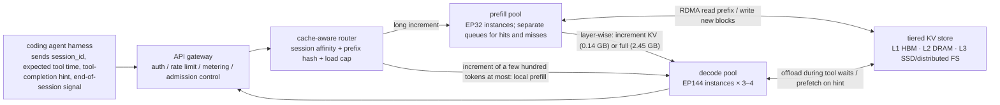
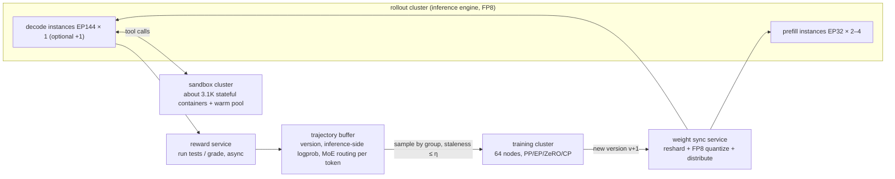
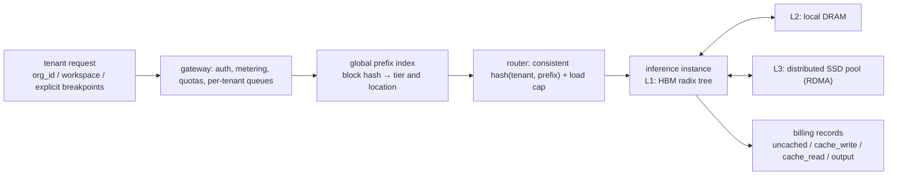
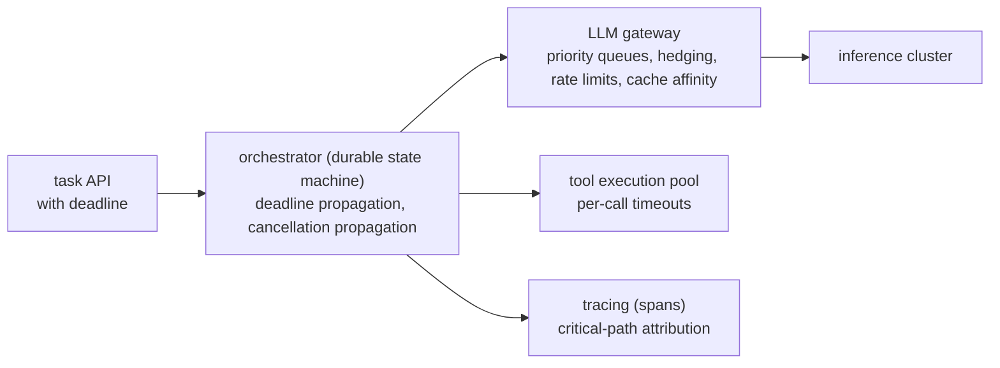
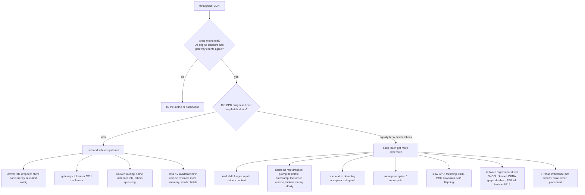

[中文](README.md) · **English**

# Module 08: System Design and Interviews

> 🕐 Suggested time: 2 hours ｜ 🎯 After this you can: finish an LLM-infra system design question in 45 minutes with the "seven-step framework", estimate the order of magnitude at every step in your head, and explain the trade-offs; talk about your own harness–inference co-design research honestly and convincingly ｜ 🧪 Lab: none (lecture only; every number can be recomputed with pen and paper) ｜ 📖 Must-read primary sources: [DeepSeek-V3/R1 Inference System Overview](https://github.com/deepseek-ai/open-infra-index/blob/main/202502OpenSourceWeek/day_6_one_more_thing_deepseekV3R1_inference_system_overview.md), [Mooncake: A KVCache-centric Disaggregated Architecture for LLM Serving](https://arxiv.org/abs/2407.00079)

## 0. One sentence

A system design interview does not test how many architecture diagrams you have memorized. It tests three conversions: **turn a vague requirement into SLOs (Service Level Objectives), turn the SLOs into orders of magnitude, then let the orders of magnitude decide the architecture and the trade-offs.**

The numbers in this module come in two kinds, and you should keep them apart when you speak in an interview too:

- **Constants**: model and hardware parameters come from public specs and official `config.json` files.
- **Assumptions**: load, SLOs, and efficiency are stated explicitly as assumptions. The drills run sensitivity analyses on them or calibrate them against public production data.

Every step of the derivation is written out, so you can check each line.

This module stitches the earlier modules into complete answers: formulas come from [Module 01](../01_inference_basics/README.en.md), engine mechanisms from [Module 02](../02_inference_engines/README.en.md), DeepSeek's deployment from [Module 03](../03_deepseek_stack/README.en.md), caching from [Module 04](../04_harness_workloads/README.en.md) and [Module 05](../05_cache_prefill/README.en.md), async RL from [Module 06](../06_long_tail_async/README.en.md), and credit assignment from [Module 07](../07_multi_agent_credit/README.en.md). The companion set of 67 interview questions is in the [question bank](../../docs/interview-questions.en.md).

## 1. Why big labs care

**A real public data point.** DeepSeek published 24 hours of statistics from its V3/R1 online inference service ([Day 6 overview](https://github.com/deepseek-ai/open-infra-index/blob/main/202502OpenSourceWeek/day_6_one_more_thing_deepseekV3R1_inference_system_overview.md)):

- Average occupancy 226.75 nodes, peak 278, 8 H800s per node.
- 608B input tokens, of which 342B (56.3%) hit the on-disk KV cache.
- 168B output tokens.
- Average per-node throughput: about 73.7k input tokens/s in prefill (including cache hits), about 14.8k output tokens/s in decode.
- At $2 per GPU-hour the daily cost is $87,072; if every token were billed at R1 prices, the **theoretical** daily revenue would be $562,027. DeepSeek itself notes that actual revenue is substantially lower.

For an infra team, **the cache hit rate, PD (prefill–decode) disaggregation, and how expert parallelism is deployed** directly decide how many GPUs burn each day.

**What the interviewer wants to see.** Suppose the question is "design an inference cluster serving 10,000 concurrent coding agents".

- **Weak answer**: draw an "LB → vLLM → GPU" box diagram, then start talking about Kubernetes.
- **Strong answer**: spend 5 minutes computing three things first.
  - If the prefix cache fails completely, prefill alone needs about 3,000 H800s; with hits it needs about 300–550. If just 10% of turns miss entirely, the prefill load nearly doubles.
  - At 32K context, each decode GPU holds only about 20 streams, so KV memory capacity is the first limit; and MLA's attention computation in decode is already at the compute ridge.
  - Long contexts shrink the global batch under large EP, which weakens the very premise of large EP.

  Conclusion: **the heart of this problem is tiered KV cache storage, cache-aware routing, and admission control for the miss tail, not the load balancer.** That is the muscle this module trains.

## 2. Answer framework: seven steps

| Step | What to do | Time in a 45-min interview | Output | Common pitfalls |
|---|---|---|---|---|
| ① Requirements and SLOs | Ask about the load: who calls? input/output length distributions? multi-turn? how long do tools take? Then ask about constraints: hardware, model, budget. Then **state your own assumptions out loud** | 5 min | An assumptions table + SLOs: p50/p99 of TTFT (Time To First Token) and TPOT (Time Per Output Token), throughput, availability | Drawing before asking; no numbers |
| ② Order-of-magnitude estimates | Compute FLOPs, bytes, KV size, bandwidth, GPU count, writing the formula at each step; p99 needs a queueing model | 8 min | 3–5 key numbers | Only averages, no tails; forgetting the attention term |
| ③ Architecture | Let the numbers pick the components: PD disaggregation? how many cache tiers? how to route? | 10 min | One diagram + why each component exists | Piling on components without saying why each is needed |
| ④ Bottlenecks | Say which resource runs out first: compute, HBM capacity, HBM bandwidth, network, or tail latency | 5 min | Ranked bottlenecks | Only saying "not enough GPUs" |
| ⑤ Trade-offs | Cost and scope of every choice | 7 min | A trade-off table | Only the upsides |
| ⑥ Metrics and monitoring | Which metrics prove the design works and catch regressions early | 5 min | A metric list (by layer) | Only watching GPU utilization |
| ⑦ Failure modes | What breaks, how the damage amplifies, what the fallback is | 5 min | Failure → impact → mitigation | Ignoring correlated failures such as "the whole cache goes invalid at once" |

**Pocket formula card** (notation: $N_{act}$ is the activated parameters per token that take part in GEMMs, excluding the embedding lookup and lm_head, $L$ the number of layers, $n_h$ the number of attention heads, $K$ the number of keys this token attends to, i.e. the context length):

| # | Formula | Used for |
|---|---|---|
| F1 | prefill FLOPs per new token ≈ $2N_{act} + a\cdot K$, where $a = 2L\,n_h\,(d_{qk}+d_v)$ is the attention FLOPs per (query, key) pair summed over all layers | prefill compute |
| F1′ | **Extra cost of an MLA prefix hit**: the cache stores latents, so before prefill each cached token must be up-projected into per-head K/V, about $2\,r_{kv}\,n_h\,(d_{nope}+d_v)\,L$ FLOPs; with fewer than $\Delta^*$ new tokens, the "absorbed" mode (computing directly on the latent) is cheaper | MLA prefix caching |
| F2 | KV bytes/token: GQA is $2L\,n_{kv}\,d_h\,b$; MLA is $L\,(r_{kv}+d_{rope})\,b$ ($b$ = bytes per element) | memory and transfer |
| F3 | Per decode step per GPU: bytes read ≈ this GPU's weights + KV of all streams on this GPU; attention FLOPs in MLA absorbed mode ≈ streams × $a_{dec}$ × context, where $a_{dec} = 2L\,n_h\,(2r_{kv}+d_{rope})$ | decode lower bound (check both memory and compute) |
| F4 | Roofline: $t = \max(F/(P\cdot \text{MFU}),\ B/(BW\cdot \text{MBU}))$ | compute-bound or memory-bound? |
| F5 | Little's law: average number in the system = arrival rate × average time in the system | concurrency, sandbox count, in-flight trajectories |
| F6 | Fan-out: the probability that $k$ **independent** subtasks all stay within their p-quantile is $p^k$; the probability that at least $m$ of $k$ finish is $\sum_{j\ge m}\binom{k}{j}p^j(1-p)^{k-j}$. When subtasks are positively correlated, simulate (see §7) | multi-agent tail latency |
| F7 | Pareto tail: $P(X>x)=(x_m/x)^\alpha$; the maximum of $N$ samples exceeds $x_m N^{1/\alpha}$ with probability about $1-1/e\approx 63\%$ | RL rollout long tail |
| F8 | Kingman's approximation (G/G/1 queue): $E[W] \approx \frac{\rho}{1-\rho}\cdot\frac{c_a^2+c_s^2}{2}\cdot E[S]$; rough p99 wait ≈ $\ln 100 \times E[W] \approx 4.6\,E[W]$ (treating the tail of the waiting time as exponential) | p99 and the utilization ceiling |

Derivation of F7: $P(\max\le x)=(1-(x_m/x)^\alpha)^N$. Substituting $x=x_mN^{1/\alpha}$ gives $(1-1/N)^N\approx e^{-1}$.

Notation for F8: $\rho$ is utilization, $c_a^2$ and $c_s^2$ are the squared coefficients of variation of inter-arrival times and service times, and $E[S]$ is the mean service time. Source: [Kingman 1961](https://doi.org/10.1017/S0305004100036094).

## 3. Parameter card: shared inputs for every estimate in this module

### 3.1 Hardware

| Quantity | Value | Source / notes |
|---|---|---|
| H100 SXM BF16 / FP8 dense compute | 989 / 1,979 TFLOPS | The [NVIDIA H100 spec page](https://www.nvidia.com/en-us/data-center/h100/) lists 1,979 / 3,958 TFLOPS with sparsity (footnote "With sparsity"); dense is half |
| H100 SXM HBM | 80 GB, 3.35 TB/s | same |
| H100 SXM NVLink / PCIe | 900 GB/s; PCIe Gen5 128 GB/s (both directions combined, about 64 GB/s one way) | same |
| H800 SXM memory | 80 GB | [NVIDIA vGPU docs](https://docs.nvidia.com/ai-enterprise/release-7/latest/infra-software/vgpu/reference/hopper.html) list "H800 SXM5 80GB" |
| H800 NVLink | 400 GB/s (H100: 900 GB/s) | [DeepSeek ISCA 2025 paper §4.1](https://arxiv.org/abs/2505.09343) |
| H800 node network | 8 × 400 Gb/s InfiniBand CX7 NICs per node; about 50 GB/s each, about 400 GB/s per node | same, §4.1 and §4.3 |
| H800 compute and HBM bandwidth | **NVIDIA has no public spec page**. The DeepSeek paper says the H800 is "similar to the H100" except for reduced FP64 and NVLink; the [Tencent Cloud HCCPNV5 instance docs](https://www.tencentcloud.com/document/product/1236/62812) list the H800 at "BF16 989 TFLOPS". No public value exists for FP8 compute or HBM bandwidth, so **this module assumes they equal the H100 SXM**: 1,979 TFLOPS, 3.35 TB/s (consistent with the repo's `codesign_sim/hardware.py`) | Corroboration: [FlashMLA](https://github.com/deepseek-ai/FlashMLA) reaches 3000 GB/s on H800 SXM5 (memory-bound configuration); [DeepGEMM](https://github.com/deepseek-ai/DeepGEMM) reaches 1550 FP8 TFLOPS on H800. Both are consistent with the assumption |
| Measured ceiling of the MLA decode kernel | 660 TFLOPS (compute-bound configuration) | FlashMLA README: "660 TFLOPS in computation-bound configuration on H800 SXM5" |
| Node DRAM / local NVMe (reference configuration) | 2 TB; 8 × 3.84 TB NVMe | [DGX H100 user guide](https://docs.nvidia.com/dgx/dgxh100-user-guide/introduction-to-dgxh100.html). Actual H800 server configurations vary by vendor; this is only an order-of-magnitude reference |

**Efficiency assumptions** (state them in the interview and say you would calibrate them with profiling):

- **MBU** (Memory Bandwidth Utilization) is 0.8, i.e. effective bandwidth ≈ 2.68 TB/s. FlashMLA's 3000 GB/s is about 90% of 3.35 TB/s, so 0.8 is not aggressive.
- **Effective prefill compute** is 600 TFLOPS/GPU. Picking the right reference peak matters here; comparing against the FP8 peak is wrong:
  - Day 6 states that core MLA computation runs in BF16; only the linear layers use FP8.
  - By the compute mix of a Drill A hit turn: linear layers 26% (at the FP8 peak of 1,979), attention 62% plus MLA up-projection 12% (at the BF16 peak of 989). The blended ceiling ≈ 1,136 TFLOPS.
  - 600 is about 53% of that ceiling, an **optimistic value**, and this module treats it as the busy-time service rate. §4 calibrates 330 TFLOPS from Day 6 data, about 29% of the ceiling; that is a 24-hour average throughput including idle time, not a busy-time rate. Their ratio, 330 / 600 ≈ 0.55, can be read as the average utilization.
- **Effective one-way PCIe bandwidth** is 50 GB/s.

### 3.2 Models (all from official `config.json` files)

| Model | Architecture | KV bytes/token (BF16) | Source |
|---|---|---|---|
| DeepSeek-V3 / R1 | 61 layers, hidden 7168, 128 heads, MLA: `kv_lora_rank`=512, `qk_rope_head_dim`=64, `qk_nope_head_dim`=128, `v_head_dim`=128; 256 routed experts (8 activated per token) + 1 shared expert, `moe_intermediate_size`=2048, first 3 layers dense (`intermediate_size`=18432); 671B total, 37B activated | 61 × (512+64) × 2 = **70,272 B ≈ 70 KB** | [config.json](https://huggingface.co/deepseek-ai/DeepSeek-V3/raw/main/config.json), [model card](https://huggingface.co/deepseek-ai/DeepSeek-V3) |
| Llama-3-70B | 80 layers, hidden 8192, 64 heads, 8 KV heads, head_dim 128 | 2 × 80 × 8 × 128 × 2 = **327,680 B = 320 KB** | [meta-llama/llama-models `sku_list.py`](https://github.com/meta-llama/llama-models/blob/main/models/sku_list.py) (the HF repo is gated) |
| Qwen3-235B-A22B | 94 layers, 64 heads, 4 KV heads, head_dim 128; 128 experts, 8 activated per token; 235B total, 22B activated | 2 × 94 × 4 × 128 × 2 = **192,512 B ≈ 188 KB** | [config.json](https://huggingface.co/Qwen/Qwen3-235B-A22B/raw/main/config.json), [model card](https://huggingface.co/Qwen/Qwen3-235B-A22B) |

**Why do the drills use V3 rather than the newer V4?** Because V3/R1 has production data like Day 6, published down to node counts, that we can calibrate against.

But be aware that the V3 baseline has been rewritten by newer architectures: the [DeepSeek-V4 technical report](https://arxiv.org/abs/2606.19348) uses CSA/HCA hybrid compressed attention, which compresses KV along the sequence dimension. At a one-million-token context, V4-Pro needs only 27% of V3.2's single-token inference FLOPs and 10% of its KV cache. See [Module 03 §5.1](../03_deepseek_stack/README.en.md#51-deepseek-v4-hybrid-attention-for-one-million-tokens).

**Five derived numbers for DeepSeek-V3** (used again and again below):

1. **Linear-layer FLOPs/token** ≈ $2N_{act}$ = 2 × 35.1B ≈ **70 GFLOPs**. The 37B activated parameters include an embedding table and an lm_head of 0.93B each (129,280 × 7,168): the embedding is a lookup and costs no FLOPs, and prefill computes lm_head only at the last position, so neither is counted. This is the accounting of `codesign_sim`'s `body_active_params`.
2. **Attention coefficient (prefill accounting)** $a$ = 2 × 61 × 128 × (192+128) = **5.0 MFLOPs**, i.e. the attention compute per (query, key) pair summed over all layers. This uses the prefill algorithm without weight absorption: each head uses 192 dims for q·k and 128 dims for the multiply with V.
   - **Break-even point**: $K^* = 70\text{G}/5.0\text{M} \approx$ **14.1K**. Beyond about 14K of context, attention costs more compute than all linear layers combined.
   - Compare Llama-3-70B: $a$ = 2 × 80 × 64 × 256 = 2.6M, $K^*$ = 137G/2.6M ≈ 52K (68.4B activated parameters after excluding embedding and lm_head).
   - **Under this accounting**, MLA mainly saves KV storage; the FLOPs per pair are not lower.
3. **Attention coefficient (decode, absorbed accounting)** $a_{dec}$ = 2 × 61 × 128 × (576+512) = **17.0 MFLOPs**, 3.4× the prefill figure.
   - In decode, attention runs directly on the 512-dim latent: each head uses 576 dims for q·k (512 + 64 RoPE) and 512 dims for the multiply with V.
   - This is MLA's core trade-off: **spend compute to save memory traffic**.
   - In practice, vLLM's MLA code uses the "compute friendly" approach (up-project the latent first) for prefill and chunked prefill, and the "data-movement friendly" approach for decode (see the header notes of [mla_attention.py](https://github.com/vllm-project/vllm/blob/main/vllm/model_executor/layers/attention/mla_attention.py)).
4. **Up-projection cost of an MLA prefix hit (F1′)**:
   - Each cached token must pass through `kv_b_proj` once, lifting 512 dims to 128 × (128+128): 2 × 512 × 32,768 × 61 ≈ **2.05 GFLOPs**.
   - When is absorbed mode cheaper? Up-projection is paid once per cached token, while absorbed mode pays an extra 17.0M − 5.0M = 12.0M per (new token, cached token) pair. So the break-even $\Delta^*$ = 2.05G / 12.0M ≈ **171 new tokens**: below about 171 new tokens, absorbed mode is cheaper.
5. **Routed-expert parameters and per-GPU weights**:
   - Routed-expert parameters = 58 layers × 256 × 3 × 7168 × 2048 ≈ **654B**. The 58 layers are 61 − 3 dense layers; each expert is three 7168×2048 matrices.
   - Non-routed parameters ≈ 671 − 654 = **17B**, covering MLA, shared experts, dense FFN, and embeddings. Summing component by component also gives 17.0B: MLA 11.4B, shared experts 2.6B, dense FFN 1.2B, embeddings 1.9B. The two methods agree.
   - DeepSeek's online decode uses EP144 + MLA/shared-expert DP144 (see [Day 6](https://github.com/deepseek-ai/open-infra-index/blob/main/202502OpenSourceWeek/day_6_one_more_thing_deepseekV3R1_inference_system_overview.md)). At FP8, 1 byte/parameter, weights per GPU ≈ 17 GB (replicated non-routed part) + 654/144 ≈ 4.5 GB (this GPU's routed experts) ≈ **21.5 GB**.
   - **Assume** activations, communication buffers, and fragmentation take about 8.5 GB; then the KV space left per GPU ≈ **50 GB**.

**Recompute with the repo's simulator.** The derived numbers above can be checked directly with `codesign_sim` (the comments are outputs from an actual run):

```python
from codesign_sim.hardware import GPUS, ridge_point
from codesign_sim.model import MODELS, kv_bytes_per_token, prefill_flops, attn_flops_per_pair
ds = MODELS["deepseek-v3"]
kv_bytes_per_token(ds)                                        # 70272
attn_flops_per_pair(ds)                                       # 4997120.0 (prefill accounting)
attn_flops_per_pair(ds, "decode")                             # 16990208.0 (decode, absorbed accounting)
prefill_flops(ds, n_new=2048, n_cached=32768) / 2048 / 1e9    # 239.2 (GFLOPs per new token, excluding MLA up-projection)
prefill_flops(ds, n_new=34816) / 1e15                         # 5.48 (PFLOPs, one full-recompute turn)
ridge_point(GPUS["H800-SXM"])                                 # 295.2 (FLOPs/Byte, BF16)
```

## 4. Drill A: serving 10,000 concurrent coding agents on an H800 cluster (prefix caching + PD disaggregation)

**① Requirements and SLOs.** Everything below is an assumption; state it in the interview and ask the interviewer to confirm.

- **Load**: 10,000 concurrent sessions on DeepSeek-V3.
  - At the start of each turn the average context $C$ = 32K tokens (repo context + history).
  - Each turn appends $\Delta$ = 2K new tokens (tool output or user message) and produces $o$ = 400 output tokens.
  - Tools wait 10 s on average, heavy-tailed: one test run can take minutes.
- **SLOs**:
  - TPOT ≤ 50 ms (20 tok/s). DeepSeek's published average online output speed is 20–22 tok/s.
  - TTFT p99 ≤ 2 s.
  - 99.9% availability.

**② Orders of magnitude.**

*Step 1: how many turns per second, and how many sessions in each state.*

- One turn cycle ≈ prefill 0.5 s + decode 400 × 50 ms = 20 s + tool 10 s = **30.5 s**.
- Turn rate ≈ 10,000 / 30.5 ≈ **328 turns/s**.
- Little's law (F5) splits the 10,000 sessions: about **6,560** decoding, about **3,280** waiting on tools, about **160** in prefill.
- Output throughput ≈ 328 × 400 ≈ **131k tokens/s**.

*Step 2: prefill compute. This is where the cache pays off.*

- **With a cache hit**, only the increment $\Delta$ is computed, but MLA adds an up-projection cost.
  - Each new token attends to 32K + 1K ≈ 33.8K keys on average. By F1, per token ≈ 70G + 5.0M × 33.8K ≈ **239 GFLOPs**, of which attention is 169G, more than the linear layers.
  - The 32K cached latents must be up-projected first (F1′): 32,768 × 2.05G ≈ **67 TFLOPs per turn**, 13.7% more than the increment alone. Δ = 2K is far above 171, so up-projection beats absorbed mode.
  - One turn in total ≈ 2,048 × 239G + 67T ≈ **557 TFLOPs**.
  - Total ≈ 328 × 557T ≈ **183 PFLOP/s**. At 600 TFLOPS/GPU that is about **304 GPUs (38 nodes)**; at the calibrated 330 TFLOPS/GPU, about **553 GPUs (69 nodes)**. The former counts pure busy time; the latter already includes idle headroom (see §3.1).
- **With the cache completely gone**, each turn recomputes 34.8K tokens.
  - Each token attends to 17.4K keys on average; per token ≈ 70G + 5.0M × 17.4K ≈ 157 GFLOPs, so **5.48 PFLOPs** per turn.
  - That is **9.8×** a hit turn (11.2× without the up-projection).
  - Total ≈ 1.80 EFLOP/s, about **2,990 GPUs (374 nodes)** at 600 TFLOPS/GPU.
- **Sensitivity**: if just 10% of turns miss entirely, the prefill load is ×1.88; at 20% it is ×2.77. So **the tail of the hit rate (the fraction of full misses) decides how big the prefill cluster must be**.

*Step 3: decode capacity and compute: check both.*

- **KV per stream**: during decode the context is C + Δ + o/2 ≈ 35.0K, so each stream ≈ 35.0K × 70,272 B ≈ **2.46 GB**. Rounding to 32K would underestimate by about 7%.
- **Capacity**:
  - 50 GB of KV space per GPU holds about **20.3 streams**.
  - 6,560 streams need about 323 GPUs. But decode is deployed in units of EP144 instances (18 nodes): one instance holds about 144 × 20.3 ≈ **2,930 streams**, so 6,560 streams need 2.24 instances.
  - That means at least **3 instances (54 nodes)**; with N+1 for 99.9% availability, **4 (72 nodes)**.
- **Memory**: each GPU reads 50 GB of KV per step, ÷ 2.68 TB/s ≈ 18.7 ms; reading 21.5 GB of weights ≈ 8.0 ms.
- **Compute**:
  - In MLA absorbed mode, attention per decode token ≈ 17.0M × 35.0K ≈ **595 GFLOPs**.
  - Per GPU per step ≈ 20.3 × 595G ≈ 12.1 TFLOPs, about **18.3 ms** at FlashMLA's 660 TFLOPS ceiling, as long as reading the KV.
  - Arithmetic intensity = 2 × 128 × 1,088 / 1,152 B ≈ **242 FLOPs/Byte**, close to the BF16 ridge point of 295.
- **With MTP**: each step has 2 query tokens, so attention doubles to 36.6 ms and becomes compute-bound. A step takes about 45 ms but yields about 1.85 tokens, so per-token time still fits the TPOT budget.
- **Conclusion**: decode hits the HBM capacity limit first, but compute is **not** plentiful: MLA's decode attention already sits on the ridge. The estimated step time is about 27 ms plus communication, which meets 50 ms.
- **An FP8 KV cache does not simply halve the GPU count**:
  - Ideally capacity doubles to 40.6 streams/GPU, but attention compute doubles with the stream count to 36.6 ms; with weight reads that is about 44.7 ms, leaving almost no room for communication.
  - Real formats don't even reach 2×: the FP8 KV format FlashMLA designed for V3.2 takes 656 B per token per layer (512 FP8 values + 4 FP32 scales + 64 BF16 RoPE values), versus 1,152 B in BF16, so capacity is only 1.76×, about 35.7 streams/GPU, with attention at about 32 ms and about 40 ms including weight reads.
  - If 20% is reserved for communication and scheduling (a 40 ms step), each GPU holds at most about 35.5 streams, about 185 GPUs. The two calculations land in the same place.
  - That ends up as **2 instances (3 with N+1)**, not half.

*Step 4: calibrate with DeepSeek's public data. This step earns a lot of credit in an interview.*

- **Decode calibration**:
  - Day 6: decode 14.8k tokens/s/node, "the average kvcache length per output token was 4,989 tokens", average output speed 20–22 tok/s. Working backwards, each GPU runs about 14.8k / 21 / 8 ≈ **88 streams** using only about 31 GB of KV, so it is **not** a capacity-bound operating point.
  - **Scaling by capacity**: our operating point is 20.3 streams per GPU, so 14.8k × 20.3 / 88 ≈ 3.41k tokens/s/node, which needs about **38 nodes**. This matches the first-principles 40 nodes (323 GPUs).
  - **Scaling inversely with context**: assuming per-node throughput is limited by KV bytes read, 14.8k × 4,989 / 35.0K ≈ 2.11k tokens/s/node, about **62 nodes**. This is a pessimistic upper bound.
  - The range comes from uncertainty in the scaling model. Neither end exceeds the 54–72 nodes set by deployment granularity, so **decode takes 54–72 nodes**.
- **Prefill calibration**:
  - Of the 73.7k tokens/s/node, 56.3% are hits, leaving about 32k uncached tokens/s/node.
  - If each token attends to about 2.5K keys on average, each token costs ≈ 70G + 5.0M × 2.5K ≈ 83 GFLOPs, so the effective compute is about 32k × 83G / 8 ≈ **330 TFLOPS/GPU**, about 29% of the blended ceiling. The online prompt-length distribution is not public, so this is a rough estimate.
  - Note: this is a 24-hour average and **already includes idle headroom**. So when sizing with it, don't divide by a utilization factor again; and the queueing model in the next step must use the busy-time service rate (600 TFLOPS), not this one.

*Step 5: p99 needs a queueing model, not just averages.*

- **Treat one EP32 prefill instance as one queueing server**: the service rate must be the busy-time rate of 600 TFLOPS/GPU, 32 GPUs × 600 ≈ 19.2 PFLOP/s. A hit turn takes about 29 ms of service, a full miss about 285 ms.
- **With 10% full misses**: $E[S]$ ≈ 55 ms, $c_s^2$ ≈ 2.0. Plugging into F8:
  - Poisson arrivals ($c_a^2$ = 1), ρ = 0.6: $E[W]$ ≈ 122 ms, p99 TTFT ≈ 4.6 × 0.122 + 0.285 ≈ **0.85 s ✓**.
  - ρ = 0.8: ≈ 1.8 s, near the edge. The utilization ceiling for p99 ≤ 2 s is about **0.82**.
  - Bursty arrivals ($c_a^2$ = 2): about 1.0 s at ρ = 0.6, about 2.3 s ✗ at ρ = 0.8, a ceiling of about **0.77**.
- **Without full misses**: even at ρ = 0.9, p99 is only about 0.6 s. So **p99 is driven by misses**.
- **Deploy at ρ ≈ 0.55**: the prefill node counts in the summary table below correspond to ρ ≈ 0.53–0.54, with p99 ≈ 0.7 s at 10% misses.
  - This headroom is for the optimistic 600 TFLOPS assumption: if the real busy-time rate were only 450 TFLOPS, ρ would rise to about 0.72 and p99 to about 1.7 s, still within 2 s.
  - This operating point also matches Day 6's 330 / 600 ≈ 0.55.
- **Mitigations**:
  - Queue hit turns separately or give them higher priority. A hits-only queue at ρ = 0.8 has p99 ≈ 0.3 s.
  - Chunk full-miss prefills so they don't block hit turns.
- **Why a single-server model**: cache-affinity routing ties requests to instances, so the pool behaves more like many small M/G/1 queues than one large M/G/c pool. A load cap plus spillover recovers part of the pooling benefit. That makes the single-server estimate conservative.
- **Correlation**: full misses tend to happen together; a system-prompt change makes every session miss at once. A steady-state queueing model cannot describe that, so **admission control** is required: cap the rate of full-miss prefills, queue new sessions, degrade when necessary.

*Step 6: where should the KV of tool-waiting sessions live? It is a three-way choice, not two-way.*

- **Keep it in HBM**: one stream takes 2.46 / 50 ≈ 4.9% of a GPU's KV space, crowding out decode capacity.
- **Offload to host DRAM**:
  - **Swap-out**: done asynchronously during the tool wait, over DMA, without using SMs.
  - **Restore**: 2.46 GB ÷ 50 GB/s ≈ **49 ms**. This is a single-stream, one-way lower bound.
  - **Concurrency**: each decode node restores about 4.6–6.1 times per second (328 turns/s spread over 54–72 nodes), 11–15 GB/s in total, only 3–4% of a node's aggregate PCIe bandwidth (about 400 GB/s). But when many tools return together, restores burst, so p99 restore latency needs its own monitoring.
  - **Prefetch**: if the harness tells the engine in advance that a tool is about to finish, the KV can be read back early, hiding the restore inside the tool wait so it never reaches TTFT.
  - **Capacity**: tool-waiting KV totals about 8.1 TB, 112–149 GB per node across 54–72 nodes, well within the 2 TB of DRAM in the reference configuration.
- **Recompute**: 5.48 PFLOPs ÷ 600T ≈ 9.1 GPU-seconds, about 10× a hit turn.
- **What the "200 s" number really means**: the break-even between keeping the KV in HBM and recomputing ≈ 9.1 / 0.049 ≈ **185 s** (about 340 s at 330 TFLOPS). It **only matters when there is no lower tier**, e.g. a system with an HBM-only prefix cache. vLLM V1's default preemption mode is RECOMPUTE; offloading has to be turned on explicitly with the OffloadingConnector.
- **Decision boundary**:
  - Sub-second waits, or HBM has slack → keep in HBM.
  - Seconds to minutes → offload to DRAM, and prefetch using the harness's completion hint.
  - Long-idle sessions, and project prefixes shared across sessions → SSD or distributed storage.
  - Every tier misses → only then recompute.

*Step 7: how much KV moves between P and D, and local vs remote prefill.*

- **Three data flows** (per turn, cluster-wide at 328 turns/s):

| Data flow | Bytes per turn | Cluster bandwidth | Time over one NIC (50 GB/s) |
|---|---|---|---|
| P reads the 32K prefix from D or storage (2.30 GB), computes, then pushes the full KV (2.45 GB) to D | 4.75 GB | 1.56 TB/s | 95 ms |
| P reads the prefix and pushes only the increment's KV (2K × 70 KB ≈ 0.14 GB) back to D, which keeps the prefix | 2.45 GB | 0.80 TB/s | 49 ms |
| Both P and D keep the prefix via session affinity: P receives only the KV of the previous turn's 400 output tokens (28 MB) and pushes back the increment | 0.17 GB | 56 GB/s | 3 ms |

  The third flow cuts network traffic by about 14×. The cost is that the prefill side must keep context for every session (about 25 TB, mostly in DRAM or on SSD) and load it into HBM over PCIe every turn. Traffic shifts from the network to local PCIe.

- **Layer-wise streaming**:
  - Splitwise: "Layer-wise KV-cache transfer happens in parallel with the prompt computation for the next layer"; Mooncake likewise uses layer-wise prefill to overlap KV transfer and dumping with compute.
  - A hit turn takes about 50 ms on one EP32 instance, and the full 2.45 GB takes about 49 ms over one NIC, so layer-wise overlap just barely hides it; sending only the increment is easy.
  - Transfer engines: [Mooncake Transfer Engine](https://github.com/kvcache-ai/Mooncake) aggregates bandwidth across multiple NICs, and [NIXL](https://github.com/ai-dynamo/nixl) is the point-to-point transfer library that Dynamo uses.
- **Under large EP, local prefill stalls the whole instance**:
  - Decode uses DP144 attention + EP144 experts, and every MoE layer does a synchronous all-to-all. While one DP rank runs a local prefill, the other 143 GPUs wait for it at dispatch/combine. What stalls is the instance's roughly 2,900 streams, not the 20 on that GPU.
  - Running the full 2K increment on one rank: attention 346 TFLOPs + up-projection 67 TFLOPs, about **0.69 s** at 600 TFLOPS.
  - If you chunk it and add only 10 ms per step to that rank, absorbed mode (cheaper for small chunks, see F1′) processes only about 11 tokens per step: 2K takes about 190 steps (9.5 s), and only about 215 tokens fit in one second.
  - **Conclusion**: on a 32K, DP-attention decode instance, local prefill only suits increments of a few hundred tokens at most, and chunk budgets must be balanced across DP ranks. Day 6's Decode Load Balancer does exactly this, balancing core-attention compute across GPUs by KVCache usage and request count.
- **Existing implementation**: NVIDIA Dynamo's [conditional disaggregation](https://docs.nvidia.com/dynamo/dev/advanced-customizations/conditional-disaggregation) decides local vs remote with two thresholds: the "effective input length" after subtracting the prefix hit (`eff_isl_threshold`, default 2048) and its ratio to the raw length (`eff_isl_ratio_threshold`, default 0.7). It also has `decode_busy_threshold`: when a decode worker's KV usage exceeds this fraction, prefill is forced remote. By the estimate above, for an MLA deployment with DP attention the length threshold should be much lower than the default 2048.

**Summary (report ranges at deployment granularity, and say which assumption sets each end):**

| Pool | 0% full misses | 10% full misses | How it's computed |
|---|---|---|---|
| prefill (mean) | 72 nodes (18 EP32) | 132 nodes (33 EP32) | Two methods converge: 38 busy nodes ÷ ρ 0.6 (600T) ≈ 63, or the idle-inclusive 330T calibration directly gives 69; after rounding to EP32, ρ ≈ 0.53. At 10% misses the load is ×1.88, 71.6 busy nodes, ρ ≈ 0.54 |
| prefill (peak) | 92 nodes (23 EP32) | 164 nodes (41 EP32) | Multiply by Day 6's peak-to-mean ratio 278 / 226.75 ≈ 1.23: 72 × 1.23 ≈ 89 and 132 × 1.23 ≈ 162, then round to EP32 |
| decode | 54–72 nodes (3–4 EP144) | same | Capacity of 2.24 instances rounded up, plus N+1. At peak, 6,560 × 1.23 ≈ 8,070 streams need 2.76 instances, still within 3–4 |
| total (peak) | 146–164 nodes | 218–236 nodes | prefill (peak) + decode |

This assumes the 10,000 concurrent sessions are a daily average, scaled to the peak by Day 6's intraday variation. The total is about **145–235 nodes (about 1,170–1,890 H800s)**.

**③ Architecture.**



- **Signals from the harness**: session_id, how long this tool call is expected to take, a hint that the tool is about to finish, whether the session has ended. With these the cache can decide on offload, prefetch, TTL (time to live), and pinning (holding KV in HBM) during the tool call. This is the co-design interface.
- **Tiered storage**: the same idea as [Mooncake](https://arxiv.org/abs/2407.00079) (a KVCache-centric disaggregated architecture), DeepSeek's on-disk KV cache, and [3FS](https://github.com/deepseek-ai/3FS).
- **Core tension: long contexts weaken the premise of large EP.**
  - The original reason for large EP is to give each expert a big enough batch.
  - At 32K, KV capacity limits an EP144 instance's global batch to about 2,930 streams, so each expert gets only about 2,930 × 8 / 256 ≈ **91 tokens** on average (about 183 with MTP), while approaching the FP8 ridge (≈ 590 FLOPs/Byte) needs about 295.
  - Compare Day 6's operating point: about 12,700 streams per instance, about 400 tokens per expert (about 350 spread over the 288 expert slots that include redundant experts).
  - At this operating point, reading expert weights (8 ms) is cheaper than reading KV (18.7 ms), so low expert-GEMM efficiency is not the main problem. **The reason to keep large EP becomes "freeing memory for KV"**: EP32 puts 37 GB of weights on each GPU and holds only 13.8 streams; EP64 27 GB, 18.0 streams; EP144 21.5 GB, 20.3 streams.
  - Countermeasures: offload tool-waiting sessions to raise the number of active streams in HBM; FP8 KV (runs into the compute wall); split pools by context length so short-context sessions get big batches; or use smaller EP for a smaller blast radius, at the cost of capacity.

**④ Bottlenecks (in order).**

1. Decode HBM capacity and MLA decode attention compute: both approach their limits together at 32K.
2. The tail of the hit rate plus queueing: every extra 10% of full misses multiplies the prefill load by about 1.9, and p99 is set mainly by misses.
3. Long-context prefill attention: beyond about 14K, attention exceeds the linear layers; hit turns also pay 13.7% for up-projection.
4. Local prefill under large EP: one rank's prefill stalls the whole instance.
5. EP load imbalance and slow GPUs: the all-to-all across 144 GPUs waits for the slowest one.

**⑤ Trade-offs.**

| Choice | Benefit | Cost | Scope |
|---|---|---|---|
| PD disaggregation vs colocated (chunked prefill) | Removes prefill interference with TPOT; each side can use its own parallelism | 0.17–4.75 GB moved per turn depending on the data flow; the ratio between the two pools must be tuned dynamically | Disaggregate for long increments; prefill locally for increments of a few hundred tokens at most, balanced across DP ranks |
| During tool waits: keep in HBM / offload to DRAM / recompute | Keeping gives the lowest TTFT; offloading costs no GPU compute | Keeping crowds out decode capacity; offloading uses PCIe and restores in about 49 ms (hideable by prefetch); recompute costs about 10× | Keep for sub-second waits or when HBM has slack; offload + prefetch for seconds to minutes; recompute only when every tier misses |
| FP8 KV vs BF16 KV | Doubles capacity | At 32K it hits the MLA attention compute wall, so the GPU count drops by less than half; possible accuracy loss | Adopt once evals pass and there is enough communication headroom |
| Cache-affinity routing vs least-loaded routing | High hit rate | Hot projects overload; the pool degenerates into many small queues and p99 worsens | Affinity + load cap; above the cap, spill elsewhere and pull the prefix from L3 |
| Large EP (EP144) vs small EP | Fewer weights per GPU, freeing memory for KV | Large blast radius: one bad GPU stops the whole instance (18 nodes); all-to-all sensitive to slow GPUs | At least N+1 instances, with fast session recovery from L3; or split pools by context length |
| Harness compresses or rewrites the context | Shorter context, smaller KV | Prefix invalidated; the next turn misses entirely (about 10×) | Compress rarely and in batches; align compression points to block boundaries |

**⑥ Metrics.**

- TTFT p50/p99 split into "hit turns" and "miss turns"; TPOT p99.
- Token-level hit rate per tier (HBM/DRAM/SSD), plus a separate count of **the fraction of turns that miss entirely**.
- Utilization and queue length of each prefill instance; requests rejected or delayed by admission control.
- KV occupancy, p99 restore latency from DRAM, PD transfer bytes (split by the three data flows above), preemption count.
- Max/mean of per-step attention FLOPs across DP ranks; per-expert batch size; per-GPU step-time distribution.
- Goodput: requests per second that meet the SLO.

**⑦ Failure modes.**

- **System prompt or tool definitions change**: every prefix hash changes at once and the prefill load jumps about ×10, a correlated failure. Mitigation: canary prompt releases, pre-warming, admission control.
- **One GPU fails in an EP144 instance**: the whole 18-node instance stops. Losing 1 of 3–4 instances cuts decode capacity by 25–33%. Mitigation: N+1 redundancy; session KV has a copy in L3 and can be restored elsewhere.
- **An L2/L3 storage node is lost**: the affected sessions fall back to recompute, causing a prefill spike. Mitigation: replicas plus rate-limited recompute.
- **Long tail of tool latency** (e.g. a 10-minute CI run): the KV is evicted once the TTL expires. Mitigation: the harness reports the expected duration, and the cache uses it to offload rather than delete.
- **Many tools return at once**: DRAM restores burst and TTFT jitters. Mitigation: stagger prefetches using completion hints, and cap concurrent restores per node.

## 5. Drill B: an async agentic RL training system for a 600B-class MoE (with sandbox cluster and weight sync)

**① Requirements and SLOs (assumptions).**

- **Policy model**: DeepSeek-V3 architecture (671B / 37B).
- **Task**: agentic coding in sandboxes, i.e. repo + tests, reward = run the tests.
- **Data per step**: 256 prompts × 16 samples per group = **4,096 trajectories**, with GRPO-style group-relative advantages.
- **Each trajectory**:
  - Initial prompt 11K tokens; 20 turns, each generating 500 tokens, 10K generated in total; 19 tool calls in between, each returning 1K tokens.
  - Final sequence 40K tokens; each tool call takes 3 s on average, heavy-tailed.
- **Goals**:
  - Keep the trainer busy.
  - Staleness (policy version lag) ≤ 2 versions.
  - Weight sync ≤ 30 s.
  - Sandbox infrastructure failures ≤ 1%, and **never scored as reward 0**.

**② Orders of magnitude.**

*Trainer side: long sequences need their own correction.*

- Each step is 4,096 × 40K = **164M tokens**.
- Calibrate with the training efficiency in the DeepSeek-V3 report: [180K H800 GPU hours per trillion tokens](https://arxiv.org/abs/2412.19437). By that measure, 164M tokens ≈ 29.5 GPU-hours ≈ 106K GPU-seconds, about 207 s on 512 GPUs (64 nodes).
- **Long-sequence correction**: that efficiency was measured at a pretraining sequence length of 4K (same report: "maximum sequence length to 4K during pre-training"). Correct with F1:
  - A 4K sequence attends to 2K keys per token on average, so each token's forward ≈ 70G + 5.0M × 2K ≈ 81G.
  - A 40K sequence attends to 20K keys on average, ≈ 70G + 5.0M × 20K ≈ 170G.
  - **2.11×** more expensive, so forward + backward ≈ 207 × 2.11 ≈ **438 s**.
- **Add the extra forward passes** (one forward is about 1/3 of forward + backward):
  - Recompute the old logprobs on the trainer: ≈ **585 s**. For why not simply take the inference-side logprobs, see "train–inference mismatch" below.
  - Also compute the reference model's logprobs for KL: ≈ **731 s**.
  - Below we take a training step of T ≈ 730 s. This is still a lower bound: pipeline bubbles, all-to-all, and extra long-sequence costs are not included.
- **Memory must be checked per GPU, not as a cluster total.** An illustrative layout keeps V3's PP16: at 512 GPUs each stage has 32 GPUs, routed experts use EP32, and the non-routed part uses ZeRO-1 DP32.
  - **Parameters per GPU**: routed experts 654B / 16 / 32 ≈ 1.28B, non-routed 17B / 16 ≈ 1.06B.
  - **Parameters, gradients, optimizer states**: generic mixed-precision Adam at about 16 B/parameter: BF16 weights 2 B, BF16 gradients 2 B, FP32 master weights plus the first and second moments 12 B. The non-routed 12 B is split 32 ways by ZeRO-1. Total about **25 GB**. DeepSeek-V3 stores AdamW's first and second moments in BF16 while keeping master weights and gradients in FP32: a different mix, but the same order of magnitude.
  - **Activations**: estimated with full recomputation (storing only each layer's input). 40K tokens × 7,168 × 2 B ≈ 0.57 GB per layer; about 3.8 layers per stage, ≈ 2.2 GB per microbatch; under 1F1B the first stage can have up to 16 microbatches in flight, ≈ **35 GB**.
  - **About 60 GB in total**, before attention workspace, all-to-all buffers, and fragmentation, which is already tight on an 80 GB GPU. So you need context parallelism (CP, splitting one sequence across GPUs), fewer in-flight microbatches, or selective recomputation.
  - Conversely, arithmetic like "671B × 16 B ≈ 10.7 TB, less than 512 × 80 GB = 41 TB" does not prove it fits.

*Rollout side (T ≈ 731 s, via Little's law).*

- Required trajectory completion rate λ = 4,096 / 731 ≈ **5.61/s**.
- Lifetime of one trajectory: decode 10K / 20 tok/s = 500 s, plus tools 19 × 3 s = 57 s, for **557 s**.
- In-flight trajectories = 5.61 × 557 ≈ **3,120**, of which about 5.61 × 500 ≈ 2,800 are decoding.
- The average context during decode is about 25.5K, 1.79 GB each, about 5.0 TB in total; ÷ 50 GB/GPU ≈ **100 GPUs**. One EP144 instance holds about 4,020 streams at this context, so **1 instance** is enough, at 70% full. RL can reissue failed trajectories, so N+1 is optional.
- Check the output volume: 2,800 × 20 tok/s × 731 s ≈ 41M ≈ 4,096 × 10K ✓.
- **Multi-turn incremental prefill**: computing turn by turn with the trajectory model above, each trajectory costs ≈ 4.83 PFLOPs, plus 0.97 PFLOPs of MLA up-projection across turns, 5.8 PFLOPs in total. Per step, 4,096 × 5.8P ≈ 2.4×10¹⁹ FLOPs; finishing that within 731 s needs 54 GPUs (600T) to 99 GPUs (330T), i.e. **2–4 EP32 prefill instances (8–16 nodes)**.
- **Sensitivity**: if the old logprobs are taken from the inference side, with only one extra forward (T ≈ 585 s), λ ≈ 7.01, about 3,900 in flight, about 126 decode GPUs, still 1 instance.

*Sandboxes.*

- Each in-flight trajectory owns one stateful sandbox (the repo's filesystem state must persist across turns), so concurrent sandboxes ≈ **3,100**, plus a 10–20% pre-warmed pool.
- Assuming 2 vCPUs per sandbox, that is about 7K–7.5K vCPUs.

*Weight sync: get the physical bytes right first.*

- **Weights that must land on each inference GPU** (FP8):
  - The non-routed 17B is **replicated on every GPU** under DP.
  - Each decode GPU also holds 2 routed experts (Day 6's configuration, including redundant experts), ≈ 17 + 5.1 ≈ **22.1 GB**.
  - Each prefill GPU holds 9 routed experts, ≈ 17 + 23 ≈ **40 GB**.
- **Total**: 1 decode instance + 3 prefill instances land 144 × 22.1 + 96 × 40 ≈ **7.0 TB**, while the logical "one 671 GB copy per instance" is only 2.7 TB.
- **Bandwidth lower bound**:
  - Each GPU receiving through its own 50 GB/s NIC needs at least 0.44–0.8 s. Alternatively, each node receives the unique bytes once and fans them out over NVLink within the node.
  - The training cluster's theoretical injection bandwidth is 64 nodes × 8 NICs × 50 GB/s ≈ 25.6 TB/s. This is a theoretical value, not the end-to-end throughput of one weight update.
- **Public reference points**:
  - Kimi K2 notes that resharding and broadcasting through a network file system would need an aggregate bandwidth that "reaches several petabytes per second" to keep overhead low, so they use a checkpoint engine co-located on the training nodes, completing a full update of 1T parameters "with less than 30 seconds" ([Kimi K2 report §3.3.2](https://arxiv.org/abs/2507.20534)).
  - LlamaRL updates a TB-scale model in about 2 s with DDMA ([LlamaRL](https://arxiv.org/abs/2505.24034)).
- **Conclusion**: the bandwidth lower bound is sub-second, and the time goes elsewhere: resharding the training layout (PP/EP/DP) into the inference layout (EP144/EP32), re-quantizing to FP8, and global orchestration and barriers.

*Why the long tail hurts synchronous RL (F7).*

- If trajectory durations follow a Pareto distribution with α = 1.5, the mean is $3x_m$. The longest of 4,096 exceeds $4096^{2/3}x_m = 256x_m$ with 63% probability, about 85× the mean.
- Real systems cap it, say at 3× the original mean ($9x_m$). But capping also shrinks the mean: $E[\min(X, 9x_m)] = x_m\,(1 + (1 - 9^{-0.5})/0.5) ≈ 2.33\,x_m$.
- Among 4,096 trajectories one almost surely hits the cap (each exceeds $9x_m$ with probability 1/27), so rollout slot utilization in synchronous mode ≈ 2.33 / 9 ≈ **26%**, and the trainer sits idle for the entire generation phase.
- Measured reference: [AReaL](https://arxiv.org/abs/2505.24298) reports that fully asynchronous training is up to 2.77× faster than synchronous systems with the same number of GPUs, with matched or improved final performance.

*GRPO's group-level tail.*

- The group-relative advantage needs all G samples of the same prompt. A group finishes when its slowest sample finishes.
- With G = 16, the probability that every sample stays within p90 is only 0.9¹⁶ ≈ 18.5%. **Even if the system as a whole is async, the long tail reappears at the group level.**

**③ Architecture.**



- **Async**: rollout keeps generating, and the trainer pulls from the buffer. The buffer only accepts trajectories whose version lag is ≤ η (AReaL calls η the "maximum permitted staleness"; η = 0 reduces to synchronous RL).
- **Off-policy correction has to go this deep to survive a deep dive.**
  - **At what level to take the ratio**: for a 10K-token trajectory, multiplying per-token ratios into a sequence-level ratio makes the variance grow exponentially with length, which is unusable. So use token-level ratios with clipping (PPO-style). This is biased, and the clip fraction must be monitored. Truncated importance sampling is the same kind of compromise.
  - **One trajectory spans several versions**: partial rollout or interruptible generation makes a trajectory's tokens come from different versions. So record the version per token, and compute each token's ratio against its own behavior policy. AReaL's decoupled PPO separates the behavior policy from the proximal policy for exactly this.
  - **GRPO's group baseline**: a group mean is only comparable when its samples come from the same or nearby versions. Control staleness per group: release a group only when all its samples are within η.
- **Train–inference mismatch is a real source of collapse.**
  - Even with identical weights, the inference engine (vLLM/SGLang) and the training framework (FSDP/Megatron) can compute very different token probabilities. In the words of [Yao et al.'s blog](https://fengyao.notion.site/off-policy-rl): "the implementation gap implicitly turns the on-policy RL to be off-policy".
  - Fix 1: recompute the old logprobs on the trainer; that is the extra forward pass above.
  - Fix 2: use TIS (truncated importance sampling, min(π_learner / π_sampler, C)) to correct the gap between the sampling and training distributions.
  - Fix 3: MoE also routes inconsistently. [R3 (Rollout Routing Replay)](https://arxiv.org/abs/2510.11370) records the inference-side routing and replays it during training.
- **Three ways to handle long trajectories**:
  - **Partial rollout**: set a fixed token budget; the unfinished part is saved to the buffer and continued in the next iteration. See [Kimi k1.5 §2.6.2](https://arxiv.org/abs/2501.12599).
  - **Interruptible generation**: when new weights arrive, interrupt ongoing generations, discard the KV computed with the old weights, recompute it with the new weights, and continue. This is what [AReaL §4.1](https://arxiv.org/abs/2505.24298) does.
  - **Drop over-age trajectories**: the simplest, but it introduces bias; see the trade-off table below.
- **Weight sync**: stage the new weights in DRAM or spare GPU memory, then switch atomically, so inference does not pause for long. The cost is extra staging space: if both copies of the weights sit in HBM on a decode GPU, KV space drops from 50 GB to about 28 GB.

**④ Bottlenecks.**

1. The long tail, including the group-level tail.
2. Long sequences on the trainer: compute ×2.11, and per-GPU activation memory is tight.
3. Resharding and orchestration during weight sync.
4. Sandbox startup latency and stability.
5. Reward computation (running tests) latency.

**⑤ Trade-offs.**

| Choice | Benefit | Cost | Scope |
|---|---|---|---|
| Colocate on the same GPUs (training and inference time-share one set of GPUs, e.g. verl's [HybridFlow](https://arxiv.org/abs/2409.19256)) vs disaggregate | Colocation moves no weights across clusters, and GPUs are never idle for a whole phase | Still synchronous, so the long tail still drags; switching requires resharding | Colocate for short trajectories with light tails; disaggregate + async for long-tailed agentic tasks |
| Larger staleness cap η | Higher throughput, fewer drops | More off-policy, may destabilize | Watch the clip fraction, KL, and train–inference logprob gap; η is usually 1–2 |
| Old logprobs from inference vs recomputed on the trainer | Inference side: saves one forward (T drops from about 731 s to about 585 s) | Inference side: train–inference numerical mismatch, hidden off-policy | Recompute on the trainer by default; to save that forward, pair it with TIS, plus routing replay for MoE |
| Drop over-age trajectories | Simple to implement | **Biased toward short, easy tasks**: long trajectories often correspond to hard problems | Only when the over-age fraction is tiny |
| Partial rollout / interruptible generation | Long trajectories no longer block | One trajectory mixes several versions; interruption recomputes KV | Agentic tasks with heavy tails; record versions per token |
| Build the batch from whichever trajectories finish first | Fast | **Length bias**: short trajectories arrive first, so the batch over-represents them | Sample by group, or stratify by length |
| Double-buffer weights in HBM | Fastest switch | About 40% less KV capacity | Only when memory is plentiful; otherwise stage in DRAM |

**⑥ Metrics.**

- Rollout: tokens/s, slot utilization. Training: MFU, per-GPU peak memory.
- Staleness distribution (mean / p99), clip fraction of the IS ratio, KL between old and new policies.
- **Train–inference logprob gap** (KL between inference-side and trainer-side logprobs on the same tokens), MoE routing agreement rate.
- Fraction of partial or interrupted trajectories, fraction dropped as over-age (**bucketed by task difficulty**).
- Weight sync time.
- Sandboxes: startup p99, failure rate, separating "infrastructure failure" from "task failure".
- Reward computation latency, trajectories completed per hour.

**⑦ Failure modes.**

- **Sandbox failures scored as reward 0**: the policy learns to "avoid actions that crash the sandbox". Mitigation: label infrastructure failures separately, exclude them from training, and check whether they correlate with difficulty.
- **Reward hacking**: e.g. editing the test files. Mitigation: read-only test files, grading in a separate container.
- **Train–inference mismatch silently accumulates**: training looks normal, then suddenly collapses at some step. Mitigation: monitor the train–inference KL, recompute logprobs on the trainer, use TIS, and add routing replay for MoE.
- **Weight sync partially fails**: some inference instances still run the old version. Mitigation: tag every token with a version number and reject mismatches.
- **Rollout node failure**: in-flight trajectories are lost. Mitigation: resume from the buffer's checkpoint, or reissue.
- **Staleness runs away**: the trainer outpaces rollout. Mitigation: the trainer blocks according to η.

## 6. Drill C: a multi-tenant prompt caching API (cache tiers, billing, isolation)

**① Requirements and SLOs (assumptions).**

- A public API with 10,000 tenants (organizations), peak 5,000 requests/s. Average prompt 20K tokens = reusable prefix 14K (system prompt + tool definitions + documents) + 6K new content. The model is DeepSeek-V3.
- Goals:
  - TTFT drops significantly on a hit.
  - Billing is reproducible and reconcilable.
  - **No prompt-prefix timing leaks caused by cross-tenant cache reuse**. Note that other timing side channels still exist; see below.
  - One tenant cannot evict other tenants' caches.
  - TTL behavior is documented and predictable.

**First, public industry practice (official docs as of 2026-09; details will change).**

| Vendor | How caching works | Retention | Pricing | Isolation |
|---|---|---|---|---|
| [Anthropic](https://platform.claude.com/docs/en/build-with-claude/prompt-caching) | Explicit breakpoints, up to 4; prefix order is tools → system → messages | 5 minutes by default, refreshed on each hit; optional 1 hour | 5-minute write = 1.25× base input price; 1-hour write = 2×; read = 0.1× (some models have exceptions) | Isolated between organizations; on some platforms also per workspace |
| [OpenAI](https://developers.openai.com/api/docs/guides/prompt-caching) | On by default; newer models support explicit breakpoints | Varies by model generation (see docs) | Newer models: write 1.25×, read 0.1× | "not shared across organizations" |
| [Gemini](https://ai.google.dev/gemini-api/docs/generate-content/caching) | Implicit (no cost-saving guarantee) + explicit | Explicit cache TTL defaults to 1 hour | Explicit caches also billed by storage duration (token-hours) | — |
| [DeepSeek](https://api-docs.deepseek.com/guides/kv_cache) | On by default, **on disk** | Cleared "usually within a few hours to a few days" after it stops being used | Hit price far below miss price (see the [pricing page](https://api-docs.deepseek.com/quick_start/pricing)) | Pass `user_id` to isolate KV cache on the business side |

**② Orders of magnitude.**

*First, a sanity check on scale.* Many people skip this step.

- 5,000 requests/s × 20K = 100M input tokens per second, **14×** the whole-site average in DeepSeek's Day 6 (608B / 86,400 s ≈ 7.0M tokens/s).
- The uncached part of each request: 6K new tokens attending to the 14K prefix, plus the MLA up-projection of the prefix, ≈ 0.96 PFLOPs. Computing the whole request would take 2.41 PFLOPs.
- **A 70% token hit rate saves only about 60% of the FLOPs**, because the uncached suffix still attends to the whole prefix. This directly affects pricing.
- The uncached prefill alone needs about 8,000 H800s (at 600 TFLOPS). In an interview, point out this magnitude first and ask the interviewer to confirm the load assumption.

*How big is one prefix?* KV of a 14K-token prefix:

| Model | KV of one 14K prefix | 100K distinct prefixes | Fits in 50 GB per GPU | Fits in 1 TB DRAM | Read back at 50 GB/s |
|---|---|---|---|---|---|
| DeepSeek-V3 (MLA) | 0.98 GB | 98 TB | ≈51 | 1,016 | 20 ms |
| Qwen3-235B-A22B (GQA, 4 KV heads) | 2.70 GB | 270 TB | ≈19 | 371 | 54 ms |
| Llama-3-70B (GQA, 8 KV heads) | 4.59 GB | 459 TB | ≈11 | 218 | 92 ms |

*Working set.* Assume about 10 active prefixes per tenant, 100K in total.

- DeepSeek-V3 needs 98 TB; at about 30 TB of NVMe per node in the reference configuration, 3–4 nodes' disks hold it.
- Llama-3-70B needs 459 TB, 4.7× as much. **MLA makes this cache product a tier cheaper.**

*What is a hit worth?*

- Recomputing one 14K prefix (DeepSeek-V3) ≈ 1.47 PFLOPs ≈ **2.5 GPU-seconds**.
- Reading 0.98 GB back from DRAM or remote SSD takes only about 20 ms of link time.
- So the GPU-time cost of a hit is more than two orders of magnitude below recomputing. **Pricing reads at about 1/10 of the base price still leaves margin; pricing writes above 1× covers write bandwidth and storage.**

*Hit bandwidth.*

- If every hit were read from L2/L3, 5,000 × 0.98 GB ≈ **4.9 TB/s**, equal to saturating the NICs of 12 nodes (8 × 50 GB/s per node).
- Conclusion: **hot prefixes must stay resident in HBM, and routing must send requests to an instance that already has the prefix**. L2/L3 only catch warm and cold data.

*Long prefixes are more worth keeping.*

- Recompute cost ∝ $n(70\text{G} + 2.5\text{M}\cdot n)$, superlinear in length, while the bytes occupied ∝ $n$.
- Recompute FLOPs per byte of KV: about 1.0M for a 1K prefix, 1.4M for 10K, 4.6M for 100K.
- So eviction should weigh "recompute cost / size", in the GreedyDual-Size family ([Cao & Irani, USITS'97](https://www.usenix.org/conference/usits-97/cost-aware-www-proxy-caching-algorithms)), rather than plain LRU.

**③ Architecture.**



- **Cache key**: a block-level hash chain. Each block's key = H(parent block hash, this block's tokens, extra keys), where the extra keys include **the tenant salt, model version, and tokenizer version**.
  - This matches vLLM's design: vLLM's [prefix caching design doc](https://docs.vllm.ai/en/stable/design/prefix_caching/) puts the parent hash into each block hash; its `cache_salt` is injected into the first block's hash so that "only requests with the same salt can reuse cached KV blocks".
- **Isolation: a salt closes only one class of side channel.**
  - **What the salt does**: one salt per tenant rules out cross-tenant hits by construction, and with them "inferring someone else's prompt prefix from whether a request hits". Why it is required: [Gu et al., ICML 2025](https://arxiv.org/abs/2502.07776) used timing side channels to detect global cache sharing across users at 7 API providers; [PROMPTPEEK at NDSS 2025](https://www.ndss-symposium.org/ndss-paper/i-know-what-you-asked-prompt-leakage-via-kv-cache-sharing-in-multi-tenant-llm-serving/) demonstrated an attack that leaks prompts through KV cache sharing.
  - **What the salt does not do**, i.e. the remaining timing side channels:
    - Shared queues: queueing delay reflects other tenants' load.
    - HBM, PCIe, and SSD bandwidth contention.
    - Queueing caused by hot spots.
    - Hits in a public namespace: it must hold only truly public content, such as descriptions of the platform's built-in tools.
    - A shared eviction pool: a tenant can infer others' activity from its own cache being evicted.
  - **Mitigations**: per-tenant queues and quotas; resource partitioning for sensitive tenants; padding or bucketing TTFT on hits (at a latency cost); regular statistical audits with enough samples.
- **Tiers**: L1 HBM (seconds to minutes) → L2 DRAM (minutes) → L3 SSD (hours).
  - Open-source implementations: [SGLang HiCache](https://www.lmsys.org/blog/2025-09-10-sglang-hicache/) (GPU / host memory / distributed storage), [LMCache](https://arxiv.org/abs/2510.09665), [Dynamo KVBM](https://docs.nvidia.com/dynamo/knowledge-base/modular-components/kvbm/kvbm-guide).
- **Fairness**: each tenant gets a guaranteed quota in every tier, plus a shared, preemptible burst pool. Eviction score = expected reuse probability × recompute cost / bytes; whatever exceeds the quota is evicted first.
- **Billing**:
  - Usage has four categories: uncached input, cache write, cache read, output. Explicit long-TTL caches also pay a storage fee (token-hours).
  - Bill on the **number of blocks the engine actually matched**, at a granularity equal to the block size, and document that granularity.

**④ Bottlenecks.** HBM capacity for hot prefixes; L2/L3 read bandwidth; global index lookup latency; hot tenants; and prefill compute for the uncached part, whose scale is set by the sanity check in step ②.

**⑤ Trade-offs.**

| Choice | Benefit | Cost | Scope |
|---|---|---|---|
| Per-tenant salt isolation vs global sharing | Rules out prefix leaks from cross-tenant reuse | Loses cross-tenant dedup. Example: if 10,000 tenants all use the same 5K public tool description, that is about 3.5 TB extra (DeepSeek-V3); other side channels still need separate handling | Isolate by default; only platform-owned public content uses the shared namespace |
| Implicit caching vs explicit breakpoints | Implicit costs users nothing | Hits are uncontrolled, hard to guarantee a price | Offer both; explicit comes with a price guarantee |
| Long vs short TTL | Higher hit rate | Higher storage cost, unfair across tenants | Short TTL + refresh on hit; charge extra for long TTL |
| Large blocks, e.g. 64 tokens vs 16 | Less metadata: a 14K prefix is 219 blocks vs 875 | Coarser granularity: tail tokens short of a full block never hit | Large blocks suit API billing better |
| Write-through to L3 vs write-back on eviction | Cache survives node failure | Doubles write bandwidth | Write through only for hot prefixes and explicit caches |

**⑥ Metrics.**

- Hit rate per tenant; hit rate and bytes read per tier.
- Eviction reason: quota or capacity.
- TTFT on hit vs miss.
- Billing reconciliation: the difference between engine usage and invoices should be 0.
- **Side-channel audit**: probing from another tenant should show no "hit peak" in the TTFT distribution, and no significant dependence on other tenants' load.

**⑦ Failure modes.**

- **Cache key omits the model version**: KV from old and new weights gets mixed, and outputs are wrong without any error. This is the most dangerous class of bug; put the version in the key and add checks.
- **Cache key omits the tenant salt**: cross-tenant leakage.
- **A model upgrade causes a global miss**: upgrade gradually and pre-warm hot prefixes first.
- **Half-written L3 data**: reads return corrupted KV. Add a checksum per block.
- **Billing disputes**: keep a log of matched blocks for every request so it can be traced.

## 7. Drill D: end-to-end latency SLO for a multi-agent orchestration platform (critical path, fan-out, timeouts)

**① Requirements and SLOs (assumptions).**

- The orchestration pattern is orchestrator-worker (lead agent + subagents):
  1. The lead agent plans;
  2. fan-out to $k$ = 5 subagents in parallel;
  3. each subagent runs at most $m$ = 4 steps of "LLM call + tool call";
  4. the lead agent aggregates.
- End-to-end SLO: p90 ≤ 90 s, p99 ≤ 180 s; per-task cost is capped.
- Inference service: TTFT 0.5 s on a cache hit, TPOT 25 ms (40 tok/s).
- Public practice for reference: in Anthropic's [multi-agent research system](https://www.anthropic.com/engineering/multi-agent-research-system), the lead agent "spins up 3-5 subagents in parallel", and multi-agent systems use about 15× the tokens of ordinary chats.

**② Orders of magnitude: the critical path.**

- One LLM call = TTFT + number of output tokens × TPOT. **Output tokens are the most expensive thing on the critical path: every 1,000 output tokens is 25 s.**
- Lead-agent planning: 800 output tokens, 0.5 + 20 = 20.5 s.
- Subagent: 4 steps × (0.5 + 300 × 25 ms + tool 3 s) = 44 s (mean).
- Aggregation: 1,000 output tokens, 0.5 + 25 = 25.5 s.
- Sum of means: 20.5 + 44 + 25.5 = **90 s**. The means alone already use up the p90 budget, before considering the tail.

**Fan-out amplifies the tail (F6).**

- **With independent subagents**: the probability that all 5 stay within their own p90 is only 0.9⁵ ≈ **59%**. For "the slowest of 5" to meet the target 90% of the time, each subagent must meet it at its own **p97.9** ($0.9^{1/5}$); with k = 10 it must be p98.9.
- The classic example: in [The Tail at Scale](https://research.google/pubs/the-tail-at-scale/), each server has a p99 of 1 s, and when a request fans out to 100 servers, "63% of user requests will take more than one second".
- **Subagents are usually positively correlated**: they share the inference cluster and tools, and inherit the difficulty of the same parent task. That changes the conclusion and has to be simulated (see the code in step ④).

**Load amplification.** One task = 1 + 5 × 4 + 1 = 22 LLM calls. 100 tasks per second means 2,200 calls per second, and they come in bursts.

**③ Architecture and techniques (each with a number).**



1. **Cut output tokens on the critical path**: reducing planning output from 800 to 300 tokens saves 12.5 s; subagents return only concise summaries.
2. **Pipelining**: stream the plan and dispatch each subtask as soon as it is parsed, instead of waiting for the whole plan.
3. **m-of-k quorum + deadline**: start aggregating once 4 of 5 are done.
   - Be precise about what is measured: this is the probability that "the fan-out stage is done by a single subagent's p90 time", **not** the pass rate of the end-to-end SLO.
   - With independence, "at least 4 done" = 0.9⁵ + 5 × 0.9⁴ × 0.1 ≈ **92%**, versus 59% for "all done", a gain of 33 percentage points. With k = 10, "at least 8" ≈ 93%.
   - With pairwise correlation ρ = 0.5 between subagents (Gaussian-copula simulation), "all done" rises to 71% and "at least 4" drops to 88%, **so the gain shrinks to 17 points**. The stronger the correlation, the less a quorum helps.
   - The cost is a possibly incomplete answer, so record which subtasks are missing.
4. **Hedged requests**: when an LLM call's TTFT exceeds p95, send a copy to another replica and use whichever returns first.
   - The Tail at Scale reports that on BigTable this cut p99.9 from 1,800 ms to 74 ms while sending only 2% more requests.
   - **An extra cost specific to LLMs**: if the hedge goes to a replica without this prefix, it is a full-miss prefill, about 10×. So hedge only to replicas that hold the same prefix.
5. **Priority on the inference side**: the aggregation call is on the critical path, so schedule it first.
6. **Pre-warm the shared prefix**: the k subagents share the same system prompt and tool definitions. Let one request write the prefix into the cache first, then dispatch the rest together, so the k requests do not all miss at once.
7. **Timeouts**:
   - **Propagate deadlines downward**: a subagent's deadline = parent deadline − time reserved for aggregation − network margin.
   - **Per-call** timeout = min(remaining budget, p99.9 of this call type).
   - **Retry** only when the remaining budget > p50 of one retry, with a global retry budget ≤ 10% to prevent retry storms.
   - **Propagate cancellation downward**: when the parent task ends, kill all subagents so they stop burning tokens.

**④ Verify: does the end-to-end p90 actually meet the SLO?**

Combine the stage distributions with Monte Carlo (assumptions: stage durations are lognormal; planning and aggregation have CV 0.3, each subagent has CV 0.5):

```python
import numpy as np

rng = np.random.default_rng(0)
N, TPOT = 200_000, 0.025                      # Monte Carlo samples; TPOT 25 ms


def corr_normal(rho, k):                      # k standard normals with pairwise correlation rho
    return np.sqrt(rho) * rng.standard_normal((N, 1)) + np.sqrt(1 - rho) * rng.standard_normal((N, k))


def lognormal(mean, cv, z):
    s2 = np.log(1 + cv**2)
    return np.exp(np.log(mean) - s2 / 2 + np.sqrt(s2) * z)


def fanout_ok(rho, k=5):                      # did each subagent finish by its own p90?
    done = (corr_normal(rho, k) <= 1.2816).sum(axis=1)
    return round(float((done == k).mean()), 3), round(float((done >= k - 1).mean()), 3)


def e2e(plan_out, sub_out, agg_out, quorum=5, rho=0.0, k=5):
    plan = lognormal(0.5 + plan_out * TPOT, 0.3, rng.standard_normal(N))
    sub_mean = 4 * (0.5 + sub_out * TPOT + 3)  # 4 steps x (TTFT + output + tool)
    sub = np.sort(lognormal(sub_mean, 0.5, corr_normal(rho, k)), axis=1)
    agg = lognormal(0.5 + agg_out * TPOT, 0.3, rng.standard_normal(N))
    return np.percentile(plan + sub[:, quorum - 1] + agg, [50, 90, 99]).round()


for rho in (0.0, 0.5):
    print(f"rho={rho}: all done / at least 4 done = {fanout_ok(rho)}")
for name, kw in [("baseline", dict(plan_out=800, sub_out=300, agg_out=1000)),
                 ("plan 300", dict(plan_out=300, sub_out=300, agg_out=1000)),
                 ("+ 4 of 5", dict(plan_out=300, sub_out=300, agg_out=1000, quorum=4)),
                 ("+ sub 200 / agg 500", dict(plan_out=300, sub_out=200, agg_out=500, quorum=4)),
                 ("same, rho=0.5", dict(plan_out=300, sub_out=200, agg_out=500, quorum=4, rho=0.5))]:
    print(f"{name}: p50/p90/p99 = {e2e(**kw)}")
```

Actual output (in seconds; runs in under a second in the repo's `.venv`):

```
rho=0.0: all done / at least 4 done = (0.591, 0.918)
rho=0.5: all done / at least 4 done = (0.709, 0.876)
baseline: p50/p90/p99 = [114. 151. 202.]
plan 300: p50/p90/p99 = [101. 138. 188.]
+ 4 of 5: p50/p90/p99 = [ 83. 106. 132.]
+ sub 200 / agg 500: p50/p90/p99 = [59. 76. 95.]
same, rho=0.5: p50/p90/p99 = [ 57.  80. 109.]
```

- **Cutting planning output and adding a quorum still leaves p90 at 106 s, which misses the SLO.** Subagent and aggregation output must also be cut (300 → 200 tokens per step, 1,000 → 500 tokens for aggregation) before p90 drops to 76 s and p99 to 95 s.
- At ρ = 0.5, p90 is 80 s and p99 is 109 s, still within the SLO.
- This step closes the "orders of magnitude → architecture → verify" loop of the seven-step framework: **accept techniques by their end-to-end quantiles**, not by the effect of each technique alone.

**⑤ Bottlenecks.** Number of output tokens, the slowest subagent, the tool long tail, queueing from bursts.

**⑥ Trade-offs.**

| Choice | Benefit | Cost | Scope |
|---|---|---|---|
| Larger k | Broader coverage, higher quality | Tail amplification (p^k when independent), cost grows linearly | Back it up with quorum + deadline |
| Quorum / partial results | With independence, the fan-out stage's on-time rate rises from 59% to 92% | The answer may be incomplete; the gain halves when subagents are positively correlated | Fine for research tasks; not for tasks that need everything (e.g. merging code) |
| Hedging | Cuts the tail sharply | More load (by trigger rate, e.g. 5%); a hedge to a replica without the prefix is a full miss | Only for idempotent LLM calls, only to replicas holding the prefix; never hedge tool calls with side effects |
| Small models for subagents | Lower TPOT, cheaper | Lower quality | Retrieval and filtering subtasks |

**⑦ Metrics.**

- End-to-end p50/p90/p99.
- **Critical-path attribution**: the share of LLM TTFT, LLM decode, tools, and queueing.
- Fan-out width distribution; straggler ratio = slowest subtask / median subtask; correlation between subtask durations.
- Deadline-exceeded rate, partial-result rate, hedge and retry ratios.
- Tokens and cost per task; quality metrics grouped by "complete or not".

**⑧ Failure modes.**

- **A tool hangs**: without per-call timeouts it drags down the whole task.
- **429 rate limits**: a 429 triggers retries, retries trigger more 429s, and it cascades.
- **Orphaned subagents**: the parent task has ended but subagents keep burning tokens.
- **Context overflow at aggregation**: k × summaries exceed the window.
- **Quality regressions hidden by latency gains**: quorum improves p90 but the completeness rate falls.

## 8. Drill E: troubleshooting a sudden 30% drop in online throughput

**Locate first, then troubleshoot.** Confirm three things:

1. Is the drop real? Did the metric definition, dashboard, or time window change?
2. All instances or only some?
3. Does the timing line up with a change (release, traffic, config)?

**The key split: did GPU busyness change?**

- **Busyness dropped**: the GPUs are idler; the problem is on the demand side or upstream.
- **Busyness unchanged but fewer tokens**: each token got more expensive.

Note that `nvidia-smi` defines GPU utilization as "Percent of time over the past sample period during which one or more kernels was executing on the GPU" ([nvidia-smi docs](https://docs.nvidia.com/deploy/nvidia-smi/index.html)). A GPU idling inside a collective therefore also shows as "busy". Look at step time and MFU/MBU, not just this percentage.



**Use orders of magnitude to judge which branch can explain 30%** (this is the step that earns the most credit in an interview):

| Hypothesis | Quick math | Can it explain 30%? |
|---|---|---|
| Hit rate drops from 80% to 60% | Missed tokens go from 20% to 40%, doubling. If prefill was 30% of GPU time, total time ×1.3 and throughput −23%; if it was 40%, throughput −29% | Yes, and it is common. Check recent prompt and harness changes first |
| MTP acceptance drops from 0.85 to 0.6 | Tokens per step fall from 1.85 to 1.6, −13.5% (the DeepSeek-V3 report gives a second-token acceptance rate of 85–90% and about 1.8× TPS) | Not by itself |
| One slow GPU (running at 70% speed) in an EP144 group | The synchronous all-to-all waits for the slowest GPU every step, so the whole instance is about 30% slower | Yes. Symptom: only some instances slow down; GPUs waiting in collectives "look busy" |
| Available KV drops from 50 GB to 42 GB | When capacity-bound, batch ≈ −16%, throughput ≈ −16% | Partly |
| Mean context grows from 20K to 32K | KV-bound decode throughput ∝ 1/context, about −38%; prefill per token also costs more | Yes. Check the input-length distribution first |

**Troubleshooting order: cheap first, expensive later.**

1. **Dashboards**: hit rate, length distributions, per-step batch, preemption count, acceptance rate, per-GPU step-time distribution.
2. **Compare**: by instance and by version.
3. **Reproduce on one machine**: `nvidia-smi -q -d PERFORMANCE` for throttle reasons (SW Power Cap, HW Thermal Slowdown, etc., see the same docs), an NCCL bandwidth test, profiler sampling.
4. **Bisect changes**: roll back recent configs or versions.

**How to report**: present the hypothesis tree, say which metric splits each branch, and attach an estimate of "how much this branch can explain at most".

## 9. How to talk about your harness–inference co-design project in interviews

### 9.1 Three ground rules

1. **Don't leak**: no partner name, background, internal design, or internal numbers. You can open with: "This work has a collaboration background under confidentiality constraints, so I'll only cover the framing that can be discussed publicly."
2. **Don't overclaim**: if there are no public results yet, don't say "improved by X%". Use wording like studying / exploring / hypothesis.
3. **Grade your evidence**: make clear which level each piece of evidence is.
   - Conclusions from public papers, with citations.
   - What you observed in a toy simulator (e.g. this repo's `codesign_sim`) or a mini engine, explicitly labeled "this is simulation, not production data".
   - Hypotheses not yet validated.

**Wording guide:**

| Don't say | Say |
|---|---|
| We solved the long-tail problem | I'm studying how the long tail affects async rollout; our working hypothesis is… |
| We improved our cache hit rate by 40% | In a simulator I wrote, session-aware eviction gets a higher hit rate than LRU, but that depends on the heavy-tailed tool latency assumption, which I haven't validated on real traces yet |
| I designed the company's inference system | I own part X (simulation, analysis, a specific experiment); other people own the rest of the system |

### 9.2 Five-part template (2-minute version)

1. **Motivation** (20 s): one concrete scenario + one order of magnitude.
   - E.g. "A coding agent appends only about 2K tokens per turn, but the context is 32K. If the KV gets pushed out of HBM during a tool wait, there are two outcomes: with a DRAM tier to catch it, reading it back takes about 50 ms; without one, the turn has to recompute everything, about 10× a hit on DeepSeek-V3. So the question becomes when to offload and when to prefetch." (numbers from §4 steps 2 and 6)
2. **Why it's hard** (30 s): the two layers can't see each other.
   - What the harness knows but the inference engine doesn't: how long tools will take, which blocks will be reused, when a session ends.
   - What the engine knows but the harness doesn't: what is in the cache, in which tier, how deep the queue is.
   - Optimizing each side alone can hurt the other. For example, the harness compresses context to save tokens and invalidates the whole prefix cache.
3. **Your entry point** (30 s): which interface or which assumption you are studying. For example, "have the harness pass the expected tool duration and a completion hint to the cache, and study when to offload and when to prefetch".
4. **How you plan to validate** (30 s):
   - Collect traces first and replay them in a simulator;
   - then run microbenchmarks on a real engine to calibrate MFU/MBU;
   - change one variable at a time;
   - use an offline bound to cap the hit rate (see follow-up 5 in §9.5 on when Belady applies).
5. **Expected trade-offs** (10 s): state it as a three-way decision boundary, consistent with §4 step 6.
   - "For sub-second waits, or when HBM has slack, keep the KV in HBM; for seconds to minutes, offload to DRAM, which restores in about 50 ms without using GPU compute, and with a completion hint from the harness it can be prefetched so the restore is hidden; only when every tier misses do we recompute, at about 10× the cost."
   - "The roughly 185 s break-even between keeping in HBM and recomputing only matters for systems without a lower tier. So the real co-design lever is prefetch timing and tier placement."

### 9.3 Practicing the public framing with this repo's topics

The table below uses this repo's module topics as examples and **does not correspond to any specific collaboration project**. Your specific entry point is a `<…>` placeholder; fill it in yourself, don't invent one.

| Topic (module) | Motivation | Why it's hard | Entry points you can discuss | How to validate | Expected trade-offs |
|---|---|---|---|---|---|
| Long tail and async ([06](../06_long_tail_async/README.en.md)) | Synchronous RL waits for the slowest trajectory (AReaL abstract: "wait until the longest output in the batch is completed") | Async brings off-policy data; GRPO's group-level tail; train–inference mismatch | `<…>` | Sweep η and the tail index α in the simulator, watching throughput and staleness; run real training on a small model and watch convergence curves | Throughput ↑ vs stability ↓; dropping vs bias |
| Credit assignment ([07](../07_multi_agent_credit/README.en.md)) | The team gets one total reward, so each agent's gradient has high variance | Counterfactuals are expensive; Shapley needs exponentially many evaluations | `<…>` | Compare gradient variance and learning curves on cooperative tasks with known contributions | Variance ↓ vs extra compute and bias |
| Prefix caching and tiering ([05](../05_cache_prefill/README.en.md)) | Sessions share long prefixes, but the working set far exceeds HBM | Affinity routing conflicts with load balancing; when to offload and when to prefetch | `<…>` | Trace replay against LRU and an offline bound; measured tier read bandwidth | Hit rate ↑ vs hot-spot overload |
| Prefill and PD disaggregation ([02](../02_inference_engines/README.en.md), [05](../05_cache_prefill/README.en.md)) | Every agent turn has a prefill, and attention's share grows with context | Short increments on long contexts; under large EP, local prefill stalls the whole instance | `<…>` | Measure TTFT/TPOT on a real engine across Δ and C | Remote: no decode interference vs moving KV; local: the reverse |
| Harness context management ([04](../04_harness_workloads/README.en.md)) | Compressing context saves tokens but invalidates the cache | The gains and costs land on different teams | `<…>` | On the same task set, compare the token cost and prefill cost of compression strategies | Saving tokens vs losing the cache |

### 9.4 A 90-second example

> I'm studying harness–inference co-design under agent workloads. This work has a collaboration background under confidentiality constraints, so I'll only cover the parts that can be discussed publicly.
>
> Here's the motivation: a coding agent appends only about 2K tokens per turn, but the context is often tens of thousands of tokens. I worked it out from DeepSeek-V3's official config: at 32K context, recomputing a whole turn's prefill costs about 10× a hit; while with a DRAM tier, reading it back takes only tens of milliseconds.
>
> The difficulty is that the two layers can't see each other: the harness knows how long a tool will take and what the next turn will reuse, while the engine only sees a stream of requests.
>
> What I'm exploring now is `<entry point>`. Validation has three steps: first sweep parameters in a discrete-event simulator I wrote to find which assumptions matter most; then replay real traces and use an offline bound to cap the hit rate; finally run microbenchmarks on a real engine to calibrate the simulator's constants.
>
> The main trade-off I expect is which tier the KV lives in and when to prefetch it: keeping it in HBM crowds out decode capacity, while offloading to DRAM costs almost no compute, but the restore has to beat the end of the tool call. So the policy should depend on a prediction of tool duration rather than one fixed threshold.
>
> I don't have result numbers I can share publicly yet.

### 9.5 The 8 follow-ups interviewers are most likely to ask

1. **"What are the results? How much did it improve?"**
   - Say plainly that there are no public numbers yet. Then describe the evaluation design: which metrics, against which baselines, how big an improvement would be meaningful. You can mention what you saw in the simulator, labeled as simulation.
   - Your own publicly shareable code can serve as supporting evidence; see §9.6.
   - Don't give a vague "about 30%".
2. **"Why is this co-design rather than plain inference optimization?"**
   - The key is cross-layer information: tool duration, completion hints, reuse intent, and end-of-session signals flow from the harness to the engine; cache state, tier, and queue depth flow back from the engine to the harness.
   - Use steps 6 and 7 of §4 as the example: only by knowing how long a tool will take can you choose correctly among "keep, offload + prefetch, recompute"; only by knowing the increment length can you choose local or remote prefill.
3. **"Async introduces off-policy data. How do you keep training from blowing up?"**
   - Main evidence: [AReaL](https://arxiv.org/abs/2505.24298) is up to 2.77× faster than synchronous systems with the same number of GPUs, with matched or improved final performance. Its tools are a staleness cap η, decoupled PPO (separating the behavior policy from the proximal policy), and interruptible generation.
   - Also raise train–inference mismatch unprompted: the inference engine and the training framework compute different logprobs to begin with. The fixes are recomputing logprobs on the trainer, TIS, and R3 routing replay for MoE.
   - Supporting evidence: [Noukhovitch et al.](https://arxiv.org/abs/2410.18252) found online DPO to be the most robust to off-policy data.
   - Monitoring: distribution and clip fraction of the IS ratio, KL, train–inference logprob gap.
   - Trade-off: a larger η gives more throughput but less stability.
4. **"What's the fundamental difference between multi-agent and single-agent reward?"**
   - Fundamentally, it is the variance of credit assignment.
   - The spectrum of methods: shared reward (unbiased but high variance) → difference rewards (need a counterfactual default action) → [COMA](https://arxiv.org/abs/1705.08926)'s counterfactual baseline (marginalizes out one agent's action) → Shapley (fair, but needs $2^n$ evaluations, so only sampled approximations).
   - Trade-off: among compute, bias, and variance.
5. **"How do you know how much headroom the cache still has?"**
   - Use offline replay for an upper bound, but state when it applies. [Belady's optimal replacement](https://doi.org/10.1147/sj.52.0078) assumes equal-sized objects with equal miss costs. Prefix caching differs in two ways:
     - a block is only usable if all its ancestor blocks hit;
     - recompute cost per byte differs by more than 4× across prefix lengths (§6).
   - So block-level Belady is only an upper bound on "blocks hit", possibly a loose one, and not a bound on "FLOPs saved".
   - Report both: the Belady block hit rate, and FLOPs saved bucketed by prefix length.
   - Then plot the working-set curve (cache capacity vs hit rate), and use KV bytes/token to convert capacity into GPUs or DRAM needed.
6. **"Why does prefill matter so much for agents?"**
   - Every tool call is followed by a prefill, which sits on the critical path of the agent loop.
   - Beyond about 14K of context, DeepSeek-V3's attention FLOPs exceed its linear layers.
   - A full miss costs about 10×, and p99 is set mainly by misses (§4 step 5).
   - Then discuss the trade-off between PD disaggregation and conditional disaggregation, and how local prefill stalls a whole instance under large EP.
7. **"If you had 8 H800s for a week, what would you do first?"**
   - **Start with the model choice**: DeepSeek-V3's FP8 weights are 671 GB, more than the 640 GB of HBM on 8 H800s, so one node cannot hold it.
   - So measure scaling on a smaller model that also uses MLA, e.g. [DeepSeek-V2-Lite](https://huggingface.co/deepseek-ai/DeepSeek-V2-Lite) (15.7B total, 2.4B activated). Extrapolate to V3 with the structural coefficients of F1/F2; or say you would need to borrow 2 nodes.
   - **Day 1**: measure how TTFT/TPOT vary with C and Δ on a real engine, and calibrate the simulator.
   - **Days 2–3**: trace replay + policy comparison.
   - **Days 4–5**: pick the single most sensitive assumption and run a real end-to-end experiment on it.
   - At each step, write down the expectation first, then compare with the result.
8. **"Where is this direction most likely to fail?"**
   - Possible reasons: the load is actually decode-dominated, so prefill optimizations gain little; the harness compresses context so often that no cache design helps; the simulator's heavy-tail assumption doesn't match real traces; instability from async cancels out the throughput gains.
   - **Being able to name the failure modes of your own direction is a sign of research maturity.**

### 9.6 Hands-on work you can show

When you have no public research results, your own publicly shareable code is the best supporting evidence. Section 8 of this repo's [capstone: a mini inference engine](../../capstone/README.en.md) lists several advanced tasks, any of which makes a good piece to show in an interview:

- Session-aware eviction plus pinning during tool calls, measuring the hit rate;
- Cache-aware multi-instance routing;
- Wiring speculative decoding into the engine.

Apply the same evidence grading when you present it: say that it is a small model on a CPU, that it proves the mechanism is correct, and that it does not represent real GPU performance.

## 10. Numbers you must be able to compute in your head

| Quantity | Typical value | How to derive it | Source |
|---|---|---|---|
| DeepSeek-V3 KV/token | 70,272 B ≈ 70 KB (BF16) | 61 × (512+64) × 2 | official config.json |
| Llama-3-70B KV/token | 320 KB | 2 × 80 × 8 × 128 × 2 | Meta `sku_list.py` |
| KV of one stream at 35K context (DeepSeek-V3) | 2.46 GB | 35.0K × 70,272 | derived |
| DeepSeek-V3 attention break-even point (prefill accounting) | ≈ 14.1K tokens | 70G / 5.0M | derived (F1) |
| MLA attention FLOPs per pair: prefill / decode absorbed | 5.0M / 17.0M | $2Ln_h(d_{qk}+d_v)$ | derived |
| MLA up-projection: per cached token / threshold for switching to absorbed mode | 2.05 GFLOPs / Δ < 171 | F1′ | derived |
| Full recompute vs hit at 32K context (with up-projection) | 9.8× (11.2× without) | §4 step 2 | derived |
| 32K decode: streams per GPU / EP144 instance capacity | 20.3 / about 2,930 | 50 GB / 2.46 GB | derived |
| 32K decode per GPU per step: KV read / attention compute | 18.7 ms / 18.3 ms | F3 | derived |
| Weights per GPU under EP144 | ≈ 21.5 GB (FP8) | 17B non-routed + 654B / 144 | derived |
| H800 GPU-to-GPU NVLink / IB per NIC | 400 GB/s / 50 GB/s | — | DeepSeek ISCA 2025 |
| Break-even between keeping KV in HBM and recomputing during a tool wait (only meaningful without a lower tier) | about 185 s | 9.1 GPU-seconds / 4.9% | derived (§4) |
| Reading 2.46 GB of KV back from DRAM (single-stream lower bound) | ≈ 49 ms | 2.46 GB / 50 GB/s | derived |
| Increment-only vs full PD transfer | 0.17 GB vs 2.45–4.75 GB per turn | §4 step 7 | derived |
| Prefill utilization ceiling for p99 TTFT ≤ 2 s with 10% full misses (at the 600T busy-time rate) | about 0.8 (about 0.77 with bursty arrivals) | F8 | derived |
| DeepSeek online decode / prefill throughput | 14.8k / 73.7k tokens/s/node | — | Day 6 |
| DeepSeek online KV cache hit rate | 56.3% | 342B / 608B | Day 6 |
| All of a k = 5 fan-out within p90 (independent / ρ = 0.5) | 59% / 71% | F6 / simulation | derived |
| 4 of 5 done by the p90 time (independent / ρ = 0.5) | 92% / 88% | F6 / simulation | derived |
| Synchronous utilization for Pareto α = 1.5 capped at 3× the mean | about 26% | 2.33 / 9 | F7 |
| Per-token training cost of a 40K sequence relative to 4K | 2.11× | F1 | derived |
| DeepSeek-V3 training efficiency | 180K H800 GPU-hours per trillion tokens | — | DeepSeek-V3 report |
| Full weight update of a 1T-parameter model | < 30 s | — | Kimi K2 report |

## 11. Pen-and-paper exercises (this module is lecture only)

This module has no `lab.py` or exercise code. Work through the problems below with pen and paper (or Python as a calculator).

### 11.1 Recompute problems

1. **Swap Drill A's model for Qwen3-235B-A22B** (188 KB/token, 22B parameters activated per token). At the 35K decode context, how many streams fit on one GPU? What is the decode capacity lower bound in GPUs? How many times DeepSeek-V3's is it?
2. **Redo Drill C with Llama-3-70B**. Hot prefixes must stay resident in HBM, and each GPU holds only about 11 prefixes of 14K. If the hot set is 5,000 prefixes, how many GPUs' worth of HBM is needed? Is L2 then better value than L1?
3. **Drill D with k = 10**: with independent subagents, for the fan-out stage to finish on time 90% of the time, at what quantile must each subagent meet its target? What about with an "8 of 10" quorum?

<details><summary>Answers</summary>

1. KV per stream = 35.0K × 192,512 ≈ 6.74 GB, so 50 GB per GPU holds only about 7.4 streams, versus about 20.3 for DeepSeek-V3. 6,560 streams need about 884 GPUs, about 2.74× DeepSeek-V3 (323 GPUs), which is exactly the ratio of their KV/token, 192,512 / 70,272. Note that Qwen3-235B's per-GPU weight footprint also differs, so the "50 GB" assumption must be recomputed for its deployment.
2. 5,000 / 10.9 ≈ 460 GPUs' worth of HBM. Each 1 TB of DRAM holds 218 prefixes, so a node with 2 TB of DRAM holds about 436, and 12 nodes' DRAM is enough. Reading one prefix back from DRAM takes 92 ms, while recomputing takes about 3.6 GPU-seconds. So warm prefixes clearly belong in L2, and HBM holds only the hottest.
3. $0.9^{1/10}$ ≈ 0.9895, i.e. each subagent must meet it at p98.9. With an "8 of 10" quorum, at each subagent's p90 time the probability that the fan-out stage is done ≈ 93%. If subagents are positively correlated, this gain shrinks (§7).

</details>

### 11.2 Recompute after changing assumptions (adversarial drills)

Give yourself 10 minutes per problem and don't look at the answers first. **Scoring rubric** (1 point each, 4 points max):

1. List which assumptions changed;
2. Say which formula must change and plug in again;
3. Give the sensitivity: which parameter the conclusion is most sensitive to;
4. Judge whether the bottleneck flips.

1. **The hit-rate distribution changes**: the fraction of full misses goes from 0% to 20%. How many prefill nodes are needed? How do you protect p99?
2. **Context grows from 32K to 128K**: what happens to decode capacity, per-expert batch, and the attention share of prefill?
3. **The decode node already holds the prefix**: how much moves between P and D per turn? Where does the prefill side get the prefix?
4. **Swap the H800 for the H20** (note: the H20's compute and bandwidth are reported values, and NVIDIA has no public spec page; this repo's `codesign_sim/hardware.py` uses BF16 148 TFLOPS, 4.0 TB/s, 96 GB): is decode still capacity-bound?
5. **Tighten p99 TTFT from 2 s to 0.5 s** (10% full misses): what does the prefill utilization ceiling become? Is there anything cheaper than adding GPUs?

<details><summary>Answer sketches</summary>

1. Load ×(0.8 + 0.2 × 9.8) ≈ ×2.77. The two methods give about 175–190 nodes, about 2.8× the 0% case. p99 depends even more on separating misses from hits in the queue and applying admission control to misses; otherwise miss service times pile straight into p99.
2. KV per stream (128K + 2K + 200) ≈ 9.37 GB, so each GPU holds only 5.3 streams, and 6,560 streams need about 1,230 GPUs (about 8.5 EP144 instances). Per-expert batch drops to about 24 tokens, so the premise of large EP barely exists. Attention compute per GPU per step is still about 18 ms, because streams × context stays about the same. Prefill: attention is 90% of each new token's cost; a hit turn is about 1,764 TFLOPs, 3.2× the 32K case; the full-miss-to-hit ratio rises to about 30×. Conclusion: sparse or compressed attention (DSA, V4's CSA/HCA) goes from optional to mandatory.
3. Use the second and third data flows of §4 step 7: push back only the increment's KV, about 0.14 GB per turn; if the prefill side also keeps the prefix via session affinity, about 0.17 GB per turn in total. Either the prefill side keeps the prefix in its own DRAM or on SSD, or, when the increment is at most a few hundred tokens, the decode side prefills it locally.
4. With the reported parameters: KV space per GPU ≈ 96 − 8.5 − 21.5 ≈ 66 GB, room for 26.8 streams. But scaling by FlashMLA's efficiency ratio on the H800 (660/989), the H20's MLA decode attention costs about 6.0 ms per stream per step, and reading weights about 6.7 ms. A 50 ms step fits at most about 7.2 streams, **so the bottleneck flips from capacity to compute**, and decode needs about 910 GPUs (323 on H800). Prefill is worse: at 29% of the blended ceiling, hit turns need about 3,700 GPUs. Conclusion: a high-bandwidth, low-compute GPU suits short-context decode, not long-context MLA.
5. By F8 (busy-time rate 600T), a full miss's own service time is already 285 ms, leaving only about 215 ms for queueing, so ρ must drop to about 0.36. Prefill grows from 132 nodes to about 200 (71.6 ÷ 0.36 ≈ 197, rounded to 50 EP32). Cheaper options: queue hit turns separately or prioritize them (a hits-only queue has p99 about 0.3 s at ρ = 0.8); chunk full-miss prefills and lower their priority; pre-warm using harness hints to reduce full misses.

</details>

## 12. Self-check questions

1. Why does "the tail of the hit rate" decide the size of the prefill cluster more than "the average hit rate"?
2. DeepSeek-V3 compresses KV to about 70 KB/token with MLA. Why is prefill still expensive at long context? And why is a prefix hit still not "compute only the increment"?
3. In Drill A, what limits decode first? Is compute really plentiful? How do you calibrate with DeepSeek's public numbers?
4. Why is synchronous RL rollout utilization about "capped mean / cap"? Why does GRPO make the long tail reappear at the group level?
5. After adding a per-tenant salt to multi-tenant prompt caching, which timing side channels remain?
6. With 5 subagents in parallel, why does "4 of 5" raise the fan-out stage's on-time rate from 59% to about 92% under independence? What happens when subagents are positively correlated?
7. Throughput fell 30%, but `nvidia-smi` shows unchanged GPU utilization. What do you suspect first, and why?

<details><summary>Answers</summary>

1. A turn that misses entirely recomputes the whole context, costing about 10× a hit (32K context, 2K increment, including MLA up-projection). So 10% of turns missing entirely multiplies the prefill load by 1.88. And p99 TTFT is set mainly by miss service times. The average hit rate hides both nonlinearities.
2. MLA compresses KV storage, but attention still has to be computed for every key. Under prefill (non-absorbed) accounting, each (query, key) pair costs about 5.0 MFLOPs, so beyond about 14.1K of context attention exceeds the linear layers' 70 GFLOPs/token. After a prefix hit, the cache holds latents, which must first be up-projected into per-head K/V, about 2.05 GFLOPs per cached token, adding about 67 TFLOPs (+13.7%) for a 32K prefix. With fewer than about 171 new tokens, absorbed mode is cheaper.
3. HBM capacity comes first: 50 GB per GPU holds only about 20 streams at 35K. But compute is not plentiful: MLA absorbed-mode attention takes about 18 ms per GPU per step, as long as reading the KV, with an arithmetic intensity of about 242, close to the ridge of 295; turning on MTP makes it compute-bound. Calibration: Day 6 runs about 88 streams per GPU using only about 31 GB of KV, not a capacity-bound operating point. Scaling by capacity gives about 38 nodes, matching the first-principles 40; scaling inversely with context gives about 62 nodes, a pessimistic upper bound. Deployment granularity (3–4 EP144 instances) gives 54–72 nodes.
4. In synchronous mode, all trajectories start together and the batch waits for the slowest one. With a cap at $9x_m$, one of 4,096 trajectories almost surely hits the cap, while the capped mean is only $2.33x_m$, so slot utilization ≈ 2.33 / 9 ≈ 26%. GRPO's group-relative advantage waits for all G samples in a group, so a group finishes at the maximum of G; with G = 16 the probability that all are within p90 is only 18.5%.
5. The salt only rules out prefix leaks from cross-tenant cache reuse. What remains: queueing delay in shared queues, HBM/PCIe/SSD bandwidth contention, hot-spot queueing, hits in a public namespace, and a shared eviction pool. Mitigations are per-tenant queues and quotas, resource partitioning, TTFT padding or bucketing, and statistical audits.
6. Under independence, "all done" requires all 5 within p90: 0.9⁵ ≈ 0.59; "at least 4" = 0.9⁵ + 5 × 0.9⁴ × 0.1 ≈ 0.919. With pairwise correlation 0.5, simulation gives 0.71 and 0.88, so the gain drops from 33 to 17 percentage points. Either way, accept the design by end-to-end quantiles (§7 step ④).
7. Suspect a slow GPU, or a higher cost per token. That utilization only counts the fraction of time "some kernel is running", so a GPU waiting in a collective for the slowest GPU also counts as busy. Look at the per-GPU step-time distribution, throttle reasons, hit rate, and length distributions.

</details>

## 13. Interview follow-ups

1. **"Is your 600 TFLOPS/GPU effective prefill compute realistic?"**
   - Conclusion: it is optimistic and needs calibration. The key is picking the right reference peak: core MLA computation runs in BF16, and only the linear layers use FP8.
   - Order of magnitude: by the compute mix of a hit turn, the blended ceiling is about 1,136 TFLOPS, and 600 is about 53% of it. Working backwards from DeepSeek's public 73.7k tokens/s/node and 56.3% hit rate gives about 330 TFLOPS, about 29% of it.
   - Trade-off: quote a 330–600 range and say you would converge it with profiler measurements. The key kernel for long-context prefill is BF16 attention.
2. **"Why does decode need expert parallelism as large as EP144?"**
   - Conclusion: the original reason is that each expert's batch is too small to amortize the cost of reading its weights. At long context that reason weakens, and the main value of large EP becomes "freeing memory for KV".
   - Order of magnitude: Day 6's operating point gives each expert about 400 tokens. Under a 32K agent load, KV capacity limits the global batch to about 2,930 streams, so each expert gets only about 91 (about 183 with MTP), while approaching the ridge needs about 295. Conversely, EP144 puts 21.5 GB of weights on each GPU, freeing about 16 GB more for KV than EP32's 37 GB.
   - Trade-off: large blast radius, all-to-all sensitive to slow GPUs; needs redundant experts and load balancing (DeepSeek open-sourced [EPLB](https://github.com/deepseek-ai/EPLB)); pools can also be split by context length.
3. **"Is PD disaggregation always better?"**
   - Conclusion: no; it depends on how the KV moves.
   - Order of magnitude: DistServe reported 7.4× more requests or 12.6× tighter SLOs in its experiments. But agent workloads have short increments on long contexts: moving the full KV costs 2.45–4.75 GB per turn, while increment-only transfer with session affinity costs about 0.17 GB.
   - Trade-off: prefill increments of a few hundred tokens at most locally on the decode side; but under DP attention + large EP, local prefill stalls the whole instance, so the threshold must be far lower than generic defaults.
4. **"In async RL, where is the weight sync bottleneck?"**
   - Conclusion: not bandwidth.
   - Order of magnitude: non-routed parameters are replicated on every GPU under DP, so the inference side actually lands about 7–11.5 TB (depending on instance count), yet each GPU receiving through its own NIC needs only 0.44–0.8 s at minimum. Public systems measure seconds to 30 s.
   - Trade-off: the time goes into resharding from the training layout to the inference layout, FP8 quantization, and global orchestration. Kimi K2 notes that resharding and broadcasting through a network file system would need "several petabytes per second" of aggregate bandwidth, which is why it uses a checkpoint engine co-located with the training nodes. Double-buffering reduces pauses but costs memory.
5. **"Why can prompt caching charge only 1/10 for reads?"**
   - Conclusion: the marginal cost of a hit is mainly bandwidth and storage, not GPU compute.
   - Order of magnitude: recomputing a 14K prefix takes about 2.5 GPU-seconds, while reading it back takes only about 20 ms of link time. But note that a 70% token hit rate saves only about 60% of the FLOPs.
   - Trade-off: the longer the TTL, the higher the storage cost, so long TTLs are charged extra (2× for 1-hour writes, or billing per token-hour).

## 14. Further reading

- [DeepSeek-V3/R1 Inference System Overview](https://github.com/deepseek-ai/open-infra-index/blob/main/202502OpenSourceWeek/day_6_one_more_thing_deepseekV3R1_inference_system_overview.md): rare large-scale production inference data published down to node counts, hit rates, and cost. This module uses it for calibration.
- [DeepSeek-V3 Technical Report](https://arxiv.org/abs/2412.19437): the source of every "official number" such as deployment units, MTP acceptance rate, and training efficiency.
- [DeepSeek-V4 technical report](https://arxiv.org/abs/2606.19348): how CSA/HCA compressed attention cuts KV at 1M context to 10% of V3.2. This module's V3 baseline should be read against this background.
- [Insights into DeepSeek-V3: Scaling Challenges and Reflections on Hardware for AI Architectures](https://arxiv.org/abs/2505.09343): how the H800's constraints (NVLink 400 GB/s, 8 × 400G NICs) forced model design choices.
- [Mooncake](https://arxiv.org/abs/2407.00079): a KVCache-centric disaggregated architecture, the prototype for the tiered storage in Drills A and C; one source for layer-wise prefill.
- [DistServe](https://arxiv.org/abs/2401.09670) and [Splitwise](https://arxiv.org/abs/2311.18677): the two foundational papers on PD disaggregation; Splitwise describes layer-wise KV transfer.
- [NVIDIA Dynamo: Conditional Disaggregation](https://docs.nvidia.com/dynamo/dev/advanced-customizations/conditional-disaggregation): an engineering implementation of the local/remote prefill decision.
- [AReaL](https://arxiv.org/abs/2505.24298): a fully asynchronous RL system, including interruptible rollout, staleness control, and decoupled PPO.
- [Your Efficient RL Framework Secretly Brings You Off-Policy RL Training](https://fengyao.notion.site/off-policy-rl) and [R3](https://arxiv.org/abs/2510.11370): where train–inference mismatch comes from, and how TIS and routing replay fix it.
- [Kimi k1.5](https://arxiv.org/abs/2501.12599) and [Kimi K2](https://arxiv.org/abs/2507.20534): the source of partial rollout; public numbers for weight sync via a checkpoint engine.
- [Auditing Prompt Caching in Language Model APIs](https://arxiv.org/abs/2502.07776): why caches must be isolated per tenant.
- [How we built our multi-agent research system](https://www.anthropic.com/engineering/multi-agent-research-system): first-hand engineering experience with the orchestrator-worker pattern, including token-usage multiples.
- [The Tail at Scale](https://research.google/pubs/the-tail-at-scale/): fan-out amplifies tail latency, and hedged requests. The theoretical basis for Drill D.
