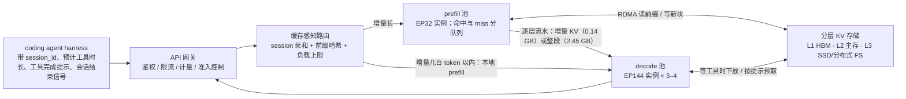
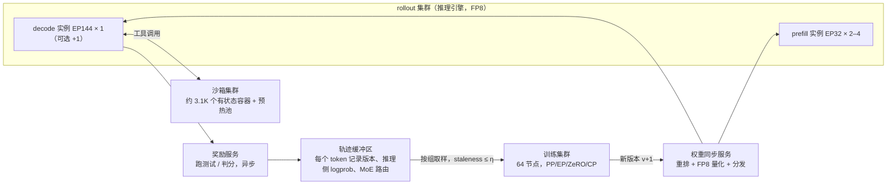
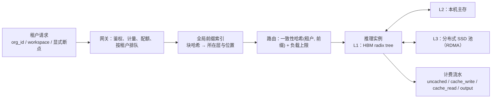
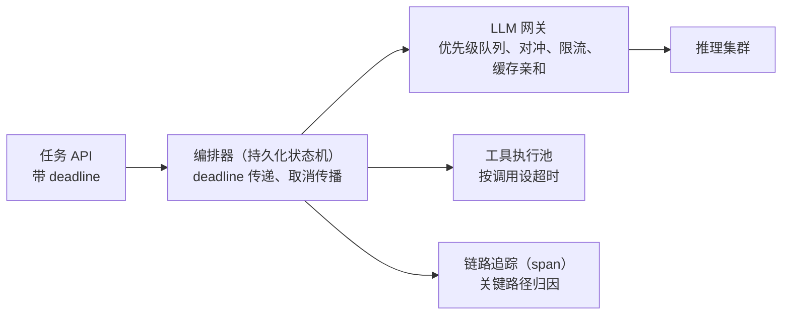
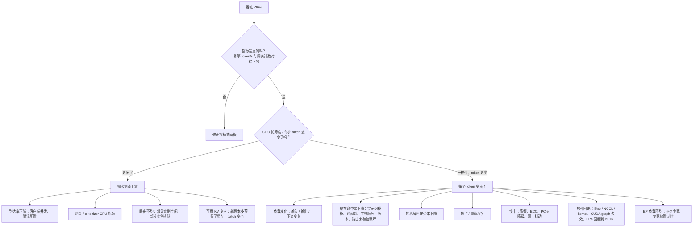

**中文** · [English](README.en.md)

# 模块 08：系统设计与面试

> 🕐 建议时长：2 小时 ｜ 🎯 学完你能：用「七步框架」在 45 分钟内完成一道 LLM infra 系统设计题，每一步都能心算出数量级，并说清取舍；能诚实而有力地讲自己的 harness–inference co-design 研究 ｜ 🧪 实验：无（纯讲义，所有数字都能用纸笔复算） ｜ 📖 必读一手资料：[DeepSeek-V3/R1 Inference System Overview](https://github.com/deepseek-ai/open-infra-index/blob/main/202502OpenSourceWeek/day_6_one_more_thing_deepseekV3R1_inference_system_overview.md)、[Mooncake: A KVCache-centric Disaggregated Architecture for LLM Serving](https://arxiv.org/abs/2407.00079)

## 0. 一句话

系统设计面试不考你背过多少架构图，考的是三次转换：**把模糊需求变成 SLO（Service Level Objective，服务等级目标），把 SLO 变成数量级，再用数量级决定架构和取舍。**

本模块的数字分两类，面试时也要这样区分着讲：

- **常数**：模型和硬件参数来自公开规格和官方 `config.json`。
- **假设**：负载、SLO、效率是显式写出的假设。演练里会做敏感性分析，或者用公开的线上数据校准。

每一步推导都写出来了，你可以逐行验算。

本模块把前面各模块的内容拼成完整的答题：公式来自[模块 01](../01_inference_basics/README.md)，引擎机制来自[模块 02](../02_inference_engines/README.md)，DeepSeek 的部署来自[模块 03](../03_deepseek_stack/README.md)，缓存来自[模块 04](../04_harness_workloads/README.md) 和[模块 05](../05_cache_prefill/README.md)，异步 RL 来自[模块 06](../06_long_tail_async/README.md)，信用分配来自[模块 07](../07_multi_agent_credit/README.md)。配套的 67 道面试题见[面试题库](../../docs/interview-questions.md)。

## 1. 大厂为什么在意

**一个真实的公开数据点。** DeepSeek 公开过 V3/R1 线上推理服务 24 小时的统计（[Day 6 概览](https://github.com/deepseek-ai/open-infra-index/blob/main/202502OpenSourceWeek/day_6_one_more_thing_deepseekV3R1_inference_system_overview.md)）：

- 平均占用 226.75 个节点，峰值 278 个，每节点 8 张 H800。
- 输入 608B token，其中 342B（56.3%）命中 on-disk KV cache（落盘的 KV 缓存）。
- 输出 168B token。
- 单节点平均吞吐：prefill 阶段约 73.7k 输入 token/s（含缓存命中），decode 阶段约 14.8k 输出 token/s。
- 按每卡每小时 2 美元算，日成本 87,072 美元；若全部按 R1 定价计费，**理论**日收入为 562,027 美元。DeepSeek 自己也说明，实际收入显著低于这个数。

对 infra 团队来说，**缓存命中率、PD 分离、专家并行的部署方式**直接决定每天烧多少卡。

**面试官想看到什么。** 假设题目是「设计一个服务 1 万个并发 coding agent 的推理集群」。

- **弱回答**：画一张「LB → vLLM → GPU」的框图，然后开始讲 Kubernetes。
- **强回答**：先用 5 分钟算出三件事。
  - 前缀缓存全部失效时，光 prefill 就要约 3,000 张 H800；命中时约 300–550 张。只要 10% 的轮次整段 miss，prefill 负载就接近翻倍。
  - 在 32K 上下文下，decode 每卡只放得下约 20 条流，先被 KV 显存容量卡住；而且 MLA 在 decode 时的注意力计算，已经顶到算力屋脊。
  - 长上下文会把大 EP 的全局 batch 压小，大 EP 原本的前提就削弱了。

  由此得出结论：**这道题的核心是 KV cache 的分层存储、按缓存路由、以及 miss 尾部的准入控制，不是负载均衡器。** 这就是本模块要训练的肌肉。

## 2. 答题框架：七步

| 步骤 | 做什么 | 45 分钟面试里的时间 | 产出 | 常见坑 |
|---|---|---|---|---|
| ① 需求与 SLO | 问清负载：谁调用？输入/输出长度分布？是否多轮？工具要等多久？再问约束：硬件、模型、预算。然后**把自己的假设说出来** | 5 min | 一张假设表 + SLO：TTFT（Time To First Token，首 token 延迟）、TPOT（Time Per Output Token，每个输出 token 的间隔）的 p50/p99、吞吐、可用性 | 不问就开画；不给数字 |
| ② 数量级估算 | 算 FLOPs、字节、KV 大小、带宽、卡数，每一步写出公式；p99 要有排队模型 | 8 min | 3–5 个关键数字 | 只算平均，不算尾部；忘了注意力项 |
| ③ 架构 | 由数字决定组件：PD 分离？几层缓存？怎么路由？ | 10 min | 一张图 + 每个组件存在的理由 | 堆组件却讲不出为什么需要 |
| ④ 瓶颈 | 指出哪个资源先耗尽：算力、HBM 容量、HBM 带宽、网络，还是尾延迟 | 5 min | 瓶颈排序 | 只说"GPU 不够" |
| ⑤ 取舍 | 每个选择的代价和适用边界 | 7 min | 取舍表 | 只讲好处 |
| ⑥ 指标与监控 | 用哪些指标证明设计有效、及早发现退化 | 5 min | 指标清单（按层） | 只盯 GPU 利用率 |
| ⑦ 故障模式 | 什么会坏，坏了之后的放大效应，怎么兜底 | 5 min | 故障 → 影响 → 缓解 | 忽略"缓存集体失效"这类相关性故障 |

**随身公式卡**（符号：$N_{act}$ 为每 token 参与 GEMM 的激活参数量，不含 embedding 查表和 lm_head，$L$ 为层数，$n_h$ 为注意力头数，$K$ 为本 token 要看的 key 数，即上下文长度）：

| # | 公式 | 用途 |
|---|---|---|
| F1 | prefill 每个新 token 的 FLOPs ≈ $2N_{act} + a\cdot K$，其中 $a = 2L\,n_h\,(d_{qk}+d_v)$ 是每个 (query, key) 对在所有层上的注意力 FLOPs | prefill 算力 |
| F1′ | **MLA 前缀命中的额外代价**：缓存里存的是 latent，prefill 前要把每个缓存 token 升维成每头的 K/V，约 $2\,r_{kv}\,n_h\,(d_{nope}+d_v)\,L$ FLOPs；新 token 少于 $\Delta^*$ 时，改用"吸收"模式（直接在 latent 上算）更省 | MLA 的前缀缓存 |
| F2 | KV 字节/token：GQA 为 $2L\,n_{kv}\,d_h\,b$；MLA 为 $L\,(r_{kv}+d_{rope})\,b$（$b$ 为每元素字节数） | 显存与传输 |
| F3 | decode 每步每卡：读字节 ≈ 本卡权重 + 本卡所有流的 KV；MLA 吸收模式的注意力 FLOPs ≈ 流数 × $a_{dec}$ × 上下文，其中 $a_{dec} = 2L\,n_h\,(2r_{kv}+d_{rope})$ | decode 下限（访存与算力两头都要查） |
| F4 | Roofline：$t = \max(F/(P\cdot \text{MFU}),\ B/(BW\cdot \text{MBU}))$ | 判断算力受限还是访存受限 |
| F5 | Little 定律：系统内平均数量 = 到达率 × 平均停留时间 | 并发、沙箱数、在途轨迹数 |
| F6 | 扇出：$k$ 个**独立**子任务都不超过各自 p 分位的概率是 $p^k$；$k$ 中至少 $m$ 个完成的概率是 $\sum_{j\ge m}\binom{k}{j}p^j(1-p)^{k-j}$。子任务正相关时要用模拟（见 §7） | 多 agent 尾延迟 |
| F7 | Pareto 尾：$P(X>x)=(x_m/x)^\alpha$；$N$ 个样本的最大值超过 $x_m N^{1/\alpha}$ 的概率约为 $1-1/e\approx 63\%$ | RL rollout 长尾 |
| F8 | Kingman 近似（G/G/1 排队）：$E[W] \approx \frac{\rho}{1-\rho}\cdot\frac{c_a^2+c_s^2}{2}\cdot E[S]$；粗估 p99 等待 ≈ $\ln 100 \times E[W] \approx 4.6\,E[W]$（把等待时间的尾部近似成指数分布） | p99 与利用率上限 |

F7 的推导：$P(\max\le x)=(1-(x_m/x)^\alpha)^N$。代入 $x=x_mN^{1/\alpha}$ 得 $(1-1/N)^N\approx e^{-1}$。

F8 的符号：$\rho$ 为利用率，$c_a^2$、$c_s^2$ 分别为到达间隔和服务时间的平方变异系数，$E[S]$ 为平均服务时间。出处：[Kingman 1961](https://doi.org/10.1017/S0305004100036094)。

## 3. 参数卡：本模块所有估算的共同输入

### 3.1 硬件

| 量 | 值 | 来源 / 说明 |
|---|---|---|
| H100 SXM BF16 / FP8 dense 算力 | 989 / 1,979 TFLOPS | [NVIDIA H100 规格页](https://www.nvidia.com/en-us/data-center/h100/)列的是带稀疏的 1,979 / 3,958 TFLOPS（脚注 "With sparsity"），dense 取一半 |
| H100 SXM HBM | 80 GB，3.35 TB/s | 同上 |
| H100 SXM NVLink / PCIe | 900 GB/s；PCIe Gen5 128 GB/s（双向合计，单向约 64 GB/s） | 同上 |
| H800 SXM 显存 | 80 GB | [NVIDIA vGPU 文档](https://docs.nvidia.com/ai-enterprise/release-7/latest/infra-software/vgpu/reference/hopper.html)列出 "H800 SXM5 80GB" |
| H800 NVLink | 400 GB/s（H100 为 900 GB/s） | [DeepSeek ISCA 2025 论文 §4.1](https://arxiv.org/abs/2505.09343) |
| H800 节点网络 | 每节点 8 块 400 Gb/s InfiniBand CX7 网卡；每块约 50 GB/s，每节点合计约 400 GB/s | 同上，§4.1 与 §4.3 |
| H800 算力与 HBM 带宽 | **NVIDIA 没有公开规格页**。DeepSeek 论文说 H800 "similar to the H100"，只是 FP64 和 NVLink 被削减；[腾讯云 HCCPNV5 实例文档](https://www.tencentcloud.com/document/product/1236/62812)列出 H800 "BF16 989 TFLOPS"。FP8 算力和 HBM 带宽查不到公开值，**本模块假设与 H100 SXM 相同**：1,979 TFLOPS、3.35 TB/s（与仓库的 `codesign_sim/hardware.py` 一致） | 旁证：[FlashMLA](https://github.com/deepseek-ai/FlashMLA) 在 H800 SXM5 上达到 3000 GB/s（访存受限配置）；[DeepGEMM](https://github.com/deepseek-ai/DeepGEMM) 在 H800 上达到 1550 FP8 TFLOPS。两者都与上述假设相容 |
| MLA decode kernel 实测上限 | 660 TFLOPS（算力受限配置） | FlashMLA README："660 TFLOPS in computation-bound configuration on H800 SXM5" |
| 节点主存 / 本地 NVMe（参考配置） | 2 TB；8 × 3.84 TB NVMe | [DGX H100 用户指南](https://docs.nvidia.com/dgx/dgxh100-user-guide/introduction-to-dgxh100.html)。H800 服务器的实际配置因厂商而异，这里只作量级参考 |

**效率假设**（面试时要主动说出来，并说明会用 profiling 校准）：

- **MBU**（Memory Bandwidth Utilization，访存带宽利用率）取 0.8，即有效带宽 ≈ 2.68 TB/s。FlashMLA 的 3000 GB/s 约为 3.35 TB/s 的 90%，所以 0.8 不算激进。
- **prefill 有效算力**取 600 TFLOPS/卡。这里选对参照峰值很重要，不能拿 FP8 峰值来比：
  - Day 6 写明 MLA 核心计算用 BF16，只有线性层用 FP8。
  - 按演练 A 命中轮的计算构成：线性层 26%（按 FP8 峰值 1,979 算），注意力 62% 加 MLA 升维 12%（按 BF16 峰值 989 算）。混合上限 ≈ 1,136 TFLOPS。
  - 600 约为这个上限的 53%，是**乐观值**，本模块把它当作忙时的服务速率。§4 用 Day 6 数据校准出 330 TFLOPS，约为上限的 29%；这是含空闲时间的 24 小时平均吞吐，不是忙时速率。两者之比 330 / 600 ≈ 0.55，可以理解为平均利用率。
- **PCIe 有效单向带宽**取 50 GB/s。

### 3.2 模型（全部来自官方 `config.json`）

| 模型 | 结构 | KV 字节/token（BF16） | 来源 |
|---|---|---|---|
| DeepSeek-V3 / R1 | 61 层，hidden 7168，128 头，MLA：`kv_lora_rank`=512、`qk_rope_head_dim`=64、`qk_nope_head_dim`=128、`v_head_dim`=128；256 个路由专家（每 token 激活 8 个）+ 1 个共享专家，`moe_intermediate_size`=2048，前 3 层 dense（`intermediate_size`=18432）；总参数 671B，激活 37B | 61 × (512+64) × 2 = **70,272 B ≈ 70 KB** | [config.json](https://huggingface.co/deepseek-ai/DeepSeek-V3/raw/main/config.json)、[模型卡](https://huggingface.co/deepseek-ai/DeepSeek-V3) |
| Llama-3-70B | 80 层，hidden 8192，64 头，8 个 KV 头，head_dim 128 | 2 × 80 × 8 × 128 × 2 = **327,680 B = 320 KB** | [meta-llama/llama-models `sku_list.py`](https://github.com/meta-llama/llama-models/blob/main/models/sku_list.py)（HF 仓库需授权） |
| Qwen3-235B-A22B | 94 层，64 头，4 个 KV 头，head_dim 128；128 个专家，每 token 激活 8 个；总参数 235B，激活 22B | 2 × 94 × 4 × 128 × 2 = **192,512 B ≈ 188 KB** | [config.json](https://huggingface.co/Qwen/Qwen3-235B-A22B/raw/main/config.json)、[模型卡](https://huggingface.co/Qwen/Qwen3-235B-A22B) |

**为什么演练用 V3，而不是更新的 V4？** 因为 V3/R1 有 Day 6 这样公开到节点数的线上数据，可以拿来校准。

但要知道 V3 的基线已经被新架构改写：[DeepSeek-V4 技术报告](https://arxiv.org/abs/2606.19348)用 CSA/HCA 混合压缩注意力，沿序列维压缩 KV。在 100 万 token 上下文下，V4-Pro 的单 token 推理 FLOPs 只有 V3.2 的 27%，KV cache 只有 10%。详见[模块 03 §5.1](../03_deepseek_stack/README.md#51-deepseek-v4面向-100-万-token-的混合注意力)。

**DeepSeek-V3 的五个派生数字**（后面反复用到）：

1. **线性层 FLOPs/token** ≈ $2N_{act}$ = 2 × 35.1B ≈ **70 GFLOPs**。37B 激活参数里有 embedding 表和 lm_head 各 0.93B（129,280 × 7,168）：embedding 是查表，不算 FLOPs；prefill 只在最后一个位置算 lm_head，所以都不计入。`codesign_sim` 的 `body_active_params` 就是这个口径。
2. **注意力系数（prefill 口径）** $a$ = 2 × 61 × 128 × (192+128) = **5.0 MFLOPs**，即每个 (query, key) 对在所有层上的注意力计算量。这里按 prefill 时不做权重吸收的算法计算：每头 q·k 用 192 维，乘 V 用 128 维。
   - **盈亏点**：$K^* = 70\text{G}/5.0\text{M} \approx$ **14.1K**。上下文超过约 14K 后，注意力的计算量超过全部线性层。
   - 对比 Llama-3-70B：$a$ = 2 × 80 × 64 × 256 = 2.6M，$K^*$ = 137G/2.6M ≈ 52K（去掉 embedding 和 lm_head 后激活参数为 68.4B）。
   - **在这个口径下**，MLA 主要省的是 KV 存储，每对的 FLOPs 并不少。
3. **注意力系数（decode 吸收口径）** $a_{dec}$ = 2 × 61 × 128 × (576+512) = **17.0 MFLOPs**，是 prefill 口径的 3.4 倍。
   - decode 时直接在 512 维 latent 上做注意力，每头 q·k 用 576 维（512 + 64 RoPE），乘 V 用 512 维。
   - 这是 MLA 的核心取舍：**用算力换访存**。
   - 实现层面，vLLM 的 MLA 代码对 prefill 和 chunked prefill 用 "compute friendly" 的做法（先把 latent 升维），对 decode 用 "data-movement friendly" 的做法（[mla_attention.py](https://github.com/vllm-project/vllm/blob/main/vllm/model_executor/layers/attention/mla_attention.py) 开头的说明）。
4. **MLA 前缀命中的升维代价（F1′）**：
   - 每个缓存 token 要过一次 `kv_b_proj`，把 512 维升到 128 × (128+128) 维：2 × 512 × 32,768 × 61 ≈ **2.05 GFLOPs**。
   - 什么时候改用吸收模式更省：升维是每个缓存 token 一次性付的，吸收模式则是每个 (新 token, 缓存 token) 对多付 17.0M − 5.0M = 12.0M。所以盈亏点 $\Delta^*$ = 2.05G / 12.0M ≈ **171 个新 token**：增量少于约 171 个时，吸收模式更省。
5. **路由专家参数与每卡权重**：
   - 路由专家参数 = 58 层 × 256 × 3 × 7168 × 2048 ≈ **654B**。58 层来自 61 − 3 个 dense 层，每个专家是 3 个 7168×2048 的矩阵。
   - 非路由参数 ≈ 671 − 654 = **17B**，包括 MLA、共享专家、dense FFN、embedding。按组件逐项加总也是 17.0B：MLA 11.4B、共享专家 2.6B、dense FFN 1.2B、embedding 1.9B。两种算法对得上。
   - DeepSeek 线上 decode 用 EP144 + MLA/共享专家 DP144（见 [Day 6](https://github.com/deepseek-ai/open-infra-index/blob/main/202502OpenSourceWeek/day_6_one_more_thing_deepseekV3R1_inference_system_overview.md)）。按 FP8、1 字节/参数计，每卡权重 ≈ 17 GB（复制的非路由部分）+ 654/144 ≈ 4.5 GB（本卡的路由专家）≈ **21.5 GB**。
   - **假设**激活值、通信缓冲、碎片占约 8.5 GB，那么每卡留给 KV 的空间 ≈ **50 GB**。

**用仓库里的模拟器复算。** 上面这些派生数字可以直接用 `codesign_sim` 验证（注释里是实际运行的输出）：

```python
from codesign_sim.hardware import GPUS, ridge_point
from codesign_sim.model import MODELS, kv_bytes_per_token, prefill_flops, attn_flops_per_pair
ds = MODELS["deepseek-v3"]
kv_bytes_per_token(ds)                                        # 70272
attn_flops_per_pair(ds)                                       # 4997120.0（prefill 口径）
attn_flops_per_pair(ds, "decode")                             # 16990208.0（decode 吸收口径）
prefill_flops(ds, n_new=2048, n_cached=32768) / 2048 / 1e9    # 239.2（GFLOPs/新 token，不含 MLA 升维）
prefill_flops(ds, n_new=34816) / 1e15                         # 5.48（PFLOPs，整段重算一轮）
ridge_point(GPUS["H800-SXM"])                                 # 295.2（FLOPs/Byte，BF16）
```

## 4. 演练 A：用 H800 集群服务 1 万个并发 coding agent（前缀缓存 + PD 分离）

**① 需求与 SLO。** 以下都是假设，面试时要说出来，并请面试官确认。

- **负载**：10,000 个并发会话，模型为 DeepSeek-V3。
  - 每轮开始时，平均上下文 $C$ = 32K token（仓库上下文 + 历史）。
  - 每轮新追加 $\Delta$ = 2K token（工具输出或用户消息），输出 $o$ = 400 token。
  - 工具平均等待 10 s，重尾：跑一次测试可能要几分钟。
- **SLO**：
  - TPOT ≤ 50 ms（20 tok/s）。DeepSeek 公开的线上平均输出速度是 20–22 tok/s。
  - TTFT p99 ≤ 2 s。
  - 可用性 99.9%。

**② 数量级。**

*第 1 步：每秒多少轮，各状态各有多少会话。*

- 一轮周期 ≈ prefill 0.5 s + decode 400 × 50 ms = 20 s + 工具 10 s = **30.5 s**。
- 轮次速率 ≈ 10,000 / 30.5 ≈ **328 轮/s**。
- 用 Little 定律（F5）拆分 10,000 个会话：decode 中约 **6,560**，等工具约 **3,280**，prefill 中约 **160**。
- 输出吞吐 ≈ 328 × 400 ≈ **131k token/s**。

*第 2 步：prefill 算力。缓存的价值在这里体现。*

- **缓存命中时**，只算增量 $\Delta$，但 MLA 有升维的额外代价。
  - 每个新 token 平均看 32K + 1K ≈ 33.8K 个 key。由 F1，每 token ≈ 70G + 5.0M × 33.8K ≈ **239 GFLOPs**，其中注意力占 169G，比线性层还大。
  - 缓存里的 32K 个 latent 要先升维（F1′）：32,768 × 2.05G ≈ **67 TFLOPs/轮**，比只算增量多 13.7%。Δ = 2K 远大于 171，所以升维比吸收模式划算。
  - 一轮合计 ≈ 2,048 × 239G + 67T ≈ **557 TFLOPs**。
  - 总量 ≈ 328 × 557T ≈ **183 PFLOP/s**。按 600 TFLOPS/卡约 **304 卡（38 节点）**，按校准后的 330 TFLOPS/卡约 **553 卡（69 节点）**。前者是纯忙时的卡数，后者已含空闲余量（见 §3.1）。
- **缓存全失效时**，每轮重算 34.8K token。
  - 平均每 token 看 17.4K 个 key，每 token ≈ 70G + 5.0M × 17.4K ≈ 157 GFLOPs，每轮 **5.48 PFLOPs**。
  - 这是命中轮的 **9.8 倍**（不计升维时是 11.2 倍）。
  - 总量 ≈ 1.80 EFLOP/s，按 600 TFLOPS/卡约 **2,990 卡（374 节点）**。
- **敏感性**：只要 10% 的轮次整段 miss，prefill 负载就 ×1.88；20% 时 ×2.77。所以 **命中率的尾部（整段 miss 的比例）决定了 prefill 集群要建多大**。

*第 3 步：decode 的容量和算力，两头都要查。*

- **每条流的 KV**：decode 期间上下文是 C + Δ + o/2 ≈ 35.0K，每条流 ≈ 35.0K × 70,272 B ≈ **2.46 GB**。如果按 32K 取整，会低估约 7%。
- **容量**：
  - 每卡 50 GB KV 空间，放约 **20.3 条流**。
  - 6,560 条流需要约 323 卡。但 decode 是按 EP144 实例（18 节点）为单位部署的：一个实例约放 144 × 20.3 ≈ **2,930 条流**，6,560 条要 2.24 个实例。
  - 所以至少 **3 个实例（54 节点）**；按 99.9% 可用性再加 N+1，要 **4 个（72 节点）**。
- **访存**：每步每卡读 KV 50 GB，÷ 2.68 TB/s ≈ 18.7 ms；读权重 21.5 GB ≈ 8.0 ms。
- **算力**：
  - MLA 吸收模式下，每个 decode token 的注意力 ≈ 17.0M × 35.0K ≈ **595 GFLOPs**。
  - 每卡每步 ≈ 20.3 × 595G ≈ 12.1 TFLOPs，按 FlashMLA 的 660 TFLOPS 上限约 **18.3 ms**，和读 KV 的时间一样长。
  - 算术强度 = 2 × 128 × 1,088 / 1,152 B ≈ **242 FLOPs/Byte**，已接近 BF16 屋脊点 295。
- **加 MTP**：每步有 2 个 query token，注意力翻倍到 36.6 ms，变成算力受限。一步约 45 ms，但产出约 1.85 个 token，折合每 token 仍在 TPOT 预算内。
- **结论**：decode 先被 HBM 容量卡住，但算力**并不宽裕**，MLA 的 decode 注意力已经站在屋脊上。估出来的步时间约 27 ms 再加通信，满足 50 ms。
- **FP8 KV cache 不能让卡数简单减半**：
  - 理想情况下容量翻倍到 40.6 条流/卡，但注意力算力随流数翻倍，要 36.6 ms，加上读权重共约 44.7 ms，几乎没给通信留余量。
  - 实际格式还达不到翻倍：FlashMLA 为 V3.2 设计的 FP8 KV 格式每层每 token 656 B（512 个 FP8 值 + 4 个 FP32 scale + 64 个 BF16 的 RoPE 值），BF16 是 1,152 B，容量只是 1.76 倍，约 35.7 条流/卡，注意力约 32 ms，加读权重约 40 ms。
  - 如果给通信和调度留 20%（步时间 40 ms），每卡最多约 35.5 条流，约 185 卡。两种算法殊途同归。
  - 最终是 **2 个实例（N+1 为 3 个）**，而不是减半。

*第 4 步：用 DeepSeek 公开数据校准。这一步在面试里很加分。*

- **decode 校准**：
  - Day 6：decode 14.8k token/s/节点，"平均每个输出 token 的 KV cache 长度为 4,989"，平均输出速度 20–22 tok/s。由此反推，每卡约 14.8k / 21 / 8 ≈ **88 条流**，KV 只占约 31 GB，**不是**容量受限的工作点。
  - **按容量折算**：我们的工作点是每卡 20.3 条流，14.8k × 20.3 / 88 ≈ 3.41k token/s/节点，需要约 **38 节点**。这和第一性原理的 40 节点（323 卡）吻合。
  - **按上下文反比折算**：假设每节点吞吐受读 KV 字节数限制，14.8k × 4,989 / 35.0K ≈ 2.11k token/s/节点，约 **62 节点**。这是悲观上界。
  - 区间来自缩放模型的不确定性。两者都不超过部署粒度给出的 54–72 节点，所以 **decode 取 54–72 节点**。
- **prefill 校准**：
  - 73.7k token/s/节点里有 56.3% 是命中，未命中部分约 32k token/s/节点。
  - 若平均每 token 看约 2.5K 个 key，每 token ≈ 70G + 5.0M × 2.5K ≈ 83 GFLOPs，有效算力约为 32k × 83G / 8 ≈ **330 TFLOPS/卡**，约为混合上限的 29%。线上 prompt 长度分布未公开，这是粗估。
  - 注意：这是 24 小时平均值，**已经包含了空闲余量**。所以用它算卡数时不再除以利用率；而下一步的排队模型要用忙时服务速率（600 TFLOPS），不能用它。

*第 5 步：p99 需要排队模型，不能只看平均。*

- **把一个 EP32 prefill 实例当成一个排队服务台**：服务速率要用忙时速率 600 TFLOPS/卡，32 卡 × 600 ≈ 19.2 PFLOP/s。命中轮服务时间约 29 ms，整段 miss 约 285 ms。
- **10% 整段 miss 时**：$E[S]$ ≈ 55 ms，$c_s^2$ ≈ 2.0。代入 F8：
  - 泊松到达（$c_a^2$ = 1）、ρ = 0.6：$E[W]$ ≈ 122 ms，p99 TTFT ≈ 4.6 × 0.122 + 0.285 ≈ **0.85 s ✓**。
  - ρ = 0.8：≈ 1.8 s，接近边界。p99 ≤ 2 s 的利用率上限约为 **0.82**。
  - 突发到达（$c_a^2$ = 2）：ρ = 0.6 时约 1.0 s，ρ = 0.8 时约 2.3 s ✗，上限约 **0.77**。
- **没有整段 miss 时**：即使 ρ = 0.9，p99 也只有约 0.6 s。所以 **p99 是被 miss 拖出来的**。
- **部署取 ρ ≈ 0.55**：下面汇总表的 prefill 节点数对应 ρ ≈ 0.53–0.54，10% miss 时 p99 ≈ 0.7 s。
  - 这份余量是留给 600 TFLOPS 这个乐观假设的：如果实际忙时速率只有 450 TFLOPS，ρ 会升到约 0.72，p99 约 1.7 s，仍在 2 s 以内。
  - 这个工作点也和 Day 6 的 330 / 600 ≈ 0.55 对得上。
- **缓解**：
  - 命中轮单独排队或给更高优先级。只有命中轮的队列在 ρ = 0.8 时 p99 约 0.3 s。
  - 整段 miss 的 prefill 切成 chunk，不堵住命中轮。
- **为什么按单服务台算**：缓存亲和路由把请求绑定到实例，整个池子更像许多个小 M/G/1 队列，而不是一个 M/G/c 大池。负载上限加溢出，才能把池化的好处找回一部分。所以单服务台的估算偏保守。
- **相关性**：整段 miss 往往是一起发生的，比如系统提示词改版会让所有会话同时 miss。稳态排队模型描述不了这种情况，必须有**准入控制**：限制整段 miss 的 prefill 速率，新会话排队，必要时降级。

*第 6 步：等工具的 KV 放哪里？这是三选一，不是二选一。*

- **留在 HBM**：一条流占每卡 KV 空间的 2.46 / 50 ≈ 4.9%，挤占 decode 容量。
- **下放主存**：
  - **换出**：在工具等待期间异步做，走 DMA，不占 SM。
  - **读回**：2.46 GB ÷ 50 GB/s ≈ **49 ms**。这是单流、单向的下限。
  - **并发**：每个 decode 节点每秒约 4.6–6.1 次读回（328 轮/s 分到 54–72 个节点），合计 11–15 GB/s，只占节点 PCIe 总带宽（约 400 GB/s）的 3–4%。但很多工具同时返回时会出现突发，p99 读回时延要单独监控。
  - **预取**：如果 harness 提前告诉引擎"工具快结束了"，可以提前把 KV 读回来，读回时间就藏在工具等待里，不进 TTFT。
  - **容量**：等工具的 KV 共约 8.1 TB，分到 54–72 个节点，每节点 112–149 GB，参考配置有 2 TB 主存，放得下。
- **重算**：5.48 PFLOPs ÷ 600T ≈ 9.1 卡·秒，约为命中轮的 10 倍。
- **200 s 这个数的真实含义**：留在 HBM 与重算的盈亏点 ≈ 9.1 / 0.049 ≈ **185 s**（按 330 TFLOPS 算约 340 s）。它**只在没有下一级存储时**才有意义，例如只有 HBM 前缀缓存的系统。vLLM V1 默认的抢占方式就是 RECOMPUTE，下放要显式打开 OffloadingConnector。
- **决策边界**：
  - 亚秒级等待，或 HBM 有富余 → 留在 HBM。
  - 秒到分钟级 → 下放主存，并用 harness 的完成提示做预取。
  - 长时间空闲的会话，以及跨会话共享的项目前缀 → 放 SSD 或分布式存储。
  - 所有层都 miss → 才重算。

*第 7 步：PD 之间搬多少 KV，本地还是远程 prefill。*

- **三种数据流**（按每轮、全集群 328 轮/s 算）：

| 数据流 | 每轮字节 | 全集群带宽 | 单网卡（50 GB/s）耗时 |
|---|---|---|---|
| P 从 D 或存储读 32K 前缀（2.30 GB），算完把整段 KV（2.45 GB）推给 D | 4.75 GB | 1.56 TB/s | 95 ms |
| P 读前缀，只把增量 KV（2K × 70 KB ≈ 0.14 GB）推回 D，D 保留前缀 | 2.45 GB | 0.80 TB/s | 49 ms |
| P 和 D 都按会话亲和保留前缀：P 只收上一轮 400 个输出 token 的 KV（28 MB），推回增量 | 0.17 GB | 56 GB/s | 3 ms |

  第三种省了约 14 倍网络流量，代价是 prefill 侧要为所有会话保留上下文（约 25 TB，主要放在主存或 SSD），每轮再经 PCIe 读进 HBM。流量从网络转移到了本机 PCIe。

- **逐层流水传输**：
  - Splitwise："Layer-wise KV-cache transfer happens in parallel with the prompt computation for the next layer"；Mooncake 也用 layer-wise prefill 把 KV 的传输和落盘与计算重叠。
  - 命中轮在一个 EP32 实例上约 50 ms，整段 2.45 GB 走单网卡约 49 ms，逐层重叠正好能藏住；只传增量时就更轻松。
  - 传输引擎：[Mooncake Transfer Engine](https://github.com/kvcache-ai/Mooncake) 做多网卡带宽聚合，[NIXL](https://github.com/ai-dynamo/nixl) 是 Dynamo 用的点对点传输库。
- **本地 prefill 在大 EP 下会卡住整个实例**：
  - decode 用的是 DP144 注意力 + EP144 专家，每个 MoE 层都要做同步的 all-to-all。某个 DP rank 在本地做 prefill 时，其余 143 张卡都会在 dispatch/combine 上等它。卡住的是整个实例约 2,900 条流，不是同卡的 20 条。
  - 2K 增量全在一个 rank 上做：注意力 346 TFLOPs + 升维 67 TFLOPs，按 600 TFLOPS 约 **0.69 s**。
  - 如果切 chunk、每步只给这个 rank 加 10 ms，按吸收模式（小 chunk 时更省，见 F1′）每步只能做约 11 个 token：2K 要约 190 步（9.5 s），1 秒内只能做约 215 个 token。
  - **结论**：在 32K、DP 注意力的 decode 实例上，本地 prefill 只适合几百 token 以内的增量，而且各 DP rank 之间的 chunk 预算要均衡。Day 6 的 Decode Load Balancer 就是按 KVCache 用量和请求数均衡各卡的 core-attention 计算量。
- **现成实现**：NVIDIA Dynamo 的 [conditional disaggregation](https://docs.nvidia.com/dynamo/dev/advanced-customizations/conditional-disaggregation) 用两个阈值决定走本地还是远程："有效输入长度"（扣掉前缀命中后，`eff_isl_threshold`，默认 2048）和它占原始长度的比例（`eff_isl_ratio_threshold`，默认 0.7）。另外还有 `decode_busy_threshold`：decode worker 的 KV 占用超过这个比例时，强制走远程 prefill。按上面的估算，在 DP 注意力的 MLA 部署上，长度阈值应比默认的 2048 低得多。

**汇总（按部署粒度报区间，并说明每一端来自哪个假设）：**

| 池子 | 0% 整段 miss | 10% 整段 miss | 怎么算的 |
|---|---|---|---|
| prefill（均值） | 72 节点（18 个 EP32） | 132 节点（33 个 EP32） | 两种口径收敛：忙时 38 节点 ÷ ρ 0.6（600T）≈ 63，或直接用含空闲的 330T 校准值 69，取整到 EP32 后 ρ ≈ 0.53。10% miss 时负载 ×1.88，忙时 71.6 节点，ρ ≈ 0.54 |
| prefill（峰值） | 92 节点（23 个 EP32） | 164 节点（41 个 EP32） | 乘 Day 6 的峰均比 278 / 226.75 ≈ 1.23：72 × 1.23 ≈ 89、132 × 1.23 ≈ 162，再取整到 EP32 |
| decode | 54–72 节点（3–4 个 EP144） | 同左 | 容量 2.24 个实例向上取整，再加 N+1。峰值时 6,560 × 1.23 ≈ 8,070 条流，要 2.76 个实例，仍在 3–4 个以内 |
| 合计（峰值） | 146–164 节点 | 218–236 节点 | prefill（峰值）+ decode |

这里假设 1 万并发是日均值，峰值按 Day 6 的日内波动放大。总量约 **145–235 节点（约 1,170–1,890 张 H800）**。

**③ 架构。**



- **harness 提供的信号**：session_id、这次工具调用预计多久、工具快结束的提示、会话是否结束。有了这些，缓存才能决定下放、预取、TTL（生存时间）和 pin（在工具调用期间把 KV 钉在 HBM 里）。这就是 co-design 的接口。
- **分层存储**：思路与 [Mooncake](https://arxiv.org/abs/2407.00079)（以 KVCache 为中心的分离式架构）、DeepSeek 的落盘 KV cache 和 [3FS](https://github.com/deepseek-ai/3FS) 一致。
- **核心张力：长上下文削弱了大 EP 的前提。**
  - 大 EP 的原始理由是让每个专家分到足够大的 batch。
  - 32K 下，一个 EP144 实例的全局 batch 被 KV 容量限制在约 2,930 条流，每个专家平均只分到 2,930 × 8 / 256 ≈ **91 个 token**（开 MTP 约 183），而逼近 FP8 屋脊（≈ 590 FLOPs/Byte）需要约 295 个。
  - 对照 Day 6 的工作点：每实例约 12,700 条流，每个专家约 400 个 token（按含冗余的 288 个专家位摊约 350）。
  - 在这个工作点上，读专家权重（8 ms）比读 KV（18.7 ms）便宜，所以专家 GEMM 效率低不是第一矛盾。**保留大 EP 的理由变成了"给 KV 腾显存"**：EP32 每卡权重 37 GB，只放 13.8 条流；EP64 27 GB，18.0 条；EP144 21.5 GB，20.3 条。
  - 对策：把等工具的会话下放以提高 HBM 中的活跃流数；FP8 KV（会撞上算力墙）；按上下文长度分池，让短上下文会话拿到大 batch；或用更小的 EP 换更小的爆炸半径，代价是容量。

**④ 瓶颈（按先后）。**

1. decode 的 HBM 容量，以及 MLA decode 注意力的算力：两者在 32K 下同时逼近上限。
2. 命中率的尾部加上排队：每多 10% 整段 miss，prefill 负载约 ×1.9，而且 p99 主要由 miss 决定。
3. 长上下文 prefill 的注意力：超过约 14K 后注意力超过线性层；命中轮还要付 13.7% 的升维代价。
4. 大 EP 下的本地 prefill：一个 rank 的 prefill 会拖住整个实例。
5. EP 负载不均和慢卡：144 张卡的 all-to-all 被最慢的一张拖住。

**⑤ 取舍。**

| 选择 | 好处 | 代价 | 适用边界 |
|---|---|---|---|
| PD 分离 vs 同机（chunked prefill） | 消除 prefill 对 TPOT 的干扰；两边可用不同并行度 | 每轮搬 0.17–4.75 GB，取决于数据流；两个池的比例要动态调 | 增量长时分离；增量在几百 token 以内时本地做，并在 DP rank 间均衡 |
| 等工具时：HBM 留存 / 主存下放 / 重算 | 留存的 TTFT 最低；下放不耗 GPU 算力 | 留存挤占 decode 容量；下放占 PCIe，读回约 49 ms（可预取隐藏）；重算约 10 倍 | 亚秒级或 HBM 有富余时留存；秒到分钟级下放加预取；只有所有层都 miss 才重算 |
| FP8 KV vs BF16 KV | 容量翻倍 | 32K 下撞上 MLA 注意力的算力墙，卡数只能减少不到一半；可能掉精度 | 评测通过、且通信余量够时采用 |
| 缓存亲和路由 vs 最小负载路由 | 命中率高 | 热点项目过载；池子退化成许多小队列，p99 变差 | 亲和 + 负载上限，超限就溢出到别处并从 L3 拉前缀 |
| 大 EP（EP144）vs 小 EP | 每卡权重少，给 KV 腾出显存 | 爆炸半径大：一张卡坏，整个实例（18 节点）停；all-to-all 对慢卡敏感 | 至少 N+1 个实例，并能快速从 L3 恢复会话；或按上下文长度分池 |
| harness 压缩或改写上下文 | 上下文变短，KV 变小 | 前缀失效，下一轮整段 miss（约 10 倍） | 少压缩、批量压缩；把压缩点对齐到块边界 |

**⑥ 指标。**

- TTFT 分"命中轮"和"未命中轮"两组看 p50/p99；TPOT p99。
- 按层（HBM/主存/SSD）统计 token 级命中率，另外单独统计**整段 miss 的轮次比例**。
- 每个 prefill 实例的利用率和队列长度；准入控制拒绝或延迟的请求数。
- KV 占用、主存读回时延的 p99、PD 传输字节数（按上面三种数据流分开）、抢占次数。
- 每个 DP rank 每步注意力 FLOPs 的 max/mean；每个专家的 batch 大小；每卡步时间的分布。
- goodput：每秒满足 SLO 的请求数。

**⑦ 故障模式。**

- **系统提示词或工具定义改版**：所有前缀哈希一起变，prefill 负载瞬间约 ×10，而且是相关性故障。缓解：灰度发布提示词、提前预热、准入控制。
- **EP144 实例中坏一张卡**：18 个节点的实例整个停掉。3–4 个实例中坏 1 个，decode 容量掉 25–33%。缓解：N+1 冗余；会话 KV 在 L3 有副本，可在别处恢复。
- **L2/L3 存储节点丢失**：相关会话退化为重算，出现一个 prefill 尖峰。缓解：副本加限流重算。
- **工具时延的长尾**（例如 CI 跑 10 分钟）：超过 TTL 后 KV 被淘汰。缓解：harness 上报预计时长，缓存据此决定下放而不是删除。
- **大量工具同时返回**：主存读回出现突发，TTFT 抖动。缓解：按完成提示错峰预取，并限制每节点并发读回数。

## 5. 演练 B：为 600B 级 MoE 设计异步 agentic RL 训练系统（含沙箱集群与权重同步）

**① 需求与 SLO（假设）。**

- **策略模型**：DeepSeek-V3 架构（671B / 37B）。
- **任务**：带沙箱的 agentic coding，即仓库 + 测试，奖励 = 跑测试。
- **每步数据**：256 个 prompt × 每组 16 个样本 = **4,096 条轨迹**，按 GRPO 的组内相对优势计算。
- **每条轨迹**：
  - 初始 prompt 11K token；20 轮，每轮生成 500 token，共生成 10K；中间 19 次工具调用，各返回 1K token。
  - 最终序列 40K token；每次工具调用平均 3 s，重尾。
- **目标**：
  - 训练端尽量不空转。
  - staleness（策略版本滞后）≤ 2 个版本。
  - 权重同步 ≤ 30 s。
  - 沙箱基础设施故障 ≤ 1%，且**不能记为 0 奖励**。

**② 数量级。**

*训练端：长序列要单独修正。*

- 每步 4,096 × 40K = **164M token**。
- 用 DeepSeek-V3 报告的训练效率校准：[每万亿 token 180K H800 GPU 小时](https://arxiv.org/abs/2412.19437)。据此，164M token ≈ 29.5 卡·时 ≈ 106K 卡·秒，512 卡（64 节点）上约 207 s。
- **长序列修正**：这个效率是在预训练序列长度 4K 下测得的（同一报告："maximum sequence length to 4K during pre-training"）。用 F1 修正：
  - 4K 序列平均每 token 看 2K 个 key，每 token 前向 ≈ 70G + 5.0M × 2K ≈ 81G。
  - 40K 序列平均看 20K 个 key，≈ 70G + 5.0M × 20K ≈ 170G。
  - 贵 **2.11 倍**，所以前向 + 反向 ≈ 207 × 2.11 ≈ **438 s**。
- **加上额外的前向**（一次前向约为前向 + 反向的 1/3）：
  - 在训练侧重算 old logprob：≈ **585 s**。为什么不直接用推理侧给的 logprob，见下文"训推不一致"。
  - 再算 reference 模型的 logprob 用于 KL：≈ **731 s**。
  - 下面取训练步长 T ≈ 730 s。这仍是下限：没算流水线气泡、all-to-all 和长序列的额外开销。
- **显存要按每张卡算，不能只看集群总量**。示意布局沿用 V3 的 PP16：512 卡时每个 stage 32 张卡，路由专家 EP32，非路由部分用 ZeRO-1 DP32。
  - **每卡参数**：路由专家 654B / 16 / 32 ≈ 1.28B，非路由 17B / 16 ≈ 1.06B。
  - **参数、梯度、优化器状态**：按通用混合精度 Adam 约 16 B/参数，其中 BF16 权重 2 B、BF16 梯度 2 B、FP32 主权重和两个一阶/二阶矩共 12 B。非路由部分的 12 B 用 ZeRO-1 切成 32 份。合计约 **25 GB**。DeepSeek-V3 把 AdamW 的一二阶矩存成 BF16，主权重和梯度保留 FP32，组合不同，但量级相同。
  - **激活**：按全量重计算（每层只存输入）估。40K token × 7,168 × 2 B ≈ 0.57 GB/层；每个 stage 约 3.8 层，≈ 2.2 GB/微批；1F1B 调度下第一个 stage 最多有 16 个微批在飞，≈ **35 GB**。
  - **合计约 60 GB**，还没算 attention workspace、all-to-all 缓冲和碎片，在 80 GB 卡上已经很紧。所以要用上下文并行（CP，把一条序列切到多张卡上），或者减少在飞的微批数，或者用选择性重计算。
  - 反过来，"671B × 16 B ≈ 10.7 TB，小于 512 × 80 GB = 41 TB"这种算法不能证明放得下。

*rollout 端（T ≈ 731 s，用 Little 定律）。*

- 需要的轨迹完成速率 λ = 4,096 / 731 ≈ **5.61 条/s**。
- 每条轨迹的生命周期：decode 10K / 20 tok/s = 500 s，加上工具 19 × 3 s = 57 s，共 **557 s**。
- 在途轨迹 = 5.61 × 557 ≈ **3,120 条**，其中在 decode 的约 5.61 × 500 ≈ 2,800 条。
- decode 期间平均上下文约 25.5K，每条 1.79 GB，共约 5.0 TB，÷ 50 GB/卡 ≈ **100 卡**。一个 EP144 实例在这个上下文下能放约 4,020 条流，**1 个实例**就够，占 70%。RL 可以把失败的轨迹重新下发，所以 N+1 是可选的。
- 核对输出量：2,800 × 20 tok/s × 731 s ≈ 41M ≈ 4,096 × 10K ✓。
- **多轮增量 prefill**：按上面的轨迹模型逐轮算，每条轨迹 ≈ 4.83 PFLOPs，加上每轮 MLA 升维 0.97 PFLOPs，共 5.8 PFLOPs。每步 4,096 × 5.8P ≈ 2.4×10¹⁹ FLOPs，在 731 s 内完成要 54 卡（600T）到 99 卡（330T），即 **2–4 个 EP32 prefill 实例（8–16 节点）**。
- **敏感性**：如果 old logprob 直接取推理侧的、只多做一次前向（T ≈ 585 s），λ ≈ 7.01，在途约 3,900 条，decode 约 126 卡，仍是 1 个实例。

*沙箱。*

- 每条在途轨迹独占一个有状态的沙箱（仓库的文件系统状态要跨轮保留），所以并发沙箱数 ≈ **3,100 个**，再加 10–20% 的预热池。
- 假设每个沙箱 2 vCPU，共约 7K–7.5K vCPU。

*权重同步：先把物理字节算对。*

- **推理侧每张卡要落地的权重**（FP8）：
  - 非路由的 17B 在 DP 下**每张卡各存一份**。
  - decode 每卡另放 2 个路由专家（Day 6 的配置，含冗余），≈ 17 + 5.1 ≈ **22.1 GB**。
  - prefill 每卡放 9 个路由专家，≈ 17 + 23 ≈ **40 GB**。
- **总量**：1 个 decode 实例 + 3 个 prefill 实例，落地 144 × 22.1 + 96 × 40 ≈ **7.0 TB**。而"每个实例一份 671 GB"的逻辑量只有 2.7 TB。
- **带宽下限**：
  - 每张卡经自己的 50 GB/s 网卡收完，最快 0.44–0.8 s。也可以每个节点只收一次唯一字节，再走 NVLink 在节点内广播。
  - 训练集群的理论注入带宽是 64 节点 × 8 块网卡 × 50 GB/s ≈ 25.6 TB/s。这是理论值，不是一次权重更新的端到端吞吐。
- **公开参考点**：
  - Kimi K2 指出，如果用网络文件系统做重排和广播，要把开销压低所需的聚合带宽 "reaches several petabytes per second"，所以他们用和训练节点同机部署的 checkpoint engine，1T 参数全量更新 "less than 30 seconds"（[Kimi K2 报告 §3.3.2](https://arxiv.org/abs/2507.20534)）。
  - LlamaRL 用 DDMA 更新 TB 级模型约 2 s（[LlamaRL](https://arxiv.org/abs/2505.24034)）。
- **结论**：带宽下限只有亚秒级，时间主要花在别处：把训练布局（PP/EP/DP）重排成推理布局（EP144/EP32），做 FP8 重新量化，以及全局编排和屏障。

*长尾为什么让同步 RL 很痛（F7）。*

- 若轨迹时长服从 α = 1.5 的 Pareto 分布，均值是 $3x_m$。4,096 条里的最长一条有 63% 的概率超过 $4096^{2/3}x_m = 256x_m$，约为均值的 85 倍。
- 实际系统会设上限，比如原均值的 3 倍（$9x_m$）。但截断之后均值也变小了：$E[\min(X, 9x_m)] = x_m\,(1 + (1 - 9^{-0.5})/0.5) ≈ 2.33\,x_m$。
- 4,096 条里几乎必然有一条触到上限（单条超过 $9x_m$ 的概率是 1/27），所以同步模式下 rollout 槽位的利用率 ≈ 2.33 / 9 ≈ **26%**，训练端还要在整个生成阶段空等。
- 实测参考：[AReaL](https://arxiv.org/abs/2505.24298) 报告，在同样卡数下，全异步相比同步系统最高快 2.77 倍，最终性能持平或更好。

*GRPO 的组级尾巴。*

- 组内优势需要同一个 prompt 的全部 G 个样本。组的完成时间 = G 个样本里最慢的那个。
- G = 16 时，所有样本都在 p90 以内的概率只有 0.9¹⁶ ≈ 18.5%。**即使整体是异步的，长尾也会在组这一级重新出现。**

**③ 架构。**



- **异步**：rollout 一直在生成，训练从缓冲区取数据。缓冲区只接受版本差 ≤ η 的轨迹（AReaL 把 η 称为 "maximum permitted staleness"，η = 0 时退化为同步）。
- **离策略修正要讲到这一层才扛得住深挖。**
  - **比率取在哪一级**：一条 10K token 的轨迹，如果把逐 token 比率连乘成序列级比率，方差随长度指数增长，不可用。所以用 token 级比率加裁剪（PPO 式）。这是有偏的，要监控裁剪比例。截断重要性采样（truncated IS）也是同一类折中。
  - **一条轨迹跨多个版本**：partial rollout 或可中断生成会让一条轨迹的 token 来自不同版本。所以要按 token 记版本号，每个 token 用它自己的行为策略算比率。AReaL 的 decoupled PPO 就把行为策略和 proximal 策略分开。
  - **GRPO 的组内基线**：组均值只在样本来自相同或相近版本时才可比。按组控制 staleness：整组样本都在 η 以内才放行。
- **训推不一致是真实的崩溃来源。**
  - 即使权重相同，推理引擎（vLLM/SGLang）和训练框架（FSDP/Megatron）算出的 token 概率也可能差别很大。[Yao et al. 的博客](https://fengyao.notion.site/off-policy-rl)的说法是："the implementation gap implicitly turns the on-policy RL to be off-policy"。
  - 对策 1：在训练侧重算 old logprob，这就是上面多出的那次前向。
  - 对策 2：用 TIS（截断重要性采样，min(π_learner / π_sampler, C)）修正采样分布与训练分布的差距。
  - 对策 3：MoE 还会路由不一致。[R3（Rollout Routing Replay）](https://arxiv.org/abs/2510.11370)把推理侧的路由记录下来，在训练时重放。
- **长轨迹的三种处理**：
  - **partial rollout**：设固定的 token 预算，没写完的部分存进缓冲区，下一轮接着写。见 [Kimi k1.5 §2.6.2](https://arxiv.org/abs/2501.12599)。
  - **可中断生成**：新权重到达时打断正在进行的生成，丢弃旧权重算出的 KV，用新权重重算后继续。这是 [AReaL §4.1](https://arxiv.org/abs/2505.24298) 的做法。
  - **直接丢弃超龄轨迹**：最简单，但会产生偏差，见下面的取舍表。
- **权重同步**：新权重先在主存或空闲显存里暂存，然后原子切换，避免推理侧长时间停顿。代价是多占一份暂存空间：decode 卡上如果双份权重都放在 HBM，KV 空间会从 50 GB 降到约 28 GB。

**④ 瓶颈。**

1. 长尾，包括组级长尾。
2. 训练端的长序列：计算 ×2.11，每张卡的激活显存也很紧。
3. 权重同步中的重排和编排。
4. 沙箱的启动延迟和稳定性。
5. 奖励计算（跑测试）的延迟。

**⑤ 取舍。**

| 选择 | 好处 | 代价 | 适用边界 |
|---|---|---|---|
| 同卡 colocate（训练和推理分时共用同一批卡，如 verl 的 [HybridFlow](https://arxiv.org/abs/2409.19256)）vs 分离 | colocate 没有跨集群搬权重，卡不会整段闲置 | 仍是同步，长尾照样拖；切换要重排 | 轨迹短、尾巴轻时选 colocate；agentic 长尾任务选分离 + 异步 |
| staleness 上限 η 取大 | 吞吐高，丢弃少 | off-policy 程度增加，可能不稳定 | 监控裁剪比例、KL 和训推 logprob 差；η 一般取 1–2 |
| old logprob 取推理侧 vs 训练侧重算 | 推理侧：省一次前向（T 从约 731 s 降到约 585 s） | 推理侧：训推数值不一致，隐性 off-policy | 默认在训练侧重算；想省这次前向就配合 TIS，MoE 再加路由重放 |
| 丢弃超龄轨迹 | 实现简单 | **偏向短而简单的任务**：长轨迹常对应难题 | 只在超龄比例很低时用 |
| partial rollout / 可中断生成 | 长轨迹不再阻塞 | 一条轨迹里混有多个版本；中断会重算 KV | 长尾重的 agentic 任务；按 token 记版本 |
| 取先完成的轨迹组成 batch | 快 | **长度偏差**：短轨迹先到，batch 里短的偏多 | 按组取样，或按长度分层取样 |
| 权重双缓冲放 HBM | 切换最快 | KV 容量约少 40% | 显存有富余时才用；否则暂存在主存 |

**⑥ 指标。**

- rollout：token/s，槽位利用率。训练：MFU，每张卡的显存峰值。
- staleness 分布（均值 / p99）、IS 比率的裁剪比例、新旧策略间的 KL。
- **训推 logprob 差**（同一批 token 在推理侧和训练侧的 KL），MoE 路由一致率。
- partial 或被中断的轨迹比例，超龄丢弃比例（**按任务难度分桶看**）。
- 权重同步耗时。
- 沙箱：启动 p99、故障率，并区分"基础设施失败"和"任务失败"。
- 奖励计算延迟，每小时完成的轨迹数。

**⑦ 故障模式。**

- **沙箱故障被当成 0 奖励**：策略会学到"别碰会让沙箱崩的操作"。缓解：基础设施失败单独标记，不参与训练，并统计是否与难度相关。
- **奖励作弊**：例如改测试文件。缓解：测试文件只读、在独立容器里判分。
- **训推不一致悄悄累积**：训练看起来正常，某一步突然崩掉。缓解：监控训推 KL，训练侧重算 logprob，用 TIS，MoE 加路由重放。
- **权重同步部分失败**：一部分推理实例还在跑旧版本。缓解：每个 token 带版本号，版本不一致时拒收。
- **rollout 节点故障**：在途轨迹丢失。缓解：从缓冲区的检查点续写，或重新下发。
- **staleness 失控**：训练端比 rollout 快太多。缓解：训练端按 η 阻塞等待。

## 6. 演练 C：多租户 prompt caching API（缓存分层、计费、隔离）

**① 需求与 SLO（假设）。**

- 公开 API，1 万个租户（组织），峰值 5,000 请求/s。平均 prompt 20K token = 可复用前缀 14K（system prompt + 工具定义 + 文档）+ 新内容 6K。模型为 DeepSeek-V3。
- 目标：
  - 命中时的 TTFT 显著下降。
  - 计费可复现、可对账。
  - **杜绝因跨租户缓存复用导致的 prompt 前缀计时泄漏**。注意，其他计时侧信道仍然存在，见下文。
  - 一个租户不能把其他租户的缓存挤掉。
  - TTL 行为要写进文档、可预期。

**先看业界公开做法（截至 2026-09 的官方文档，细节会变）。**

| 厂商 | 缓存方式 | 保留时间 | 计价 | 隔离 |
|---|---|---|---|---|
| [Anthropic](https://platform.claude.com/docs/en/build-with-claude/prompt-caching) | 显式断点，最多 4 个；前缀顺序为 tools → system → messages | 默认 5 分钟，命中即续期；可选 1 小时 | 5 分钟写入 = 1.25× 基础输入价；1 小时写入 = 2×；读取 = 0.1×（部分模型有例外） | 组织之间隔离；在部分平台上还按 workspace 隔离 |
| [OpenAI](https://developers.openai.com/api/docs/guides/prompt-caching) | 默认开启；新一代模型支持显式断点 | 随模型代际不同（见文档） | 新一代模型：写入 1.25×、读取 0.1× | "not shared across organizations" |
| [Gemini](https://ai.google.dev/gemini-api/docs/generate-content/caching) | 隐式（不保证省钱）+ 显式 | 显式缓存默认 TTL 1 小时 | 显式缓存另按存储时长（token·小时）计费 | — |
| [DeepSeek](https://api-docs.deepseek.com/guides/kv_cache) | 默认开启，**落盘** | 不再使用后"通常几小时到几天"清除 | 命中价远低于未命中价（见[定价页](https://api-docs.deepseek.com/quick_start/pricing)） | 可传 `user_id` 在业务侧隔离 KV cache |

**② 数量级。**

*先做规模的合理性检查。* 这一步很多人会跳过。

- 5,000 请求/s × 20K = 每秒 1 亿输入 token，是 DeepSeek Day 6 全站平均（608B / 86,400 s ≈ 7.0M token/s）的 **14 倍**。
- 每个请求未命中的部分：6K 新 token 要对 14K 前缀做注意力，再加上前缀的 MLA 升维，≈ 0.96 PFLOPs。整段算要 2.41 PFLOPs。
- **70% 的 token 命中只省下约 60% 的 FLOPs**，因为未命中的后缀仍要对整个前缀做注意力。这一点直接影响定价。
- 光未命中部分的 prefill 就要约 8,000 张 H800（按 600 TFLOPS）。面试时应该先指出这个量级，请面试官确认负载假设。

*单个前缀有多大。* 14K token 前缀的 KV：

| 模型 | 一个 14K 前缀的 KV | 10 万个不同前缀 | 每卡 50 GB 能放 | 每 1 TB 主存能放 | 按 50 GB/s 读回 |
|---|---|---|---|---|---|
| DeepSeek-V3（MLA） | 0.98 GB | 98 TB | ≈51 个 | 1,016 个 | 20 ms |
| Qwen3-235B-A22B（GQA，4 个 KV 头） | 2.70 GB | 270 TB | ≈19 个 | 371 个 | 54 ms |
| Llama-3-70B（GQA，8 个 KV 头） | 4.59 GB | 459 TB | ≈11 个 | 218 个 | 92 ms |

*工作集。* 假设每个租户约 10 个活跃前缀，共 10 万个。

- DeepSeek-V3 需要 98 TB，按参考配置每节点约 30 TB NVMe，3–4 个节点的盘就放得下。
- Llama-3-70B 要 459 TB，是前者的 4.7 倍。**MLA 让这个缓存产品便宜了一个档次。**

*命中值多少钱。*

- 重算一个 14K 前缀（DeepSeek-V3）≈ 1.47 PFLOPs ≈ **2.5 卡·秒**。
- 从主存或远端 SSD 读回 0.98 GB 只要约 20 ms 的链路时间。
- 所以命中的 GPU 时间成本比重算低两个数量级以上。**读取价定在基础价的 1/10 左右，仍有利润空间；写入价高于 1×，覆盖写带宽和存储。**

*命中带宽。*

- 如果每次命中都从 L2/L3 读，5,000 × 0.98 GB ≈ **4.9 TB/s**，相当于 12 个节点的网卡全部跑满（每节点 8 × 50 GB/s）。
- 结论：**热前缀必须常驻 HBM，并且路由要把请求送到已经有这个前缀的实例**。L2/L3 只接住温数据和冷数据。

*长前缀更值得留。*

- 重算代价 ∝ $n(70\text{G} + 2.5\text{M}\cdot n)$，是长度的超线性函数；而占用的字节 ∝ $n$。
- 每字节 KV 对应的重算 FLOPs：1K 前缀约 1.0M，10K 约 1.4M，100K 约 4.6M。
- 所以淘汰策略应该考虑"重算代价 / 大小"，属于 GreedyDual-Size 一类（[Cao & Irani, USITS'97](https://www.usenix.org/conference/usits-97/cost-aware-www-proxy-caching-algorithms)），而不是纯 LRU。

**③ 架构。**



- **缓存键**：块级哈希链。每块的键 = H(父块哈希, 本块 token, 附加键)，附加键包括**租户 salt、模型版本、tokenizer 版本**。
  - 这与 vLLM 的设计一致：vLLM 的[前缀缓存设计文档](https://docs.vllm.ai/en/stable/design/prefix_caching/)把父块哈希放进块哈希；它的 `cache_salt` 会注入第一块的哈希，"only requests with the same salt can reuse cached KV blocks"。
- **隔离：salt 只堵住了一类侧信道。**
  - **salt 能做到的**：每个租户一个 salt，从结构上杜绝跨租户命中，也就杜绝了"通过命中与否推断别人的 prompt 前缀"。为什么必须做：[Gu et al., ICML 2025](https://arxiv.org/abs/2502.07776) 用计时侧信道在 7 家 API 提供商检测到跨用户的全局缓存共享；[NDSS 2025 的 PROMPTPEEK](https://www.ndss-symposium.org/ndss-paper/i-know-what-you-asked-prompt-leakage-via-kv-cache-sharing-in-multi-tenant-llm-serving/) 展示了通过 KV cache 共享泄露 prompt 的攻击。
  - **salt 做不到的**，也就是剩余的计时侧信道：
    - 共享队列：排队时延反映了其他租户的负载。
    - HBM、PCIe、SSD 带宽争用。
    - 热点造成的排队。
    - 公开命名空间的命中：只能放真正公开的内容，例如平台内置工具的说明。
    - 共享淘汰池：一个租户能从自己的缓存被挤掉，推断出别人的活动。
  - **缓解**：按租户分队列、设配额；对敏感租户做资源分区；对命中请求的 TTFT 做填充或分桶（代价是延迟）；定期做样本量足够的统计审计。
- **分层**：L1 HBM（秒到分钟）→ L2 主存（分钟）→ L3 SSD（小时）。
  - 对应的开源实现：[SGLang HiCache](https://www.lmsys.org/blog/2025-09-10-sglang-hicache/)（GPU/主存/分布式存储三级）、[LMCache](https://arxiv.org/abs/2510.09665)、[Dynamo KVBM](https://docs.nvidia.com/dynamo/knowledge-base/modular-components/kvbm/kvbm-guide)。
- **公平**：每个租户在每一层有保底配额，另外共享一个可抢占的突发池。淘汰分 = 预计复用概率 × 重算代价 / 字节数；超出配额的部分先被淘汰。
- **计费**：
  - usage 分四类：未缓存输入、缓存写入、缓存读取、输出。显式长 TTL 的缓存另收存储费（token·小时）。
  - 计费按引擎**实际匹配到的块数**记账，粒度等于块大小，并把粒度写进文档。

**④ 瓶颈。** 热前缀的 HBM 容量；L2/L3 的读带宽；全局索引的查询延迟；热点租户；以及未命中部分的 prefill 算力，它的规模由第 ② 步的合理性检查决定。

**⑤ 取舍。**

| 选择 | 好处 | 代价 | 适用边界 |
|---|---|---|---|
| 按租户 salt 隔离 vs 全局共享 | 杜绝跨租户复用带来的前缀泄漏 | 丢掉跨租户去重。例：1 万个租户都用同一段 5K 的公开工具说明，要多存约 3.5 TB（DeepSeek-V3）；其他侧信道仍需单独处理 | 默认隔离；只有平台自有的公开内容才走共享命名空间 |
| 隐式缓存 vs 显式断点 | 隐式对用户零成本 | 命中不可控，难以承诺价格 | 两者都提供；显式的提供价格保证 |
| TTL 长 vs 短 | 命中率高 | 存储成本高，对租户不公平 | 短 TTL + 命中续期；长 TTL 另收费 |
| 块大，例如 64 token vs 16 token | 元数据少：14K 前缀是 219 个块 vs 875 个 | 粒度粗，尾部不足一块的 token 不命中 | 大块更适合 API 计费 |
| 写穿到 L3 vs 淘汰时才写回 | 节点挂了缓存还在 | 写带宽翻倍 | 只对热前缀和显式缓存写穿 |

**⑥ 指标。**

- 每个租户的命中率，各层的命中率和读字节数。
- 淘汰原因：配额还是容量。
- 命中和未命中的 TTFT。
- 计费对账：引擎的 usage 与账单差异应为 0。
- **侧信道审计**：用另一个租户去探测，其 TTFT 分布不应出现"命中峰"，也不应随其他租户的负载显著变化。

**⑦ 故障模式。**

- **缓存键漏了模型版本**：新旧权重混用 KV，输出错误但不报错。这是最危险的一类 bug，要把版本写进键并加校验。
- **缓存键漏了租户 salt**：跨租户泄漏。
- **模型升级导致全体 miss**：灰度升级，并先预热热前缀。
- **L3 写了一半**：读到损坏的 KV。每块加校验和。
- **计费争议**：保留每次请求匹配到的块数日志，以便追溯。

## 7. 演练 D：多 agent 编排平台的端到端延迟 SLO（关键路径、fan-out、超时）

**① 需求与 SLO（假设）。**

- 编排模式是 orchestrator-worker（主 agent + 子 agent）：
  1. 主 agent 规划；
  2. fan-out（扇出）$k$ = 5 个子 agent 并行；
  3. 每个子 agent 最多 $m$ = 4 步"LLM 调用 + 工具调用"；
  4. 主 agent 汇总。
- 端到端 SLO：p90 ≤ 90 s，p99 ≤ 180 s；单任务成本有上限。
- 推理服务：缓存命中时 TTFT 0.5 s，TPOT 25 ms（40 tok/s）。
- 参考的公开实践：Anthropic 的[多 agent 研究系统](https://www.anthropic.com/engineering/multi-agent-research-system)中，主 agent "spins up 3-5 subagents in parallel"；多 agent 系统的 token 消耗约为普通对话的 15 倍。

**② 数量级：关键路径。**

- 一次 LLM 调用 = TTFT + 输出 token 数 × TPOT。**输出 token 是关键路径上最贵的东西：每 1,000 个输出 token 是 25 s。**
- 主 agent 规划：输出 800 token，0.5 + 20 = 20.5 s。
- 子 agent：4 步 × (0.5 + 300 × 25 ms + 工具 3 s) = 44 s（均值）。
- 汇总：输出 1,000 token，0.5 + 25 = 25.5 s。
- 均值合计：20.5 + 44 + 25.5 = **90 s**。按均值算就已经顶到 p90 的预算了，更不用说尾部。

**fan-out 放大尾部（F6）。**

- **子 agent 相互独立时**：5 个都不超过各自 p90 的概率只有 0.9⁵ ≈ **59%**。要让"5 个里最慢的那个"在 90% 的情况下达标，每个子 agent 要在它自己的 **p97.9**（$0.9^{1/5}$）处达标；k = 10 时要到 p98.9。
- 经典例子：[The Tail at Scale](https://research.google/pubs/the-tail-at-scale/) 里，每台服务器 p99 为 1 s，并行请求 100 台时，"63% of user requests will take more than one second"。
- **子 agent 通常正相关**：它们共用推理集群和工具，又继承同一个父任务的难度。这会改变结论，要用模拟来算（见第 ③ 步的代码）。

**负载放大。** 1 个任务 = 1 + 5 × 4 + 1 = 22 次 LLM 调用。每秒 100 个任务就是每秒 2,200 次调用，并且是突发的。

**③ 架构与手段（每条都带数字）。**



1. **砍掉关键路径上的输出 token**：规划输出从 800 降到 300 token，省 12.5 s；子 agent 只返回精炼摘要。
2. **流水化**：规划以流式输出，每解析出一个子任务就立即派发，不等整份计划写完。
3. **k 取 m 的法定数（quorum）+ deadline**：5 个里有 4 个完成就开始汇总。
   - 口径要说清：这里说的是"扇出阶段在单个子 agent 的 p90 时刻已经完成"的概率，**不是**端到端 SLO 的达标率。
   - 独立时，"至少 4 个完成" = 0.9⁵ + 5 × 0.9⁴ × 0.1 ≈ **92%**，而"全部完成"只有 59%，提升 33 个百分点。k = 10 时，"至少 8 个"≈ 93%。
   - 子 agent 两两相关系数 ρ = 0.5 时（高斯 copula 模拟），"全部完成"升到 71%，"至少 4 个"降到 88%，**提升只剩 17 个百分点**。相关性越强，quorum 越不管用。
   - 代价是答案可能不完整，所以要记录缺了哪些子任务。
4. **对冲请求（hedged request）**：一次 LLM 调用的 TTFT 超过 p95 时，向另一个副本再发一份，用先返回的那个。
   - The Tail at Scale 报告，在 BigTable 上这样做让 p99.9 从 1,800 ms 降到 74 ms，只多发了 2% 的请求。
   - **LLM 场景的额外代价**：对冲请求如果发到没有这个前缀的副本，就是一次整段 miss 的 prefill，约 10 倍。所以只对冲到持有相同前缀的副本。
5. **推理侧优先级**：汇总调用在关键路径上，优先调度。
6. **共享前缀预热**：k 个子 agent 的 system prompt 和工具定义相同。先让一个请求把前缀写进缓存，再同时派发其余的，避免 k 个请求同时 miss。
7. **超时**：
   - **deadline 向下传递**：子 agent 的 deadline = 父 deadline − 汇总预留时间 − 网络余量。
   - **单次调用**的超时 = min(剩余预算, 该类调用的 p99.9)。
   - **重试**只在剩余预算 > 一次重试的 p50 时才做，全局重试预算 ≤ 10%，防止重试风暴。
   - **取消向下传播**：父任务结束时，杀掉所有子 agent，避免它们继续烧 token。

**④ 回头验证：端到端 p90 真的达标了吗？**

用蒙特卡洛把各段的分布拼起来（假设：各段时长服从对数正态，规划和汇总的 CV 为 0.3，每个子 agent 的 CV 为 0.5）：

```python
import numpy as np

rng = np.random.default_rng(0)
N, TPOT = 200_000, 0.025                      # 蒙特卡洛样本数；TPOT 25 ms


def corr_normal(rho, k):                      # k 个两两相关系数为 rho 的标准正态
    return np.sqrt(rho) * rng.standard_normal((N, 1)) + np.sqrt(1 - rho) * rng.standard_normal((N, k))


def lognormal(mean, cv, z):
    s2 = np.log(1 + cv**2)
    return np.exp(np.log(mean) - s2 / 2 + np.sqrt(s2) * z)


def fanout_ok(rho, k=5):                      # 各子 agent 在自己的 p90 时刻是否完成
    done = (corr_normal(rho, k) <= 1.2816).sum(axis=1)
    return round(float((done == k).mean()), 3), round(float((done >= k - 1).mean()), 3)


def e2e(plan_out, sub_out, agg_out, quorum=5, rho=0.0, k=5):
    plan = lognormal(0.5 + plan_out * TPOT, 0.3, rng.standard_normal(N))
    sub_mean = 4 * (0.5 + sub_out * TPOT + 3)  # 4 步 ×（TTFT + 输出 + 工具）
    sub = np.sort(lognormal(sub_mean, 0.5, corr_normal(rho, k)), axis=1)
    agg = lognormal(0.5 + agg_out * TPOT, 0.3, rng.standard_normal(N))
    return np.percentile(plan + sub[:, quorum - 1] + agg, [50, 90, 99]).round()


for rho in (0.0, 0.5):
    print(f"rho={rho}: 全部完成 / 至少 4 个完成 = {fanout_ok(rho)}")
for name, kw in [("基线", dict(plan_out=800, sub_out=300, agg_out=1000)),
                 ("规划 300", dict(plan_out=300, sub_out=300, agg_out=1000)),
                 ("+ 5 取 4", dict(plan_out=300, sub_out=300, agg_out=1000, quorum=4)),
                 ("+ 子 200 / 汇总 500", dict(plan_out=300, sub_out=200, agg_out=500, quorum=4)),
                 ("同上，rho=0.5", dict(plan_out=300, sub_out=200, agg_out=500, quorum=4, rho=0.5))]:
    print(f"{name}: p50/p90/p99 = {e2e(**kw)}")
```

实际运行输出（单位为秒；在仓库的 `.venv` 里不到 1 秒跑完）：

```
rho=0.0: 全部完成 / 至少 4 个完成 = (0.591, 0.918)
rho=0.5: 全部完成 / 至少 4 个完成 = (0.709, 0.876)
基线: p50/p90/p99 = [114. 151. 202.]
规划 300: p50/p90/p99 = [101. 138. 188.]
+ 5 取 4: p50/p90/p99 = [ 83. 106. 132.]
+ 子 200 / 汇总 500: p50/p90/p99 = [59. 76. 95.]
同上，rho=0.5: p50/p90/p99 = [ 57.  80. 109.]
```

- **只砍规划输出、加 quorum，p90 仍是 106 s，没达标。** 还要再砍子 agent 和汇总的输出（每步 300 → 200 token，汇总 1,000 → 500 token），p90 才降到 76 s、p99 降到 95 s。
- ρ = 0.5 时 p90 为 80 s、p99 为 109 s，仍然达标。
- 这一步就是七步框架里"数量级 → 架构 → 回头验证"的闭环：**手段要用端到端分位数来验收**，不能只看单个手段的效果。

**⑤ 瓶颈。** 输出 token 数、最慢的子 agent、工具的长尾、突发带来的排队。

**⑥ 取舍。**

| 选择 | 好处 | 代价 | 适用边界 |
|---|---|---|---|
| k 取大 | 覆盖面广、质量高 | 尾部放大（独立时 p^k），成本线性增长 | 用 quorum 配合 deadline 兜底 |
| quorum / 部分结果 | 独立时扇出阶段按时完成率从 59% 提到 92% | 答案可能不完整；子 agent 正相关时收益减半 | 调研类任务可以；必须全量的任务（如代码合并）不行 |
| 对冲 | 大幅削尾 | 负载增加（按触发率算，例如 5%）；发到无前缀的副本等于整段 miss | 只对幂等的 LLM 调用、只发往持有前缀的副本；有副作用的工具调用不对冲 |
| 子 agent 用小模型 | TPOT 低、便宜 | 质量下降 | 检索、筛选类子任务 |

**⑦ 指标。**

- 端到端 p50/p90/p99。
- **关键路径归因**：分别算 LLM 的 TTFT、LLM 的 decode、工具、排队各占多少。
- fan-out 宽度分布；落后比 = 最慢子任务 / 子任务中位数；子任务时长之间的相关系数。
- deadline 超时率、部分结果率、对冲和重试比例。
- 每任务 token 数和成本；按"是否完整"分组的质量指标。

**⑧ 故障模式。**

- **工具卡死**：没有单次超时就会拖垮整个任务。
- **429 限流**：429 引发重试，重试又引发更多 429，形成级联。
- **孤儿子 agent**：父任务已经结束，子 agent 还在烧 token。
- **汇总时上下文溢出**：k × 摘要超过窗口。
- **质量回归被延迟改进掩盖**：quorum 提升了 p90，但完整率下降了。

## 8. 演练 E：线上吞吐突然下降 30% 的排查

**先定位，再排查。** 先确认三件事：

1. 是真的下降吗？指标定义、面板、时间窗口有没有变？
2. 是全部实例还是部分实例？
3. 时间点和哪次变更（发布、流量、配置）对得上？

**关键的一刀是：GPU 忙碌度变了没有？**

- **忙碌度下降**：GPU 更闲了，问题在需求侧或上游。
- **忙碌度不变但 token 更少**：每个 token 变贵了。

注意，`nvidia-smi` 的 GPU utilization 定义是 "Percent of time over the past sample period during which one or more kernels was executing on the GPU"（[nvidia-smi 文档](https://docs.nvidia.com/deploy/nvidia-smi/index.html)）。因此在集合通信里空等的卡也会显示"忙"。要看步时间和 MFU/MBU，而不是只看这个百分比。



**用数量级判断哪个分支能解释 30%**（这是面试里最加分的一步）：

| 假设 | 算一下 | 能解释 30% 吗 |
|---|---|---|
| 命中率从 80% 降到 60% | 未命中 token 从 20% 变成 40%，翻倍。若 prefill 原本占 GPU 时间的 30%，总时间 ×1.3，吞吐 −23%；若原本占 40%，吞吐 −29% | 能，而且常见。先查提示词和 harness 最近的改动 |
| MTP 接受率从 0.85 降到 0.6 | 每步产出 token 从 1.85 降到 1.6，−13.5%（DeepSeek-V3 报告的第二个 token 接受率为 85–90%，TPS 约 1.8 倍） | 单独解释不了 30% |
| 1 张慢卡（跑到 70% 速度）在 EP144 组里 | 同步的 all-to-all 每步都等最慢的那张，整个实例约慢 30% | 能。症状是只有部分实例变慢；集合通信里等待的卡"看起来很忙" |
| 可用 KV 从 50 GB 降到 42 GB | 容量受限时 batch 约 −16%，吞吐约 −16% | 部分能 |
| 上下文均值从 20K 涨到 32K | KV 受限的 decode 吞吐约 ∝ 1/上下文，约 −38%；prefill 每 token 也更贵 | 能。先看输入长度分布 |

**排查顺序：先便宜后昂贵。**

1. **看面板**：命中率、长度分布、每步 batch、抢占次数、接受率、每卡步时间分布。
2. **比对**：按实例、按版本对比。
3. **单机复现**：`nvidia-smi -q -d PERFORMANCE` 查降频原因（SW Power Cap、HW Thermal Slowdown 等，见同一份文档），跑 NCCL 带宽测试，做 profiler 采样。
4. **二分变更**：回滚最近的配置或版本。

**汇报方式**：给出假设树，说明每个分支用哪个指标一刀切开，再附上"这个分支最多能解释多少"的估算。

## 9. 如何在面试里讲你的 harness–inference co-design 项目

### 9.1 三条底线

1. **不泄露**：不说合作方的名字、背景、内部方案和内部数字。可以这样开头："这部分工作有保密约束的合作背景，我只讲公开可以讨论的框架。"
2. **不夸大**：还没有可公开的结果，就不要说"提升了 X%"。用 studying / exploring / hypothesis 这类措辞。
3. **证据分级**：要讲清每条证据是哪一级。
   - 公开论文的结论，注明出处。
   - 你自己在玩具模拟器（例如本仓库的 `codesign_sim`）或迷你引擎里看到的现象，明确说"这是模拟，不是生产数据"。
   - 尚未验证的假设。

**措辞对照：**

| 不要说 | 要说 |
|---|---|
| 我们解决了长尾问题 | 我在研究长尾对异步 rollout 的影响，目前的假设是…… |
| 我们的 cache 命中率提升了 40% | 在一个我自己写的模拟器里，session-aware 淘汰比 LRU 的命中率高，但这依赖于重尾工具时延这个假设，还没在真实 trace 上验证 |
| 我设计了公司的推理系统 | 我负责的是 X 部分（模拟、分析、某个实验），系统的其他部分由别人负责 |

### 9.2 五段式模板（2 分钟版）

1. **问题动机**（20 s）：一个具体场景 + 一个数量级。
   - 例："coding agent 每一轮只追加约 2K token，但上下文有 32K。工具等待期间 KV 如果被挤出 HBM，就有两种结局：有主存这一层接住，读回约 50 ms；没有的话，这一轮要整段重算，DeepSeek-V3 上约是命中时的 10 倍。所以问题变成：什么时候下放，什么时候预取。"（数字来自 §4 第 2、6 步）
2. **为什么难**（30 s）：两层互相看不见。
   - harness 知道的，推理引擎不知道：工具要等多久、哪些块会被复用、会话何时结束。
   - 引擎知道的，harness 不知道：什么在缓存里、在哪一层、队列有多深。
   - 两侧各自优化会互相伤害。例如 harness 为了省 token 去压缩上下文，却让前缀缓存整段失效。
3. **你的切入点**（30 s）：你研究的是哪个接口或哪个假设。例如"让 harness 把预计工具时长和完成提示传给缓存，研究下放与预取的时机"。
4. **你打算怎么验证**（30 s）：
   - 先采集 trace，在模拟器里回放；
   - 再用真实引擎做微基准，校准 MFU/MBU；
   - 每次只改一个变量；
   - 用离线界给命中率定一个上限（见 §9.5 追问 5 对 Belady 适用条件的说明）。
5. **预期取舍**（10 s）：要讲成三选一的决策边界，与 §4 第 6 步一致。
   - "等待只有亚秒级、或者 HBM 有富余时，留在 HBM；秒到分钟级就下放主存，读回约 50 ms 且不耗 GPU 算力，有了 harness 的完成提示还能预取，把读回藏起来；只有所有层都 miss 才重算，约 10 倍代价。"
   - "留在 HBM 与重算之间约 185 s 的盈亏点，只对没有下一级存储的系统才有意义。所以 co-design 真正的杠杆，是预取时机和分层放置。"

### 9.3 用本仓库的主题练习公开讲法

下表按本仓库各模块的主题举例，**不对应任何具体的合作课题**。你的具体切入点用 `<…>` 占位，自己填，不要编。

| 主题（模块） | 动机 | 为什么难 | 可讨论的切入点 | 怎么验证 | 预期取舍 |
|---|---|---|---|---|---|
| 长尾与异步（[06](../06_long_tail_async/README.md)） | 同步 RL 要等最慢的轨迹（AReaL 摘要："wait until the longest output in the batch is completed"） | 异步带来 off-policy；GRPO 的组级长尾；训推不一致 | `<…>` | 模拟器里扫 η 与尾部指数 α，看吞吐和 staleness；小模型上跑真实训练，看收敛曲线 | 吞吐 ↑ vs 稳定性 ↓；丢弃 vs 偏差 |
| 信用分配（[07](../07_multi_agent_credit/README.md)） | 团队只拿到一个总奖励，每个 agent 的梯度方差大 | 反事实代价高；Shapley 要指数次评估 | `<…>` | 在贡献已知的合作任务上比较梯度方差和学习曲线 | 方差 ↓ vs 额外计算与偏差 |
| 前缀缓存与分层（[05](../05_cache_prefill/README.md)） | 会话之间共享长前缀，但工作集远大于 HBM | 亲和路由与负载均衡冲突；下放与预取的时机 | `<…>` | trace 回放，与 LRU 和离线界对比；分层读带宽的实测 | 命中率 ↑ vs 热点过载 |
| prefill 与 PD 分离（[02](../02_inference_engines/README.md)、[05](../05_cache_prefill/README.md)） | agent 每轮都有 prefill，上下文越长注意力占比越高 | 增量短但上下文长；大 EP 下本地 prefill 会卡住整个实例 | `<…>` | 在真实引擎上测不同 Δ 和 C 下的 TTFT/TPOT | 远程：不干扰 decode vs 搬 KV；本地：反过来 |
| harness 的上下文管理（[04](../04_harness_workloads/README.md)） | 压缩上下文省 token，却让缓存失效 | 两侧的收益和代价落在不同的团队 | `<…>` | 同一批任务比较压缩策略的 token 成本与 prefill 成本 | 省 token vs 丢缓存 |

### 9.4 90 秒示范

> 我在研究 agent 负载下 harness 和推理引擎的协同设计。这部分工作有保密约束的合作背景，我只讲公开可以讨论的部分。
>
> 动机是这样的：coding agent 每轮只追加约 2K token，但上下文常常有几万 token。我按 DeepSeek-V3 的官方配置算过，32K 上下文下，一轮整段重算的 prefill 大约是命中时的 10 倍；而如果有主存这一层，读回只要几十毫秒。
>
> 难点在于两层互相看不见：harness 知道工具要等多久、下一轮会复用什么，引擎只看到一串请求。
>
> 我现在在探索的是 `<切入点>`。验证分三步：先在一个我写的离散事件模拟器里扫参数，找出哪些假设最敏感；再用真实 trace 回放，并用离线界给出命中率的上限；最后在真实引擎上做微基准，校准模拟器里的常数。
>
> 我预期的主要取舍是 KV 放在哪一层、什么时候预取：留在 HBM 会挤占 decode 容量，下放主存几乎不耗算力，但读回必须赶在工具结束之前。所以策略应该依赖工具时长的预测，而不是一刀切的阈值。
>
> 目前还没有可以公开的结果数字。

### 9.5 面试官最可能的 8 个追问

1. **"结果是什么？提升了多少？"**
   - 直说还没有可公开的数字。然后讲评估设计：用什么指标、和什么基线比、多大的提升算有意义。模拟器里看到的现象可以讲，但要标明是模拟。
   - 可以拿自己写的、可公开的代码当佐证，见 §9.6。
   - 不要给一个模糊的"大概 30%"。
2. **"这为什么叫 co-design，而不是单纯的推理优化？"**
   - 关键在于跨层信息：工具时长、完成提示、复用意图、会话结束信号从 harness 传到引擎；缓存状态、所在层和队列深度从引擎传回 harness。
   - 举 §4 第 6、7 步的例子：只有知道工具要等多久，才能在"留存、下放加预取、重算"之间选对；只有知道增量多长，才能决定本地还是远程 prefill。
3. **"异步会引入 off-policy，怎么保证训练不崩？"**
   - 主证据：[AReaL](https://arxiv.org/abs/2505.24298) 在同等卡数下比同步系统最高快 2.77 倍，最终性能持平或更好。它的手段是 staleness 上限 η、decoupled PPO（把行为策略和 proximal 策略分开）和可中断生成。
   - 还要主动提训推不一致：推理引擎和训练框架算出的 logprob 本身就有差距。对策是训练侧重算 logprob、TIS，MoE 再加 R3 路由重放。
   - 补充证据：[Noukhovitch et al.](https://arxiv.org/abs/2410.18252) 发现 online DPO 对 off-policy 数据最鲁棒。
   - 监控：IS 比率的分布和裁剪比例、KL、训推 logprob 差。
   - 取舍：η 越大吞吐越高，但越不稳。
4. **"多 agent 奖励和单 agent 的本质区别是什么？"**
   - 本质是信用分配的方差。
   - 方法谱系：共享奖励（无偏但方差大）→ difference rewards（需要一个默认动作的反事实）→ [COMA](https://arxiv.org/abs/1705.08926) 的反事实基线（边缘化掉单个 agent 的动作）→ Shapley（公平但要 $2^n$ 次评估，只能采样近似）。
   - 取舍：计算量、偏差、方差三者之间。
5. **"你怎么知道缓存还有多少提升空间？"**
   - 用离线回放给上限，但要讲清适用条件。[Belady 最优替换](https://doi.org/10.1147/sj.52.0078)假设对象等大、未命中代价相同。前缀缓存有两点不同：
     - 一个块要可用，它的所有祖先块都得命中；
     - 不同长度前缀的重算代价/字节相差 4 倍以上（§6）。
   - 所以块级 Belady 只是"命中块数"的上界，而且可能很宽松，不是"省下 FLOPs"的上界。
   - 报告时要同时给两样：Belady 块命中率，以及按前缀长度分桶的 FLOPs 节省。
   - 再画工作集曲线（缓存容量 vs 命中率），按 KV 字节/token 把容量换算成需要多少卡或多少主存。
6. **"为什么 prefill 对 agent 特别重要？"**
   - 每轮工具调用之后都要 prefill，它在 agent 循环的关键路径上。
   - 上下文超过约 14K 后，DeepSeek-V3 的注意力 FLOPs 超过线性层。
   - 整段 miss 的代价约 10 倍，而且 p99 主要由 miss 决定（§4 第 5 步）。
   - 再讲 PD 分离与条件分离的取舍，以及大 EP 下本地 prefill 会卡住整个实例。
7. **"给你 8 张 H800 用一周，你先做什么？"**
   - **先说模型选择**：DeepSeek-V3 的 FP8 权重 671 GB，比 8 张 H800 的 640 GB 显存还大，一个节点装不下。
   - 所以用同样是 MLA 的小模型测缩放规律，例如 [DeepSeek-V2-Lite](https://huggingface.co/deepseek-ai/DeepSeek-V2-Lite)（15.7B 总参数、2.4B 激活）。用 F1/F2 的结构系数外推到 V3；或者说明要借 2 个节点。
   - **第 1 天**：用真实引擎测 TTFT/TPOT 随 C 和 Δ 的变化，校准模拟器。
   - **第 2–3 天**：trace 回放 + 策略对比。
   - **第 4–5 天**：挑最敏感的那一个假设，做真实的端到端实验。
   - 每一步写下预期，再和结果对照。
8. **"这个方向最可能在哪里失败？"**
   - 可能的原因：负载其实以 decode 为主，prefill 优化收益小；harness 频繁压缩上下文，缓存怎么设计都没用；模拟器的重尾假设与真实 trace 不符；异步带来的不稳定抵消了吞吐收益。
   - **能说出自己方向的失败模式，是研究成熟度的信号。**

### 9.6 可以展示的动手作品

没有可公开的研究结果时，自己写的、可公开的代码是最好的佐证。本仓库的[综合实战：迷你推理引擎](../../capstone/README.md)第 8 节列了几个进阶任务，都可以作为面试里展示的作品：

- 会话感知淘汰加工具期间 pin，测命中率；
- 缓存感知的多实例路由；
- 把投机解码接进引擎。

讲的时候同样遵守证据分级：说清它是 CPU 上的小模型，证明的是机制正确，不代表真实 GPU 性能。

## 10. 必须会心算的数字

| 量 | 典型值 | 怎么推出来 | 来源 |
|---|---|---|---|
| DeepSeek-V3 KV/token | 70,272 B ≈ 70 KB（BF16） | 61 × (512+64) × 2 | 官方 config.json |
| Llama-3-70B KV/token | 320 KB | 2 × 80 × 8 × 128 × 2 | Meta `sku_list.py` |
| 35K 上下文单流 KV（DeepSeek-V3） | 2.46 GB | 35.0K × 70,272 | 推导 |
| DeepSeek-V3 注意力盈亏点（prefill 口径） | ≈ 14.1K token | 70G / 5.0M | 推导（F1） |
| MLA 每对注意力 FLOPs：prefill / decode 吸收 | 5.0M / 17.0M | $2Ln_h(d_{qk}+d_v)$ | 推导 |
| MLA 升维：每缓存 token / 改用吸收模式的阈值 | 2.05 GFLOPs / Δ < 171 | F1′ | 推导 |
| 32K 上下文整段重算 vs 命中（含升维） | 9.8×（不含升维 11.2×） | §4 第 2 步 | 推导 |
| 32K decode：每卡流数 / EP144 实例容量 | 20.3 条 / 约 2,930 条 | 50 GB / 2.46 GB | 推导 |
| 32K decode 每卡每步：读 KV / 注意力计算 | 18.7 ms / 18.3 ms | F3 | 推导 |
| EP144 下每卡权重 | ≈ 21.5 GB（FP8） | 17B 非路由 + 654B / 144 | 推导 |
| H800 卡间 NVLink / 每网卡 IB | 400 GB/s / 50 GB/s | — | DeepSeek ISCA 2025 |
| 等工具时 HBM 留存与重算的盈亏点（无下一级存储时才有意义） | 约 185 s | 9.1 卡·秒 / 4.9% | 推导（§4） |
| 2.46 GB KV 从主存读回（单流下限） | ≈ 49 ms | 2.46 GB / 50 GB/s | 推导 |
| 只传增量 vs 整段 PD 传输 | 0.17 GB vs 2.45–4.75 GB/轮 | §4 第 7 步 | 推导 |
| 10% 整段 miss 时 p99 TTFT ≤ 2 s 的 prefill 利用率上限（按 600T 忙时速率） | 约 0.8（突发到达约 0.77） | F8 | 推导 |
| DeepSeek 线上 decode / prefill 吞吐 | 14.8k / 73.7k token/s/节点 | — | Day 6 |
| DeepSeek 线上 KV cache 命中率 | 56.3% | 342B / 608B | Day 6 |
| k = 5 扇出都在 p90 内（独立 / ρ = 0.5） | 59% / 71% | F6 / 模拟 | 推导 |
| 5 取 4 在 p90 时刻完成（独立 / ρ = 0.5） | 92% / 88% | F6 / 模拟 | 推导 |
| Pareto α = 1.5，截断在 3 倍均值时的同步利用率 | 约 26% | 2.33 / 9 | F7 |
| 40K 序列相对 4K 的每 token 训练成本 | 2.11× | F1 | 推导 |
| DeepSeek-V3 训练效率 | 180K H800 卡·时 / 万亿 token | — | DeepSeek-V3 报告 |
| 1T 参数模型全量权重更新 | < 30 s | — | Kimi K2 报告 |

## 11. 纸笔练习（本模块为纯讲义）

本模块没有 `lab.py` 和练习代码。建议用纸笔（或 Python 当计算器）完成下面的题目。

### 11.1 复算题

1. **把演练 A 的模型换成 Qwen3-235B-A22B**（188 KB/token，每 token 激活 22B 参数）。在 35K 的 decode 上下文下，每卡能放几条流？decode 容量下限是多少卡？和 DeepSeek-V3 相比差几倍？
2. **把演练 C 换成 Llama-3-70B**。热前缀要常驻 HBM，每卡只能放约 11 个 14K 前缀。如果热集有 5,000 个前缀，需要多少卡的 HBM？这时 L2 比 L1 更划算吗？
3. **演练 D 取 k = 10**：子 agent 相互独立时，要让扇出阶段在 90% 的情况下按时完成，单个子 agent 要在哪个分位达标？改成"10 取 8"的 quorum 后呢？

<details><summary>答案</summary>

1. 单流 KV = 35.0K × 192,512 ≈ 6.74 GB，每卡 50 GB 只能放约 7.4 条流，而 DeepSeek-V3 能放约 20.3 条。6,560 条流需要约 884 卡，是 DeepSeek-V3（323 卡）的约 2.74 倍，正好等于两者 KV/token 之比 192,512 / 70,272。注意 Qwen3-235B 的每卡权重占用也不同，要按它的部署方式重算"50 GB"这个假设。
2. 5,000 / 10.9 ≈ 460 卡的 HBM。每 1 TB 主存能放 218 个前缀，一个 2 TB 主存的节点约放 436 个，12 个节点的主存就够。从主存读回一个前缀要 92 ms，而重算要约 3.6 卡·秒。所以温前缀放 L2 明显更划算，HBM 只放最热的。
3. $0.9^{1/10}$ ≈ 0.9895，即每个子 agent 要在 p98.9 达标。改成"10 取 8"后，按单个子 agent 的 p90 时刻计算，扇出阶段按时完成的概率 ≈ 93%。要是子 agent 正相关，这个收益会变小（§7）。

</details>

### 11.2 改变假设后重算（对抗式演练）

每题限时 10 分钟，先不看答案。**评分标准**（每条 1 分，满分 4 分）：

1. 列出改变了哪些假设；
2. 指出哪条公式要改，重新代入；
3. 给出敏感性：结论对哪个参数最敏感；
4. 判断瓶颈有没有翻转。

1. **命中率分布变了**：整段 miss 的比例从 0% 变成 20%，prefill 要多少节点？p99 怎么保？
2. **上下文从 32K 涨到 128K**：decode 的容量、每专家 batch、prefill 的注意力占比各变成多少？
3. **decode 节点已经有前缀**：PD 之间每轮要搬多少？prefill 侧从哪里拿前缀？
4. **H800 换成 H20**（注意：H20 的算力和带宽是据报道的值，NVIDIA 没有公开规格页；本仓库 `codesign_sim/hardware.py` 取 BF16 148 TFLOPS、4.0 TB/s、96 GB）：decode 还是容量受限吗？
5. **p99 TTFT 从 2 s 收紧到 0.5 s**（10% 整段 miss）：prefill 利用率上限变成多少？有没有比堆卡更便宜的办法？

<details><summary>答案要点</summary>

1. 负载 ×(0.8 + 0.2 × 9.8) ≈ ×2.77。两种口径约 175–190 节点，是 0% 时的约 2.8 倍。p99 更依赖把 miss 与命中分队列、对 miss 做准入控制，否则 miss 的服务时间会直接堆进 p99。
2. 单流 KV（128K + 2K + 200）≈ 9.37 GB，每卡只放 5.3 条流，6,560 条要约 1,230 卡（约 8.5 个 EP144 实例）。每专家 batch 降到约 24 个 token，大 EP 的前提几乎不存在。每卡每步的注意力计算仍约 18 ms，因为流数 × 上下文基本不变。prefill：每个新 token 的注意力占 90%；命中轮约 1,764 TFLOPs，是 32K 时的 3.2 倍；整段 miss 与命中之比升到约 30 倍。结论：稀疏或压缩注意力（DSA、V4 的 CSA/HCA）从可选项变成必选项。
3. 按 §4 第 7 步的第二、三种数据流：只推回增量 KV，约 0.14 GB/轮；如果 prefill 侧也按会话亲和保留前缀，每轮总共约 0.17 GB。前缀要么由 prefill 侧自己在主存或 SSD 里保留，要么增量只有几百 token 以内时直接在 decode 侧本地 prefill。
4. 按据报道的参数：每卡 KV 空间 ≈ 96 − 8.5 − 21.5 ≈ 66 GB，容量能放 26.8 条流。但按 FlashMLA 在 H800 上的效率比例（660/989）折算，H20 的 MLA decode 注意力每条流每步约 6.0 ms，读权重约 6.7 ms。50 ms 的步时间内最多约 7.2 条流，**瓶颈从容量翻转成算力**，decode 要约 910 卡（H800 是 323）。prefill 更糟：按混合上限的 29% 算，命中轮要约 3,700 卡。结论：高带宽、低算力的卡适合短上下文 decode，不适合 MLA 长上下文。
5. 按 F8（忙时速率 600T），整段 miss 自己的服务时间就有 285 ms，留给排队的只剩约 215 ms，ρ 要降到约 0.36。prefill 从 132 节点增加到约 200 节点（71.6 ÷ 0.36 ≈ 197，取整到 50 个 EP32）。更便宜的办法：命中轮单独排队或优先调度（只有命中轮的队列，ρ = 0.8 时 p99 约 0.3 s）；整段 miss 切成 chunk 并降低优先级；用 harness 的提示提前预热，减少整段 miss。

</details>

## 12. 自测题

1. 为什么说"命中率的尾部"比"平均命中率"更决定 prefill 集群的大小？
2. DeepSeek-V3 用 MLA 把 KV 压到约 70 KB/token，为什么长上下文下 prefill 仍然很贵？前缀命中之后为什么还不是"只算增量"？
3. 演练 A 里 decode 先受限于什么？算力真的宽裕吗？怎么用 DeepSeek 的公开数字校准？
4. 同步 RL 的 rollout 利用率为什么约等于"截断后的均值 / 上限"？GRPO 为什么会让长尾在组这一级重新出现？
5. 多租户 prompt caching 按租户加 salt 之后，还剩哪些计时侧信道？
6. 5 个子 agent 并行，为什么"5 取 4"在独立时能把扇出阶段的按时完成率从 59% 提到约 92%？子 agent 正相关时会怎样？
7. 吞吐掉了 30%，但 `nvidia-smi` 显示 GPU 利用率没变。你第一个怀疑什么？为什么？

<details><summary>答案</summary>

1. 整段 miss 的一轮要重算全部上下文，代价约是命中时的 10 倍（32K 上下文、2K 增量，含 MLA 升维）。所以 10% 的轮次整段 miss 就让 prefill 负载 ×1.88。而且 p99 TTFT 主要由 miss 的服务时间决定。平均命中率掩盖了这两个非线性。
2. MLA 压缩的是 KV 的存储，注意力计算仍要对每个 key 做。prefill（不吸收）口径下每个 (query, key) 对约 5.0 MFLOPs，上下文超过约 14.1K 后注意力就超过线性层的 70 GFLOPs/token。前缀命中后，缓存里存的是 latent，要先升维成每头 K/V，每个缓存 token 约 2.05 GFLOPs，32K 前缀多出约 67 TFLOPs（+13.7%）。增量少于约 171 个 token 时，改用吸收模式更省。
3. 先受限于 HBM 容量：每卡 50 GB 只放得下约 20 条 35K 的流。但算力并不宽裕：MLA 吸收模式的注意力每卡每步约 18 ms，和读 KV 的时间相当，算术强度约 242，接近屋脊点 295；开 MTP 就变成算力受限。校准：Day 6 每卡约 88 条流、只用约 31 GB KV，不是容量受限的工作点。按容量折算约 38 节点，与第一性原理的 40 吻合；按上下文反比折算约 62 节点，是悲观上界。部署粒度（3–4 个 EP144 实例）给出 54–72 节点。
4. 同步模式下，所有轨迹一起开始，等最慢的那条结束。截断在 $9x_m$ 时，4,096 条里几乎必然有一条触到上限，而截断后的均值只有 $2.33x_m$，所以槽位利用率 ≈ 2.33 / 9 ≈ 26%。GRPO 的组内优势要等同组 G 个样本全部完成，一组的完成时间是 G 个里的最大值，G = 16 时全在 p90 内的概率只有 18.5%。
5. salt 只杜绝了跨租户缓存复用带来的前缀泄漏。剩下的有：共享队列的排队时延、HBM/PCIe/SSD 带宽争用、热点排队、公开命名空间的命中、共享淘汰池。缓解要靠按租户排队和配额、资源分区、TTFT 填充或分桶、统计审计。
6. 独立时，"全部完成"要求 5 个都在 p90 内：0.9⁵ ≈ 0.59；"至少 4 个"= 0.9⁵ + 5 × 0.9⁴ × 0.1 ≈ 0.919。两两相关系数 0.5 时，模拟得到 0.71 和 0.88，收益从 33 个百分点降到 17 个。无论哪种情况，都要回头用端到端分位数验收（§7 第 ④ 步）。
7. 怀疑有慢卡，或者每 token 的成本变高了。这个利用率只统计"有 kernel 在跑"的时间比例，在集合通信里等最慢那张卡的 GPU 也算忙。应该看每卡步时间分布、降频原因、命中率和长度分布。

</details>

## 13. 面试追问

1. **"你估的 prefill 有效算力 600 TFLOPS/卡靠谱吗？"**
   - 结论：偏乐观，需要校准。关键是选对参照峰值：MLA 核心计算用 BF16，只有线性层用 FP8。
   - 数量级：按命中轮的构成，混合上限约 1,136 TFLOPS，600 约为其 53%。用 DeepSeek 公开的 73.7k token/s/节点和 56.3% 命中率反推约 330 TFLOPS，约为其 29%。
   - 取舍：报 330–600 的区间，并说明用 profiler 实测来收敛。长上下文 prefill 的关键 kernel 是 BF16 注意力。
2. **"为什么 decode 要用 EP144 这么大的专家并行？"**
   - 结论：原始理由是每个专家的 batch 太小，读权重的开销摊不薄。但在长上下文下，这个理由减弱，大 EP 的主要价值变成了"给 KV 腾显存"。
   - 数量级：Day 6 的工作点每专家约 400 个 token。32K agent 负载下，KV 容量把全局 batch 限在约 2,930 条流，每专家只有约 91 个（MTP 约 183），逼近屋脊需要约 295。反过来，EP144 每卡权重 21.5 GB，比 EP32 的 37 GB 多腾出约 16 GB 给 KV。
   - 取舍：爆炸半径大，all-to-all 对慢卡敏感，需要冗余专家和负载均衡（DeepSeek 开源了 [EPLB](https://github.com/deepseek-ai/EPLB)）；也可以按上下文长度分池。
3. **"PD 分离一定更好吗？"**
   - 结论：不一定，关键看 KV 怎么搬。
   - 数量级：DistServe 在它的实验里报告了 7.4 倍请求量或 12.6 倍更紧的 SLO。但 agent 负载增量短、上下文长：整段搬每轮 2.45–4.75 GB，只传增量加会话亲和只要约 0.17 GB。
   - 取舍：增量在几百 token 以内时在 decode 侧本地 prefill，但在 DP 注意力 + 大 EP 下，本地 prefill 会拖住整个实例，所以阈值要比通用默认值低得多。
4. **"异步 RL 中，权重同步的瓶颈在哪？"**
   - 结论：不在带宽。
   - 数量级：非路由参数在 DP 下每张卡各存一份，推理侧实际要落地约 7–11.5 TB（看实例数），但每张卡经自己的网卡收完的下限只有 0.44–0.8 s。公开系统实测是秒级到 30 s。
   - 取舍：时间花在训练布局到推理布局的重排、FP8 量化和全局编排上。Kimi K2 指出用网络文件系统重排广播需要"several petabytes per second"的聚合带宽，所以用和训练节点同机的 checkpoint engine。双缓冲能减少停顿，但要占显存。
5. **"prompt caching 的读价格为什么可以只收 1/10？"**
   - 结论：命中的边际成本主要是带宽和存储，而不是 GPU 算力。
   - 数量级：重算一个 14K 前缀约 2.5 卡·秒，读回只需要约 20 ms 的链路时间。但要注意，70% 的 token 命中只省下约 60% 的 FLOPs。
   - 取舍：TTL 越长，存储成本越高，所以长 TTL 另收费（1 小时写入 2×，或按 token·小时计费）。

## 14. 延伸阅读

- [DeepSeek-V3/R1 Inference System Overview](https://github.com/deepseek-ai/open-infra-index/blob/main/202502OpenSourceWeek/day_6_one_more_thing_deepseekV3R1_inference_system_overview.md)：少见的、公开到节点数、命中率和成本的大规模线上推理数据。本模块用它做校准。
- [DeepSeek-V3 Technical Report](https://arxiv.org/abs/2412.19437)：部署单元、MTP 接受率、训练效率等所有"官方数字"的出处。
- [DeepSeek-V4 技术报告](https://arxiv.org/abs/2606.19348)：CSA/HCA 压缩注意力如何把 1M 上下文的 KV 降到 V3.2 的 10%。本模块的 V3 基线要放在这个背景下理解。
- [Insights into DeepSeek-V3: Scaling Challenges and Reflections on Hardware for AI Architectures](https://arxiv.org/abs/2505.09343)：讲 H800 的约束（NVLink 400 GB/s、8 块 400G 网卡）如何倒逼模型设计。
- [Mooncake](https://arxiv.org/abs/2407.00079)：以 KVCache 为中心的分离式架构，是演练 A 和 C 分层存储的原型；layer-wise prefill 的出处之一。
- [DistServe](https://arxiv.org/abs/2401.09670) 和 [Splitwise](https://arxiv.org/abs/2311.18677)：PD 分离的两篇奠基论文；Splitwise 讲了逐层 KV 传输。
- [NVIDIA Dynamo：Conditional Disaggregation](https://docs.nvidia.com/dynamo/dev/advanced-customizations/conditional-disaggregation)：本地/远程 prefill 决策的工程实现。
- [AReaL](https://arxiv.org/abs/2505.24298)：全异步 RL 系统，包括可中断 rollout、staleness 控制和 decoupled PPO。
- [Your Efficient RL Framework Secretly Brings You Off-Policy RL Training](https://fengyao.notion.site/off-policy-rl) 和 [R3](https://arxiv.org/abs/2510.11370)：训推不一致从哪来，TIS 和路由重放怎么修。
- [Kimi k1.5](https://arxiv.org/abs/2501.12599) 和 [Kimi K2](https://arxiv.org/abs/2507.20534)：partial rollout 的出处；checkpoint engine 做权重同步的公开数字。
- [Auditing Prompt Caching in Language Model APIs](https://arxiv.org/abs/2502.07776)：为什么缓存必须按租户隔离。
- [How we built our multi-agent research system](https://www.anthropic.com/engineering/multi-agent-research-system)：orchestrator-worker 模式的一手工程经验，含 token 消耗倍数。
- [The Tail at Scale](https://research.google/pubs/the-tail-at-scale/)：扇出放大尾延迟，以及对冲请求。演练 D 的理论基础。
